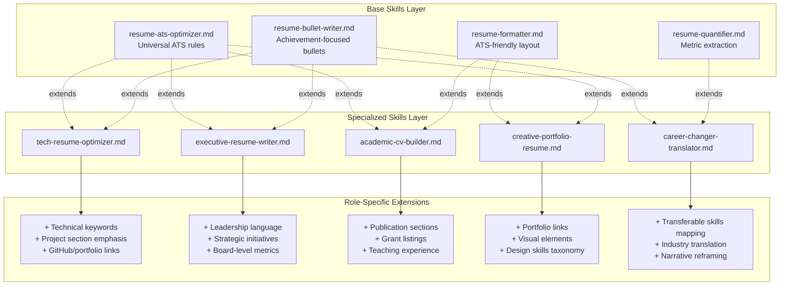
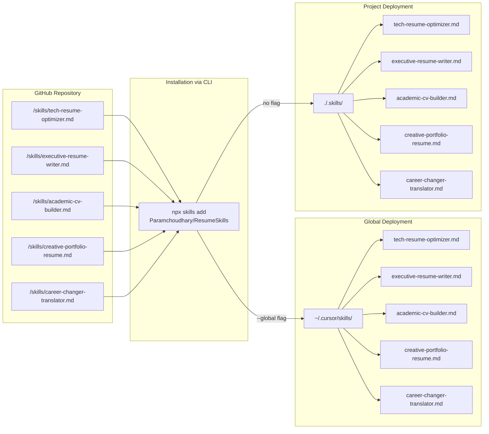
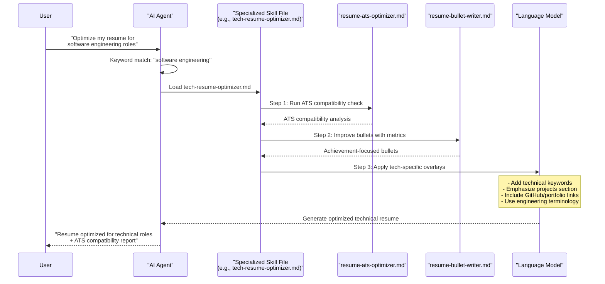
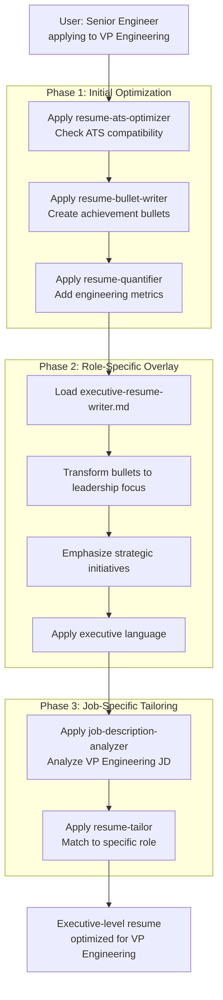
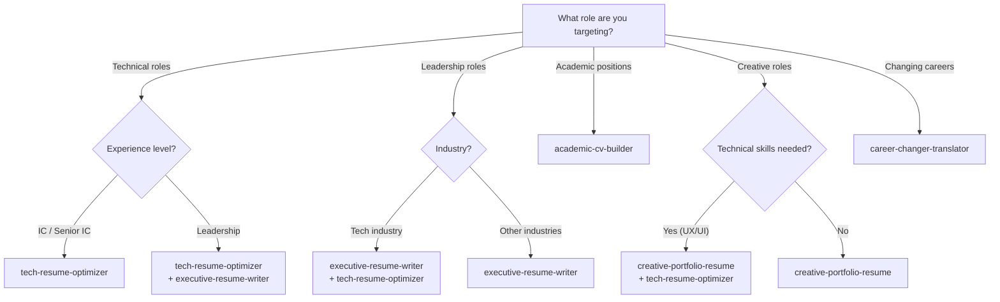

<!-- source: DeepWiki mcp.deepwiki.com · repo Paramchoudhary/ResumeSkills · page 4.5 Specialized Roles Skills · fetched 2026-10-26 -->

# Specialized Roles Skills

<details>
<summary>Relevant source files</summary>

The following files were used as context for generating this wiki page:

- [README.md](README.md)

</details>


## Purpose and Scope

This page documents the five specialized roles skills that extend the base resume optimization functionality for specific career paths and industries. These skills overlay and customize the behavior of core skills like `resume-ats-optimizer` and `resume-bullet-writer` to apply role-specific best practices, terminology, and formatting conventions.

For detailed documentation of individual specialized skills, see their respective child pages: [Executive Resume Writer](#4.5.1) is currently documented. For general resume optimization skills that apply to all roles, see [Resume Optimization Skills](#4.1). For strategic job search skills, see [Job Search Strategy Skills](#4.2).

**Sources:** [README.md:134-139]()

---

## Overview

Specialized roles skills are markdown files located in the `/skills` directory that provide role-specific knowledge layers. Unlike base skills that optimize resumes using universal best practices, specialized skills apply industry-specific frameworks, terminologies, and conventions while maintaining compatibility with ATS systems.

These skills do not replace base skills—they extend them. When invoked, a specialized skill typically:
1. Applies the base optimization workflows (ATS compatibility, bullet formatting, quantification)
2. Overlays role-specific requirements (terminology, section emphasis, achievement framing)
3. Outputs a resume optimized for both ATS systems and human reviewers in that specific field

**Sources:** [README.md:134-139](), Diagram 2 and Diagram 6 from high-level overview

---

## Skill Extension Architecture

### How Specialized Skills Extend Base Skills



**Diagram: Specialized Skills Extension Architecture** - Shows how each specialized skill file extends base optimization skills with role-specific requirements while maintaining ATS compatibility.

**Sources:** [README.md:134-139](), Diagram 2 from high-level overview showing specialized overlays

---

## Available Specialized Skills

| Skill File | Target Roles | Primary Extensions | Child Documentation |
|------------|--------------|-------------------|---------------------|
| `tech-resume-optimizer.md` | Software Engineers, Product Managers, Data Scientists, DevOps, Technical Leads | Technical terminology, project sections, stack/tools emphasis, GitHub links | Not yet documented |
| `executive-resume-writer.md` | C-suite (CEO, CTO, CFO), VPs, Directors, Senior Leadership | Leadership language, strategic initiatives, board-level metrics, transformation emphasis | [Page 4.5.1](#4.5.1) |
| `academic-cv-builder.md` | Professors, Researchers, Post-docs, Academic Administrators | Publication sections, grant listings, teaching experience, conference presentations | Not yet documented |
| `creative-portfolio-resume.md` | Designers, Copywriters, Creatives, UX/UI, Brand Managers | Portfolio integration, visual balance with ATS, design skills taxonomy, client work showcase | Not yet documented |
| `career-changer-translator.md` | Career transitioners, Industry switchers, Role pivoters | Transferable skills mapping, industry terminology translation, narrative reframing, gap explanation | Not yet documented |

**Sources:** [README.md:21-23](), [README.md:27](), [README.md:31](), [README.md:135-139]()

---

## File Structure and Storage Locations

### Skill File Paths

Specialized skills are stored in the repository at:
```
/skills/tech-resume-optimizer.md
/skills/executive-resume-writer.md
/skills/academic-cv-builder.md
/skills/creative-portfolio-resume.md
/skills/career-changer-translator.md
```

After installation, they are deployed to:
- **Global installation:** `~/.cursor/skills/tech-resume-optimizer.md`, etc.
- **Project installation:** `./.skills/tech-resume-optimizer.md`, etc.



**Diagram: Specialized Skills File Deployment Paths** - Shows the repository source paths and deployment destinations for specialized role skill files.

**Sources:** [README.md:36-50](), [README.md:54-59]()

---

## Invocation Patterns

### Keyword Triggers

AI agents match user prompts to specialized skills based on keyword patterns. Each skill contains role-specific keywords that trigger invocation:

| Skill | Keyword Triggers (Examples) |
|-------|----------------------------|
| `tech-resume-optimizer` | "software engineer", "developer", "technical", "engineering resume", "PM resume", "data scientist" |
| `executive-resume-writer` | "executive", "C-suite", "CEO", "VP", "director", "leadership resume", "senior executive" |
| `academic-cv-builder` | "academic", "professor", "researcher", "CV", "publications", "faculty position" |
| `creative-portfolio-resume` | "designer", "creative", "portfolio resume", "UX", "copywriter", "brand manager" |
| `career-changer-translator` | "career change", "transition", "switching industries", "transferable skills", "pivot" |

### Example Invocations

```
User: "Optimize my resume for a software engineering role at Google"
→ AI Agent loads: tech-resume-optimizer.md
→ Also applies: resume-ats-optimizer.md, resume-bullet-writer.md

User: "I'm a VP of Sales applying to a CEO position. Update my resume."
→ AI Agent loads: executive-resume-writer.md
→ Also applies: resume-formatter.md, resume-quantifier.md

User: "I'm transitioning from teaching to product management. Help me reframe my resume."
→ AI Agent loads: career-changer-translator.md
→ Also applies: resume-bullet-writer.md, resume-tailor.md
```

**Sources:** [README.md:88-107](), Diagram 4 from high-level overview showing skill invocation

---

## Integration with Base Skills Workflow

### Sequential Application Pattern

Specialized skills typically invoke base skills in a specific sequence, then apply role-specific overlays:



**Diagram: Specialized Skill Execution Flow** - Shows how a specialized skill (tech-resume-optimizer.md) invokes base skills sequentially then applies role-specific transformations.

**Sources:** [README.md:88-107](), [README.md:163-174](), Diagram 4 from high-level overview

---

## Role-Specific Customizations

### What Each Skill Modifies

Each specialized skill modifies different aspects of the base resume optimization process:

| Skill | Section Emphasis | Terminology Changes | Metric Focus | Formatting Adjustments |
|-------|-----------------|---------------------|--------------|----------------------|
| `tech-resume-optimizer` | Projects, Technical Skills, GitHub | Engineering jargon, technical stack names | User growth, performance improvements, system uptime | Code portfolio links, clean technical sections |
| `executive-resume-writer` | Leadership Summary, Strategic Initiatives | C-suite language, transformation verbs | Revenue growth, P&L responsibility, team scale | Condensed format, executive summary prominence |
| `academic-cv-builder` | Publications, Grants, Teaching | Academic terminology, research methods | Citation counts, grant amounts, student outcomes | Multi-page CV format, chronological publication lists |
| `creative-portfolio-resume` | Portfolio Links, Creative Projects | Design terminology, creative process | Campaign metrics, engagement rates, brand impact | Visual hierarchy, portfolio URL prominence |
| `career-changer-translator` | Transferable Skills, Narrative Framing | Industry-neutral language | Cross-functional achievements | Skills-based format, narrative summary |

**Sources:** [README.md:21-23](), [README.md:27](), [README.md:31](), [README.md:135-139]()

---

## Workflow Integration Example

### Complete Specialized Optimization Workflow



**Diagram: Multi-Phase Specialized Optimization Workflow** - Shows how specialized skills integrate with base skills and job search strategy skills to create role-optimized resumes.

**Sources:** [README.md:163-174](), [README.md:176-187](), Diagram 2 from high-level overview

---

## Installation and Usage

### Installing Specialized Skills

Specialized skills are included in the full ResumeSkills repository installation:

```bash
# Install all skills including specialized roles (global)
npx skills add Paramchoudhary/ResumeSkills -g -y

# Install to current project
npx skills add Paramchoudhary/ResumeSkills -y

# Verify specialized skills are installed
npx skills list --global | grep -E "(tech-resume|executive-resume|academic-cv|creative-portfolio|career-changer)"
```

### Individual Skill Installation

Users can also download individual specialized skill files:

```bash
# Download single specialized skill
wget https://raw.githubusercontent.com/Paramchoudhary/ResumeSkills/main/skills/tech-resume-optimizer.md
mv tech-resume-optimizer.md ~/.cursor/skills/

# Or download executive resume writer
wget https://raw.githubusercontent.com/Paramchoudhary/ResumeSkills/main/skills/executive-resume-writer.md
mv executive-resume-writer.md ~/.cursor/skills/
```

**Sources:** [README.md:36-63]()

---

## Skill Compatibility Matrix

### When to Use Each Specialized Skill



**Diagram: Specialized Skill Selection Decision Tree** - Guides users to select appropriate specialized skill(s) based on target role and background. Some scenarios require combining multiple specialized skills.

**Sources:** [README.md:134-139](), [README.md:21-23](), [README.md:27](), [README.md:31]()

---

## Relationship to Other Skill Categories

Specialized roles skills interact with all other skill categories:

| Other Category | Relationship | Example Integration |
|----------------|--------------|---------------------|
| [Resume Optimization Skills](#4.1) | **Extends** - Specialized skills always invoke base optimization skills first | `tech-resume-optimizer` applies `resume-ats-optimizer` rules before adding technical overlays |
| [Job Search Strategy Skills](#4.2) | **Consumed by** - Job analysis and tailoring skills use specialized optimized resumes | `job-description-analyzer` analyzes an executive resume created by `executive-resume-writer` |
| [Supporting Documents Skills](#4.3) | **Input to** - Specialized resumes feed into supporting document generation | `cover-letter-generator` uses academic CV from `academic-cv-builder` to create cover letter |
| [Interview & Negotiation Skills](#4.4) | **Supports** - Specialized resumes provide context for interview and negotiation prep | `interview-prep-generator` extracts leadership stories from executive resume |

**Sources:** [README.md:97-139](), Diagram 2 from high-level overview showing skill category relationships

---

## Uninstallation

### Removing Specialized Skills

```bash
# Remove individual specialized skills
npx skills remove tech-resume-optimizer
npx skills remove executive-resume-writer
npx skills remove academic-cv-builder
npx skills remove creative-portfolio-resume
npx skills remove career-changer-translator

# Or remove all specialized skills via wildcard
rm ~/.cursor/skills/tech-resume-optimizer.md
rm ~/.cursor/skills/executive-resume-writer.md
rm ~/.cursor/skills/academic-cv-builder.md
rm ~/.cursor/skills/creative-portfolio-resume.md
rm ~/.cursor/skills/career-changer-translator.md
```

**Sources:** [README.md:65-75]()

---

