<!-- source: DeepWiki mcp.deepwiki.com · repo Paramchoudhary/ResumeSkills · page 5 End-to-End Workflows · fetched 2026-10-26 -->

# End-to-End Workflows

<details>
<summary>Relevant source files</summary>

The following files were used as context for generating this wiki page:

- [README.md](README.md)

</details>


## Purpose and Scope

This document describes complete job search workflows that chain multiple skills together to accomplish complex, multi-stage tasks. Each workflow represents a real-world use case where skills are invoked in sequence, with outputs from one skill feeding into the next.

For individual skill documentation, see [Skills Reference](#4). For basic skill invocation mechanics, see [Skill Invocation and Execution](#3.3). For installation setup, see [Installation](#2.1).

---

## Workflow Architecture Overview

The ResumeSkills system organizes skills into four sequential workflow phases that mirror the job search lifecycle. Each phase contains multiple skills that can be invoked independently or chained together.

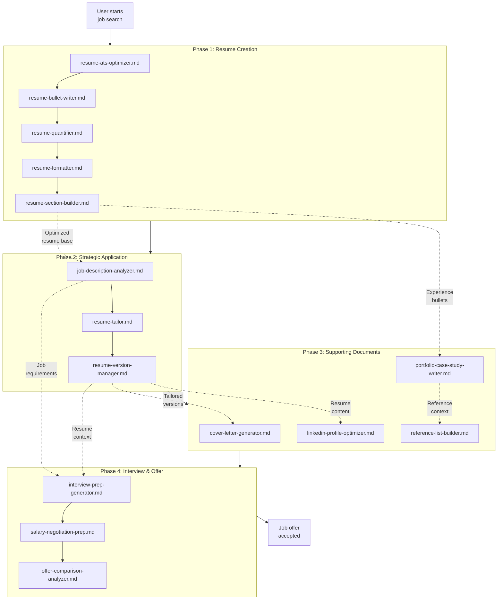

**Workflow Phases:**

| Phase | Primary Goal | Skills Involved | Output |
|-------|--------------|-----------------|--------|
| Phase 1 | Create ATS-optimized base resume | 5 resume optimization skills | Polished master resume |
| Phase 2 | Analyze and tailor for specific jobs | 3 job search strategy skills | Customized resume versions |
| Phase 3 | Generate supporting materials | 4 document generation skills | Complete application package |
| Phase 4 | Prepare for interviews and negotiate | 3 interview/offer skills | Interview prep + negotiation plan |

**Sources:** [README.md:97-140](), [README.md:156-200]()

---

## Workflow 1: Resume Creation and Optimization Pipeline

This workflow transforms a basic resume into an ATS-optimized, achievement-focused document. Skills execute in sequence, with each step refining the output from the previous step.

### Execution Sequence

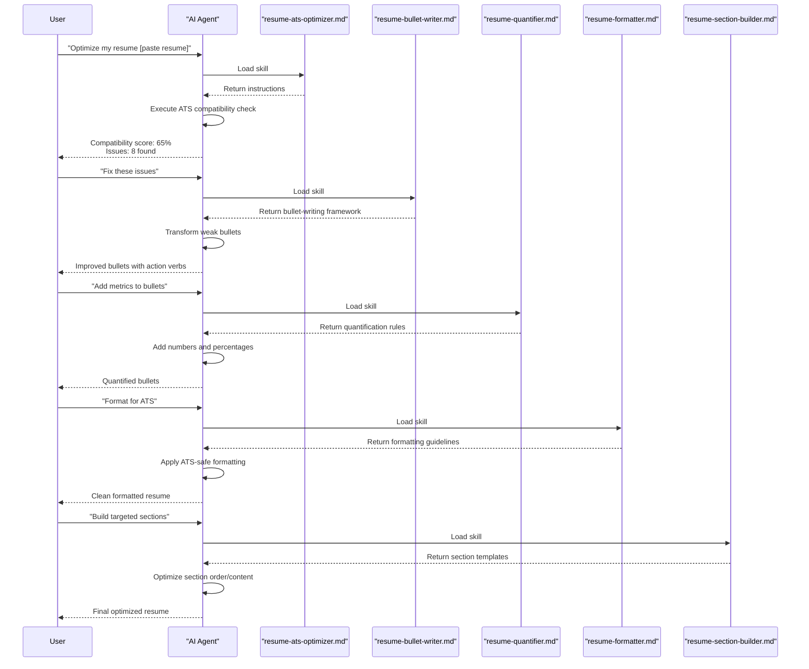

### Step-by-Step Breakdown

| Step | Skill File | User Prompt | Key Actions | Output |
|------|-----------|-------------|-------------|--------|
| 1 | `resume-ats-optimizer.md` | "Check ATS compatibility" | Parse resume, identify formatting issues, keyword gaps | ATS compatibility report with score |
| 2 | `resume-bullet-writer.md` | "Improve my bullets" | Identify weak bullets, apply achievement framework | Rewritten bullets with action verbs |
| 3 | `resume-quantifier.md` | "Add metrics" | Find quantification opportunities, estimate when needed | Bullets with numbers/percentages |
| 4 | `resume-formatter.md` | "Format for ATS" | Remove tables/columns, standardize fonts, clean spacing | ATS-compatible formatting |
| 5 | `resume-section-builder.md` | "Optimize sections" | Reorder sections, tailor to experience level | Properly structured resume |

### Invocation Patterns

**Pattern 1: Single Prompt Chain**
```
User: "Here's my resume [paste]. Optimize it completely for ATS, improve bullets, 
add metrics, and format it properly."

→ Agent automatically loads and chains:
  1. resume-ats-optimizer.md
  2. resume-bullet-writer.md  
  3. resume-quantifier.md
  4. resume-formatter.md
```

**Pattern 2: Iterative Refinement**
```
User: "Check ATS score"
→ Loads resume-ats-optimizer.md, returns score: 68%

User: "Fix the issues"  
→ Loads resume-bullet-writer.md + resume-formatter.md

User: "Now add metrics"
→ Loads resume-quantifier.md
```

### Data Flow Through Pipeline

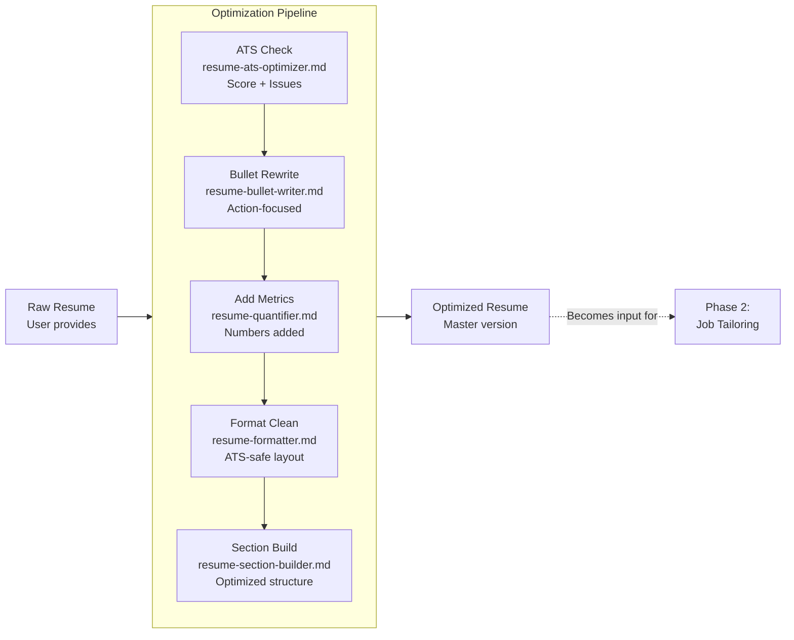

**Sources:** [README.md:111-116](), [README.md:163-174]()

---

## Workflow 2: Strategic Job Application Process

This workflow analyzes job postings, calculates match scores, and creates customized resume versions for high-fit opportunities.

### Decision Tree Workflow

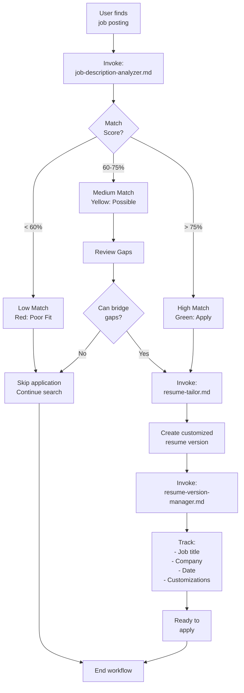

### Skill Interaction Pattern

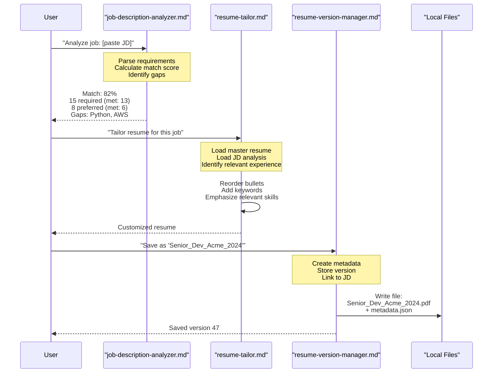

### Match Score Calculation

The `job-description-analyzer.md` skill uses this scoring algorithm:

| Component | Weight | Calculation |
|-----------|--------|-------------|
| Required Skills Met | 70% | (Skills matched / Total required) × 0.70 |
| Preferred Skills Met | 20% | (Skills matched / Total preferred) × 0.20 |
| Experience Level | 10% | Match (1.0) or Partial (0.5) × 0.10 |

**Example Calculation:**
- Required: 13/15 met = 0.867 × 0.70 = 0.607
- Preferred: 6/8 met = 0.750 × 0.20 = 0.150
- Experience: Match = 1.000 × 0.10 = 0.100
- **Final Score: 85.7%**

### Version Tracking Structure

When `resume-version-manager.md` saves a version, it creates:

```
.resume-versions/
├── metadata.json
├── Senior_Dev_Acme_2024.pdf
├── Data_Scientist_Google_2024.pdf
└── PM_Microsoft_2024.pdf
```

**metadata.json structure:**
```json
{
  "versions": [
    {
      "id": 47,
      "filename": "Senior_Dev_Acme_2024.pdf",
      "job_title": "Senior Software Developer",
      "company": "Acme Corp",
      "date_created": "2024-01-15",
      "match_score": 82,
      "customizations": [
        "Added Python projects",
        "Emphasized AWS experience",
        "Reordered sections for backend focus"
      ],
      "job_url": "https://acme.com/careers/123"
    }
  ]
}
```

**Sources:** [README.md:118-122](), [README.md:176-187]()

---

## Workflow 3: Complete Application Package Assembly

This workflow generates all supporting documents needed for a complete application, using the tailored resume as the foundation.

### Parallel Document Generation

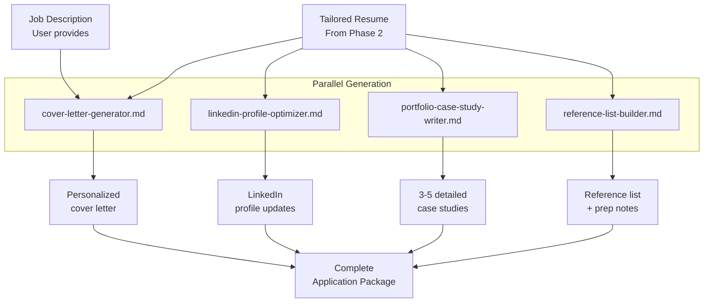

### Document Generation Workflow

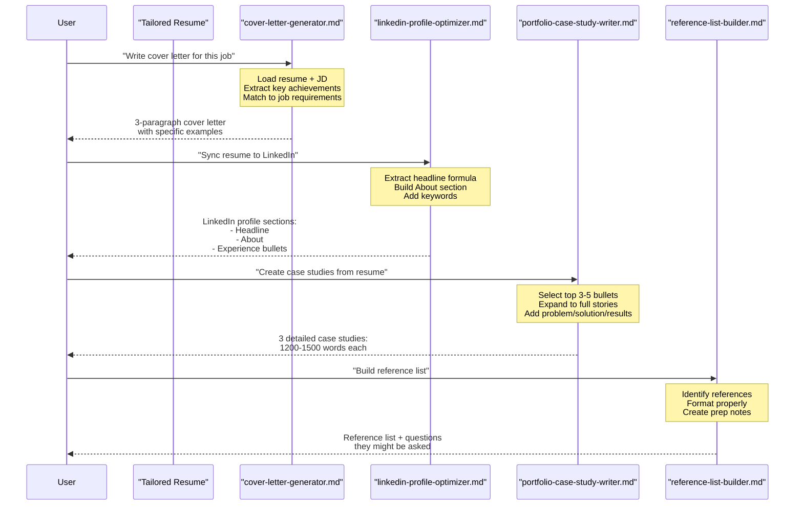

### Document Dependencies

| Output Document | Primary Input | Skills Used | Key Data Extracted |
|-----------------|---------------|-------------|-------------------|
| Cover Letter | Tailored resume + JD | `cover-letter-generator.md` | Top 3 achievements, company research, role requirements |
| LinkedIn Profile | Master/tailored resume | `linkedin-profile-optimizer.md` | Headline formula, keywords, experience bullets |
| Portfolio Case Studies | Master resume bullets | `portfolio-case-study-writer.md` | Individual bullet details, metrics, context |
| Reference List | Career history | `reference-list-builder.md` | Manager names, relationships, anticipated questions |

### Invocation Example

**Single Command Package Generation:**
```
User: "I'm applying to Senior PM at Google. Here's the JD [paste] and my 
tailored resume [paste]. Create the complete application package: cover letter, 
LinkedIn updates, case studies, and references."

→ Agent loads and executes in parallel:
  1. cover-letter-generator.md → 3-paragraph letter
  2. linkedin-profile-optimizer.md → Profile sections
  3. portfolio-case-study-writer.md → 3 case studies  
  4. reference-list-builder.md → Reference list

→ Returns all 4 documents in ~2 minutes
```

**Sources:** [README.md:124-128](), [README.md:188-200]()

---

## Workflow 4: Interview to Offer Acceptance

This workflow prepares for interviews, compares multiple offers, and builds negotiation strategies.

### Interview Preparation Flow

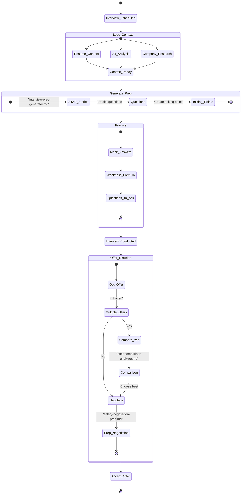

### Skill Chaining: Interview to Negotiation

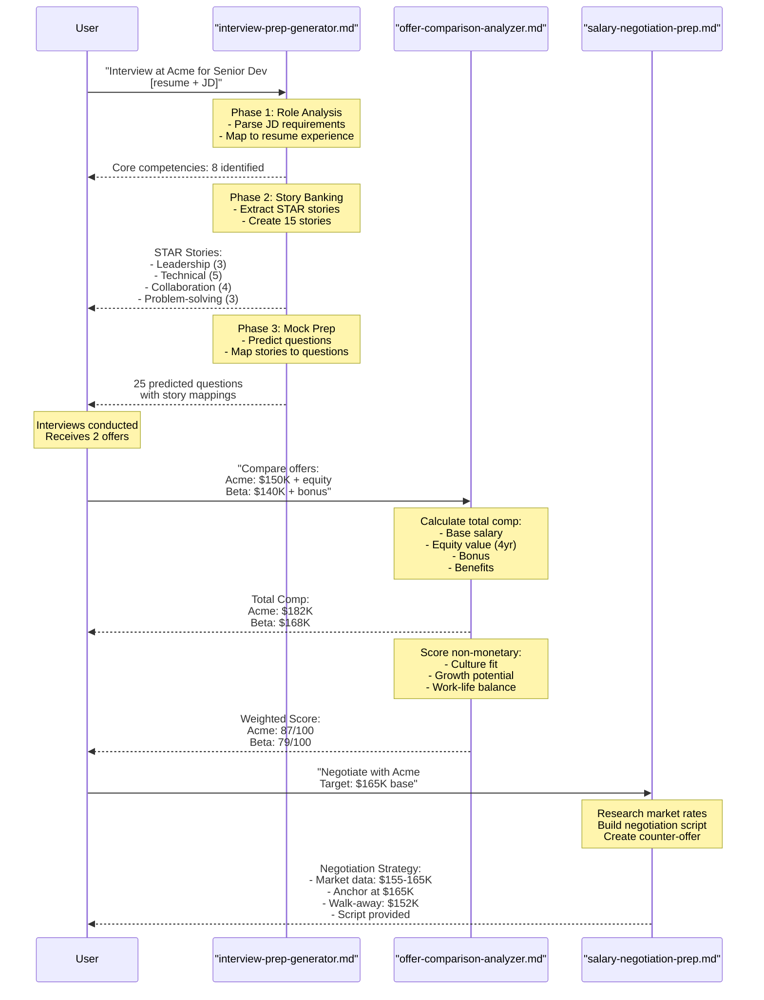

### STAR Story Generation

The `interview-prep-generator.md` skill extracts stories from resume bullets using this structure:

**Input Bullet:**
```
"Led cross-functional team of 12 to migrate legacy monolith to microservices, 
reducing deployment time by 75% and improving system uptime to 99.99%"
```

**Generated STAR Story:**

| Component | Content |
|-----------|---------|
| **Situation** | Legacy monolith architecture causing slow deployments (4 hours) and frequent downtime (95% uptime). Business losing customers due to reliability issues. |
| **Task** | Assigned to lead migration to microservices while maintaining system stability for 1M+ active users. Budget: $500K, Timeline: 6 months. |
| **Action** | 1. Assembled cross-functional team (4 engineers, 2 QA, 3 DevOps, 3 PMs)<br/>2. Created phased migration plan with zero-downtime rollout<br/>3. Implemented feature flags for gradual traffic shifting<br/>4. Set up comprehensive monitoring and rollback procedures |
| **Result** | - Deployment time: 4 hours → 15 minutes (75% reduction)<br/>- System uptime: 95% → 99.99%<br/>- Customer churn: reduced by 40%<br/>- Team velocity: increased by 3x |

### Offer Comparison Matrix

The `offer-comparison-analyzer.md` skill generates comparison tables:

| Component | Acme Corp | Beta Inc | Gamma LLC |
|-----------|-----------|----------|-----------|
| **Base Salary** | $150,000 | $140,000 | $155,000 |
| **Equity (4yr)** | $120,000 (RSU) | $80,000 (Options) | $60,000 (RSU) |
| **Bonus** | 15% ($22,500) | 20% ($28,000) | 10% ($15,500) |
| **Benefits** | Premium + 401k match 6% | Standard + 401k match 4% | Premium + 401k match 5% |
| **Total Cash (Yr 1)** | $172,500 | $168,000 | $170,500 |
| **Total Comp (4yr)** | $182,500 | $178,000 | $177,500 |
| **PTO Days** | 25 | 20 | 30 |
| **Remote Policy** | Hybrid (3 days) | Full remote | Office required |
| **Growth Stage** | Series C | Public | Series B |
| **Weighted Score** | 87/100 | 79/100 | 82/100 |
| **Recommendation** | **Accept** | Decline | Counter |

**Sources:** [README.md:130-132](), [README.md:188-200]()

---

## Advanced Skill Chaining Patterns

### Pattern 1: Conditional Branching

Skills can create conditional workflows based on intermediate outputs:

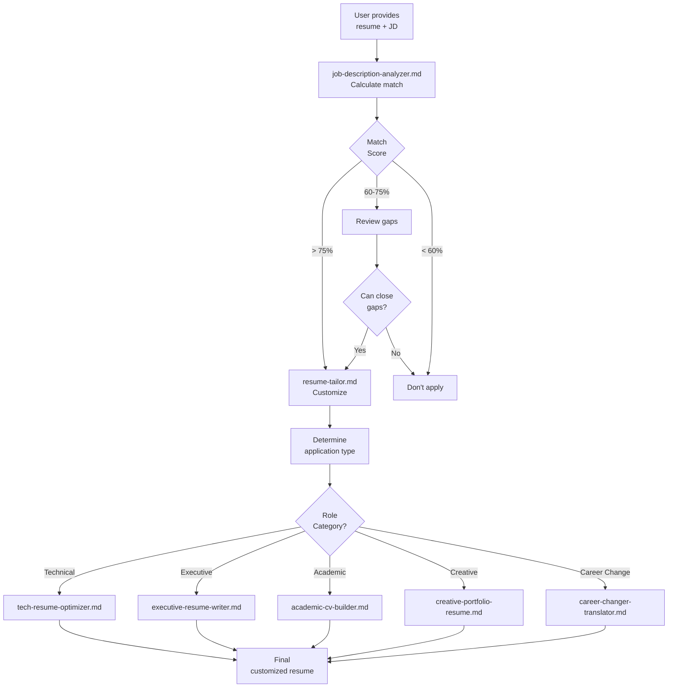

### Pattern 2: Iterative Refinement Loop

Users can iterate through optimization cycles until quality thresholds are met:

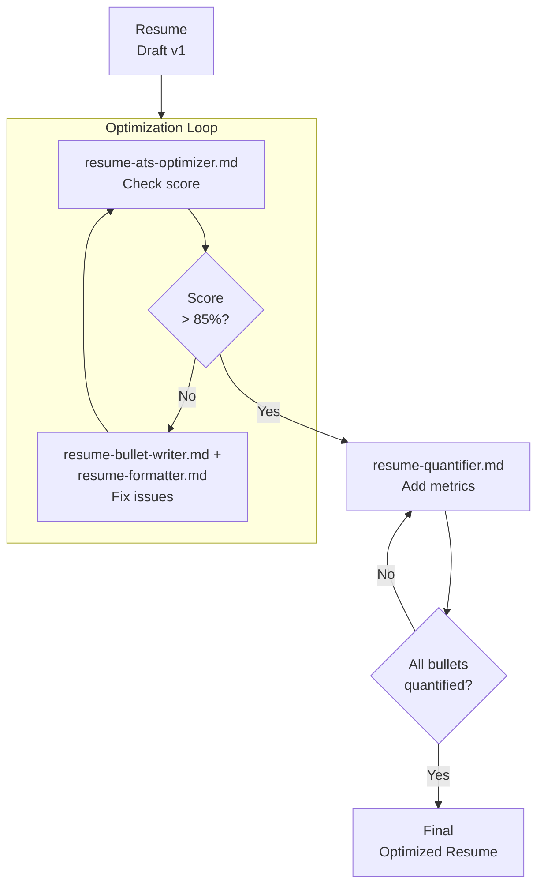

### Pattern 3: Parallel Processing with Merge

Generate multiple documents in parallel, then combine:

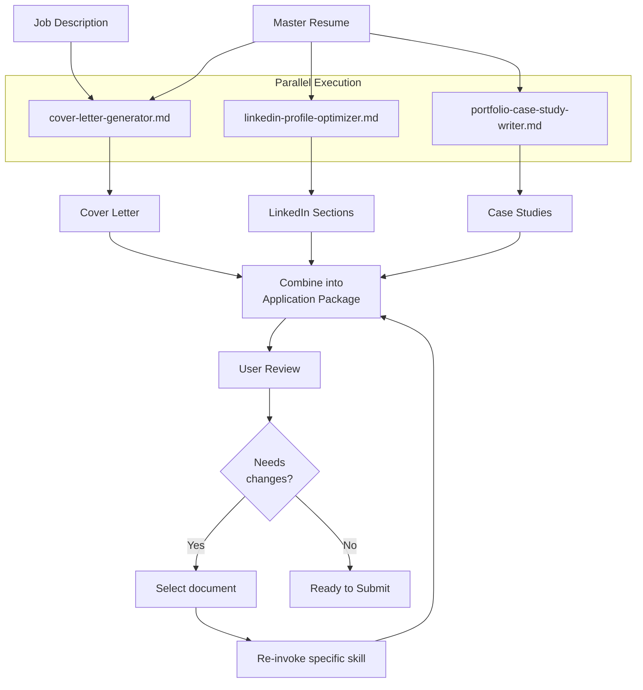

### Pattern 4: Cross-Skill Data Passing

Later skills consume structured output from earlier skills:

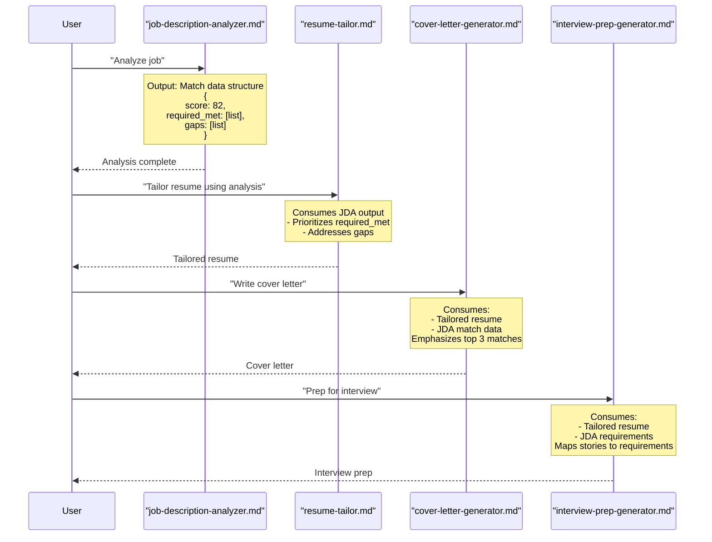

**Sources:** [README.md:88-107](), [README.md:156-200]()

---

## Workflow Decision Trees

### Should I Apply? Decision Tree

This decision tree shows how skills guide the application decision:

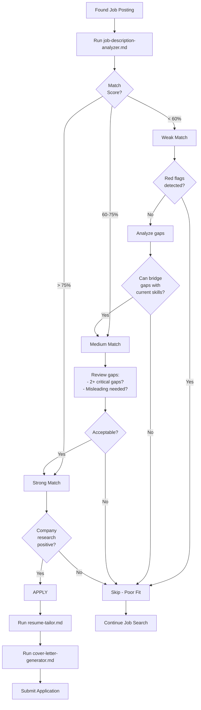

### Multi-Offer Evaluation Flowchart

When handling multiple offers, this workflow determines the best choice:

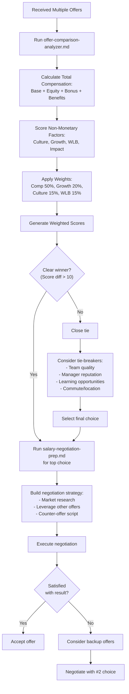

### Resume Quality Gate Workflow

This workflow ensures resumes meet quality standards before application:

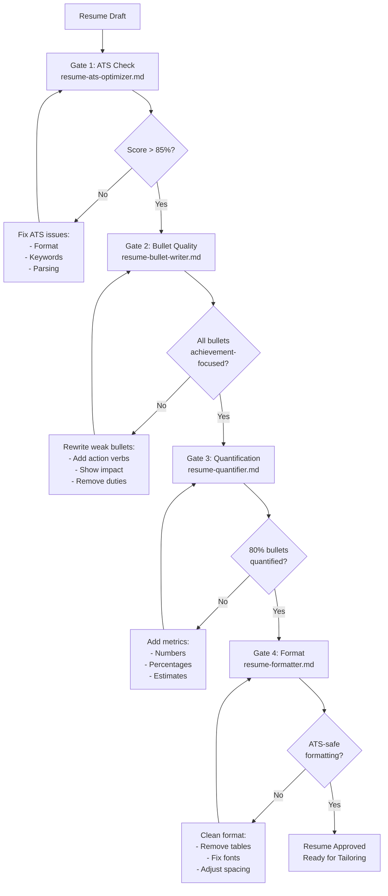

**Sources:** [README.md:176-187](), [README.md:141-159]()

---

## Complete End-to-End Example

### Scenario: Senior Software Engineer Job Search

**Starting Point:** User has basic resume, looking for senior engineering roles.

**Complete Workflow Execution:**

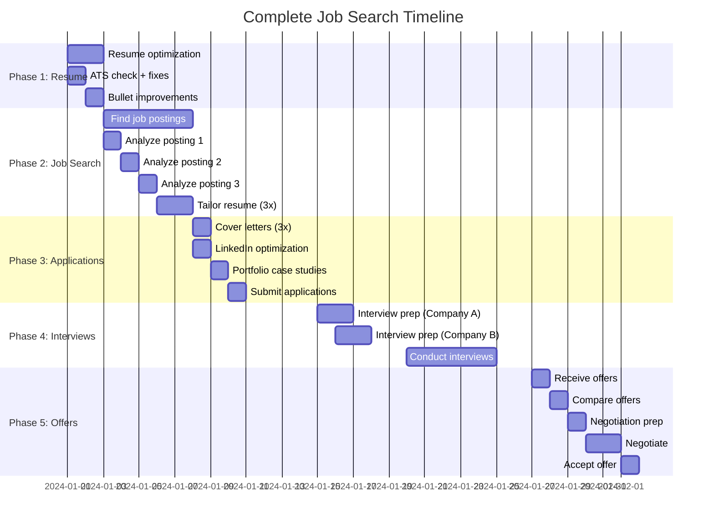

**Skill Invocations (32 total):**

| Day | Skills Invoked | User Prompts | Outputs Generated |
|-----|---------------|--------------|-------------------|
| **Day 1** | `resume-ats-optimizer.md`<br/>`resume-formatter.md` | "Check ATS compatibility"<br/>"Fix formatting issues" | ATS score: 68% → 92%<br/>Formatted resume |
| **Day 2** | `resume-bullet-writer.md`<br/>`resume-quantifier.md`<br/>`resume-section-builder.md` | "Improve bullets"<br/>"Add metrics"<br/>"Optimize sections" | 15 improved bullets<br/>12 metrics added<br/>Restructured resume |
| **Day 3-5** | `job-description-analyzer.md` (3x) | "Analyze posting: Acme Corp"<br/>"Analyze posting: Beta Inc"<br/>"Analyze posting: Gamma LLC" | Match scores:<br/>Acme: 82%<br/>Beta: 78%<br/>Gamma: 61% |
| **Day 6-7** | `resume-tailor.md` (3x)<br/>`resume-version-manager.md` (3x) | "Tailor for Acme"<br/>"Tailor for Beta"<br/>"Tailor for Gamma"<br/>+ save each | 3 customized resumes<br/>3 tracked versions |
| **Day 8-9** | `cover-letter-generator.md` (3x)<br/>`linkedin-profile-optimizer.md`<br/>`portfolio-case-study-writer.md` | "Write cover letter: Acme"<br/>(repeat 2x)<br/>"Optimize LinkedIn"<br/>"Create case studies" | 3 cover letters<br/>LinkedIn updates<br/>4 case studies |
| **Day 15-16** | `interview-prep-generator.md` (2x) | "Prep for Acme interview"<br/>"Prep for Beta interview" | 18 STAR stories<br/>30 predicted questions |
| **Day 27-28** | `offer-comparison-analyzer.md` | "Compare Acme vs Beta offers" | Comparison matrix<br/>Recommendation: Acme |
| **Day 29-30** | `salary-negotiation-prep.md` | "Negotiate with Acme" | Market research<br/>Negotiation script<br/>Counter-offer: $165K |

**Final Results:**
- 3 applications submitted
- 2 interviews received (67% response rate)
- 2 offers received (100% conversion rate)
- Final salary: $165K (up from $158K offer, +$7K negotiated)
- Total time: 31 days

**Sources:** [README.md:156-200]()

---

