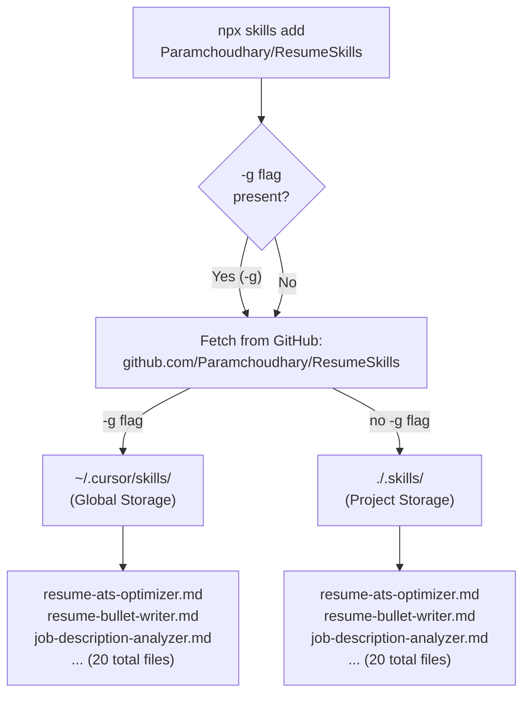
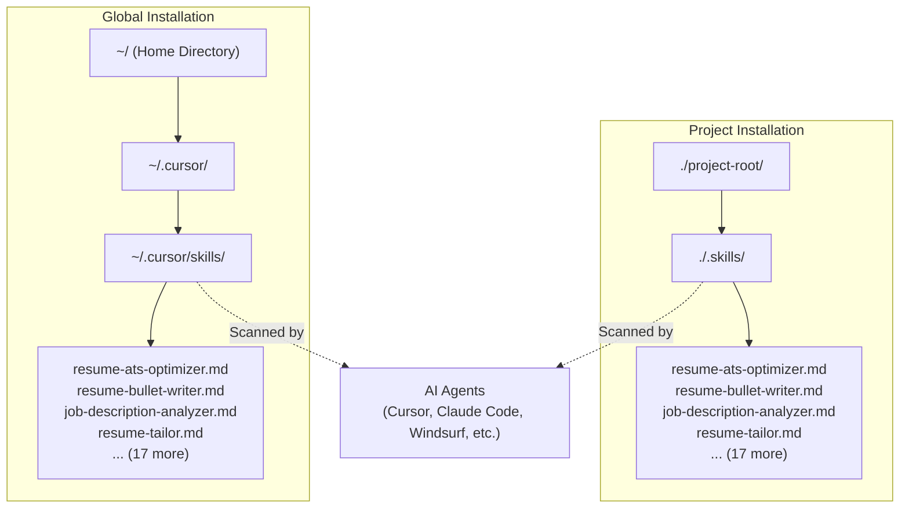
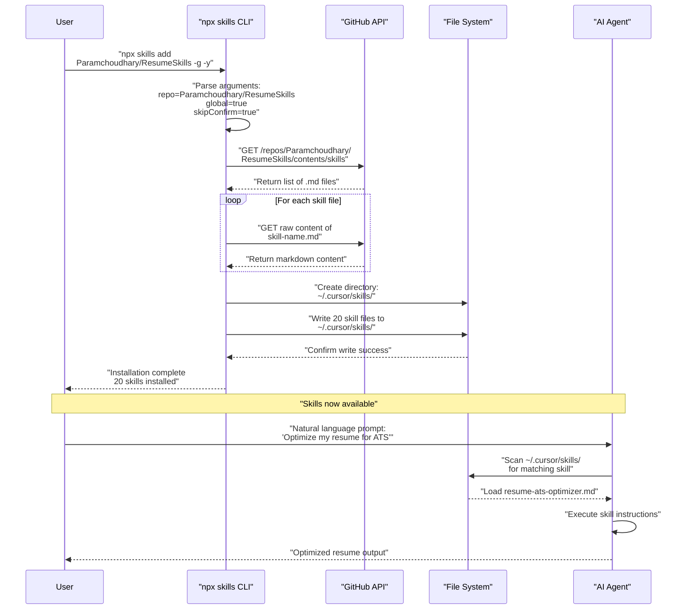
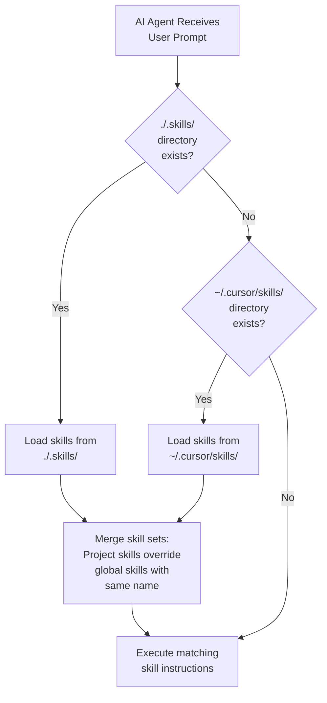

<!-- source: DeepWiki mcp.deepwiki.com · repo Paramchoudhary/ResumeSkills · page 6 CLI Reference · fetched 2026-10-26 -->

# CLI Reference

<details>
<summary>Relevant source files</summary>

The following files were used as context for generating this wiki page:

- [README.md](README.md)

</details>


This document provides complete reference documentation for the `npx skills` command-line interface used to install, manage, and remove ResumeSkills. The CLI tool handles fetching skills from the GitHub repository and deploying them to either global or project-specific storage locations where AI agents can discover them.

For general installation guidance and choosing between installation methods, see [Installation](#2.1). For understanding how AI agents discover and load these installed skills, see [AI Agent Integration](#3.2).

---

## Overview

The `npx skills` CLI manages skill files by:
1. Fetching markdown skill definitions from the `Paramchoudhary/ResumeSkills` repository
2. Deploying them to either `~/.cursor/skills/` (global) or `./.skills/` (project-specific)
3. Enabling discovery by 30+ AI agents that scan these directories

The CLI supports three core operations: `add`, `list`, and `remove`.

**Sources:** [README.md:34-75]()

---

## Command Reference

### `npx skills add`

Installs skills from a GitHub repository to local storage.

#### Syntax

```bash
npx skills add <repository> [options]
```

#### Parameters

| Parameter | Required | Description |
|-----------|----------|-------------|
| `<repository>` | Yes | GitHub repository in format `username/repo-name` |

#### Options

| Option | Shorthand | Description | Default |
|--------|-----------|-------------|---------|
| `--global` | `-g` | Install to global skills directory (`~/.cursor/skills/`) | Project-specific install |
| `--yes` | `-y` | Skip confirmation prompts | Interactive confirmation |

#### Examples

```bash
# Install all ResumeSkills globally (recommended for most users)
npx skills add Paramchoudhary/ResumeSkills -g -y

# Install to current project only
npx skills add Paramchoudhary/ResumeSkills -y

# Install with interactive confirmation
npx skills add Paramchoudhary/ResumeSkills -g
```

#### Installation Targets



**Sources:** [README.md:36-50]()

---

### `npx skills list`

Lists installed skills in the current context.

#### Syntax

```bash
npx skills list [options]
```

#### Options

| Option | Description |
|--------|-------------|
| `--global` | List skills from global directory (`~/.cursor/skills/`) |
| (none) | List skills from project directory (`./.skills/`) |

#### Examples

```bash
# List project-specific skills
npx skills list

# List globally installed skills
npx skills list --global
```

#### Typical Output

When skills are installed, the command displays:

```
Installed skills:
- resume-ats-optimizer
- resume-bullet-writer
- job-description-analyzer
- resume-tailor
- cover-letter-generator
- linkedin-profile-optimizer
- interview-prep-generator
- salary-negotiation-prep
- tech-resume-optimizer
- executive-resume-writer
- career-changer-translator
- resume-quantifier
- resume-formatter
- portfolio-case-study-writer
- academic-cv-builder
- reference-list-builder
- offer-comparison-analyzer
- resume-version-manager
- creative-portfolio-resume
- resume-section-builder
```

**Sources:** [README.md:45-49]()

---

### `npx skills remove`

Removes individual skills by name.

#### Syntax

```bash
npx skills remove <skill-name>
```

#### Parameters

| Parameter | Required | Description |
|-----------|----------|-------------|
| `<skill-name>` | Yes | Exact name of skill to remove (without `.md` extension) |

#### Examples

```bash
# Remove specific skills
npx skills remove resume-ats-optimizer
npx skills remove resume-bullet-writer

# Remove multiple skills sequentially
npx skills remove interview-prep-generator
npx skills remove salary-negotiation-prep
```

#### Alternative: Manual Removal

Skills can also be removed by directly deleting files:

```bash
# Remove all resume-related skills from global directory
rm -rf ~/.cursor/skills/resume-*

# Remove all skills from project directory
rm -rf ./.skills/*
```

**Sources:** [README.md:65-75]()

---

## Global vs Project-Specific Installation

### Decision Matrix

| Use Case | Install Type | Command | Storage Location |
|----------|--------------|---------|------------------|
| Default recommendation for most users | Global | `npx skills add -g -y` | `~/.cursor/skills/` |
| Skills needed across all projects | Global | `npx skills add -g -y` | `~/.cursor/skills/` |
| Team sharing skills via git | Project | `npx skills add -y` | `./.skills/` |
| Testing new skills before global install | Project | `npx skills add -y` | `./.skills/` |
| Project-specific skill customizations | Project | `npx skills add -y` | `./.skills/` |

### Directory Structure



**Sources:** [README.md:36-63]()

---

## Command Execution Flow

The following diagram illustrates the complete execution flow from CLI invocation to skill availability:



**Sources:** [README.md:36-50](), [README.md:88-107]()

---

## Verification Commands

After installation, verify skills are properly installed:

```bash
# Check global installation
npx skills list --global

# Check project installation
npx skills list

# Verify file system directly
ls -la ~/.cursor/skills/          # Global
ls -la ./.skills/                 # Project
```

### Expected File Count

A successful installation of ResumeSkills should show **20 markdown files**:

| Category | Count | Skills |
|----------|-------|--------|
| Resume Optimization | 5 | resume-ats-optimizer, resume-bullet-writer, resume-quantifier, resume-formatter, resume-section-builder |
| Job Search Strategy | 4 | job-description-analyzer, resume-tailor, resume-version-manager, offer-comparison-analyzer |
| Supporting Documents | 4 | cover-letter-generator, linkedin-profile-optimizer, portfolio-case-study-writer, reference-list-builder |
| Interview & Negotiation | 2 | interview-prep-generator, salary-negotiation-prep |
| Specialized Roles | 5 | tech-resume-optimizer, executive-resume-writer, academic-cv-builder, creative-portfolio-resume, career-changer-translator |

**Sources:** [README.md:9-32](), [README.md:109-140]()

---

## Storage Location Precedence

When both global and project-specific skills are installed, AI agents follow this precedence:



**Project-level skills take precedence** over global skills with the same filename, allowing project-specific customization.

**Sources:** [README.md:36-63]()

---

## Common Workflows

### Initial Setup (Recommended)

```bash
# Install globally for use across all projects
npx skills add Paramchoudhary/ResumeSkills -g -y

# Verify installation
npx skills list --global
```

### Team Collaboration Setup

```bash
# In project repository root
npx skills add Paramchoudhary/ResumeSkills -y

# Commit to version control
git add .skills/
git commit -m "Add ResumeSkills for team"

# Other team members get skills automatically
git pull
```

### Selective Installation

```bash
# Install all skills globally
npx skills add Paramchoudhary/ResumeSkills -g -y

# Remove skills not needed
npx skills remove academic-cv-builder
npx skills remove executive-resume-writer
npx skills remove creative-portfolio-resume

# Keep only relevant skills
npx skills list --global
```

### Cleanup

```bash
# Remove individual skills
npx skills remove resume-ats-optimizer
npx skills remove resume-bullet-writer

# Or remove all skills at once
rm -rf ~/.cursor/skills/resume-*
rm -rf ~/.cursor/skills/job-*
rm -rf ~/.cursor/skills/interview-*
rm -rf ~/.cursor/skills/salary-*
rm -rf ~/.cursor/skills/cover-*
rm -rf ~/.cursor/skills/linkedin-*
rm -rf ~/.cursor/skills/portfolio-*
rm -rf ~/.cursor/skills/academic-*
rm -rf ~/.cursor/skills/reference-*
rm -rf ~/.cursor/skills/offer-*
rm -rf ~/.cursor/skills/tech-*
rm -rf ~/.cursor/skills/executive-*
rm -rf ~/.cursor/skills/career-*
rm -rf ~/.cursor/skills/creative-*
```

**Sources:** [README.md:36-75]()

---

## Troubleshooting

### Skills Not Found by AI Agent

**Symptom:** AI agent doesn't recognize skill-related prompts

**Solutions:**
```bash
# 1. Verify skills are installed
npx skills list --global

# 2. Check directory exists
ls -la ~/.cursor/skills/

# 3. Verify files are readable
cat ~/.cursor/skills/resume-ats-optimizer.md

# 4. Reinstall if needed
npx skills add Paramchoudhary/ResumeSkills -g -y
```

### Permission Denied Errors

**Symptom:** CLI cannot write to `~/.cursor/skills/`

**Solutions:**
```bash
# 1. Create directory manually
mkdir -p ~/.cursor/skills

# 2. Set correct permissions
chmod 755 ~/.cursor/skills

# 3. Retry installation
npx skills add Paramchoudhary/ResumeSkills -g -y
```

### Multiple Versions Conflict

**Symptom:** Inconsistent behavior between projects

**Solutions:**
```bash
# 1. Check both locations
npx skills list --global
npx skills list

# 2. Remove project-specific if unintended
rm -rf ./.skills/

# 3. Or remove global if project should override
npx skills remove <skill-name>  # for each skill
```

**Sources:** [README.md:65-75]()

---

## Integration with AI Agents

The CLI installs skills to standard locations that 30+ AI agents scan:

| AI Agent | Default Scan Paths |
|----------|-------------------|
| Cursor IDE | `~/.cursor/skills/`, `./.skills/` |
| Claude Code CLI | `~/.cursor/skills/`, `./.skills/` |
| Windsurf | `~/.cursor/skills/`, `./.skills/` |
| Other 30+ agents | `~/.cursor/skills/`, `./.skills/`, `~/.agents/skills/` |

After running `npx skills add`, no additional configuration is required. AI agents automatically discover and load skills on their next invocation.

For detailed information on how agents load and execute skills, see [AI Agent Integration](#3.2) and [Skill Invocation and Execution](#3.3).

**Sources:** [README.md:77-87]()