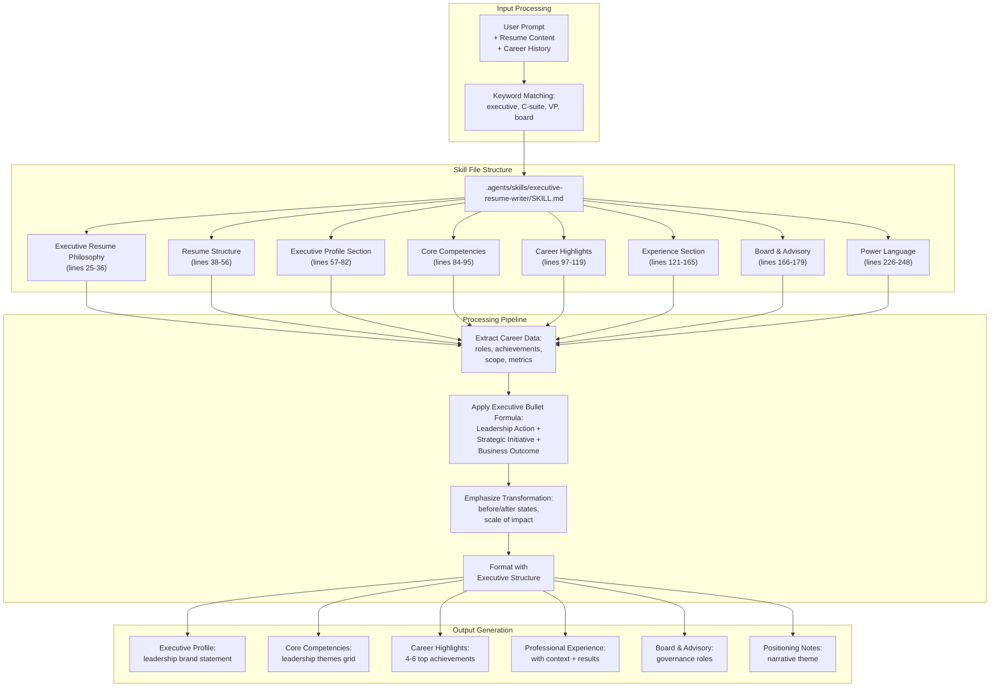
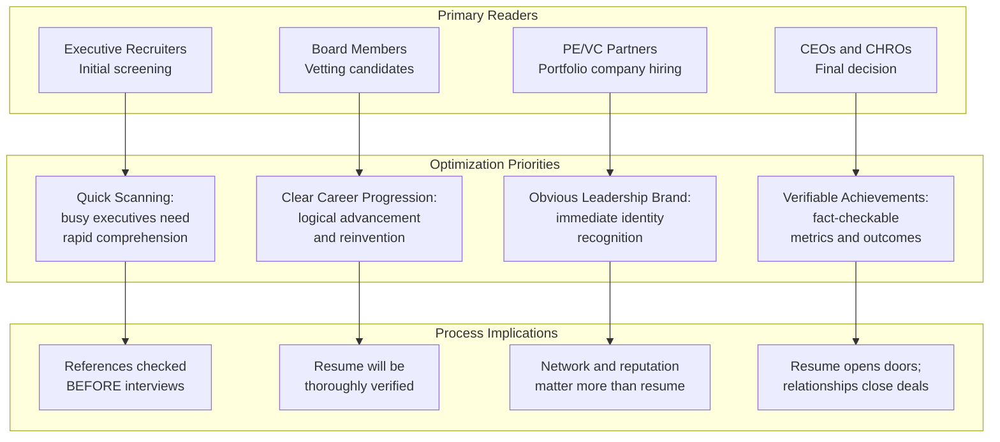
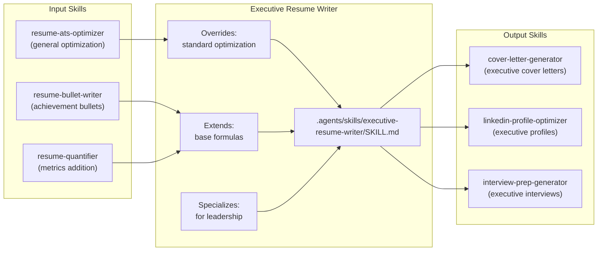

<!-- source: DeepWiki mcp.deepwiki.com · repo Paramchoudhary/ResumeSkills · extra page Executive Resume Writer · fetched 2026-10-26 -->

# Executive Resume Writer

<details>
<summary>Relevant source files</summary>

The following files were used as context for generating this wiki page:

- [.agents/skills/executive-resume-writer/SKILL.md](.agents/skills/executive-resume-writer/SKILL.md)

</details>


## Purpose and Scope

This page documents the **executive-resume-writer** skill, which creates resumes for C-suite, VP, and Director-level positions. This skill transforms standard resume content into executive-level narratives that emphasize strategic leadership, organizational transformation, and business impact at scale.

For general resume optimization, see [Resume Optimization Skills](#4.1). For career transition guidance, see [Career Changer Translator](#4.5.5). For technical leadership roles below executive level, see [Tech Resume Optimizer](#4.5).

**Sources:** [.agents/skills/executive-resume-writer/SKILL.md:1-6]()

---

## When This Skill Is Invoked

The skill activates when user prompts contain specific executive-level keywords or context indicators:

| Trigger Category | Keywords/Phrases |
|-----------------|------------------|
| **Role Level** | "executive resume", "C-suite", "VP resume", "senior leadership" |
| **Governance** | "board", "board of directors", "advisory board" |
| **Search Context** | "executive search", "executive recruiter" |
| **Experience Level** | "15+ years", "20+ years experience" |
| **Leadership Scope** | "P&L responsibility", "organizational impact" |

The skill is designed for candidates applying for:
- C-suite positions (CEO, COO, CFO, CTO, CHRO)
- VP and SVP roles
- Director roles in large organizations (typically 1000+ employees)
- Board positions and advisory roles

**Sources:** [.agents/skills/executive-resume-writer/SKILL.md:8-14]()

---

## Skill Processing Architecture



**Diagram: Skill Invocation and Processing Pipeline**

This diagram shows how user input triggers keyword matching that loads the skill markdown file, which contains structured instructions in specific line ranges. The skill processes input through extraction, transformation (using formulas), emphasis on transformation, and formatting stages to generate the six core output sections.

**Sources:** [.agents/skills/executive-resume-writer/SKILL.md:1-287]()

---

## Executive Resume Philosophy: Key Differentiators

The skill operates on fundamentally different principles than standard resume optimization. The philosophy is encoded in a comparison table:

| Dimension | Standard Resume | Executive Resume |
|-----------|-----------------|------------------|
| **Primary Goal** | Lists skills | Demonstrates leadership brand |
| **Content Focus** | Shows tasks | Shows strategic impact |
| **Value Proposition** | Focuses on "what" | Focuses on "so what" |
| **Length** | 1-2 pages | 2-3 pages acceptable |
| **Optimization** | Keywords for ATS | Story for decision-makers |
| **Impact Level** | Individual contributions | Organizational transformation |

These principles are embedded throughout the skill's processing logic and directly influence how content is transformed.

**Sources:** [.agents/skills/executive-resume-writer/SKILL.md:25-36]()

---

## Document Structure Specification

### Recommended Section Order

The skill generates resumes with the following seven-section structure:

```
1. Executive Profile/Summary
2. Core Competencies (Leadership Themes)
3. Career Highlights / Key Achievements
4. Professional Experience
5. Board & Advisory Roles
6. Education & Executive Development
7. Industry Recognition (optional)
```

### Length Guidelines by Role Level

| Role Level | Page Length | Rationale |
|------------|-------------|-----------|
| VP/SVP | 2 pages | Concise but comprehensive |
| C-Suite | 2-3 pages | More complex scope requires detail |
| Board CV | Can exceed 3 pages | Full career documentation |

**Sources:** [.agents/skills/executive-resume-writer/SKILL.md:38-56]()

---

## Core Writing Formulas

### Executive Bullet Formula

The skill applies a specific formula for every experience bullet point:

```
[Leadership Action] + [Strategic Initiative] + [Business Outcome at Scale]
```

**Components:**

| Component | Purpose | Example Elements |
|-----------|---------|------------------|
| **Leadership Action** | Strategic verb | Spearheaded, Orchestrated, Championed, Transformed |
| **Strategic Initiative** | What changed | Operational transformation, M&A integration, Digital transformation |
| **Business Outcome** | Measurable impact | Revenue growth ($/$%), Margin improvement, Geographic expansion, Team scale |

**Example Application:**

```
• Operational Transformation: Redesigned end-to-end operations, improving 
  gross margins from 62% to 78% and reducing customer onboarding time from 
  90 to 30 days
```

This formula is applied consistently across all experience descriptions.

**Sources:** [.agents/skills/executive-resume-writer/SKILL.md:123-125](), [.agents/skills/executive-resume-writer/SKILL.md:136-147]()

---

### Transformation Story Formula

For handling role context and narrative arc, the skill uses:

```
"Inherited [situation]. Implemented [strategic change]. Achieved [outcome]."
```

This formula emphasizes that executives are hired to **transform**, not maintain status quo.

**Example Applications:**

```markdown
Recruited by CEO to transform operations and prepare company for IPO. 
Direct reports include VP Engineering, VP Customer Success, VP Operations, 
and CIO. Full P&L ownership for services business ($150M).
```

**Sources:** [.agents/skills/executive-resume-writer/SKILL.md:183-191]()

---

## Section-Specific Processing Logic

### Executive Profile Section (Lines 57-82)

**Format Template:**
```
[TITLE/FUNCTION] EXECUTIVE

[Leadership brand statement - who you are as a leader]

[2-3 sentences on your track record with scope/scale]

[What you're known for / unique value proposition]
```

**Required Elements:**
- Role title/function in ALL CAPS
- Leadership brand statement (1-2 sentences defining leadership identity)
- Track record with quantified scope (revenue, employees, geographies, outcomes)
- Unique value proposition or what the executive is "known for"

**Example Output:**
```
CHIEF OPERATING OFFICER | P&L LEADERSHIP | OPERATIONAL TRANSFORMATION

Growth-focused operations executive with 20+ years scaling B2B technology 
companies from $50M to $500M+ in revenue. Known for building high-performance 
teams, operational excellence, and creating scalable infrastructure that 
enables rapid growth.

Track record includes 3 successful exits, 2 IPO preparations, and leading 
organizations of 500+ employees across 6 countries. Expertise in operational 
strategy, M&A integration, and digital transformation in SaaS and enterprise 
software environments.

Core philosophy: Build repeatable processes that scale while maintaining 
the agility that drives innovation.
```

**Sources:** [.agents/skills/executive-resume-writer/SKILL.md:57-82]()

---

### Core Competencies Section (Lines 84-95)

Formatted as **leadership themes** rather than skills lists, using a three-column grid:

```
LEADERSHIP COMPETENCIES

Strategic Growth        | M&A Integration          | Digital Transformation
P&L Management ($500M+) | Global Team Leadership   | Board Relations
Operational Excellence  | Change Management        | Investor Relations
```

**Processing Rules:**
- Theme-based grouping (not alphabetical)
- Include dollar amounts for P&L scope
- Mix strategic, operational, and relational competencies
- Maximum 9 themes (3x3 grid)

**Sources:** [.agents/skills/executive-resume-writer/SKILL.md:84-95]()

---

### Career Highlights Section (Lines 97-119)

Places 4-6 biggest achievements **before** chronological experience. This front-loads impact for executive recruiters and board members who scan quickly.

**Format:**
```
CAREER HIGHLIGHTS

• [Achievement 1 with metrics]
• [Achievement 2 with metrics]
• [Achievement 3 with metrics]
• [Achievement 4 with metrics]
```

**Prioritization Logic:**
1. Largest financial impact (revenue, margins, exits)
2. Largest organizational impact (team growth, geographic expansion)
3. Strategic initiatives (M&A, IPO, transformation)
4. Recognition or board-level accomplishments

**Sources:** [.agents/skills/executive-resume-writer/SKILL.md:97-119]()

---

### Experience Section Context Block (Lines 149-165)

For each role, the skill generates a context block before listing achievements:

**Required Context Elements:**

| Element | Purpose | Example |
|---------|---------|---------|
| **Company Context** | Revenue, employees, stage | "$400M B2B SaaS company \| 1,200 employees \| Series D - IPO track" |
| **Reporting Structure** | Span of control | "Direct reports include VP Engineering, VP Customer Success, VP Operations, and CIO" |
| **P&L Responsibility** | Budget authority | "Full P&L ownership for services business ($150M)" |
| **Strategic Scope** | Mission/mandate | "Recruited by CEO to transform operations and prepare company for IPO" |

**Metrics Emphasis Priority:**


**Diagram: Metrics Prioritization for Executive Experience**

**Sources:** [.agents/skills/executive-resume-writer/SKILL.md:149-165]()

---

### Board & Advisory Section (Lines 166-179)

**Format Template:**
```
BOARD & ADVISORY POSITIONS

Board of Directors | [Company] | [Dates]
[Company description]. [Committee roles if applicable].

Advisory Board | [Company] | [Dates]
[Value provided].

Board Observer | [Company] (acquired by [Acquirer], [Year]) | [Dates]
[Context and contribution].
```

**Processing Rules:**
- List most prestigious positions first
- Include company context (revenue, industry)
- Specify committee chairs or memberships
- Note exit outcomes for companies that were acquired or went public
- Describe value provided for advisory roles

**Sources:** [.agents/skills/executive-resume-writer/SKILL.md:166-179]()

---

## Power Language Guidelines

### Strategic Action Verbs (Lines 226-241)

The skill replaces standard action verbs with executive-level language:

**Strategic Tier:**
```
Spearheaded, Orchestrated, Championed, Steered
Transformed, Revolutionized, Pioneered
Architected (strategically), Engineered (strategically)
Drove, Accelerated, Catalyzed
```

**Leadership Tier:**
```
"Led organization through..."
"Built and scaled..."
"Established vision for..."
"Negotiated and secured..."
"Championed transformation..."
```

### Language to Avoid (Lines 242-248)

The skill actively filters out:

| Category | Examples | Reason |
|----------|----------|--------|
| **Tactical/Operational** | managed, handled, assisted | Too junior |
| **First Person** | I, my, me | Not resume convention |
| **Jargon** | Acronyms without context | Unclear to board members |
| **Generic Claims** | "excellent leader", "strong communicator" | No proof |
| **Excessive Humility** | "helped with", "contributed to" | Undersells impact |

**Sources:** [.agents/skills/executive-resume-writer/SKILL.md:226-248]()

---

## Confidentiality Handling

### What to Include vs. Redact (Lines 213-223)

| Scenario | Approach | Example |
|----------|----------|---------|
| **Confidential Absolutes** | Use percentage improvements | "Improved EBITDA margins from 12% to 28%" instead of "$50M to $112M" |
| **Revenue Ranges** | Use broad ranges | "$100M-$500M" instead of "$347M" |
| **Relative Impact** | Describe scale without specifics | "Largest acquisition in company history" |
| **Proprietary Strategies** | ❌ Do not include | Detailed go-to-market plans, pricing strategies |
| **Undisclosed M&A** | ❌ Do not name | "Evaluated 12 acquisition targets" not "Evaluated acquiring CompanyX" |
| **Financial Details** | ❌ Only if public | Pre-IPO companies, private equity financials |

**Sources:** [.agents/skills/executive-resume-writer/SKILL.md:213-223]()

---

## Output Format Specification

### Complete Output Structure (Lines 250-286)

When executed, the skill generates markdown output with this structure:

```markdown
# EXECUTIVE RESUME

## Executive Profile
[Full executive profile section with title, brand statement, track record, value proposition]

## Core Competencies
[Formatted 3x3 competency grid with leadership themes]

## Career Highlights
[4-6 top achievements with metrics]

## Professional Experience

### [Most Recent Role]
[Company] | [Location] | [Dates]
[Company context line: revenue, employees, stage]

[Strategic context paragraph with reporting structure and P&L scope]

Strategic Initiatives & Results:

• [Thematic bullet 1: Leadership Action + Strategic Initiative + Business Outcome]

• [Thematic bullet 2: ...]

### [Previous Role]
[Same structure]

## Board & Advisory
[Board positions with company context and committee roles]

## Education & Development
[Degrees, executive education programs, certifications]

---

## Positioning Notes
- Key narrative theme: [The overarching story the resume tells]
- Leadership brand: [What the executive is known for]
- Differentiator: [What sets them apart from other executives]
```

### Positioning Notes Purpose

These meta-notes at the end guide the candidate (or recruiter) on how to position the resume in conversations. They are generated by analyzing:
- Career trajectory patterns
- Repeated themes across roles
- Unique combinations of experience
- Strategic positioning opportunities

**Sources:** [.agents/skills/executive-resume-writer/SKILL.md:250-286]()

---

## Executive Search Optimization

### Audience Consideration (Lines 288-306)

The skill optimizes for multiple audiences who review executive resumes:



**Diagram: Executive Search Audience and Optimization Strategy**

**Key Processing Rules:**
- Front-load impact (Career Highlights section before chronological experience)
- Use white space liberally for scanning
- Ensure every metric is verifiable with former colleagues
- Emphasize relationship-building and advisory roles
- Frame short tenures around specific missions completed
- Show progression and reinvention in long tenures

**Sources:** [.agents/skills/executive-resume-writer/SKILL.md:288-306]()

---

## Tenure Handling Strategies

### Short Tenure Framing (Lines 202-212)

For roles under 2 years, the skill applies mission-based framing:

```
"Brought in to lead post-merger integration"
"Recruited for turnaround; completed in 18 months"
"Joined to prepare company for acquisition"
```

### Long Tenure Framing

For roles over 5 years, emphasize progression and multiple transformations:

```
"Promoted through 4 roles over 12 years"
"Led multiple transformations as company grew from $50M to $500M"
```

**Processing Logic:**
1. Detect tenure length from date ranges
2. If < 2 years: Add mission-based context sentence
3. If > 5 years: Break into sub-sections by role progression or transformation phase
4. If gap between roles: Frame around strategic sabbatical, advisory period, or personal circumstances (if provided)

**Sources:** [.agents/skills/executive-resume-writer/SKILL.md:202-212]()

---

## Integration with Other Skills



**Diagram: Skill Integration Pattern**

**Relationship Type Definitions:**

| Relationship | Description | Example |
|--------------|-------------|---------|
| **Overrides** | Executive skill ignores general optimization rules | 2-3 pages acceptable vs. strict 1-page for ATS |
| **Extends** | Builds on base formulas with executive context | Bullet formula adds "Leadership Action" component |
| **Specializes** | Applies role-specific transformations | Emphasis on transformation vs. task completion |
| **Feeds Into** | Output becomes input for downstream skills | Executive resume content informs cover letters |

The executive resume writer operates as a specialized overlay in the skill ecosystem (see [Specialized Roles Skills](#4.5)), applying executive-specific transformations while maintaining consistency with the broader system architecture.

**Sources:** [.agents/skills/executive-resume-writer/SKILL.md:1-307](), README context from high-level diagrams

---

