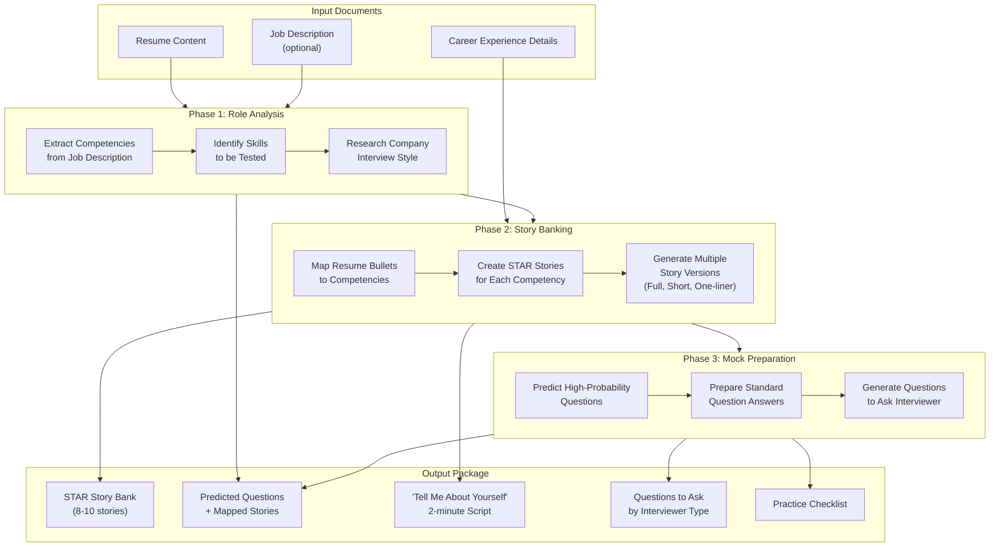
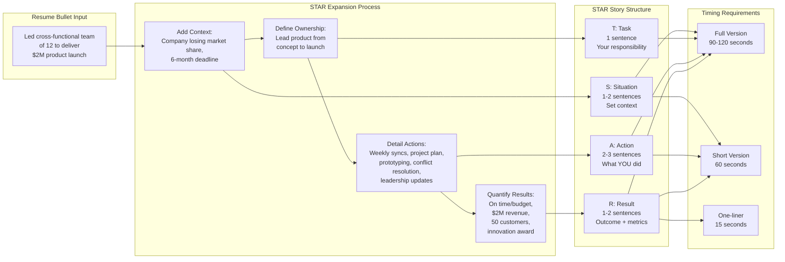
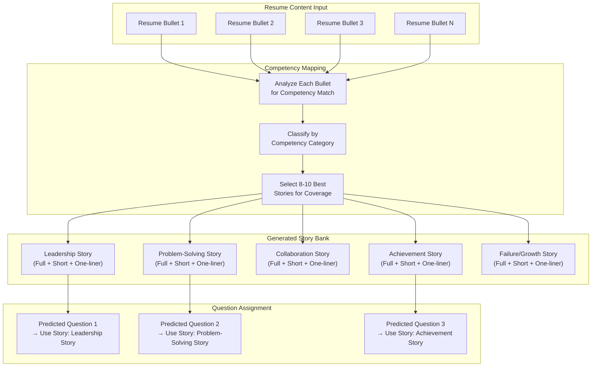
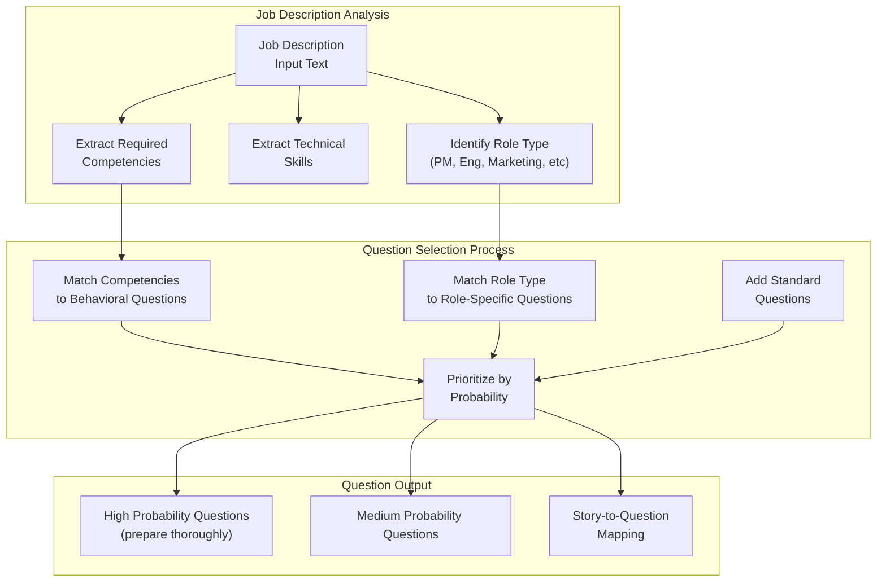
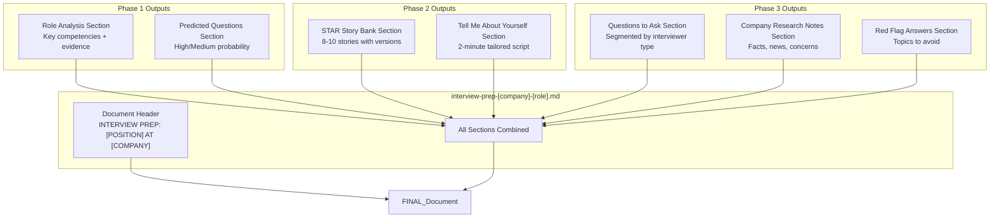
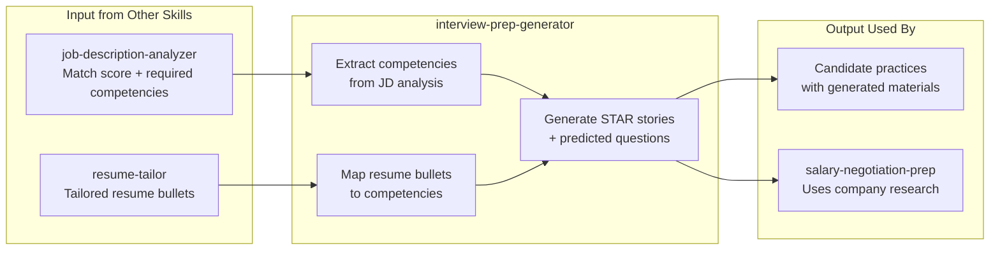

<!-- source: DeepWiki mcp.deepwiki.com · repo Paramchoudhary/ResumeSkills · extra page Interview Prep Generator · fetched 2026-10-26 -->

# Interview Prep Generator

<details>
<summary>Relevant source files</summary>

The following files were used as context for generating this wiki page:

- [.agents/skills/interview-prep-generator/SKILL.md](.agents/skills/interview-prep-generator/SKILL.md)

</details>


## Purpose and Scope

This page documents the `interview-prep-generator` skill, which transforms resume content and job descriptions into comprehensive interview preparation materials. The skill generates STAR-formatted stories, predicts role-specific questions, and produces structured practice materials for job interviews.

This skill operates in the final stages of the job search process, after a candidate has optimized their resume and received an interview invitation. For job analysis and resume tailoring prior to application, see [Job Description Analyzer](#4.2.1). For salary discussions after receiving an offer, see the salary-negotiation-prep skill documented in [Interview & Negotiation Skills](#4.4).

**Sources:** [.agents/skills/interview-prep-generator/SKILL.md:1-16]()

---

## Invocation and Triggers

The skill is automatically loaded by AI agents when user prompts contain specific keywords or phrases indicating interview preparation needs.

### Trigger Keywords

| Keyword Pattern | Example User Prompt |
|-----------------|---------------------|
| `"interview prep"` | "Help me prepare for an interview" |
| `"prepare for interview"` | "I have an interview next week, how should I prepare?" |
| `"STAR stories"` | "Create STAR stories from my resume" |
| `"interview questions"` | "What interview questions should I expect?" |
| `"behavioral questions"` | "Help me practice behavioral questions" |

When triggered, the AI agent loads the skill definition from [.agents/skills/interview-prep-generator/SKILL.md]() and executes its multi-phase workflow using the provided resume content and optional job description as inputs.

**Sources:** [.agents/skills/interview-prep-generator/SKILL.md:8-15]()

---

## Three-Phase Framework

The skill implements a structured three-phase preparation process that progresses from analysis to content creation to practice.

### Framework Architecture



### Phase Breakdown

**Phase 1: Role Analysis** ([.agents/skills/interview-prep-generator/SKILL.md:28-31]())
- Extracts testable competencies from job description requirements
- Identifies specific skills the interviewer will evaluate
- Provides context for company interview style and format

**Phase 2: Story Banking** ([.agents/skills/interview-prep-generator/SKILL.md:33-36]())
- Converts resume bullets into detailed STAR stories
- Creates stories mapped to common competency categories
- Generates multiple length versions for different question formats

**Phase 3: Mock Preparation** ([.agents/skills/interview-prep-generator/SKILL.md:38-41]())
- Predicts high-probability questions for the specific role
- Prepares answers for standard and difficult questions
- Generates thoughtful questions for the candidate to ask

**Sources:** [.agents/skills/interview-prep-generator/SKILL.md:26-41]()

---

## STAR Method Structure

The skill uses the STAR (Situation, Task, Action, Result) framework to structure behavioral interview answers. This method transforms resume bullets into compelling narratives with specific timing and structure constraints.

### STAR Component Specification



### STAR Template Syntax

The skill uses a specific template format defined in [.agents/skills/interview-prep-generator/SKILL.md:51-61]():

```
SITUATION: "At [Company], we faced [specific challenge/context]..."

TASK: "I was responsible for [specific ownership]..."

ACTION: "I [specific action 1], [specific action 2], and [specific action 3]..."

RESULT: "As a result, [quantified outcome]. This led to [business impact]."
```

### Example Story Generation

The skill transforms a resume bullet using the expansion process defined in [.agents/skills/interview-prep-generator/SKILL.md:118-143]():

**Input Resume Bullet:**
```
Led cross-functional team of 12 to deliver $2M product launch
```

**Generated STAR Story:**

| Component | Generated Content |
|-----------|------------------|
| **Situation** | "Our company was losing market share to a competitor, and leadership decided we needed to launch a new product line within 6 months." |
| **Task** | "As Product Manager, I was tasked with leading the product from concept to launch, coordinating across engineering, design, marketing, and sales teams (12 people total)." |
| **Action** | "I established weekly cross-functional syncs and a shared Notion workspace. I created a detailed project plan with milestones and dependencies. I implemented a rapid prototyping process with 2-week design sprints. I personally resolved 3 major conflicts between engineering and marketing. I presented monthly updates to leadership to maintain alignment." |
| **Result** | "We launched on time and under budget, generating $2M revenue in first year, acquiring 50 new enterprise customers. The team received the company innovation award." |

**Sources:** [.agents/skills/interview-prep-generator/SKILL.md:43-78](), [.agents/skills/interview-prep-generator/SKILL.md:118-143](), [.agents/skills/interview-prep-generator/SKILL.md:145-150]()

---

## Story Banking Process

The skill implements a competency-driven story banking system that ensures comprehensive interview preparation across all likely question categories.

### Core Competency Framework

The skill identifies five primary competency categories and specific story types needed for each, as defined in [.agents/skills/interview-prep-generator/SKILL.md:82-116]():

| Competency Category | Required Story Types | Question Examples |
|---------------------|---------------------|-------------------|
| **Leadership** | Led team through challenge<br/>Managed conflict<br/>Made difficult decision<br/>Delegated effectively<br/>Developed/mentored someone | "Tell me about a time you led a team"<br/>"Describe a situation where you had to make an unpopular decision" |
| **Problem-Solving** | Solved complex technical problem<br/>Fixed broken process<br/>Handled unexpected obstacle<br/>Made decision with incomplete info<br/>Improved something proactively | "Describe a complex problem you solved"<br/>"Tell me about a time something didn't go as planned" |
| **Collaboration** | Worked with difficult colleague<br/>Aligned cross-functional stakeholders<br/>Built consensus<br/>Partnered with other teams<br/>Influenced without authority | "Tell me about working with someone difficult"<br/>"Describe a time you had to influence someone without authority" |
| **Achievement** | Exceeded goals/expectations<br/>Delivered under pressure<br/>Went above and beyond<br/>Took initiative<br/>Accomplished something proud of | "What's your proudest professional accomplishment?"<br/>"Tell me about a time you exceeded expectations" |
| **Failure/Growth** | Made mistake and learned<br/>Received critical feedback<br/>Failed and recovered<br/>Changed approach based on learning | "Tell me about a time you failed"<br/>"What's the biggest mistake you've made at work?" |

### Story Bank Structure



The skill generates three versions of each story as specified in [.agents/skills/interview-prep-generator/SKILL.md:145-150]():

1. **Full version:** 2 minutes (for "tell me about a time..." questions)
2. **Short version:** 60 seconds (for follow-up questions)
3. **One-liner:** 15 seconds (for "give me an example" prompts)

**Sources:** [.agents/skills/interview-prep-generator/SKILL.md:80-150]()

---

## Question Prediction and Categorization

The skill maintains comprehensive question taxonomies for different interview contexts and predicts high-probability questions based on job description analysis.

### Question Categories

The skill organizes questions into three main categories defined in [.agents/skills/interview-prep-generator/SKILL.md:152-230]():

#### 1. Behavioral Questions by Competency

| Competency | High-Frequency Questions | Line Reference |
|------------|-------------------------|----------------|
| Leadership | "Tell me about a time you led a team"<br/>"Describe a situation where you had to make an unpopular decision"<br/>"How have you developed team members?"<br/>"Tell me about a time you dealt with a difficult team member" | [156-160]() |
| Problem-Solving | "Describe a complex problem you solved"<br/>"Tell me about a time something didn't go as planned"<br/>"How do you approach problems with incomplete information?"<br/>"Give an example of an innovative solution you developed" | [162-166]() |
| Collaboration | "Tell me about working with someone difficult"<br/>"Describe a time you had to influence someone without authority"<br/>"How do you handle disagreements with colleagues?"<br/>"Tell me about a successful cross-functional project" | [168-172]() |
| Achievement | "What's your proudest professional accomplishment?"<br/>"Tell me about a time you exceeded expectations"<br/>"Describe a goal you achieved against the odds"<br/>"What's the biggest impact you've had in your career?" | [174-178]() |
| Failure/Growth | "Tell me about a time you failed"<br/>"What's the biggest mistake you've made at work?"<br/>"How do you handle criticism?"<br/>"What would you do differently in your career?" | [180-184]() |

#### 2. Role-Specific Questions

The skill includes specialized question sets for different job functions:

| Role Type | Sample Questions | Line Reference |
|-----------|------------------|----------------|
| Product Management | "How do you prioritize features?"<br/>"Walk me through how you'd approach [product problem]"<br/>"How do you measure product success?"<br/>"Tell me about a product you shipped from 0 to 1" | [188-192]() |
| Engineering | "Describe your experience with [specific technology]"<br/>"How do you approach code reviews?"<br/>"Tell me about a technical challenge you solved"<br/>"How do you balance technical debt vs. features?" | [194-198]() |
| Marketing | "How do you measure campaign success?"<br/>"Tell me about a campaign that didn't work"<br/>"How do you allocate budget across channels?"<br/>"Describe your approach to brand building" | [200-204]() |
| Sales | "Walk me through your sales process"<br/>"Tell me about a deal you lost and why"<br/>"How do you handle objections?"<br/>"Describe your largest closed deal" | [206-210]() |

#### 3. Standard Questions

Universal questions asked in nearly all interviews:

| Category | Questions | Line Reference |
|----------|-----------|----------------|
| About You | "Tell me about yourself" (2 min pitch)<br/>"Walk me through your resume"<br/>"Why are you looking for a new role?"<br/>"Where do you see yourself in 5 years?" | [214-218]() |
| About the Role | "Why this role?"<br/>"What interests you about this position?"<br/>"What do you think this role entails?"<br/>"What would you do in your first 90 days?" | [220-224]() |
| About the Company | "Why this company?"<br/>"What do you know about us?"<br/>"Why do you want to work here?"<br/>"What excites you about our mission?" | [226-230]() |

### Question Prediction Logic



**Sources:** [.agents/skills/interview-prep-generator/SKILL.md:152-230]()

---

## Difficult Question Handling

The skill provides specific formulas for handling challenging interview questions, as defined in [.agents/skills/interview-prep-generator/SKILL.md:257-300]().

### Formula-Based Responses

| Question Type | Formula | Example Template |
|---------------|---------|------------------|
| **"What's your greatest weakness?"** | Real weakness + Self-awareness + Improvement steps | "I tend to be overly detail-oriented, which can sometimes slow me down. I've recognized this and now set time limits for tasks and ask for feedback on when good enough is good enough. In my current role, I've also learned to delegate detailed work when appropriate." |
| **"Why are you leaving your current job?"** | Positive + Forward-looking + Brief | "I've learned a lot at [Company], but I'm looking for [specific opportunity] that I don't see available in my current path. This role at [Company] offers exactly that - the chance to [specific thing]." |
| **"Tell me about a time you failed"** | Real failure + What you learned + How you applied the learning | "In my first year as a PM, I launched a feature without sufficient user research. The feature was technically sound but users found it confusing. Only 10% adopted it. I learned the hard way that building the right thing matters more than building the thing right. Since then, I never skip user research - I now always do at least 10 user interviews before major feature decisions." |
| **Salary Questions** | Deflect + Research-based range + Flexibility | "I'm flexible on compensation and more focused on finding the right role. Can you share the range budgeted for this position?" OR "Based on my research and experience, I'm looking for something in the range of $X-$Y, but I'm open to discussing the full compensation package." |

### Response Requirements

For weakness questions ([.agents/skills/interview-prep-generator/SKILL.md:259-265]()):
- Must be a real weakness (not a humble brag)
- Must demonstrate self-awareness
- Must include concrete improvement steps

For failure questions ([.agents/skills/interview-prep-generator/SKILL.md:278-287]()):
- Must be a real failure (not a disguised success)
- Must explain the learning outcome
- Must show how the learning was applied subsequently

**Sources:** [.agents/skills/interview-prep-generator/SKILL.md:257-300]()

---

## Questions to Ask Interviewers

The skill generates role-appropriate questions for candidates to ask, segmented by interviewer type as specified in [.agents/skills/interview-prep-generator/SKILL.md:232-255]().

### Question Matrix by Interviewer Type

| Interviewer Type | Recommended Questions | Purpose |
|------------------|----------------------|---------|
| **Hiring Manager** | "What does success look like in this role at 30/60/90 days?"<br/>"What are the biggest challenges facing the team?"<br/>"How is performance measured?"<br/>"What's the team structure?" | Understand expectations, challenges, evaluation criteria |
| **Team Members** | "What's a typical day/week like?"<br/>"What do you enjoy most about working here?"<br/>"How do teams collaborate?"<br/>"What would you want a new hire to know?" | Understand day-to-day reality, team dynamics, culture |
| **Executives** | "What's the company's strategy for the next year?"<br/>"How does this team contribute to company goals?"<br/>"What keeps you excited about the company?" | Understand strategic direction, team positioning, leadership vision |

### Questions to Avoid

The skill explicitly identifies questions that should not be asked ([.agents/skills/interview-prep-generator/SKILL.md:251-255]()):

- ❌ Questions about salary/benefits (save for HR discussion)
- ❌ Questions you could easily Google (shows lack of preparation)
- ❌ Negative questions about company problems (creates negative impression)
- ❌ Yes/no questions (ask open-ended questions instead)

**Sources:** [.agents/skills/interview-prep-generator/SKILL.md:232-255]()

---

## Output Structure

The skill generates a comprehensive markdown document with a standardized structure defined in [.agents/skills/interview-prep-generator/SKILL.md:302-361]().

### Output Document Template

```markdown
# INTERVIEW PREP: [POSITION] AT [COMPANY]

## Role Analysis
**Key competencies they'll test:**
1. [Competency] - Evidence: [From JD]
2. [Competency] - Evidence: [From JD]
3. [Competency] - Evidence: [From JD]

## Predicted Questions

### High Probability (prepare thoroughly)
1. [Question] → Use story: [Story name]
2. [Question] → Use story: [Story name]
3. [Question] → Use story: [Story name]

### Medium Probability
1. [Question]
2. [Question]

## Your STAR Story Bank

### Story 1: [Name - e.g., "Product Launch Success"]
**Use for:** Leadership, Achievement, Cross-functional
**STAR:**
- S: [Situation]
- T: [Task]
- A: [Action]
- R: [Result with metrics]
**Short version:** [60 second version]

### Story 2: [Name]
[Same structure]

## "Tell Me About Yourself" Script
[2-minute pitch tailored to this role]

## Questions to Ask
**For Hiring Manager:**
1. [Question]
2. [Question]

**For Team:**
1. [Question]
2. [Question]

## Company Research Notes
- Recent news: [Item]
- Key facts to reference: [Facts]
- Potential concerns: [Items to be ready for]

## Red Flag Answers to Avoid
- Don't mention: [Topics]
- Don't criticize: [Past employer aspects]
- Watch out for: [Potential trap questions]
```

### Document Section Mapping



**Sources:** [.agents/skills/interview-prep-generator/SKILL.md:302-361]()

---

## Implementation Checklist

The skill includes a 10-step implementation checklist defined in [.agents/skills/interview-prep-generator/SKILL.md:363-375]() that ensures complete interview preparation:

| Step | Task | Purpose |
|------|------|---------|
| 1 | ✅ Analyze job description for competencies | Identify what will be tested |
| 2 | ✅ Create 8-10 STAR stories covering all competencies | Build comprehensive story bank |
| 3 | ✅ Write "tell me about yourself" pitch | Prepare opening response |
| 4 | ✅ Prepare answers for likely questions | Practice high-probability questions |
| 5 | ✅ Research company thoroughly | Demonstrate knowledge and interest |
| 6 | ✅ Prepare thoughtful questions to ask | Show engagement and critical thinking |
| 7 | ✅ Practice out loud (time yourself) | Ensure timing and delivery |
| 8 | ✅ Prepare logistics (outfit, route, tech check) | Eliminate day-of stress |
| 9 | ✅ Review the day before interview | Refresh memory on key points |
| 10 | ✅ Send thank you notes after | Maintain professional follow-up |

**Sources:** [.agents/skills/interview-prep-generator/SKILL.md:363-376]()

---

## Integration with Other Skills

The interview-prep-generator skill can consume outputs from other skills in the job search workflow:

### Upstream Skill Dependencies

- **job-description-analyzer** ([#4.2.1](#4.2.1)): Provides competency extraction and match analysis that informs question prediction
- **resume-tailor**: Provides the tailored resume content that serves as input for story creation
- **resume-bullet-writer**: Provides achievement-focused bullets that are expanded into STAR stories

### Downstream Skill Integration

- **salary-negotiation-prep**: Uses the company research and role analysis from interview prep to inform negotiation strategy

### Data Flow Example



**Sources:** [.agents/skills/interview-prep-generator/SKILL.md:28-31]() (role analysis integration)

---

