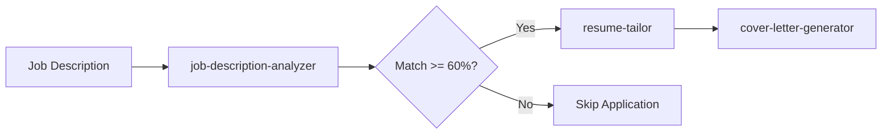
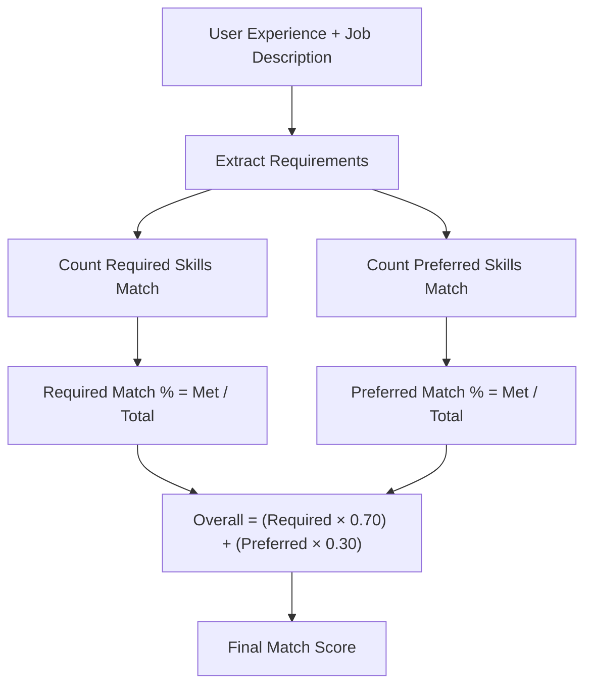
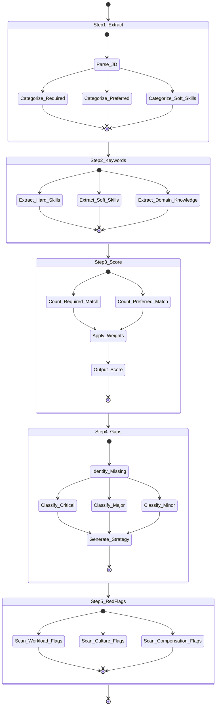
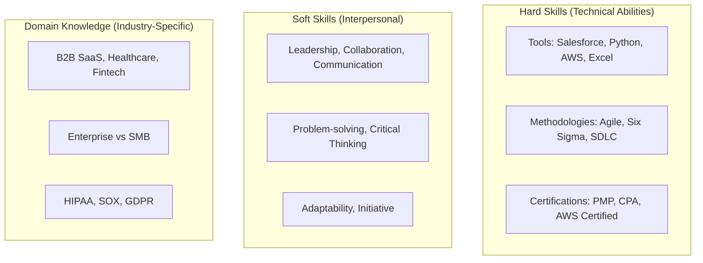
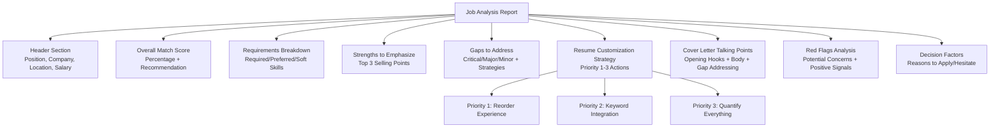
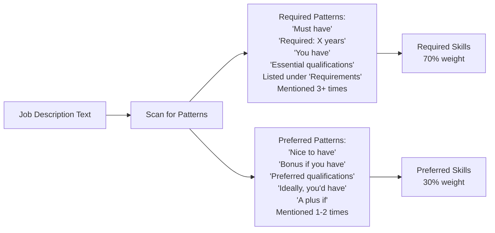
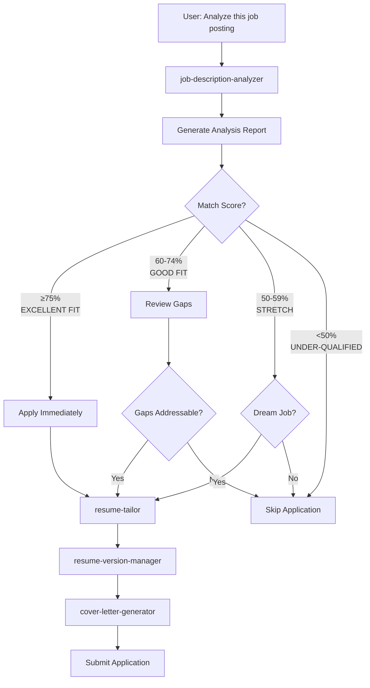

<!-- source: DeepWiki mcp.deepwiki.com · repo Paramchoudhary/ResumeSkills · extra page Job Description Analyzer · fetched 2026-10-26 -->

# Job Description Analyzer

<details>
<summary>Relevant source files</summary>

The following files were used as context for generating this wiki page:

- [.agents/skills/job-description-analyzer/SKILL.md](.agents/skills/job-description-analyzer/SKILL.md)

</details>


## Purpose and Scope

The Job Description Analyzer skill analyzes job postings to calculate quantitative match scores, identify skill gaps, detect red flags, and generate strategic recommendations on whether to apply and how to customize application materials. This skill prevents wasted effort on under-qualified or over-qualified positions by providing data-driven application decisions.

This page documents the `job-description-analyzer` skill implementation. For an overview of all Job Search Strategy skills, see [4.2](#4.2). For post-analysis resume customization, see the `resume-tailor` skill documentation. For offer stage analysis, see [4.2.2](#4.2.2).

**Sources**: [.agents/skills/job-description-analyzer/SKILL.md:1-18]()

---

## Invocation Triggers

The skill activates when users provide natural language prompts matching specific patterns or keywords. The AI agent performs keyword matching against the skill's trigger definitions to determine when to load this skill.

### Primary Trigger Keywords

| Category | Keywords/Phrases |
|----------|------------------|
| Analysis requests | `"analyze this job"`, `"job description"`, `"match score"` |
| Qualification questions | `"should I apply"`, `"am I qualified"`, `"good fit"` |
| Comparative queries | `"match percentage"`, `"how well do I match"` |
| Preparation requests | `"tailor resume for"`, `"customize for job"` |

### Trigger Patterns

```
User: "Should I apply to this Senior PM role?"
→ Matches: "should I apply"
→ Loads: job-description-analyzer

User: "What's my match score for this position?"
→ Matches: "match score"
→ Loads: job-description-analyzer

User: "Analyze this job description [paste]"
→ Matches: "analyze", "job description"
→ Loads: job-description-analyzer
```

### Strategic Positioning

The skill is designed to execute **before** resume tailoring to ensure application effort is justified. The workflow order is:



**Sources**: [.agents/skills/job-description-analyzer/SKILL.md:8-18]()

---

## Match Score Calculation Algorithm

The skill calculates a weighted match score based on required and preferred qualifications. The algorithm prioritizes required skills over preferred skills to reflect actual hiring practices.

### Calculation Formula



### Weighting Logic

The match score uses a **70/30 weighting** between required and preferred qualifications:

```
Overall Match = (Required Match × 0.70) + (Preferred Match × 0.30)

Example:
  Required: 8/10 met = 80%
  Preferred: 3/5 met = 60%
  
  Overall: (80% × 0.70) + (60% × 0.30)
         = 56% + 18%
         = 74%
```

This weighting reflects that employers prioritize required skills heavily but still value preferred qualifications.

**Sources**: [.agents/skills/job-description-analyzer/SKILL.md:89-110]()

### Match Score Interpretation

The skill applies threshold-based recommendations:

| Match Range | Interpretation | Recommendation | Risk Assessment |
|-------------|----------------|----------------|-----------------|
| 90-100% | Overqualified | Review carefully | Flight risk concern for employer |
| 75-89% | Excellent fit | Apply immediately | Ideal candidate profile |
| 60-74% | Good fit | Apply with strong cover letter | Need to address gaps proactively |
| 50-59% | Stretch role | Apply only if passionate | Low success probability |
| <50% | Under-qualified | Skip unless dream job | Wasted effort likely |

**Sources**: [.agents/skills/job-description-analyzer/SKILL.md:104-109]()

---

## Analysis Workflow

The skill executes a five-step analysis pipeline that transforms unstructured job descriptions into structured decision data.



**Sources**: [.agents/skills/job-description-analyzer/SKILL.md:45-140]()

### Step 1: Extract Requirements

Requirements are categorized into three hierarchical groups:

| Category | Definition | Examples |
|----------|-----------|----------|
| **Required (Must-Have)** | Explicitly stated as mandatory; disqualification if missing | Education, years of experience, specific technical skills, certifications, industry experience |
| **Preferred (Nice-to-Have)** | Desirable but not mandatory; differentiation factors | "Bonus" skills, advanced certifications, domain expertise, specific tool experience |
| **Soft Skills/Culture** | Interpersonal and cultural fit factors | Communication style, work environment, team structure, company values |

**Sources**: [.agents/skills/job-description-analyzer/SKILL.md:47-68]()

### Step 2: Keyword Extraction

Keywords are extracted and classified into three taxonomic types:



**Sources**: [.agents/skills/job-description-analyzer/SKILL.md:70-88]()

### Step 3: Calculate Match Score

See [Match Score Calculation Algorithm](#match-score-calculation-algorithm) section above.

### Step 4: Gap Analysis

Each missing requirement receives a severity classification and mitigation strategy:

| Gap Type | Definition | Strategy |
|----------|-----------|----------|
| **Critical Gap** | Deal-breaker that disqualifies candidate | Do not apply |
| **Major Gap** | Significant but addressable | Mention proactively in cover letter with learning plan |
| **Minor Gap** | Easy to learn or less important | Downplay or emphasize related transferable skills |

**Sources**: [.agents/skills/job-description-analyzer/SKILL.md:112-118]()

### Step 5: Red Flag Detection

The skill scans for linguistic patterns indicating potential workplace issues:

| Red Flag Category | Patterns | Interpretation |
|-------------------|----------|----------------|
| **Workload Flags** | "wear many hats", "fast-paced environment", "hit the ground running", "self-starter in ambiguous situations" | Understaffing, high workload, limited support |
| **Culture Flags** | "rockstar/ninja/guru", "work hard, play hard", "unlimited vacation", "like a family" | Immature culture, boundary issues, overwork expectations |
| **Compensation Flags** | "competitive salary" (no range), "equity-heavy", "commission-based", "DOE" with no range | Compensation transparency issues, potential underpayment |

**Sources**: [.agents/skills/job-description-analyzer/SKILL.md:119-140]()

---

## Output Report Structure

The skill generates a structured markdown report with nine standardized sections. The report format is defined in [.agents/skills/job-description-analyzer/SKILL.md:141-384]().

### Report Template Architecture



### Section 1: Header and Overall Match Score

```markdown
# JOB ANALYSIS REPORT

**Position:** [Job Title]
**Company:** [Company Name]
**Location:** [Location + Remote/Hybrid]
**Salary Range:** [Range + equity/benefits]

═══════════════════════════════════════════

## OVERALL MATCH SCORE: [XX]% [✅/⚠️/❌]

**Recommendation:** [STRONG FIT | GOOD FIT | STRETCH | SKIP]
**Application Priority:** [HIGH | MEDIUM | LOW]
**Estimated Competition:** [High/Medium/Low] (Posted [X] days ago)
**Time to Tailor Resume:** [XX-XX] minutes
```

**Sources**: [.agents/skills/job-description-analyzer/SKILL.md:143-160]()

### Section 2: Requirements Breakdown

The requirements section uses checkmarks (✅/❌) and provides evidence from the user's background:

```markdown
## REQUIREMENTS BREAKDOWN

### Required Skills - X/Y ✅

✅ [Requirement] (You have: [Evidence])
✅ [Requirement] (You have: [Evidence])
❌ [Requirement] (You have: [Gap description]) ⚠️

### Preferred Skills - X/Y ✅

✅ [Preference] (You have: [Evidence])
❌ [Preference] (You don't have)

### Soft Skills - X/Y ✅

✅ [Soft skill] ([Evidence from resume])
```

This format provides immediate visual scanning of match status with contextual evidence.

**Sources**: [.agents/skills/job-description-analyzer/SKILL.md:163-194]()

### Section 3: Strengths to Emphasize

Identifies the top 3 differentiating strengths with tactical advice:

```markdown
## STRENGTHS TO EMPHASIZE

**Your Top 3 Selling Points:**

1. **[Strength Name]**
   - [Why it matters for this role]
   - [Where to emphasize in resume]

2. **[Strength Name]**
   - [Differentiation factor]
   - [Strategic positioning advice]

3. **[Strength Name]**
   - [Connection to job requirements]
   - [Evidence to highlight]
```

**Sources**: [.agents/skills/job-description-analyzer/SKILL.md:197-212]()

### Section 4: Gaps to Address

Structured gap analysis with severity classification:

```markdown
## GAPS TO ADDRESS

**Critical Gaps:** [None ✅ | List]

**Major Gaps:**
⚠️ **[Gap Name]**
- [Why this gap matters - evidence from JD]
- [What employer expects]

**Strategy:**
- [How to address in cover letter]
- [How to frame transferable skills]

**Minor Gaps:**
- [Gap name] (mentioned [X]x)
- [Importance assessment]

**Strategy:**
- [Whether to mention or ignore]
- [Pivot strategy if asked]
```

**Sources**: [.agents/skills/job-description-analyzer/SKILL.md:214-236]()

### Section 5: Resume Customization Strategy

Three-priority tactical customization plan:

| Priority Level | Action | Example |
|----------------|--------|---------|
| **Priority 1** | Reorder experience to lead with most relevant | Move developer tools role from position 2 to position 1 |
| **Priority 2** | Integrate exact keyword phrases from JD | Add "SQL and data analysis" mentioned 5x in JD to skills section |
| **Priority 3** | Quantify bullets with metrics | Change "Led roadmap" to "Defined roadmap based on 50+ interviews, 100K+ users" |

**Sources**: [.agents/skills/job-description-analyzer/SKILL.md:239-277]()

### Section 6: Cover Letter Talking Points

Provides three opening hook options and gap-addressing templates:

```markdown
## COVER LETTER TALKING POINTS

### Opening Hook (Choose One):

**Option 1 - Specific Company Knowledge:**
"[Reference to company initiative/product + connection to your experience]"

**Option 2 - Mutual Connection:**
"[Name] mentioned you're looking for [role] - my [X] years in [relevant area]..."

**Option 3 - Problem-Solver:**
"Your JD mentions [challenge] - I've navigated this at [company], [specific achievement]"

### Body - Address the Match:
- "Your requirement for [X]: I have [Y] years with..."
- "Your focus on [X]: In my current role, I..."

### Addressing [Gap Name] (Optional):
"While my [area] has primarily been [tool/approach], I'm [learning strategy]. 
More importantly, I've [transferable skill evidence]."
```

**Sources**: [.agents/skills/job-description-analyzer/SKILL.md:280-300]()

### Section 7: Red Flags Analysis

Evaluates potential concerns and positive signals:

```markdown
## RED FLAGS ANALYSIS

### Potential Concerns: [⚠️ MINOR | ⚠️ MODERATE | 🚨 MAJOR]

**Flag 1:** "[Specific phrase from JD]"
- Appears [X]x in description
- Interpretation: [What this likely means]
- May mean: [Potential workplace implications]

### Positive Signals: ✅

**Signal 1:** [Positive indicator]
- [What this shows about the company/role]
```

**Sources**: [.agents/skills/job-description-analyzer/SKILL.md:303-327]()

### Section 8: Application Timeline

Structured day-by-day action plan:

```markdown
## APPLICATION TIMELINE

**✅ Day 1 (Today):**
- Customize resume ([X] minutes)
- Write cover letter ([X] minutes)

**✅ Day 1-2:**
- Submit application
- Connect with 2-3 current employees on LinkedIn
- Research company more deeply

**✅ Week 1:**
- Follow up if no response after 7 days

**📊 Expected Response Time:** [X] weeks
**📊 Interview Process:** [Steps from job posting]
```

**Sources**: [.agents/skills/job-description-analyzer/SKILL.md:338-360]()

### Section 9: Decision Factors

Final recommendation with supporting evidence:

```markdown
## DECISION FACTORS

### Reasons to Apply ✅
1. [Evidence-based reason]
2. [Match quality reason]
3. [Strategic fit reason]

### Reasons to Hesitate ⚠️
1. [Concern with mitigation strategy]
2. [Risk factor with assessment]

### Overall Recommendation:
**[APPLY | HESITATE | SKIP] - [Brief justification]**
[Final paragraph with tactical next steps]
```

**Sources**: [.agents/skills/job-description-analyzer/SKILL.md:363-384]()

---

## Requirement Classification System

The skill uses linguistic pattern matching to distinguish required qualifications from preferred qualifications. This classification directly impacts the weighted match score calculation.

### Classification Rules



### Frequency-Based Heuristic

The skill uses mention frequency as a classification signal when explicit language is ambiguous:

- **Mentioned 3+ times**: Likely required, even if not explicitly stated
- **Mentioned 1-2 times**: Likely preferred
- **Mentioned 0 times but implied**: Context-dependent classification

**Sources**: [.agents/skills/job-description-analyzer/SKILL.md:386-405]()

### Dealbreaker Detection

The skill identifies absolute disqualifiers that override match scores:

| Dealbreaker Type | Examples | Detection Logic |
|------------------|----------|-----------------|
| **License Requirements** | Medical license, Bar admission, CPA | Pattern: "Required" + "license" / "certification" |
| **Security Clearance** | Top Secret, Secret | Pattern: "Required" + "clearance" |
| **Experience Gap >50%** | 3 years experience when 7+ required | Calculation: User years / Required years < 0.5 |
| **Hard Degree Requirement** | "MD required", "JD required" | Pattern: Degree abbreviation + "required" (not "preferred") |
| **Location Constraint** | On-site only when user is remote | Pattern: "On-site" or "In office" with no remote option |

When a dealbreaker is detected, the skill outputs a recommendation to skip the application regardless of other match scores.

**Sources**: [.agents/skills/job-description-analyzer/SKILL.md:406-420]()

---

## Red Flag Detection System

The skill maintains a dictionary of warning patterns organized by concern category. This system helps users avoid toxic work environments or roles with misleading descriptions.

### Red Flag Categories and Patterns

```mermaid
graph TB
    subgraph "Workload Red Flags"
        W1["'wear many hats'<br/>→ Understaffing"]
        W2["'fast-paced environment'<br/>→ High pressure"]
        W3["'hit the ground running'<br/>→ No training"]
        W4["'self-starter in ambiguous situations'<br/>→ Poor management"]
    end
    
    subgraph "Culture Red Flags"
        C1["'rockstar/ninja/guru'<br/>→ Immature culture"]
        C2["'work hard, play hard'<br/>→ Long hours"]
        C3["'unlimited vacation'<br/>→ Guilt about taking PTO"]
        C4["'like a family'<br/>→ Boundary issues"]
    end
    
    subgraph "Compensation Red Flags"
        M1["'competitive salary' (no range)<br/>→ Won't disclose pay"]
        M2["'equity-heavy'<br/>→ Low cash comp"]
        M3["'commission-based'<br/>→ No base salary"]
        M4["'DOE' with no range<br/>→ Lowball risk"]
    end
    
    JD[Job Description] --> W1 & W2 & W3 & W4
    JD --> C1 & C2 & C3 & C4
    JD --> M1 & M2 & M3 & M4
```



**Sources**: [.agents/skills/job-description-analyzer/SKILL.md:119-140]()

### Red Flag Severity Assessment

Red flags are evaluated in the context of the overall posting:

- **Minor (⚠️)**: 1-2 flags, balanced by positive signals
- **Moderate (⚠️⚠️)**: 3-4 flags, limited positive signals
- **Major (🚨)**: 5+ flags, vague description, multiple compensation red flags

The skill includes this assessment in the report's "Red Flags Analysis" section with recommendations to research company culture before applying.

---

## Integration with Job Search Workflow

The job-description-analyzer skill serves as a gating function in the multi-skill job search workflow. Its primary output (match score and recommendation) determines whether downstream skills are invoked.

### Workflow Decision Tree



### Data Flow to Downstream Skills

The analysis report provides structured inputs for subsequent skills:

| Downstream Skill | Consumed Data from job-description-analyzer |
|------------------|---------------------------------------------|
| `resume-tailor` | Keywords to integrate, experience prioritization, quantification targets |
| `resume-version-manager` | Job title + company for version naming |
| `cover-letter-generator` | Opening hooks, gap addressing strategies, company research |
| `interview-prep-generator` | Required skills to prepare STAR stories for, red flags to ask about |

**Sources**: Workflow analysis based on skill relationships documented in system architecture diagrams.

---

## Edge Cases and Special Situations

The skill handles non-standard job description scenarios with specific strategies defined in [.agents/skills/job-description-analyzer/SKILL.md:436-458]().

### Vague Job Descriptions

**Pattern**: Job description lacks specific requirements, uses generic language, no clear responsibilities.

**Strategy**:
1. Flag as potential red flag in report
2. Extract available keywords
3. Recommend reaching out to recruiter/hiring manager for clarity before investing effort
4. Use industry-standard requirements as baseline for match calculation

### Multiple Roles in One JD

**Pattern**: Job description combines responsibilities from 2+ distinct roles (e.g., "Product Manager + Data Analyst + Project Manager").

**Strategy**:
1. Identify the core role from job title and first paragraph
2. Focus match score on primary responsibilities
3. Flag scope creep concerns in red flags section
4. Warn about potential workload issues

### Internal Job Postings

**Pattern**: User is already employed at company and analyzing internal role posting.

**Strategy**:
1. Adjust match calculation to emphasize internal knowledge value
2. Recommend highlighting cross-team relationships in cover letter
3. Reference specific company initiatives user has been involved with
4. De-emphasize culture fit concerns (already working there)

### Reposted Jobs

**Pattern**: Job posting has been reposted after previous listing expired.

**Strategy**:
1. Flag in report as "reposted job"
2. Note possible causes: previous hire didn't work out, role expanded, first search failed
3. Recommend researching why reposted before applying
4. Compare requirements to original posting if available (may have changed)

**Sources**: [.agents/skills/job-description-analyzer/SKILL.md:436-458]()

---

## Implementation Checklist

The skill executes a 10-step checklist to ensure comprehensive analysis:

```mermaid
graph LR
    Start[Job Description Input] --> C1["✅ Extract requirements<br/>(required vs preferred)"]
    C1 --> C2["✅ Identify keywords<br/>(hard, soft, industry)"]
    C2 --> C3["✅ Calculate match score"]
    C3 --> C4["✅ Identify strengths<br/>to emphasize"]
    C4 --> C5["✅ Identify gaps +<br/>strategies"]
    C5 --> C6["✅ Detect red flags"]
    C6 --> C7["✅ Create resume<br/>customization plan"]
    C7 --> C8["✅ Generate cover letter<br/>talking points"]
    C8 --> C9["✅ Research company"]
    C9 --> C10["✅ Provide recommendation<br/>+ timeline"]
    C10 --> Output[Complete Analysis Report]
```



Each step must complete before proceeding to the next to ensure data dependencies are satisfied. For example, match score calculation (step 3) requires completed requirement extraction (step 1) and keyword identification (step 2).

**Sources**: [.agents/skills/job-description-analyzer/SKILL.md:421-435]()

---

