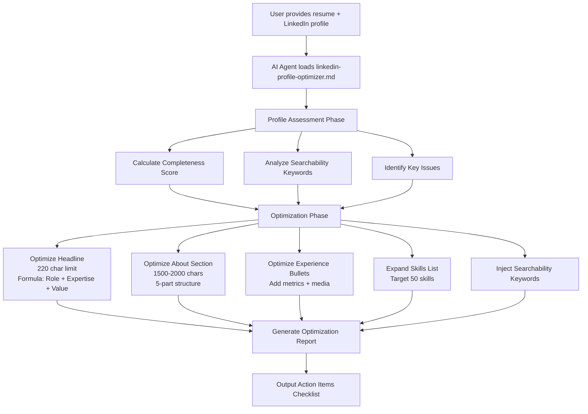
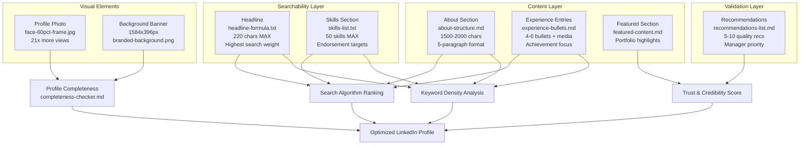
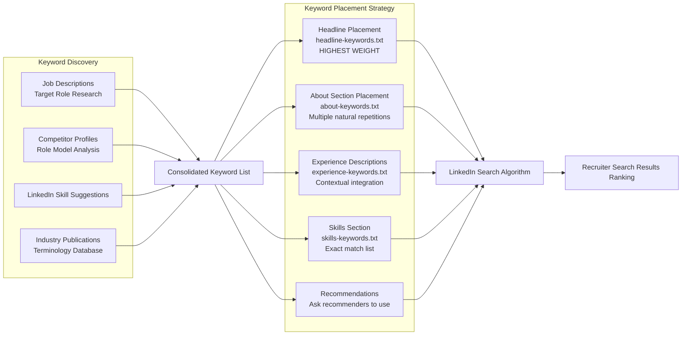
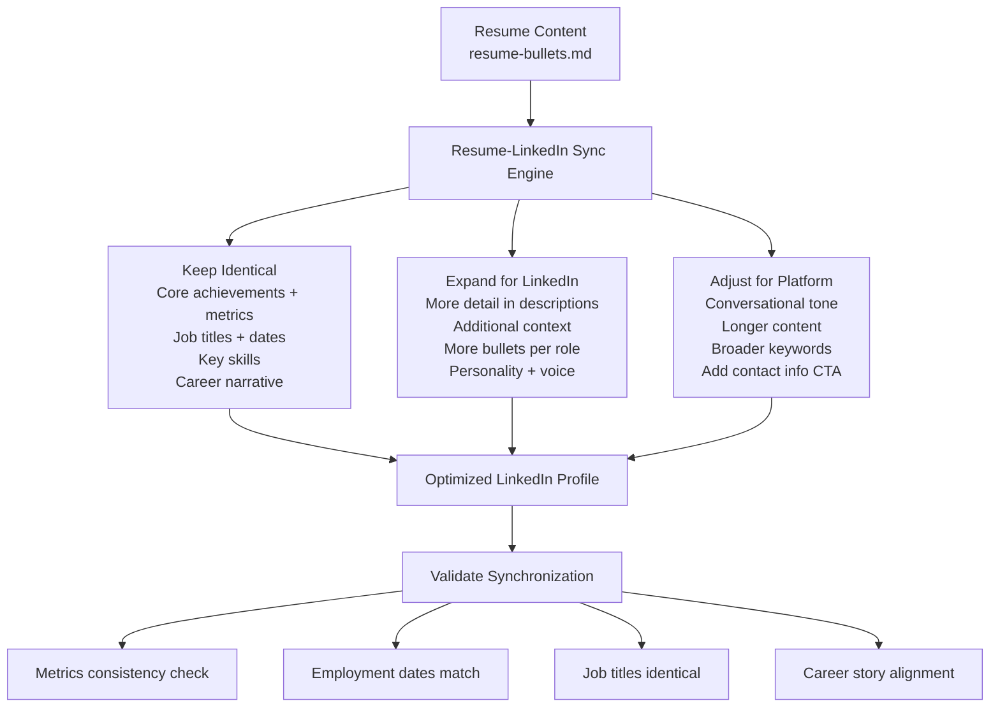
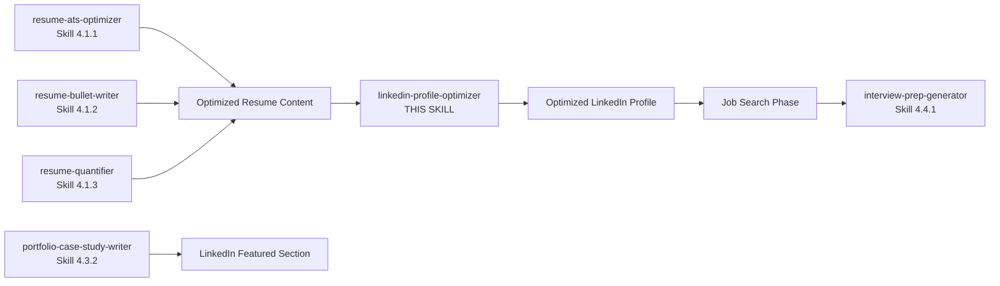

<!-- source: DeepWiki mcp.deepwiki.com · repo Paramchoudhary/ResumeSkills · extra page LinkedIn Profile Optimizer · fetched 2026-10-26 -->

# LinkedIn Profile Optimizer

<details>
<summary>Relevant source files</summary>

The following files were used as context for generating this wiki page:

- [.agents/skills/linkedin-profile-optimizer/SKILL.md](.agents/skills/linkedin-profile-optimizer/SKILL.md)

</details>


## Purpose and Scope

This document covers the `linkedin-profile-optimizer` skill, which transforms user resumes and career information into optimized LinkedIn profiles that maximize recruiter visibility and job search success. This skill addresses the platform-specific requirements of LinkedIn's search algorithm, profile completeness standards, and recruiter discovery mechanisms.

This skill is part of the Supporting Documents Skills category ([4.3](#4.3)), which creates supplementary job search materials beyond the resume. For resume optimization itself, see Resume Optimization Skills ([4.1](#4.1)). For general interview preparation content, see Interview Prep Generator ([4.4.1](#4.4.1)).

**Sources:** [.agents/skills/linkedin-profile-optimizer/SKILL.md:1-7]()

---

## Skill Invocation and Triggers

### Invocation Keywords

The AI agent matches this skill when user prompts contain any of the following terms:

| Keyword Category | Specific Terms |
|-----------------|----------------|
| Platform Identifier | "LinkedIn", "LinkedIn profile" |
| Optimization Intent | "optimize LinkedIn", "improve LinkedIn visibility" |
| Specific Elements | "LinkedIn headline", "LinkedIn summary" |
| Audience Focus | "recruiter", "searchability" |
| Synchronization | "sync resume with LinkedIn" |

### Typical User Prompts

```
"Optimize my LinkedIn profile for job searching"
"Make my LinkedIn profile more recruiter-friendly"
"Improve my LinkedIn headline and summary"
"Help me sync my resume with my LinkedIn profile"
```

**Sources:** [.agents/skills/linkedin-profile-optimizer/SKILL.md:8-15]()

---

## Skill Execution Flow



**Diagram: LinkedIn Profile Optimizer Execution Pipeline**

This diagram maps the skill's processing stages from initial input through assessment, optimization, and final output generation. Each optimization phase targets a specific section defined in [.agents/skills/linkedin-profile-optimizer/SKILL.md:37-223]().

**Sources:** [.agents/skills/linkedin-profile-optimizer/SKILL.md:8-25](), [.agents/skills/linkedin-profile-optimizer/SKILL.md:309-350]()

---

## Core Capabilities

The skill provides six primary optimization capabilities:

| Capability | Implementation | Character Limit |
|-----------|----------------|-----------------|
| Headline Optimization | Formula-based: `[Role] \| [Key Expertise] \| [Value Proposition]` | 220 characters |
| About Section Writing | 5-paragraph structure with hook, achievements, skills list, CTA | 2,600 characters (recommends 1,500-2,000) |
| Experience Structuring | Resume bullets + context + media attachments | Unlimited |
| Skills Expansion | Target 50 skills across technical, tools, methodologies, soft skills | Up to 50 skills |
| Keyword Integration | Strategic placement in headline, about, experience, skills | N/A |
| Profile Completeness | Checklist validation against LinkedIn's "All-Star" requirements | N/A |

**Sources:** [.agents/skills/linkedin-profile-optimizer/SKILL.md:17-25]()

---

## LinkedIn vs Resume: Platform Differences

The skill applies different optimization strategies based on fundamental platform differences:

| Aspect | Resume | LinkedIn Profile |
|--------|--------|------------------|
| **Length** | 1-2 pages | Unlimited |
| **Tone** | Formal | Conversational |
| **Keywords** | Job-specific (narrow) | Industry-wide (broad) |
| **Audience** | One specific employer | All recruiters globally |
| **Update Frequency** | Per application | Continuous |
| **Personality Expression** | Minimal | Encouraged |

### Strategic Implications

- **Expand**: LinkedIn can include more detail, additional context, more bullets per role, personality and voice
- **Adjust**: Use conversational tone, broader keywords than job-specific, add contact information
- **Maintain**: Core achievements and metrics, job titles and dates, key skills, overall career narrative

**Sources:** [.agents/skills/linkedin-profile-optimizer/SKILL.md:26-36](), [.agents/skills/linkedin-profile-optimizer/SKILL.md:352-371]()

---

## Profile Section Optimization Architecture



**Diagram: Profile Section Optimization Architecture**

This diagram maps the eight profile sections to their optimization outcomes. Each node references actual file components from the skill definition at [.agents/skills/linkedin-profile-optimizer/SKILL.md]().

**Sources:** [.agents/skills/linkedin-profile-optimizer/SKILL.md:37-223]()

---

## Headline Optimization Formula

### Formula Structure

```
[Role] | [Key Expertise] | [Value Proposition]
```

### Implementation Rules

- **Character Limit**: 220 characters (strict)
- **Search Weight**: Highest algorithmic priority
- **Keyword Strategy**: Include role title variations, key skills, industry terms, certifications

### Anti-Patterns (Weak Headlines)

The skill explicitly flags these patterns as detrimental:

```
❌ "Looking for opportunities"
❌ "Unemployed Product Manager"
❌ "Student at University"
❌ "Open to work"
```

These signal job-seeking status rather than value proposition and reduce search visibility.

### Optimized Examples

```
✅ Senior Product Manager | B2B SaaS | Driving 0→1 Products from Concept to $10M ARR

✅ Data Scientist | Machine Learning & Analytics | Turning Data into Business Decisions

✅ Software Engineer | Python, AWS, Kubernetes | Building Scalable Systems at Fortune 500

✅ Marketing Director | Growth & Brand Strategy | 3x Revenue Growth at Series B Startups
```

**Sources:** [.agents/skills/linkedin-profile-optimizer/SKILL.md:65-96]()

---

## About Section Structure

### Five-Part Template

The skill enforces this structure for the About section:

```
[HOOK - Compelling first line visible in preview (300 chars)]

[PARAGRAPH 1: Who you are and what you do]

[PARAGRAPH 2: Your key achievements and specialties]

[PARAGRAPH 3: What you're looking for or passionate about]

[SKILLS LIST: Core competencies, searchable keywords]

[CALL TO ACTION: How to reach you]
```

### Hook Criticality

Only the first ~300 characters display before LinkedIn's "see more" cutoff. The skill prioritizes a compelling opening line that:

1. States value proposition immediately
2. Uses active voice
3. Avoids generic statements

**Example Hook**: `I help SaaS companies turn product ideas into revenue.`

### Character Budget

- **Limit**: 2,600 characters
- **Recommended**: 1,500-2,000 characters (3-5 paragraphs)
- **Minimum for SEO**: 1,200 characters

**Sources:** [.agents/skills/linkedin-profile-optimizer/SKILL.md:98-140]()

---

## Experience Section Optimization

### LinkedIn vs Resume Experience

| Element | Resume | LinkedIn Profile |
|---------|--------|------------------|
| Bullet Count | 3-5 per role | 4-6 per role |
| Description | Minimal/none | 2-3 sentences about role context |
| Media Attachments | Not applicable | Required (presentations, links, documents) |
| Update Frequency | Static | Dynamic (add new achievements) |
| Tone | Achievement-focused | Achievement-focused + personality |

### Experience Entry Template

```
[Job Title]
[Company Name] · [Employment Type]
[Start Date] - [End Date] · [Duration]
[Location] · [Work Model]

[2-3 sentence description of role scope and impact]

• [Bullet 1: Growth/revenue metric]
• [Bullet 2: Team leadership metric]
• [Bullet 3: Efficiency/retention metric]
• [Bullet 4: Process/framework creation]
• [Bullet 5: Cross-functional collaboration]
• [Bullet 6: Customer impact]

Skills: [Skill 1] · [Skill 2] · [Skill 3] · [Skill 4] · [Skill 5]
```

### Rich Media Integration

The skill recommends adding these attachments:

- Presentations from projects
- Links to published work
- Product demos or screenshots
- Case studies
- Media coverage

**Sources:** [.agents/skills/linkedin-profile-optimizer/SKILL.md:142-176]()

---

## Keyword Optimization Strategy



**Diagram: Keyword Optimization Data Flow**

This diagram shows the four-stage keyword optimization process: discovery from multiple sources, consolidation, strategic placement across profile sections (with headline having highest algorithmic weight), and ultimate impact on recruiter search visibility.

**Sources:** [.agents/skills/linkedin-profile-optimizer/SKILL.md:224-246]()

---

## Search Algorithm Optimization Factors

The skill incorporates five algorithmic ranking factors:

| Factor | Implementation | Weight |
|--------|----------------|--------|
| **Exact Matches** | Use exact phrases from job descriptions | High |
| **Keyword Density** | Repeat important terms naturally across sections | Medium |
| **Recent Activity** | Engagement, posts, profile updates boost visibility | Medium |
| **Profile Completeness** | All-Star status (8+ requirements met) | High |
| **Engagement Signals** | Comments, reactions, shares, connection growth | Low-Medium |

### Keyword Placement Priority (Highest to Lowest)

1. Headline (220 characters)
2. About section (first 300 characters)
3. Skills section (top 3 featured)
4. About section (remaining content)
5. Experience descriptions
6. Recommendations (via recommenders)

**Sources:** [.agents/skills/linkedin-profile-optimizer/SKILL.md:240-246]()

---

## Profile Completeness Checklist

### LinkedIn "All-Star" Requirements

The skill validates against LinkedIn's minimum completeness standard:

```
✅ Professional photo
✅ Custom headline (not auto-generated)
✅ Current position with description
✅ Two past positions
✅ Education
✅ At least 5 skills
✅ Industry and postal code
✅ 50+ connections
```

### Beyond All-Star (Target State)

```
✅ Custom background banner (1584x396px)
✅ Featured section populated (3+ items)
✅ About section (1500+ characters)
✅ Rich media in Experience sections
✅ 500+ connections
✅ 5+ recommendations
✅ All 50 skills listed and endorsed
✅ Volunteer experience
✅ Certifications with dates
```

**Profile Score Impact**: All-Star profiles receive 40x more recruiter search appearances than incomplete profiles.

**Sources:** [.agents/skills/linkedin-profile-optimizer/SKILL.md:247-269]()

---

## Skills Section Strategy

### Target Configuration

- **Total Skills**: 50 (maximum allowed)
- **Top 3 Featured**: Most endorsed, most relevant to target role
- **Endorsement Strategy**: Request endorsements from colleagues for top 10 skills

### Skill Categories to Include

| Category | Examples | Priority |
|----------|----------|----------|
| Job-Specific | Product Management, Data Analysis, Software Development | High |
| Tools & Technologies | JIRA, Salesforce, Python, AWS, Kubernetes | High |
| Methodologies | Agile, Scrum, Six Sigma, Design Thinking | Medium |
| Soft Skills | Leadership, Communication, Stakeholder Management | Medium |
| Industry Terms | B2B, SaaS, Enterprise, E-commerce | High (for searchability) |

### Ordering Strategy

1. Most endorsed skills appear first
2. Skills relevant to target job titles
3. Recently added skills (recency signal)

**Sources:** [.agents/skills/linkedin-profile-optimizer/SKILL.md:178-194]()

---

## Featured Section Configuration

The Featured section displays prominently below the About section. The skill recommends populating with:

| Content Type | Purpose | Example |
|-------------|---------|---------|
| Portfolio Pieces | Demonstrate work quality | Product case studies, design portfolios |
| Published Articles | Establish thought leadership | Medium posts, industry publications |
| Presentations | Show expertise | Conference talks, webinar slides |
| Media Coverage | Build credibility | Interviews, quotes, press mentions |
| Important Posts | Highlight key content | Viral posts, announcement posts |
| Project Highlights | Showcase achievements | Launch announcements, project summaries |

**Visibility Impact**: Featured content appears in profile preview and search snippets, increasing click-through rate.

**Sources:** [.agents/skills/linkedin-profile-optimizer/SKILL.md:196-207]()

---

## Recommendations Strategy

### Target Configuration

- **Minimum**: 5 recommendations
- **Optimal**: 10+ recommendations
- **Recency**: At least 2 within past 12 months

### Recommender Priority Hierarchy

| Recommender Type | Value Weight | Why |
|-----------------|--------------|-----|
| Former Direct Manager | Highest | Validates leadership and results |
| Direct Reports | High | Demonstrates management ability |
| Cross-Functional Partners | High | Shows collaboration skills |
| Clients/Customers | Medium-High | Proves external impact |
| Peers | Medium | Confirms teamwork |
| Mentees | Low-Medium | Shows mentorship |

### Acquisition Process

```
1. Give recommendations first (reciprocity)
2. Ask specific people directly (personalized request)
3. Make it easy (suggest talking points/keywords)
4. Time strategically (after successful project completion)
```

**Sources:** [.agents/skills/linkedin-profile-optimizer/SKILL.md:209-223]()

---

## Recruiter Visibility Settings

### "Open to Work" Configuration

The skill configures two visibility modes:

| Setting | Visibility | Trade-offs |
|---------|-----------|------------|
| **All LinkedIn Members** | Green "#OpenToWork" badge visible | Public signal, may alert current employer |
| **Recruiters Only** | Hidden badge, only visible to LinkedIn Recruiters | Discreet, recommended for active employees |

### Required Configurations

- Job titles interested in (up to 5)
- Location preferences (remote, hybrid, on-site)
- Start date availability
- Job types (full-time, contract, temporary, internship)

### Profile Visibility Checklist

```
✅ Profile viewing options: Show full profile (not anonymous)
✅ Sharing profile edits: ON or OFF (user choice)
✅ Represent in LinkedIn Services: ON (for job board visibility)
```

**Sources:** [.agents/skills/linkedin-profile-optimizer/SKILL.md:270-288]()

---

## Content Posting Strategy

The skill includes a content engagement framework to boost profile visibility:

### Posting Frequency Recommendations

- **Minimum**: 1 post per week
- **Optimal**: 3-5 posts per week
- **Engagement**: Daily comments on others' content

### Content Type Mix

```
1. Industry insights/opinions (30%)
2. Professional lessons learned (25%)
3. Career milestones (15%)
4. Helpful resources (20%)
5. Engagement with others' content (10%)
```

### Visibility Impact

- Active posting increases search ranking
- Comments boost engagement signals
- Shares expand network reach
- Consistent activity signals "active candidate"

**Sources:** [.agents/skills/linkedin-profile-optimizer/SKILL.md:289-308]()

---

## Output Format Specification

When the skill executes, it generates a structured optimization report:

```markdown
# LINKEDIN PROFILE OPTIMIZATION

## Current Profile Assessment
**Completeness:** X%
**Searchability Score:** X/10
**Key Issues:** [List]

## Optimized Sections

### Headline
**Current:** [Their current headline]
**Optimized:** [New headline with keywords]

### About Section
[Full optimized About section text]

### Experience Improvements
**[Company Name]**
- Add: [Suggested additions]
- Modify: [Suggested changes]
- Media to add: [Suggestions]

### Skills to Add
[List of skills to add based on target roles]

### Keywords Integrated
[List of keywords added throughout profile]

## Action Items
1. [ ] Update headline
2. [ ] Rewrite About section
3. [ ] Update current role description
4. [ ] Add X skills
5. [ ] Request X recommendations
6. [ ] Add featured content
7. [ ] Upload professional photo
```

The checklist format enables users to implement changes incrementally rather than all at once.

**Sources:** [.agents/skills/linkedin-profile-optimizer/SKILL.md:309-350]()

---

## Resume-to-LinkedIn Synchronization Strategy



**Diagram: Resume-to-LinkedIn Synchronization Logic**

This diagram shows the three-path synchronization strategy that maintains consistency while leveraging platform-specific strengths.

### Synchronization Rules

| Content Type | Strategy | Rationale |
|-------------|----------|-----------|
| Core Achievements | Keep identical | Consistency across touchpoints |
| Job Titles | Keep identical | Avoid confusion during background checks |
| Employment Dates | Keep identical | Must match for verification |
| Key Skills | Keep identical | Core competencies remain constant |
| Descriptions | Expand 2-3x | LinkedIn allows more detail |
| Bullet Count | Expand +2-3 per role | No space constraints on LinkedIn |
| Tone | Adjust to conversational | LinkedIn is social platform |
| Keywords | Adjust to industry-wide | Resume targets specific job, LinkedIn targets all jobs |

**Sources:** [.agents/skills/linkedin-profile-optimizer/SKILL.md:352-371]()

---

## Integration with Other Skills

The LinkedIn Profile Optimizer integrates with other skills in the workflow:



**Diagram: Cross-Skill Dependencies**

The LinkedIn Profile Optimizer consumes output from resume optimization skills ([4.1](#4.1)) and provides content to interview preparation skills ([4.4.1](#4.4.1)). It also integrates with the Portfolio Case Study Writer ([4.3.2](#4.3.2)) to populate the Featured section.

**Sources:** System architecture diagrams from context, [.agents/skills/linkedin-profile-optimizer/SKILL.md:1-371]()

---

