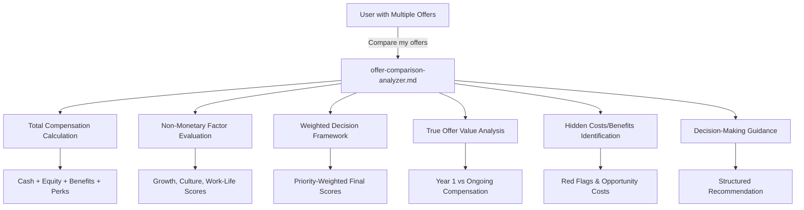
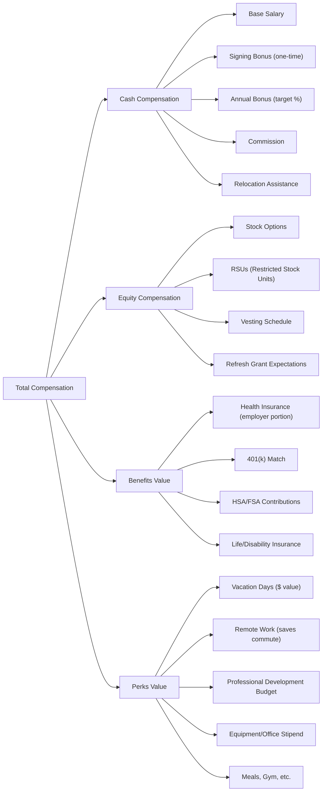
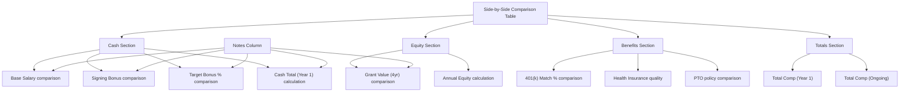
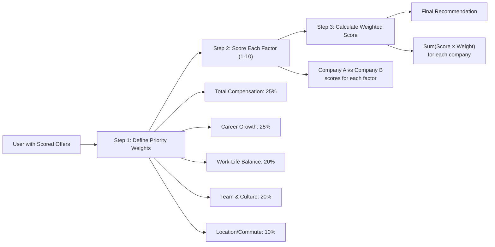
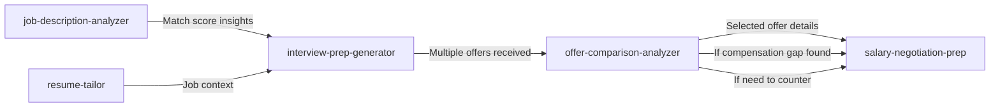

<!-- source: DeepWiki mcp.deepwiki.com · repo Paramchoudhary/ResumeSkills · extra page Offer Comparison Analyzer · fetched 2026-10-26 -->

# Offer Comparison Analyzer

<details>
<summary>Relevant source files</summary>

The following files were used as context for generating this wiki page:

- [.agents/skills/offer-comparison-analyzer/SKILL.md](.agents/skills/offer-comparison-analyzer/SKILL.md)

</details>


## Purpose and Scope

The Offer Comparison Analyzer skill provides a systematic framework for evaluating and comparing multiple job offers using both quantitative compensation analysis and qualitative factor assessment. This skill transforms the emotionally-charged decision of choosing between opportunities into a data-driven process by calculating total compensation (not just base salary), scoring non-monetary factors, and applying weighted decision matrices aligned with personal priorities.

This page documents the mechanics of the offer-comparison-analyzer skill, including invocation triggers, compensation calculation methodology, comparison frameworks, and output formats. For preparing negotiation strategies after selecting an offer, see [Salary Negotiation Prep](#4.4). For analyzing whether a job matches your profile before applying, see [Job Description Analyzer](#4.2.1).

**Sources:** [.agents/skills/offer-comparison-analyzer/SKILL.md:1-24]()

---

## When to Use This Skill

The skill activates when user input contains keywords or phrases indicating multiple competing offers:

| Trigger Keywords | Example Prompts |
|-----------------|----------------|
| `compare offers` | "Compare my two job offers" |
| `multiple offers` | "I have multiple offers to evaluate" |
| `which job` | "Which job should I take?" |
| `offer comparison` | "Help me with offer comparison" |
| `deciding between jobs` | "Deciding between two jobs at different companies" |

The skill is designed for candidates who have received formal written offers and need structured decision support. It is **not** for pre-application job research or negotiation preparation (those are covered by other skills).

**Sources:** [.agents/skills/offer-comparison-analyzer/SKILL.md:8-15]()

---

## Core Capabilities

The skill provides six primary capabilities:



**Diagram: Skill Capability Architecture**

The skill addresses the fundamental challenge that offers are difficult to compare due to different compensation structures, non-monetary factors, hidden costs/benefits, emotional decision-making, and information asymmetry between candidates and employers.

**Sources:** [.agents/skills/offer-comparison-analyzer/SKILL.md:17-43]()

---

## Total Compensation Calculator

### Compensation Components

The skill calculates total compensation across four major categories, not just base salary. This addresses the common mistake of comparing offers based only on the most visible number.



**Diagram: Total Compensation Component Breakdown**

**Sources:** [.agents/skills/offer-comparison-analyzer/SKILL.md:44-74]()

### Calculation Methodology

The skill provides a structured template for calculating total compensation. Here is the calculation framework as defined in the skill:

| Component | Calculation Method | Example |
|-----------|-------------------|---------|
| **Base Salary** | Annual amount | $150,000 |
| **Signing Bonus** | One-time (Year 1 only) | $25,000 |
| **Target Bonus** | Base × Bonus % | $150,000 × 15% = $22,500 |
| **Commission** | Expected annual (for sales) | Varies |
| **RSU Grant** | Total value ÷ Vesting years | $200,000 ÷ 4 = $50,000/year |
| **Stock Options** | (Current price - Strike price) × Shares | Varies |
| **401(k) Match** | Base × Match % | $150,000 × 4% = $6,000 |
| **Health Insurance** | Employer contribution value | ~$15,000 |
| **Extra PTO** | Extra days × Daily rate | 10 days × $575 = $5,750 |
| **Remote Work Savings** | Commute + Lunch costs avoided | ~$3,000 |

The skill distinguishes between **Year 1 Total** (includes one-time bonuses) and **Ongoing Total** (recurring annual compensation) to provide realistic long-term comparison.

**Example calculation template from the skill:**

```
OFFER A - TOTAL COMPENSATION

CASH
Base Salary:                    $150,000
Signing Bonus (year 1 only):     $25,000
Target Bonus (15%):              $22,500
--------------------------------
Cash Compensation:              $197,500 (year 1)
                               $172,500 (ongoing)

EQUITY
RSU Grant: $200,000 over 4 years
Annual Value:                    $50,000
--------------------------------
Equity Compensation:             $50,000/year

BENEFITS
401(k) Match (4%):               $6,000
Health Insurance:                $15,000 (employer portion)
HSA Contribution:                 $1,000
--------------------------------
Benefits Value:                  $22,000/year

PERKS
Vacation: 20 days (vs 10 standard)
  Extra 10 days × ~$575/day:      $5,750 value
Remote Work Savings:              $3,000 (commute, lunch)
Professional Dev:                 $2,000 budget
--------------------------------
Perks Value:                     $10,750/year

TOTAL YEAR 1:        $280,250
TOTAL ONGOING:       $255,250/year
```

**Sources:** [.agents/skills/offer-comparison-analyzer/SKILL.md:75-111]()

---

## Side-by-Side Comparison Framework

The skill generates structured comparison tables that make differences immediately visible. The template structure is:



**Diagram: Comparison Table Structure**

The skill includes a notes column for each row to highlight key differences (e.g., "A +$11.5K", "B better"). This allows quick scanning for the offer winner in each category.

**Example comparison table format:**

|                          | Company A | Company B | Notes |
|--------------------------|-----------|-----------|-------|
| **CASH**                 |           |           |       |
| Base Salary              | $150,000  | $160,000  | B +$10K |
| Signing Bonus            | $25,000   | $10,000   | A +$15K |
| Target Bonus             | 15%       | 10%       | A +$6.5K |
| **Cash Total (Yr 1)**    | $197,500  | $186,000  | A +$11.5K |
|                          |           |           |       |
| **EQUITY**               |           |           |       |
| Grant Value (4yr)        | $200,000  | $300,000  | B +$100K |
| Annual Equity            | $50,000   | $75,000   | B +$25K |
|                          |           |           |       |
| **BENEFITS**             |           |           |       |
| 401(k) Match             | 4%        | 6%        | B +$3.2K |
| Health Insurance         | Good      | Premium   | B better |
| PTO                      | 20 days   | Unlimited | Varies |
|                          |           |           |       |
| **TOTAL COMP (Yr 1)**    | $280,250  | $285,000  | B +$4.7K |
| **TOTAL COMP (Ongoing)** | $255,250  | $275,000  | B +$19.7K |

**Sources:** [.agents/skills/offer-comparison-analyzer/SKILL.md:113-137]()

---

## Non-Monetary Factor Evaluation

### Factor Categories

The skill evaluates four major non-monetary categories with customizable weighting:

```mermaid
graph TB
    FACTORS["Non-Monetary Factors"]
    
    FACTORS --> F1["Career Growth (Weight: High)"]
    FACTORS --> F2["Work-Life Balance (Weight: Personal)"]
    FACTORS --> F3["Team & Culture (Weight: High)"]
    FACTORS --> F4["Risk Assessment (Weight: Medium)"]
    
    F1 --> F1A["Learning opportunity"]
    F1 --> F1B["Brand/resume value"]
    F1 --> F1C["Promotion potential"]
    F1 --> F1D["Scope/responsibility"]
    F1 --> F1E["Manager quality"]
    
    F2 --> F2A["Expected hours"]
    F2 --> F2B["Remote/hybrid flexibility"]
    F2 --> F2C["Vacation usage culture"]
    F2 --> F2D["On-call requirements"]
    F2 --> F2E["Travel requirements"]
    F2 --> F2F["Commute time"]
    
    F3 --> F3A["Manager quality (crucial!)"]
    F3 --> F3B["Team health/dynamics"]
    F3 --> F3C["Company culture fit"]
    F3 --> F3D["DEI considerations"]
    F3 --> F3E["Company stability/growth"]
    F3 --> F3F["Values alignment"]
    
    F4 --> F4A["Funding runway"]
    F4 --> F4B["Market position"]
    F4 --> F4C["Company trajectory"]
    F4 --> F4D["Equity risk (could be $0)"]
    F4 --> F4E["Role stability"]
    F4 --> F4F["Severance policy"]
```



**Diagram: Non-Monetary Factor Framework**

**Sources:** [.agents/skills/offer-comparison-analyzer/SKILL.md:139-199]()

### Scoring Methodology

Each factor is scored on a 1-10 scale for each offer. The skill provides scoring templates like:

```
Company A: Growth Score
- Learning opportunity: 8/10
- Brand/resume value: 7/10
- Promotion potential: 6/10
- Scope: 8/10
Average: 7.25/10

Company B: Growth Score
- Learning opportunity: 7/10
- Brand/resume value: 9/10
- Promotion potential: 8/10
- Scope: 7/10
Average: 7.75/10
```

This granular scoring approach forces explicit evaluation of each subfactor rather than relying on gut feeling.

**Sources:** [.agents/skills/offer-comparison-analyzer/SKILL.md:150-165]()

---

## Weighted Decision Matrix

### Three-Step Process

The skill implements a weighted decision matrix that combines quantitative and qualitative factors:



**Diagram: Weighted Decision Matrix Calculation Flow**

### Example Calculation

| Factor | Weight | Company A Score | A Weighted | Company B Score | B Weighted |
|--------|--------|----------------|------------|----------------|------------|
| Compensation | 25% | 7 | 1.75 | 8 | 2.00 |
| Career Growth | 25% | 7 | 1.75 | 8 | 2.00 |
| Work-Life | 20% | 8 | 1.60 | 6 | 1.20 |
| Team & Culture | 20% | 9 | 1.80 | 7 | 1.40 |
| Location | 10% | 8 | 0.80 | 5 | 0.50 |
| **TOTAL** | **100%** | - | **7.70** | - | **7.10** |

In this example, Company A scores higher (7.70 vs 7.10) despite Company B offering better compensation and growth, because the user prioritized work-life balance and team quality where Company A excels.

**Sources:** [.agents/skills/offer-comparison-analyzer/SKILL.md:200-243]()

---

## Red Flags and Warning Signs

The skill includes comprehensive red flag detection across three categories:

### Offer Red Flags

| Red Flag | Risk Description |
|----------|-----------------|
| Vague bonus language | "up to 20%" = likely lower actual payout |
| Equity with no liquidity path | Startup equity worthless without exit strategy |
| High base but no equity at startup | Indicates company doesn't value retention |
| Cliff longer than 1 year | Risk of losing all equity if leaving early |
| Vesting acceleration absent | No protection if company is acquired |
| Non-compete restrictions | Limits future career options |
| Verbal promises not in writing | Unenforceable and often forgotten |

### Company Red Flags

- High turnover (check LinkedIn movement patterns)
- Recent layoffs or reorganizations
- Manager seems checked out or disengaged
- Glassdoor patterns showing consistent negative themes
- Funding concerns or runway < 12 months
- Unclear path to profitability

### Role Red Flags

- Vague or shifting responsibilities during interview process
- Position exists due to recent firing or departure under bad circumstances
- No clear growth path discussed
- Unrealistic expectations set during negotiation
- Role seems to change significantly between interviews

**Sources:** [.agents/skills/offer-comparison-analyzer/SKILL.md:245-273]()

---

## Self-Assessment Questions

The skill guides users through four categories of introspective questions to complement quantitative analysis:

### The Gut Check

- Which offer excites me more?
- Which would I regret not taking?
- Which aligns with my 5-year goals?
- Which would I brag about to friends?

### The Monday Morning Test

- Which job do I want to wake up for?
- Which team do I want to work with?
- Which problems do I want to solve?

### The Learning Test

- Where will I grow more?
- Which skills will I develop?
- Which looks better on my resume in 3 years?

### The Risk Test

- What's the downside of each?
- Which failure would I regret more?
- What's my backup plan for each?

These questions surface emotional and long-term considerations that pure numerical analysis misses.

**Sources:** [.agents/skills/offer-comparison-analyzer/SKILL.md:274-296]()

---

## Output Structure

The skill generates a structured markdown output document following this format:

```mermaid
graph TD
    OUTPUT["Offer Comparison Output Document"]
    
    OUTPUT --> SEC1["Offers Being Compared"]
    OUTPUT --> SEC2["Total Compensation Comparison Table"]
    OUTPUT --> SEC3["Non-Monetary Comparison Table"]
    OUTPUT --> SEC4["Weighted Analysis Scores"]
    OUTPUT --> SEC5["Key Differences List"]
    OUTPUT --> SEC6["Recommendation with Reasoning"]
    OUTPUT --> SEC7["Things to Clarify Checklist"]
    OUTPUT --> SEC8["Negotiation Opportunities"]
    
    SEC1 --> S1A["Role + Company for Offer A"]
    SEC1 --> S1B["Role + Company for Offer B"]
    
    SEC2 --> S2A["Base, Bonus, Equity, Benefits rows"]
    SEC2 --> S2B["Year 1 Total vs Ongoing Total"]
    SEC2 --> S2C["Difference column"]
    
    SEC3 --> S3A["Career Growth scores"]
    SEC3 --> S3B["Work-Life scores"]
    SEC3 --> S3C["Team/Culture scores"]
    SEC3 --> S3D["Risk Level scores"]
    
    SEC4 --> S4A["User's priority weights"]
    SEC4 --> S4B["Final weighted scores"]
    
    SEC6 --> S6A["Based on stated priorities"]
    SEC6 --> S6B["3 key reasons"]
    
    SEC7 --> S7A["Questions for Company A"]
    SEC7 --> S7B["Questions for Company B"]
```



**Diagram: Output Document Structure**

### Complete Output Template

The skill produces output following this structure from [.agents/skills/offer-comparison-analyzer/SKILL.md:298-353]():

```markdown
# JOB OFFER COMPARISON

## Offers Being Compared
- **Offer A:** [Role] at [Company]
- **Offer B:** [Role] at [Company]

## Total Compensation Comparison

| Component | Offer A | Offer B | Difference |
|-----------|---------|---------|------------|
| Base | $X | $X | |
| Bonus | $X | $X | |
| Equity (annual) | $X | $X | |
| Benefits | $X | $X | |
| **Year 1 Total** | $X | $X | |
| **Ongoing Total** | $X | $X | |

## Non-Monetary Comparison

| Factor | Offer A | Offer B | Notes |
|--------|---------|---------|-------|
| Career Growth | X/10 | X/10 | |
| Work-Life | X/10 | X/10 | |
| Team/Culture | X/10 | X/10 | |
| Risk Level | X/10 | X/10 | |

## Weighted Analysis

Using your priorities:
- Offer A Score: X.XX
- Offer B Score: X.XX

## Key Differences
1. [Key difference 1]
2. [Key difference 2]
3. [Key difference 3]

## Recommendation

Based on your stated priorities of [X, Y, Z], **Offer [A/B]** appears to be the stronger choice because:
- [Reason 1]
- [Reason 2]
- [Reason 3]

## Things to Clarify Before Deciding
- [ ] [Question for Company A]
- [ ] [Question for Company B]

## Negotiation Opportunities
- [Opportunity 1]
- [Opportunity 2]
```

**Sources:** [.agents/skills/offer-comparison-analyzer/SKILL.md:297-353]()

---

## Comparison Checklist

The skill includes a verification checklist to ensure comprehensive analysis:

| Checkpoint | Description |
|-----------|-------------|
| ✅ Calculated total comp | Not just base salary |
| ✅ Included equity | With realistic valuation |
| ✅ Factored in benefits value | Health, 401(k), insurance |
| ✅ Considered tax implications | State taxes, equity tax treatment |
| ✅ Weighted non-monetary factors | Growth, culture, work-life |
| ✅ Assessed career growth potential | Learning, brand value, promotion track |
| ✅ Evaluated team and manager quality | Manager quality is crucial |
| ✅ Checked company stability/risk | Funding, runway, market position |
| ✅ Aligned with personal priorities | Custom weights for factors |
| ✅ Gut-checked the decision | Monday morning test |

This checklist ensures no critical factor is overlooked during the decision-making process.

**Sources:** [.agents/skills/offer-comparison-analyzer/SKILL.md:355-367]()

---

## Integration with Other Skills

The offer-comparison-analyzer skill connects to other job search skills in the workflow:



**Diagram: Skill Integration in Job Search Workflow**

- **Input from interview-prep-generator**: The interview process provides context about role expectations and culture that inform non-monetary scoring
- **Output to salary-negotiation-prep**: Once an offer is selected via comparison, negotiation prep can optimize the final terms
- **Parallel with job-description-analyzer**: While JDA evaluates job fit before application, offer comparison evaluates actual offers after receiving them

**Sources:** High-level diagram analysis from README context

---

