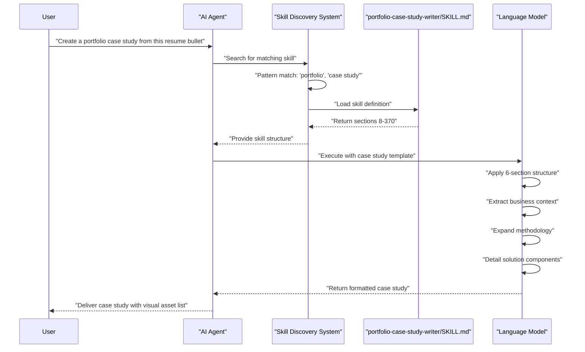
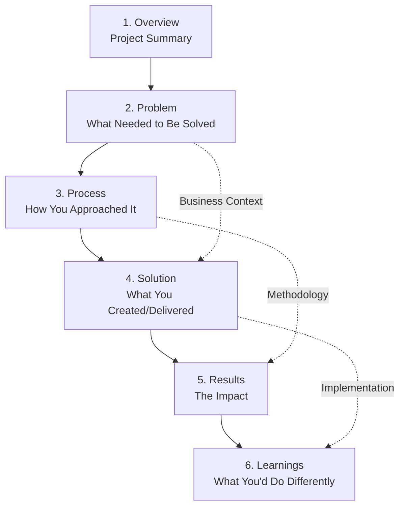
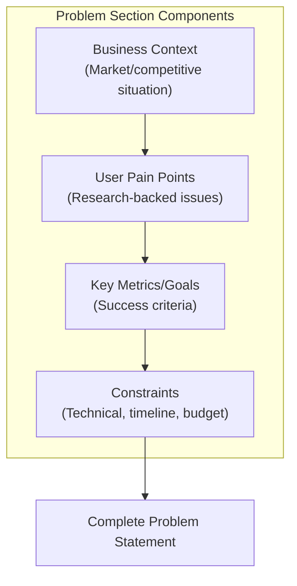
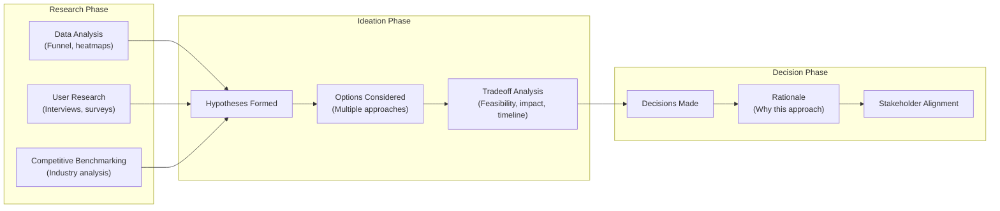
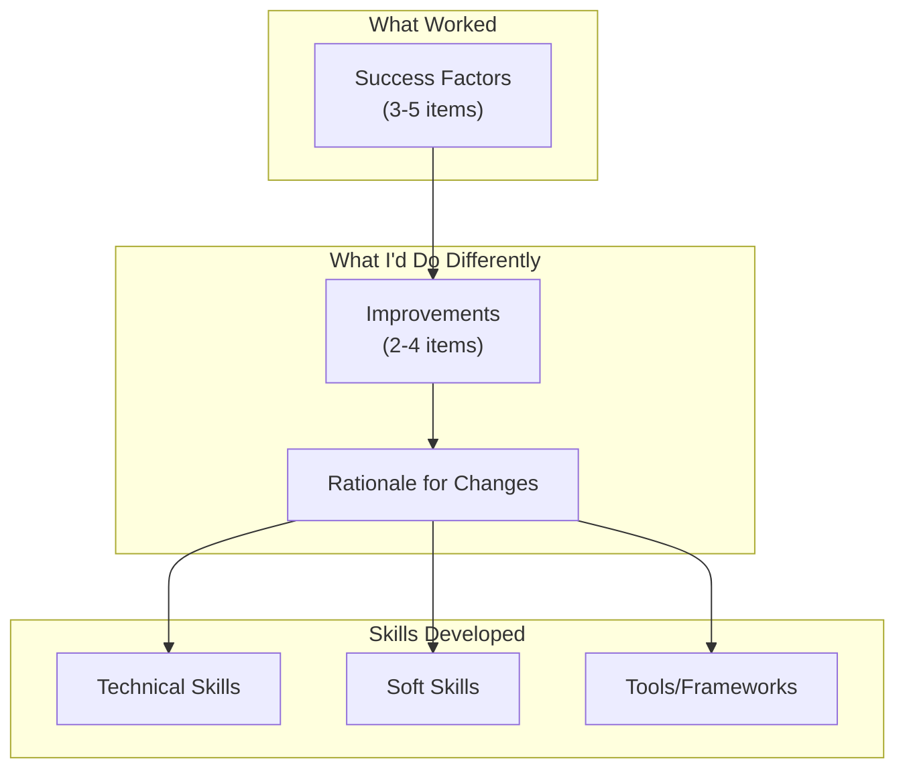
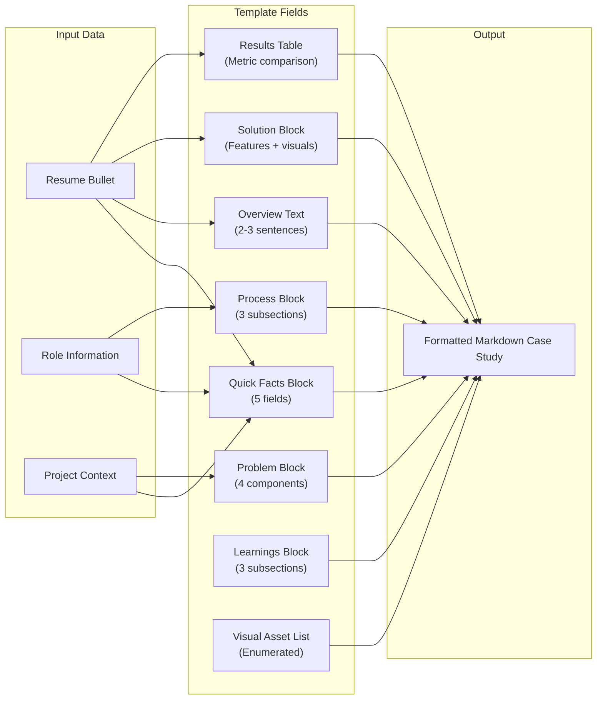
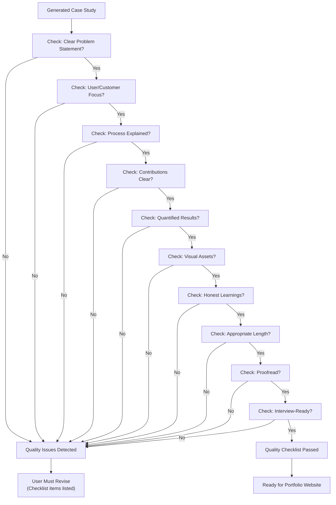
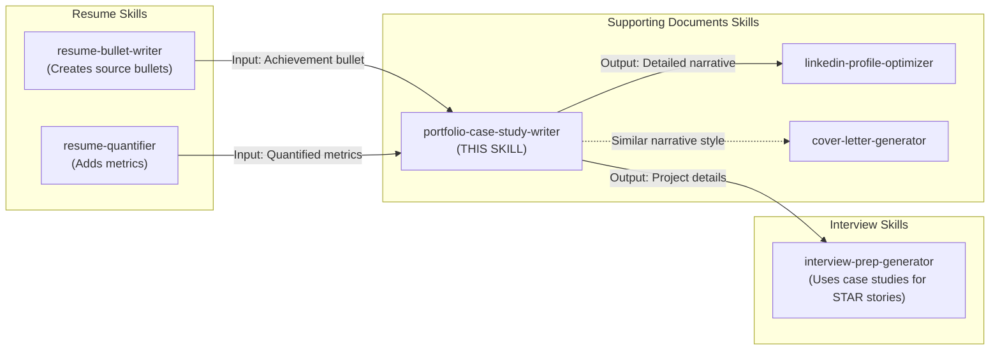

<!-- source: DeepWiki mcp.deepwiki.com · repo Paramchoudhary/ResumeSkills · extra page Portfolio Case Study Writer · fetched 2026-10-26 -->

# Portfolio Case Study Writer

<details>
<summary>Relevant source files</summary>

The following files were used as context for generating this wiki page:

- [.agents/skills/portfolio-case-study-writer/SKILL.md](.agents/skills/portfolio-case-study-writer/SKILL.md)

</details>


## Purpose and Scope

This document provides technical documentation for the `portfolio-case-study-writer` skill, which transforms resume achievement bullets into detailed portfolio case studies. This skill expands concise resume statements into comprehensive narratives that demonstrate thinking process, methodology, and business impact.

The skill implements a standardized six-section case study structure: Overview, Problem, Process, Solution, Results, and Learnings. It adapts the depth and focus based on the user's role (Product Manager, UX Designer, Software Engineer, Marketing) while maintaining consistent narrative flow.

For general supporting documents overview, see [Supporting Documents Skills](#4.3). For optimizing LinkedIn profiles, see [LinkedIn Profile Optimizer](#4.3.1). For preparing references, see [Reference List Builder](#4.3.3).

**Sources:** [.agents/skills/portfolio-case-study-writer/SKILL.md:1-6]()

---

## Skill Invocation and Triggers

### Invocation Keywords

The AI agent activates this skill when the user's prompt contains specific keywords or phrases indicating a need for portfolio case study creation.

| Trigger Category | Keywords | Example Prompt |
|-----------------|----------|----------------|
| Direct Request | "case study", "portfolio" | "Create a case study for my portfolio" |
| Content Expansion | "project writeup", "detailed writeup" | "Expand this resume bullet into a project writeup" |
| Portfolio Building | "portfolio piece", "work samples" | "I need portfolio pieces for my website" |
| Project Showcase | "showcase project", "project depth" | "I want to showcase this project in depth" |

### Skill Discovery Pattern



**Sources:** [.agents/skills/portfolio-case-study-writer/SKILL.md:8-15]()

---

## Core Transformation Process

### Resume Bullet to Case Study Expansion

The skill transforms concise resume bullets (typically 1-2 lines) into comprehensive case studies (3-10 minute reading time). This expansion follows a structured pipeline:

```mermaid
graph LR
    subgraph "Input Processing"
        ResumeBullet["Resume Bullet<br/>(1-2 lines)"]
        ParseAction["Extract Action Verb"]
        ParseMetric["Extract Metrics"]
        ParseContext["Extract Business Context"]
    end
    
    subgraph "Section Generation Pipeline"
        GenOverview["Generate Overview<br/>(Quick Facts Template)"]
        GenProblem["Generate Problem<br/>(Context + Pain Points)"]
        GenProcess["Generate Process<br/>(Research + Decisions)"]
        GenSolution["Generate Solution<br/>(Features + Implementation)"]
        GenResults["Generate Results<br/>(Metrics Table)"]
        GenLearnings["Generate Learnings<br/>(Reflections)"]
    end
    
    subgraph "Output Assembly"
        FormatMarkdown["Format Markdown"]
        AddVisualList["Add Visual Asset List"]
        QualityCheck["Quality Checklist"]
    end
    
    ResumeBullet --> ParseAction
    ResumeBullet --> ParseMetric
    ResumeBullet --> ParseContext
    
    ParseAction --> GenOverview
    ParseMetric --> GenOverview
    ParseContext --> GenOverview
    
    GenOverview --> GenProblem
    ParseContext --> GenProblem
    
    GenProblem --> GenProcess
    ParseAction --> GenProcess
    
    GenProcess --> GenSolution
    
    GenSolution --> GenResults
    ParseMetric --> GenResults
    
    GenResults --> GenLearnings
    
    GenLearnings --> FormatMarkdown
    FormatMarkdown --> AddVisualList
    AddVisualList --> QualityCheck
    QualityCheck --> CaseStudyOutput["Case Study Output<br/>(3-10 min read)"]
```



### Value Proposition

| Aspect | Resume Bullet | Portfolio Case Study |
|--------|---------------|---------------------|
| **Content Depth** | WHAT you did | HOW and WHY you did it |
| **Demonstrable Skills** | Outcomes only | Thinking process + outcomes |
| **Differentiation** | Same format as competitors | Unique narrative |
| **Role Requirements** | Optional for most roles | Required for PM, UX, creative roles |
| **Reading Time** | 5-10 seconds | 3-10 minutes |

**Sources:** [.agents/skills/portfolio-case-study-writer/SKILL.md:17-33]()

---

## Six-Section Case Study Structure

### Standard Template Definition

The skill enforces a standardized structure defined in [.agents/skills/portfolio-case-study-writer/SKILL.md:36-46]():



### Reading Time Targets

| Target | Duration | Purpose | Sections Emphasized |
|--------|----------|---------|-------------------|
| **Quick Read** | 3-5 minutes | Essential portfolio browsing | Overview, Results |
| **Deep Dive** | 10-15 minutes | Detailed review by hiring managers | All sections, especially Process |

**Sources:** [.agents/skills/portfolio-case-study-writer/SKILL.md:35-51]()

---

## Section Implementation Details

### 1. Overview Section Structure

The Overview section uses a structured template defined in [.agents/skills/portfolio-case-study-writer/SKILL.md:54-75]():

| Field | Data Type | Purpose | Example |
|-------|-----------|---------|---------|
| `Project name` | String | Hook reader attention | "Redesigning the Checkout Flow" |
| `Company` | String | Provide organizational context | "E-Commerce Inc." |
| `Role` | String | Establish your contribution level | "Lead Product Designer" |
| `Timeline` | Duration | Show project scope | "6 weeks" |
| `Team size` | Number + Roles | Indicate collaboration scale | "2 designers, 3 engineers, 1 PM" |
| `Impact summary` | One-sentence result | Preview the outcome | "Reduced cart abandonment by 35%" |

**Markdown Template:**
```markdown
# [Project Name]

**Company:** [Company Name]
**Role:** [Your Role]
**Timeline:** [Duration]
**Team:** [Team Composition]

**Summary:** [One-sentence impact statement with quantified result]
```

**Sources:** [.agents/skills/portfolio-case-study-writer/SKILL.md:54-75]()

### 2. Problem Section Structure

The Problem section establishes the business case and user needs [.agents/skills/portfolio-case-study-writer/SKILL.md:77-104]():



**Required Elements:**

| Element | Source Data | Validation |
|---------|-------------|------------|
| Business context | Market position, competitive landscape | Must explain why this matters to company |
| User pain points | User research, exit surveys, interviews | Must be evidence-based, not assumed |
| Key metrics or goals | Existing baselines, industry benchmarks | Must be quantified and measurable |
| Constraints | Technical limitations, timeline, budget | Must be realistic and specific |

**Sources:** [.agents/skills/portfolio-case-study-writer/SKILL.md:77-104]()

### 3. Process Section Structure

The Process section demonstrates methodology and decision-making [.agents/skills/portfolio-case-study-writer/SKILL.md:106-144]():



**Subsection Template:**

| Subsection | Content Focus | Key Question Answered |
|------------|---------------|----------------------|
| **Research** | Methods used, data sources, key insights | What did you learn? |
| **Ideation** | Approaches explored, options considered | What alternatives existed? |
| **Decisions Made** | Final choices, rationale, stakeholder buy-in | Why this path? |

**Sources:** [.agents/skills/portfolio-case-study-writer/SKILL.md:106-144]()

### 4. Solution Section Structure

The Solution section presents the deliverable with visual descriptions [.agents/skills/portfolio-case-study-writer/SKILL.md:146-186]():

| Component | Description Format | Visual Asset |
|-----------|-------------------|--------------|
| Overview | Before/after comparison statement | Before/after comparison image |
| Key Feature 1 | Feature description + rationale | Mockup/screenshot |
| Key Feature 2 | Feature description + rationale | Mockup/screenshot |
| Key Feature N | Feature description + rationale | Mockup/screenshot |
| Technical Implementation | Architecture/stack details (if relevant) | System diagram |
| Problem Mapping | How features address problems | Feature-to-problem matrix |

**Visual Asset Placeholders:**
- `[IMAGE: Before/After comparison]`
- `[IMAGE: Feature mockup]`
- `[IMAGE: System diagram]`

**Sources:** [.agents/skills/portfolio-case-study-writer/SKILL.md:146-186]()

### 5. Results Section Structure

The Results section quantifies impact with data tables [.agents/skills/portfolio-case-study-writer/SKILL.md:188-220]():

**Primary Metrics Table Format:**

| Metric | Before | After | Change |
|--------|--------|-------|--------|
| [Primary KPI] | [Baseline] | [Post-launch] | [% or absolute change] |
| [Secondary KPI] | [Baseline] | [Post-launch] | [% or absolute change] |
| [Tertiary KPI] | [Baseline] | [Post-launch] | [% or absolute change] |

**Required Data Points:**

| Category | Data Required | Timeframe |
|----------|---------------|-----------|
| Primary metrics | 2-4 key KPIs with before/after values | Must specify (e.g., "90 days post-launch") |
| Comparison to goals | % achievement vs stated goals | From Problem section |
| Business impact | Revenue, cost savings, or efficiency gains | Annualized if possible |
| Secondary effects | Unexpected positive/negative impacts | Same timeframe as primary |

**Sources:** [.agents/skills/portfolio-case-study-writer/SKILL.md:188-220]()

### 6. Learnings Section Structure

The Learnings section demonstrates self-awareness and growth mindset [.agents/skills/portfolio-case-study-writer/SKILL.md:222-250]():



**Subsection Requirements:**

| Subsection | Count | Focus |
|------------|-------|-------|
| What Worked | 3-5 items | Validation of approach, early wins, team dynamics |
| What I'd Do Differently | 2-4 items | Honest reflection, process improvements, timeline issues |
| Skills Developed | 2-3 items | Specific tools, frameworks, or capabilities learned |

**Sources:** [.agents/skills/portfolio-case-study-writer/SKILL.md:222-250]()

---

## Role-Specific Focus Areas

### Focus Area Mapping by Role

The skill adapts emphasis based on the user's role while maintaining the same six-section structure [.agents/skills/portfolio-case-study-writer/SKILL.md:252-280]():

```mermaid
graph TB
    subgraph "Product Manager"
        PM_Strategy["Strategy & Prioritization<br/>(Why this, not that)"]
        PM_Stakeholder["Stakeholder Management<br/>(Alignment tactics)"]
        PM_Metrics["Metrics & Outcomes<br/>(Business impact)"]
        PM_Tradeoffs["Technical Trade-offs<br/>(Decision rationale)"]
    end
    
    subgraph "UX/Product Designer"
        UX_Research["User Research<br/>(Methods, insights)"]
        UX_Process["Design Process<br/>(Iterations, explorations)"]
        UX_Visual["Visual Artifacts<br/>(Mockups, prototypes)"]
        UX_Usability["Usability Improvements<br/>(Before/after metrics)"]
    end
    
    subgraph "Software Engineer"
        ENG_Architecture["Technical Architecture<br/>(System design)"]
        ENG_Problem["Problem-Solving Approach<br/>(Algorithm choices)"]
        ENG_Design["System Design<br/>(Scalability, patterns)"]
        ENG_Quality["Code Quality/Performance<br/>(Optimizations, testing)"]
    end
    
    subgraph "Marketing"
        MKT_Strategy["Strategy & Targeting<br/>(Audience segmentation)"]
        MKT_Creative["Creative Execution<br/>(Campaign elements)"]
        MKT_Channel["Channel Performance<br/>(Multi-channel analysis)"]
        MKT_ROI["ROI & Attribution<br/>(Conversion funnels)"]
    end
    
    CaseStudyStructure["6-Section Case Study Structure"]
    
    CaseStudyStructure --> PM_Strategy
    CaseStudyStructure --> UX_Research
    CaseStudyStructure --> ENG_Architecture
    CaseStudyStructure --> MKT_Strategy
```



| Role | Primary Focus Sections | Visual Emphasis | Metrics Priority |
|------|----------------------|-----------------|------------------|
| **Product Manager** | Process (60%), Results (30%) | Strategy diagrams, roadmaps | Business metrics, adoption |
| **UX Designer** | Process (40%), Solution (40%) | Mockups, user flows, wireframes | Usability metrics, satisfaction |
| **Software Engineer** | Solution (50%), Process (30%) | Architecture diagrams, code snippets | Performance, scalability |
| **Marketing** | Process (30%), Results (40%) | Campaign visuals, channel mix | ROI, conversion rates |

**Sources:** [.agents/skills/portfolio-case-study-writer/SKILL.md:252-280]()

---

## Visual Asset Requirements

### Must-Have Visual Categories

The skill generates a visual asset list that the user must populate [.agents/skills/portfolio-case-study-writer/SKILL.md:282-300]():

| Visual Category | Purpose | Placement | Format Recommendations |
|-----------------|---------|-----------|----------------------|
| **Before/after comparisons** | Show transformation impact | Solution section | Side-by-side or vertical stack |
| **Key screens or deliverables** | Demonstrate output quality | Solution section | Full-width screenshots |
| **Process diagrams** | Explain methodology | Process section | Flowcharts, journey maps |
| **Results charts** | Visualize data | Results section | Bar charts, line graphs |

### Nice-to-Have Visual Categories

| Visual Category | Purpose | Placement | When to Include |
|-----------------|---------|-----------|-----------------|
| **User journey maps** | Show end-to-end flow | Problem or Process | UX/Product Designer roles |
| **Wireframes evolution** | Show design iterations | Process section | Designer roles with iteration focus |
| **Research artifacts** | Demonstrate rigor | Process section | Heavy research projects |
| **Team photos** | Humanize the work | Overview section | When collaboration is key theme |

### Visual Asset List Output

At the end of each case study, the skill generates:

```markdown
## Visual Asset List
1. Before/after comparison of [specific element]
2. Screenshot: [Feature name] in context
3. Process diagram: [Methodology name]
4. Results chart: [Metric] over time
5. [Additional visuals as needed]
```

**Visual Implementation Guidelines:**

| Guideline | Specification | Rationale |
|-----------|---------------|-----------|
| Consistent sizing | Max width 800px | Mobile-friendly, fast loading |
| Captions required | Below each image | Context for visuals |
| Sensitive data | Blur/redact as needed | Privacy/NDA compliance |
| File format | PNG for UI, SVG for diagrams | Quality vs. file size |

**Sources:** [.agents/skills/portfolio-case-study-writer/SKILL.md:282-300]()

---

## Output Format Specification

### Markdown Template Structure

The skill outputs markdown using this template [.agents/skills/portfolio-case-study-writer/SKILL.md:302-356]():

```markdown
# CASE STUDY: [PROJECT NAME]

## Quick Facts
- **Role:** [Your role]
- **Company:** [Company]
- **Timeline:** [Duration]
- **Team:** [Team composition]
- **Impact:** [One-line result]

---

## Overview
[2-3 sentence summary]

## Problem
[Context and challenges]

## Process
### Research
[What you learned]

### Approach
[How you tackled it]

### Key Decisions
[Important choices and rationale]

## Solution
[What you built/created]

### Feature 1
[Description with visual placeholder]

### Feature 2
[Description with visual placeholder]

## Results
[Quantified impact]

| Metric | Before | After | Change |
|--------|--------|-------|--------|

## Learnings
[Reflections and growth]

---

## Visual Asset List
[List of images/screenshots needed]
```

### Data Structure Mapping



**Sources:** [.agents/skills/portfolio-case-study-writer/SKILL.md:302-356]()

---

## Quality Assurance Checklist

### Validation Criteria

The skill enforces quality through a 10-point checklist [.agents/skills/portfolio-case-study-writer/SKILL.md:358-369]():

| Criterion | Validation Method | Required Evidence |
|-----------|-------------------|-------------------|
| ✅ Clear problem statement | Check Problem section exists | Business context + user pain points |
| ✅ Evidence of user/customer focus | Check for research citations | User interviews, data analysis, surveys |
| ✅ Process clearly explained | Check Process section completeness | Research, approach, decisions subsections |
| ✅ Specific contributions clear | Check for "I" vs "We" clarity | Role description + individual actions |
| ✅ Quantified results | Check Results table exists | Before/after metrics with % change |
| ✅ Visual artifacts included | Check visual asset list | Minimum 4 visual placeholders |
| ✅ Honest about challenges/learnings | Check Learnings section | "What I'd do differently" subsection |
| ✅ Appropriate length | Word count check | 1000-2500 words (3-10 min read) |
| ✅ Proofread and polished | Grammar/spelling check | No typos, consistent formatting |
| ✅ Can discuss in detail in interview | Content depth validation | Enough detail to answer follow-up questions |

### Quality Enforcement Flow



**Sources:** [.agents/skills/portfolio-case-study-writer/SKILL.md:358-369]()

---

## Integration with Related Skills

### Skill Dependency Map



### Data Flow from Resume to Portfolio

| Source Skill | Data Extracted | Usage in Case Study | Target Section |
|--------------|----------------|---------------------|----------------|
| `resume-bullet-writer` | Action verb + achievement | Problem statement, solution description | Problem, Solution |
| `resume-quantifier` | Metrics (%, $, time saved) | Results table baseline and outcomes | Results |
| `resume-section-builder` | Role, company, timeline | Quick Facts block | Overview |
| `job-description-analyzer` | Business context, requirements | Problem section context | Problem |

**Sources:** [.agents/skills/portfolio-case-study-writer/SKILL.md:1-370]()

---

