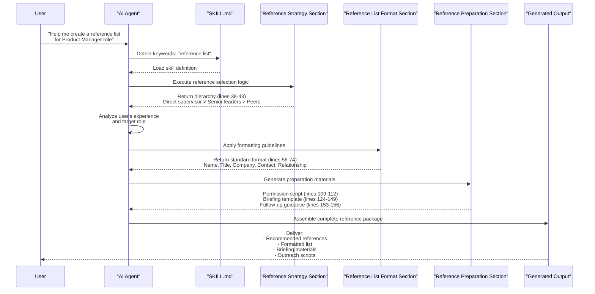
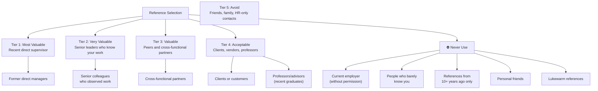
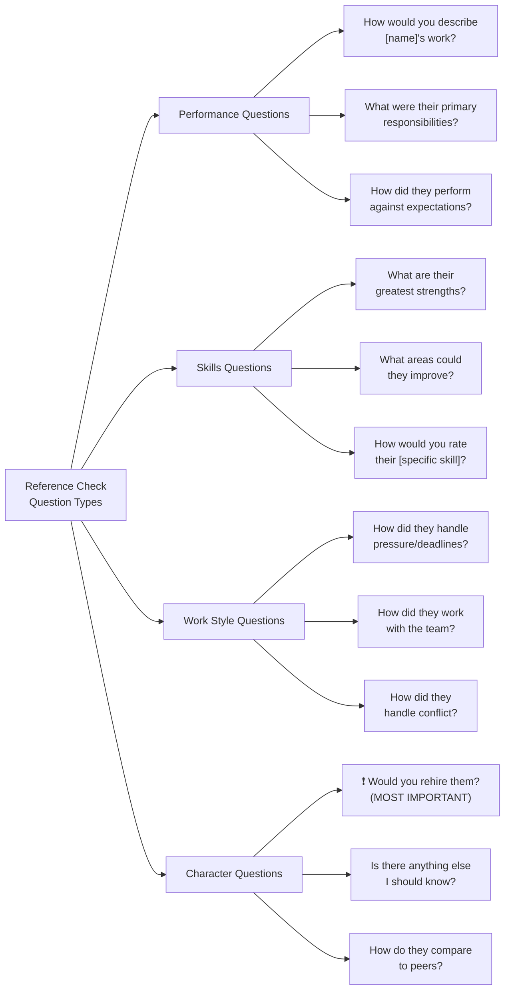
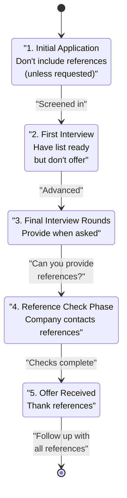

<!-- source: DeepWiki mcp.deepwiki.com · repo Paramchoudhary/ResumeSkills · extra page Reference List Builder · fetched 2026-10-26 -->

# Reference List Builder

<details>
<summary>Relevant source files</summary>

The following files were used as context for generating this wiki page:

- [.agents/skills/reference-list-builder/SKILL.md](.agents/skills/reference-list-builder/SKILL.md)

</details>


## Purpose and Scope

This document provides complete technical documentation for the `reference-list-builder` skill, which generates professional reference lists and prepares reference materials for job applications. The skill guides users through reference selection strategy, proper formatting, and the three-step preparation process to ensure references are briefed and ready for employer contact.

For related application materials, see [Portfolio Case Study Writer](#4.3.2) for detailed project documentation and [LinkedIn Profile Optimizer](#4.3.1) for professional profile optimization. For complete application preparation workflows, see [End-to-End Workflows](#5).

**Sources:** [.agents/skills/reference-list-builder/SKILL.md:1-6]()

---

## Skill Invocation

The `reference-list-builder` skill is triggered when AI agents detect specific keywords in user prompts. The skill file defines invocation conditions and core capabilities that guide the agent's execution.

### Invocation Keywords

The skill activates when user input contains:

| Keyword Pattern | Example Prompts |
|----------------|-----------------|
| "references" | "Help me create references" |
| "reference list" | "Build a reference list" |
| "professional references" | "Format my professional references" |
| "reference check" | "Prepare for reference checks" |

**Keyword Matching Location:** [.agents/skills/reference-list-builder/SKILL.md:15]()

### Core Capabilities

The skill provides six primary functions defined in its capabilities section:

```
Core Capabilities:
├── Format professional reference lists
├── Guide reference selection strategy
├── Prepare reference briefing materials
├── Anticipate reference check questions
├── Handle difficult reference situations
└── Coordinate reference outreach
```

**Sources:** [.agents/skills/reference-list-builder/SKILL.md:8-25]()

---

## Skill Execution Flow

The following diagram shows how the AI agent executes the `reference-list-builder` skill, from keyword detection through output generation.

### Execution Sequence



**Sources:** [.agents/skills/reference-list-builder/SKILL.md:8-25](), [.agents/skills/reference-list-builder/SKILL.md:100-157]()

---

## Reference Selection Strategy

The skill implements a hierarchical reference selection strategy defined in the `Reference Strategy` section of the skill file.

### Reference Hierarchy



### Ideal Reference Types

The skill defines six categories of ideal references with context-specific recommendations:

| Reference Type | When to Use | Value |
|---------------|-------------|-------|
| Former direct managers | Always (most important) | Highest - can speak to performance, growth, management |
| Senior colleagues | When manager unavailable | High - observed work quality and impact |
| Cross-functional partners | For collaboration skills | High - demonstrates teamwork and influence |
| Clients or customers | For client-facing roles | Medium - validates external impact |
| Direct reports | For leadership positions | Medium - shows management capability |
| Professors or advisors | For recent graduates | Medium - academic reference when professional limited |

**Sources:** [.agents/skills/reference-list-builder/SKILL.md:26-53]()

---

## Reference List Format

The skill defines precise formatting requirements to ensure professional presentation and consistency with resume formatting.

### Standard Format Structure

The skill specifies required and optional information fields:

```
PROFESSIONAL REFERENCES

[Reference 1 - Most Senior/Relevant]
────────────────────────────────────
Name: [Full Name]                    (Required)
Title: [Current Job Title]           (Required)
Company: [Current Company]           (Required)
Phone: [Phone Number]                (Required)
Email: [Professional Email]          (Required)
Relationship: [Context + Dates]      (Required)
LinkedIn: [Profile URL]              (Optional)
Best Time: [Availability]            (Optional)
```

**Format Definition Location:** [.agents/skills/reference-list-builder/SKILL.md:54-98]()

### Formatting Guidelines

The skill enforces specific formatting rules for consistency:

| Guideline | Requirement | Rationale |
|-----------|-------------|-----------|
| Match resume style | Fonts, headers, formatting must match | Professional cohesion |
| Reference count | 3-5 references (more only if requested) | Standard expectation |
| Separate page | Never on resume itself | Clean document separation |
| Header matching | Header should match resume header | Branding consistency |
| Title formatting | "References" or "Professional References" | Clear identification |

**Sources:** [.agents/skills/reference-list-builder/SKILL.md:76-98]()

---

## Three-Step Preparation Process

The skill implements a systematic three-step process for preparing references, defined in the `Reference Preparation` section.

### Preparation Workflow

```mermaid
stateDiagram-v2
    [*] --> Step1_Permission
    
    state Step1_Permission {
        [*] --> IdentifyReferences
        IdentifyReferences --> CallOrEmail: "Contact potential reference"
        CallOrEmail --> AskPermission: "Use permission script<br/>(lines 109-112)"
        AskPermission --> ConfirmContact: "Confirm phone/email"
        ConfirmContact --> ExplainRole: "Describe target role"
        ExplainRole --> GaugeEnthusiasm: "Assess willingness"
        GaugeEnthusiasm --> Willing: "Enthusiastic?"
        Willing --> [*]: "Yes - Add to list"
        Willing --> IdentifyReferences: "No/Lukewarm - Find another"
    }
    
    Step1_Permission --> Step2_Brief
    
    state Step2_Brief {
        [*] --> PreparePackage
        PreparePackage --> SendResume: "Attach resume copy"
        SendResume --> SendJD: "Attach job description"
        SendJD --> SendTalkingPoints: "Key points to highlight"
        SendTalkingPoints --> SendProjects: "Specific projects"
        SendProjects --> SendTimeline: "Expected contact date"
        SendTimeline --> SendBriefing: "Use email template<br/>(lines 124-149)"
        SendBriefing --> [*]
    }
    
    Step2_Brief --> WaitForReferenceCheck
    WaitForReferenceCheck --> Step3_FollowUp
    
    state Step3_FollowUp {
        [*] --> ReferenceChecked
        ReferenceChecked --> SendThanks: "Thank reference<br/>(regardless of outcome)"
        SendThanks --> ShareResult: "Inform of result"
        ShareResult --> OfferReciprocate: "Offer to return favor"
        OfferReciprocate --> [*]
    }
    
    Step3_FollowUp --> [*]
```



### Step 1: Ask Permission

The skill provides a templated permission request script:

**Script Structure (lines 109-112):**
```markdown
"Hi [Name], I hope you're doing well! I'm applying for a [Role] 
position at [Company] and was wondering if you'd be comfortable 
serving as a reference for me. The role involves [brief description], 
and I think your perspective on [specific project/skill] would be 
particularly valuable. Would you be willing to speak with them if 
they reach out?"
```

### Step 2: Brief Your References

The skill generates a comprehensive briefing email template:

**Briefing Email Components (lines 124-149):**

| Component | Content | Purpose |
|-----------|---------|---------|
| Subject Line | "Reference Preparation - [Role] at [Company]" | Clear identification |
| Role Context | Job title and company | Orient reference |
| Key Requirements | What employer is looking for | Frame expectations |
| Points to Emphasize | 2-3 specific achievements | Guide talking points |
| Projects to Mention | Relevant work done together | Provide examples |
| Attachments | Resume + job description | Complete context |
| Timeline | When contact expected | Set expectations |

### Step 3: Follow Up

The skill emphasizes post-check follow-up requirements:

- Send thank you regardless of outcome
- Inform reference of result (hired/not hired)
- Offer to reciprocate as reference in future

**Sources:** [.agents/skills/reference-list-builder/SKILL.md:100-157]()

---

## Special Situations Handling

The skill provides specific strategies for five common difficult reference situations.

### Situation Resolution Matrix

```mermaid
graph TB
    Problem["Reference Problem Situations"]
    
    Situation1["Current Employer<br/>Doesn't Know"]
    Situation2["Manager Left<br/>Company"]
    Situation3["Bad Relationship<br/>with Past Manager"]
    Situation4["Limited Professional<br/>Experience"]
    Situation5["Reference Won't Give<br/>Positive Review"]
    
    Problem --> Situation1
    Problem --> Situation2
    Problem --> Situation3
    Problem --> Situation4
    Problem --> Situation5
    
    Situation1 --> S1_Option1["Ask if check can<br/>wait until later stage"]
    Situation1 --> S1_Option2["Use colleagues<br/>who've left"]
    Situation1 --> S1_Option3["Be upfront about<br/>confidential search"]
    
    Situation2 --> S2_Option1["Track down<br/>on LinkedIn"]
    Situation2 --> S2_Option2["Use personal<br/>email/phone"]
    Situation2 --> S2_Option3["List new company<br/>in reference"]
    
    Situation3 --> S3_Option1["Use another<br/>supervisor"]
    Situation3 --> S3_Option2["Use senior<br/>colleagues instead"]
    Situation3 --> S3_Option3["Choose references<br/>from different roles"]
    
    Situation4 --> S4_Option1["Professors or<br/>academic advisors"]
    Situation4 --> S4_Option2["Internship<br/>supervisors"]
    Situation4 --> S4_Option3["Volunteer<br/>leaders"]
    
    Situation5 --> S5_Solution["⛔ DON'T USE THEM<br/>Better to have fewer<br/>than lukewarm"]
```



**Sources:** [.agents/skills/reference-list-builder/SKILL.md:158-196]()

---

## Reference Check Questions

The skill anticipates common reference check questions to help users prepare references with appropriate talking points.

### Question Categories

The skill organizes anticipated questions into four categories:



### The Critical "Would You Rehire?" Question

The skill identifies line 221-223 as containing the most important reference check question:

> **Most important question.** Brief your references that this may be asked and ensure they can answer enthusiastically.

This question is treated as a pass/fail gate. The skill instructs users to ensure references can answer this enthusiastically before listing them.

**Sources:** [.agents/skills/reference-list-builder/SKILL.md:197-224]()

---

## Reference Timing Strategy

The skill defines when references should be shared during the application process.

### Timing Flowchart



### When NOT to Provide References

The skill explicitly states when references should NOT be shared:

| Timing | Action | Rationale |
|--------|--------|-----------|
| Initial application | Don't include | Not requested, premature |
| First interview | Have ready, don't offer | Wait to be asked |
| Unsolicited | Never share without asking | Requires permission each time |

**Sources:** [.agents/skills/reference-list-builder/SKILL.md:261-277]()

---

## Output Structure

The skill generates a structured markdown output when executed. The output format is defined in lines 278-334.

### Generated Output Template

The skill produces output in the following structure:

```markdown
# REFERENCE LIST

## Reference Strategy
**Target Role:** [Position]
**Company:** [Company]

## Recommended References

### Primary References (Use These)

**Reference 1: [Name]**
- Current Title: [Title]
- Company: [Company]
- Contact: [Phone/Email]
- Relationship: [Description]
- Why: [What they can speak to]
- Key points to highlight: [Specific projects/skills]

**Reference 2: [Name]**
[Same format]

**Reference 3: [Name]**
[Same format]

### Backup References (If Needed)

**Reference 4: [Name]**
[Same format]

## Briefing Notes

### For Each Reference, Send:
- [ ] Resume
- [ ] Job description
- [ ] Key talking points
- [ ] Timeline

### Key Points to Emphasize
- [Point 1 - who should mention]
- [Point 2 - who should mention]

## Reference Outreach

### Permission Request Script
[Customized script]

### Briefing Email
[Draft briefing email]

### Thank You Template
[Post-check thank you message]
```

**Template Definition:** [.agents/skills/reference-list-builder/SKILL.md:278-334]()

---

## Reference Checklist

The skill provides a 10-point verification checklist to ensure readiness:

### Pre-Submission Checklist

| Item | Requirement | Verification |
|------|-------------|--------------|
| ✅ Reference count | Have 3-5 references ready | Minimum 3, maximum 5 unless requested |
| ✅ Permission | All references have given permission | Each contacted individually |
| ✅ Contact accuracy | Contact information current | Phone and email verified |
| ✅ Role awareness | References know specific role | Briefed on job description |
| ✅ Materials sent | Each has resume and talking points | Briefing email sent |
| ✅ Supervisor included | At least one direct supervisor | Highest value reference |
| ✅ Diversity | References span different work aspects | Multiple perspectives |
| ✅ Enthusiasm | References enthusiastic, not just willing | Gauged during permission request |
| ✅ Backup identified | Backup references available | 1-2 additional contacts ready |
| ✅ Thanks planned | Thank you notes prepared | Templates ready to send |

**Checklist Location:** [.agents/skills/reference-list-builder/SKILL.md:336-348]()

---

## Skill File Structure

The complete skill is defined in a single markdown file with structured sections:

```
reference-list-builder/SKILL.md
├── Frontmatter (lines 1-4)
│   ├── name: Reference List Builder
│   └── description: Format professional references
│
├── When to Use This Skill (lines 8-15)
│   └── Keywords: references, reference list, professional references
│
├── Core Capabilities (lines 17-25)
│   └── 6 primary functions
│
├── Reference Strategy (lines 26-53)
│   ├── Who Makes a Good Reference (lines 28-43)
│   └── Who to Avoid (lines 45-53)
│
├── Reference List Format (lines 54-98)
│   ├── Standard Format (lines 56-74)
│   ├── Information to Include (lines 76-90)
│   └── Formatting Guidelines (lines 92-98)
│
├── Reference Preparation (lines 100-157)
│   ├── Step 1: Ask Permission (lines 101-112)
│   ├── Step 2: Brief Your References (lines 114-149)
│   └── Step 3: Follow Up (lines 151-157)
│
├── Handling Special Situations (lines 158-196)
│   └── 5 common scenarios with solutions
│
├── What Reference Checkers Ask (lines 197-224)
│   ├── Common Questions (lines 199-220)
│   └── The "Would You Rehire?" Question (lines 221-224)
│
├── Reference List Template (lines 225-260)
│
├── Reference Timing (lines 261-277)
│   ├── When to Provide References (lines 263-269)
│   └── Common Timeline (lines 271-277)
│
├── Output Format (lines 278-334)
│   └── Markdown template structure
│
└── Reference Checklist (lines 336-348)
    └── 10-point verification list
```

**Sources:** [.agents/skills/reference-list-builder/SKILL.md:1-348]()

---

