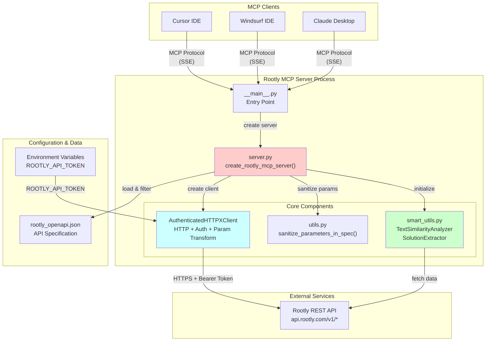
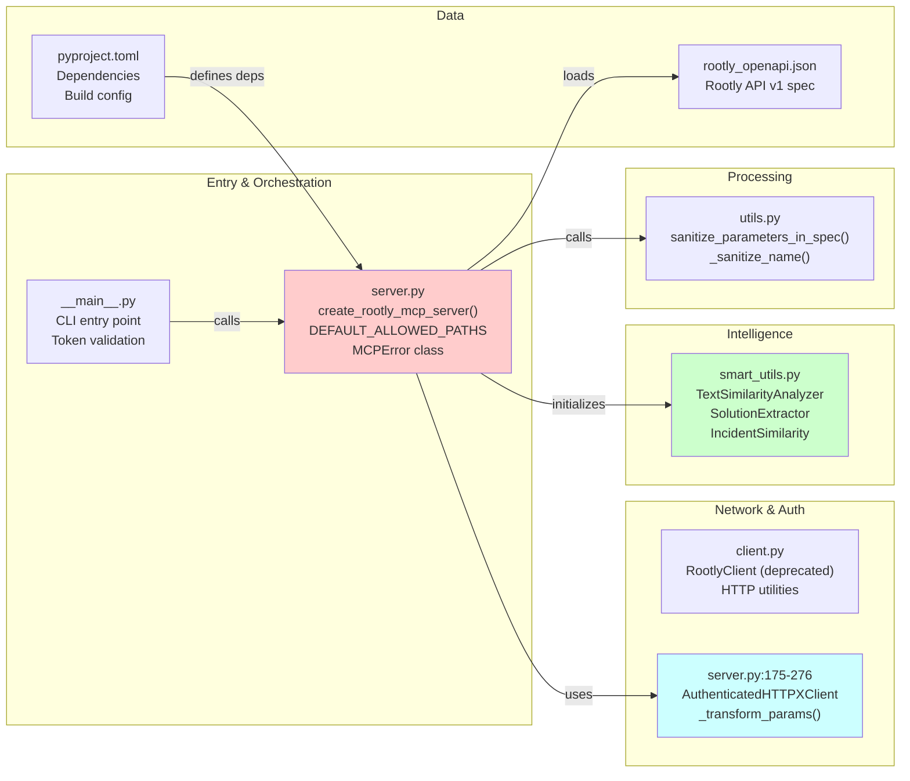
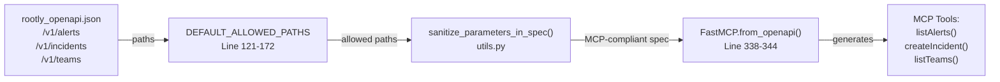
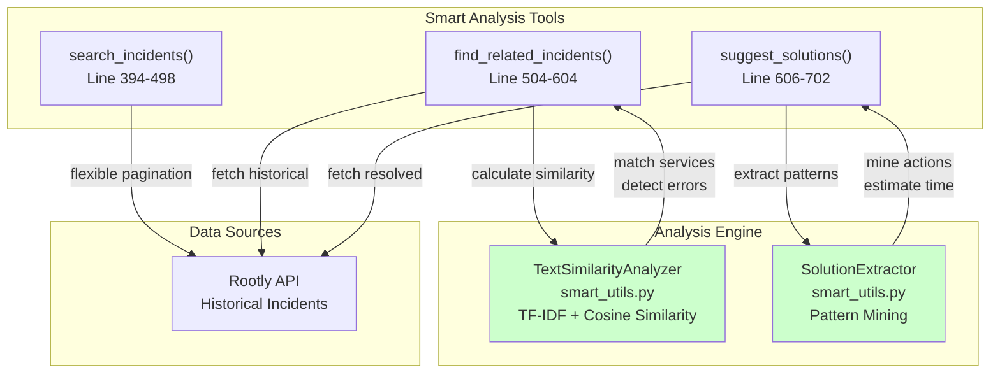
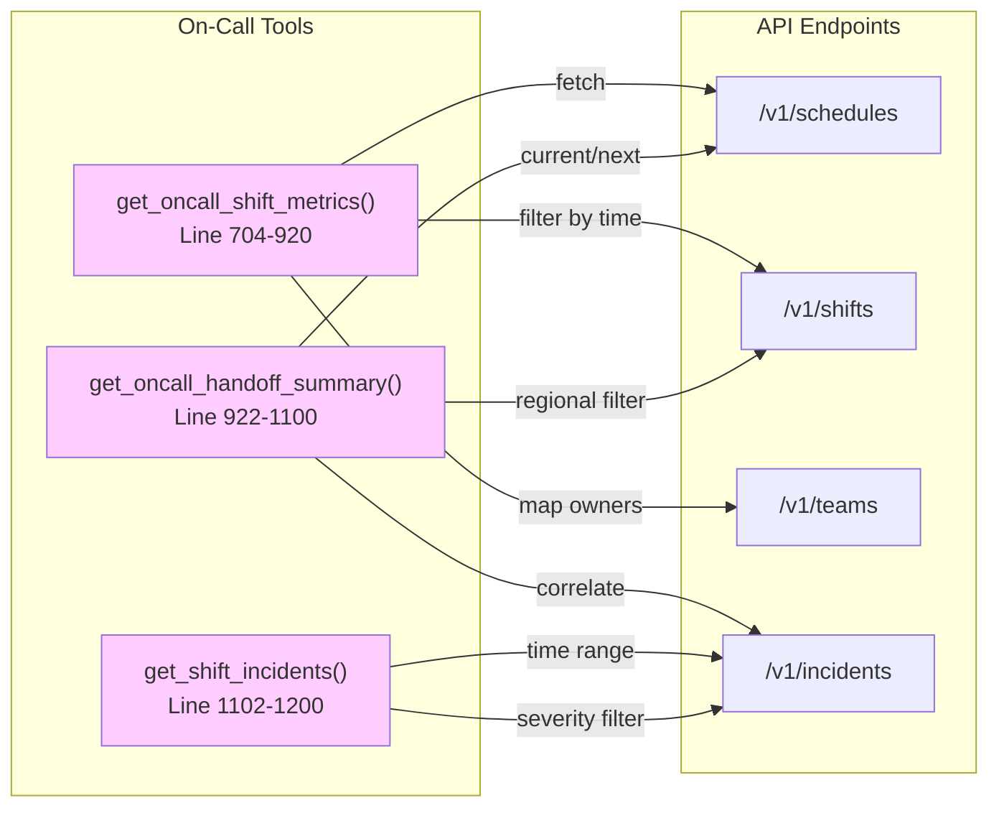
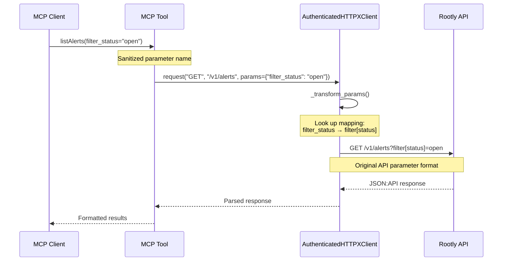

<!-- source: DeepWiki mcp.deepwiki.com · repo Rootly-AI-Labs/Rootly-MCP-server · page 1 Overview · fetched 2026-10-26 -->

# Overview

<details>
<summary>Relevant source files</summary>

The following files were used as context for generating this wiki page:

- [README.md](README.md)
- [rootly_openapi.json](rootly_openapi.json)
- [src/rootly_mcp_server/__init__.py](src/rootly_mcp_server/__init__.py)
- [src/rootly_mcp_server/server.py](src/rootly_mcp_server/server.py)
- [tests/unit/test_oncall_handoff.py](tests/unit/test_oncall_handoff.py)

</details>


The Rootly MCP Server is a **Model Context Protocol (MCP) server** that provides programmatic integration between MCP-compatible AI assistants (such as Cursor IDE, Windsurf IDE, and Claude Desktop) and the Rootly incident management platform. It enables AI agents to interact with Rootly's REST API through dynamically generated tools, intelligent incident analysis, and on-call management capabilities.

This document provides a high-level introduction to the system's purpose, architecture, and core components. For detailed installation and configuration instructions, see [Getting Started](#2). For deep dives into specific subsystems, see [Core Architecture](#3), [Tool System](#4), and [Development Guide](#5).

## What is the Rootly MCP Server?

The Rootly MCP Server is a Python application that serves as a bridge between the **Model Context Protocol** and the **Rootly API**. It transforms Rootly's OpenAPI specification into MCP-compatible tools while adding intelligent analysis capabilities on top of raw API access.

**Key characteristics:**

| Aspect | Description |
|--------|-------------|
| **Protocol** | Model Context Protocol (MCP) via Server-Sent Events (SSE) |
| **API Integration** | Rootly REST API v1 at `https://api.rootly.com` |
| **Tool Generation** | Dynamic, based on OpenAPI/Swagger specification |
| **Intelligence Layer** | TF-IDF-based similarity analysis for incident correlation |
| **Deployment Modes** | Local (development) and hosted (production at `https://mcp.rootly.com/sse`) |
| **Package Distribution** | PyPI as `rootly-mcp-server` |

Sources: [src/rootly_mcp_server/__init__.py:1-20](), [src/rootly_mcp_server/server.py:1-10](), [README.md:1-32]()

## System Architecture

The following diagram shows how the Rootly MCP Server fits into the broader ecosystem, connecting MCP clients to the Rootly API while adding intelligent processing capabilities:



**Architecture layers:**

1. **Entry Layer** ([src/rootly_mcp_server/__main__.py:1-50]()): Validates environment, starts FastMCP server
2. **Server Layer** ([src/rootly_mcp_server/server.py:278-344]()): Orchestrates OpenAPI processing and tool registration
3. **Transport Layer** ([src/rootly_mcp_server/server.py:175-276]()): HTTP client with authentication and parameter transformation
4. **Intelligence Layer** ([src/rootly_mcp_server/smart_utils.py:1-500]()): ML-based incident analysis and solution extraction
5. **Integration Layer**: FastMCP framework handles MCP protocol details

Sources: [src/rootly_mcp_server/__main__.py:1-50](), [src/rootly_mcp_server/server.py:1-344](), Diagram 1 from context

## Core Components

### Primary Files



| Component | File | Key Classes/Functions | Purpose |
|-----------|------|----------------------|---------|
| **Server Core** | [server.py:278-344]() | `create_rootly_mcp_server()` | Main orchestrator, FastMCP server creation |
| **HTTP Client** | [server.py:175-276]() | `AuthenticatedHTTPXClient` | Authenticated HTTP with parameter transformation |
| **OpenAPI Processing** | [utils.py:1-100]() | `sanitize_parameters_in_spec()` | Makes OpenAPI params MCP-compliant |
| **Smart Analysis** | [smart_utils.py:1-500]() | `TextSimilarityAnalyzer`, `SolutionExtractor` | TF-IDF similarity, solution mining |
| **Entry Point** | [__main__.py:1-50]() | `main()` | CLI entry, environment validation |
| **Error Handling** | [server.py:28-83]() | `MCPError` | Protocol-compliant error responses |

Sources: [src/rootly_mcp_server/server.py:1-1500](), [src/rootly_mcp_server/utils.py:1-100](), [src/rootly_mcp_server/smart_utils.py:1-500](), [src/rootly_mcp_server/__main__.py:1-50]()

## How It Works: Initialization Flow

The server initializes through a multi-stage pipeline that transforms the Rootly API specification into MCP-compatible tools:

```mermaid
sequenceDiagram
    participant CLI as __main__.py
    participant Create as create_rootly_mcp_server()
    participant Load as _load_swagger_spec()
    participant Filter as _filter_openapi_spec()
    participant Sanitize as sanitize_parameters_in_spec()
    participant Client as AuthenticatedHTTPXClient
    participant FastMCP as FastMCP.from_openapi()
    
    CLI->>CLI: Validate ROOTLY_API_TOKEN
    CLI->>Create: Call with config
    
    Create->>Load: Fetch/load OpenAPI spec
    Load-->>Create: Full specification
    
    Create->>Create: Add /v1 prefix to allowed_paths
    Create->>Filter: Filter by DEFAULT_ALLOWED_PATHS
    Filter-->>Create: Filtered specification
    
    Create->>Sanitize: Sanitize parameter names
    Note over Sanitize: filter[status] → filter_status<br/>page[size] → page_size
    Sanitize-->>Create: Sanitized spec + mapping
    
    Create->>Client: Instantiate with parameter_mapping
    Client->>Client: Set ROOTLY_API_TOKEN header
    Client-->>Create: Authenticated client
    
    Create->>FastMCP: from_openapi(sanitized_spec, client)
    FastMCP-->>Create: MCP server with auto-generated tools
    
    Create->>Create: Register custom tools<br/>search_incidents, find_related_incidents,<br/>suggest_solutions, oncall tools
    
    Create-->>CLI: FastMCP server instance
    CLI->>CLI: Run server on port 3000
```

**Initialization stages:**

1. **Environment Validation** ([__main__.py:20-35]()): Checks for `ROOTLY_API_TOKEN`, fails fast if missing
2. **Spec Loading** ([server.py:1400-1450]()): Fetches from `SWAGGER_URL` or loads local `rootly_openapi.json`
3. **Path Filtering** ([server.py:1500-1550]()): Applies `DEFAULT_ALLOWED_PATHS` to limit exposed endpoints
4. **Spec Cleaning** ([server.py:1600-1700]()): Removes broken `$ref` references, adds pagination/sparse fieldset params
5. **Parameter Sanitization** ([utils.py:20-80]()): Transforms `filter[status]` → `filter_status` for MCP compatibility
6. **Client Creation** ([server.py:175-212]()): Creates `AuthenticatedHTTPXClient` with token and parameter mapping
7. **Tool Generation** ([server.py:338-344]()): FastMCP auto-generates tools from OpenAPI operations
8. **Custom Registration** ([server.py:354-1200]()): Registers intelligent tools like `search_incidents`, `find_related_incidents`

Sources: [src/rootly_mcp_server/__main__.py:1-50](), [src/rootly_mcp_server/server.py:278-1700](), [src/rootly_mcp_server/utils.py:1-100](), Diagram 2 from context

## Key Capabilities

### 1. Dynamic Tool Generation from OpenAPI

The server converts OpenAPI paths into MCP tools automatically using FastMCP's `from_openapi()` integration:



**Path filtering:** The `DEFAULT_ALLOWED_PATHS` constant ([server.py:121-172]()) limits exposed endpoints to prevent context overflow and control security. Only 40+ carefully selected paths are exposed by default.

**Example transformation:**
- OpenAPI: `GET /v1/alerts?filter[status]=open&page[size]=10`
- Sanitized: `GET /v1/alerts?filter_status=open&page_size=10`
- MCP Tool: `listAlerts(filter_status="open", page_size=10)`

Sources: [src/rootly_mcp_server/server.py:121-172](), [src/rootly_mcp_server/server.py:338-344](), [src/rootly_mcp_server/utils.py:1-100]()

### 2. Intelligent Incident Analysis

Beyond raw API access, the server provides AI-powered incident analysis using machine learning techniques:



**Analysis capabilities:**
- **Text Similarity** ([smart_utils.py:50-200]()): TF-IDF vectorization and cosine similarity scoring
- **Service Detection** ([smart_utils.py:150-180]()): Automatic identification of affected services from incident text
- **Error Pattern Matching** ([smart_utils.py:180-200]()): Recognition of common error types (timeout, 500, connection)
- **Solution Mining** ([smart_utils.py:300-450]()): Extraction of actionable steps from resolution summaries
- **Time Estimation** ([smart_utils.py:400-450]()): Average resolution time calculation from similar incidents

Sources: [src/rootly_mcp_server/server.py:394-702](), [src/rootly_mcp_server/smart_utils.py:1-500]()

### 3. On-Call Management

Specialized tools aggregate data across multiple API endpoints for on-call operations:



**Multi-endpoint aggregation:**
- `get_oncall_shift_metrics()` ([server.py:704-920]()): Queries `/schedules`, `/shifts`, and `/teams` to compute shift counts, hours, and role distribution
- `get_oncall_handoff_summary()` ([server.py:922-1100]()): Correlates current/next on-call with incidents during their shifts
- Regional filtering using business hours (9am-5pm) in specified timezones

Sources: [src/rootly_mcp_server/server.py:704-1200](), [tests/unit/test_oncall_handoff.py:1-71]()

### 4. Dual-Mode Authentication

The server supports two authentication modes for different deployment scenarios:

| Mode | Token Source | Use Case | Configuration |
|------|-------------|----------|---------------|
| **Local** | `ROOTLY_API_TOKEN` env var | Development, self-hosted | `hosted=False` (default) |
| **Hosted** | MCP request `Authorization` header | Production SaaS | `hosted=True` |

**Implementation:** The `AuthenticatedHTTPXClient` ([server.py:175-212]()) checks the `hosted` flag. In local mode, it reads the token from environment variables at initialization. In hosted mode, it extracts tokens from incoming MCP request headers at runtime ([server.py:376-393]()).

Sources: [src/rootly_mcp_server/server.py:175-212](), [src/rootly_mcp_server/server.py:376-393](), Diagram 6 from context

## Request Processing Flow

When an MCP client invokes a tool, the request flows through multiple transformation stages:



**Parameter transformation** ([server.py:213-234]()): The bidirectional mapping ensures MCP tool interfaces use valid Python identifiers (`filter_status`) while the actual HTTP requests use Rootly's bracket notation (`filter[status]`).

**Error handling** ([server.py:28-83]()): The `MCPError` class categorizes exceptions into authentication, network, validation, and execution errors, returning protocol-compliant JSON-RPC error responses.

Sources: [src/rootly_mcp_server/server.py:213-234](), [src/rootly_mcp_server/server.py:28-83](), Diagram 4 from context

## Configuration and Extensibility

### Environment Variables

| Variable | Purpose | Default |
|----------|---------|---------|
| `ROOTLY_API_TOKEN` | API authentication token | Required in local mode |
| `ROOTLY_BASE_URL` | Rootly API base URL | `https://api.rootly.com` |

Sources: [src/rootly_mcp_server/server.py:205-211](), [src/rootly_mcp_server/server.py:323-325]()

### Path Allowlist

To expose additional API endpoints, modify `DEFAULT_ALLOWED_PATHS` ([server.py:121-172]()). The current allowlist includes 40+ paths covering:
- Alerts and alert management
- Incidents and action items
- Teams and users
- Services and environments
- On-call schedules and shifts
- Workflows and severities

Each path in the allowlist becomes one or more MCP tools after OpenAPI processing.

Sources: [src/rootly_mcp_server/server.py:121-172](), [README.md:183-190]()

### Custom Tools

New intelligent tools can be registered using FastMCP's `@mcp.tool()` decorator ([server.py:354-1200]()). Custom tools have access to:
- The `make_authenticated_request()` helper for API calls
- The `TextSimilarityAnalyzer` for ML-based analysis
- The `SolutionExtractor` for pattern mining
- The `MCPError` utility for consistent error handling

Sources: [src/rootly_mcp_server/server.py:354-1200](), [src/rootly_mcp_server/server.py:375-393](), [src/rootly_mcp_server/smart_utils.py:1-500]()

## Package Distribution

The server is distributed as a Python package on PyPI:

- **Package name:** `rootly-mcp-server`
- **Current version:** `2.0.12` ([__init__.py:16]())
- **Installation:** `uv tool install rootly-mcp-server` or `uvx rootly-mcp-server`
- **Dependencies:** Managed via `pyproject.toml` and locked in `uv.lock`
- **Build system:** Hatchling with automated PyPI publishing via GitHub Actions

Sources: [src/rootly_mcp_server/__init__.py:16](), [README.md:31-96](), [pyproject.toml:1-100]()

---

This overview establishes the foundational understanding of the Rootly MCP Server. For implementation details, see the following sections:

- **[Getting Started](#2)**: Installation, configuration, and first-time setup
- **[Core Architecture](#3)**: Deep dives into server initialization, OpenAPI processing, and authentication
- **[Tool System](#4)**: Details on tool generation, smart analysis, and on-call intelligence
- **[Development Guide](#5)**: Contributing, testing, and extending the server

---

