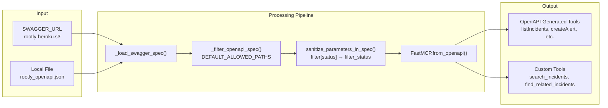
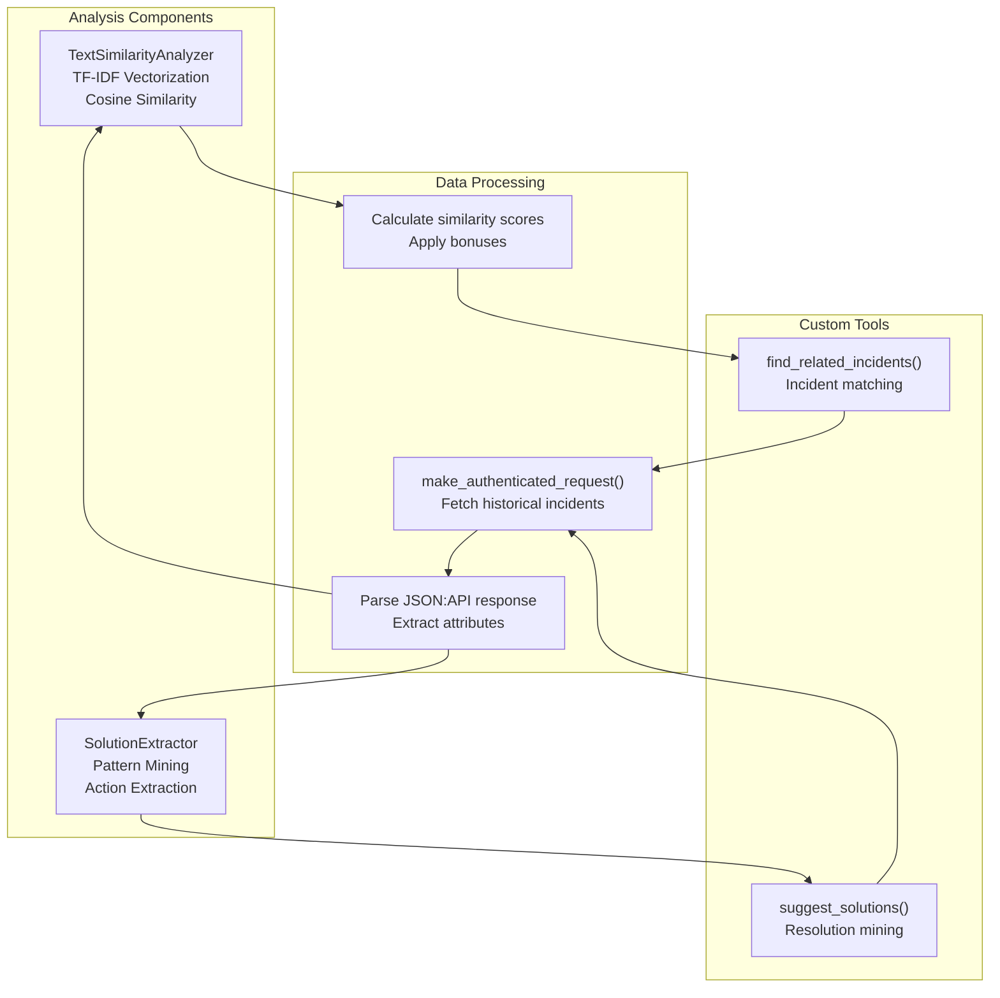
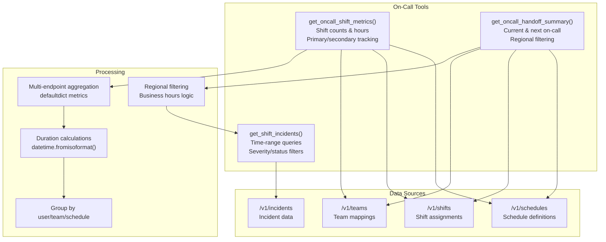
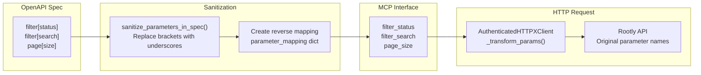
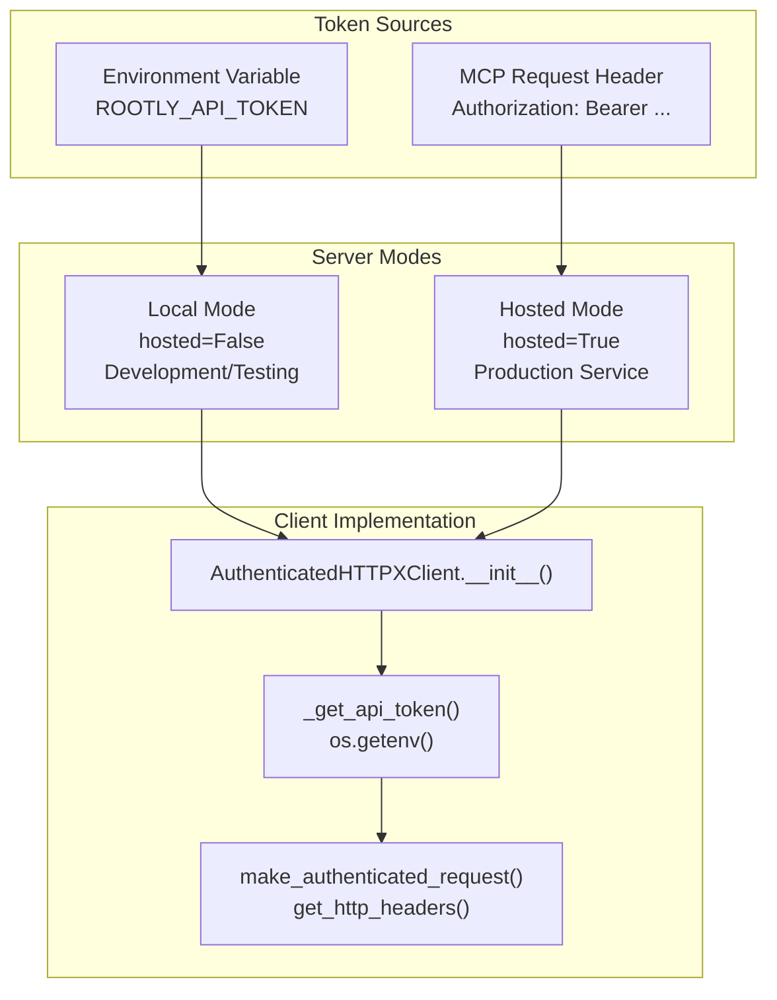

<!-- source: DeepWiki mcp.deepwiki.com · repo Rootly-AI-Labs/Rootly-MCP-server · page 1.1 Key Features · fetched 2026-10-26 -->

# Key Features

<details>
<summary>Relevant source files</summary>

The following files were used as context for generating this wiki page:

- [README.md](README.md)
- [src/rootly_mcp_server/server.py](src/rootly_mcp_server/server.py)
- [tests/unit/test_oncall_handoff.py](tests/unit/test_oncall_handoff.py)

</details>


## Purpose and Scope

This document describes the core capabilities of the Rootly MCP Server, including dynamic tool generation, intelligent incident analysis, on-call management, and MCP protocol compliance mechanisms. For architectural details about how these features are implemented, see [Architecture Overview](#1.2). For setup instructions, see [Getting Started](#2).

---

## Feature Overview

The Rootly MCP Server provides five major categories of functionality:

| Feature Category | Key Capabilities | Primary Implementation |
|-----------------|------------------|----------------------|
| **Dynamic Tool Generation** | Auto-generates MCP tools from OpenAPI spec | `create_rootly_mcp_server()`, `FastMCP.from_openapi()` |
| **Smart Analysis** | ML-based incident similarity and solution mining | `TextSimilarityAnalyzer`, `SolutionExtractor` |
| **On-Call Management** | Shift metrics, handoff summaries, incident tracking | `get_oncall_shift_metrics()`, `get_oncall_handoff_summary()` |
| **MCP Compliance** | Parameter sanitization, error handling, resources | `sanitize_parameters_in_spec()`, `MCPError` |
| **Authentication** | Dual-mode (local/hosted) token handling | `AuthenticatedHTTPXClient` |

Sources: [src/rootly_mcp_server/server.py:278-344](), [README.md:122-132]()

---

## Dynamic Tool Generation from OpenAPI

### OpenAPI-to-MCP Pipeline



**Diagram: OpenAPI specification processing pipeline with function names**

The server dynamically generates MCP tools by consuming Rootly's OpenAPI specification through a multi-stage pipeline implemented in `create_rootly_mcp_server()`:

1. **Specification Loading** ([src/rootly_mcp_server/server.py:311]()): Fetches from `SWAGGER_URL` with local file fallback
2. **Path Filtering** ([src/rootly_mcp_server/server.py:315]()): Applies `DEFAULT_ALLOWED_PATHS` whitelist to limit exposed endpoints
3. **Parameter Sanitization** ([src/rootly_mcp_server/server.py:319]()): Transforms parameters to MCP-compliant names
4. **Tool Generation** ([src/rootly_mcp_server/server.py:338-344]()): Uses `FastMCP.from_openapi()` to create tool handlers

### Default Allowed Paths

The server exposes a curated subset of Rootly API endpoints defined in `DEFAULT_ALLOWED_PATHS`:

| Category | Endpoints | Purpose |
|----------|-----------|---------|
| **Incidents** | `/incidents`, `/incidents/{incident_id}/alerts` | Core incident operations |
| **Alerts** | `/alerts`, `/alerts/{alert_id}` | Alert management |
| **Teams & Users** | `/teams`, `/users`, `/users/me` | Identity and ownership |
| **Services** | `/services`, `/environments`, `/severities` | Resource metadata |
| **On-Call** | `/schedules`, `/shifts`, `/on_call_roles` | On-call schedule management |
| **Workflows** | `/workflows`, `/workflow_runs` | Automation integration |

Sources: [src/rootly_mcp_server/server.py:121-172](), [src/rootly_mcp_server/server.py:299-316]()

---

## Smart Analysis Capabilities

### Architecture



**Diagram: Smart analysis tool architecture with component names**

### find_related_incidents

Implements ML-based incident similarity detection using `TextSimilarityAnalyzer`:

**Implementation**: [src/rootly_mcp_server/server.py:504-604]()

**Core Algorithm**:
1. Accepts either `incident_id` or `incident_description` as input
2. Fetches historical incidents with optional `status_filter`
3. Applies `TextSimilarityAnalyzer.calculate_similarity()` using TF-IDF vectorization
4. Returns ranked results with `similarity_score`, `matched_services`, and `resolution_time_hours`

**Key Features**:
- **Text Vectorization**: TF-IDF conversion of titles, summaries, and descriptions
- **Service Detection**: Automatic identification of affected services from incident text
- **Error Pattern Matching**: Recognizes common error types (timeout, 404, etc.)
- **Configurable Threshold**: `similarity_threshold` parameter (0.0-1.0, default 0.15)

### suggest_solutions

Mines actionable solutions from historically resolved incidents using `SolutionExtractor`:

**Implementation**: [src/rootly_mcp_server/server.py:606-702]()

**Processing Pipeline**:
1. Finds similar incidents using similarity analysis
2. Filters to incidents with `status_filter="resolved"` (default)
3. Extracts solutions via `SolutionExtractor.extract_solutions()`
4. Generates high-level recommendations via `_generate_recommendation()`

**Output Structure**:
- `solutions`: List of suggested actions with confidence scores
- `insights`: Common patterns and average resolution time
- `recommendation`: High-level guidance based on analysis

Sources: [src/rootly_mcp_server/server.py:504-702](), [src/rootly_mcp_server/smart_utils.py](), [README.md:192-229]()

---

## On-Call Management Tools

### Tool Suite



**Diagram: On-call tool data flow and aggregation logic**

### get_oncall_shift_metrics

Aggregates shift data across multiple dimensions with role-based tracking:

**Implementation**: [src/rootly_mcp_server/server.py:704-1053]()

**Key Capabilities**:
- **Time-Range Queries**: Accepts `start_date` and `end_date` in ISO 8601 format
- **Multi-Level Grouping**: Groups by `user`, `schedule`, `team`, or `none`
- **Role Tracking**: Distinguishes primary vs secondary on-call roles
- **Metrics Calculated**:
  - `shift_count`: Total number of shifts
  - `total_hours`: Cumulative shift duration
  - `days_on_call`: Unique calendar days with shifts
  - `primary_hours` / `secondary_hours`: Role-specific totals
  - `override_count`: Ad-hoc shift overrides

**Multi-Endpoint Correlation**:
1. Fetches `/v1/schedules` to get schedule metadata
2. Fetches `/v1/teams` to resolve team names
3. Queries `/v1/shifts` with temporal filters
4. Aggregates using `defaultdict` with included relationships

### get_oncall_handoff_summary

Provides real-time on-call status with timezone-aware regional filtering:

**Implementation**: [src/rootly_mcp_server/server.py:1055-1380]()

**Advanced Features**:
- **Timezone Support**: Accepts IANA timezone identifiers (e.g., `America/Los_Angeles`)
- **Regional Filtering**: When `filter_by_region=True`, shows only shifts overlapping business hours (9am-5pm) in specified timezone
- **Handoff Intelligence**: Returns both `current_oncall` and `next_oncall` for seamless transitions
- **Optional Incident Correlation**: When `include_incidents=True`, fetches incidents during current shifts (disabled by default for performance)

**Timezone Conversion**: Uses `ZoneInfo` and `convert_to_timezone()` helper to display all timestamps in target timezone

### get_shift_incidents

Queries incidents within a specific time window with filtering:

**Implementation**: [src/rootly_mcp_server/server.py:1382-1463]()

**Filter Options**:
- `severity`: Filter by incident severity
- `status`: Filter by incident status
- `tags`: Comma-separated tag filtering
- `schedule_ids`: Associate incidents with specific schedules

Sources: [src/rootly_mcp_server/server.py:704-1463](), [README.md:230-278]()

---

## MCP Protocol Compliance

### Parameter Sanitization System

The server ensures MCP compatibility through bidirectional parameter transformation:



**Diagram: Parameter transformation pipeline for MCP compliance**

**Implementation**: [src/rootly_mcp_server/utils.py](), [src/rootly_mcp_server/server.py:213-225]()

**Transformation Rules**:
- Brackets replaced with underscores: `filter[status]` → `filter_status`
- Reverse mapping stored in `parameter_mapping` dictionary
- `AuthenticatedHTTPXClient._transform_params()` performs reverse transformation before HTTP requests

### Error Handling with MCPError

Provides protocol-compliant error responses with intelligent categorization:

**Implementation**: [src/rootly_mcp_server/server.py:28-82]()

**Error Categories**:
- `authentication_error`: 401/unauthorized responses
- `network_error`: Connection/timeout failures
- `client_error`: 4xx HTTP status codes
- `server_error`: 5xx HTTP status codes
- `validation_error`: Input validation failures
- `execution_error`: Generic tool execution errors

**Response Types**:
1. **Protocol-level errors**: `MCPError.protocol_error()` for JSON-RPC compliance
2. **Tool-level errors**: `MCPError.tool_error()` returned as successful tool result with error structure

Sources: [src/rootly_mcp_server/utils.py](), [src/rootly_mcp_server/server.py:28-82](), [src/rootly_mcp_server/server.py:213-234]()

---

## Dual Authentication Modes

The server supports two operational modes with different token handling strategies:

### Authentication Architecture



**Diagram: Dual authentication mode implementation**

### Mode Comparison

| Aspect | Local Mode (`hosted=False`) | Hosted Mode (`hosted=True`) |
|--------|---------------------------|----------------------------|
| **Token Source** | `ROOTLY_API_TOKEN` environment variable | `Authorization` header from MCP request |
| **Use Case** | Development, testing, personal deployment | Production hosted service |
| **Token Validation** | Checked in `__main__.py` at startup | Extracted per-request via `get_http_headers()` |
| **Security** | Token stored in environment/config | Token never stored, passed through only |

**Local Mode Implementation**: [src/rootly_mcp_server/server.py:184-194]()
- Token loaded from environment in `AuthenticatedHTTPXClient.__init__()`
- Added to `Authorization` header for all requests

**Hosted Mode Implementation**: [src/rootly_mcp_server/server.py:375-392]()
- Token extracted from MCP request headers in `make_authenticated_request()`
- Uses FastMCP's `get_http_headers()` dependency injection

Sources: [src/rootly_mcp_server/server.py:175-276](), [src/rootly_mcp_server/server.py:375-392](), [src/rootly_mcp_server/__main__.py]()

---

## Smart Pagination

Prevents context window overflow through intelligent default limits:

**Implementation**: [src/rootly_mcp_server/server.py:394-498]()

**search_incidents Configuration**:
- Default `page_size`: 10 items (maximum 20)
- Default `page_number`: 1 (single page)
- Multi-page mode: Set `page_number=0` to fetch across pages up to `max_results`
- Safety limit: Maximum 10 pages to prevent infinite loops

**Multi-Page Algorithm**:
```python
while len(all_incidents) < max_results and current_page <= max_pages:
    # Fetch page
    # Check metadata for last page
    # Aggregate results
```

**Other Endpoints**: Default to 100 items per page for batch operations (schedules, shifts, teams)

Sources: [src/rootly_mcp_server/server.py:394-498](), [README.md:125]()

---

## MCP Resource Exposure

Exposes Rootly entities as MCP resources for AI agent reference:

**Implementation**: Resources registered via `@mcp.resource()` decorators

**Resource URIs**:
- `incident://{id}`: Individual incident details
- `team://{id}`: Team information
- `rootly://incidents`: Recent incidents list

**Use Case**: Allows MCP clients to reference Rootly entities in conversations and context without explicit API calls.

Sources: [src/rootly_mcp_server/server.py]() (resource decorators), [README.md:130]()

---

