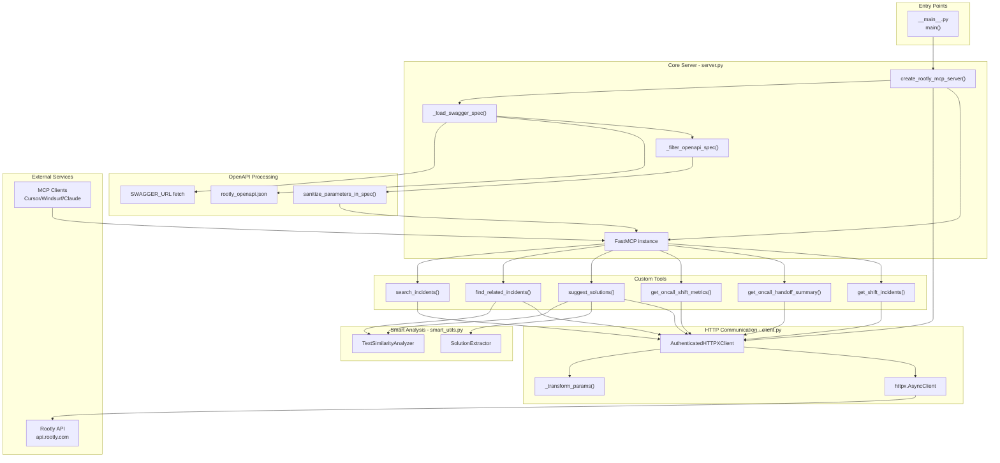
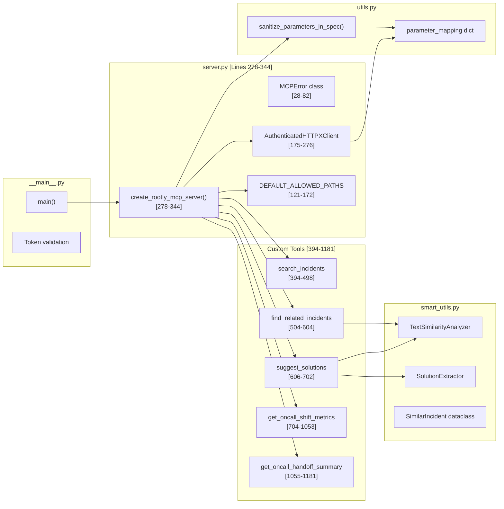
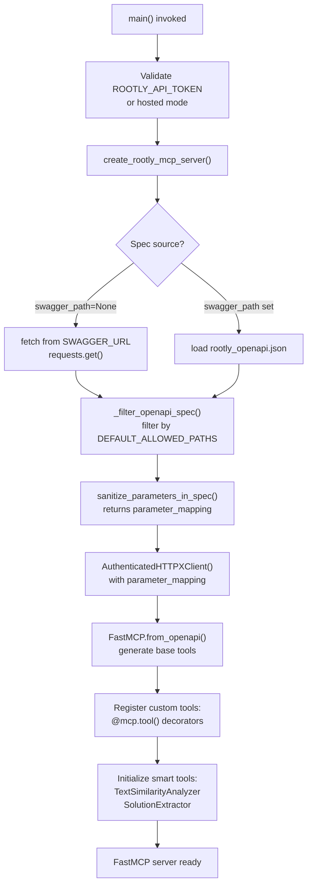
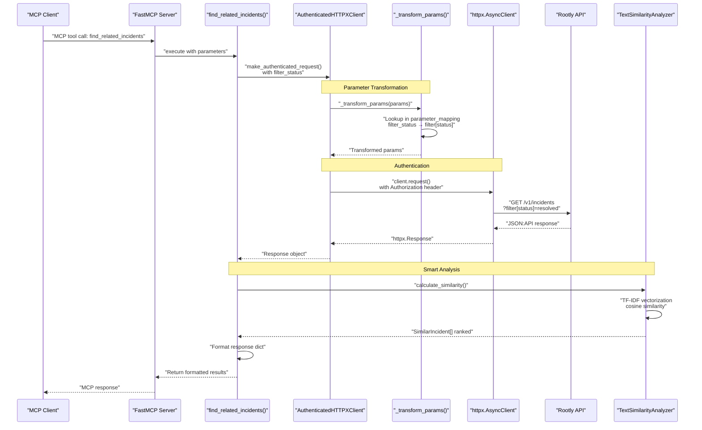
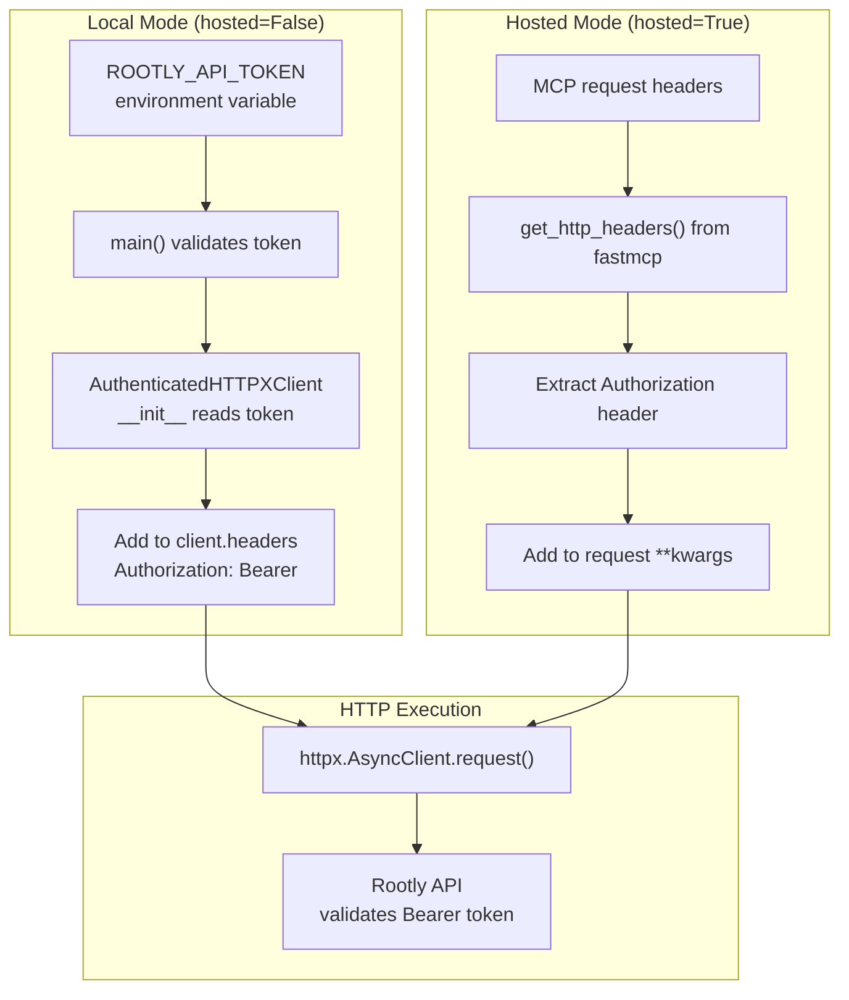
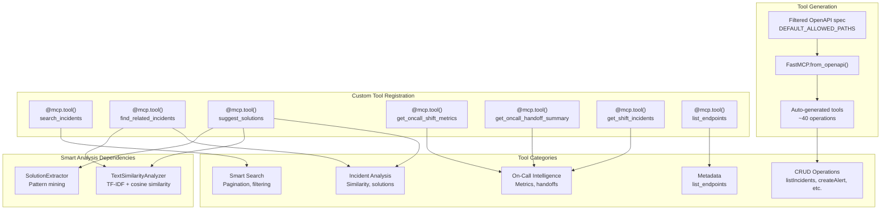
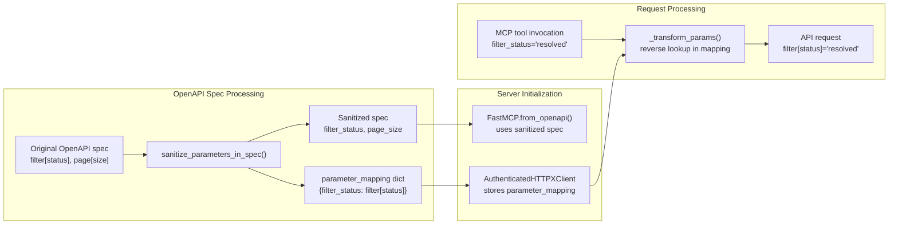
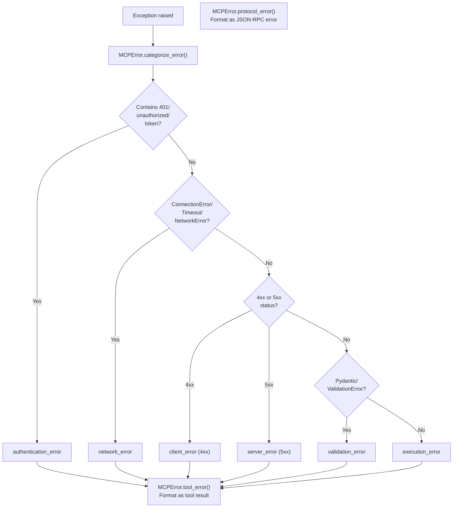

<!-- source: DeepWiki mcp.deepwiki.com · repo Rootly-AI-Labs/Rootly-MCP-server · page 1.2 Architecture Overview · fetched 2026-10-26 -->

# Architecture Overview

<details>
<summary>Relevant source files</summary>

The following files were used as context for generating this wiki page:

- [README.md](README.md)
- [pyproject.toml](pyproject.toml)
- [src/rootly_mcp_server/server.py](src/rootly_mcp_server/server.py)
- [tests/unit/test_oncall_handoff.py](tests/unit/test_oncall_handoff.py)

</details>


## Purpose and Scope

This document provides a comprehensive architectural overview of the Rootly MCP Server system, showing how the major components fit together and interact. It covers the complete data flow from MCP client requests through the server initialization, OpenAPI processing, tool generation, and API communication.

For detailed information about specific subsystems, see:
- Server initialization details: [Server Initialization Pipeline](#3.1)
- OpenAPI processing: [OpenAPI Processing](#3.2)
- Authentication details: [Authentication System](#3.3)
- Tool architecture: [Tool System](#4)
- Development workflow: [Development Guide](#5)

## System Overview

The Rootly MCP Server is built around a central `FastMCP` server instance that dynamically generates tools from the Rootly OpenAPI specification. The system transforms and filters the OpenAPI spec to ensure MCP protocol compatibility while maintaining full Rootly API functionality.



**Key Architecture Characteristics:**

| Aspect | Implementation |
|--------|----------------|
| **Entry Point** | `main()` in `__main__.py` |
| **Core Server** | `FastMCP` instance created by `create_rootly_mcp_server()` |
| **Spec Source** | Local `rootly_openapi.json` or remote `SWAGGER_URL` |
| **HTTP Client** | `AuthenticatedHTTPXClient` wrapping `httpx.AsyncClient` |
| **Tool Generation** | `FastMCP.from_openapi()` + custom `@mcp.tool()` decorators |
| **Authentication** | Dual-mode: env token (`ROOTLY_API_TOKEN`) or MCP headers |

**Sources:** [src/rootly_mcp_server/server.py:1-343](), [src/rootly_mcp_server/__main__.py](), [README.md:1-332]()

## Core Component Mapping

This diagram maps high-level architectural concepts to specific code entities in the codebase.



**Component Responsibilities:**

| Component | Location | Primary Responsibility |
|-----------|----------|----------------------|
| `create_rootly_mcp_server()` | [server.py:278-344]() | Server initialization, spec loading, tool generation |
| `AuthenticatedHTTPXClient` | [server.py:175-276]() | HTTP client with auth and parameter transformation |
| `MCPError` | [server.py:28-82]() | Protocol-compliant error handling |
| `sanitize_parameters_in_spec()` | [utils.py]() | OpenAPI parameter name transformation |
| `TextSimilarityAnalyzer` | [smart_utils.py]() | TF-IDF based incident similarity |
| `SolutionExtractor` | [smart_utils.py]() | Resolution pattern mining |
| `main()` | [__main__.py]() | CLI entry, token validation |

**Sources:** [src/rootly_mcp_server/server.py:1-1181](), [pyproject.toml:48-49]()

## Initialization Pipeline

The server initialization follows a multi-stage pipeline that transforms the raw OpenAPI specification into a working MCP server with parameter sanitization and custom tools.



**Pipeline Stages:**

| Stage | Function/Class | Key Operations |
|-------|----------------|----------------|
| 1. Entry | `main()` | Token validation, environment setup |
| 2. Spec Loading | `_load_swagger_spec()` | Fetch remote or load local JSON |
| 3. Filtering | `_filter_openapi_spec()` | Reduce to `DEFAULT_ALLOWED_PATHS` |
| 4. Sanitization | `sanitize_parameters_in_spec()` | Transform `filter[x]` → `filter_x` |
| 5. Client Creation | `AuthenticatedHTTPXClient()` | Initialize with mapping & auth |
| 6. Base Tools | `FastMCP.from_openapi()` | Auto-generate from paths |
| 7. Custom Tools | `@mcp.tool()` | Register 6+ custom tools |
| 8. Smart Init | Tool bodies | Initialize analyzers |

**Sources:** [src/rootly_mcp_server/server.py:278-344](), [src/rootly_mcp_server/server.py:394-1181]()

## Request Processing Flow

This sequence diagram shows the complete request flow for a custom tool, including parameter transformation and API communication.



**Request Flow Characteristics:**

| Stage | Component | Key Transformation |
|-------|-----------|-------------------|
| 1. Invocation | `FastMCP` | Route to tool function |
| 2. Parameter Receipt | Custom tool | MCP-sanitized names (`filter_status`) |
| 3. Transformation | `_transform_params()` | Reverse mapping to API format (`filter[status]`) |
| 4. Authentication | `AuthenticatedHTTPXClient` | Add Bearer token header |
| 5. HTTP Call | `httpx.AsyncClient` | Execute HTTP request |
| 6. Analysis (optional) | `TextSimilarityAnalyzer` | ML-based processing |
| 7. Response | Custom tool | Format for MCP client |

**Sources:** [src/rootly_mcp_server/server.py:175-276](), [src/rootly_mcp_server/server.py:504-604]()

## Authentication Architecture

The system supports dual authentication modes with automatic token injection and header propagation.



**Authentication Modes:**

| Mode | Token Source | Implementation | Code Location |
|------|-------------|----------------|---------------|
| **Local** | `ROOTLY_API_TOKEN` env var | Stored in `_api_token`, added to client headers | [server.py:205-211]() |
| **Hosted** | MCP request `Authorization` header | Extracted per-request via `get_http_headers()` | [server.py:376-389]() |

**Token Flow:**
1. **Local Mode:** `os.getenv("ROOTLY_API_TOKEN")` → `self._api_token` → `headers["Authorization"]` in `__init__`
2. **Hosted Mode:** MCP request headers → `get_http_headers()` → `kwargs["headers"]["Authorization"]` per request

**Sources:** [src/rootly_mcp_server/server.py:175-211](), [src/rootly_mcp_server/server.py:375-392]()

## Tool Architecture

The system exposes two distinct layers of tools: auto-generated tools from OpenAPI paths and custom intelligent tools with enhanced functionality.



**Tool Categories:**

| Category | Count | Source | Key Tools |
|----------|-------|--------|-----------|
| **OpenAPI-Generated** | ~40 | `FastMCP.from_openapi()` | `listIncidents`, `createAlert`, `listTeams` |
| **Search & Pagination** | 1 | `@mcp.tool()` | `search_incidents` |
| **Smart Analysis** | 2 | `@mcp.tool()` + smart_utils | `find_related_incidents`, `suggest_solutions` |
| **On-Call Intelligence** | 3 | `@mcp.tool()` | `get_oncall_shift_metrics`, `get_oncall_handoff_summary`, `get_shift_incidents` |
| **Metadata** | 1 | `@mcp.tool()` | `list_endpoints` |

**Tool Implementation Patterns:**

```python
# Pattern 1: Direct API call with enhanced pagination
@mcp.tool()
async def search_incidents(...) -> dict:
    response = await make_authenticated_request("GET", "/v1/incidents", params=...)
    # Enhanced pagination logic
    return formatted_results

# Pattern 2: API call + ML analysis
@mcp.tool()
async def find_related_incidents(...) -> dict:
    # Fetch historical data
    historical = await make_authenticated_request(...)
    # Apply TextSimilarityAnalyzer
    similar = similarity_analyzer.calculate_similarity(...)
    return formatted_results

# Pattern 3: Multi-endpoint aggregation
@mcp.tool()
async def get_oncall_shift_metrics(...) -> dict:
    # Fetch schedules, teams, shifts
    schedules = await make_authenticated_request("/v1/schedules", ...)
    teams = await make_authenticated_request("/v1/teams", ...)
    shifts = await make_authenticated_request("/v1/shifts", ...)
    # Aggregate and compute metrics
    return aggregated_metrics
```

**Sources:** [src/rootly_mcp_server/server.py:336-344](), [src/rootly_mcp_server/server.py:394-1181]()

## Parameter Sanitization System

The parameter sanitization system ensures MCP protocol compliance by transforming Rootly API parameter names with special characters into valid MCP identifiers.



**Transformation Rules:**

| Original Format | Sanitized Format | Example |
|----------------|------------------|---------|
| `filter[status]` | `filter_status` | Status filtering |
| `page[size]` | `page_size` | Pagination size |
| `filter[search]` | `filter_search` | Search query |
| `fields[incidents]` | `fields_incidents` | Sparse fieldsets |

**Bidirectional Mapping:**
- **Forward (Sanitization):** [utils.py:sanitize_parameters_in_spec()]() creates MCP-compliant names
- **Reverse (Transformation):** [server.py:213-225]() maps back to original API format
- **Storage:** `parameter_mapping` dict stored in `AuthenticatedHTTPXClient.parameter_mapping`

**Sources:** [src/rootly_mcp_server/utils.py](), [src/rootly_mcp_server/server.py:213-225](), [src/rootly_mcp_server/server.py:319-333]()

## Error Handling System

The `MCPError` class provides protocol-compliant error categorization and response formatting.



**Error Categories:**

| Category | Detection Pattern | HTTP Status | Example |
|----------|------------------|-------------|---------|
| `authentication_error` | "401", "unauthorized", "token" | 401 | Invalid API token |
| `network_error` | Exception type contains "connection", "timeout" | - | Network unreachable |
| `client_error` | "4" in first 2 chars of error | 4xx | Invalid parameters |
| `server_error` | "5" in first 2 chars of error | 5xx | API server error |
| `validation_error` | Exception type contains "validation", "pydantic" | - | Invalid input |
| `execution_error` | Default fallback | - | Generic tool error |

**Error Response Format:**
```python
# Tool-level error (returned as successful tool result)
{
    "error": True,
    "error_type": "authentication_error",
    "message": "Authentication failed: 401 Unauthorized",
    "details": {...}  # Optional
}

# Protocol-level error (JSON-RPC error response)
{
    "jsonrpc": "2.0",
    "error": {
        "code": -32000,
        "message": "Internal error",
        "data": {...}  # Optional
    }
}
```

**Sources:** [src/rootly_mcp_server/server.py:28-82](), [src/rootly_mcp_server/server.py:422-424](), [src/rootly_mcp_server/server.py:602-604]()

## Key Subsystems

The following subsystems implement specialized functionality beyond basic CRUD operations:

### Smart Analysis Subsystem

**Location:** [src/rootly_mcp_server/smart_utils.py]()

**Components:**
- `TextSimilarityAnalyzer`: TF-IDF vectorization with cosine similarity scoring
- `SolutionExtractor`: Pattern mining from incident resolutions
- `SimilarIncident`: Data class for similarity results

**Integration Points:**
- Used by `find_related_incidents()` [server.py:504-604]()
- Used by `suggest_solutions()` [server.py:606-702]()

**Key Operations:**
1. Vectorize incident text (title, summary, description)
2. Calculate cosine similarity scores
3. Apply service matching bonus (+0.1)
4. Apply keyword matching bonus (+0.05)
5. Rank and filter by threshold

### On-Call Intelligence Subsystem

**Location:** [src/rootly_mcp_server/server.py:704-1181]()

**Tools:**
1. `get_oncall_shift_metrics()`: Multi-endpoint aggregation (schedules + teams + shifts)
2. `get_oncall_handoff_summary()`: Current/next on-call with regional filtering
3. `get_shift_incidents()`: Incident correlation with shift timeframes

**Aggregation Pattern:**
```python
# Fetch from multiple endpoints
schedules = await request("/v1/schedules")
teams = await request("/v1/teams")
shifts = await request("/v1/shifts")

# Build relationship maps
schedule_to_team = build_mapping(schedules, teams)

# Aggregate metrics
metrics = aggregate_by_group(shifts, schedule_to_team)
```

### Configuration System

**Location:** [pyproject.toml:1-87]()

**Key Configuration:**
- Python version requirement: `>=3.12`
- Package name: `rootly-mcp-server`
- Entry point: `rootly_mcp_server.__main__:main`
- Dependencies: FastMCP, httpx, scikit-learn, numpy
- Test markers: unit, integration, remote, slow

**Sources:** [src/rootly_mcp_server/smart_utils.py](), [src/rootly_mcp_server/server.py:704-1181](), [pyproject.toml:1-87]()

## Deployment Architecture

The system supports multiple deployment modes with different authentication and hosting strategies.

| Deployment Mode | Entry Command | Authentication | Use Case |
|----------------|---------------|----------------|----------|
| **Local (uv)** | `uv tool run rootly-mcp-server` | `ROOTLY_API_TOKEN` env var | Development, local IDE |
| **Local (uvx)** | `uvx rootly-mcp-server` | `ROOTLY_API_TOKEN` env var | Quick local execution |
| **Local (dev)** | `uv run rootly-mcp-server` | `ROOTLY_API_TOKEN` env var | Development with repo |
| **Hosted (SSE)** | `mcp-remote https://mcp.rootly.com/sse` | MCP request headers | Remote production |

**Container Support:**
- Docker image built in CI
- Health check endpoints: `/health`, `/healthz`
- Deployed to AWS ECS via Semaphore CI

**Sources:** [README.md:32-121](), [src/rootly_mcp_server/server.py:346-350]()

---

