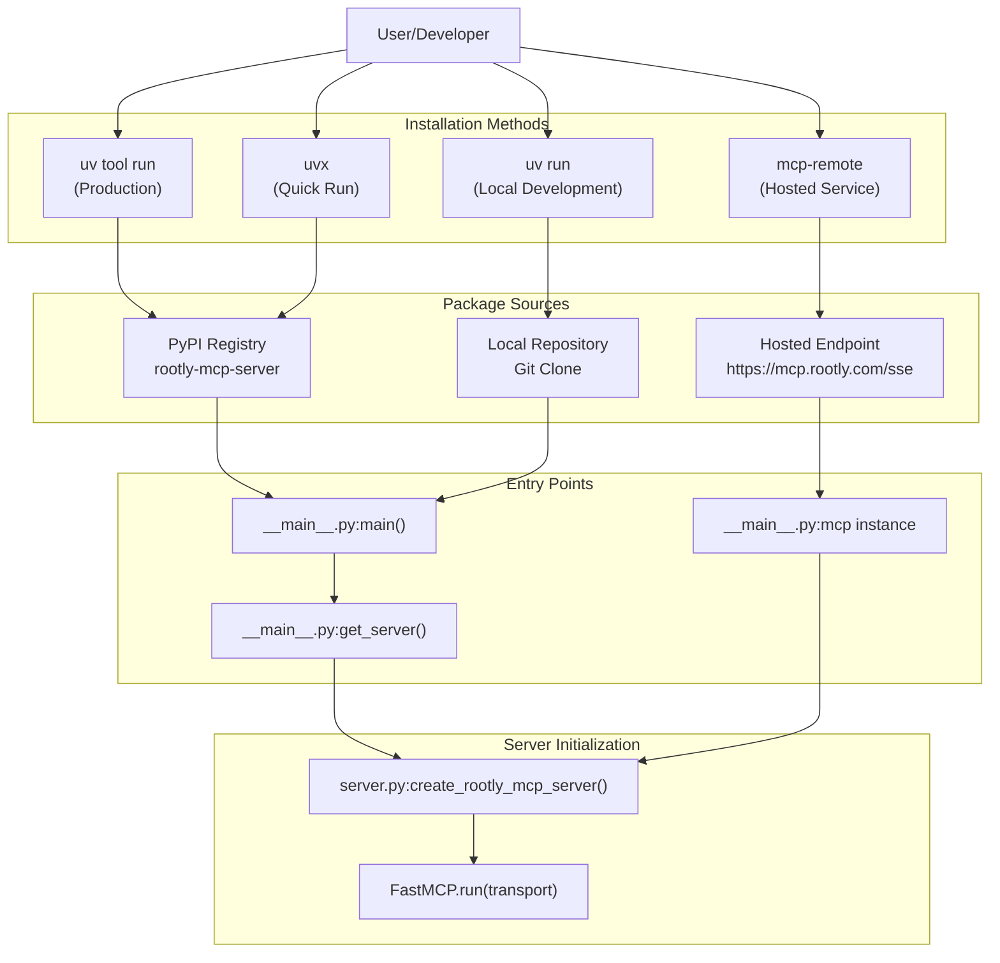
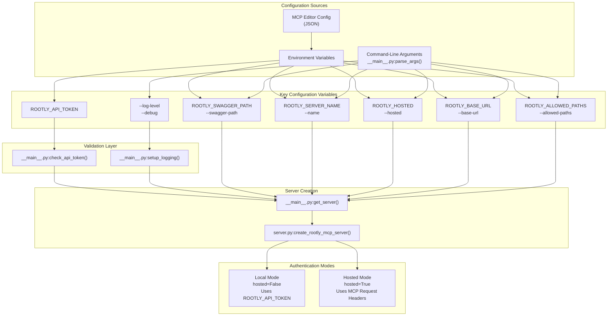

<!-- source: DeepWiki mcp.deepwiki.com · repo Rootly-AI-Labs/Rootly-MCP-server · page 2 Getting Started · fetched 2026-10-26 -->

# Getting Started

<details>
<summary>Relevant source files</summary>

The following files were used as context for generating this wiki page:

- [README.md](README.md)
- [pyproject.toml](pyproject.toml)
- [src/rootly_mcp_server/__main__.py](src/rootly_mcp_server/__main__.py)
- [src/rootly_mcp_server/utils.py](src/rootly_mcp_server/utils.py)
- [tests/unit/test_oncall_handoff.py](tests/unit/test_oncall_handoff.py)

</details>


This page provides a step-by-step guide to installing and running the Rootly MCP Server for the first time. It covers prerequisites, installation methods, basic configuration, and verification steps to get the server operational in your MCP-compatible editor.

For detailed installation instructions for specific methods (uv, uvx, local development, hosted), see [Installation](#2.1). For comprehensive configuration options including environment variables and operational modes, see [Configuration](#2.2). For practical usage examples, see [Quick Start Examples](#2.3).

## Prerequisites

Before installing the Rootly MCP Server, ensure you have the following:

| Requirement | Version/Details | Purpose |
|-------------|-----------------|---------|
| Python | 3.12 or higher | Core runtime environment |
| `uv` package manager | Latest stable | Fast dependency management and package execution |
| Rootly API Token | Valid token with appropriate permissions | Authentication with Rootly API |
| MCP-compatible editor | Cursor, Windsurf, or Claude Desktop | Client to interact with the MCP server |

### Python Version Requirement

The server requires Python 3.12+ as specified in [pyproject.toml:6]():

```toml
requires-python = ">=3.12"
```

### Installing uv

Install the `uv` package manager using the official installer:

```bash
curl -LsSf https://astral.sh/uv/install.sh | sh
```

Sources: [README.md:14-18](), [pyproject.toml:6]()

### API Token Requirements

The MCP server requires a Rootly API token with appropriate permissions. Token types and their capabilities:

| Token Type | Access Level | Use Case |
|------------|-------------|----------|
| **Global API Key** (Recommended) | Full access across all entities | Organization-wide visibility, required for on-call tools |
| Team API Key | Team Admin permissions | Team-specific workflows |
| Personal API Key | User-level permissions | Individual use cases |

**Important**: For full functionality of tools like `get_oncall_handoff_summary`, `get_oncall_shift_metrics`, and organization-wide incident search, a **Global API Key** is recommended.

To generate an API token, visit the [Rootly API documentation](https://docs.rootly.com/api-reference/overview#how-to-generate-an-api-key%3F).

Sources: [README.md:19-29]()

## Installation Methods Overview

The Rootly MCP Server supports multiple installation methods to accommodate different workflows:



**Installation Method Decision Flow**

Sources: [README.md:31-120](), [__main__.py:148-192]()

### Quick Comparison

| Method | Best For | Installation Time | Isolation |
|--------|----------|-------------------|-----------|
| `uv tool run` | Production use, auto-updates | ~10 seconds | Global tool cache |
| `uvx` | Quick testing, one-off runs | ~5 seconds | Temporary environment |
| Local development | Contributing, customization | ~30 seconds | Project virtual environment |
| Hosted service | Managed deployment, no local setup | Instant | Remote server |

Each method invokes the same entry point at [__main__.py:148]() but with different package resolution strategies. For detailed setup instructions for each method, see [Installation](#2.1).

Sources: [README.md:31-96]()

## Configuration Basics

The server uses environment variables and command-line arguments for configuration. The initialization flow connects user-provided configuration to server creation:



**Configuration Flow: From User Input to Server Creation**

Sources: [__main__.py:16-101](), [__main__.py:120-141]()

### Essential Configuration Variables

| Variable | Required | Default | Purpose |
|----------|----------|---------|---------|
| `ROOTLY_API_TOKEN` | Yes (local mode) | None | Authentication token for Rootly API |
| `ROOTLY_SERVER_NAME` | No | "Rootly" | Display name for the MCP server |
| `ROOTLY_HOSTED` | No | false | Enable hosted mode (remote MCP server) |
| `ROOTLY_BASE_URL` | No | "https://api.rootly.com" | Rootly API base URL |
| `ROOTLY_SWAGGER_PATH` | No | Auto-detected | Path to OpenAPI specification file |
| `ROOTLY_ALLOWED_PATHS` | No | Preset defaults | Comma-separated list of allowed API paths |

The `check_api_token()` function at [__main__.py:103-116]() validates that `ROOTLY_API_TOKEN` is set in local mode:

```python
def check_api_token():
    api_token = os.environ.get("ROOTLY_API_TOKEN")
    if not api_token:
        logger.error("ROOTLY_API_TOKEN environment variable is not set.")
        sys.exit(1)
```

In hosted mode (`--hosted` flag or `ROOTLY_HOSTED=true`), the server receives authentication through MCP request headers instead of environment variables, as validated at [__main__.py:162-164]():

```python
if not hosted_mode:
    check_api_token()
```

For comprehensive configuration options, see [Configuration](#2.2).

Sources: [__main__.py:103-116](), [__main__.py:120-141](), [__main__.py:162-164]()

## Basic Setup Example

Here's a minimal configuration to get started with the Rootly MCP Server in Cursor IDE:

### Step 1: Export API Token

```bash
export ROOTLY_API_TOKEN="your-api-token-here"
```

### Step 2: Add MCP Server Configuration

Add this configuration to your MCP settings file (typically `~/.cursor/mcp.json` or similar):

```json
{
  "mcpServers": {
    "rootly": {
      "command": "uvx",
      "args": [
        "--from",
        "rootly-mcp-server",
        "rootly-mcp-server"
      ],
      "env": {
        "ROOTLY_API_TOKEN": "<YOUR_ROOTLY_API_TOKEN>"
      }
    }
  }
}
```

This configuration:
1. Uses `uvx` for automatic package installation
2. Specifies the package name `rootly-mcp-server` from PyPI ([pyproject.toml:2]())
3. Invokes the entry point `rootly-mcp-server` ([pyproject.toml:49]())
4. Passes the API token via environment variable

### Step 3: Restart Your Editor

Restart Cursor (or your MCP-compatible editor) to load the new server configuration.

Sources: [README.md:59-75](), [pyproject.toml:49]()

## Verification Steps

After setup, verify the server is working correctly:

### 1. Check Server Logs

The server logs to stderr with timestamps and log levels. The logging is configured at [__main__.py:75-100]():

```python
logging.basicConfig(
    level=numeric_level,
    format="%(asctime)s - %(name)s - %(levelname)s - %(message)s",
    handlers=[logging.StreamHandler(sys.stderr)]
)
```

Look for:
- `"Starting Rootly MCP Server"` - Server initialization
- `"ROOTLY_API_TOKEN is set"` - Token validation passed
- `"Initializing server with name: Rootly"` - Server creation started
- `"Running server with transport: stdio..."` - Server running

### 2. List Available Tools

In your MCP client, check that tools are available. The server should expose:

**Core Tool Categories:**
- Alert management (`listAlerts`, `createAlert`, `attachAlert`)
- Incident operations (`listIncidents`, `createIncident`, `search_incidents`)
- Team management (`listTeams`, `createTeam`, `getCurrentUser`)
- On-call tools (`get_oncall_shift_metrics`, `get_oncall_handoff_summary`)
- Smart analysis (`find_related_incidents`, `suggest_solutions`)

The complete list of available tools is documented in [README.md:136-180]().

### 3. Test a Simple Query

Try a basic query to verify API connectivity:

```
Use the Rootly MCP server to list my recent incidents.
```

This should invoke the `search_incidents` tool and return results from your Rootly instance.

Sources: [__main__.py:75-100](), [__main__.py:153-182](), [README.md:136-180]()

## Troubleshooting Common Issues

| Issue | Cause | Solution |
|-------|-------|----------|
| `ROOTLY_API_TOKEN is not set` | Missing environment variable | Export token: `export ROOTLY_API_TOKEN="..."` |
| `Failed to start server` | Invalid swagger spec or network error | Check logs for details, verify API connectivity |
| Server starts but no tools appear | OpenAPI spec filtering issue | Verify `allowed_paths` configuration |
| `Permission denied` errors | Insufficient API token permissions | Use a Global API Key or verify token scopes |

For detailed debugging:

1. **Enable Debug Logging**: Set `--debug` flag or `DEBUG=true` environment variable ([__main__.py:47-50](), [__main__.py:77-78]())
2. **Check Token Format**: Token should start with valid characters, logged at [__main__.py:116]()
3. **Verify Python Version**: Ensure Python 3.12+ is installed ([pyproject.toml:6]())

Sources: [__main__.py:47-50](), [__main__.py:77-78](), [__main__.py:103-116](), [README.md:286-331]()

## Next Steps

After successfully installing and configuring the server:

1. **Explore Installation Options**: See [Installation](#2.1) for alternative installation methods (uv tool, local development, hosted service)
2. **Advanced Configuration**: Review [Configuration](#2.2) for customizing allowed paths, operational modes, and advanced settings
3. **Try Example Workflows**: Check [Quick Start Examples](#2.3) for common usage patterns
4. **Understand Architecture**: Read [Core Architecture](#3) to learn how the server processes requests
5. **Explore Tools**: Review [Tool System](#4) to understand available capabilities
6. **Development Setup**: See [Development Guide](#5) if you plan to contribute or customize the server

Sources: [README.md:1-331]()

## Architecture Context

The initialization flow follows this path through the codebase:

1. **Entry Point**: [__main__.py:148]() - `main()` function processes arguments
2. **Token Validation**: [__main__.py:103]() - `check_api_token()` ensures token is set
3. **Server Creation**: [__main__.py:120]() - `get_server()` builds configuration
4. **Initialization**: [__main__.py:173]() - Calls `create_rootly_mcp_server()` from [server.py]()
5. **Server Run**: [__main__.py:182]() - Starts FastMCP server with specified transport

The server instance created at [__main__.py:145]() (`mcp = get_server()`) is available as a module-level variable for FastMCP CLI integration.

For deeper understanding of server initialization, see [Server Initialization Pipeline](#3.1). For authentication details, see [Authentication System](#3.3).

Sources: [__main__.py:103-192]()

---

