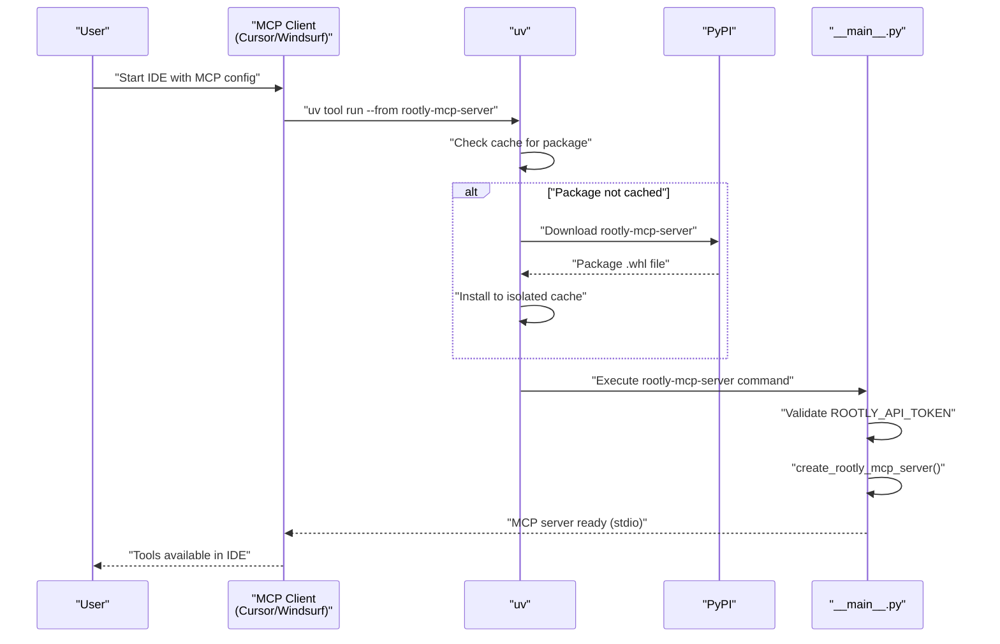
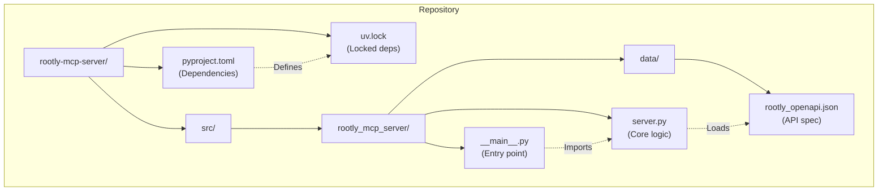
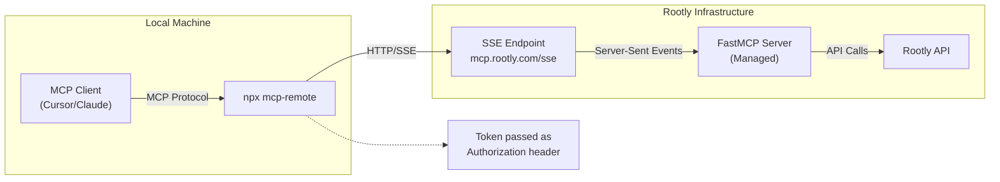
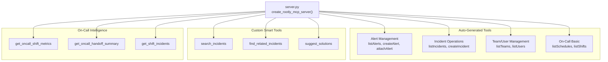

<!-- source: DeepWiki mcp.deepwiki.com · repo Rootly-AI-Labs/Rootly-MCP-server · page 2.1 Installation · fetched 2026-10-26 -->

# Installation

<details>
<summary>Relevant source files</summary>

The following files were used as context for generating this wiki page:

- [README.md](README.md)
- [pyproject.toml](pyproject.toml)
- [tests/unit/test_oncall_handoff.py](tests/unit/test_oncall_handoff.py)

</details>


This document provides detailed instructions for installing the Rootly MCP Server using different methods. It covers prerequisites, multiple installation approaches, and verification steps to ensure successful setup.

For information about configuring the server after installation, see [Configuration](#2.2). For usage examples, see [Quick Start Examples](#2.3).

---

## Overview

The Rootly MCP Server can be installed in four ways:

| Method | Use Case | Package Source | Configuration Location |
|--------|----------|----------------|------------------------|
| **uv tool run** | Production use in MCP clients | PyPI (auto-managed) | MCP client config |
| **uvx** | Quick testing, single commands | PyPI (auto-managed) | MCP client config |
| **Local development** | Custom modifications, debugging | Local repository clone | MCP client config |
| **Hosted service** | Managed infrastructure, no local install | Remote server | MCP client config |

Each method produces the same server functionality but differs in deployment model, update management, and customization capabilities.

Sources: [README.md:31-120]()

---

## Prerequisites

### Python Environment

**Required Python Version**: 3.12 or higher

The server requires Python 3.12+ due to type annotation features and modern async capabilities. Verify your Python version:

```bash
python --version  # Should show 3.12.x or higher
```

Sources: [README.md:14](), [pyproject.toml:6]()

### Package Manager: uv

**Install uv**: The server uses `uv` for dependency management and execution:

```bash
curl -LsSf https://astral.sh/uv/install.sh | sh
```

After installation, verify `uv` is available:

```bash
uv --version
```

**Why uv?** The server uses `uv` instead of `pip` for:
- Fast dependency resolution using Rust
- Deterministic lock file generation ([uv.lock]())
- Tool execution without virtual environment pollution
- Consistent builds across environments

Sources: [README.md:15-18](), [README.md:289]()

### Rootly API Token

All installation methods require a Rootly API token for authentication. The server supports three token types:

| Token Type | Scope | Recommended For |
|------------|-------|----------------|
| **Global API Key** | Full org access | Production deployments, org-wide tools |
| **Team API Key** | Team-specific access | Team-isolated workflows |
| **Personal API Key** | User permission inheritance | Individual testing |

Generate a token at: [Rootly API Settings](https://docs.rootly.com/api-reference/overview#how-to-generate-an-api-key%3F)

**Recommended**: Use a **Global API Key** for full functionality of tools like `get_oncall_handoff_summary` and `get_oncall_shift_metrics` which require organization-wide visibility.

Sources: [README.md:19-29]()

---

## Installation Method 1: uv Tool Run (Recommended)

### Overview

The `uv tool run` method automatically manages the package installation and execution. This is the recommended approach for MCP client integrations.

### Installation Flow



Sources: [README.md:35-55](), [pyproject.toml:49]()

### Configuration

Add this configuration to your MCP client's settings file (e.g., `~/.config/cursor/mcp.json` or `~/Library/Application Support/Claude/claude_desktop_config.json`):

```json
{
  "mcpServers": {
    "rootly": {
      "command": "uv",
      "args": [
        "tool",
        "run",
        "--from",
        "rootly-mcp-server",
        "rootly-mcp-server"
      ],      
      "env": {
        "ROOTLY_API_TOKEN": "<YOUR_ROOTLY_API_TOKEN>"
      }
    }
  }
}
```

**Configuration Breakdown**:
- `command: "uv"`: Uses uv as the execution wrapper
- `args[0-1]: "tool", "run"`: Invokes uv's tool runner
- `args[2-3]: "--from", "rootly-mcp-server"`: Specifies PyPI package name
- `args[4]: "rootly-mcp-server"`: Entry point command name (from [pyproject.toml:49]())
- `env.ROOTLY_API_TOKEN`: API token for authentication (see [Configuration](#2.2))

### How It Works

The entry point chain:
1. `uv tool run` executes the `rootly-mcp-server` script
2. Script maps to `rootly_mcp_server.__main__:main` ([pyproject.toml:49]())
3. `__main__.py:main()` validates environment and creates server
4. Server communicates via stdio with the MCP client

Sources: [README.md:37-55](), [pyproject.toml:48-49]()

---

## Installation Method 2: uvx (Simplified)

### Overview

`uvx` is a shorthand for `uv tool run`, providing a more concise command for single-use executions.

### Configuration

```json
{
  "mcpServers": {
    "rootly": {
      "command": "uvx",
      "args": [
        "--from",
        "rootly-mcp-server",
        "rootly-mcp-server"
      ],      
      "env": {
        "ROOTLY_API_TOKEN": "<YOUR_ROOTLY_API_TOKEN>"
      }
    }
  }
}
```

**Difference from Method 1**: `uvx` combines `uv tool run` into a single command, reducing configuration verbosity.

Sources: [README.md:57-75]()

---

## Installation Method 3: Local Development Setup

### Overview

Local development setup allows customization of `allowed_paths` and direct code modification. This method clones the repository and uses `uv run` to execute from source.

### Repository Structure



Sources: [README.md:77-96](), [pyproject.toml:36-46]()

### Installation Steps

#### Step 1: Clone Repository

```bash
git clone https://github.com/Rootly-AI-Labs/Rootly-MCP-server.git
cd Rootly-MCP-server
```

#### Step 2: Create Virtual Environment

```bash
uv venv .venv
source .venv/bin/activate  # On Windows: .venv\Scripts\activate
```

This creates an isolated Python environment in `.venv/` directory.

Sources: [README.md:293-298]()

#### Step 3: Install Dependencies

```bash
uv pip install .
```

This installs dependencies from [pyproject.toml:18-26]():
- `fastmcp>=2.9.0` (MCP protocol implementation)
- `httpx>=0.24.0` (Async HTTP client)
- `pydantic>=2.0.0` (Data validation)
- `scikit-learn>=1.3.0` (ML for similarity analysis)
- `numpy>=1.24.0` (Numerical operations)
- `brotli>=1.0.0` (Compression support)

Sources: [README.md:300-311](), [pyproject.toml:18-26]()

#### Step 4: Configure MCP Client

```json
{
  "mcpServers": {
    "rootly": {
      "command": "uv",
      "args": [
        "run",
        "--directory",
        "/absolute/path/to/Rootly-MCP-server",
        "rootly-mcp-server"
      ],
      "env": {
        "ROOTLY_API_TOKEN": "<YOUR_ROOTLY_API_TOKEN>"
      }
    }
  }
}
```

**Key Difference**: Uses `uv run --directory` to execute from a specific repository location, bypassing PyPI.

Sources: [README.md:79-96]()

### Development Tools Setup (Optional)

For contributors, install pre-commit hooks:

```bash
./scripts/setup-hooks.sh
```

This configures automatic checks before commits:
- **Ruff**: Linting and code formatting
- **Pyright**: Static type checking
- **Pytest**: Unit test execution

Sources: [README.md:313-325]()

---

## Installation Method 4: Hosted Service

### Overview

Connect to Rootly's hosted MCP server via `mcp-remote`, eliminating local installation requirements.

### Architecture



Sources: [README.md:98-120]()

### Configuration

```json
{
  "mcpServers": {
    "rootly": {
      "command": "npx",
      "args": [
        "-y",
        "mcp-remote",
        "https://mcp.rootly.com/sse",
        "--header",
        "Authorization:${ROOTLY_AUTH_HEADER}"
      ],
      "env": {
        "ROOTLY_AUTH_HEADER": "Bearer <YOUR_ROOTLY_API_TOKEN>"
      }
    }
  }
}
```

**Configuration Breakdown**:
- `command: "npx"`: Uses Node.js package runner
- `args[1]: "mcp-remote"`: Remote MCP client package
- `args[2]`: Server-Sent Events endpoint URL
- `args[3-4]`: Header injection for authentication
- `env.ROOTLY_AUTH_HEADER`: Full Bearer token with prefix

**Authentication Mode**: The hosted server uses MCP request header authentication instead of environment variables. See [Authentication System](#3.3) for details.

Sources: [README.md:100-120]()

---

## Verification

### Verify Installation Success

After configuring your MCP client, verify the server is running:

1. **Restart MCP Client**: Close and reopen your IDE/editor
2. **Check Server Logs**: Look for initialization messages in MCP client logs
3. **List Available Tools**: Use your IDE's MCP tool browser

### Expected Tool List

A successful installation exposes these tool categories:



Sources: [README.md:122-181]()

### Manual Test Script

For local development, use the test client:

```bash
# Activate virtual environment first
source .venv/bin/activate

# Run interactive test
python tests/test_client.py
```

This script validates:
- API token authentication
- Tool discovery
- Basic API connectivity

Sources: [README.md:330]()

---

## Troubleshooting

### Common Issues

#### Issue: "ROOTLY_API_TOKEN not set"

**Symptom**: Server fails to start with token validation error

**Solution**:
1. Verify token is set in MCP client config's `env` section
2. Ensure no leading/trailing whitespace in token value
3. Confirm token has not expired in Rootly dashboard

**Code Reference**: Token validation occurs in [src/rootly_mcp_server/__main__.py]() at startup.

#### Issue: "uv: command not found"

**Symptom**: MCP client cannot execute `uv` command

**Solution**:
1. Verify uv installation: `which uv` (Unix) or `where uv` (Windows)
2. Ensure uv is in system PATH
3. Restart terminal/IDE after uv installation
4. Reinstall: `curl -LsSf https://astral.sh/uv/install.sh | sh`

#### Issue: Package not updating

**Symptom**: Old version persists after PyPI update

**Solution**:
```bash
# Clear uv cache for specific package
uv cache clean rootly-mcp-server

# Or clear entire cache
uv cache clean
```

Then restart MCP client to force fresh download.

#### Issue: Permission denied on Linux/macOS

**Symptom**: Cannot execute scripts or create virtual environment

**Solution**:
```bash
# Make scripts executable
chmod +x scripts/setup-hooks.sh

# Ensure directory ownership
chown -R $USER:$USER /path/to/Rootly-MCP-server
```

Sources: [README.md:285-332]()

### Dependency Conflicts

If encountering version conflicts during local development:

```bash
# Show dependency tree
uv pip tree

# Remove lock file and reinstall
rm uv.lock
uv pip install .
```

The [uv.lock]() file ensures reproducible builds but may need regeneration if dependencies update.

Sources: [pyproject.toml:54-65]()

### Network Issues with Hosted Service

If the hosted service fails to connect:

1. **Verify Endpoint**: Ensure `https://mcp.rootly.com/sse` is accessible
2. **Check Firewall**: Corporate firewalls may block SSE connections
3. **Inspect Headers**: Confirm `Authorization` header format: `Bearer <token>`
4. **Fallback**: Use local installation methods if hosted service is unavailable

---

## Next Steps

After successful installation:

1. **Configure Server**: See [Configuration](#2.2) for customizing `allowed_paths` and operational modes
2. **Test Functionality**: Follow [Quick Start Examples](#2.3) to verify tool operation
3. **Explore Tools**: Review [Tool System](#4) documentation for available capabilities

Sources: [README.md:1-332](), [pyproject.toml:1-87]()

---

