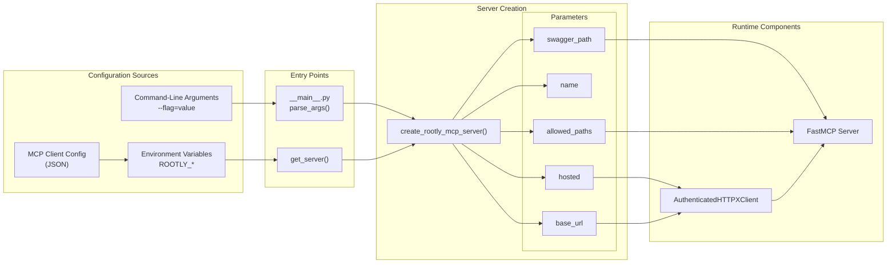
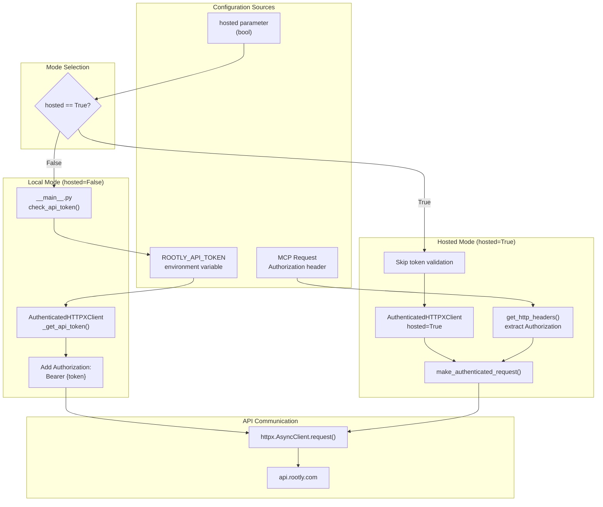
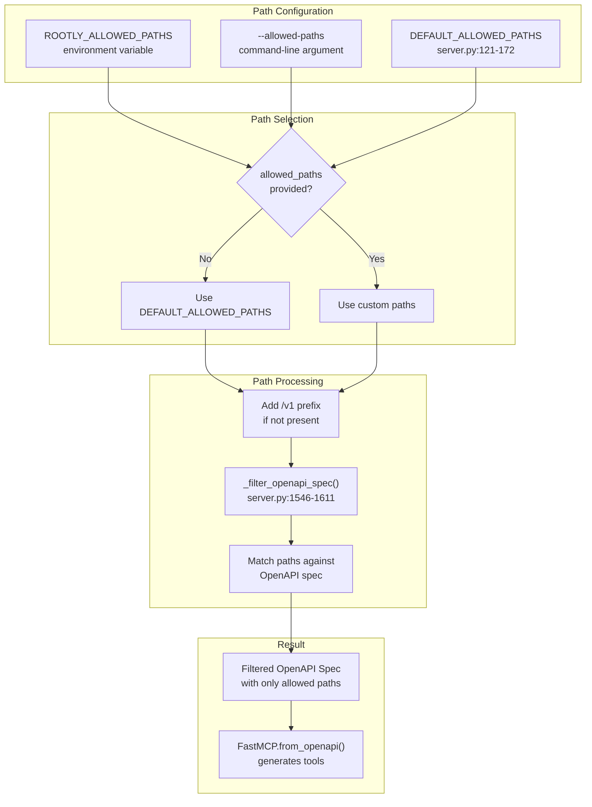
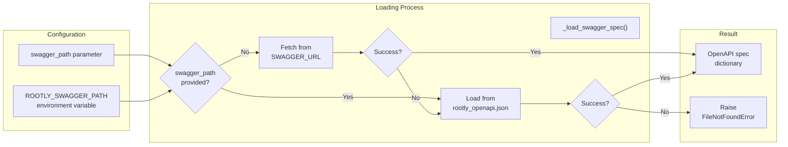

<!-- source: DeepWiki mcp.deepwiki.com · repo Rootly-AI-Labs/Rootly-MCP-server · page 2.2 Configuration · fetched 2026-10-26 -->

# Configuration

<details>
<summary>Relevant source files</summary>

The following files were used as context for generating this wiki page:

- [README.md](README.md)
- [src/rootly_mcp_server/__main__.py](src/rootly_mcp_server/__main__.py)
- [src/rootly_mcp_server/server.py](src/rootly_mcp_server/server.py)
- [src/rootly_mcp_server/utils.py](src/rootly_mcp_server/utils.py)
- [tests/unit/test_oncall_handoff.py](tests/unit/test_oncall_handoff.py)

</details>


This document describes all configuration options for the Rootly MCP Server, including environment variables, command-line arguments, MCP client configuration, authentication modes, and API path filtering. 

For installation instructions, see [Installation](#2.1). For API reference details on server creation, see [Server API](#7.1). For authentication internals, see [Authentication System](#3.3).

## Overview

The Rootly MCP Server supports multiple configuration mechanisms that can be used independently or in combination. Configuration flows from three primary sources: MCP client configuration files, environment variables, and command-line arguments. The server operates in two distinct authentication modes (local and hosted) with different configuration requirements for each.



**Diagram: Configuration Flow Architecture**

Sources: [src/rootly_mcp_server/__main__.py:16-72](), [src/rootly_mcp_server/__main__.py:119-141](), [src/rootly_mcp_server/server.py:278-344]()

## Configuration Methods

### Environment Variables

Environment variables provide configuration when the server is launched through MCP clients or directly via command line. All Rootly-specific environment variables use the `ROOTLY_` prefix.

| Variable | Required | Default | Description |
|----------|----------|---------|-------------|
| `ROOTLY_API_TOKEN` | Yes (local mode) | None | API authentication token |
| `ROOTLY_BASE_URL` | No | `https://api.rootly.com` | Rootly API base URL |
| `ROOTLY_SWAGGER_PATH` | No | None | Path to local OpenAPI spec file |
| `ROOTLY_SERVER_NAME` | No | `Rootly` | Display name for MCP server |
| `ROOTLY_ALLOWED_PATHS` | No | DEFAULT_ALLOWED_PATHS | Comma-separated API paths |
| `ROOTLY_HOSTED` | No | `false` | Enable hosted mode (true/false/1/0) |
| `DEBUG` | No | `false` | Enable debug logging (true/false/1/0) |

**Environment Variable Usage:**

```bash
# Local mode - token required
export ROOTLY_API_TOKEN="sk_live_..."
export ROOTLY_BASE_URL="https://api.rootly.com"
export DEBUG="true"

# Hosted mode - token not required (comes from MCP headers)
export ROOTLY_HOSTED="true"
export ROOTLY_SERVER_NAME="Rootly Production"
```

The `check_api_token()` function validates token presence in local mode [src/rootly_mcp_server/__main__.py:103-116](), while `get_server()` loads environment variables for programmatic server creation [src/rootly_mcp_server/__main__.py:119-141]().

Sources: [src/rootly_mcp_server/__main__.py:103-141](), [src/rootly_mcp_server/server.py:323-333]()

### Command-Line Arguments

Command-line arguments override environment variables and are primarily used when running the server directly via `python -m rootly_mcp_server` or the `rootly-mcp-server` CLI command.

| Argument | Type | Default | Description |
|----------|------|---------|-------------|
| `--swagger-path` | string | None | Path to Swagger JSON file |
| `--log-level` | choice | INFO | Logging level (DEBUG/INFO/WARNING/ERROR/CRITICAL) |
| `--name` | string | Rootly | MCP server name |
| `--transport` | choice | stdio | Transport protocol (stdio/sse) |
| `--debug` | flag | false | Enable debug mode |
| `--base-url` | string | None | Rootly API base URL |
| `--allowed-paths` | string | None | Comma-separated allowed API paths |
| `--hosted` | flag | false | Enable hosted mode |
| `--host` | flag | false | (Deprecated) Use --hosted instead |

**Command-Line Usage:**

```bash
# Basic local mode
rootly-mcp-server --log-level DEBUG

# Custom configuration
rootly-mcp-server \
  --name "Rootly Dev" \
  --base-url "https://api.staging.rootly.com" \
  --allowed-paths "/incidents,/alerts,/teams" \
  --debug

# Hosted mode
rootly-mcp-server --hosted --transport sse
```

The `parse_args()` function processes these arguments [src/rootly_mcp_server/__main__.py:16-72](), and `main()` uses them to configure the server [src/rootly_mcp_server/__main__.py:148-191]().

Sources: [src/rootly_mcp_server/__main__.py:16-72](), [src/rootly_mcp_server/__main__.py:148-191]()

### MCP Client Configuration

MCP-compatible clients (Cursor, Windsurf, Claude Desktop) use JSON configuration files to launch the server. These configurations set environment variables and specify the launch command.

#### Using uv (Recommended)

```json
{
  "mcpServers": {
    "rootly": {
      "command": "uv",
      "args": [
        "tool",
        "run",
        "--from",
        "rootly-mcp-server",
        "rootly-mcp-server"
      ],      
      "env": {
        "ROOTLY_API_TOKEN": "<YOUR_ROOTLY_API_TOKEN>"
      }
    }
  }
}
```

#### Using uvx

```json
{
  "mcpServers": {
    "rootly": {
      "command": "uvx",
      "args": [
        "--from",
        "rootly-mcp-server",
        "rootly-mcp-server"
      ],      
      "env": {
        "ROOTLY_API_TOKEN": "<YOUR_ROOTLY_API_TOKEN>"
      }
    }
  }
}
```

#### Local Development Configuration

```json
{
  "mcpServers": {
    "rootly": {
      "command": "uv",
      "args": [
        "run",
        "--directory",
        "/path/to/rootly-mcp-server",
        "rootly-mcp-server"
      ],
      "env": {
        "ROOTLY_API_TOKEN": "<YOUR_ROOTLY_API_TOKEN>",
        "DEBUG": "true"
      }
    }
  }
}
```

#### Hosted Service Configuration

```json
{
  "mcpServers": {
    "rootly": {
      "command": "npx",
      "args": [
        "-y",
        "mcp-remote",
        "https://mcp.rootly.com/sse",
        "--header",
        "Authorization:${ROOTLY_AUTH_HEADER}"
      ],
      "env": {
        "ROOTLY_AUTH_HEADER": "Bearer <YOUR_ROOTLY_API_TOKEN>"
      }
    }
  }
}
```

Sources: [README.md:36-120]()

## Authentication Configuration

The server supports two authentication modes with different configuration requirements. The mode is determined by the `hosted` parameter.



**Diagram: Authentication Mode Configuration Flow**

Sources: [src/rootly_mcp_server/__main__.py:103-116](), [src/rootly_mcp_server/__main__.py:162-164](), [src/rootly_mcp_server/server.py:175-211](), [src/rootly_mcp_server/server.py:375-392]()

### Local Mode Configuration

Local mode (default, `hosted=False`) requires a `ROOTLY_API_TOKEN` environment variable. The token is loaded once during client initialization.

**Configuration:**

```bash
export ROOTLY_API_TOKEN="sk_live_abc123..."
```

**Validation:** The `check_api_token()` function [src/rootly_mcp_server/__main__.py:103-116]() validates token presence before server startup. If missing, the server exits with error code 1.

**Token Loading:** The `AuthenticatedHTTPXClient._get_api_token()` method [src/rootly_mcp_server/server.py:205-211]() retrieves the token from the environment and logs a warning if not found.

**Header Injection:** During initialization, the token is added to the `httpx.AsyncClient` headers [src/rootly_mcp_server/server.py:193-194]():

```python
if self._api_token:
    headers["Authorization"] = f"Bearer {self._api_token}"
```

### Hosted Mode Configuration

Hosted mode (`hosted=True`) extracts authentication from incoming MCP request headers instead of environment variables. This enables multi-tenant scenarios where each request carries its own token.

**Configuration:**

```bash
export ROOTLY_HOSTED="true"
# or
rootly-mcp-server --hosted
```

**Request-Level Authentication:** The `make_authenticated_request()` function [src/rootly_mcp_server/server.py:375-392]() extracts the Authorization header from each incoming MCP request:

```python
if hosted:
    from fastmcp.server.dependencies import get_http_headers
    request_headers = get_http_headers()
    auth_header = request_headers.get("authorization", "")
    if auth_header:
        kwargs["headers"]["Authorization"] = auth_header
```

**No Token Validation:** In hosted mode, `check_api_token()` is skipped [src/rootly_mcp_server/__main__.py:162-164](), allowing the server to start without `ROOTLY_API_TOKEN` set.

Sources: [src/rootly_mcp_server/server.py:175-211](), [src/rootly_mcp_server/server.py:375-392](), [src/rootly_mcp_server/__main__.py:103-116](), [src/rootly_mcp_server/__main__.py:162-164]()

## API Path Filtering Configuration

The server restricts exposed API endpoints through the `allowed_paths` configuration. This limits context window size and controls security.

### Default Allowed Paths

The `DEFAULT_ALLOWED_PATHS` constant [src/rootly_mcp_server/server.py:121-172]() defines the default whitelist:

```python
DEFAULT_ALLOWED_PATHS = [
    "/incidents/{incident_id}/alerts",
    "/alerts",
    "/alerts/{alert_id}",
    "/severities",
    "/teams",
    "/services",
    "/schedules",
    "/shifts",
    # ... 30+ paths total
]
```

**Categories included:**
- Alerts: Create, list, attach to incidents
- Incidents: Action items, types, workflows
- Teams & Users: Team management, current user
- On-Call: Schedules, shifts, rotations, overrides
- Services & Environments: Service catalog, environments
- Severities & Functionalities: Severity levels, functional areas

### Custom Path Configuration

Override the default paths using environment variables or command-line arguments:

**Environment Variable:**

```bash
export ROOTLY_ALLOWED_PATHS="/incidents,/alerts,/teams,/schedules"
rootly-mcp-server
```

**Command-Line:**

```bash
rootly-mcp-server --allowed-paths "/incidents,/alerts,/teams"
```

**Programmatic:**

```python
from rootly_mcp_server.server import create_rootly_mcp_server

server = create_rootly_mcp_server(
    allowed_paths=["/incidents", "/alerts", "/teams"]
)
```

### Path Filtering Process



**Diagram: API Path Filtering Pipeline**

The `create_rootly_mcp_server()` function processes paths [src/rootly_mcp_server/server.py:298-316]():

1. If `allowed_paths` is None, use `DEFAULT_ALLOWED_PATHS`
2. Add `/v1` prefix to all paths (Rootly API convention)
3. Call `_filter_openapi_spec()` to filter the OpenAPI spec
4. Only matching paths remain for tool generation

The `_filter_openapi_spec()` function [src/rootly_mcp_server/server.py:1546-1611]() performs exact path matching, preserving path parameters and operations.

Sources: [src/rootly_mcp_server/server.py:121-172](), [src/rootly_mcp_server/server.py:298-316](), [src/rootly_mcp_server/server.py:1546-1611]()

## Server Parameters

The `create_rootly_mcp_server()` function [src/rootly_mcp_server/server.py:278-296]() accepts the following parameters:

| Parameter | Type | Default | Description |
|-----------|------|---------|-------------|
| `swagger_path` | Optional[str] | None | Path to local OpenAPI spec file. If None, fetches from SWAGGER_URL |
| `name` | str | "Rootly" | Display name for the MCP server |
| `allowed_paths` | Optional[List[str]] | None | API paths to expose. If None, uses DEFAULT_ALLOWED_PATHS |
| `hosted` | bool | False | Enable hosted mode (request-level authentication) |
| `base_url` | Optional[str] | None | Rootly API base URL. If None, uses ROOTLY_BASE_URL env var or default |

**Parameter Resolution Priority:**

1. Function arguments (highest priority)
2. Command-line arguments
3. Environment variables
4. Default values (lowest priority)

**Example with all parameters:**

```python
server = create_rootly_mcp_server(
    swagger_path="/path/to/custom_swagger.json",
    name="Rootly Production",
    allowed_paths=["/incidents", "/alerts", "/teams"],
    hosted=True,
    base_url="https://api.staging.rootly.com"
)
```

Sources: [src/rootly_mcp_server/server.py:278-344]()

## OpenAPI Specification Configuration

The server loads the Rootly OpenAPI specification from two possible sources, with automatic fallback.

### Specification Sources



**Diagram: OpenAPI Specification Loading Flow**

**Remote Source:** The default `SWAGGER_URL` constant [src/rootly_mcp_server/server.py:85]() points to:
```python
SWAGGER_URL = "https://rootly-heroku.s3.amazonaws.com/swagger/v1/swagger.json"
```

**Local Fallback:** If remote fetch fails or `swagger_path` is provided, the server attempts to load from `rootly_openapi.json` in the package directory.

**Loading Function:** The `_load_swagger_spec()` function [src/rootly_mcp_server/server.py:1458-1544]() handles this logic with logging at each step.

Sources: [src/rootly_mcp_server/server.py:85](), [src/rootly_mcp_server/server.py:1458-1544]()

## Logging Configuration

### Log Level Configuration

Control logging verbosity through environment variables or command-line arguments:

**Environment Variable:**
```bash
export DEBUG="true"  # Enables DEBUG level
```

**Command-Line:**
```bash
rootly-mcp-server --log-level DEBUG
# or
rootly-mcp-server --debug
```

**Available Levels:**
- `DEBUG`: Detailed information for diagnosing problems
- `INFO`: Confirmation that things are working as expected (default)
- `WARNING`: Something unexpected happened
- `ERROR`: A serious problem occurred
- `CRITICAL`: The program may not be able to continue

The `setup_logging()` function [src/rootly_mcp_server/__main__.py:75-100]() configures Python's logging system, directing output to stderr for stdio transport compatibility.

**What Gets Logged:**

```python
# DEBUG level logs
logger.debug(f"Python version: {sys.version}")
logger.debug(f"Current directory: {Path.cwd()}")
logger.debug(f"Token starts with: {api_token[:5]}...")
logger.debug(f"Transformed parameter: '{key}' -> '{original_key}'")

# INFO level logs
logger.info(f"Creating Rootly MCP Server with allowed paths: {allowed_paths_v1}")
logger.info(f"Loaded Swagger spec with {len(swagger_spec.get('paths', {}))} total paths")
logger.info(f"Sanitized parameter names for MCP compatibility")

# WARNING level logs
logger.warning("ROOTLY_API_TOKEN environment variable is not set")

# ERROR level logs
logger.error("ROOTLY_API_TOKEN environment variable is not set.")
logger.error(f"Failed to start server: {e}", exc_info=True)
```

Sources: [src/rootly_mcp_server/__main__.py:75-100]()

## Configuration Best Practices

### Security Considerations

1. **Token Protection:** Never commit tokens to version control. Use environment variables or secret management systems.

2. **Hosted Mode for Multi-Tenant:** Use hosted mode when serving multiple clients with different tokens:
   ```json
   {
     "mcpServers": {
       "rootly": {
         "command": "npx",
         "args": ["-y", "mcp-remote", "https://mcp.rootly.com/sse", 
                  "--header", "Authorization:${ROOTLY_AUTH_HEADER}"],
         "env": {"ROOTLY_AUTH_HEADER": "Bearer <TOKEN>"}
       }
     }
   }
   ```

3. **Path Restrictions:** Limit `allowed_paths` to only what's needed. Default paths are already curated for common use cases.

### Performance Optimization

1. **Minimize Exposed Paths:** Fewer paths = smaller OpenAPI spec = faster tool generation = reduced context window usage.

2. **Use Local Swagger:** For development, cache the OpenAPI spec locally to avoid remote fetches:
   ```bash
   export ROOTLY_SWAGGER_PATH="/path/to/rootly_openapi.json"
   ```

3. **Debug Mode:** Only enable debug logging when troubleshooting. It generates significant log volume.

### Development vs Production

**Development Configuration:**
```bash
export ROOTLY_API_TOKEN="sk_test_..."
export ROOTLY_BASE_URL="https://api.staging.rootly.com"
export DEBUG="true"
export ROOTLY_SWAGGER_PATH="./rootly_openapi.json"
```

**Production Configuration:**
```bash
export ROOTLY_API_TOKEN="sk_live_..."
export ROOTLY_BASE_URL="https://api.rootly.com"
export ROOTLY_HOSTED="true"
# No debug logging in production
```

Sources: [README.md:19-30](), [src/rootly_mcp_server/__main__.py:103-116]()

## Configuration Troubleshooting

### Common Issues

**Issue: "ROOTLY_API_TOKEN environment variable is not set"**

Solution: Set the token before starting the server:
```bash
export ROOTLY_API_TOKEN="your-token-here"
```

Or use hosted mode if tokens come from MCP requests:
```bash
rootly-mcp-server --hosted
```

**Issue: "Failed to load swagger spec"**

Solutions:
1. Check network connectivity to `SWAGGER_URL`
2. Verify local `rootly_openapi.json` exists in package directory
3. Provide custom path: `--swagger-path /path/to/spec.json`

**Issue: Custom allowed_paths not working**

Verify path format matches OpenAPI spec:
```bash
# Correct (with /v1 prefix or let server add it)
--allowed-paths "/incidents,/alerts"

# Incorrect (missing /v1 will be auto-added)
--allowed-paths "incidents,alerts"
```

The server automatically adds the `/v1` prefix [src/rootly_mcp_server/server.py:302-306]().

**Issue: Authentication failures in hosted mode**

Ensure MCP client passes the Authorization header:
```json
{
  "command": "npx",
  "args": ["-y", "mcp-remote", "https://mcp.rootly.com/sse",
           "--header", "Authorization:${ROOTLY_AUTH_HEADER}"],
  "env": {"ROOTLY_AUTH_HEADER": "Bearer <TOKEN>"}
}
```

### Validation Steps

1. **Check Environment:** Verify all required variables are set:
   ```bash
   env | grep ROOTLY
   ```

2. **Test Token:** Verify token works with direct API call:
   ```bash
   curl -H "Authorization: Bearer $ROOTLY_API_TOKEN" \
        https://api.rootly.com/v1/users/me
   ```

3. **Enable Debug Logging:** Get detailed diagnostic information:
   ```bash
   rootly-mcp-server --debug
   ```

4. **Verify Configuration:** Check that configuration is loaded correctly by examining debug logs for lines like:
   - "Creating Rootly MCP Server with allowed paths: ..."
   - "Using Rootly API base URL: ..."
   - "Loaded Swagger spec with X total paths"

Sources: [src/rootly_mcp_server/__main__.py:103-116](), [src/rootly_mcp_server/server.py:308-326]()

---

