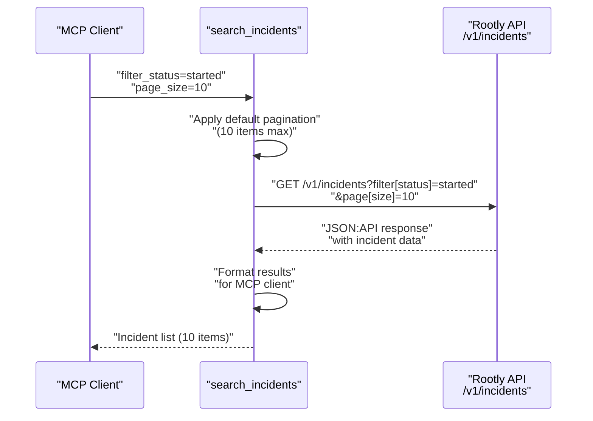
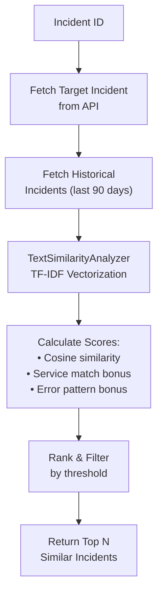
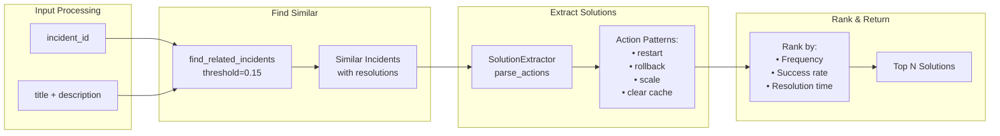
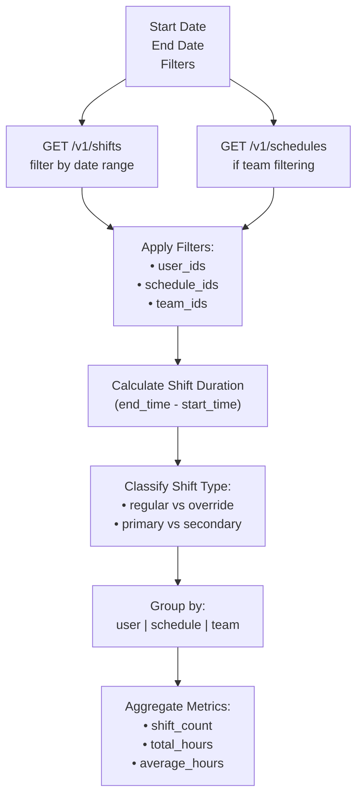
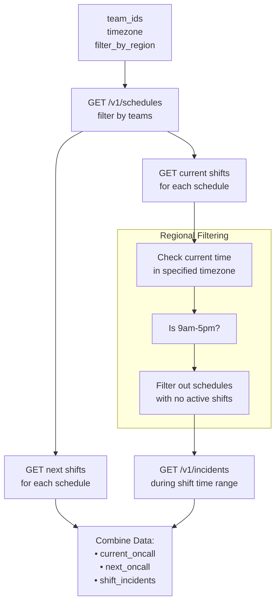
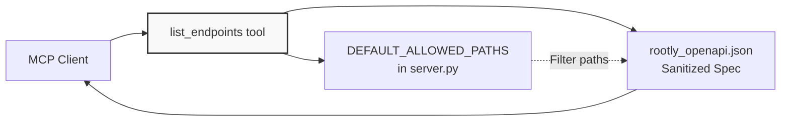

<!-- source: DeepWiki mcp.deepwiki.com · repo Rootly-AI-Labs/Rootly-MCP-server · page 2.3 Quick Start Examples · fetched 2026-10-26 -->

# Quick Start Examples

<details>
<summary>Relevant source files</summary>

The following files were used as context for generating this wiki page:

- [README.md](README.md)
- [src/rootly_mcp_server/texttest.json](src/rootly_mcp_server/texttest.json)
- [tests/unit/test_oncall_handoff.py](tests/unit/test_oncall_handoff.py)
- [tests/unit/test_oncall_metrics.py](tests/unit/test_oncall_metrics.py)

</details>


This page provides practical examples for common tasks using the Rootly MCP Server. These examples demonstrate how to interact with the server through MCP-compatible clients like Cursor, Windsurf, or Claude Desktop after completing installation and configuration (see [Installation](#2.1) and [Configuration](#2.2)).

For detailed information about specific tool implementations and advanced features, see [Smart Analysis Tools](#4.2) and [On-Call Intelligence Tools](#4.3).

---

## Basic Incident Search

The `search_incidents` tool provides flexible incident search with smart pagination defaults to prevent context window overflow.

**Example: Search for recent critical incidents**

```
search_incidents(
    filter_status="started,mitigated",
    filter_severity="critical,high",
    page_size=10
)
```

**Parameters:**
| Parameter | Type | Description | Default |
|-----------|------|-------------|---------|
| `filter_status` | string | Comma-separated statuses: `started`, `mitigated`, `resolved`, `cancelled` | None |
| `filter_severity` | string | Comma-separated severities: `critical`, `high`, `medium`, `low` | None |
| `page_size` | integer | Number of results to return | 10 |
| `filter_title` | string | Filter by incident title (partial match) | None |
| `filter_service_ids` | string | Comma-separated service IDs | None |

**Expected Output:**
Returns a JSON array of incident objects containing:
- `id`: Unique incident identifier
- `title`: Incident title
- `status`: Current status
- `severity`: Severity level with details
- `started_at`: Incident start timestamp
- `url`: Link to incident in Rootly
- `summary`: AI-generated summary (if available)



**Sources:** [README.md:158](), [src/rootly_mcp_server/server.py]()

---

## Finding Related Incidents

The `find_related_incidents` tool uses TF-IDF similarity analysis to identify historically similar incidents based on text content, affected services, and error patterns.

**Example: Find similar incidents to analyze patterns**

```
find_related_incidents(
    incident_id="d374e44c-2495-4af5-933b-4f791e5e46c7",
    similarity_threshold=0.15,
    max_results=5
)
```

**Parameters:**
| Parameter | Type | Description | Default |
|-----------|------|-------------|---------|
| `incident_id` | string (required) | UUID of the target incident | - |
| `similarity_threshold` | float | Minimum similarity score (0.0-1.0) | 0.15 |
| `max_results` | integer | Maximum number of similar incidents to return | 5 |

**Output Structure:**
```json
{
  "similar_incidents": [
    {
      "id": "uuid",
      "title": "Incident title",
      "similarity_score": 0.45,
      "matched_services": ["service-a", "service-b"],
      "resolution_time_minutes": 120,
      "status": "resolved",
      "summary": "Resolution description"
    }
  ],
  "analysis": {
    "common_services": ["auth-service"],
    "common_error_patterns": ["timeout", "connection refused"]
  }
}
```

**How Similarity Works:**



**Sources:** [README.md:195-220](), [src/rootly_mcp_server/smart_utils.py](), [tests/unit/test_smart_tools.py]()

---

## Getting Solution Suggestions

The `suggest_solutions` tool mines historical incident resolutions to recommend actionable solutions with confidence scores.

**Example: Get suggestions for an existing incident**

```
suggest_solutions(
    incident_id="d374e44c-2495-4af5-933b-4f791e5e46c7",
    max_solutions=3
)
```

**Example: Get suggestions for a new incident**

```
suggest_solutions(
    incident_title="Payment API returning 500 errors",
    incident_description="Users unable to complete checkout, seeing timeout errors on payment-service",
    max_solutions=5
)
```

**Parameters:**
| Parameter | Type | Description | Default |
|-----------|------|-------------|---------|
| `incident_id` | string | UUID of existing incident | None |
| `incident_title` | string | Title for new incident | None |
| `incident_description` | string | Description for new incident | None |
| `max_solutions` | integer | Maximum solutions to return | 3 |

**Note:** Either `incident_id` OR (`incident_title` + `incident_description`) must be provided.

**Output Structure:**
```json
{
  "solutions": [
    {
      "action": "Restart auth-service and clear Redis cache",
      "confidence": 0.85,
      "source_incidents": ["uuid1", "uuid2"],
      "success_rate": "2/2",
      "avg_resolution_time_minutes": 15
    }
  ],
  "patterns": {
    "common_actions": ["restart service", "clear cache"],
    "affected_services": ["auth-service", "payment-service"]
  }
}
```

**Solution Extraction Flow:**



**Sources:** [README.md:204-228](), [src/rootly_mcp_server/smart_utils.py]()

---

## On-Call Shift Metrics

The `get_oncall_shift_metrics` tool calculates shift statistics aggregated by user, team, or schedule.

**Example: Get monthly metrics by user**

```
get_oncall_shift_metrics(
    start_date="2025-10-01",
    end_date="2025-10-31",
    group_by="user"
)
```

**Example: Filter by specific users**

```
get_oncall_shift_metrics(
    start_date="2025-10-01",
    end_date="2025-10-31",
    user_ids="user-1,user-2,user-3",
    group_by="user"
)
```

**Parameters:**
| Parameter | Type | Description | Default |
|-----------|------|-------------|---------|
| `start_date` | string (required) | ISO 8601 date (YYYY-MM-DD) | - |
| `end_date` | string (required) | ISO 8601 date (YYYY-MM-DD) | - |
| `group_by` | string | One of: `user`, `schedule`, `team`, `none` | `user` |
| `user_ids` | string | Comma-separated user IDs to filter | None |
| `schedule_ids` | string | Comma-separated schedule IDs to filter | None |
| `team_ids` | string | Comma-separated team IDs to filter | None |

**Output Structure:**
```json
{
  "metrics": [
    {
      "user_id": "user-1",
      "user_name": "John Doe",
      "shift_count": 12,
      "total_hours": 96.0,
      "avg_shift_hours": 8.0,
      "regular_shifts": 10,
      "override_shifts": 2,
      "primary_shifts": 8,
      "secondary_shifts": 4,
      "total_days": 12.0
    }
  ],
  "summary": {
    "total_shifts": 12,
    "total_hours": 96.0,
    "unique_people": 1
  }
}
```

**Metrics Calculation Flow:**



**Sources:** [README.md:230-240](), [tests/unit/test_oncall_metrics.py:131-160](), [src/rootly_mcp_server/server.py]()

---

## On-Call Handoff Summary

The `get_oncall_handoff_summary` tool provides complete handoff information including current on-call, next on-call, and incidents during shifts.

**Example: Get handoff summary for specific teams**

```
get_oncall_handoff_summary(
    team_ids="team-1,team-2",
    timezone="America/Los_Angeles"
)
```

**Example: Regional filtering (APAC business hours)**

```
get_oncall_handoff_summary(
    timezone="Asia/Tokyo",
    filter_by_region=true
)
```

**Parameters:**
| Parameter | Type | Description | Default |
|-----------|------|-------------|---------|
| `team_ids` | string | Comma-separated team IDs | None (all teams) |
| `timezone` | string | IANA timezone identifier | `UTC` |
| `filter_by_region` | boolean | Show only on-call during business hours (9am-5pm) | `false` |

**Output Structure:**
```json
{
  "schedules": [
    {
      "schedule_id": "schedule-1",
      "schedule_name": "Backend On-Call",
      "team_name": "Backend Team",
      "current_oncall": {
        "user_name": "Jane Smith",
        "user_email": "jane@example.com",
        "shift_start": "2025-10-20T09:00:00Z",
        "shift_end": "2025-10-21T09:00:00Z",
        "role": "primary"
      },
      "next_oncall": {
        "user_name": "Bob Johnson",
        "shift_start": "2025-10-21T09:00:00Z",
        "shift_end": "2025-10-22T09:00:00Z"
      },
      "shift_incidents": [
        {
          "incident_id": "inc-1",
          "title": "Database slow queries",
          "severity": "high",
          "status": "resolved",
          "started_at": "2025-10-20T14:30:00Z"
        }
      ]
    }
  ],
  "summary": {
    "total_schedules": 1,
    "total_incidents": 1
  }
}
```

**Handoff Data Aggregation:**



**Sources:** [README.md:242-262](), [tests/unit/test_oncall_handoff.py:12-36](), [src/rootly_mcp_server/server.py]()

---

## Shift Incidents

The `get_shift_incidents` tool queries incidents that occurred during a specific time range with optional filtering.

**Example: Get incidents during a shift**

```
get_shift_incidents(
    start_time="2025-10-20T09:00:00Z",
    end_time="2025-10-20T17:00:00Z"
)
```

**Example: Filter by severity and status**

```
get_shift_incidents(
    start_time="2025-10-20T09:00:00Z",
    end_time="2025-10-20T17:00:00Z",
    severity="critical,high",
    status="resolved",
    tags="database,api"
)
```

**Parameters:**
| Parameter | Type | Description | Default |
|-----------|------|-------------|---------|
| `start_time` | string (required) | ISO 8601 timestamp | - |
| `end_time` | string (required) | ISO 8601 timestamp | - |
| `severity` | string | Comma-separated severities | None |
| `status` | string | Comma-separated statuses | None |
| `tags` | string | Comma-separated tags | None |

**Output Structure:**
```json
{
  "incidents": [
    {
      "id": "inc-1",
      "title": "Database connection pool exhausted",
      "severity": "high",
      "status": "resolved",
      "started_at": "2025-10-20T10:15:00Z",
      "resolved_at": "2025-10-20T11:30:00Z",
      "resolution_time_minutes": 75,
      "services": ["database-service"]
    }
  ],
  "summary": {
    "total_incidents": 1,
    "by_severity": {"high": 1},
    "by_status": {"resolved": 1},
    "avg_resolution_time_minutes": 75
  }
}
```

**Sources:** [README.md:264-278](), [tests/unit/test_oncall_handoff.py:43-68](), [src/rootly_mcp_server/server.py]()

---

## Other Common Operations

### Listing Teams

```
listTeams(page_size=20)
```

Returns all teams in your Rootly organization with pagination support.

### Getting Current User

```
getCurrentUser()
```

Returns information about the user associated with the API token, including permissions and team membership.

### Listing Services

```
listServices(
    filter_name="payment",
    page_size=10
)
```

Returns services matching the filter criteria. Useful for identifying service IDs needed for incident filtering.

### Listing Severities

```
listSeverities()
```

Returns all configured severity levels (e.g., SEV0, SEV1, SEV2) with their descriptions and colors.

**Tool Discovery:**



**Sources:** [README.md:134-181](), [src/rootly_mcp_server/server.py]()

---

## Quick Reference Table

| Task | Tool Name | Key Parameters | Output |
|------|-----------|----------------|--------|
| Search incidents | `search_incidents` | `filter_status`, `filter_severity`, `page_size` | Incident list |
| Find similar incidents | `find_related_incidents` | `incident_id`, `similarity_threshold` | Similar incidents with scores |
| Get solution suggestions | `suggest_solutions` | `incident_id` OR `incident_title` + `incident_description` | Ranked solutions with confidence |
| Calculate shift metrics | `get_oncall_shift_metrics` | `start_date`, `end_date`, `group_by` | Aggregated shift statistics |
| Get handoff summary | `get_oncall_handoff_summary` | `team_ids`, `timezone`, `filter_by_region` | Current/next on-call + incidents |
| Query shift incidents | `get_shift_incidents` | `start_time`, `end_time`, filters | Incidents during time range |
| List teams | `listTeams` | `page_size` | Team list |
| List services | `listServices` | `filter_name`, `page_size` | Service list |
| Get current user | `getCurrentUser` | None | User details with permissions |

**Sources:** [README.md:122-181]()

---

