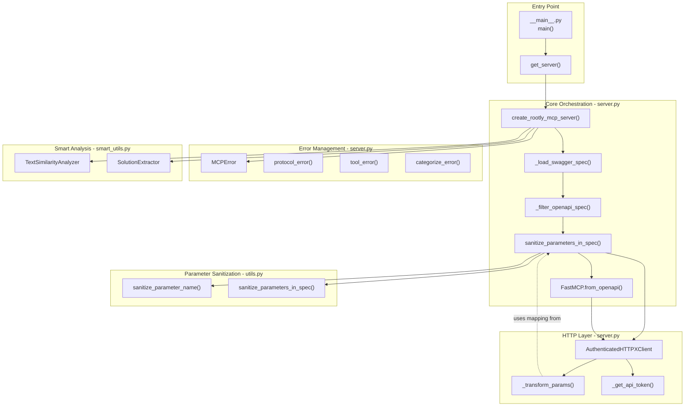
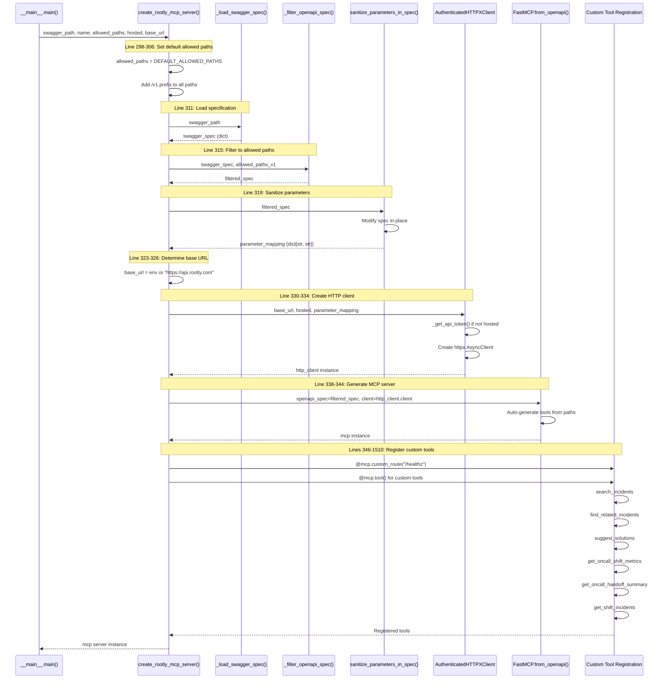
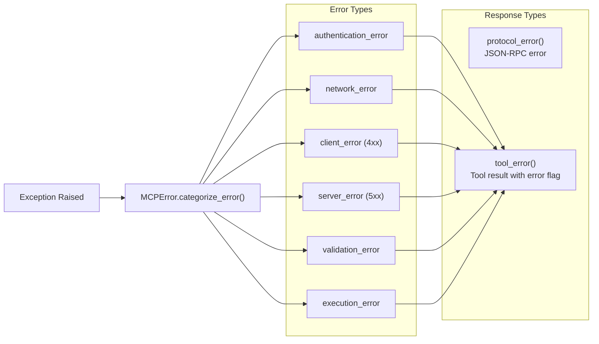
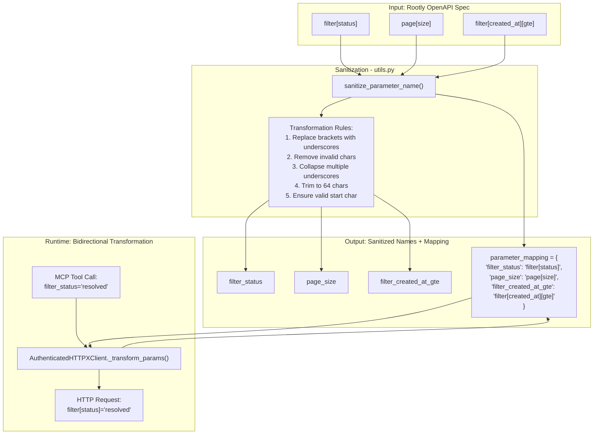
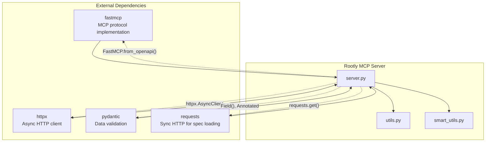

<!-- source: DeepWiki mcp.deepwiki.com · repo Rootly-AI-Labs/Rootly-MCP-server · page 3 Core Architecture · fetched 2026-10-26 -->

# Core Architecture

<details>
<summary>Relevant source files</summary>

The following files were used as context for generating this wiki page:

- [src/rootly_mcp_server/__main__.py](src/rootly_mcp_server/__main__.py)
- [src/rootly_mcp_server/server.py](src/rootly_mcp_server/server.py)
- [src/rootly_mcp_server/utils.py](src/rootly_mcp_server/utils.py)

</details>


This document provides a detailed examination of the Rootly MCP Server's internal architecture, focusing on the critical components that enable dynamic tool generation from OpenAPI specifications and intelligent incident management. The architecture centers around [src/rootly_mcp_server/server.py](), which orchestrates the transformation of Rootly's API into MCP-compliant tools.

For step-by-step initialization details, see [Server Initialization Pipeline](#3.1). For OpenAPI specification processing, see [OpenAPI Processing](#3.2). For authentication mechanisms, see [Authentication System](#3.3). For HTTP client implementation, see [HTTP Client & Request Flow](#3.4).

## Architecture Overview

The Rootly MCP Server architecture follows a multi-stage transformation pipeline that converts the Rootly OpenAPI specification into MCP-compliant tools while maintaining full API compatibility through bidirectional parameter mapping.



**Sources:** [src/rootly_mcp_server/server.py:278-344](), [src/rootly_mcp_server/__main__.py:119-145](), [src/rootly_mcp_server/utils.py:45-105]()

## Core Component Responsibilities

| Component | Location | Primary Responsibility | Key Methods/Functions |
|-----------|----------|----------------------|---------------------|
| `create_rootly_mcp_server` | [server.py:278-344]() | Main server factory function | Orchestrates entire initialization pipeline |
| `AuthenticatedHTTPXClient` | [server.py:175-276]() | HTTP client with auth & parameter transformation | `request()`, `_transform_params()`, `_get_api_token()` |
| `MCPError` | [server.py:28-82]() | Protocol-compliant error handling | `protocol_error()`, `tool_error()`, `categorize_error()` |
| `sanitize_parameters_in_spec` | [utils.py:45-105]() | Parameter name sanitization for MCP compliance | Builds bidirectional mapping dictionary |
| `sanitize_parameter_name` | [utils.py:12-42]() | Individual name transformation | Applies regex-based sanitization rules |
| `FastMCP.from_openapi` | FastMCP library | Auto-generates tools from OpenAPI spec | Inherited from FastMCP framework |

**Sources:** [src/rootly_mcp_server/server.py:1-1562](), [src/rootly_mcp_server/utils.py:1-105]()

## Server Initialization Flow

The server initialization follows a strict sequence that transforms the raw OpenAPI specification into a fully functional MCP server with authenticated HTTP capabilities.



**Sources:** [src/rootly_mcp_server/server.py:278-1562](), [src/rootly_mcp_server/__main__.py:148-192]()

## Component Details

### create_rootly_mcp_server Function

The `create_rootly_mcp_server` function at [server.py:278-344]() is the primary factory function that constructs the entire MCP server instance. It accepts configuration parameters and returns a fully initialized `FastMCP` server.

**Function Signature:**
```python
def create_rootly_mcp_server(
    swagger_path: Optional[str] = None,
    name: str = "Rootly",
    allowed_paths: Optional[List[str]] = None,
    hosted: bool = False,
    base_url: Optional[str] = None,
) -> FastMCP
```

**Key Responsibilities:**
1. **Path Filtering**: Restricts API exposure to `DEFAULT_ALLOWED_PATHS` or custom list ([server.py:299-306]())
2. **Specification Loading**: Retrieves OpenAPI spec from URL or local file ([server.py:311]())
3. **Parameter Sanitization**: Ensures MCP protocol compliance ([server.py:319-320]())
4. **Client Creation**: Instantiates authenticated HTTP client ([server.py:330-334]())
5. **Tool Generation**: Delegates to `FastMCP.from_openapi()` ([server.py:338-344]())

**Sources:** [src/rootly_mcp_server/server.py:278-344]()

### AuthenticatedHTTPXClient Class

The `AuthenticatedHTTPXClient` class at [server.py:175-276]() wraps the `httpx.AsyncClient` to provide authentication and bidirectional parameter transformation.

**Class Structure:**
```python
class AuthenticatedHTTPXClient:
    def __init__(self, base_url: str, hosted: bool, parameter_mapping: Dict[str, str])
    def _get_api_token(self) -> Optional[str]
    def _transform_params(self, params: Dict[str, Any]) -> Dict[str, Any]
    async def request(self, method: str, url: str, **kwargs)
    async def get(self, url: str, **kwargs)
    async def post(self, url: str, **kwargs)
    # ... other HTTP methods
```

**Key Features:**

| Feature | Implementation | Purpose |
|---------|---------------|---------|
| Dual Authentication | [server.py:184-194]() | Supports local (env token) and hosted (request header) modes |
| Parameter Transformation | [server.py:213-225]() | Reverse-maps sanitized names to original API names |
| Request Interception | [server.py:227-234]() | Applies transformations before HTTP calls |
| Header Management | [server.py:188-194]() | Sets JSON:API headers and authorization |

The `_transform_params` method performs the critical reverse transformation:
- **Input**: MCP-compliant sanitized parameter names (e.g., `filter_status`)
- **Lookup**: Uses `parameter_mapping` dictionary from sanitization phase
- **Output**: Original Rootly API parameter names (e.g., `filter[status]`)

**Sources:** [src/rootly_mcp_server/server.py:175-276]()

### MCPError Error Handling System

The `MCPError` class at [server.py:28-82]() provides a structured error handling mechanism that distinguishes between protocol-level and tool-level errors.



**Error Categorization Logic** ([server.py:58-82]()):
1. **Authentication Errors**: Keywords "401", "unauthorized", "token", "forbidden"
2. **Network Errors**: Exception type contains "connection", "timeout", "network"
3. **HTTP Client Errors**: Status codes 4xx
4. **HTTP Server Errors**: Status codes 5xx
5. **Validation Errors**: Exception type contains "validation", "pydantic", "field"
6. **Generic Execution Errors**: All other exceptions

**Sources:** [src/rootly_mcp_server/server.py:28-82]()

## Parameter Sanitization Architecture

The parameter sanitization system bridges the gap between Rootly's API conventions (which use bracket notation like `filter[status]`) and MCP's requirements (which mandate `^[a-zA-Z0-9_.-]{1,64}$`).



**Sanitization Rules** ([utils.py:12-42]()):
1. **Bracket Replacement**: `filter[kind]` → `filter_kind` (regex: `\[([^\]]+)\]` → `_\1`)
2. **Invalid Character Removal**: Replace `[^a-zA-Z0-9_.-]` with `_`
3. **Underscore Consolidation**: Replace `_{2,}` with single `_`
4. **Trimming**: Strip leading/trailing `_`
5. **Length Limit**: Truncate to 64 characters
6. **Valid Start**: Prepend `param_` if starts with digit or is empty

**Sources:** [src/rootly_mcp_server/utils.py:12-105]()

## Tool Registration System

The server registers two categories of tools: auto-generated tools from OpenAPI paths and custom intelligent tools.

### Auto-Generated Tools

`FastMCP.from_openapi()` at [server.py:338-344]() automatically creates MCP tools from the filtered OpenAPI specification. Each API operation becomes a callable tool with parameter schemas derived from the OpenAPI parameter definitions.

**Generation Process:**
1. FastMCP reads each path in `filtered_spec["paths"]`
2. For each HTTP method (GET, POST, PUT, DELETE, PATCH), creates a tool
3. Tool name: derived from `operationId` or path + method
4. Tool parameters: extracted from OpenAPI `parameters` array
5. Tool description: taken from `summary` and `description` fields

### Custom Tool Registration

Custom tools are registered using the `@mcp.tool()` decorator. The server defines six custom tools:

| Tool Name | Location | Purpose |
|-----------|----------|---------|
| `list_endpoints` | [server.py:354-373]() | Lists all available API endpoints with descriptions |
| `search_incidents` | [server.py:394-498]() | Flexible incident search with pagination |
| `find_related_incidents` | [server.py:504-604]() | ML-based similarity analysis using TF-IDF |
| `suggest_solutions` | [server.py:606-702]() | Pattern-based solution extraction |
| `get_oncall_shift_metrics` | [server.py:704-1053]() | Aggregated on-call metrics with grouping |
| `get_oncall_handoff_summary` | [server.py:1055-1380]() | Current/next on-call status with timezone support |

**Custom Tool Pattern:**
```python
@mcp.tool()
async def custom_tool_name(
    param1: Annotated[type, Field(description="...")],
    param2: Annotated[type, Field(description="...", ge=min, le=max)],
) -> dict:
    try:
        # Tool logic
        response = await make_authenticated_request("GET", "/v1/endpoint", params={...})
        return formatted_result
    except Exception as e:
        error_type, error_message = MCPError.categorize_error(e)
        return MCPError.tool_error(error_message, error_type)
```

**Sources:** [src/rootly_mcp_server/server.py:354-1510]()

## Configuration Constants

The server defines critical configuration constants that control its behavior:

| Constant | Location | Value | Purpose |
|----------|----------|-------|---------|
| `SWAGGER_URL` | [server.py:85]() | `"https://rootly-heroku.s3.amazonaws.com/swagger/v1/swagger.json"` | Remote OpenAPI spec location |
| `DEFAULT_ALLOWED_PATHS` | [server.py:121-172]() | List of 40+ paths | Restricts API surface to essential operations |

**DEFAULT_ALLOWED_PATHS Categories:**
- **Incidents & Alerts**: `/incidents/{incident_id}/alerts`, `/alerts`, `/severities`
- **Teams & Services**: `/teams`, `/services`, `/functionalities`, `/environments`
- **Workflows**: `/workflows`, `/workflow_runs`
- **Users**: `/users`, `/users/me`
- **On-Call**: `/schedules`, `/shifts`, `/override_shifts`, `/on_call_roles`, `/on_call_shadows`
- **Action Items**: `/incident_action_items`, `/incidents/{incident_id}/action_items`

**Sources:** [src/rootly_mcp_server/server.py:85-172]()

## Dependency Integration

The architecture integrates with several external libraries:



**Integration Points:**
- **FastMCP**: [server.py:17]() - Import and [server.py:338-344]() - Usage
- **httpx**: [server.py:14]() - Import and [server.py:196-203]() - Client creation
- **Pydantic**: [server.py:19]() - Import and used throughout for field annotations
- **requests**: [server.py:13]() - Import for synchronous spec fetching

**Sources:** [src/rootly_mcp_server/server.py:1-26]()

---

