<!-- source: DeepWiki mcp.deepwiki.com · repo Rootly-AI-Labs/Rootly-MCP-server · page 3.1 Server Initialization Pipeline · fetched 2026-10-26 -->

# Server Initialization Pipeline

<details>
<summary>Relevant source files</summary>

The following files were used as context for generating this wiki page:

- [src/rootly_mcp_server/server.py](src/rootly_mcp_server/server.py)
- [tests/unit/test_server.py](tests/unit/test_server.py)

</details>


This document provides a detailed walkthrough of the Rootly MCP Server's initialization process, from the entry point through tool generation. It covers the multi-stage transformation pipeline that converts a Rootly OpenAPI specification into an MCP-compliant server with dynamically generated tools.

For information about the OpenAPI specification processing details (filtering, cleaning, pagination injection), see [OpenAPI Processing](#3.2). For authentication configuration and token handling, see [Authentication System](#3.3). For HTTP client implementation and request transformation, see [HTTP Client & Request Flow](#3.4).

**Scope**: This document focuses exclusively on the initialization sequence executed by the `create_rootly_mcp_server` function and related setup logic.

---

## Initialization Entry Point

The server initialization begins with the `create_rootly_mcp_server` function, which orchestrates the entire setup pipeline. This function accepts configuration parameters and returns a fully configured `FastMCP` server instance ready to handle MCP protocol requests.

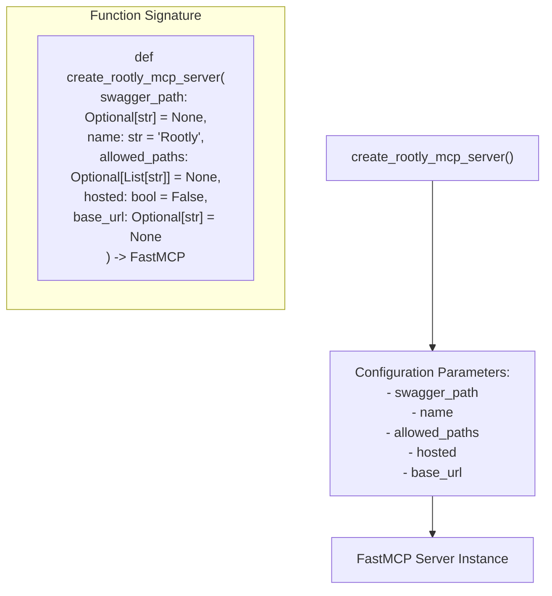

**Sources**: [src/rootly_mcp_server/server.py:278-296]()

### Configuration Parameters

| Parameter | Type | Default | Purpose |
|-----------|------|---------|---------|
| `swagger_path` | `Optional[str]` | `None` | Path to local OpenAPI spec file; if `None`, fetches from remote URL |
| `name` | `str` | `"Rootly"` | Display name for the MCP server |
| `allowed_paths` | `Optional[List[str]]` | `None` | API paths to expose as tools; defaults to `DEFAULT_ALLOWED_PATHS` |
| `hosted` | `bool` | `False` | Authentication mode: `False` for local (env token), `True` for hosted (MCP headers) |
| `base_url` | `Optional[str]` | `None` | Rootly API base URL; defaults to `ROOTLY_BASE_URL` env var or `"https://api.rootly.com"` |

**Sources**: [src/rootly_mcp_server/server.py:278-296]()

---

## Initialization Pipeline Stages

The initialization follows a strictly ordered sequence of stages. Each stage transforms the configuration or specification, preparing it for the next stage.

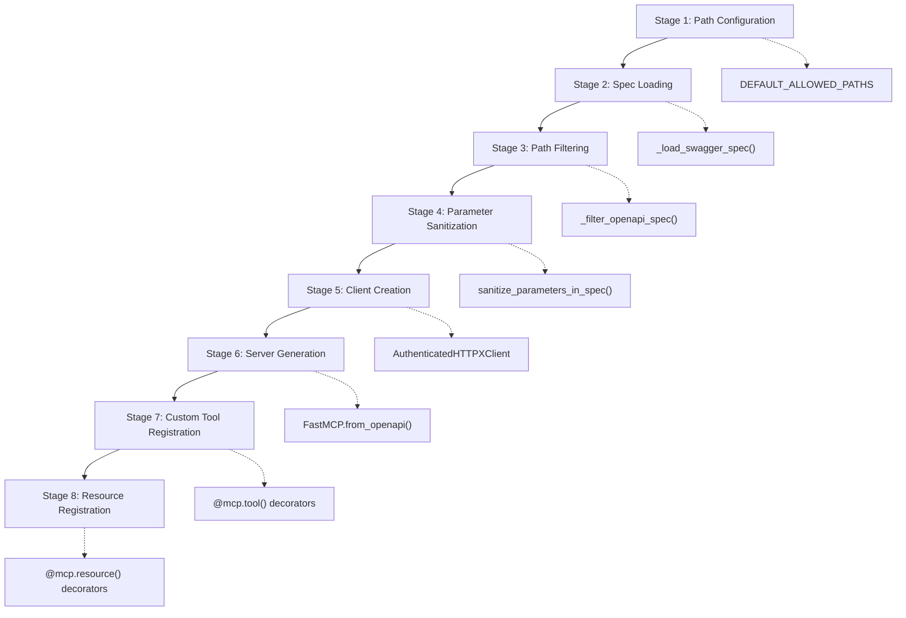

**Sources**: [src/rootly_mcp_server/server.py:278-1751]()

---

## Stage 1: Path Configuration

The first stage establishes which API endpoints will be exposed as MCP tools. If no paths are specified, the server uses a curated default list.

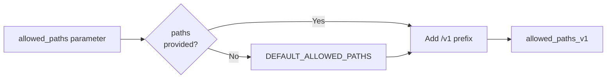

### Default Allowed Paths

The `DEFAULT_ALLOWED_PATHS` constant defines a comprehensive set of API endpoints organized by resource type:

| Category | Endpoints | Count |
|----------|-----------|-------|
| **Alerts** | `/alerts`, `/alerts/{alert_id}`, `/incidents/{incident_id}/alerts` | 3 |
| **Incidents** | Implicitly included via `/incidents/{incident_id}/alerts` | - |
| **Teams** | `/teams`, `/teams/{team_id}` | 2 |
| **Services** | `/services`, `/services/{service_id}` | 2 |
| **Severities** | `/severities`, `/severities/{severity_id}` | 2 |
| **Functionalities** | `/functionalities`, `/functionalities/{functionality_id}` | 2 |
| **Incident Types** | `/incident_types`, `/incident_types/{incident_type_id}` | 2 |
| **Action Items** | `/incident_action_items`, `/incident_action_items/{id}`, `/incidents/{id}/action_items` | 3 |
| **Workflows** | `/workflows`, `/workflows/{workflow_id}`, `/workflow_runs`, `/workflow_runs/{id}` | 4 |
| **Environments** | `/environments`, `/environments/{environment_id}` | 2 |
| **Users** | `/users`, `/users/{user_id}`, `/users/me` | 3 |
| **Status Pages** | `/status_pages`, `/status_pages/{status_page_id}` | 2 |
| **On-Call Schedules** | `/schedules`, `/schedules/{id}`, `/schedules/{id}/shifts`, `/shifts` | 4 |
| **Schedule Rotations** | `/schedule_rotations/{id}`, rotation users, active days | 3 |
| **Override Shifts** | `/schedules/{id}/override_shifts`, `/override_shifts/{id}` | 2 |
| **On-Call Shadows/Roles** | `/schedules/{id}/on_call_shadows`, `/on_call_shadows/{id}`, roles | 3 |

**Path Normalization**: All paths receive a `/v1` prefix if not already present, ensuring consistency with the Rootly API versioning scheme.

**Sources**: [src/rootly_mcp_server/server.py:121-172](), [src/rootly_mcp_server/server.py:299-309]()

---

## Stage 2: Specification Loading

The server loads the OpenAPI specification that defines the Rootly API structure. This stage implements a fallback hierarchy for maximum reliability.

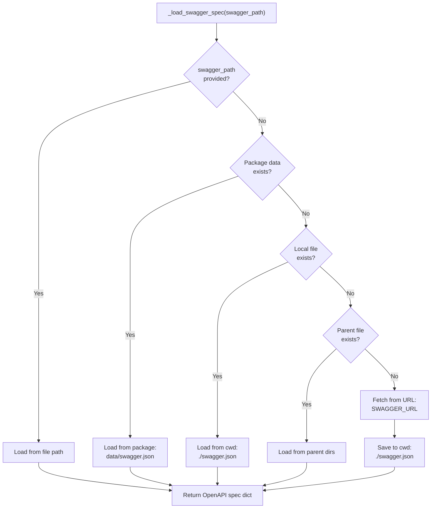

### Loading Strategy Hierarchy

1. **Explicit Path** (`swagger_path` parameter): Direct file load if path provided
2. **Package Data**: Check `src/rootly_mcp_server/data/swagger.json` (bundled with installation)
3. **Current Directory**: Check `./swagger.json` in working directory
4. **Parent Directories**: Walk up directory tree searching for `swagger.json`
5. **Remote URL**: Fetch from `SWAGGER_URL` constant and cache locally

The remote URL is defined as:
```python
SWAGGER_URL = "https://rootly-heroku.s3.amazonaws.com/swagger/v1/swagger.json"
```

**Caching Behavior**: When fetching from the remote URL, the spec is automatically saved to `./swagger.json` in the current working directory for faster subsequent loads.

**Sources**: [src/rootly_mcp_server/server.py:84-85](), [src/rootly_mcp_server/server.py:1754-1839](), [src/rootly_mcp_server/server.py:311-312]()

---

## Stage 3: Path Filtering

Once loaded, the OpenAPI specification undergoes filtering to include only the allowed paths. This stage also performs critical schema cleanup and constraint injection.

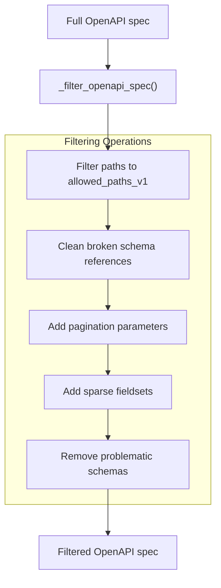

### Path Filtering Logic

The function creates a deep copy of the specification and filters the `paths` object:

```python
filtered_paths = {
    path: path_item
    for path, path_item in original_paths.items()
    if path in allowed_paths
}
```

### Schema Reference Cleanup

The filtering stage identifies and removes broken schema references that would cause validation failures:

- **Broken References**: References to `incident_trigger_params` and similar missing schemas
- **Response Schemas**: Replaced with generic `{"type": "object", "additionalProperties": true}` to avoid strict validation
- **Request Body Schemas**: Converted to flexible object schemas for problematic endpoints

### Pagination Constraint Injection

For endpoints containing `"incident"` or `"alert"` in their path (case-insensitive), the filter automatically injects pagination parameters:

| Parameter | Schema | Purpose |
|-----------|--------|---------|
| `page[size]` | `type: integer, default: 10, min: 1, max: 20` | Limits page size to prevent memory issues |
| `page[number]` | `type: integer, default: 1, min: 1` | Specifies page number for pagination |

### Sparse Fieldset Injection

To reduce payload sizes, the filter adds required sparse fieldset parameters:

**For Alert Endpoints**:
```python
{
    "name": "fields[alerts]",
    "in": "query",
    "required": True,
    "schema": {
        "type": "string",
        "default": "id,summary,status,started_at,ended_at,short_id,alert_urgency_id,source,noise"
    }
}
```

**For Incident Endpoints**:
```python
{
    "name": "fields[incidents]",
    "in": "query",
    "required": True,
    "schema": {
        "type": "string",
        "default": "id,title,summary,status,severity,created_at,updated_at,url,started_at"
    }
}
```

**Include Parameter**: Both endpoint types receive an `include` parameter defaulting to `""` (empty string) to minimize relationship loading.

**Sources**: [src/rootly_mcp_server/server.py:1841-2099](), [src/rootly_mcp_server/server.py:315-316]()

---

## Stage 4: Parameter Sanitization

MCP protocol has strict naming requirements for tool parameters (must be valid Python identifiers). The Rootly API uses bracket notation (e.g., `filter[status]`) which violates these requirements. This stage transforms parameter names bidirectionally.

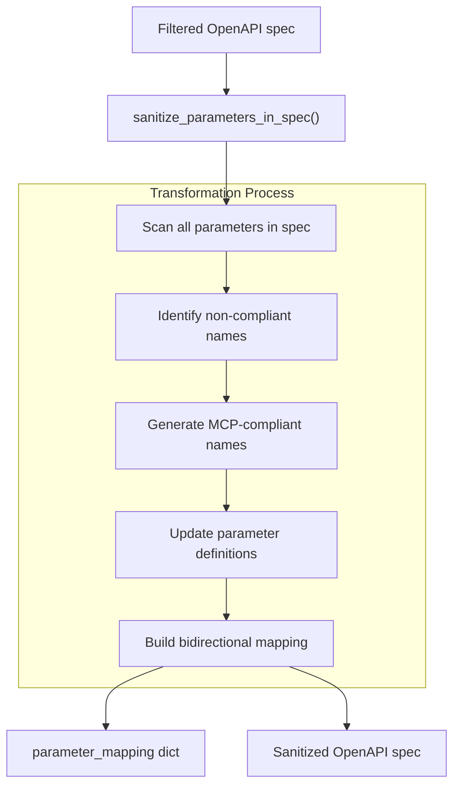

### Sanitization Rules

The `sanitize_parameters_in_spec` function from `utils.py` applies these transformations:

| Original Format | Sanitized Format | Example |
|----------------|------------------|---------|
| `filter[status]` | `filter_status` | `filter[status]` → `filter_status` |
| `page[size]` | `page_size` | `page[size]` → `page_size` |
| `page[number]` | `page_number` | `page[number]` → `page_number` |
| `fields[incidents]` | `fields_incidents` | `fields[incidents]` → `fields_incidents` |

**Mapping Structure**: The function returns a dictionary mapping sanitized names back to originals:
```python
{
    "filter_status": "filter[status]",
    "page_size": "page[size]",
    "page_number": "page[number]",
    # ... more mappings
}
```

This mapping is later used by `AuthenticatedHTTPXClient` to reverse-transform parameters before making API calls.

**Sources**: [src/rootly_mcp_server/server.py:21](), [src/rootly_mcp_server/server.py:319-320](), [src/rootly_mcp_server/utils.py]()

---

## Stage 5: HTTP Client Creation

With the sanitized specification ready, the server creates an authenticated HTTP client that handles API communication and parameter transformation.

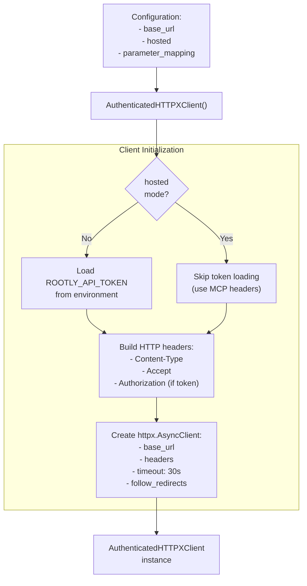

### Client Configuration

**Base URL Resolution**:
1. Use `base_url` parameter if provided
2. Otherwise use `ROOTLY_BASE_URL` environment variable
3. Default to `"https://api.rootly.com"`

**Header Configuration**:
```python
headers = {
    "Content-Type": "application/vnd.api+json",
    "Accept": "application/vnd.api+json"
}
if api_token:
    headers["Authorization"] = f"Bearer {api_token}"
```

**HTTPX Client Settings**:
- **Timeout**: 30 seconds for all operations
- **Redirects**: Follow redirects automatically
- **Connection Limits**: Max 5 keepalive connections, 10 total connections

### Parameter Mapping Integration

The client stores the `parameter_mapping` dictionary from Stage 4 and uses it in the `_transform_params` method to reverse-transform sanitized parameter names back to original API format before making requests.

**Sources**: [src/rootly_mcp_server/server.py:175-276](), [src/rootly_mcp_server/server.py:323-334]()

---

## Stage 6: Server Generation

The core FastMCP server is generated from the sanitized OpenAPI specification using FastMCP's `from_openapi` factory method.

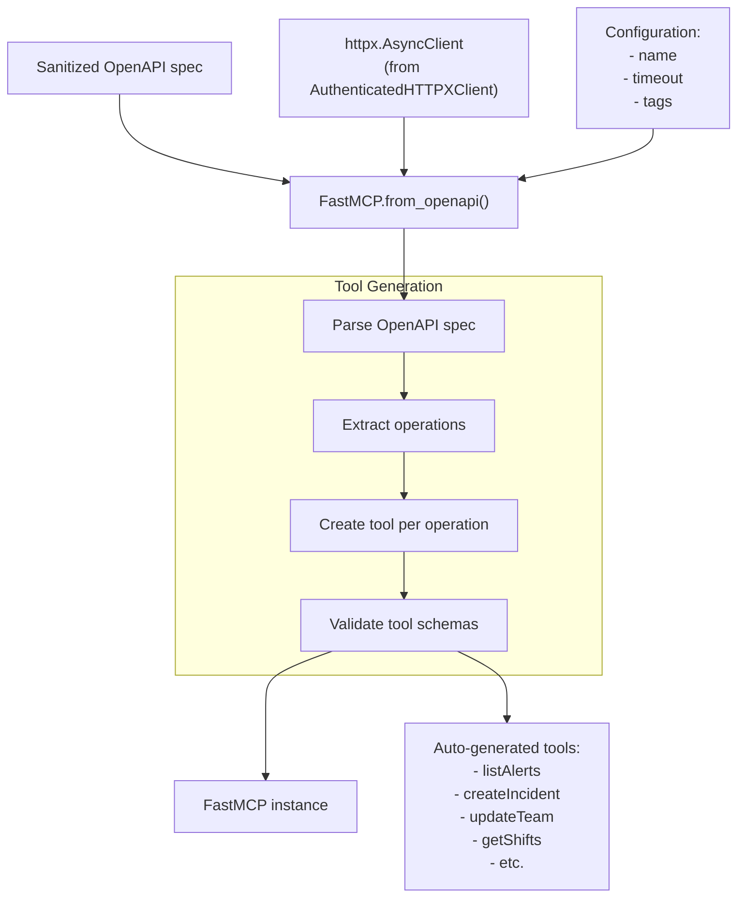

### Generation Configuration

```python
mcp = FastMCP.from_openapi(
    openapi_spec=filtered_spec,
    client=http_client.client,  # The underlying httpx.AsyncClient
    name=name,
    timeout=30.0,
    tags={"rootly", "incident-management"}
)
```

### Auto-Generated Tools

FastMCP automatically creates one tool per operation in the filtered spec. Each tool:
- Uses the operation's `operationId` as the tool name
- Converts parameters to MCP tool arguments (using sanitized names)
- Handles request/response marshaling
- Applies JSON:API content type headers

**Example Generated Tool**:
- **OpenAPI Operation**: `GET /v1/incidents` with `operationId: listIncidents`
- **Generated MCP Tool**: `listIncidents(page_size, page_number, filter_status, ...)`

### Health Check Routes

Immediately after server creation, custom HTTP routes are registered for health monitoring:

```python
@mcp.custom_route("/healthz", methods=["GET"])
@mcp.custom_route("/health", methods=["GET"])
async def health_check(request):
    from starlette.responses import PlainTextResponse
    return PlainTextResponse("OK")
```

**Sources**: [src/rootly_mcp_server/server.py:336-350]()

---

## Stage 7: Custom Tool Registration

After auto-generation, the server registers custom intelligent tools that provide functionality beyond simple CRUD operations.

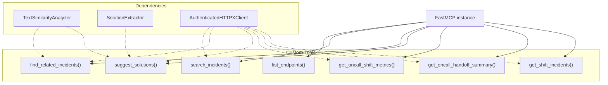

### Custom Tool Categories

#### 1. Metadata Tools
- **`list_endpoints()`**: Returns all available API endpoints with descriptions

#### 2. Search & Discovery Tools
- **`search_incidents()`**: Smart pagination with configurable limits (default 10 items)
  - Single-page mode: `page_number > 0`
  - Multi-page mode: `page_number = 0` (fetches up to `max_results`)

#### 3. AI-Powered Analysis Tools
- **`find_related_incidents()`**: Uses TF-IDF similarity analysis to find related incidents
  - Requires: `incident_id` OR `incident_description`
  - Configurable: `similarity_threshold`, `max_results`, `status_filter`
  
- **`suggest_solutions()`**: Mines historical resolutions for solution suggestions
  - Requires: `incident_id` OR `incident_title`/`incident_description`
  - Defaults to resolved incidents for better solution quality

#### 4. On-Call Intelligence Tools
- **`get_oncall_shift_metrics()`**: Aggregates shift statistics
  - Groups by: user, schedule, or team
  - Calculates: shift counts, hours, primary/secondary role distribution
  
- **`get_oncall_handoff_summary()`**: Current on-call status
  - Timezone-aware display
  - Regional filtering (business hours)
  - Optional incident fetching
  
- **`get_shift_incidents()`**: Incidents during specific time periods
  - Filters by severity, status, tags
  - Includes duration and resolution metrics

### Tool Registration Pattern

Each custom tool uses the `@mcp.tool()` decorator:

```python
@mcp.tool()
async def search_incidents(
    query: Annotated[str, Field(description="Search query...")] = "",
    page_size: Annotated[int, Field(description="...", ge=1, le=20)] = 10,
    # ... more parameters
) -> dict:
    """Tool docstring becomes tool description."""
    # Implementation
```

**Dependency Initialization**: Before registering analysis tools, the server initializes shared components:

```python
similarity_analyzer = TextSimilarityAnalyzer()
solution_extractor = SolutionExtractor()
```

**Sources**: [src/rootly_mcp_server/server.py:354-1641](), [src/rootly_mcp_server/server.py:500-502]()

---

## Stage 8: Resource Registration

The final stage registers MCP resources that expose Rootly entities through URI schemes.

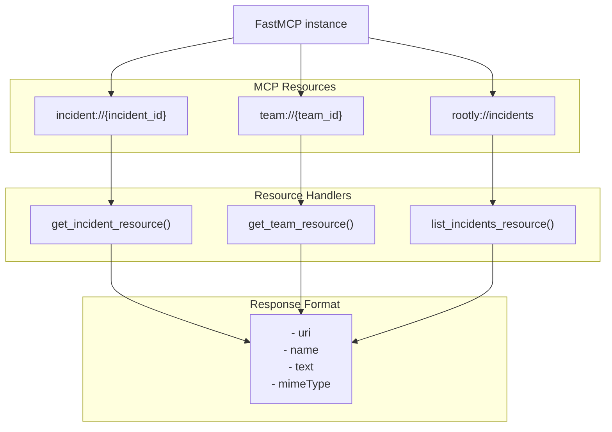

### Resource URI Schemes

| URI Pattern | Handler | Purpose |
|-------------|---------|---------|
| `incident://{incident_id}` | `get_incident_resource()` | Fetch single incident details as text |
| `team://{team_id}` | `get_team_resource()` | Fetch single team details as text |
| `rootly://incidents` | `list_incidents_resource()` | List recent incidents |

### Resource Response Format

Each resource handler returns a standardized structure:

```python
{
    "uri": "incident://12345",
    "name": "Incident #12345",
    "text": "Incident #12345\nTitle: ...\nStatus: ...\n...",
    "mimeType": "text/plain"
}
```

**Error Handling**: Resources that fail to load return error information in the text field while maintaining the same response structure.

**Example Resource Text Output**:
```
Incident #12345
Title: Database connection timeout
Status: resolved
Severity: high
Created: 2024-01-15T10:30:00Z
Updated: 2024-01-15T12:45:00Z
Summary: Multiple services experiencing connection timeouts to primary database
URL: https://app.rootly.com/incidents/12345
```

**Sources**: [src/rootly_mcp_server/server.py:1643-1746]()

---

## Complete Initialization Flow

This diagram shows the complete initialization flow from function call to ready server:

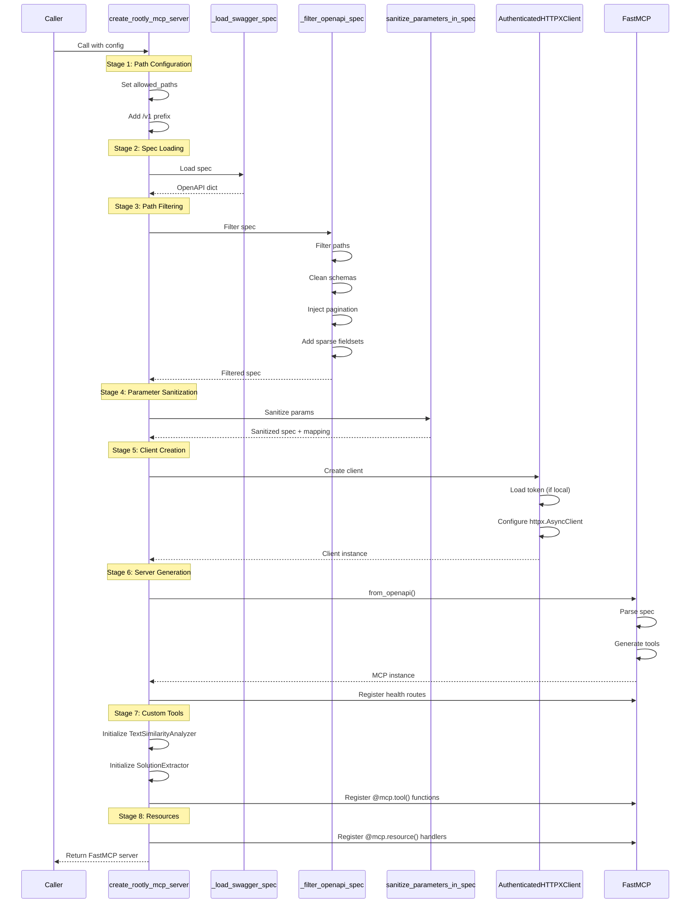

**Sources**: [src/rootly_mcp_server/server.py:278-1751]()

---

## Configuration Validation

The initialization pipeline includes implicit validation at multiple stages:

| Stage | Validation | Failure Behavior |
|-------|-----------|------------------|
| **Spec Loading** | File existence, URL accessibility, JSON parsing | Raises `FileNotFoundError` or `Exception` |
| **Path Filtering** | Path existence in spec | Silently excludes non-existent paths |
| **Parameter Sanitization** | Parameter name compatibility | Transforms all parameters, no failures |
| **Client Creation** | Token availability (local mode only) | Warning logged if missing, continues |
| **Server Generation** | OpenAPI spec validity | Raises validation errors from FastMCP |

**Token Validation**: In local mode (non-hosted), missing `ROOTLY_API_TOKEN` logs a warning but does not prevent initialization. The server will fail when tools attempt to make authenticated requests.

**Sources**: [src/rootly_mcp_server/server.py:205-211](), [tests/unit/test_server.py:132-138]()

---

## Logging and Observability

The initialization pipeline includes logging at key stages for troubleshooting:

```python
logger.info(f"Creating Rootly MCP Server with allowed paths: {allowed_paths_v1}")
logger.info(f"Loaded Swagger spec with {len(swagger_spec.get('paths', {}))} total paths")
logger.info(f"Filtered spec to {len(filtered_spec.get('paths', {}))} allowed paths")
logger.info(f"Sanitized parameter names for MCP compatibility (mapped {len(parameter_mapping)} parameters)")
logger.info(f"Using Rootly API base URL: {base_url}")
logger.info("Created Rootly MCP Server successfully")
```

**Log Levels**:
- `INFO`: Normal initialization progress
- `WARNING`: Missing tokens, fallback operations
- `DEBUG`: Parameter transformations, detailed spec loading steps
- `ERROR`: Failed spec loading, network errors

**Sources**: [src/rootly_mcp_server/server.py:24-25](), [src/rootly_mcp_server/server.py:308-327](), [src/rootly_mcp_server/server.py:1750]()

---

## Testing the Initialization Pipeline

The test suite validates each initialization stage independently and in integration:

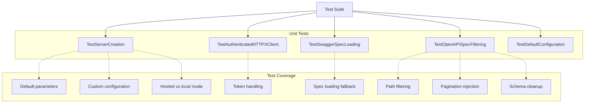

### Key Test Cases

**Server Creation Tests** ([tests/unit/test_server.py:26-91]()):
- Default parameters initialization
- Custom name configuration
- Hosted mode setup
- Custom allowed paths
- Explicit swagger path handling

**HTTP Client Tests** ([tests/unit/test_server.py:94-154]()):
- Local mode with environment token
- Hosted mode without token
- Custom base URL
- Missing token handling

**Spec Loading Tests** ([tests/unit/test_server.py:157-213]()):
- File-based loading
- URL-based fetching
- Fallback chain validation

**Spec Filtering Tests** ([tests/unit/test_server.py:216-369]()):
- Path inclusion/exclusion
- Pagination parameter injection
- Sparse fieldset addition
- Schema structure preservation

**Sources**: [tests/unit/test_server.py:1-393]()

---

## Error Handling During Initialization

The initialization pipeline handles errors gracefully at each stage:

### Stage-Specific Error Handling

**Spec Loading Errors**:
- File not found: Fallback to URL fetch
- URL unreachable: Raise exception with clear message
- Invalid JSON: Raise parsing exception

**Filtering Errors**:
- Non-existent paths: Silently skip
- Broken schema refs: Replace with generic schemas
- Invalid operations: Log warning and exclude

**Client Creation Errors**:
- Missing token (local mode): Log warning, continue (will fail at request time)
- Invalid base URL: httpx validates and raises

**Server Generation Errors**:
- Invalid OpenAPI spec: FastMCP validation raises detailed error
- Duplicate operation IDs: FastMCP handles with warnings

### MCPError Integration

Custom tools registered in Stage 7 use the `MCPError` class for error categorization:

```python
class MCPError:
    @staticmethod
    def categorize_error(exception: Exception) -> tuple[str, str]:
        """Categorize exception into error type and message."""
        # Returns: (error_type, error_message)
        # Types: authentication_error, network_error, client_error, 
        #        server_error, validation_error, execution_error
```

This error handling is applied during tool execution, not initialization.

**Sources**: [src/rootly_mcp_server/server.py:28-82]()

---

## Performance Characteristics

### Initialization Timing

Typical initialization times by stage (approximate):

| Stage | Duration | Notes |
|-------|----------|-------|
| Path Configuration | < 1ms | In-memory list operations |
| Spec Loading (cached) | 1-5ms | Local file read |
| Spec Loading (remote) | 100-500ms | Network fetch + save |
| Path Filtering | 5-50ms | Depends on spec size |
| Parameter Sanitization | 5-20ms | String transformations |
| Client Creation | 1-5ms | Client initialization |
| Server Generation | 50-200ms | FastMCP tool generation |
| Custom Tool Registration | 1-5ms | Decorator registration |
| Resource Registration | < 1ms | Handler registration |
| **Total (cached)** | **70-290ms** | Typical case |
| **Total (remote)** | **170-790ms** | First run |

### Memory Usage

- **Base Server**: ~10-20 MB
- **OpenAPI Spec**: ~2-5 MB (in memory)
- **Tool Metadata**: ~1-2 MB for all tools
- **Analysis Components**: ~5-10 MB (TextSimilarityAnalyzer, SolutionExtractor)
- **Total**: ~20-40 MB typical footprint

**Sources**: [src/rootly_mcp_server/server.py:278-1751]()

---

## Summary

The server initialization pipeline transforms a Rootly OpenAPI specification into a fully functional MCP server through eight distinct stages:

1. **Path Configuration**: Selects which API endpoints to expose
2. **Specification Loading**: Fetches OpenAPI spec with fallback hierarchy
3. **Path Filtering**: Removes unused paths and injects operational constraints
4. **Parameter Sanitization**: Transforms parameter names for MCP compliance
5. **HTTP Client Creation**: Builds authenticated client with parameter mapping
6. **Server Generation**: Creates FastMCP instance with auto-generated tools
7. **Custom Tool Registration**: Adds intelligent analysis and on-call tools
8. **Resource Registration**: Exposes entities through MCP resource URIs

The result is a server that provides both direct API access (via auto-generated tools) and intelligent functionality (via custom tools) while maintaining full MCP protocol compliance and Rootly API compatibility.

**Sources**: [src/rootly_mcp_server/server.py:278-1751](), [tests/unit/test_server.py:1-393]()

---

