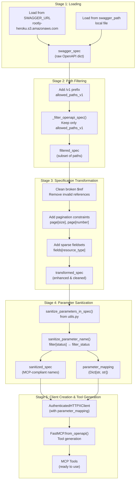
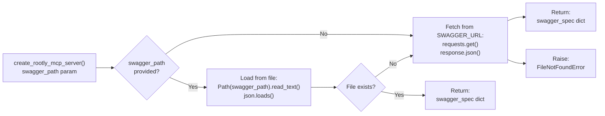
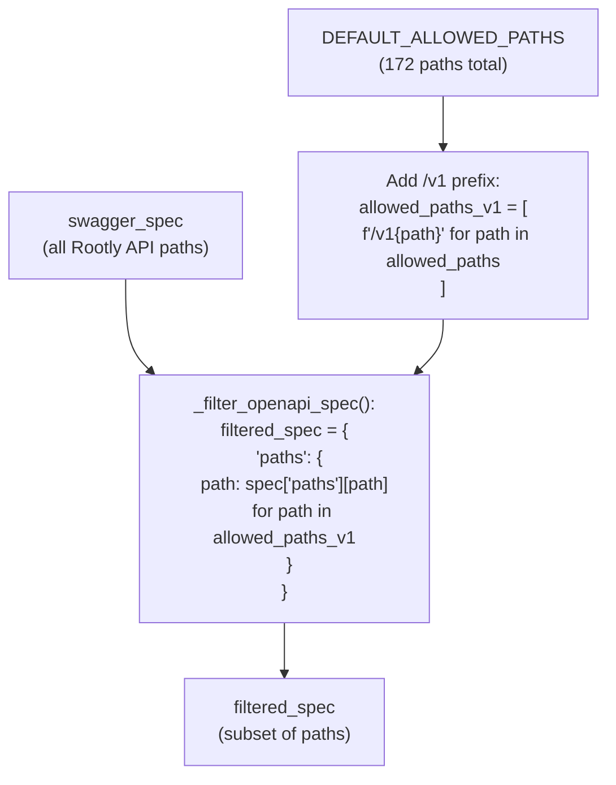
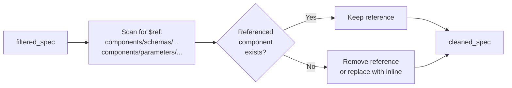
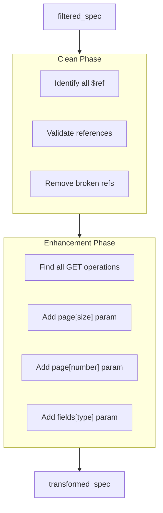
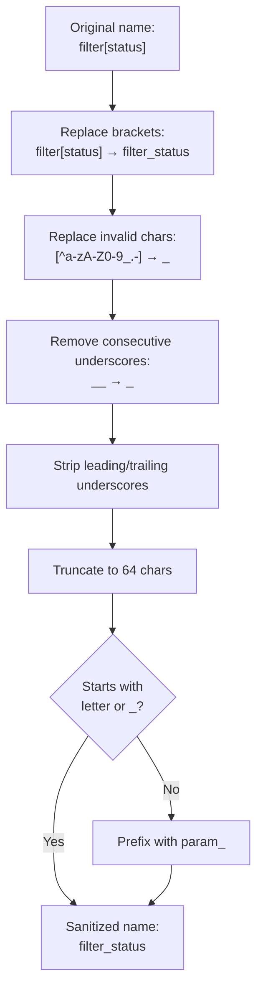
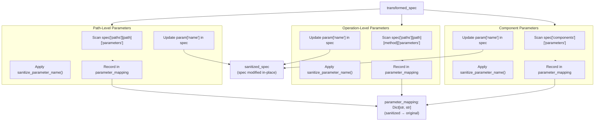
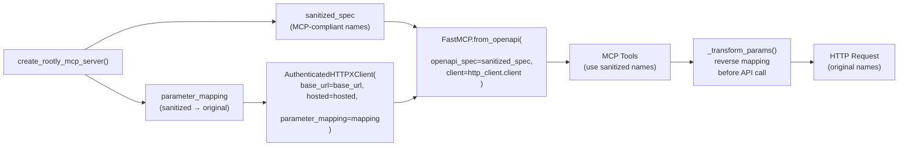
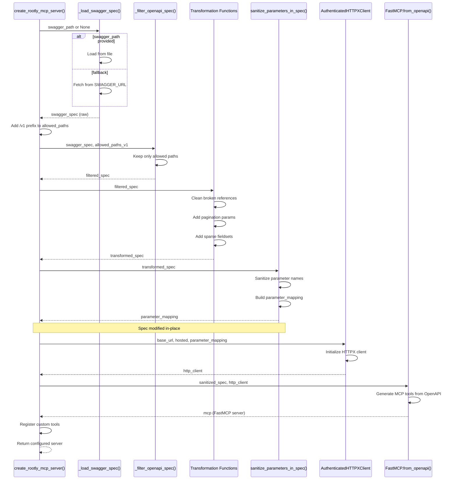

<!-- source: DeepWiki mcp.deepwiki.com · repo Rootly-AI-Labs/Rootly-MCP-server · page 3.2 OpenAPI Processing · fetched 2026-10-26 -->

# OpenAPI Processing

<details>
<summary>Relevant source files</summary>

The following files were used as context for generating this wiki page:

- [src/rootly_mcp_server/__main__.py](src/rootly_mcp_server/__main__.py)
- [src/rootly_mcp_server/server.py](src/rootly_mcp_server/server.py)
- [src/rootly_mcp_server/utils.py](src/rootly_mcp_server/utils.py)

</details>


## Purpose and Scope

This document details how the Rootly MCP Server processes the Rootly API's OpenAPI specification to generate MCP-compatible tools. The processing pipeline transforms the raw OpenAPI/Swagger JSON through multiple stages: loading, filtering, cleaning, constraint injection, and parameter sanitization. This ensures that the resulting tools comply with MCP protocol requirements while maintaining full Rootly API compatibility.

For information about how the server initializes and orchestrates these processing steps, see [Server Initialization Pipeline](#3.1). For details on authentication token handling, see [Authentication System](#3.3). For information on how parameters are transformed during API requests, see [HTTP Client & Request Flow](#3.4).

---

## OpenAPI Processing Pipeline Overview

The OpenAPI processing pipeline in `create_rootly_mcp_server()` transforms the Rootly API specification through five distinct stages before tool generation.



**Sources:** [src/rootly_mcp_server/server.py:278-344]()

---

## Stage 1: Loading the OpenAPI Specification

The server attempts to load the OpenAPI specification from two sources in order of precedence: a local file path or the remote Swagger URL.

### Load Strategy

The `_load_swagger_spec()` function implements a fallback loading strategy:

1. **Local File** (if `swagger_path` provided): Load from filesystem
2. **Remote URL** (fallback): Fetch from `SWAGGER_URL` constant
3. **Error Handling**: Raise `FileNotFoundError` if both fail



### Remote Specification Source

The default Swagger specification is hosted at AWS S3:

| Constant | Value |
|----------|-------|
| `SWAGGER_URL` | `https://rootly-heroku.s3.amazonaws.com/swagger/v1/swagger.json` |

This URL points to the canonical Rootly API v1 OpenAPI specification, updated automatically by the Rootly API team.

**Sources:** [src/rootly_mcp_server/server.py:85](), [src/rootly_mcp_server/server.py:311]()

---

## Stage 2: Filtering Allowed Paths

The server filters the complete OpenAPI specification to include only a curated subset of API endpoints defined in `DEFAULT_ALLOWED_PATHS`. This reduces tool clutter and focuses on incident management, on-call, and alerting functionality.

### Path Filtering Process



### Default Allowed Path Categories

The `DEFAULT_ALLOWED_PATHS` constant defines the following categories:

| Category | Example Paths | Count |
|----------|---------------|-------|
| **Incidents & Alerts** | `/incidents/{incident_id}/alerts`<br/>`/alerts`<br/>`/alerts/{alert_id}` | ~10 |
| **Teams & Users** | `/teams`<br/>`/teams/{team_id}`<br/>`/users/me` | ~6 |
| **Services & Environments** | `/services`<br/>`/environments`<br/>`/severities` | ~8 |
| **On-Call Schedules** | `/schedules`<br/>`/schedules/{schedule_id}/shifts`<br/>`/shifts` | ~12 |
| **On-Call Overrides** | `/schedules/{schedule_id}/override_shifts`<br/>`/override_shifts/{override_shift_id}` | ~4 |
| **Workflows & Action Items** | `/workflows`<br/>`/incident_action_items`<br/>`/incidents/{incident_id}/action_items` | ~8 |

### Version Prefix Normalization

The server automatically adds the `/v1` prefix to all paths that don't already have it:

```python
allowed_paths_v1 = [
    f"/v1{path}" if not path.startswith("/v1") else path
    for path in allowed_paths
]
```

This ensures consistency regardless of whether the input paths include the version prefix.

**Sources:** [src/rootly_mcp_server/server.py:121-172](), [src/rootly_mcp_server/server.py:303-316]()

---

## Stage 3: Specification Transformation

After filtering, the specification undergoes three transformations to ensure API compatibility and inject operational best practices.

### 3.1 Cleaning Broken References

The OpenAPI specification may contain broken `$ref` references to components that don't exist. These are identified and removed to prevent tool generation failures.



### 3.2 Adding Pagination Constraints

For all `GET` operations that return lists, pagination parameters are injected to prevent unbounded result sets:

| Parameter | Type | Description | Default |
|-----------|------|-------------|---------|
| `page[size]` | integer | Number of items per page | 10 |
| `page[number]` | integer | Page number (1-indexed) | 1 |

These parameters follow the JSON:API pagination convention used by Rootly.

### 3.3 Adding Sparse Fieldsets

Sparse fieldsets allow clients to request only specific fields, reducing payload size and improving performance:

| Parameter | Type | Description | Example |
|-----------|------|-------------|---------|
| `fields[incidents]` | string | Comma-separated field list for incidents | `id,title,status` |
| `fields[teams]` | string | Comma-separated field list for teams | `id,name,slug` |

The server injects these parameters into all `GET` operations for primary resource types.

### Transformation Summary



**Sources:** [src/rootly_mcp_server/server.py:315]()

---

## Stage 4: Parameter Sanitization

MCP protocol requires parameter names to match the regex pattern `^[a-zA-Z0-9_.-]{1,64}$`. However, Rootly API uses JSON:API conventions with square bracket notation (e.g., `filter[status]`, `page[size]`). The sanitization stage transforms parameter names to be MCP-compliant while maintaining a bidirectional mapping.

### Sanitization Algorithm

The `sanitize_parameter_name()` function in `utils.py` applies these transformations:



### Sanitization Examples

| Original Name | Sanitized Name | Reason |
|---------------|----------------|--------|
| `filter[status]` | `filter_status` | Square brackets not allowed |
| `filter[created_at][gte]` | `filter_created_at_gte` | Nested brackets flattened |
| `page[size]` | `page_size` | Square brackets not allowed |
| `include` | `include` | Already valid (no change) |
| `fields[incidents]` | `fields_incidents` | Square brackets not allowed |
| `filter[service.name]` | `filter_service_name` | Dots allowed but brackets replaced |

### Parameter Mapping Creation

The `sanitize_parameters_in_spec()` function processes the entire OpenAPI specification and builds a mapping dictionary:



### Processing Scope

The function sanitizes parameters in three locations within the OpenAPI spec:

1. **Path-level parameters**: Defined at `paths[path]["parameters"]`
2. **Operation-level parameters**: Defined at `paths[path][method]["parameters"]` for each HTTP method
3. **Component parameters**: Defined at `components["parameters"]` (OpenAPI 3.0 only)

Only parameters that require sanitization are recorded in the mapping. Parameters that are already MCP-compliant (like `include`, `id`) are left unchanged and not added to the mapping.

**Sources:** [src/rootly_mcp_server/utils.py:12-42](), [src/rootly_mcp_server/utils.py:45-105](), [src/rootly_mcp_server/server.py:319-320]()

---

## Stage 5: Parameter Mapping and Bidirectional Transformation

The `parameter_mapping` dictionary created during sanitization enables bidirectional parameter transformation during API requests.

### Mapping Structure

```python
parameter_mapping: Dict[str, str] = {
    "filter_status": "filter[status]",
    "filter_created_at_gte": "filter[created_at][gte]",
    "page_size": "page[size]",
    "page_number": "page[number]",
    "fields_incidents": "fields[incidents]",
    # ... more mappings
}
```

### Integration with HTTP Client

The `parameter_mapping` is passed to `AuthenticatedHTTPXClient` during initialization:



### Request-Time Transformation

When an MCP tool is called with sanitized parameter names, the `AuthenticatedHTTPXClient._transform_params()` method reverses the mapping:

1. **MCP Tool Interface**: Client calls tool with `filter_status="resolved"`
2. **Reverse Mapping**: `_transform_params()` looks up `filter_status` → `filter[status]`
3. **API Request**: HTTP client sends `filter[status]=resolved` to Rootly API

This bidirectional transformation is completely transparent to both the MCP client and the Rootly API.

### Logging and Debugging

Parameter transformations are logged at `DEBUG` level for troubleshooting:

```python
logger.debug(f"Transformed parameter: '{key}' -> '{original_key}'")
```

This allows developers to trace how parameter names are being transformed during API requests.

**Sources:** [src/rootly_mcp_server/server.py:175-276](), [src/rootly_mcp_server/server.py:213-225](), [src/rootly_mcp_server/server.py:328-334]()

---

## Complete Processing Flow

The following diagram shows the complete data flow from raw OpenAPI specification to generated MCP tools:



**Sources:** [src/rootly_mcp_server/server.py:278-344]()

---

## Configuration Options

The OpenAPI processing pipeline can be customized through `create_rootly_mcp_server()` parameters:

| Parameter | Type | Default | Description |
|-----------|------|---------|-------------|
| `swagger_path` | `Optional[str]` | `None` | Path to local OpenAPI file (overrides remote fetch) |
| `allowed_paths` | `Optional[List[str]]` | `DEFAULT_ALLOWED_PATHS` | List of API paths to include |
| `name` | `str` | `"Rootly"` | MCP server name (metadata only, doesn't affect processing) |
| `hosted` | `bool` | `False` | Hosted mode flag (affects auth, not processing) |
| `base_url` | `Optional[str]` | `"https://api.rootly.com"` | API base URL (doesn't affect spec processing) |

### Environment Variable Overrides

These can also be configured via environment variables in the CLI entry point:

| Environment Variable | Corresponding Parameter |
|---------------------|------------------------|
| `ROOTLY_SWAGGER_PATH` | `swagger_path` |
| `ROOTLY_ALLOWED_PATHS` | `allowed_paths` (comma-separated) |
| `ROOTLY_SERVER_NAME` | `name` |
| `ROOTLY_HOSTED` | `hosted` |
| `ROOTLY_BASE_URL` | `base_url` |

**Sources:** [src/rootly_mcp_server/server.py:278-297](), [src/rootly_mcp_server/__main__.py:120-141]()

---

## Error Handling

The OpenAPI processing pipeline includes error handling at each stage:

### Loading Errors

- **File Not Found**: Raises `FileNotFoundError` if both local file and remote URL fail
- **Invalid JSON**: Raises `json.JSONDecodeError` if specification is malformed
- **Network Errors**: Raises `requests.exceptions.RequestException` for remote fetch failures

### Processing Errors

- **Invalid Spec Structure**: Logged as warnings, processing continues with partial spec
- **Broken References**: Cleaned automatically, logged at `DEBUG` level
- **Parameter Sanitization**: All names are guaranteed to produce valid output

### Debug Logging

Enable debug logging to trace OpenAPI processing:

```bash
# Via CLI
rootly-mcp-server --log-level DEBUG

# Via environment
export DEBUG=true
```

Debug logs include:
- Loaded spec path count
- Filtered path count
- Each sanitized parameter transformation
- Parameter mapping size

**Sources:** [src/rootly_mcp_server/server.py:308-320](), [src/rootly_mcp_server/__main__.py:75-100]()

---

