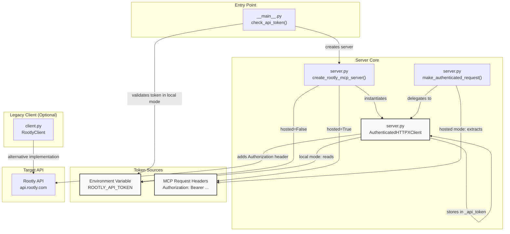
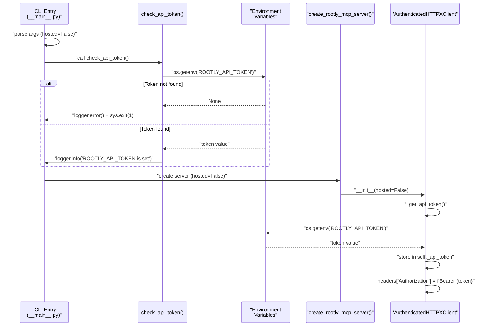
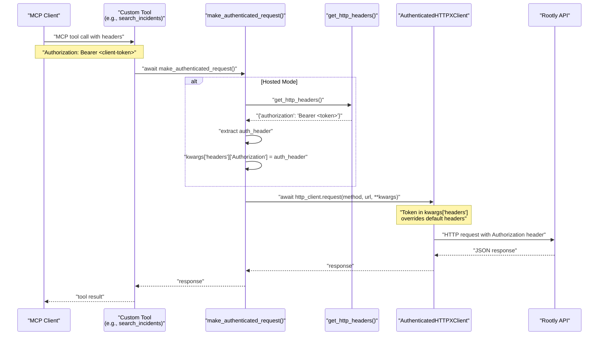
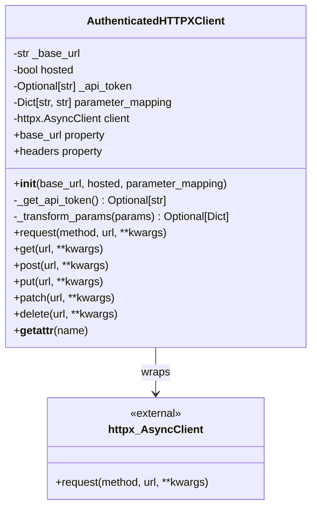
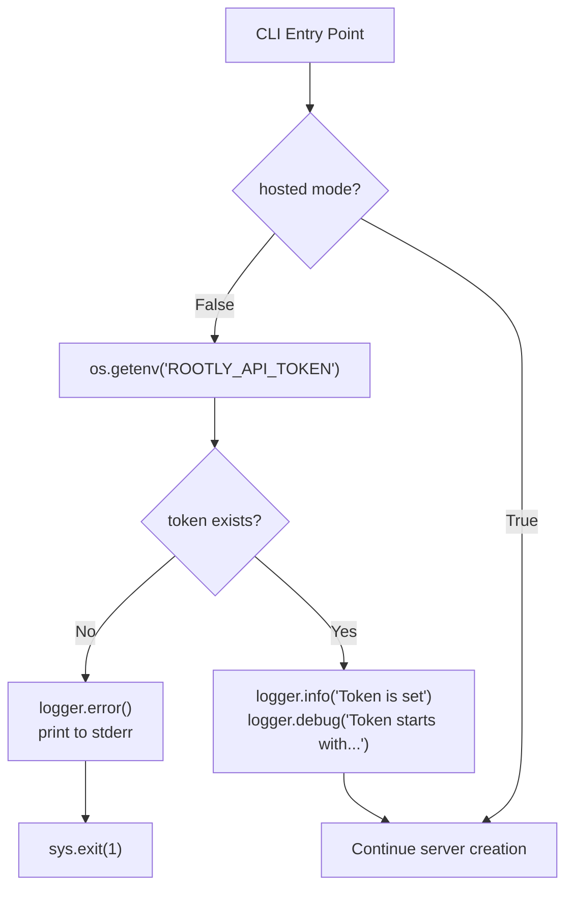

<!-- source: DeepWiki mcp.deepwiki.com · repo Rootly-AI-Labs/Rootly-MCP-server · page 3.3 Authentication System · fetched 2026-10-26 -->

# Authentication System

<details>
<summary>Relevant source files</summary>

The following files were used as context for generating this wiki page:

- [src/rootly_mcp_server/__main__.py](src/rootly_mcp_server/__main__.py)
- [src/rootly_mcp_server/client.py](src/rootly_mcp_server/client.py)
- [src/rootly_mcp_server/server.py](src/rootly_mcp_server/server.py)
- [src/rootly_mcp_server/utils.py](src/rootly_mcp_server/utils.py)

</details>


## Purpose and Scope

This document describes the dual-mode authentication architecture of the Rootly MCP Server. The authentication system supports two operational modes: **local mode** (development/testing using environment variables) and **hosted mode** (production using MCP request headers). This design enables secure API token management across different deployment contexts while maintaining a consistent interface.

For information about how authenticated requests are made to the Rootly API, see [HTTP Client & Request Flow](#3.4). For details on server initialization and configuration, see [Server Initialization Pipeline](#3.1).

---

## Authentication Architecture Overview

The authentication system consists of three primary components that work together to provide secure, flexible API access:



**Sources**: [src/rootly_mcp_server/__main__.py:103-117](), [src/rootly_mcp_server/server.py:175-276](), [src/rootly_mcp_server/server.py:278-344](), [src/rootly_mcp_server/client.py:15-28]()

---

## Operational Modes

The server supports two distinct authentication modes, selected via the `hosted` parameter during server initialization:

| Mode | Token Source | Use Case | Validation Point | Configuration |
|------|-------------|----------|------------------|---------------|
| **Local** | `ROOTLY_API_TOKEN` environment variable | Development, testing, self-hosted deployment | Startup (`check_api_token()`) | `hosted=False` (default) |
| **Hosted** | MCP request `Authorization` header | Production, multi-tenant cloud deployment | Per-request extraction | `hosted=True` |

The mode is determined during server creation and affects both token retrieval and validation behavior throughout the system lifecycle.

**Sources**: [src/rootly_mcp_server/__main__.py:162-164](), [src/rootly_mcp_server/server.py:282-284]()

---

## Local Mode Authentication

### Token Configuration

In local mode, the server requires the `ROOTLY_API_TOKEN` environment variable to be set before startup. This token is validated at initialization and stored for all subsequent API requests.



**Sources**: [src/rootly_mcp_server/__main__.py:103-117](), [src/rootly_mcp_server/server.py:184-211]()

### Implementation Details

The `check_api_token()` function performs early validation:

[src/rootly_mcp_server/__main__.py:103-117]()

This validation ensures the server cannot start without proper credentials, preventing runtime errors and providing clear feedback to users.

The `AuthenticatedHTTPXClient._get_api_token()` method retrieves and stores the token:

[src/rootly_mcp_server/server.py:205-211]()

Key characteristics:
- Token is retrieved once during client instantiation
- Token is stored in `self._api_token` for reuse
- Warning is logged (not error) if token is missing, as hosted mode doesn't require it
- Token is automatically added to HTTP client headers during initialization

**Sources**: [src/rootly_mcp_server/__main__.py:103-117](), [src/rootly_mcp_server/server.py:184-211]()

---

## Hosted Mode Authentication

### Per-Request Token Extraction

In hosted mode, the server does not require an environment variable. Instead, it extracts the API token from each incoming MCP request's `Authorization` header. This enables multi-tenant deployments where different clients may use different API tokens.



**Sources**: [src/rootly_mcp_server/server.py:375-392]()

### Token Header Injection

The `make_authenticated_request()` function handles per-request token extraction in hosted mode:

[src/rootly_mcp_server/server.py:375-392]()

This implementation:
- Uses FastMCP's `get_http_headers()` dependency to access request headers
- Extracts the `authorization` header from the MCP request
- Injects it into the outgoing HTTP request to the Rootly API
- Falls back silently if header extraction fails (graceful degradation)
- Allows per-request authentication for multi-tenant scenarios

In hosted mode, the `AuthenticatedHTTPXClient` is still instantiated but without a stored token:

[src/rootly_mcp_server/server.py:184-186]()

**Sources**: [src/rootly_mcp_server/server.py:178-211](), [src/rootly_mcp_server/server.py:375-392]()

---

## AuthenticatedHTTPXClient

The `AuthenticatedHTTPXClient` class is the core authentication component, wrapping HTTPX to provide transparent token injection and parameter transformation.

### Class Structure



**Sources**: [src/rootly_mcp_server/server.py:175-276]()

### Initialization and Header Setup

The client is initialized with mode-specific behavior:

[src/rootly_mcp_server/server.py:178-203]()

Key initialization steps:
1. Store base URL and operational mode
2. Retrieve API token (only in local mode)
3. Create HTTPX async client with standard headers
4. Add `Authorization` header with Bearer token (local mode only)
5. Configure timeout and connection limits

The headers are set up with JSON:API compliance:

```json
{
  "Content-Type": "application/vnd.api+json",
  "Accept": "application/vnd.api+json",
  "Authorization": "Bearer <token>"
}
```

**Sources**: [src/rootly_mcp_server/server.py:178-203]()

### Request Method Delegation

The client provides proxy methods for all HTTP verbs, ensuring consistent authentication:

[src/rootly_mcp_server/server.py:227-254]()

All methods delegate to `request()`, which performs parameter transformation before calling the underlying HTTPX client:

[src/rootly_mcp_server/server.py:227-234]()

**Sources**: [src/rootly_mcp_server/server.py:227-254]()

---

## Token Validation and Error Handling

### Startup Validation

In local mode, the `check_api_token()` function performs comprehensive validation:



**Sources**: [src/rootly_mcp_server/__main__.py:103-117](), [src/rootly_mcp_server/__main__.py:162-164]()

### Runtime Token Handling

During runtime, token absence is handled differently based on mode:

| Scenario | Local Mode | Hosted Mode |
|----------|-----------|-------------|
| Token not found at init | Log warning, set `_api_token = None` | Skip token retrieval entirely |
| Token not found at request | Request proceeds with invalid auth, API returns 401 | `make_authenticated_request()` extracts from MCP headers |
| Missing Authorization header | Immediate authentication failure | Tool-level error response |

The `RootlyClient` (legacy implementation) handles token errors in `make_request()`:

[src/rootly_mcp_server/client.py:52-56]()

**Sources**: [src/rootly_mcp_server/server.py:205-211](), [src/rootly_mcp_server/client.py:52-56]()

---

## Token Security

### Log Redaction

The system implements token redaction in debug logs to prevent credential leakage:

[src/rootly_mcp_server/__main__.py:100]()

Example output:
```
ROOTLY_API_TOKEN=roo...
```

Only the first 3 characters are logged, preventing full token exposure in logs while still allowing verification that the token is set.

[src/rootly_mcp_server/__main__.py:116]()

Example output:
```
Token starts with: roo_a...
```

### Token Transmission

Tokens are transmitted securely using standard Bearer token authentication:

```
Authorization: Bearer <token>
```

All requests use HTTPS (enforced by base URL `https://api.rootly.com`), ensuring encrypted transmission. The `AuthenticatedHTTPXClient` configures proper TLS/SSL handling through HTTPX defaults.

**Sources**: [src/rootly_mcp_server/__main__.py:100](), [src/rootly_mcp_server/__main__.py:116](), [src/rootly_mcp_server/server.py:188-194]()

---

## Integration with Server Creation

### Server Initialization Flow

```mermaid
sequenceDiagram
    participant Main as "__main__.py"
    participant Create as "create_rootly_mcp_server()"
    participant Auth as "AuthenticatedHTTPXClient"
    participant FastMCP as "FastMCP.from_openapi()"
    
    Main->>Main: "parse args: hosted flag"
    Main->>Create: "create_rootly_mcp_server(hosted=bool)"
    
    Create->>Create: "determine base_url"
    Note over Create: "base_url = env or default<br/>'https://api.rootly.com'"
    
    Create->>Auth: "AuthenticatedHTTPXClient(base_url, hosted, parameter_mapping)"
    
    alt Local Mode (hosted=False)
        Auth->>Auth: "_get_api_token()"
        Auth->>Auth: "self._api_token = token"
        Auth->>Auth: "headers['Authorization'] = 'Bearer {token}'"
    else Hosted Mode (hosted=True)
        Auth->>Auth: "skip token retrieval"
        Auth->>Auth: "no Authorization header"
    end
    
    Auth->>Auth: "create httpx.AsyncClient(headers, ...)"
    Auth-->>Create: "http_client"
    
    Create->>FastMCP: "FastMCP.from_openapi(client=http_client.client)"
    FastMCP-->>Create: "mcp server instance"
    
    Create->>Create: "register custom tools"
    Note over Create: "Custom tools use<br/>make_authenticated_request()"
    
    Create-->>Main: "configured server"
```

**Sources**: [src/rootly_mcp_server/server.py:278-344](), [src/rootly_mcp_server/__main__.py:148-183]()

### Configuration Parameters

The authentication mode is configured through multiple layers:

| Configuration Source | Parameter | Default | Effect |
|---------------------|-----------|---------|--------|
| CLI argument | `--hosted` | `False` | Sets `hosted` mode flag |
| Environment variable | `ROOTLY_HOSTED` | `"false"` | Sets `hosted` mode in `get_server()` |
| Function parameter | `hosted: bool` | `False` | Passed to `create_rootly_mcp_server()` |

Example CLI usage:
```bash
# Local mode (default)
python -m rootly_mcp_server

# Hosted mode
python -m rootly_mcp_server --hosted
```

Example environment configuration:
```bash
# Local mode
export ROOTLY_API_TOKEN="roo_abc123..."
python -m rootly_mcp_server

# Hosted mode
export ROOTLY_HOSTED="true"
python -m rootly_mcp_server
```

**Sources**: [src/rootly_mcp_server/__main__.py:62-65](), [src/rootly_mcp_server/__main__.py:119-141](), [src/rootly_mcp_server/server.py:278-284]()

---

## Authentication Flow Comparison

### Complete Flow Diagrams

**Local Mode:**

```mermaid
flowchart LR
    Start["Server Start"]
    ValidateToken["check_api_token()<br/>validates ROOTLY_API_TOKEN"]
    CreateClient["AuthenticatedHTTPXClient<br/>retrieves & stores token"]
    AddHeaders["Add Authorization header<br/>to httpx.AsyncClient"]
    ToolCall["Tool invocation"]
    Request["http_client.request()"]
    Transform["Transform parameters"]
    APICall["HTTP call to Rootly API<br/>with Authorization header"]
    
    Start --> ValidateToken
    ValidateToken --> CreateClient
    CreateClient --> AddHeaders
    AddHeaders --> ToolCall
    ToolCall --> Request
    Request --> Transform
    Transform --> APICall
```


**Hosted Mode:**

```mermaid
flowchart LR
    Start["Server Start"]
    SkipValidation["Skip token validation<br/>(no check_api_token)"]
    CreateClient["AuthenticatedHTTPXClient<br/>no token retrieval"]
    NoHeaders["No Authorization header<br/>in default httpx.AsyncClient"]
    ToolCall["Tool invocation with<br/>MCP request headers"]
    ExtractToken["make_authenticated_request()<br/>extracts Authorization"]
    InjectHeader["Add Authorization to<br/>request kwargs"]
    Request["http_client.request()"]
    Transform["Transform parameters"]
    APICall["HTTP call to Rootly API<br/>with extracted header"]
    
    Start --> SkipValidation
    SkipValidation --> CreateClient
    CreateClient --> NoHeaders
    NoHeaders --> ToolCall
    ToolCall --> ExtractToken
    ExtractToken --> InjectHeader
    InjectHeader --> Request
    Request --> Transform
    Transform --> APICall
```


**Sources**: [src/rootly_mcp_server/__main__.py:103-117](), [src/rootly_mcp_server/__main__.py:162-164](), [src/rootly_mcp_server/server.py:178-211](), [src/rootly_mcp_server/server.py:375-392]()

---

## Legacy Client Implementation

The `RootlyClient` class in `client.py` provides an alternative authentication implementation, primarily used for backward compatibility and testing:

[src/rootly_mcp_server/client.py:15-28]()

Key differences from `AuthenticatedHTTPXClient`:

| Feature | AuthenticatedHTTPXClient | RootlyClient |
|---------|------------------------|--------------|
| HTTP library | `httpx` (async) | `requests` (sync) |
| Parameter transformation | Yes (bidirectional mapping) | No |
| Integration | FastMCP OpenAPI tools | Manual tool implementation |
| Current usage | Primary (all OpenAPI tools) | Legacy (some tests) |
| Header flexibility | Per-request override support | Fixed headers per request |

**Sources**: [src/rootly_mcp_server/client.py:15-56]()

---

## Testing Authentication

### Unit Test Mocking

Tests mock the authentication token to avoid requiring real credentials:

```python
# Example pattern from test suite
@pytest.fixture
def mock_api_token(monkeypatch):
    """Mock the ROOTLY_API_TOKEN environment variable."""
    monkeypatch.setenv("ROOTLY_API_TOKEN", "test_token_123")
```

### Integration Test Requirements

Integration tests require a real `ROOTLY_API_TOKEN`:

- Local integration tests: Token must be set in environment
- Remote integration tests: Token validated against actual API
- CI/CD: Token provided via GitHub Secrets or Semaphore Secrets

The distinction between local mode testing and hosted mode testing is critical for CI/CD pipeline configuration, as detailed in [Deployment & Operations](#6).

**Sources**: Test fixtures are defined in test files (not shown in provided code)

---

