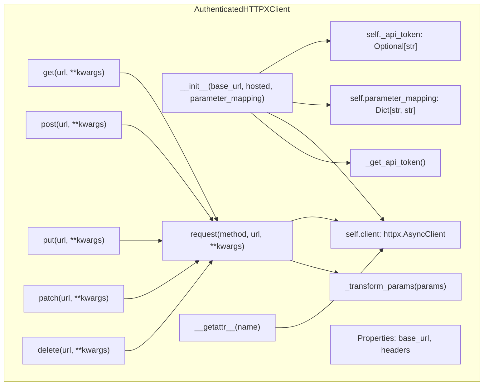
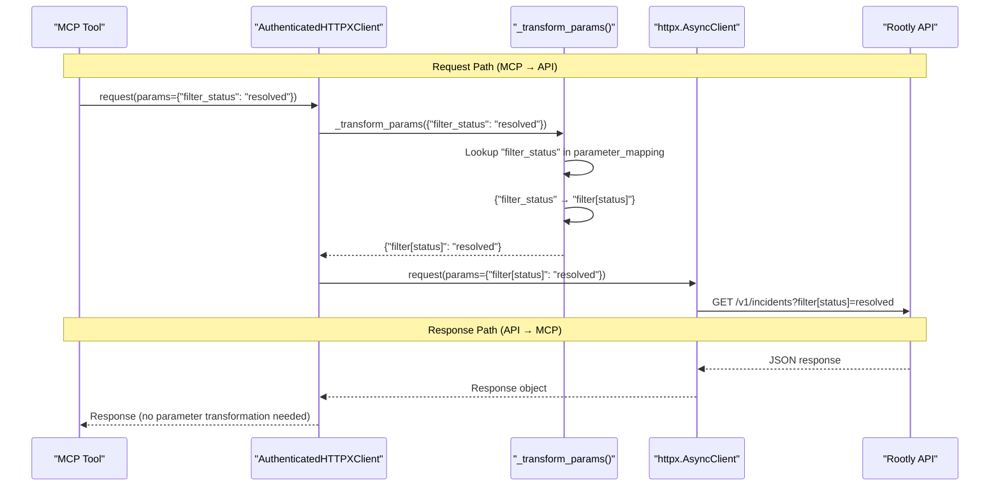
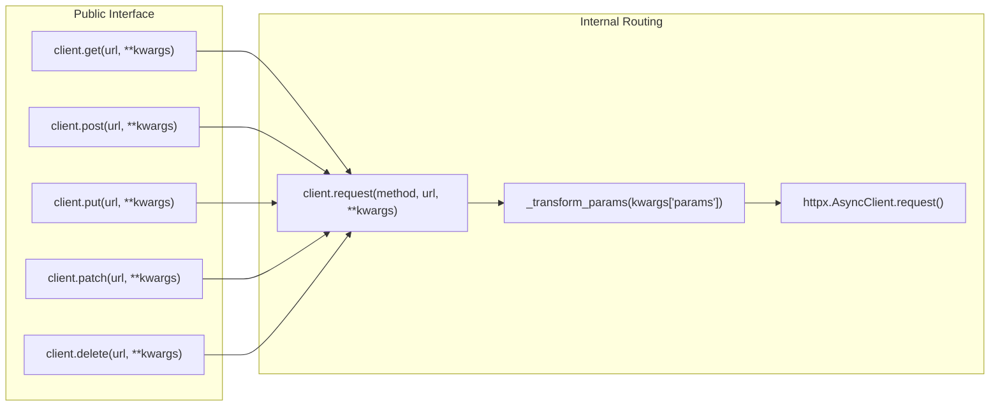
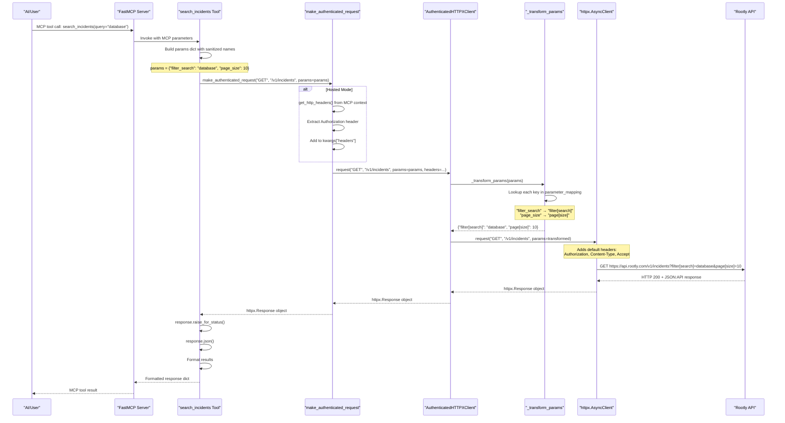

<!-- source: DeepWiki mcp.deepwiki.com · repo Rootly-AI-Labs/Rootly-MCP-server · page 3.4 HTTP Client & Request Flow · fetched 2026-10-26 -->

# HTTP Client & Request Flow

<details>
<summary>Relevant source files</summary>

The following files were used as context for generating this wiki page:

- [src/rootly_mcp_server/client.py](src/rootly_mcp_server/client.py)
- [src/rootly_mcp_server/server.py](src/rootly_mcp_server/server.py)

</details>


## Purpose and Scope

This document describes the HTTP client layer responsible for communicating with the Rootly API. It covers the `AuthenticatedHTTPXClient` class, which serves as a wrapper around HTTPX's async client, handles bidirectional parameter transformation, manages authentication in both local and hosted modes, and provides the request proxying layer that enables MCP tools to interact with the Rootly API.

For information about authentication token sources and validation, see [Authentication System](#3.3). For details on how parameters are sanitized in the OpenAPI specification, see [OpenAPI Processing](#3.2).

---

## AuthenticatedHTTPXClient Overview

The `AuthenticatedHTTPXClient` is the core HTTP communication component, defined in [src/rootly_mcp_server/server.py:175-276](). It wraps `httpx.AsyncClient` to provide:

1. **Parameter Transformation**: Bidirectional mapping between MCP-compliant parameter names and original Rootly API parameter names
2. **Authentication Injection**: Automatic Bearer token headers in both local and hosted modes
3. **Request Proxying**: Method overrides that intercept and transform requests before delegating to HTTPX
4. **Protocol Compliance**: JSON:API headers and content negotiation

### Class Structure



**Sources**: [src/rootly_mcp_server/server.py:175-276]()

### Initialization and Configuration

The client is instantiated during server creation with three key parameters:

| Parameter | Type | Purpose |
|-----------|------|---------|
| `base_url` | `str` | Rootly API base URL (default: `https://api.rootly.com`) |
| `hosted` | `bool` | Whether running in hosted mode (affects authentication) |
| `parameter_mapping` | `Dict[str, str]` | Sanitized → original parameter name mapping |

The HTTPX client is configured with [src/rootly_mcp_server/server.py:188-203]():

```
Headers:
  - Content-Type: application/vnd.api+json
  - Accept: application/vnd.api+json
  - Authorization: Bearer {token} (if not hosted)

Configuration:
  - timeout: 30.0 seconds
  - follow_redirects: True
  - max_keepalive_connections: 5
  - max_connections: 10
```

**Sources**: [src/rootly_mcp_server/server.py:175-204]()

---

## Dual-Mode Authentication

The client supports two distinct authentication modes based on the `hosted` flag:

```mermaid
graph TB
    subgraph "Local Mode (hosted=False)"
        LocalInit["Server Initialization"]
        LocalEnv["ROOTLY_API_TOKEN env var"]
        LocalToken["_get_api_token()"]
        LocalHeader["Authorization header added to httpx.AsyncClient"]
        LocalReq["All requests authenticated"]
        
        LocalInit --> LocalToken
        LocalToken --> LocalEnv
        LocalEnv --> LocalHeader
        LocalHeader --> LocalReq
    end
    
    subgraph "Hosted Mode (hosted=True)"
        HostedInit["Server Initialization"]
        NoToken["No token stored"]
        HostedReq["Request time"]
        ExtractToken["make_authenticated_request()"]
        MCPHeaders["Extract from MCP request headers"]
        InjectHeader["Add Authorization to kwargs"]
        HTTPXCall["httpx.AsyncClient.request()"]
        
        HostedInit --> NoToken
        NoToken --> HostedReq
        HostedReq --> ExtractToken
        ExtractToken --> MCPHeaders
        MCPHeaders --> InjectHeader
        InjectHeader --> HTTPXCall
    end
```



**Sources**: [src/rootly_mcp_server/server.py:178-211](), [src/rootly_mcp_server/server.py:375-392]()

### Local Mode Implementation

In local mode, the token is read once during initialization and stored in the HTTPX client's default headers:

[src/rootly_mcp_server/server.py:184-194]()

```
if not self.hosted:
    self._api_token = self._get_api_token()
    
headers = {...}
if self._api_token:
    headers["Authorization"] = f"Bearer {self._api_token}"
    
self.client = httpx.AsyncClient(
    base_url=base_url,
    headers=headers,
    ...
)
```

The `_get_api_token()` method reads from environment variables with logging [src/rootly_mcp_server/server.py:205-211]().

### Hosted Mode Implementation

In hosted mode, tokens are extracted at request time by the `make_authenticated_request` helper function [src/rootly_mcp_server/server.py:375-392]():

```
if hosted:
    try:
        from fastmcp.server.dependencies import get_http_headers
        request_headers = get_http_headers()
        auth_header = request_headers.get("authorization", "")
        if auth_header:
            if "headers" not in kwargs:
                kwargs["headers"] = {}
            kwargs["headers"]["Authorization"] = auth_header
    except Exception:
        pass  # Fallback to default behavior
```

This allows the MCP protocol layer to provide authentication dynamically for each request.

**Sources**: [src/rootly_mcp_server/server.py:375-392]()

---

## Parameter Transformation Pipeline

One of the client's most critical responsibilities is bidirectional parameter transformation. MCP requires parameter names to follow specific naming conventions (no special characters like `[`, `]`), while the Rootly API uses JSON:API-style parameter names like `filter[status]` and `page[size]`.

### Transformation Architecture



**Sources**: [src/rootly_mcp_server/server.py:213-234]()

### _transform_params Implementation

The transformation logic is implemented in [src/rootly_mcp_server/server.py:213-225]():

```
def _transform_params(self, params: Optional[Dict[str, Any]]) -> Optional[Dict[str, Any]]:
    """Transform sanitized parameter names back to original names."""
    if not params or not self.parameter_mapping:
        return params
    
    transformed = {}
    for key, value in params.items():
        # Use the original name if we have a mapping, otherwise keep the sanitized name
        original_key = self.parameter_mapping.get(key, key)
        transformed[original_key] = value
        if original_key != key:
            logger.debug(f"Transformed parameter: '{key}' -> '{original_key}'")
    return transformed
```

### Parameter Mapping Examples

The `parameter_mapping` dictionary is created during server initialization by the `sanitize_parameters_in_spec()` function:

| Sanitized Name (MCP) | Original Name (Rootly API) | Context |
|---------------------|---------------------------|---------|
| `filter_status` | `filter[status]` | Status filtering |
| `filter_severity` | `filter[severity]` | Severity filtering |
| `page_size` | `page[size]` | Pagination size |
| `page_number` | `page[number]` | Pagination offset |
| `filter_search` | `filter[search]` | Search queries |
| `fields_incidents` | `fields[incidents]` | Sparse fieldsets |
| `fields_alerts` | `fields[alerts]` | Sparse fieldsets |

**Sources**: [src/rootly_mcp_server/server.py:213-225](), [src/rootly_mcp_server/server.py:319-333]()

---

## Request Method Proxying

The client implements method proxying to intercept HTTP requests and apply parameter transformation before delegating to HTTPX.

### Proxy Implementation



**Sources**: [src/rootly_mcp_server/server.py:227-254]()

### Method Implementations

Each HTTP method is implemented as a simple proxy [src/rootly_mcp_server/server.py:236-254]():

```
async def get(self, url: str, **kwargs):
    """Proxy to request with GET method."""
    return await self.request('GET', url, **kwargs)

async def post(self, url: str, **kwargs):
    """Proxy to request with POST method."""
    return await self.request('POST', url, **kwargs)
```

The core `request()` method applies transformation [src/rootly_mcp_server/server.py:227-234]():

```
async def request(self, method: str, url: str, **kwargs):
    """Override request to transform parameters."""
    # Transform query parameters
    if 'params' in kwargs:
        kwargs['params'] = self._transform_params(kwargs['params'])
    
    # Call the underlying client's request method
    return await self.client.request(method, url, **kwargs)
```

**Sources**: [src/rootly_mcp_server/server.py:227-254]()

### Attribute Delegation

For attributes and methods not explicitly overridden, the client uses `__getattr__` to delegate to the underlying HTTPX client [src/rootly_mcp_server/server.py:262-267]():

```
def __getattr__(self, name):
    # Delegate all other attributes to the underlying client, except for request methods
    if name in ['request', 'get', 'post', 'put', 'patch', 'delete']:
        # Use our overridden methods instead
        return getattr(self, name)
    return getattr(self.client, name)
```

This allows access to HTTPX features like connection pooling, cookies, and event hooks while maintaining the transformation layer.

**Sources**: [src/rootly_mcp_server/server.py:262-276]()

---

## Complete Request Lifecycle

The following diagram shows the complete flow from a tool invocation through parameter transformation, authentication, and API communication:



**Sources**: [src/rootly_mcp_server/server.py:175-276](), [src/rootly_mcp_server/server.py:375-392](), [src/rootly_mcp_server/server.py:394-498]()

---

## HTTPX Client Configuration

The underlying HTTPX client is configured with production-ready settings optimized for the Rootly API.

### Configuration Details

[src/rootly_mcp_server/server.py:196-203]()

| Setting | Value | Purpose |
|---------|-------|---------|
| `base_url` | `"https://api.rootly.com"` | Base URL for all requests |
| `timeout` | `30.0` | Prevent hanging requests |
| `follow_redirects` | `True` | Handle 3xx responses |
| `max_keepalive_connections` | `5` | Connection pool size |
| `max_connections` | `10` | Maximum concurrent connections |

### Headers Configuration

Default headers ensure JSON:API compliance:

```
Content-Type: application/vnd.api+json
Accept: application/vnd.api+json
Authorization: Bearer {token}  (if not hosted)
```

HTTPX automatically handles `Accept-Encoding` for compression (gzip, deflate, br) based on available codecs.

**Sources**: [src/rootly_mcp_server/server.py:188-203]()

---

## make_authenticated_request Helper

Custom tools use the `make_authenticated_request` helper function [src/rootly_mcp_server/server.py:375-392]() instead of accessing the client directly. This provides:

1. **Hosted Mode Token Extraction**: Automatically extracts tokens from MCP request context
2. **Unified Interface**: Consistent authentication handling across all custom tools
3. **Error Fallback**: Graceful degradation if token extraction fails

### Usage Pattern

Custom tools follow this pattern:

```
response = await make_authenticated_request(
    "GET",
    "/v1/incidents",
    params={
        "filter[status]": "resolved",  # Can use original names
        "page[size]": 10
    }
)
response.raise_for_status()
data = response.json()
```

### Implementation

```
async def make_authenticated_request(method: str, url: str, **kwargs):
    """Make an authenticated request, extracting token from MCP headers in hosted mode."""
    if hosted:
        try:
            from fastmcp.server.dependencies import get_http_headers
            request_headers = get_http_headers()
            auth_header = request_headers.get("authorization", "")
            if auth_header:
                if "headers" not in kwargs:
                    kwargs["headers"] = {}
                kwargs["headers"]["Authorization"] = auth_header
        except Exception:
            pass  # Fallback to default client behavior
    
    return await http_client.request(method, url, **kwargs)
```

This function is used by all custom tools including `search_incidents`, `find_related_incidents`, `suggest_solutions`, and the on-call intelligence tools.

**Sources**: [src/rootly_mcp_server/server.py:375-392](), [src/rootly_mcp_server/server.py:419](), [src/rootly_mcp_server/server.py:444](), [src/rootly_mcp_server/server.py:518]()

---

## Legacy RootlyClient

The codebase includes a legacy `RootlyClient` class in [src/rootly_mcp_server/client.py:1-133]() that predates the HTTPX-based implementation. This class:

- Uses synchronous `requests` library instead of async HTTPX
- Has similar authentication and request logic
- Is not currently used by the main server implementation
- Remains for backward compatibility or testing purposes

The modern server exclusively uses `AuthenticatedHTTPXClient` for all API communication.

**Sources**: [src/rootly_mcp_server/client.py:1-133]()

---

## Error Handling

HTTP-level errors are handled at multiple layers:

1. **HTTPX Layer**: Connection errors, timeouts, network failures
2. **Response Status**: HTTP error status codes (4xx, 5xx)
3. **Tool Layer**: Custom error categorization via `MCPError.categorize_error()`

The client itself focuses on transport concerns, while tools handle response validation and error categorization. For details on error categorization and MCP error responses, see [Error Handling & MCPError](#8.4).

**Sources**: [src/rootly_mcp_server/server.py:175-276](), [src/rootly_mcp_server/server.py:28-83]()

---

