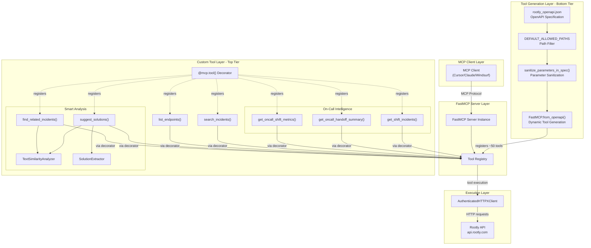
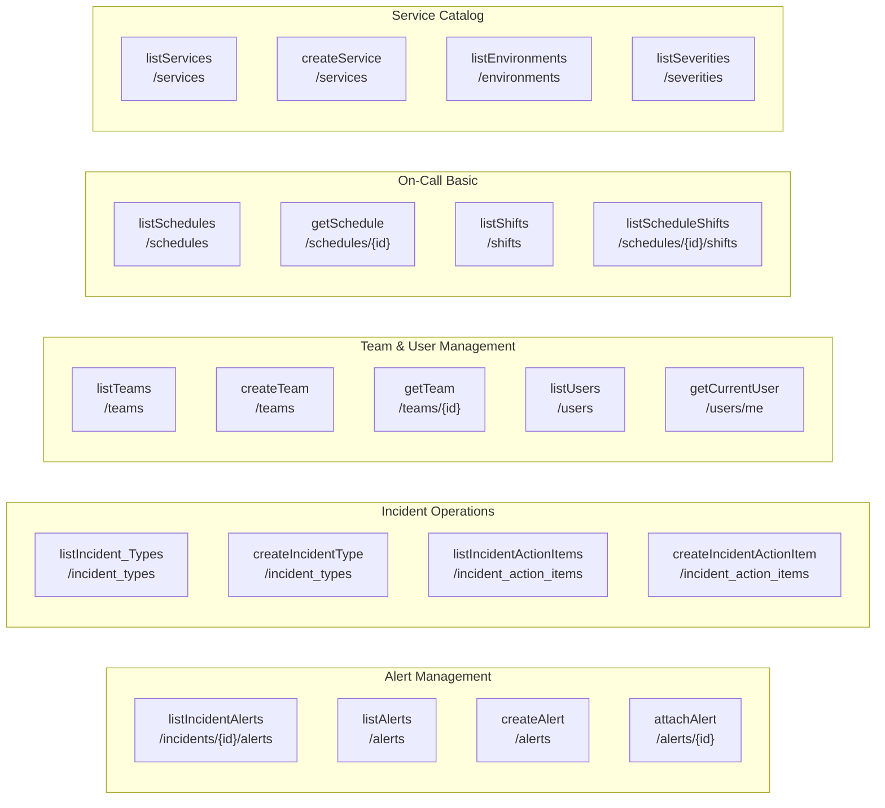
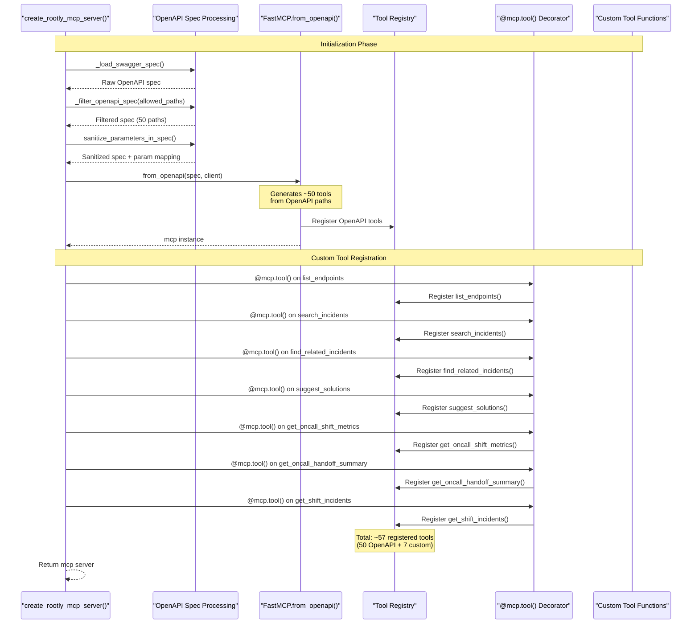
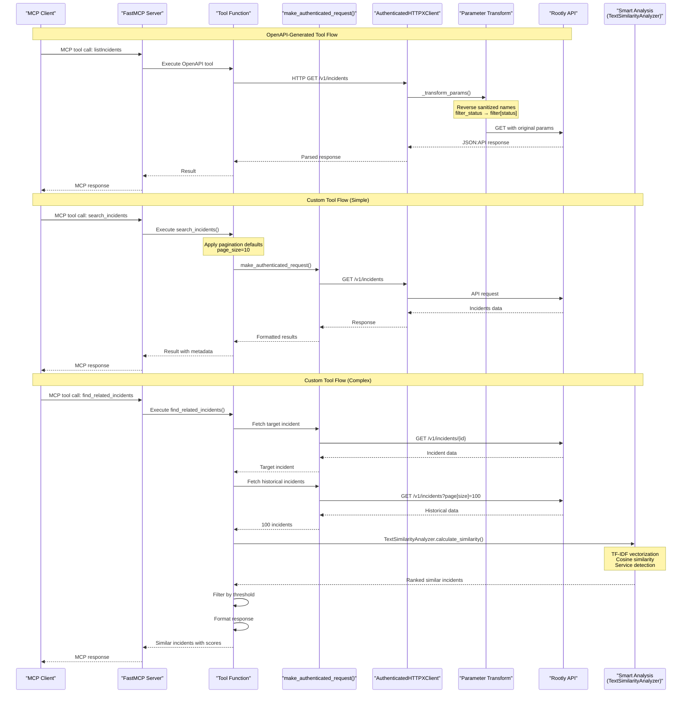
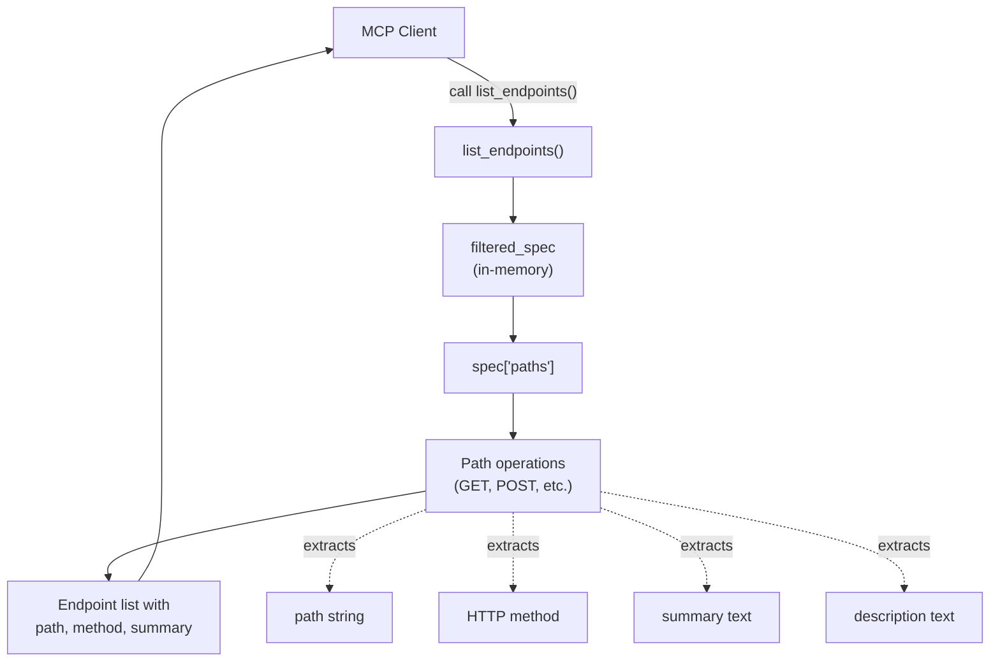
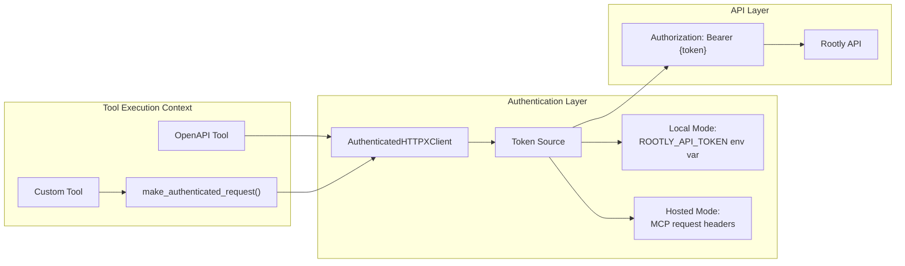
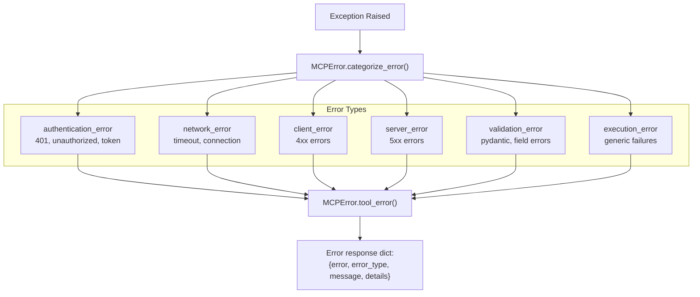

<!-- source: DeepWiki mcp.deepwiki.com · repo Rootly-AI-Labs/Rootly-MCP-server · page 4 Tool System · fetched 2026-10-26 -->

# Tool System

<details>
<summary>Relevant source files</summary>

The following files were used as context for generating this wiki page:

- [README.md](README.md)
- [src/rootly_mcp_server/server.py](src/rootly_mcp_server/server.py)
- [tests/unit/test_oncall_handoff.py](tests/unit/test_oncall_handoff.py)

</details>


## Purpose and Scope

This document provides a comprehensive overview of the Rootly MCP Server's tool system, which exposes Rootly API functionality to MCP clients through two complementary layers: automatically generated OpenAPI tools and custom intelligent tools. This page covers the high-level architecture, tool categories, registration mechanisms, and invocation flows. For detailed information about specific tool types, see:

- OpenAPI-generated CRUD operations: [OpenAPI-Generated Tools](#4.1)
- AI-powered incident analysis: [Smart Analysis Tools](#4.2)
- On-call management and metrics: [On-Call Intelligence Tools](#4.3)
- MCP resource URIs: [MCP Resources](#4.4)
- Creating new custom tools: [Custom Tool Development](#4.5)

For the broader context of how the tool system fits into the server architecture, see [Core Architecture](#3).

---

## Dual-Layer Tool Architecture

The Rootly MCP Server employs a two-tier tool architecture that balances automated API coverage with intelligent, value-added functionality.

### Architecture Overview



**Sources:** [src/rootly_mcp_server/server.py:278-373](), [src/rootly_mcp_server/server.py:121-172]()

### Layer Responsibilities

| Layer | Purpose | Tool Count | Generation Method |
|-------|---------|------------|-------------------|
| **Bottom Tier: OpenAPI Tools** | Direct CRUD access to Rootly entities | ~50 tools | Automatic from OpenAPI spec via `FastMCP.from_openapi()` |
| **Top Tier: Custom Tools** | Intelligent analysis and aggregation | 7 custom tools | Manual registration with `@mcp.tool()` decorator |

**Bottom Tier** provides comprehensive coverage of the Rootly API's basic operations (create, read, update, delete) for entities like incidents, alerts, teams, schedules, and services. These tools are automatically generated from paths in `DEFAULT_ALLOWED_PATHS`.

**Top Tier** adds value through multi-step API orchestration, machine learning analysis, data aggregation, and intelligent pattern recognition. These tools solve higher-level operational problems that require domain knowledge.

**Sources:** [src/rootly_mcp_server/server.py:338-344](), [src/rootly_mcp_server/server.py:354-1507]()

---

## Tool Categories

### OpenAPI-Generated Tools

These tools are automatically created from the Rootly OpenAPI specification, filtered by `DEFAULT_ALLOWED_PATHS`. Each allowed API path becomes one or more MCP tools.



**Sources:** [src/rootly_mcp_server/server.py:121-172](), [README.md:134-181]()

### Custom Intelligent Tools

Custom tools extend the OpenAPI-generated capabilities with higher-level operations that aggregate data, apply machine learning, or orchestrate multi-step workflows.

#### Utility Tools

| Tool Name | Function | Purpose |
|-----------|----------|---------|
| `list_endpoints` | [`server.py:354-373`]() | Discovery tool that lists all available API endpoints with descriptions |
| `search_incidents` | [`server.py:394-498`]() | Enhanced incident search with flexible pagination and smart defaults |

#### Smart Analysis Tools

| Tool Name | Function | ML Component | Purpose |
|-----------|----------|--------------|---------|
| `find_related_incidents` | [`server.py:504-604`]() | `TextSimilarityAnalyzer` | TF-IDF similarity matching to find historical incidents |
| `suggest_solutions` | [`server.py:606-702`]() | `TextSimilarityAnalyzer`<br/>`SolutionExtractor` | Pattern mining from resolved incidents to recommend solutions |

#### On-Call Intelligence Tools

| Tool Name | Function | Data Sources | Purpose |
|-----------|----------|--------------|---------|
| `get_oncall_shift_metrics` | [`server.py:704-1053`]() | `/shifts`, `/schedules`, `/teams` | Aggregate shift statistics grouped by user/team/schedule |
| `get_oncall_handoff_summary` | [`server.py:1055-1380`]() | `/schedules`, `/shifts`, `/incidents` | Current/next on-call with optional incident context |
| `get_shift_incidents` | [`server.py:1382-1507`]() | `/incidents` with time filtering | Incidents within specified time ranges with filters |

**Sources:** [src/rootly_mcp_server/server.py:354-1507](), [src/rootly_mcp_server/smart_utils.py]()

---

## Tool Registration Process

### Registration Flow Diagram



**Sources:** [src/rootly_mcp_server/server.py:278-344]()

### Code Mapping: Tool Registration

The following table maps high-level concepts to specific code locations:

| Concept | Code Entity | Location |
|---------|-------------|----------|
| Server creation | `create_rootly_mcp_server()` | [server.py:278-296]() |
| Path filtering | `DEFAULT_ALLOWED_PATHS` | [server.py:121-172]() |
| Path filtering | `_filter_openapi_spec()` | [server.py:1509-1559]() |
| Parameter sanitization | `sanitize_parameters_in_spec()` | [utils.py]() |
| OpenAPI tool generation | `FastMCP.from_openapi()` | [server.py:338-344]() |
| Custom tool decorator | `@mcp.tool()` | [server.py:354](), [server.py:394](), etc. |
| Tool registry | `FastMCP` instance | [server.py:338]() |

**Sources:** [src/rootly_mcp_server/server.py:278-344](), [src/rootly_mcp_server/utils.py]()

---

## Tool Invocation Flow

### Request Processing Pipeline



**Sources:** [src/rootly_mcp_server/server.py:375-604](), [src/rootly_mcp_server/smart_utils.py]()

### Tool Execution Patterns

The server implements three distinct execution patterns based on tool complexity:

#### Pattern 1: Direct OpenAPI Tools
```
Client Request → FastMCP Router → OpenAPI Tool → HTTPClient → Rootly API → Response
```
- **Example:** `listIncidents`, `createAlert`
- **Characteristics:** Single API call, minimal processing
- **Code:** Generated by `FastMCP.from_openapi()`

#### Pattern 2: Simple Custom Tools  
```
Client Request → FastMCP Router → Custom Tool → make_authenticated_request() → Response
```
- **Example:** `search_incidents`, `list_endpoints`
- **Characteristics:** Single or few API calls with light processing
- **Code:** [server.py:394-498](), [server.py:354-373]()

#### Pattern 3: Complex Custom Tools
```
Client Request → FastMCP Router → Custom Tool → Multiple API Calls → ML Analysis → Aggregation → Response
```
- **Example:** `find_related_incidents`, `get_oncall_shift_metrics`
- **Characteristics:** Multi-step orchestration, ML processing, data aggregation
- **Code:** [server.py:504-604](), [server.py:704-1053]()

**Sources:** [src/rootly_mcp_server/server.py:338-1507]()

---

## Tool Discovery and Metadata

### Tool Metadata Structure

Each tool exposes metadata through the MCP protocol that describes its functionality:

| Metadata Field | Source | Purpose |
|----------------|--------|---------|
| `name` | Function name or OpenAPI `operationId` | Unique tool identifier |
| `description` | Docstring or OpenAPI `summary` | Human-readable purpose |
| `inputSchema` | Function annotations or OpenAPI parameters | JSON Schema for validation |
| `outputSchema` | Inferred from return types | Expected response structure |

### Discovery Tool

The `list_endpoints()` tool provides runtime discovery of available tools:



**Sources:** [src/rootly_mcp_server/server.py:354-373]()

### Example Tool Discovery Response

When a client calls `list_endpoints()`, it receives a structured list:

```json
[
  {
    "path": "/v1/incidents",
    "method": "GET",
    "summary": "List all incidents",
    "description": "Retrieves a list of incidents with optional filtering"
  },
  {
    "path": "/v1/alerts",
    "method": "POST",
    "summary": "Create an alert",
    "description": "Creates a new alert and optionally attaches it to an incident"
  }
]
```

**Sources:** [src/rootly_mcp_server/server.py:354-373]()

---

## Tool Authentication and Authorization

All tools use the same authentication mechanism through `AuthenticatedHTTPXClient`:



**Authentication Flow:**
1. Tool is invoked by MCP client
2. Tool calls `AuthenticatedHTTPXClient` or `make_authenticated_request()`
3. Client retrieves token from environment (`ROOTLY_API_TOKEN`) or MCP headers (`hosted=True`)
4. Token is injected into `Authorization` header
5. Request is sent to Rootly API

**Sources:** [src/rootly_mcp_server/server.py:175-276](), [src/rootly_mcp_server/server.py:375-392]()

---

## Error Handling

Tools use the `MCPError` class for consistent error responses:



**Error Response Structure:**
```python
{
    "error": True,
    "error_type": "authentication_error",  # Categorized error type
    "message": "Authentication failed: 401 Unauthorized",
    "details": {  # Optional additional context
        "status_code": 401,
        "endpoint": "/v1/incidents"
    }
}
```

**Sources:** [src/rootly_mcp_server/server.py:28-82](), [src/rootly_mcp_server/server.py:423-424]()

---

## Tool Configuration

### Path Filtering

Tools are filtered through `DEFAULT_ALLOWED_PATHS` for security and context management:

```python
# Only these paths become tools
DEFAULT_ALLOWED_PATHS = [
    "/incidents/{incident_id}/alerts",
    "/alerts",
    "/teams",
    "/schedules",
    # ... ~50 paths total
]
```

To expose additional paths, modify this constant in [`server.py:121-172`]().

### Pagination Defaults

Several tools implement smart pagination to prevent context overflow:

| Tool | Default Page Size | Max Page Size | Behavior |
|------|------------------|---------------|----------|
| `search_incidents` | 10 | 20 | Fetches up to `max_results` across pages when `page_number=0` |
| `find_related_incidents` | 100 | N/A | Single fetch for similarity analysis |
| `get_oncall_shift_metrics` | 100 shifts | N/A | Paginated schedule fetch |
| `get_oncall_handoff_summary` | 100 schedules | N/A | Multi-page schedule fetch |

**Sources:** [src/rootly_mcp_server/server.py:394-498](), [src/rootly_mcp_server/server.py:504-604](), [src/rootly_mcp_server/server.py:704-1053]()

---

## Performance Considerations

### Tool Performance Characteristics

| Tool Type | API Calls | ML Processing | Typical Latency | Use Case |
|-----------|-----------|---------------|-----------------|----------|
| OpenAPI tools | 1 | None | < 500ms | Direct CRUD operations |
| `search_incidents` | 1-10 | None | < 2s | Fast incident lookup |
| `find_related_incidents` | 2 | TF-IDF | 1-3s | Similarity analysis |
| `suggest_solutions` | 2 | TF-IDF + patterns | 1-4s | Solution mining |
| `get_oncall_shift_metrics` | 3-5 | None | 2-5s | Shift aggregation |
| `get_oncall_handoff_summary` | 3-10+ | None | 2-10s | Full handoff context |

### Optimization Strategies

1. **Pagination Control**: Tools like `search_incidents` default to small page sizes (10 items) to minimize latency
2. **Sparse Fieldsets**: OpenAPI tools use `fields[resource]` parameters to request only needed fields
3. **Conditional Fetching**: `get_oncall_handoff_summary` has `include_incidents=False` default for faster responses
4. **Caching Analyzers**: `TextSimilarityAnalyzer` and `SolutionExtractor` are initialized once per server instance

**Sources:** [src/rootly_mcp_server/server.py:394-498](), [src/rootly_mcp_server/server.py:1055-1380](), [src/rootly_mcp_server/server.py:500-502]()

---

## Summary

The Rootly MCP Server's tool system provides:

- **~50 OpenAPI-generated tools** for direct Rootly API access
- **7 custom intelligent tools** for enhanced workflows
- **Dual-layer architecture** balancing coverage and intelligence
- **Consistent authentication** through `AuthenticatedHTTPXClient`
- **Standardized error handling** via `MCPError`
- **Smart pagination** to manage AI context windows
- **Discovery capabilities** through `list_endpoints()`

For detailed information about each tool category, see the respective sub-pages: [OpenAPI-Generated Tools](#4.1), [Smart Analysis Tools](#4.2), [On-Call Intelligence Tools](#4.3), [MCP Resources](#4.4), and [Custom Tool Development](#4.5).

**Sources:** [src/rootly_mcp_server/server.py:278-1507](), [README.md:122-181]()

---

