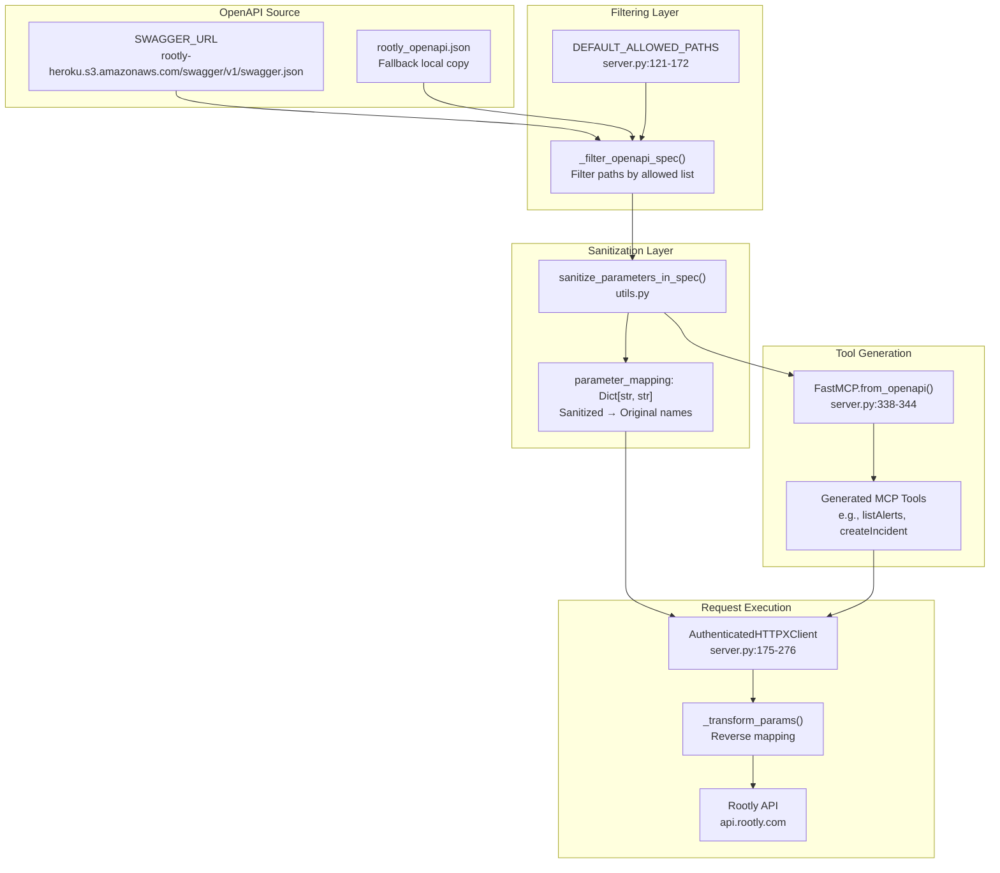
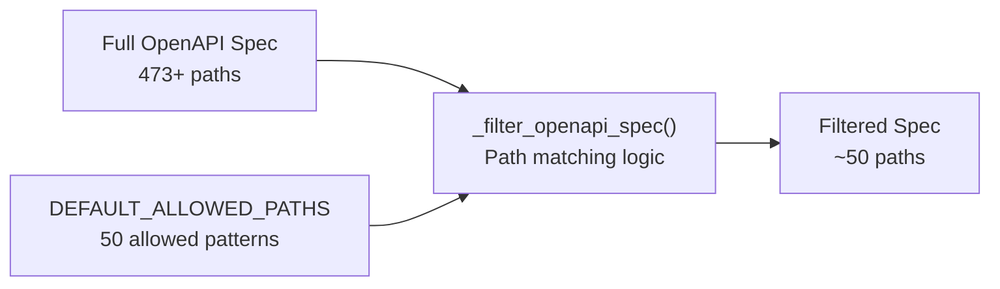
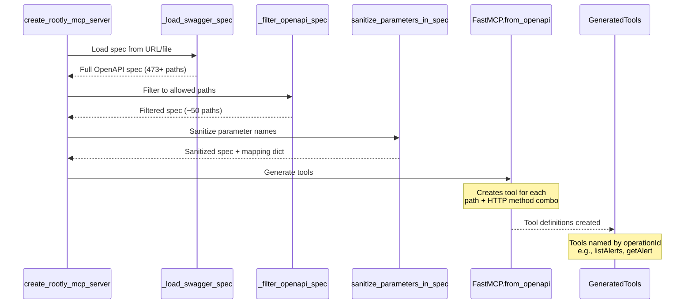
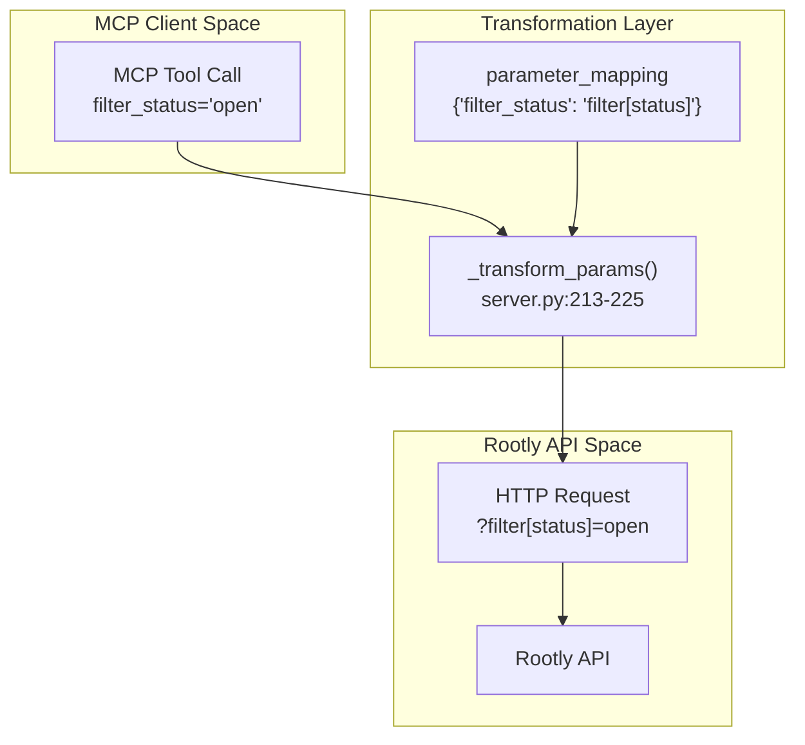
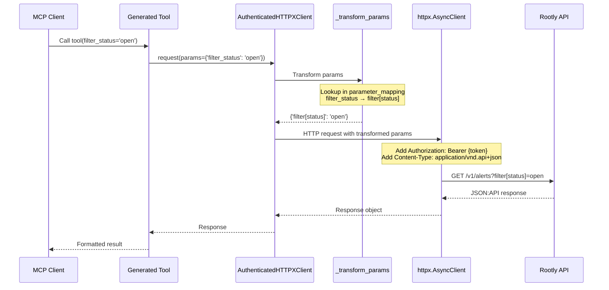

<!-- source: DeepWiki mcp.deepwiki.com · repo Rootly-AI-Labs/Rootly-MCP-server · page 4.1 OpenAPI-Generated Tools · fetched 2026-10-26 -->

# OpenAPI-Generated Tools

<details>
<summary>Relevant source files</summary>

The following files were used as context for generating this wiki page:

- [rootly_openapi.json](rootly_openapi.json)
- [src/rootly_mcp_server/__init__.py](src/rootly_mcp_server/__init__.py)
- [src/rootly_mcp_server/server.py](src/rootly_mcp_server/server.py)
- [tests/unit/test_tools.py](tests/unit/test_tools.py)

</details>


This document describes the automatic tool generation system that creates MCP tools directly from the Rootly OpenAPI specification. These tools provide direct CRUD (Create, Read, Update, Delete) access to Rootly API resources without custom logic or enhancement.

For information about enhanced intelligent tools built on top of these base operations, see [Smart Analysis Tools](#4.2) and [On-Call Intelligence Tools](#4.3). For details on creating custom tools, see [Custom Tool Development](#4.5).

## Purpose and Scope

OpenAPI-generated tools form the foundation layer of the Rootly MCP Server's tool ecosystem. They are automatically created from the Rootly API's OpenAPI/Swagger specification using FastMCP's `from_openapi()` integration, providing type-safe, validated access to allowed API endpoints. This system handles:

- Automatic tool generation from OpenAPI operation definitions
- Path-based filtering to expose only approved endpoints
- Parameter name sanitization for MCP protocol compliance
- Bidirectional parameter transformation between MCP and Rootly formats
- JSON:API request/response handling

## Architecture Overview



**Sources:** [src/rootly_mcp_server/server.py:84-344]()

## OpenAPI Specification Source

The server loads the Rootly API OpenAPI specification from two sources with automatic fallback:

| Priority | Source | Location | Function |
|----------|--------|----------|----------|
| 1 (Primary) | Remote URL | `SWAGGER_URL` constant | `_load_swagger_spec()` |
| 2 (Fallback) | Local file | `rootly_openapi.json` | File system read |

The remote specification URL is defined at [src/rootly_mcp_server/server.py:85]():

```python
SWAGGER_URL = "https://rootly-heroku.s3.amazonaws.com/swagger/v1/swagger.json"
```

The specification defines:
- **473+ API endpoints** across 100+ resource types
- JSON:API format request/response schemas
- Bearer token authentication requirements
- Pagination, filtering, and sparse fieldset parameters

**Sources:** [src/rootly_mcp_server/server.py:84-86](), [rootly_openapi.json:1-6]()

## Path Filtering System

The server restricts tool generation to a curated subset of endpoints defined in `DEFAULT_ALLOWED_PATHS`. This prevents exposure of sensitive operations and reduces the tool surface area for better usability.

### Filtering Implementation



The filtering function at [src/rootly_mcp_server/server.py:315]() iterates through the full specification and retains only paths that match the allowed list. Paths are automatically prefixed with `/v1` if not already present.

**Sources:** [src/rootly_mcp_server/server.py:299-316]()

### Allowed Endpoint Categories

The `DEFAULT_ALLOWED_PATHS` list at [src/rootly_mcp_server/server.py:121-172]() organizes endpoints into functional categories:

| Category | Endpoints | Example Operations |
|----------|-----------|-------------------|
| **Alerts** | `/alerts`, `/alerts/{alert_id}`, `/incidents/{incident_id}/alerts` | `listAlerts`, `getAlert`, `createAlert`, `updateAlert`, `attachAlert` |
| **Incidents** | (Referenced but not in default paths) | Accessed via custom `search_incidents` tool |
| **Severities** | `/severities`, `/severities/{severity_id}` | `listSeverities`, `getSeverity` |
| **Teams** | `/teams`, `/teams/{team_id}` | `listTeams`, `getTeam` |
| **Services** | `/services`, `/services/{service_id}` | `listServices`, `getService` |
| **Functionalities** | `/functionalities`, `/functionalities/{functionality_id}` | `listFunctionalities`, `getFunctionality` |
| **Incident Types** | `/incident_types`, `/incident_types/{incident_type_id}` | `listIncidentTypes`, `getIncidentType` |
| **Action Items** | `/incident_action_items`, `/incidents/{incident_id}/action_items` | `listIncidentActionItems`, `getIncidentActionItem` |
| **Workflows** | `/workflows`, `/workflows/{workflow_id}`, `/workflow_runs` | `listWorkflows`, `getWorkflow`, `listWorkflowRuns` |
| **Environments** | `/environments`, `/environments/{environment_id}` | `listEnvironments`, `getEnvironment` |
| **Users** | `/users`, `/users/{user_id}`, `/users/me` | `listUsers`, `getUser`, `getCurrentUser` |
| **Status Pages** | `/status_pages`, `/status_pages/{status_page_id}` | `listStatusPages`, `getStatusPage` |
| **On-Call Schedules** | `/schedules`, `/schedules/{schedule_id}`, `/schedules/{schedule_id}/shifts` | `listSchedules`, `getSchedule`, `listScheduleShifts` |
| **Shifts** | `/shifts` | `listShifts` |
| **Schedule Rotations** | `/schedule_rotations/{schedule_rotation_id}/*` | `getScheduleRotation`, `listScheduleRotationUsers` |
| **Override Shifts** | `/schedules/{schedule_id}/override_shifts`, `/override_shifts/{override_shift_id}` | `listOverrideShifts`, `getOverrideShift` |
| **On-Call Shadows** | `/schedules/{schedule_id}/on_call_shadows`, `/on_call_shadows/{on_call_shadow_id}` | `listOnCallShadows`, `getOnCallShadow` |
| **On-Call Roles** | `/on_call_roles`, `/on_call_roles/{on_call_role_id}` | `listOnCallRoles`, `getOnCallRole` |

**Sources:** [src/rootly_mcp_server/server.py:121-172](), [tests/unit/test_tools.py:75-81]()

## Tool Generation Process

The core tool generation happens through FastMCP's OpenAPI integration, which introspects the specification and creates tool definitions automatically.



The generation call at [src/rootly_mcp_server/server.py:338-344]():

```python
mcp = FastMCP.from_openapi(
    openapi_spec=filtered_spec,
    client=http_client.client,
    name=name,
    timeout=30.0,
    tags={"rootly", "incident-management"},
)
```

### Tool Naming Convention

FastMCP uses the `operationId` field from the OpenAPI specification as the tool name. Examples from [rootly_openapi.json]():

| Path | Method | operationId | Generated Tool Name |
|------|--------|-------------|---------------------|
| `/v1/alerts` | GET | `listAlerts` | `listAlerts` |
| `/v1/alerts` | POST | `createAlert` | `createAlert` |
| `/v1/alerts/{id}` | GET | `getAlert` | `getAlert` |
| `/v1/alerts/{id}` | PATCH | `updateAlert` | `updateAlert` |
| `/v1/teams/{team_id}` | GET | `getTeam` | `getTeam` |
| `/v1/users/me` | GET | `getCurrentUser` | `getCurrentUser` |

**Sources:** [src/rootly_mcp_server/server.py:338-344](), [rootly_openapi.json:3053-3111]()

## Parameter Handling

The OpenAPI specification uses JSON:API parameter naming conventions (e.g., `filter[status]`, `page[number]`) that contain brackets, which are not MCP-compliant identifiers. The server implements bidirectional parameter transformation.

### Sanitization Flow



### Sanitization Examples

The `sanitize_parameters_in_spec()` function in [src/rootly_mcp_server/utils.py]() performs the transformation:

| Original Name | Sanitized Name | Reason |
|---------------|----------------|--------|
| `filter[status]` | `filter_status` | Brackets → underscores |
| `filter[search]` | `filter_search` | Brackets → underscores |
| `page[number]` | `page_number` | Brackets → underscores |
| `page[size]` | `page_size` | Brackets → underscores |
| `filter[created_at][gte]` | `filter_created_at_gte` | Nested brackets → underscores |
| `include` | `include` | No change needed |

The `parameter_mapping` dictionary at [src/rootly_mcp_server/server.py:319]() stores the bidirectional mapping for runtime transformation.

**Sources:** [src/rootly_mcp_server/server.py:319-320](), [src/rootly_mcp_server/utils.py]()

## Request Execution

Generated tools execute through the `AuthenticatedHTTPXClient`, which handles parameter transformation and authentication.



The `AuthenticatedHTTPXClient` class at [src/rootly_mcp_server/server.py:175-276]() provides:

- **Parameter transformation**: [server.py:213-225]() via `_transform_params()`
- **Authentication header injection**: [server.py:193-194]() with Bearer token
- **JSON:API content-type headers**: [server.py:188-190]()
- **Automatic redirect following**: [server.py:200]()
- **Connection pooling**: [server.py:202]() with configurable limits

**Sources:** [src/rootly_mcp_server/server.py:175-276]()

## Tool Discovery

The server provides a `list_endpoints` tool at [src/rootly_mcp_server/server.py:354-373]() that returns all available generated tools with their descriptions:

```python
@mcp.tool()
def list_endpoints() -> list:
    """List all available Rootly API endpoints with their descriptions."""
    endpoints = []
    for path, path_item in filtered_spec.get("paths", {}).items():
        for method, operation in path_item.items():
            if method.lower() not in ["get", "post", "put", "delete", "patch"]:
                continue
            
            endpoints.append({
                "path": path,
                "method": method.upper(),
                "summary": operation.get("summary", ""),
                "description": operation.get("description", ""),
            })
    
    return endpoints
```

This tool enables clients to discover available operations programmatically without consulting external documentation.

**Sources:** [src/rootly_mcp_server/server.py:354-373]()

## JSON:API Format Support

All generated tools handle JSON:API formatted requests and responses automatically. The OpenAPI specification at [rootly_openapi.json:1-6]() specifies:

- **Content-Type**: `application/vnd.api+json`
- **Accept**: `application/vnd.api+json`
- **Response format**: JSON:API structure with `data`, `meta`, `links`, and `included` sections
- **Pagination**: Through `page[number]` and `page[size]` parameters
- **Sparse fieldsets**: Through `fields[resource_type]` parameters
- **Relationship inclusion**: Through `include` parameter

The `AuthenticatedHTTPXClient` sets these headers at [src/rootly_mcp_server/server.py:188-190]():

```python
headers = {
    "Content-Type": "application/vnd.api+json", 
    "Accept": "application/vnd.api+json"
}
```

**Sources:** [src/rootly_mcp_server/server.py:188-191](), [rootly_openapi.json:2-10]()

## Testing

OpenAPI-generated tool functionality is verified through unit tests in [tests/unit/test_tools.py]():

| Test | Purpose | Lines |
|------|---------|-------|
| `test_search_incidents_tool_availability` | Verifies server creation with tools | [21-36]() |
| `test_custom_tool_registration` | Ensures tools are registered | [38-47]() |
| `test_default_allowed_paths_exist` | Validates `DEFAULT_ALLOWED_PATHS` | [54-62]() |
| `test_oncall_endpoints_in_defaults` | Confirms on-call endpoints included | [75-81]() |

**Sources:** [tests/unit/test_tools.py:1-82]()

---

