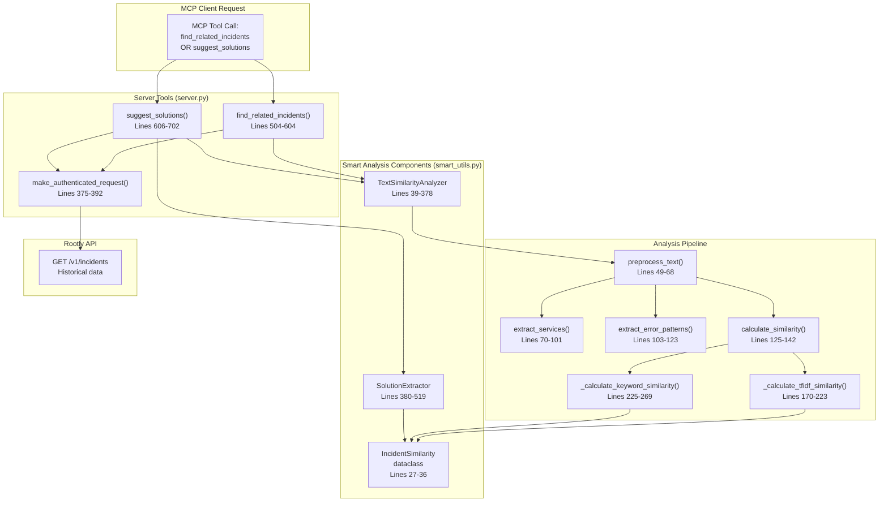
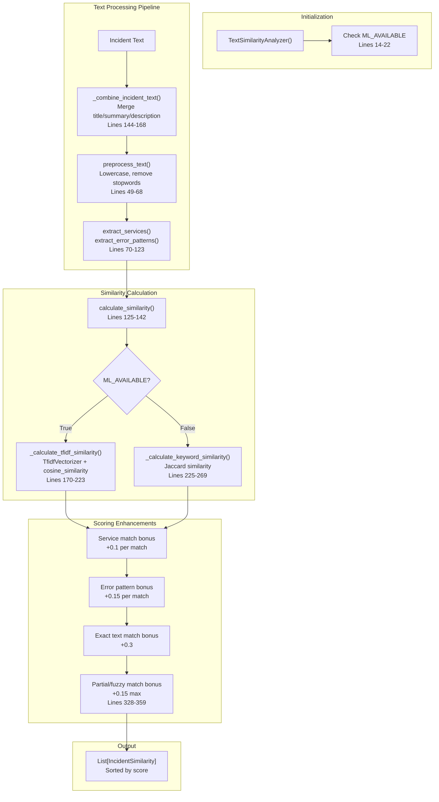
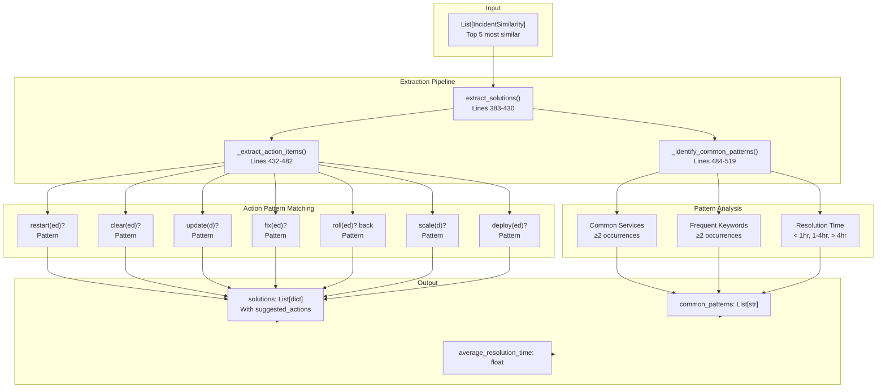

<!-- source: DeepWiki mcp.deepwiki.com · repo Rootly-AI-Labs/Rootly-MCP-server · page 4.2 Smart Analysis Tools · fetched 2026-10-26 -->

# Smart Analysis Tools

<details>
<summary>Relevant source files</summary>

The following files were used as context for generating this wiki page:

- [README.md](README.md)
- [src/rootly_mcp_server/server.py](src/rootly_mcp_server/server.py)
- [src/rootly_mcp_server/smart_utils.py](src/rootly_mcp_server/smart_utils.py)
- [tests/integration/local/test_smart_tools.py](tests/integration/local/test_smart_tools.py)
- [tests/unit/test_oncall_handoff.py](tests/unit/test_oncall_handoff.py)
- [tests/unit/test_smart_utils.py](tests/unit/test_smart_utils.py)

</details>


This document covers the AI-powered incident analysis tools that provide intelligent recommendations based on historical incident data. These tools use text similarity analysis and pattern mining to help users quickly identify similar past incidents and extract actionable solutions.

For information about on-call intelligence tools like shift metrics and handoff summaries, see [On-Call Intelligence Tools](#4.3). For information about basic CRUD operations on Rootly resources, see [OpenAPI-Generated Tools](#4.1).

## Overview

The Rootly MCP Server includes two custom smart analysis tools that go beyond basic API operations to provide intelligent insights:

| Tool | Purpose | Key Technology |
|------|---------|----------------|
| `find_related_incidents` | Find historically similar incidents to understand patterns | TF-IDF + cosine similarity |
| `suggest_solutions` | Extract actionable solutions from similar resolved incidents | Pattern mining + ML analysis |

Both tools leverage the `TextSimilarityAnalyzer` and `SolutionExtractor` classes in [src/rootly_mcp_server/smart_utils.py]() to perform advanced text analysis with graceful fallback when ML libraries are unavailable.

**Sources:** [src/rootly_mcp_server/server.py:504-702](), [src/rootly_mcp_server/smart_utils.py:1-519](), [README.md:191-228]()

## Smart Analysis Architecture



**Diagram: Smart Analysis Tool Flow**

The architecture uses a pipeline approach where incident text is preprocessed, services and error patterns are extracted, and similarity is calculated using either TF-IDF (when scikit-learn is available) or keyword-based matching (fallback mode). Results are returned as `IncidentSimilarity` objects containing scores, matched services, and resolution metadata.

**Sources:** [src/rootly_mcp_server/server.py:500-702](), [src/rootly_mcp_server/smart_utils.py:39-519]()

## Tool: find_related_incidents

The `find_related_incidents` tool finds historically similar incidents using text similarity analysis. It accepts either an incident ID or a descriptive text string.

### Function Signature

[src/rootly_mcp_server/server.py:504-604]()

```python
@mcp.tool()
async def find_related_incidents(
    incident_id: str = "",
    incident_description: str = "",
    similarity_threshold: float = 0.15,
    max_results: int = 5,
    status_filter: str = ""
) -> dict
```

### Parameters

| Parameter | Type | Description | Default |
|-----------|------|-------------|---------|
| `incident_id` | `str` | Existing incident ID to find similar incidents for | `""` |
| `incident_description` | `str` | Descriptive text (e.g., "website is down") when no incident exists | `""` |
| `similarity_threshold` | `float` | Minimum similarity score (0.0-1.0) | `0.15` |
| `max_results` | `int` | Maximum number of related incidents to return (1-20) | `5` |
| `status_filter` | `str` | Filter by status ("resolved", "investigating", etc.) | `""` (all) |

### Usage Modes

The tool supports two distinct usage patterns:

**Mode 1: Find Similar to Existing Incident**
```python
find_related_incidents(
    incident_id="12345",
    similarity_threshold=0.2,
    max_results=5
)
```

**Mode 2: Find Similar to Text Description**
```python
find_related_incidents(
    incident_description="database timeout errors",
    similarity_threshold=0.15,
    max_results=10
)
```

When using `incident_description`, the tool creates a synthetic incident object [src/rootly_mcp_server/server.py:527-535]() with the description used for title, summary, and description fields.

### Response Structure

```json
{
  "target_incident": {
    "id": "12345",
    "title": "Payment API timeout errors"
  },
  "related_incidents": [
    {
      "incident_id": "11234",
      "title": "Payment service timeouts",
      "similarity_score": 0.845,
      "matched_services": ["payment", "api"],
      "matched_keywords": ["timeout", "error", "api"],
      "resolution_summary": "Restarted payment service and cleared cache",
      "resolution_time_hours": 1.5
    }
  ],
  "total_found": 3,
  "similarity_threshold": 0.15,
  "analysis_summary": "Found 3 similar incidents out of 100 historical incidents"
}
```

**Sources:** [src/rootly_mcp_server/server.py:504-604](), [tests/integration/local/test_smart_tools.py:90-117](), [tests/integration/local/test_smart_tools.py:330-408]()

## Tool: suggest_solutions

The `suggest_solutions` tool mines solutions from similar resolved incidents and provides actionable recommendations with time estimates.

### Function Signature

[src/rootly_mcp_server/server.py:606-702]()

```python
@mcp.tool()
async def suggest_solutions(
    incident_id: str = "",
    incident_title: str = "",
    incident_description: str = "",
    max_solutions: int = 3,
    status_filter: str = "resolved"
) -> dict
```

### Parameters

| Parameter | Type | Description | Default |
|-----------|------|-------------|---------|
| `incident_id` | `str` | Existing incident ID | `""` |
| `incident_title` | `str` | Title for new incident | `""` |
| `incident_description` | `str` | Description for new incident | `""` |
| `max_solutions` | `int` | Maximum number of solution suggestions (1-10) | `3` |
| `status_filter` | `str` | Filter by status (defaults to resolved for solution mining) | `"resolved"` |

### Response Structure

```json
{
  "target_incident": {
    "id": "12345",
    "title": "Payment API timeout errors",
    "description": "Users cannot complete payments"
  },
  "solutions": [
    {
      "incident_id": "11234",
      "title": "Payment service timeouts",
      "similarity": 0.845,
      "matched_services": ["payment"],
      "resolution_summary": "Restarted payment service and cleared Redis cache",
      "resolution_time_hours": 1.5,
      "suggested_actions": [
        "restart payment service",
        "clear redis cache"
      ]
    }
  ],
  "insights": {
    "common_patterns": ["Common services affected: payment", "Typically resolve in 1.2 hours"],
    "average_resolution_time_hours": 1.2,
    "total_similar_incidents": 5
  },
  "recommendation": "Similar incidents typically resolve quickly (< 1 hour). Consider trying: restart payment service, clear redis cache"
}
```

The `recommendation` field is generated by `_generate_recommendation()` [src/rootly_mcp_server/server.py:88-117]() which synthesizes high-level guidance from solution data.

**Sources:** [src/rootly_mcp_server/server.py:606-702](), [src/rootly_mcp_server/server.py:88-117](), [tests/integration/local/test_smart_tools.py:119-150]()

## Text Similarity Analysis

### TextSimilarityAnalyzer Class

The `TextSimilarityAnalyzer` class [src/rootly_mcp_server/smart_utils.py:39-378]() provides the core similarity analysis functionality with dual-mode operation.



**Diagram: Text Similarity Analysis Pipeline**

**Sources:** [src/rootly_mcp_server/smart_utils.py:39-378]()

### ML Mode: TF-IDF Vectorization

When scikit-learn is available, the analyzer uses TF-IDF (Term Frequency-Inverse Document Frequency) vectorization for sophisticated text matching.

**Algorithm:** [src/rootly_mcp_server/smart_utils.py:170-223]()

1. **Vectorization**: Convert all incident texts to TF-IDF vectors using `TfidfVectorizer` with:
   - Max 1000 features
   - Unigrams and bigrams (`ngram_range=(1, 2)`)

2. **Cosine Similarity**: Calculate similarity between target and each historical incident using `cosine_similarity()`

3. **Bonus Scoring**:
   - Service match: +0.1 per matching service [src/rootly_mcp_server/smart_utils.py:200]()
   - Error pattern match: +0.15 per matching pattern [src/rootly_mcp_server/smart_utils.py:201]()
   - Exact text match: +0.3 bonus [src/rootly_mcp_server/smart_utils.py:204-206]()
   - Partial/fuzzy match: up to +0.15 [src/rootly_mcp_server/smart_utils.py:209-210]()

4. **Filtering**: Only include incidents with score > 0.1 [src/rootly_mcp_server/smart_utils.py:195]()

**Sources:** [src/rootly_mcp_server/smart_utils.py:170-223](), [tests/unit/test_smart_utils.py:151-200]()

### Fallback Mode: Keyword Matching

When ML libraries are unavailable, the analyzer falls back to Jaccard similarity for keyword-based matching.

**Algorithm:** [src/rootly_mcp_server/smart_utils.py:225-269]()

1. **Word Sets**: Convert texts to sets of words
2. **Jaccard Similarity**: `|intersection| / |union|`
3. **Bonus Scoring**: Same as ML mode but with higher weights:
   - Service match: +0.2 per match
   - Error pattern match: +0.25 per match
   - Exact text match: +0.4 bonus
4. **Filtering**: Only include incidents with score > 0.15

**Sources:** [src/rootly_mcp_server/smart_utils.py:225-269](), [tests/unit/test_smart_utils.py:202-237]()

### Service Detection

The `extract_services()` method [src/rootly_mcp_server/smart_utils.py:70-101]() identifies service names using pattern matching:

**Service Patterns:**
- Hyphenated: `payment-service`, `auth-api`, `db-server`
- Concatenated: `paymentapi`, `authservice`
- Dotted: `auth.service`, `api.com`
- Spaced: `payment api`, `auth service`

**Known Services:** Exact matches for common infrastructure:
- `elasticsearch`, `elastic`, `kibana`
- `redis`, `postgres`, `mysql`, `mongodb`
- `kafka`, `rabbitmq`, `nginx`, `apache`
- `docker`, `kubernetes`

**Sources:** [src/rootly_mcp_server/smart_utils.py:70-101](), [tests/unit/test_smart_utils.py:43-64](), [tests/integration/local/test_smart_tools.py:246-268]()

### Error Pattern Detection

The `extract_error_patterns()` method [src/rootly_mcp_server/smart_utils.py:103-123]() identifies common error types:

| Pattern | Trigger Keywords | Example |
|---------|-----------------|---------|
| `http-XXX` | HTTP status codes (4xx, 5xx) | `http-500`, `http-404` |
| `database-error` | connection, timeout, database, db | Database connection timeout |
| `resource-error` | memory, cpu, disk, resource | Out of memory error |
| `network-error` | network, dns, connection, unreachable | Network unreachable |

**Sources:** [src/rootly_mcp_server/smart_utils.py:103-123](), [tests/unit/test_smart_utils.py:66-86]()

### Fuzzy Keyword Matching

The analyzer includes fuzzy matching capabilities to catch partial keyword matches [src/rootly_mcp_server/smart_utils.py:294-326]().

**Word Similarity Detection:**

1. **Variation Dictionary**: Maps base terms to known variants [src/rootly_mcp_server/smart_utils.py:297-305]()
   - `elastic` → `elasticsearch`, `elk`
   - `payment` → `payments`, `pay`, `billing`
   - `error` → `errors`, `err`, `failure`, `failed`, `failing`

2. **Substring Similarity**: For words ≥5 characters, matches if 70% overlap [src/rootly_mcp_server/smart_utils.py:315-319]()

3. **Prefix Matching**: For words ≥4 characters, matches if one starts with the other [src/rootly_mcp_server/smart_utils.py:322-324]()

The `_calculate_partial_similarity_bonus()` method [src/rootly_mcp_server/smart_utils.py:328-359]() awards up to +0.15 bonus for fuzzy matches.

**Sources:** [src/rootly_mcp_server/smart_utils.py:294-359](), [tests/integration/local/test_smart_tools.py:269-328]()

## Solution Extraction

### SolutionExtractor Class

The `SolutionExtractor` class [src/rootly_mcp_server/smart_utils.py:380-519]() mines actionable solutions from resolved incidents.



**Diagram: Solution Extraction Pipeline**

**Sources:** [src/rootly_mcp_server/smart_utils.py:380-519]()

### Action Item Extraction

The `_extract_action_items()` method [src/rootly_mcp_server/smart_utils.py:432-482]() parses resolution text to identify concrete actions using regex patterns:

**Supported Action Patterns:**

| Action | Pattern | Example Match |
|--------|---------|---------------|
| Restart | `restart(?:ed)?\s+(\w+(?:\s+\w+)*)` | "restarted payment service" → `restart payment service` |
| Clear | `clear(?:ed)?\s+(\w+(?:\s+\w+)*)` | "cleared redis cache" → `clear redis cache` |
| Update | `update(?:d)?\s+(\w+(?:\s+\w+)*)` | "updated database configuration" → `update database configuration` |
| Fix | `fix(?:ed)?\s+(\w+(?:\s+\w+)*)` | "fixed connection pool settings" → `fix connection pool settings` |
| Rollback | `roll(?:ed)?\s+back\s+(\w+(?:\s+\w+)*)` | "rolled back deployment to v1.2" → `rollback deployment to v1.2` |
| Scale | `scale(?:d)?\s+(\w+(?:\s+\w+)*)` | "scaled up instances" → `scale up instances` |
| Deploy | `deploy(?:ed)?\s+(\w+(?:\s+\w+)*)` | "deployed hotfix" → `deploy hotfix` |

The method returns up to 5 top actions [src/rootly_mcp_server/smart_utils.py:482]().

**Sources:** [src/rootly_mcp_server/smart_utils.py:432-482](), [tests/unit/test_smart_utils.py:260-282](), [tests/integration/local/test_smart_tools.py:222-244]()

### Common Pattern Identification

The `_identify_common_patterns()` method [src/rootly_mcp_server/smart_utils.py:484-519]() aggregates patterns across similar incidents:

**Pattern Types:**

1. **Service Patterns** [src/rootly_mcp_server/smart_utils.py:488-496]()
   - Identifies services appearing in ≥2 incidents
   - Format: "Common services affected: payment, auth"

2. **Keyword Patterns** [src/rootly_mcp_server/smart_utils.py:498-506]()
   - Identifies keywords appearing ≥2 times with length >3
   - Format: "Common keywords: timeout, error, connection"
   - Limits to top 3 keywords

3. **Resolution Time Patterns** [src/rootly_mcp_server/smart_utils.py:508-517]()
   - Categorizes average resolution time:
     - Quick: < 1 hour
     - Normal: 1-4 hours
     - Extended: > 4 hours
   - Format: "These incidents typically resolve in 2.3 hours"

**Sources:** [src/rootly_mcp_server/smart_utils.py:484-519](), [tests/unit/test_smart_utils.py:283-314]()

## Data Model

### IncidentSimilarity Dataclass

The `IncidentSimilarity` dataclass [src/rootly_mcp_server/smart_utils.py:27-36]() represents similarity analysis results:

```python
@dataclass
class IncidentSimilarity:
    incident_id: str
    title: str
    similarity_score: float
    matched_services: List[str]
    matched_keywords: List[str]
    resolution_summary: str = ""
    resolution_time_hours: Optional[float] = None
```

**Field Descriptions:**

| Field | Type | Description |
|-------|------|-------------|
| `incident_id` | `str` | Incident identifier from Rootly API |
| `title` | `str` | Incident title for display |
| `similarity_score` | `float` | Computed similarity (0.0-1.0, can exceed 1.0 with bonuses) |
| `matched_services` | `List[str]` | Services detected in both incidents |
| `matched_keywords` | `List[str]` | Common meaningful keywords (up to 8) |
| `resolution_summary` | `str` | Resolution text from incident attributes |
| `resolution_time_hours` | `Optional[float]` | Hours from created_at to resolved_at |

**Sources:** [src/rootly_mcp_server/smart_utils.py:27-36](), [tests/unit/test_smart_utils.py:361-395]()

## ML Library Detection

The smart analysis tools detect ML library availability at module load time [src/rootly_mcp_server/smart_utils.py:14-22]():

```python
try:
    ML_AVAILABLE = (
        importlib.util.find_spec("sklearn.feature_extraction.text") is not None and
        importlib.util.find_spec("sklearn.metrics.pairwise") is not None
    )
except (ImportError, ModuleNotFoundError):
    ML_AVAILABLE = False
```

**Behavior:**
- When `ML_AVAILABLE = True`: Uses TF-IDF vectorization via scikit-learn
- When `ML_AVAILABLE = False`: Falls back to keyword-based Jaccard similarity
- Warning logged on fallback: "scikit-learn not available. Text similarity will use basic keyword matching." [src/rootly_mcp_server/smart_utils.py:44]()

**Sources:** [src/rootly_mcp_server/smart_utils.py:14-24](), [tests/unit/test_smart_utils.py:151-200](), [tests/unit/test_smart_utils.py:202-237]()

## Error Handling

Both smart analysis tools use the `MCPError` class for consistent error responses [src/rootly_mcp_server/server.py:28-82]().

### Error Categorization

```python
error_type, error_message = MCPError.categorize_error(exception)
return MCPError.tool_error(error_message, error_type)
```

**Error Types:**
- `authentication_error`: 401, unauthorized, token issues
- `network_error`: Connection, timeout issues
- `client_error`: 4xx HTTP errors
- `server_error`: 5xx HTTP errors
- `validation_error`: Input validation failures
- `execution_error`: Generic execution errors

**Common Error Scenarios:**

1. **Missing Input** [src/rootly_mcp_server/server.py:537]()
   ```python
   return MCPError.tool_error(
       "Must provide either incident_id or incident_description", 
       "validation_error"
   )
   ```

2. **Incident Not Found** [src/rootly_mcp_server/server.py:524]()
   ```python
   return MCPError.tool_error("Incident not found", "not_found")
   ```

3. **API Failures** [src/rootly_mcp_server/server.py:602-604]()
   ```python
   except Exception as e:
       error_type, error_message = MCPError.categorize_error(e)
       return MCPError.tool_error(f"Failed to find related incidents: {error_message}", error_type)
   ```

**Sources:** [src/rootly_mcp_server/server.py:28-82](), [src/rootly_mcp_server/server.py:602-604](), [tests/integration/local/test_smart_tools.py:212-220]()

## Testing Strategy

Smart analysis tools have comprehensive test coverage across unit and integration levels.

### Unit Tests

[tests/unit/test_smart_utils.py]() tests individual components:

**TextSimilarityAnalyzer Tests:**
- Text preprocessing [tests/unit/test_smart_utils.py:23-41]()
- Service extraction [tests/unit/test_smart_utils.py:43-64]()
- Error pattern detection [tests/unit/test_smart_utils.py:66-86]()
- ML mode similarity calculation [tests/unit/test_smart_utils.py:151-200]()
- Fallback mode similarity calculation [tests/unit/test_smart_utils.py:202-237]()

**SolutionExtractor Tests:**
- Action item extraction [tests/unit/test_smart_utils.py:260-282]()
- Common pattern identification [tests/unit/test_smart_utils.py:283-314]()
- Complete solution extraction [tests/unit/test_smart_utils.py:316-358]()

**Sources:** [tests/unit/test_smart_utils.py:1-482]()

### Integration Tests

[tests/integration/local/test_smart_tools.py]() tests tool integration with realistic scenarios:

**find_related_incidents Tests:**
- Success case with payment incidents [tests/integration/local/test_smart_tools.py:90-117]()
- Text description input [tests/integration/local/test_smart_tools.py:330-408]()
- Status filter functionality [tests/integration/local/test_smart_tools.py:409-461]()
- High similarity threshold [tests/integration/local/test_smart_tools.py:195-210]()
- No matches scenario [tests/integration/local/test_smart_tools.py:184-193]()

**suggest_solutions Tests:**
- With incident ID [tests/integration/local/test_smart_tools.py:119-150]()
- With text input [tests/integration/local/test_smart_tools.py:151-182]()

**Pattern Matching Tests:**
- Service extraction patterns [tests/integration/local/test_smart_tools.py:246-268]()
- Action extraction patterns [tests/integration/local/test_smart_tools.py:222-244]()
- Partial/fuzzy matching [tests/integration/local/test_smart_tools.py:269-328]()

**Sources:** [tests/integration/local/test_smart_tools.py:1-461]()

## Data Requirements

For optimal smart analysis results, Rootly incidents should include:

### Essential Fields

| Field | Purpose | Example |
|-------|---------|---------|
| `title` | Primary text for similarity analysis | "Payment API timeout errors" |
| `summary` | Resolution details and additional context | "Restarted payment service..." |
| `created_at` | Resolution time calculation | ISO 8601 timestamp |
| `resolved_at` | Resolution time calculation | ISO 8601 timestamp |
| `status` | Filter resolved incidents for solutions | "resolved", "investigating" |

### Best Practices

**Title Guidelines:**
- Be specific: "Payment API 500 errors" > "API error"
- Include service names: "auth-service timeout"
- Include error types: "database connection timeout"

**Summary Guidelines:**
- Document resolution steps: "Restarted auth-service, cleared Redis cache, and increased connection pool from 10 to 50"
- Include configuration changes: "Updated timeout from 30s to 60s"
- Note root cause: "Memory leak in payment processor"

**Service Identification:**
- Use consistent naming: "payment-service" not "payments API"
- Tag affected services in incident attributes

**Sources:** [README.md:222-228](), [tests/integration/local/test_smart_tools.py:28-73]()

## Performance Considerations

### API Request Patterns

Both tools make authenticated API requests to fetch historical incidents:

**find_related_incidents:**
- Single request: `GET /v1/incidents` with `page[size]=100` [src/rootly_mcp_server/server.py:540-543]()
- Optional status filter applied
- Excludes target incident if using incident_id [src/rootly_mcp_server/server.py:556-557]()

**suggest_solutions:**
- Single request: `GET /v1/incidents` with `page[size]=150` [src/rootly_mcp_server/server.py:642-645]()
- Defaults to `filter[status]=resolved` [src/rootly_mcp_server/server.py:612]()
- Fetches more incidents for better solution mining

### Computation Costs

**TF-IDF Mode:**
- Initial vectorization: O(n × m) where n = incidents, m = vocabulary size
- Similarity calculation: O(n) cosine similarity operations
- Memory: Stores TF-IDF matrix for all incidents

**Fallback Mode:**
- Word set creation: O(n × w) where w = words per incident
- Jaccard calculation: O(n × w) set operations
- Memory: Minimal, only stores word sets temporarily

**Optimization Techniques:**
- Early filtering: Excludes scores < threshold before enrichment [src/rootly_mcp_server/smart_utils.py:195](), [src/rootly_mcp_server/smart_utils.py:258]()
- Top-k limiting: Only processes top similar incidents [src/rootly_mcp_server/smart_utils.py:397]()
- Feature limiting: Max 1000 TF-IDF features [src/rootly_mcp_server/smart_utils.py:186]()

**Sources:** [src/rootly_mcp_server/server.py:540-556](), [src/rootly_mcp_server/server.py:642-659](), [src/rootly_mcp_server/smart_utils.py:186-195]()

---

