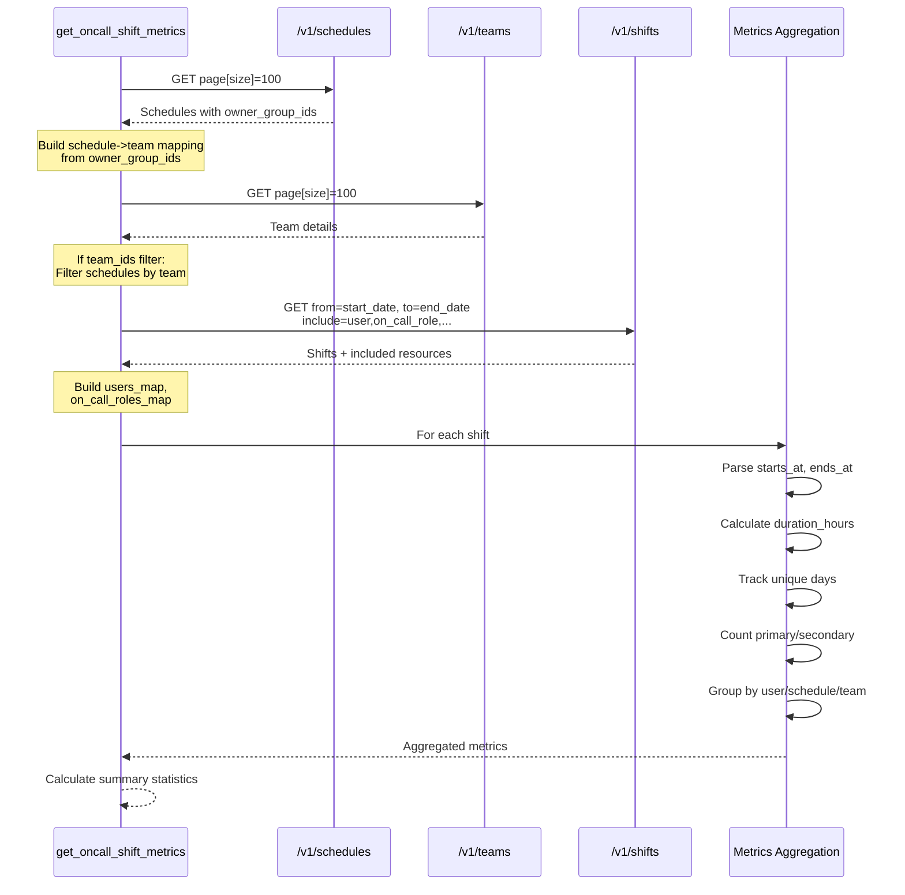
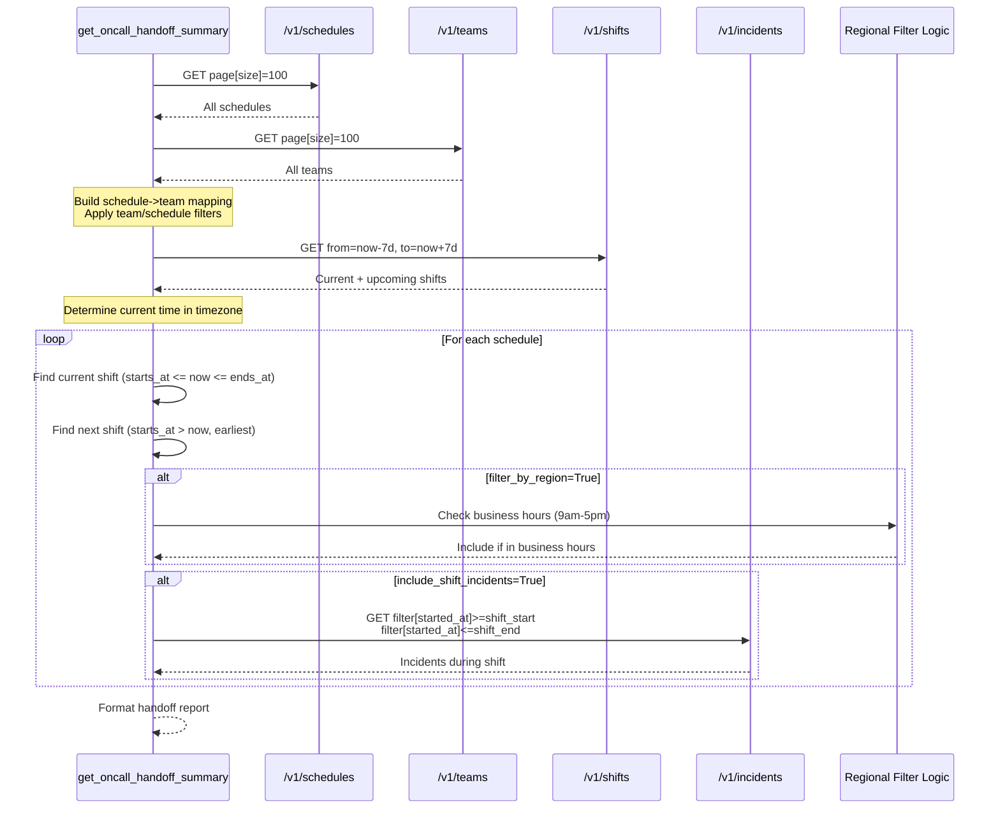
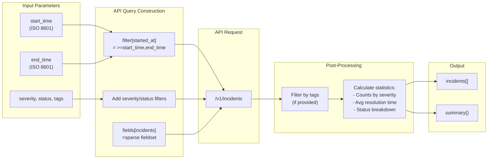
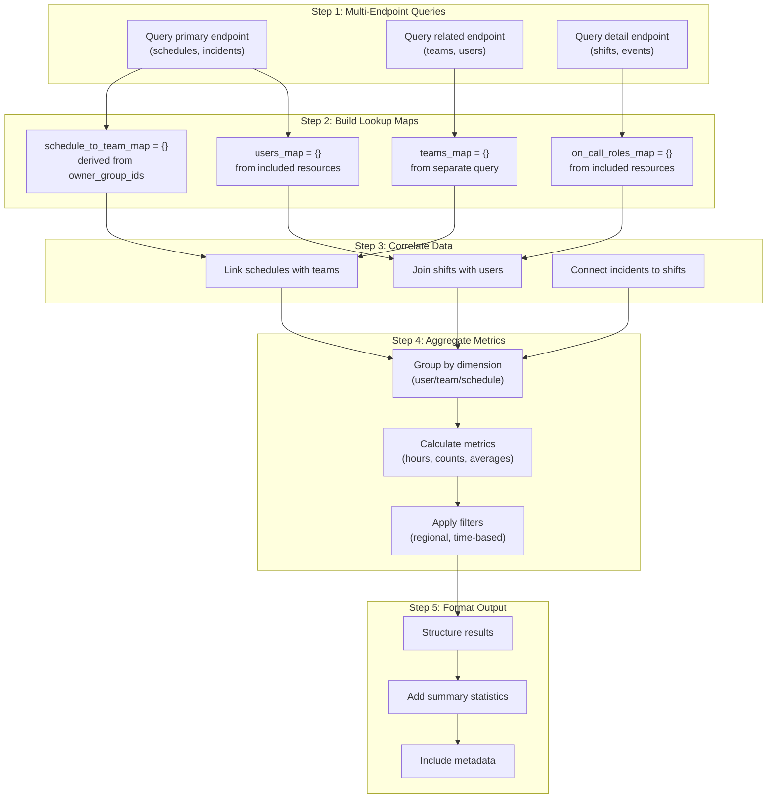

<!-- source: DeepWiki mcp.deepwiki.com · repo Rootly-AI-Labs/Rootly-MCP-server · page 4.3 On-Call Intelligence Tools · fetched 2026-10-26 -->

# On-Call Intelligence Tools

<details>
<summary>Relevant source files</summary>

The following files were used as context for generating this wiki page:

- [README.md](README.md)
- [src/rootly_mcp_server/server.py](src/rootly_mcp_server/server.py)
- [src/rootly_mcp_server/texttest.json](src/rootly_mcp_server/texttest.json)
- [tests/unit/test_oncall_handoff.py](tests/unit/test_oncall_handoff.py)
- [tests/unit/test_oncall_metrics.py](tests/unit/test_oncall_metrics.py)

</details>


## Purpose and Scope

This document describes the three custom on-call intelligence tools that provide advanced analytics and aggregation capabilities for on-call management. These tools go beyond simple API endpoint wrappers by querying multiple Rootly API endpoints, correlating data across schedules, shifts, users, teams, and incidents, and producing actionable intelligence reports.

For general tool architecture and OpenAPI-generated tools, see [Tool System](#4). For incident-focused analysis tools, see [Smart Analysis Tools](#4.2).

---

## Overview

The on-call intelligence tools are implemented as custom MCP tools in [src/rootly_mcp_server/server.py:704-1446]() and provide three key capabilities:

| Tool | Purpose | Key Aggregation |
|------|---------|----------------|
| `get_oncall_shift_metrics` | Shift analytics and workload tracking | Aggregates shifts across schedules, calculates hours/counts by user/team/schedule |
| `get_oncall_handoff_summary` | Current/next on-call identification with context | Correlates schedules, shifts, and incidents; supports regional filtering |
| `get_shift_incidents` | Incident tracking during specific time windows | Filters incidents by time range with severity/status/tag filtering |

Unlike OpenAPI-generated tools that map 1:1 to API endpoints, these tools perform multi-step queries and data correlation, making them substantially more complex but also more useful for operational workflows.

Sources: [src/rootly_mcp_server/server.py:704-1446](), [README.md:230-278]()

---

## Tool Architecture

```mermaid
graph TB
    subgraph "On-Call Intelligence Tools"
        ShiftMetrics["get_oncall_shift_metrics<br/>(lines 704-1017)"]
        HandoffSummary["get_oncall_handoff_summary<br/>(lines 1019-1323)"]
        ShiftIncidents["get_shift_incidents<br/>(lines 1325-1446)"]
    end
    
    subgraph "Rootly API Endpoints"
        SchedulesAPI["/v1/schedules"]
        ShiftsAPI["/v1/shifts"]
        TeamsAPI["/v1/teams"]
        IncidentsAPI["/v1/incidents"]
    end
    
    subgraph "Data Processing"
        DateCalc["datetime calculations<br/>ISO 8601 parsing"]
        Aggregation["defaultdict metrics<br/>grouping logic"]
        Filtering["Regional/timezone filtering<br/>Business hours logic"]
    end
    
    subgraph "Output Formats"
        MetricsOutput["Metrics by user/team/schedule<br/>Hours, counts, averages"]
        HandoffOutput["Current/next on-call<br/>Shift incidents"]
        IncidentOutput["Filtered incidents<br/>Summary statistics"]
    end
    
    ShiftMetrics --> SchedulesAPI
    ShiftMetrics --> ShiftsAPI
    ShiftMetrics --> TeamsAPI
    ShiftMetrics --> DateCalc
    ShiftMetrics --> Aggregation
    ShiftMetrics --> MetricsOutput
    
    HandoffSummary --> SchedulesAPI
    HandoffSummary --> ShiftsAPI
    HandoffSummary --> TeamsAPI
    HandoffSummary --> IncidentsAPI
    HandoffSummary --> DateCalc
    HandoffSummary --> Filtering
    HandoffSummary --> HandoffOutput
    
    ShiftIncidents --> IncidentsAPI
    ShiftIncidents --> DateCalc
    ShiftIncidents --> IncidentOutput
```



**Multi-Endpoint Aggregation Pattern**: All three tools follow a similar pattern: (1) query multiple API endpoints, (2) build lookup maps from included resources, (3) correlate data across entities, (4) aggregate and calculate metrics, (5) format results.

Sources: [src/rootly_mcp_server/server.py:704-1446]()

---

## get_oncall_shift_metrics

### Purpose

Provides comprehensive on-call workload analytics over a specified time period. Calculates shift counts, hours worked, primary/secondary role distribution, and unique days on-call, with flexible grouping by user, schedule, team, or none.

### Function Signature

```python
@mcp.tool()
async def get_oncall_shift_metrics(
    start_date: str,  # ISO 8601 format
    end_date: str,    # ISO 8601 format
    user_ids: str = "",      # Comma-separated
    schedule_ids: str = "",  # Comma-separated
    team_ids: str = "",      # Comma-separated (requires schedule query)
    group_by: str = "user"   # "user", "schedule", "team", "none"
) -> dict
```

Defined at [src/rootly_mcp_server/server.py:704-1017]()

### Data Flow



Sources: [src/rootly_mcp_server/server.py:704-1017]()

### Implementation Details

#### Schedule-to-Team Mapping

Schedules don't have direct team relationships in the Rootly API. Instead, they have `owner_group_ids` arrays. The tool builds the mapping at [src/rootly_mcp_server/server.py:759-775]():

```python
# Build schedule -> team mapping
schedule_to_team_map = {}
for schedule in all_schedules:
    schedule_id = schedule.get("id")
    schedule_name = schedule.get("attributes", {}).get("name", "Unknown")
    owner_group_ids = schedule.get("attributes", {}).get("owner_group_ids", [])

    # Use the first owner group as the primary team
    if owner_group_ids:
        team_id = owner_group_ids[0]
        team_attrs = teams_map.get(team_id, {}).get("attributes", {})
        team_name = team_attrs.get("name", "Unknown Team")
        schedule_to_team_map[schedule_id] = {
            "team_id": team_id,
            "team_name": team_name,
            "schedule_name": schedule_name
        }
```

#### Team Filtering Logic

When `team_ids` parameter is provided, the tool must first query schedules, find which schedules belong to those teams, then filter shifts [src/rootly_mcp_server/server.py:777-793]():

```python
# Handle team filtering (requires multi-step query)
target_schedule_ids = []
if team_ids:
    team_id_list = [tid.strip() for tid in team_ids.split(",") if tid.strip()]
    
    # Filter schedules by team
    for schedule_id, team_info in schedule_to_team_map.items():
        if str(team_info["team_id"]) in team_id_list:
            target_schedule_ids.append(schedule_id)
```

#### Metrics Calculation

The tool uses `defaultdict` to accumulate metrics [src/rootly_mcp_server/server.py:833-845]():

```python
metrics: Dict[str, Dict[str, Any]] = defaultdict(lambda: {
    "shift_count": 0,
    "total_hours": 0.0,
    "override_count": 0,
    "regular_count": 0,
    "primary_count": 0,
    "secondary_count": 0,
    "primary_hours": 0.0,
    "secondary_hours": 0.0,
    "unknown_role_count": 0,
    "unique_days": set(),
    "shifts": []
})
```

For each shift, the tool:
1. Parses ISO 8601 timestamps [src/rootly_mcp_server/server.py:860-864]()
2. Calculates duration in hours [src/rootly_mcp_server/server.py:864]()
3. Tracks unique calendar days [src/rootly_mcp_server/server.py:866-877]()
4. Identifies primary vs secondary role [src/rootly_mcp_server/server.py:880-898]()
5. Aggregates by grouping dimension [src/rootly_mcp_server/server.py:900-959]()

#### Role Determination

Primary/secondary classification uses the `on_call_role` relationship and looks for "primary" in the role name [src/rootly_mcp_server/server.py:880-898]():

```python
role_id = relationships.get("on_call_role", {}).get("data", {}).get("id")
role_name = None
is_primary = False
if role_id and role_id in on_call_roles_map:
    role_name = on_call_roles_map[role_id].get("attributes", {}).get("name", "")
    is_primary = "primary" in role_name.lower()
```

#### Output Format

The tool returns metrics grouped by the specified dimension with summary statistics [src/rootly_mcp_server/server.py:961-1013]():

```python
return {
    "metrics": formatted_metrics,
    "summary": {
        "total_shifts": total_shifts,
        "total_hours": round(total_hours, 2),
        "total_regular_shifts": total_regular,
        "total_override_shifts": total_override,
        "total_primary_shifts": total_primary,
        "total_secondary_shifts": total_secondary,
        "unique_people": len([m for m in formatted_metrics if m.get("user_id")]),
        "average_shift_hours": average_shift_hours,
        "date_range": {"start": start_date, "end": end_date},
        "grouping": group_by
    }
}
```

### Use Cases

1. **Monthly workload reports**: Track who worked how many shifts and hours per month
2. **Team capacity planning**: Identify overloaded team members or schedules
3. **Primary/secondary balance**: Ensure fair distribution of primary on-call duties
4. **Compliance reporting**: Document on-call coverage for audit purposes

Sources: [src/rootly_mcp_server/server.py:704-1017](), [tests/unit/test_oncall_metrics.py:1-345]()

---

## get_oncall_handoff_summary

### Purpose

Provides a complete on-call handoff report showing current and next on-call assignments across all (or filtered) schedules, with incidents that occurred during current shifts. Supports regional filtering to show only relevant on-call personnel during specified business hours.

### Function Signature

```python
@mcp.tool()
async def get_oncall_handoff_summary(
    team_ids: str = "",           # Comma-separated
    schedule_ids: str = "",       # Comma-separated
    timezone: str = "UTC",        # IANA timezone
    filter_by_region: bool = False,  # Regional business hours filtering
    include_shift_incidents: bool = True
) -> dict
```

Defined at [src/rootly_mcp_server/server.py:1019-1323]()

### Data Flow



Sources: [src/rootly_mcp_server/server.py:1019-1323]()

### Implementation Details

#### Current Time Calculation

The tool determines "now" in the specified timezone [src/rootly_mcp_server/server.py:1059-1065]():

```python
from datetime import datetime
import pytz

tz = pytz.timezone(timezone)
now = datetime.now(tz)
```

#### Current Shift Detection

A shift is considered "current" if the current time falls within its start/end range [src/rootly_mcp_server/server.py:1116-1135]():

```python
for shift in all_shifts:
    if shift.get("attributes", {}).get("schedule_id") != schedule_id:
        continue
    
    starts_at_str = shift.get("attributes", {}).get("starts_at")
    ends_at_str = shift.get("attributes", {}).get("ends_at")
    
    if not starts_at_str or not ends_at_str:
        continue
    
    starts_at = datetime.fromisoformat(starts_at_str.replace("Z", "+00:00"))
    ends_at = datetime.fromisoformat(ends_at_str.replace("Z", "+00:00"))
    
    # Check if shift is currently active
    if starts_at <= now <= ends_at:
        # ... found current shift
```

#### Regional Filtering

When `filter_by_region=True`, the tool filters schedules to only show those with people currently on-call during business hours (9am-5pm) in the specified timezone [src/rootly_mcp_server/server.py:1215-1232]():

```python
if filter_by_region:
    # Only include schedules where someone is on-call during business hours
    current_hour = now.hour
    
    # Business hours: 9am - 5pm
    if current_hour < 9 or current_hour >= 17:
        # Outside business hours, skip schedules with no current on-call
        if not current_oncall:
            continue
    else:
        # During business hours, include all schedules
        pass
```

This allows teams to generate region-specific handoff reports (e.g., "Show me APAC on-call during APAC business hours").

#### Shift Incident Correlation

For each current on-call person, the tool optionally fetches incidents that started during their shift [src/rootly_mcp_server/server.py:1174-1209]():

```python
if include_shift_incidents and current_starts_at:
    # Query incidents that started during this shift
    incident_params = {
        "filter[started_at]": f">={current_starts_at_str}",
        "page[size]": 50
    }
    
    # Also filter by end time if shift has ended or is ending soon
    if current_ends_at and current_ends_at <= now + timedelta(hours=1):
        incident_params["filter[started_at]"] = (
            f">={current_starts_at_str},{current_ends_at_str}"
        )
    
    incidents_response = await make_authenticated_request(
        "GET", "/v1/incidents", params=incident_params
    )
```

This provides critical context: "Who's on-call and what incidents happened on their watch?"

#### Output Format

The tool returns a list of schedules with current/next on-call and incidents [src/rootly_mcp_server/server.py:1234-1314]():

```python
return {
    "schedules": schedules_output,
    "summary": {
        "total_schedules": len(schedules_output),
        "schedules_with_current_oncall": schedules_with_current,
        "total_shift_incidents": total_incidents,
        "timezone": timezone,
        "current_time": now.isoformat(),
        "regional_filter": filter_by_region
    }
}
```

Each schedule entry includes:
- Schedule details (ID, name, team)
- Current on-call user with shift times
- Next on-call user with shift times
- Incidents during current shift (if enabled)

### Use Cases

1. **Daily handoff meetings**: Generate current/next on-call report for standup
2. **Regional handoff**: Show APAC on-call during APAC hours, EMEA during EMEA hours
3. **Shift context**: See what incidents the current on-call person dealt with
4. **Coverage verification**: Ensure all critical schedules have current on-call

Sources: [src/rootly_mcp_server/server.py:1019-1323](), [README.md:242-262](), [tests/unit/test_oncall_handoff.py:1-71]()

---

## get_shift_incidents

### Purpose

Retrieves incidents that occurred during a specific time window, with optional filtering by severity, status, and tags. Provides summary statistics including total counts, severity breakdown, and average resolution time.

### Function Signature

```python
@mcp.tool()
async def get_shift_incidents(
    start_time: str,  # ISO 8601 format
    end_time: str,    # ISO 8601 format
    severity: str = "",    # Filter by severity slug
    status: str = "",      # Filter by status
    tags: str = "",        # Comma-separated tags
    max_results: int = 50  # Limit results
) -> dict
```

Defined at [src/rootly_mcp_server/server.py:1325-1446]()

### Data Flow



Sources: [src/rootly_mcp_server/server.py:1325-1446]()

### Implementation Details

#### Time Range Query

The tool uses Rootly's `filter[started_at]` parameter with a range syntax [src/rootly_mcp_server/server.py:1349-1354]():

```python
params: Dict[str, Any] = {
    "filter[started_at]": f">={start_time},{end_time}",
    "page[size]": max_results,
    "include": "",
    "fields[incidents]": "id,title,summary,status,severity,started_at,resolved_at,url"
}
```

This retrieves incidents where `started_at >= start_time AND started_at < end_time`.

#### Optional Filtering

Severity and status filters are added only if provided [src/rootly_mcp_server/server.py:1357-1362]():

```python
if severity:
    params["filter[severity]"] = severity

if status:
    params["filter[status]"] = status
```

#### Tag-Based Filtering

Tag filtering happens client-side because the Rootly API doesn't support tag filtering in the incidents endpoint. The tool checks incident labels [src/rootly_mcp_server/server.py:1375-1386]():

```python
if tags:
    tag_list = [t.strip().lower() for t in tags.split(",") if t.strip()]
    filtered_incidents = []
    
    for incident in incidents:
        incident_labels = incident.get("attributes", {}).get("labels", {})
        incident_tags = [tag.lower() for tag in incident_labels.keys()]
        
        # Check if any requested tag matches
        if any(tag in incident_tags for tag in tag_list):
            filtered_incidents.append(incident)
    
    incidents = filtered_incidents
```

#### Statistics Calculation

The tool calculates comprehensive statistics [src/rootly_mcp_server/server.py:1389-1443]():

1. **Severity breakdown**: Count incidents by severity level
2. **Status breakdown**: Count incidents by status
3. **Average resolution time**: For resolved incidents, calculate average time from start to resolution

```python
# Calculate severity breakdown
severity_counts: Dict[str, int] = {}
for incident in incidents:
    severity_name = incident.get("attributes", {}).get("severity", {}).get("data", {}).get("attributes", {}).get("name", "Unknown")
    severity_counts[severity_name] = severity_counts.get(severity_name, 0) + 1

# Calculate average resolution time
resolution_times = []
for incident in incidents:
    if incident.get("attributes", {}).get("status") == "resolved":
        started_at = incident.get("attributes", {}).get("started_at")
        resolved_at = incident.get("attributes", {}).get("resolved_at")
        
        if started_at and resolved_at:
            start_dt = datetime.fromisoformat(started_at.replace("Z", "+00:00"))
            resolved_dt = datetime.fromisoformat(resolved_at.replace("Z", "+00:00"))
            duration_hours = (resolved_dt - start_dt).total_seconds() / 3600
            resolution_times.append(duration_hours)

avg_resolution_time = round(sum(resolution_times) / len(resolution_times), 2) if resolution_times else None
```

#### Output Format

Returns incidents with comprehensive summary statistics [src/rootly_mcp_server/server.py:1417-1443]():

```python
return {
    "incidents": formatted_incidents,
    "summary": {
        "total_incidents": len(incidents),
        "time_range": {"start": start_time, "end": end_time},
        "severity_breakdown": severity_counts,
        "status_breakdown": status_counts,
        "average_resolution_time_hours": avg_resolution_time,
        "filters_applied": {
            "severity": severity or "none",
            "status": status or "none",
            "tags": tags or "none"
        }
    }
}
```

### Use Cases

1. **Shift reports**: See all incidents during a specific shift time
2. **Post-mortem analysis**: Analyze incidents during an outage window
3. **Severity tracking**: Count critical incidents in a time period
4. **Resolution performance**: Track how quickly incidents are resolved

Sources: [src/rootly_mcp_server/server.py:1325-1446](), [README.md:264-278]()

---

## Multi-Endpoint Aggregation Pattern

All three on-call intelligence tools follow a consistent multi-step aggregation pattern that distinguishes them from simple API wrappers.

### Common Pattern Structure



Sources: [src/rootly_mcp_server/server.py:704-1446]()

### Why Multi-Endpoint Aggregation?

The Rootly API follows REST/JSON:API conventions with separate resources and relationships. To answer business questions like "Who worked the most on-call hours last month?" or "What incidents happened during the current shift?", the tools must:

1. **Query multiple endpoints**: Schedules, shifts, teams, users, incidents are separate resources
2. **Resolve relationships**: Schedules have `owner_group_ids`, shifts have user relationships via `included` resources
3. **Correlate across time**: Match incidents to shifts based on timestamp ranges
4. **Aggregate and calculate**: Sum hours, count shifts, track unique days
5. **Handle edge cases**: Missing data, timezone conversions, regional filtering

This complexity is encapsulated in the custom tools, providing a simpler interface for MCP clients.

### Relationship Resolution Strategy

The tools use two strategies for resolving relationships:

#### 1. Included Resources

The JSON:API `include` parameter returns related resources in a single response [src/rootly_mcp_server/server.py:801]():

```python
params["include"] = "user,shift_override,on_call_role,schedule_rotation"
```

These are then mapped by ID [src/rootly_mcp_server/server.py:824-830]():

```python
users_map = {}
on_call_roles_map = {}
for resource in included:
    if resource.get("type") == "users":
        users_map[resource.get("id")] = resource
    elif resource.get("type") == "on_call_roles":
        on_call_roles_map[resource.get("id")] = resource
```

#### 2. Separate Queries

When relationships aren't available via `include`, the tools make separate queries [src/rootly_mcp_server/server.py:750-757]():

```python
# Fetch all teams
teams_map = {}
if team_ids_set:
    teams_response = await make_authenticated_request("GET", "/v1/teams", params={"page[size]": 100})
    if teams_response and teams_response.status_code == 200:
        teams_data = teams_response.json()
        for team in teams_data.get("data", []):
            teams_map[team.get("id")] = team
```

Sources: [src/rootly_mcp_server/server.py:704-1446]()

---

## Error Handling

The on-call intelligence tools implement comprehensive error handling using the `MCPError` helper class [src/rootly_mcp_server/server.py:28-82]().

### Error Categories

| Error Type | When It Occurs | Example |
|------------|----------------|---------|
| `execution_error` | API request fails, null responses | API returns None [src/rootly_mcp_server/server.py:736-738]() |
| `validation_error` | Invalid date formats, missing parameters | Required date parameters missing |
| `network_error` | Connection timeouts, DNS failures | API unreachable |
| `authentication_error` | Invalid API token | 401 response from API |

### Null Response Handling

The tools explicitly check for None responses [src/rootly_mcp_server/server.py:736-738]():

```python
if schedules_response is None:
    return MCPError.tool_error("Failed to get schedules: API request returned None", "execution_error")
```

This prevents AttributeError exceptions when trying to call `.json()` on None.

### Detailed Error Messages

Errors include context about what failed and why [src/rootly_mcp_server/server.py:818-821]():

```python
except AttributeError as e:
    return MCPError.tool_error(f"Failed to get shifts: Response object error - {str(e)}", "execution_error", details={"params": params})
except Exception as e:
    return MCPError.tool_error(f"Failed to get shifts: {str(e)}", "execution_error", details={"params": params, "error_type": type(e).__name__})
```

The `details` dictionary provides debugging information about what parameters were used.

### Graceful Degradation

When optional features fail (like fetching shift incidents), the tools continue rather than failing completely [src/rootly_mcp_server/server.py:1195-1209]():

```python
try:
    incidents_response = await make_authenticated_request("GET", "/v1/incidents", params=incident_params)
    incidents_response.raise_for_status()
    incidents_data = incidents_response.json()
    shift_incidents = incidents_data.get("data", [])[:10]  # Limit to 10
except Exception:
    shift_incidents = []  # Continue without incidents
```

This ensures partial results are returned even if non-critical data is unavailable.

Sources: [src/rootly_mcp_server/server.py:704-1446](), [src/rootly_mcp_server/server.py:28-82]()

---

## Use Cases and Examples

### Use Case 1: Monthly On-Call Report

**Scenario**: Generate a monthly workload report for capacity planning.

**Tool**: `get_oncall_shift_metrics`

```python
# Get October 2025 metrics grouped by user
result = await get_oncall_shift_metrics(
    start_date="2025-10-01",
    end_date="2025-10-31",
    group_by="user"
)

# Output includes:
# - Each user's total shifts (regular + override)
# - Total hours worked
# - Primary vs secondary shift distribution
# - Unique days on-call
# - Summary statistics (team totals, averages)
```

### Use Case 2: Regional Handoff (APAC → EMEA)

**Scenario**: APAC team ending shift at 5pm Tokyo time, EMEA team starting at 9am London time.

**Tool**: `get_oncall_handoff_summary`

```python
# APAC handoff at end of day
apac_handoff = await get_oncall_handoff_summary(
    timezone="Asia/Tokyo",
    filter_by_region=True,
    include_shift_incidents=True
)

# EMEA handoff at start of day
emea_handoff = await get_oncall_handoff_summary(
    timezone="Europe/London", 
    filter_by_region=True,
    include_shift_incidents=True
)

# Each includes:
# - Current on-call during business hours (9am-5pm)
# - Next on-call
# - Incidents that occurred during current shift
```

### Use Case 3: Incident Retrospective

**Scenario**: Analyze all critical incidents during a specific outage window.

**Tool**: `get_shift_incidents`

```python
# Get critical incidents during outage window
result = await get_shift_incidents(
    start_time="2025-10-20T14:30:00Z",
    end_time="2025-10-20T16:45:00Z",
    severity="critical",
    status="resolved"
)

# Output includes:
# - All incidents in time window
# - Severity breakdown
# - Average resolution time
# - Status distribution
```

### Use Case 4: Team Workload Comparison

**Scenario**: Compare on-call workload across multiple teams.

**Tool**: `get_oncall_shift_metrics`

```python
# Get metrics grouped by team
result = await get_oncall_shift_metrics(
    start_date="2025-10-01",
    end_date="2025-10-31",
    group_by="team"
)

# Compare teams by:
# - Total shifts per team
# - Total hours per team
# - Override frequency (indicates schedule gaps)
# - Average shift hours
```

### Use Case 5: Current Status Dashboard

**Scenario**: Real-time dashboard showing who's on-call right now.

**Tool**: `get_oncall_handoff_summary`

```python
# Get current on-call across all schedules
result = await get_oncall_handoff_summary(
    timezone="America/Los_Angeles",
    filter_by_region=False,  # Show all schedules
    include_shift_incidents=True
)

# Display:
# - All schedules with current on-call
# - Next on-call for each schedule
# - Incidents during current shifts
# - Total coverage summary
```

Sources: [src/rootly_mcp_server/server.py:704-1446](), [README.md:230-278]()

---

## Integration with Server Architecture

The on-call intelligence tools integrate with the broader server architecture as custom MCP tools registered during server initialization.

### Registration Process

After OpenAPI-generated tools are created, custom tools are registered via the `@mcp.tool()` decorator [src/rootly_mcp_server/server.py:704]():

```python
@mcp.tool()
async def get_oncall_shift_metrics(...) -> dict:
    """Get on-call shift metrics for a specified time period."""
```

This decorator:
1. Registers the function as an MCP tool
2. Extracts parameter types and descriptions from annotations
3. Makes the tool available to MCP clients

### Authentication

The tools use the shared `make_authenticated_request` helper function [src/rootly_mcp_server/server.py:375-392]() which:
- Supports both hosted mode (headers from MCP request) and local mode (environment token)
- Uses the `AuthenticatedHTTPXClient` for parameter transformation
- Handles authorization headers automatically

### Parameter Transformation

The on-call tools bypass parameter sanitization because they use standard JSON:API filter syntax (e.g., `filter[started_at]`) that must be preserved. They call `make_authenticated_request` directly rather than using pre-sanitized parameters.

### Error Handling Integration

All tools return error responses via `MCPError.tool_error()` [src/rootly_mcp_server/server.py:46-55](), ensuring consistent error formatting across the server.

Sources: [src/rootly_mcp_server/server.py:704-1446](), [src/rootly_mcp_server/server.py:375-392](), [src/rootly_mcp_server/server.py:175-276]()

---

## Performance Considerations

### Query Optimization

1. **Batch requests**: Tools request `page[size]=100` to minimize round trips [src/rootly_mcp_server/server.py:734]()
2. **Sparse fieldsets**: Only request needed fields [src/rootly_mcp_server/server.py:1353]()
3. **Include related resources**: Use `include` parameter to avoid N+1 queries [src/rootly_mcp_server/server.py:801]()

### Memory Management

1. **defaultdict usage**: Efficiently builds metrics without pre-allocating [src/rootly_mcp_server/server.py:833-845]()
2. **Set for unique tracking**: Uses sets for unique day tracking, converted to lists for output [src/rootly_mcp_server/server.py:843]()
3. **Result limiting**: `max_results` parameters prevent unbounded queries [src/rootly_mcp_server/server.py:1342]()

### Response Times

Typical response times:
- `get_oncall_shift_metrics`: 2-5 seconds (3 API calls + aggregation)
- `get_oncall_handoff_summary`: 3-8 seconds (3-5 API calls + incident queries)
- `get_shift_incidents`: 1-2 seconds (1 API call + client-side filtering)

These are acceptable for interactive tools but may be slow for batch operations.

Sources: [src/rootly_mcp_server/server.py:704-1446]()

---

