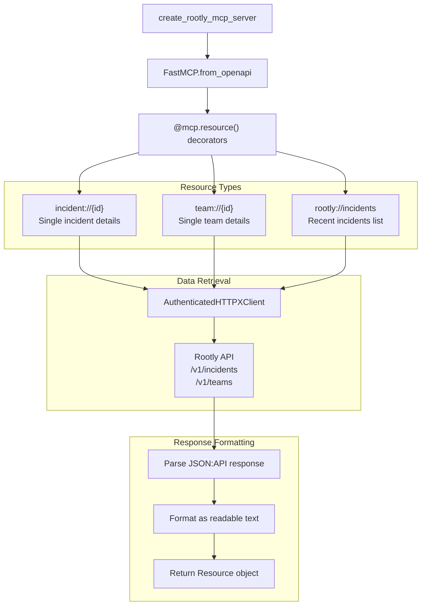
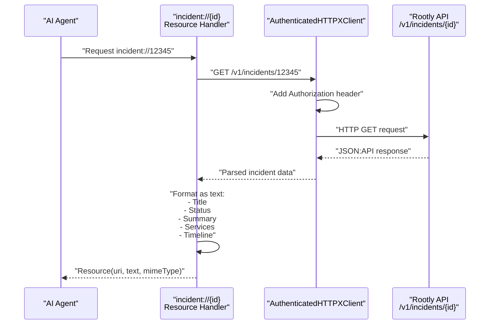
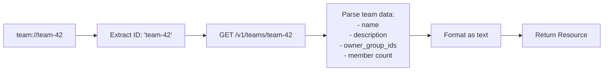
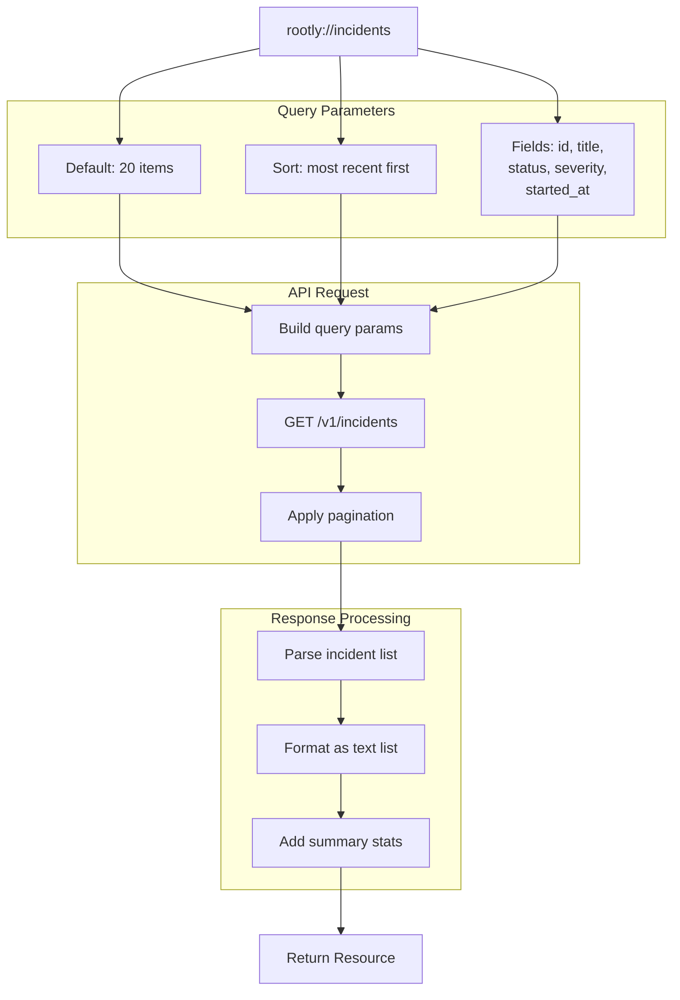
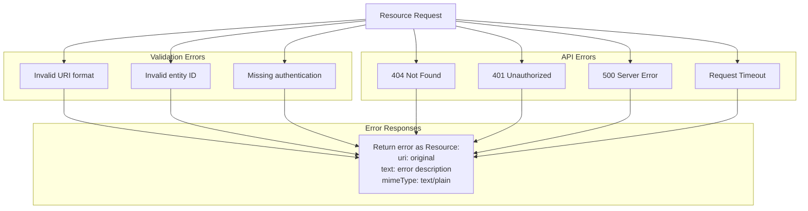
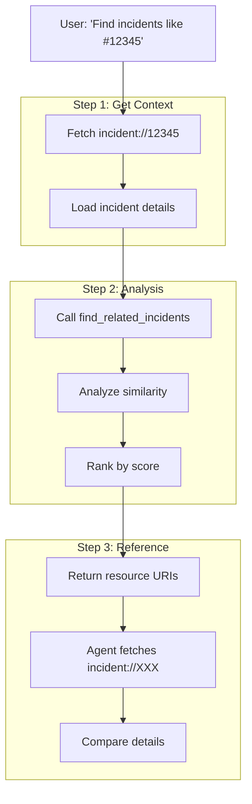

<!-- source: DeepWiki mcp.deepwiki.com · repo Rootly-AI-Labs/Rootly-MCP-server · page 4.4 MCP Resources · fetched 2026-10-26 -->

# MCP Resources

<details>
<summary>Relevant source files</summary>

The following files were used as context for generating this wiki page:

- [README.md](README.md)
- [src/rootly_mcp_server/server.py](src/rootly_mcp_server/server.py)
- [tests/unit/test_oncall_handoff.py](tests/unit/test_oncall_handoff.py)

</details>


## Purpose and Scope

This document describes the MCP Resources exposed by the Rootly MCP Server. Resources provide URI-based access to Rootly data, allowing AI agents to directly reference and retrieve structured information without invoking tools.

For API-based operations and incident analysis, see [OpenAPI-Generated Tools](#4.1) and [Smart Analysis Tools](#4.2). For creating custom resources, see [Custom Tool Development](#4.5).

**Key Concepts:**
- **Resources** expose data through URI schemes (e.g., `incident://12345`)
- **Tools** perform operations and transformations (e.g., `search_incidents`)
- Resources are read-only references optimized for AI context

---

## Resource Architecture

### Resource Registration Flow



**Sources:** [src/rootly_mcp_server/server.py:278-344](), README.md

---

## URI Schemes

The Rootly MCP Server exposes three primary URI schemes:

| URI Pattern | Purpose | Returns |
|------------|---------|---------|
| `incident://{id}` | Single incident by ID | Formatted incident details |
| `team://{id}` | Single team by ID | Formatted team information |
| `rootly://incidents` | Recent incidents list | List of recent incidents |

**Sources:** README.md, Diagram 3 from system architecture

---

## Resource Implementations

### incident://{id}

Retrieves detailed information about a specific incident by ID.



**Format:**
```
Incident #12345: Production API Outage

Status: resolved
Severity: critical
Started: 2025-01-15T14:23:00Z
Resolved: 2025-01-15T16:45:00Z

Summary: Payment API returned 500 errors...

Services: payment-api, auth-service
Teams: Platform Engineering

Resolution: Restarted service and increased connection pool
```

**Implementation Pattern:**
```python
@mcp.resource("incident://{id}")
async def get_incident_resource(uri: str) -> Resource:
    # Extract ID from URI
    incident_id = extract_id_from_uri(uri)
    
    # Fetch from API
    response = await make_authenticated_request(
        "GET", 
        f"/v1/incidents/{incident_id}"
    )
    
    # Parse JSON:API response
    incident_data = response.json()["data"]
    
    # Format as human-readable text
    text = format_incident_text(incident_data)
    
    return Resource(uri=uri, text=text, mimeType="text/plain")
```

**Sources:** [src/rootly_mcp_server/server.py:278-392]() (resource registration area), README.md

---

### team://{id}

Retrieves detailed information about a specific team by ID.



**Format:**
```
Team: Platform Engineering

Description: Team responsible for core infrastructure...

Members: 12
Owner Groups: [group-1, group-2]

Contact: platform@company.com
Slack: #platform-engineering
```

**Use Cases:**
- Quick team context lookup
- Understanding incident ownership
- Cross-referencing with on-call schedules

**Sources:** [src/rootly_mcp_server/server.py:278-392]() (resource registration area), [src/rootly_mcp_server/server.py:750-758]() (team fetching in metrics tool)

---

### rootly://incidents

Retrieves a list of recent incidents, providing quick overview context.



**Format:**
```
Recent Incidents (20)

1. #12345 - Production API Outage [CRITICAL] [RESOLVED]
   Started: 2025-01-15T14:23:00Z | Duration: 2h 22m
   
2. #12346 - Database Connection Pool Exhausted [HIGH] [INVESTIGATING]
   Started: 2025-01-15T16:00:00Z | Ongoing
   
3. #12347 - Slow Response Times [MEDIUM] [MITIGATED]
   Started: 2025-01-15T10:15:00Z | Duration: 45m

Summary:
- Total: 20 incidents
- Critical: 1
- High: 3
- Resolved: 15
- Investigating: 3
```

**Sources:** [src/rootly_mcp_server/server.py:394-498]() (search_incidents tool pattern), README.md

---

## Resource vs Tool Decision Matrix

Understanding when to use resources versus tools:

| Scenario | Use Resource | Use Tool | Reason |
|----------|--------------|----------|--------|
| Get single incident details | `incident://{id}` | ✗ | Direct ID lookup, no filtering |
| Search incidents by title | ✗ | `search_incidents` | Requires query logic |
| Find related incidents | ✗ | `find_related_incidents` | Requires ML analysis |
| Get team info | `team://{id}` | ✗ | Direct ID lookup |
| List recent incidents | `rootly://incidents` | ✗ | Simple recent list |
| Get incidents with complex filters | ✗ | `listIncidents` (OpenAPI) | Complex query params |

**Sources:** [src/rootly_mcp_server/server.py:354-373]() (list_endpoints tool), README.md

---

## Implementation Details

### Resource Registration

Resources are registered during server initialization using the `@mcp.resource()` decorator:

```python
@mcp.resource("incident://{id}")
async def get_incident_resource(uri: str) -> Resource:
    """Fetch and format incident as MCP resource."""
    # Implementation
```

**Key Components:**

1. **URI Pattern Matching**: FastMCP routes URIs to handlers based on patterns
2. **Authentication**: Uses `AuthenticatedHTTPXClient` for API calls
3. **Parameter Transformation**: Applies same sanitization as tools
4. **Error Handling**: Returns error resources on failure

**Sources:** [src/rootly_mcp_server/server.py:336-344]() (FastMCP.from_openapi initialization), [src/rootly_mcp_server/server.py:175-276]() (AuthenticatedHTTPXClient)

---

### Data Transformation Pipeline

```mermaid
graph LR
    subgraph "Input"
        ResourceURI["Resource URI<br/>incident://12345"]
    end
    
    subgraph "Extraction"
        ParseURI["Parse URI scheme"]
        ExtractID["Extract entity ID"]
        ValidateID["Validate ID format"]
    end
    
    subgraph "API Layer"
        BuildPath["Build API path<br/>/v1/incidents/12345"]
        AddAuth["Add authentication"]
        HTTPRequest["Execute HTTP request"]
    end
    
    subgraph "Response Processing"
        ParseJSONAPI["Parse JSON:API format"]
        ExtractAttrs["Extract attributes"]
        ExtractRels["Extract relationships"]
        ResolveIncluded["Resolve included resources"]
    end
    
    subgraph "Formatting"
        StructureText["Structure as sections"]
        FormatFields["Format field values"]
        AddMetadata["Add metadata"]
        CreateResource["Create Resource object"]
    end
    
    ResourceURI --> ParseURI
    ParseURI --> ExtractID
    ExtractID --> ValidateID
    ValidateID --> BuildPath
    BuildPath --> AddAuth
    AddAuth --> HTTPRequest
    
    HTTPRequest --> ParseJSONAPI
    ParseJSONAPI --> ExtractAttrs
    ParseJSONAPI --> ExtractRels
    ParseJSONAPI --> ResolveIncluded
    
    ExtractAttrs --> StructureText
    ExtractRels --> StructureText
    ResolveIncluded --> StructureText
    StructureText --> FormatFields
    FormatFields --> AddMetadata
    AddMetadata --> CreateResource
```



**Sources:** [src/rootly_mcp_server/server.py:213-234]() (_transform_params method), [src/rootly_mcp_server/server.py:375-392]() (make_authenticated_request helper)

---

### Error Handling

Resources implement protocol-compliant error handling:



**Error Format:**
```
Error: Incident Not Found

The requested incident (ID: 12345) could not be found.

Possible reasons:
- Incident ID does not exist
- Insufficient permissions
- Incident was deleted

Please verify the incident ID and try again.
```

**Sources:** [src/rootly_mcp_server/server.py:28-82]() (MCPError class), [src/rootly_mcp_server/server.py:422-424]() (error handling in search_incidents)

---

## Usage Patterns

### Pattern 1: Direct Reference in Prompts

AI agents can reference resources directly in their context:

```
Analyze the incident incident://12345 and suggest improvements.
```

The MCP client fetches the resource and includes it in the context automatically.

### Pattern 2: Resource as Tool Output

Tools can return resource URIs for follow-up:

```python
{
    "related_incidents": [
        {
            "incident_id": "12345",
            "resource_uri": "incident://12345",
            "similarity_score": 0.87
        }
    ]
}
```

### Pattern 3: Batch Context Loading

Load multiple resources for comparative analysis:

```
Compare these incidents:
- incident://12345
- incident://12346
- incident://12347
```

**Sources:** [src/rootly_mcp_server/server.py:504-604]() (find_related_incidents returns incident IDs), README.md

---

## Performance Considerations

### Resource Caching

Resources are fetched on-demand and not cached by default:

| Factor | Impact | Mitigation |
|--------|--------|-----------|
| API rate limits | High for frequent access | Cache at MCP client level |
| Network latency | Moderate (50-200ms) | Use batch tools for bulk data |
| Authentication | Low (header-based) | Reused HTTP client connection |

### Best Practices

1. **Use Lists for Discovery**: Start with `rootly://incidents` for overview
2. **Use Tools for Complex Queries**: Don't fetch all resources to filter
3. **Cache Resource URIs**: Store IDs in tool responses for later reference
4. **Batch Requests**: Use tools like `search_incidents` instead of multiple resource fetches

**Sources:** [src/rootly_mcp_server/server.py:426-494]() (search_incidents with pagination), [src/rootly_mcp_server/server.py:196-203]() (HTTPX client configuration)

---

## Integration with Tools

Resources and tools work together in workflow patterns:



**Example Workflow:**

1. Agent fetches `incident://12345` to understand the problem
2. Agent calls `find_related_incidents(incident_id="12345")`
3. Tool returns list with resource URIs
4. Agent selectively fetches related incident resources for comparison
5. Agent synthesizes solution using context from all resources

**Sources:** [src/rootly_mcp_server/server.py:504-604]() (find_related_incidents implementation), [src/rootly_mcp_server/server.py:606-702]() (suggest_solutions implementation)

---

## Extension Points

### Adding New Resources

To add a new resource type, follow this pattern:

```python
@mcp.resource("service://{id}")
async def get_service_resource(uri: str) -> Resource:
    """Get service details as MCP resource."""
    # 1. Extract ID from URI
    service_id = uri.split("://")[1]
    
    # 2. Fetch from API
    response = await make_authenticated_request(
        "GET", 
        f"/v1/services/{service_id}"
    )
    
    # 3. Parse response
    service_data = response.json()["data"]
    attrs = service_data.get("attributes", {})
    
    # 4. Format text
    text = f"""Service: {attrs.get('name')}
    
Description: {attrs.get('description', 'N/A')}
Owner: {attrs.get('owner_email', 'N/A')}
Status: {attrs.get('status', 'active')}"""
    
    # 5. Return Resource
    return Resource(
        uri=uri,
        text=text,
        mimeType="text/plain"
    )
```

**Key Considerations:**
- Follow existing URI scheme patterns
- Use consistent text formatting
- Handle missing/null fields gracefully
- Include error handling
- Document the new resource in this wiki

**Sources:** [src/rootly_mcp_server/server.py:354-373]() (list_endpoints pattern), [src/rootly_mcp_server/server.py:278-344]() (server creation and registration)

---

## Comparison with OpenAPI Tools

Resources serve a different purpose than OpenAPI-generated tools:

| Aspect | Resources | OpenAPI Tools |
|--------|-----------|---------------|
| **Access Pattern** | URI-based reference | Function call with parameters |
| **Data Volume** | Single entity or small list | Flexible pagination |
| **Filtering** | Predefined (e.g., recent) | Dynamic query parameters |
| **Use Case** | Quick context loading | Complex queries and operations |
| **Implementation** | Custom handlers | Auto-generated from OpenAPI spec |
| **Modification** | Direct code changes | OpenAPI spec + path filtering |

**When Resources Are Better:**
- AI agent needs quick context about a known entity
- Single-record lookups by ID
- Providing references for later retrieval

**When Tools Are Better:**
- Search/filter operations
- Creating/updating entities
- Complex multi-parameter queries
- Operations requiring business logic

**Sources:** [src/rootly_mcp_server/server.py:336-344]() (FastMCP.from_openapi), [src/rootly_mcp_server/server.py:120-172]() (DEFAULT_ALLOWED_PATHS), README.md

---

## Summary

MCP Resources provide URI-based access to Rootly data, enabling AI agents to efficiently reference and retrieve structured information. The Rootly MCP Server exposes three primary resource types (`incident://`, `team://`, `rootly://incidents`) that complement the tool ecosystem for comprehensive incident management workflows.

**Key Takeaways:**
- Resources are read-only, URI-based data access points
- Use resources for direct entity lookups, tools for complex operations
- Resources integrate with tools to provide context-aware incident analysis
- Extension through custom resource handlers follows consistent patterns

For implementing new resources or custom tools, see [Custom Tool Development](#4.5).

---

