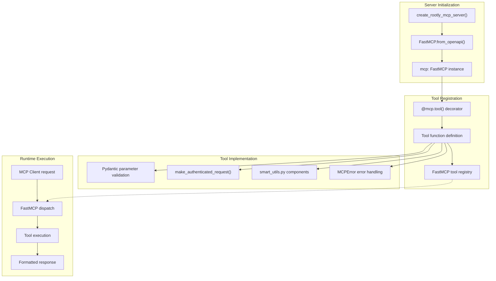
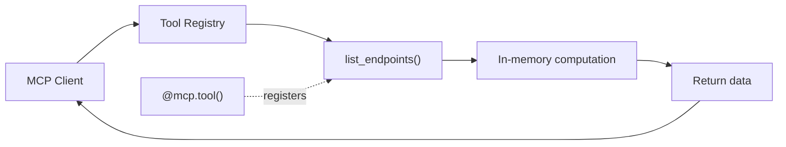
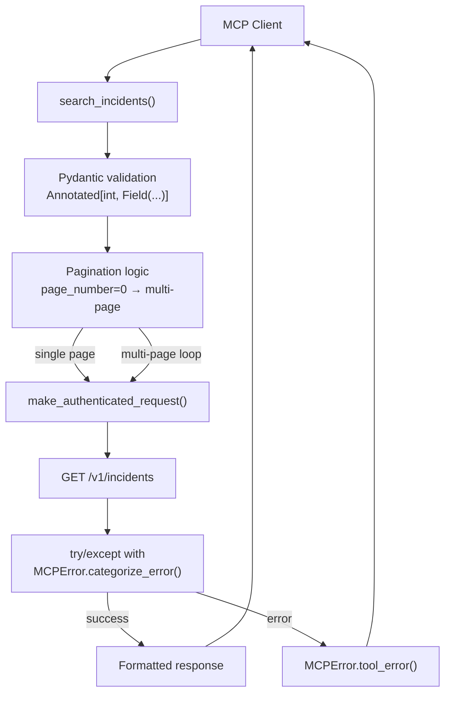
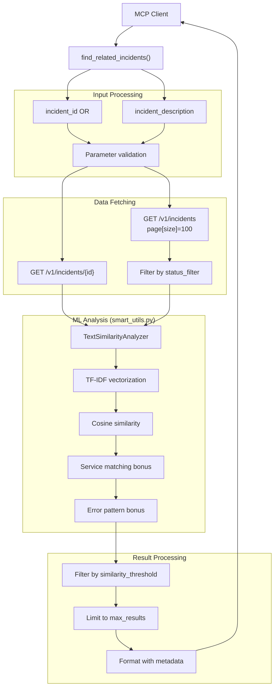
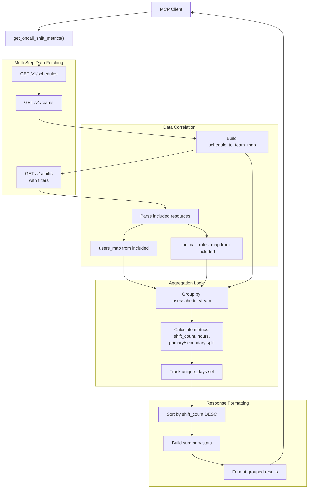
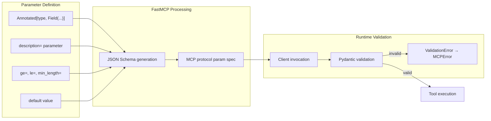
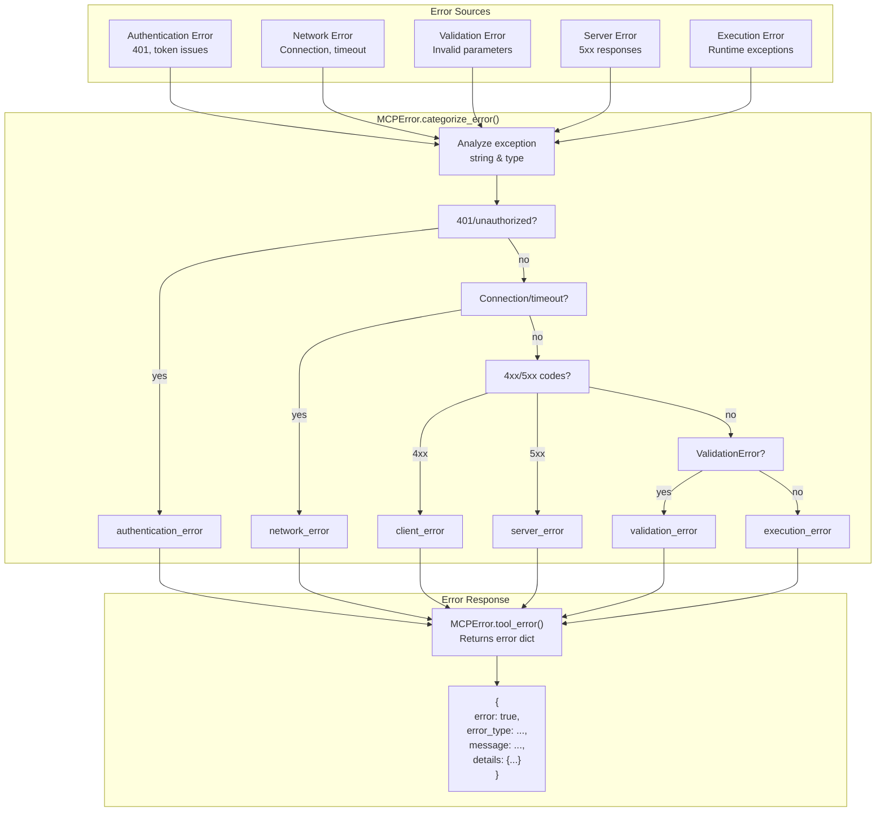
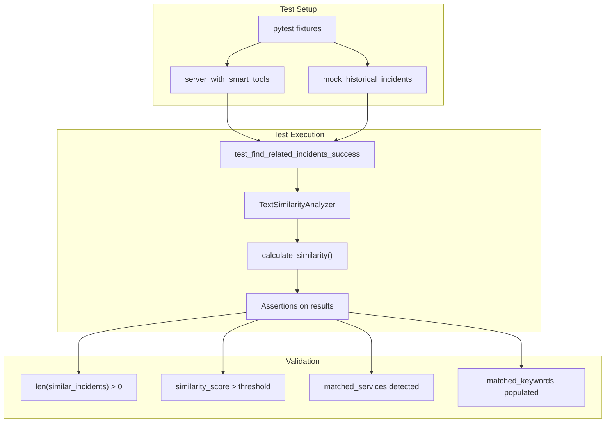

<!-- source: DeepWiki mcp.deepwiki.com · repo Rootly-AI-Labs/Rootly-MCP-server · page 4.5 Custom Tool Development · fetched 2026-10-26 -->

# Custom Tool Development

<details>
<summary>Relevant source files</summary>

The following files were used as context for generating this wiki page:

- [src/rootly_mcp_server/server.py](src/rootly_mcp_server/server.py)
- [src/rootly_mcp_server/smart_utils.py](src/rootly_mcp_server/smart_utils.py)
- [tests/integration/local/test_smart_tools.py](tests/integration/local/test_smart_tools.py)
- [tests/unit/test_smart_utils.py](tests/unit/test_smart_utils.py)

</details>


This document provides a comprehensive guide for developing custom MCP tools in the Rootly MCP Server. Custom tools extend the auto-generated OpenAPI tools with specialized functionality like AI-powered analysis, multi-endpoint aggregation, and enhanced user experiences.

For information about auto-generated tools from OpenAPI specifications, see [OpenAPI-Generated Tools](#4.1). For details on the existing smart analysis and on-call tools, see [Smart Analysis Tools](#4.2) and [On-Call Intelligence Tools](#4.3).

## Overview

Custom tools in the Rootly MCP Server are Python functions decorated with `@mcp.tool()` that provide functionality beyond direct API endpoint mapping. They enable:

- **Enhanced User Experience**: Simplified interfaces with smart defaults (e.g., pagination, filtering)
- **AI-Powered Analysis**: Machine learning-based similarity detection and pattern matching
- **Data Aggregation**: Combining data from multiple API endpoints into unified responses
- **Domain Logic**: Business logic that operates on top of raw API data

All custom tools are registered in [src/rootly_mcp_server/server.py:354-1310]() within the `create_rootly_mcp_server` function.

Sources: [src/rootly_mcp_server/server.py:278-1310]()

## Tool Registration Architecture



**Tool Registration Flow**: Custom tools are registered after the FastMCP server is initialized from the OpenAPI spec. The `@mcp.tool()` decorator registers the function in FastMCP's tool registry, making it available to MCP clients. At runtime, client requests are dispatched to the appropriate tool function with automatic parameter validation.

Sources: [src/rootly_mcp_server/server.py:278-373](), [src/rootly_mcp_server/server.py:394-703]()

## Tool Patterns and Examples

### Pattern 1: Simple Utility Tools

Simple tools provide utility functionality without external API calls. These are synchronous and return computed data.



**Example: list_endpoints**

The `list_endpoints` tool [src/rootly_mcp_server/server.py:354-373]() iterates over the filtered OpenAPI spec to return available endpoints:

| Aspect | Implementation |
|--------|----------------|
| **Pattern** | Synchronous utility function |
| **Inputs** | None (uses `filtered_spec` from closure) |
| **Processing** | Iterates `filtered_spec["paths"]` dictionary |
| **Output** | List of endpoint metadata dicts |
| **Error Handling** | None needed (pure computation) |

```python
@mcp.tool()
def list_endpoints() -> list:
    """List all available Rootly API endpoints with their descriptions."""
    endpoints = []
    for path, path_item in filtered_spec.get("paths", {}).items():
        for method, operation in path_item.items():
            if method.lower() not in ["get", "post", "put", "delete", "patch"]:
                continue
            # Extract metadata...
    return endpoints
```

Sources: [src/rootly_mcp_server/server.py:354-373]()

### Pattern 2: API Wrapper Tools

API wrapper tools enhance direct API calls with smart defaults, pagination, and error handling. These are asynchronous and use `make_authenticated_request`.



**Example: search_incidents**

The `search_incidents` tool [src/rootly_mcp_server/server.py:394-498]() demonstrates the wrapper pattern with intelligent pagination:

| Feature | Implementation |
|---------|----------------|
| **Smart Defaults** | `page_size=10`, `max_results=5` with validation constraints |
| **Pagination Modes** | Single page (`page_number > 0`) or multi-page (`page_number = 0`) |
| **Parameter Validation** | `Annotated[int, Field(description="...", ge=1, le=20)]` |
| **Field Selection** | `fields[incidents]` to minimize response size |
| **Error Handling** | `MCPError.categorize_error()` for consistent error responses |

**Key implementation details:**

```python
@mcp.tool()
async def search_incidents(
    query: Annotated[str, Field(description="Search query...")] = "",
    page_size: Annotated[int, Field(ge=1, le=20)] = 10,
    page_number: Annotated[int, Field(ge=0)] = 1,
    max_results: Annotated[int, Field(ge=1, le=10)] = 5,
) -> dict:
    """Search incidents with flexible pagination control."""
    # Single page mode
    if page_number > 0:
        # Direct API call...
        
    # Multi-page mode (page_number = 0)
    while len(all_incidents) < max_results and current_page <= max_pages:
        # Loop with pagination...
```

Sources: [src/rootly_mcp_server/server.py:394-498]()

### Pattern 3: AI-Powered Analysis Tools

AI-powered tools use machine learning components from `smart_utils.py` to provide intelligent analysis. These tools combine API data with ML processing.



**Example: find_related_incidents**

The `find_related_incidents` tool [src/rootly_mcp_server/server.py:504-604]() demonstrates AI-powered analysis:

| Component | Implementation |
|-----------|----------------|
| **Input Modes** | Accepts `incident_id` OR `incident_description` text |
| **ML Analysis** | `TextSimilarityAnalyzer.calculate_similarity()` |
| **Similarity Algorithm** | TF-IDF + cosine similarity + service/error bonuses |
| **Threshold Filtering** | `similarity_threshold` parameter (default 0.15) |
| **Result Enrichment** | Matched services, keywords, resolution data |

**Integration with smart_utils.py:**

```python
# Initialize analyzer (once per server)
similarity_analyzer = TextSimilarityAnalyzer()

@mcp.tool()
async def find_related_incidents(...) -> dict:
    # Fetch target and historical incidents...
    
    # Calculate similarities using ML
    similar_incidents = similarity_analyzer.calculate_similarity(
        historical_incidents, 
        target_incident
    )
    
    # Filter and format results...
```

The `TextSimilarityAnalyzer` [src/rootly_mcp_server/smart_utils.py:39-377]() handles:
- Text preprocessing and normalization
- Service name extraction via regex patterns
- Error pattern detection (HTTP codes, database errors)
- TF-IDF vectorization (when scikit-learn available)
- Keyword-based fallback (when ML libraries unavailable)

Sources: [src/rootly_mcp_server/server.py:500-604](), [src/rootly_mcp_server/smart_utils.py:39-224]()

### Pattern 4: Multi-Endpoint Aggregation Tools

Complex tools aggregate data from multiple API endpoints, performing joins and transformations that would be cumbersome for clients to implement.



**Example: get_oncall_shift_metrics**

The `get_oncall_shift_metrics` tool [src/rootly_mcp_server/server.py:704-1053]() demonstrates complex multi-endpoint aggregation:

| Step | Endpoint | Purpose |
|------|----------|---------|
| 1 | `GET /v1/schedules` | Fetch all schedules with owner_group_ids |
| 2 | `GET /v1/teams` | Fetch team details for schedule ownership mapping |
| 3 | `GET /v1/shifts` | Fetch shifts with `include=user,on_call_role,schedule_rotation` |

**Data Processing Pipeline:**

```python
@mcp.tool()
async def get_oncall_shift_metrics(
    start_date: str,
    end_date: str,
    group_by: str = "user",
    ...
) -> dict:
    # Step 1: Fetch schedules
    schedules_response = await make_authenticated_request(
        "GET", "/v1/schedules", params={"page[size]": 100}
    )
    
    # Step 2: Build schedule-to-team mapping
    schedule_to_team_map = {}
    for schedule in all_schedules:
        owner_group_ids = schedule["attributes"]["owner_group_ids"]
        # Map schedule to team...
    
    # Step 3: Fetch shifts with includes
    params = {
        "from": start_date,
        "to": end_date,
        "include": "user,shift_override,on_call_role,schedule_rotation"
    }
    shifts_response = await make_authenticated_request("GET", "/v1/shifts", params)
    
    # Step 4: Parse included resources
    for resource in included:
        if resource["type"] == "users":
            users_map[resource["id"]] = resource
        elif resource["type"] == "on_call_roles":
            on_call_roles_map[resource["id"]] = resource
    
    # Step 5: Aggregate metrics
    metrics = defaultdict(lambda: {
        "shift_count": 0,
        "total_hours": 0.0,
        "unique_days": set(),
        # ...
    })
    
    for shift in shifts:
        # Group by user/schedule/team
        # Calculate hours, track days, count primary/secondary
        # ...
    
    return formatted_results
```

**Aggregation Features:**
- **Flexible Grouping**: By user, schedule, team, or none
- **Time Calculations**: Duration in hours, unique calendar days
- **Role Differentiation**: Primary vs secondary shift tracking
- **Override Tracking**: Regular vs override shift counts

Sources: [src/rootly_mcp_server/server.py:704-1053]()

## Parameter Handling

Custom tools use Pydantic's `Annotated` type hints with `Field` for rich parameter validation and documentation.



**Parameter Pattern Table:**

| Type | Pattern | Example |
|------|---------|---------|
| **String with description** | `Annotated[str, Field(description="...")]` | Query strings, filters |
| **Integer with constraints** | `Annotated[int, Field(ge=1, le=20)]` | Page sizes, limits |
| **Float with range** | `Annotated[float, Field(ge=0.0, le=1.0)]` | Similarity thresholds |
| **Optional with default** | `param: Annotated[str, Field(...)] = ""` | Optional filters |

**Example from search_incidents:**

```python
@mcp.tool()
async def search_incidents(
    query: Annotated[str, Field(description="Search query to filter incidents by title/summary")] = "",
    page_size: Annotated[int, Field(description="Number of results per page (max: 20)", ge=1, le=20)] = 10,
    page_number: Annotated[int, Field(description="Page number to retrieve (use 0 for all pages)", ge=0)] = 1,
    max_results: Annotated[int, Field(description="Maximum total results when fetching all pages (ignored if page_number > 0)", ge=1, le=10)] = 5,
) -> dict:
```

**Benefits:**
- **Automatic Validation**: FastMCP validates before tool execution
- **Self-Documenting**: Descriptions appear in MCP tool schemas
- **Type Safety**: Runtime type checking via Pydantic
- **Constraint Enforcement**: `ge`, `le`, etc. enforced automatically

Sources: [src/rootly_mcp_server/server.py:394-399](), [src/rootly_mcp_server/server.py:505-511]()

## Error Handling Patterns

All custom tools use the `MCPError` class for consistent error handling across authentication, validation, network, and execution failures.



**MCPError Implementation:**

The `MCPError` class [src/rootly_mcp_server/server.py:28-82]() provides two error creation methods:

| Method | Purpose | When to Use |
|--------|---------|-------------|
| `protocol_error()` | JSON-RPC protocol-level errors | Rarely (FastMCP handles this) |
| `tool_error()` | Tool execution errors returned as success | Custom tool error responses |

**Error Categorization Logic:**

```python
@staticmethod
def categorize_error(exception: Exception) -> tuple[str, str]:
    """Categorize an exception into error type and appropriate message."""
    error_str = str(exception)
    exception_type = type(exception).__name__
    
    # Authentication/Authorization errors
    if any(keyword in error_str.lower() for keyword in 
           ["401", "unauthorized", "authentication", "token", "forbidden"]):
        return "authentication_error", f"Authentication failed: {error_str}"
    
    # Network/Connection errors  
    if any(keyword in exception_type.lower() for keyword in 
           ["connection", "timeout", "network"]):
        return "network_error", f"Network error: {error_str}"
    
    # HTTP errors
    if "40" in error_str[:10]:  # 4xx client errors
        return "client_error", f"Client error: {error_str}"
    # ...
```

**Usage Pattern in Custom Tools:**

```python
@mcp.tool()
async def find_related_incidents(...) -> dict:
    try:
        # Fetch data...
        target_response = await make_authenticated_request("GET", f"/v1/incidents/{incident_id}")
        target_response.raise_for_status()
        
        # Process data...
        similar_incidents = similarity_analyzer.calculate_similarity(...)
        
        return {
            "related_incidents": [...],
            "total_found": len(filtered_incidents),
            # ...
        }
        
    except Exception as e:
        error_type, error_message = MCPError.categorize_error(e)
        return MCPError.tool_error(f"Failed to find related incidents: {error_message}", error_type)
```

**Error Response Format:**

```json
{
  "error": true,
  "error_type": "authentication_error",
  "message": "Authentication failed: 401 Unauthorized",
  "details": {
    "params": {"incident_id": "123"},
    "exception_type": "HTTPStatusError"
  }
}
```

Sources: [src/rootly_mcp_server/server.py:28-82](), [src/rootly_mcp_server/server.py:602-604]()

## Testing Custom Tools

Custom tools should be tested at multiple levels: unit tests for components, integration tests for API interactions, and end-to-end tests for complete workflows.

### Unit Testing Pattern

Unit tests focus on component functionality in isolation, mocking external dependencies.

**Example: Testing SolutionExtractor**

```python
# From tests/unit/test_smart_utils.py
class TestSolutionExtractor:
    def setup_method(self):
        self.extractor = SolutionExtractor()
    
    def test_extract_action_items(self):
        text = "We restarted the payment service and the issue was resolved"
        actions = self.extractor._extract_action_items(text)
        assert any("restart" in action.lower() for action in actions)
```

Sources: [tests/unit/test_smart_utils.py:253-281]()

### Integration Testing Pattern

Integration tests verify that tools work correctly with real API interactions and ML components.



**Example: Testing find_related_incidents**

```python
# From tests/integration/local/test_smart_tools.py
class TestSmartToolsIntegration:
    @pytest.fixture
    async def server_with_smart_tools(self):
        server = create_rootly_mcp_server(
            swagger_path="src/rootly_mcp_server/data/swagger.json",
            name="TestRootly",
            hosted=False
        )
        return server
    
    async def test_find_related_incidents_success(
        self, 
        server_with_smart_tools, 
        mock_target_incident, 
        mock_historical_incidents
    ):
        from rootly_mcp_server.smart_utils import TextSimilarityAnalyzer
        
        analyzer = TextSimilarityAnalyzer()
        target = mock_target_incident["data"]
        historical = mock_historical_incidents["data"]
        
        similar_incidents = analyzer.calculate_similarity(historical, target)
        
        # Validate results
        assert len(similar_incidents) > 0
        
        payment_incidents = [inc for inc in similar_incidents 
                           if "payment" in inc.title.lower()]
        assert len(payment_incidents) >= 2
        
        top_incident = similar_incidents[0]
        assert top_incident.similarity_score > 0.1
        assert top_incident.incident_id in ["1001", "1003"]
```

Sources: [tests/integration/local/test_smart_tools.py:90-117]()

### Test Data Patterns

Effective test data should cover realistic scenarios:

| Scenario | Test Data Pattern | Purpose |
|----------|------------------|---------|
| **Similar Incidents** | Multiple incidents with shared services/keywords | Verify matching works |
| **Dissimilar Incidents** | Incidents with no overlap | Verify filtering works |
| **Edge Cases** | Empty results, missing fields | Verify error handling |
| **Realistic Data** | Actual incident patterns | Verify real-world utility |

**Example Test Data:**

```python
@pytest.fixture
def mock_historical_incidents(self):
    return {
        "data": [
            {
                "id": "1001",
                "attributes": {
                    "title": "Payment API timeout errors",
                    "summary": "Users cannot complete payments due to timeout",
                    "status": "resolved",
                    "created_at": "2024-01-01T10:00:00Z",
                    "resolved_at": "2024-01-01T11:30:00Z"
                }
            },
            # More test incidents...
        ]
    }
```

Sources: [tests/integration/local/test_smart_tools.py:27-73]()

## Best Practices

### 1. Tool Design Principles

| Principle | Implementation | Example |
|-----------|----------------|---------|
| **Single Responsibility** | Each tool does one thing well | `search_incidents` handles search, not analysis |
| **Smart Defaults** | Provide sensible defaults for all parameters | `page_size=10`, `similarity_threshold=0.15` |
| **Composability** | Tools should be usable independently or together | `find_related_incidents` + `suggest_solutions` |
| **Error Resilience** | Handle errors gracefully, return partial results when possible | Multi-page fetch continues on page errors |

### 2. Parameter Validation

**Always use Pydantic Field constraints:**

```python
# Good: Explicit constraints and descriptions
page_size: Annotated[int, Field(
    description="Number of results per page (max: 20)", 
    ge=1, 
    le=20
)] = 10

# Bad: No validation or description
page_size: int = 10
```

### 3. Authentication Handling

**Use `make_authenticated_request` for all API calls:**

```python
# Good: Uses the helper that handles hosted mode
response = await make_authenticated_request("GET", "/v1/incidents", params=params)

# Bad: Direct client access bypasses hosted mode auth
response = await http_client.get("/v1/incidents", params=params)
```

The `make_authenticated_request` helper [src/rootly_mcp_server/server.py:375-392]() handles token extraction in hosted mode.

### 4. Response Formatting

**Structure responses with clear metadata:**

```python
# Good: Rich response with metadata
return {
    "target_incident": {...},
    "related_incidents": [...],
    "total_found": len(filtered),
    "similarity_threshold": threshold,
    "analysis_summary": "..."
}

# Bad: Just raw data
return filtered_incidents
```

### 5. ML Component Integration

**Initialize ML components once at server creation:**

```python
# Good: Initialize once (outside tool function)
similarity_analyzer = TextSimilarityAnalyzer()
solution_extractor = SolutionExtractor()

@mcp.tool()
async def find_related_incidents(...):
    similar = similarity_analyzer.calculate_similarity(...)
    # ...

# Bad: Create new instance every call
@mcp.tool()
async def find_related_incidents(...):
    analyzer = TextSimilarityAnalyzer()  # Expensive!
    # ...
```

Sources: [src/rootly_mcp_server/server.py:500-502]()

### 6. Pagination Strategies

**Offer both single-page and multi-page modes:**

```python
if page_number > 0:
    # Single page mode - direct control
    params = {"page[size]": page_size, "page[number]": page_number}
    response = await make_authenticated_request("GET", url, params=params)
    return response.json()
else:
    # Multi-page mode - aggregate results
    while len(all_items) < max_results and current_page <= max_pages:
        # Fetch page...
        # Check for end conditions...
```

Sources: [src/rootly_mcp_server/server.py:407-498]()

### 7. Error Context

**Provide detailed error context for debugging:**

```python
except Exception as e:
    error_type, error_message = MCPError.categorize_error(e)
    return MCPError.tool_error(
        f"Failed to get on-call shift metrics: {error_message}",
        error_type,
        details={
            "params": {"start_date": start_date, "end_date": end_date},
            "exception_type": type(e).__name__,
            "exception_str": str(e),
            "traceback": traceback.format_exc()  # Only in debug mode
        }
    )
```

Sources: [src/rootly_mcp_server/server.py:1041-1053]()

## Tool Registration Checklist

When adding a new custom tool, ensure:

- [ ] Tool function is defined inside `create_rootly_mcp_server()`
- [ ] Function is decorated with `@mcp.tool()`
- [ ] Parameters use `Annotated[type, Field(...)]` with descriptions
- [ ] Async functions use `async def` for I/O operations
- [ ] API calls use `await make_authenticated_request(...)`
- [ ] Errors are caught and converted to `MCPError.tool_error()`
- [ ] Response includes metadata for context
- [ ] Docstring describes purpose and usage
- [ ] Unit tests cover component logic
- [ ] Integration tests verify end-to-end behavior

Sources: [src/rootly_mcp_server/server.py:354-1310]()

---

