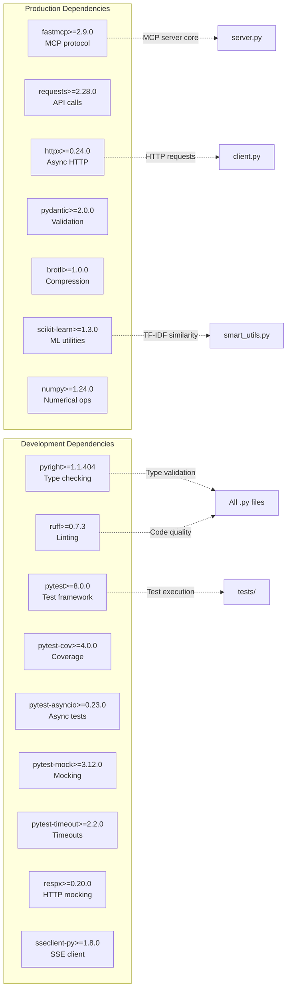
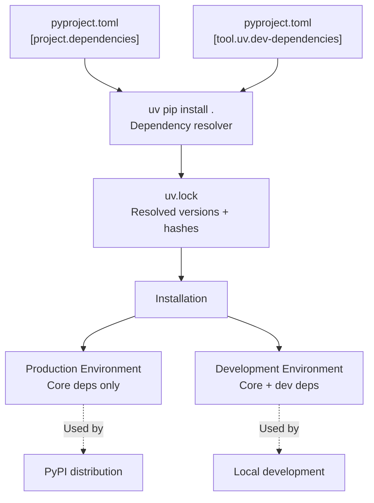
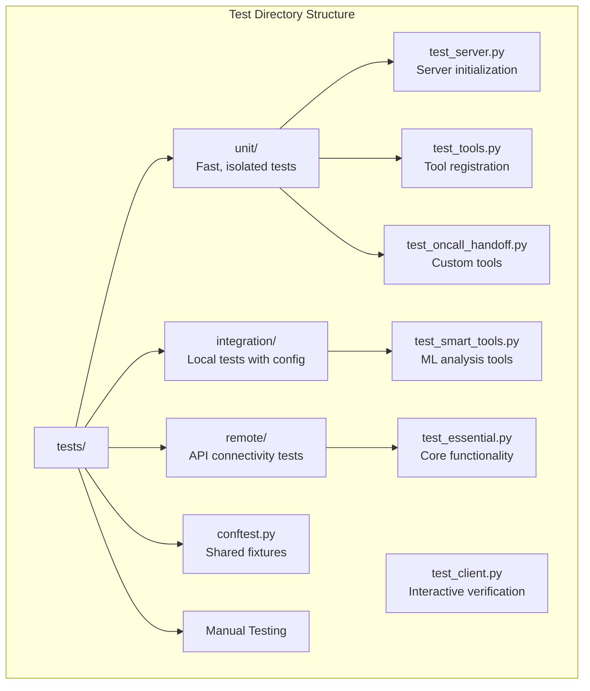
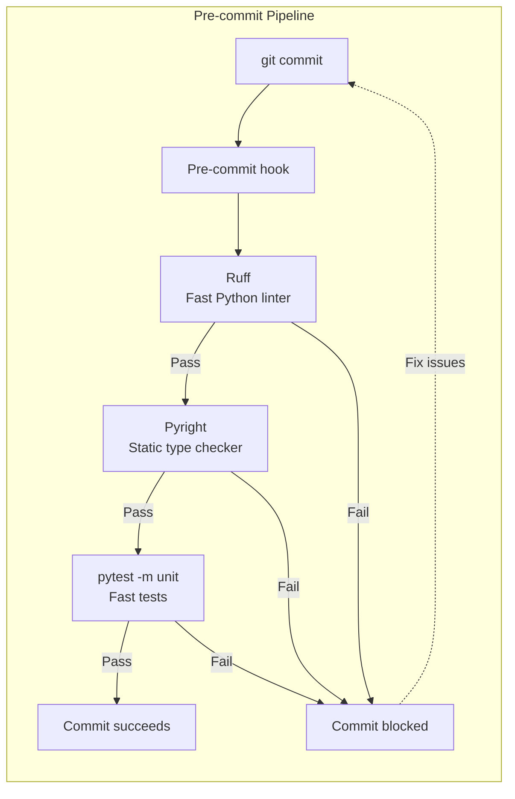
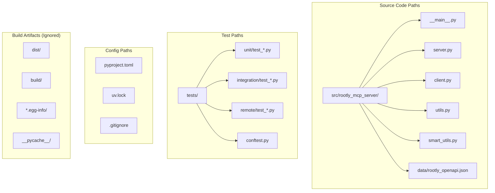

<!-- source: DeepWiki mcp.deepwiki.com · repo Rootly-AI-Labs/Rootly-MCP-server · page 5 Development Guide · fetched 2026-10-26 -->

# Development Guide

<details>
<summary>Relevant source files</summary>

The following files were used as context for generating this wiki page:

- [.gitignore](.gitignore)
- [README.md](README.md)
- [pyproject.toml](pyproject.toml)
- [tests/unit/test_oncall_handoff.py](tests/unit/test_oncall_handoff.py)

</details>


This guide provides comprehensive information for developers working on the Rootly MCP Server codebase. It covers project structure, environment setup, dependency management, testing strategies, code quality tools, and common development workflows.

For deployment and CI/CD information, see [Deployment & Operations](#6). For detailed API documentation of server functions and client methods, see [API Reference](#7). For understanding the core architecture, see [Core Architecture](#3).

---

## Purpose and Scope

This document serves as the primary reference for developers contributing to or extending the Rootly MCP Server. It covers:

- **Project organization**: Directory structure and module responsibilities
- **Environment setup**: Installation, virtual environments, and dependency management
- **Testing**: Unit, integration, and remote testing strategies
- **Code quality**: Linting, type checking, and pre-commit hooks
- **Development workflows**: Common tasks and debugging approaches

This guide focuses on the development process itself. For information about creating custom tools, see [Custom Tool Development](#4.5). For understanding how the server processes OpenAPI specifications, see [OpenAPI Processing](#3.2).

---

## Project Structure Overview

The codebase follows a standard Python package structure with clear separation between source code, tests, configuration, and deployment artifacts.

### Directory Layout

```mermaid
graph TB
    Root["rootly-mcp-server/"]
    
    Src["src/rootly_mcp_server/"]
    SrcMain["__main__.py<br/>CLI entry point"]
    SrcServer["server.py<br/>FastMCP server core"]
    SrcClient["client.py<br/>HTTP client"]
    SrcUtils["utils.py<br/>OpenAPI sanitization"]
    SrcSmart["smart_utils.py<br/>AI analysis tools"]
    SrcData["data/<br/>rootly_openapi.json"]
    
    Tests["tests/"]
    TestUnit["unit/<br/>Fast isolated tests"]
    TestIntegration["integration/<br/>Local integration"]
    TestRemote["remote/<br/>API connectivity"]
    TestConf["conftest.py<br/>Shared fixtures"]
    
    Config["Configuration Files"]
    PyProject["pyproject.toml<br/>Project metadata"]
    UvLock["uv.lock<br/>Dependency locks"]
    GitIgnore[".gitignore"]
    
    Scripts["scripts/"]
    SetupHooks["setup-hooks.sh<br/>Git hook installer"]
    
    CI["CI/CD"]
    GitHub[".github/workflows/<br/>test.yml"]
    Semaphore[".semaphore/<br/>semaphore.yml"]
    
    Root --> Src
    Root --> Tests
    Root --> Config
    Root --> Scripts
    Root --> CI
    
    Src --> SrcMain
    Src --> SrcServer
    Src --> SrcClient
    Src --> SrcUtils
    Src --> SrcSmart
    Src --> SrcData
    
    Tests --> TestUnit
    Tests --> TestIntegration
    Tests --> TestRemote
    Tests --> TestConf
    
    Config --> PyProject
    Config --> UvLock
    Config --> GitIgnore
    
    Scripts --> SetupHooks
    
    CI --> GitHub
    CI --> Semaphore
```



**Sources**: [README.md:285-332](), [pyproject.toml:1-87](), [.gitignore:1-194]()

### Core Modules

The source code in `src/rootly_mcp_server/` is organized into five primary modules:

| Module | Purpose | Key Exports |
|--------|---------|-------------|
| `__main__.py` | CLI entry point, validates environment | `main()` function |
| `server.py` | FastMCP server, tool generation, custom tools | `create_rootly_mcp_server()` |
| `client.py` | HTTP client with authentication | `RootlyClient`, `AuthenticatedHTTPXClient` |
| `utils.py` | OpenAPI spec processing and sanitization | `sanitize_parameters_in_spec()` |
| `smart_utils.py` | ML-based similarity and solution extraction | `TextSimilarityAnalyzer`, `SolutionExtractor` |

**Sources**: [README.md:1-332]()

### Data Files

The `data/` directory contains the fallback OpenAPI specification file `rootly_openapi.json`, which is used when the remote specification cannot be fetched. This file is included in the Python package distribution.

**Sources**: [pyproject.toml:45-46]()

---

## Environment Setup

The project uses `uv` for fast, deterministic dependency management and virtual environment creation.

### Prerequisites

Before beginning development, ensure you have:

1. **Python 3.12 or higher** - Required for all type annotations and language features
2. **`uv` package manager** - Install via:
   ```bash
   curl -LsSf https://astral.sh/uv/install.sh | sh
   ```
3. **Rootly API token** - Required for integration and remote tests (see [Configuration](#2.2))

**Sources**: [README.md:12-19](), [README.md:287-289]()

### Virtual Environment Creation

Create and activate a virtual environment using `uv`:

```bash
# Create virtual environment
uv venv .venv

# Activate (Linux/macOS)
source .venv/bin/activate

# Activate (Windows)
.venv\Scripts\activate
```

The virtual environment must be activated before running any scripts, tests, or development tools. The `.venv` directory is excluded from version control via `.gitignore`.

**Sources**: [README.md:291-298](), [.gitignore:131-138]()

### Dependency Installation

Install all project dependencies and development tools:

```bash
# Install production dependencies
uv pip install .

# Development dependencies are automatically installed from pyproject.toml [tool.uv.dev-dependencies]
```

To add new dependencies during development:

```bash
# Add production dependency
uv pip install <package>
# Then manually add to pyproject.toml [project.dependencies]

# Add development dependency  
uv pip install <dev-package>
# Then manually add to pyproject.toml [tool.uv.dev-dependencies]
```

**Sources**: [README.md:300-311](), [pyproject.toml:18-26](), [pyproject.toml:54-65]()

### Development Dependency Categories



**Sources**: [pyproject.toml:18-26](), [pyproject.toml:54-65]()

---

## Dependency Management with uv

The project uses `uv` for dependency resolution and lock file management, providing reproducible builds across environments.

### Lock File Structure

The `uv.lock` file contains resolved dependency versions with cryptographic hashes for security and reproducibility. This file should be committed to version control.

**Key characteristics of `uv.lock`**:
- **Deterministic**: Same dependencies on all platforms
- **Secure**: Includes SHA-256 hashes for all packages
- **Cross-platform**: Resolves dependencies for all target platforms
- **Git-tracked**: Committed to repository (not in `.gitignore`)

**Sources**: [.gitignore:98-102]()

### Package Distribution

The package is built using `hatchling` as the build backend and distributed to PyPI:

```bash
# Build distribution packages
uv build

# Generates:
# - dist/rootly_mcp_server-<version>-py3-none-any.whl
# - dist/rootly_mcp_server-<version>.tar.gz
```

The build configuration includes:
- **Package location**: `src/rootly_mcp_server`
- **Data files**: `data/rootly_openapi.json` included in wheel
- **Entry point**: `rootly-mcp-server` command maps to `rootly_mcp_server.__main__:main`

**Sources**: [pyproject.toml:32-49]()

### Dependency Resolution Strategy



**Sources**: [pyproject.toml:1-87]()

---

## Testing Strategy

The project implements a three-tier testing pyramid: fast unit tests, local integration tests, and remote integration tests.

### Test Organization



**Sources**: [pyproject.toml:67-86](), [tests/unit/test_oncall_handoff.py:1-71]()

### Test Categories and Markers

Tests are categorized using pytest markers defined in `pyproject.toml`:

| Marker | Purpose | Requirements | Example |
|--------|---------|--------------|---------|
| `@pytest.mark.unit` | Fast, isolated tests with mocks | None | `test_tool_registered()` |
| `@pytest.mark.integration` | Tests with real config and tokens | `ROOTLY_API_TOKEN` env var | `test_similarity_analysis()` |
| `@pytest.mark.remote` | Tests requiring API connectivity | Valid API token + network | `test_api_connection()` |
| `@pytest.mark.slow` | Long-running tests | None | `test_large_dataset()` |

**Sources**: [pyproject.toml:80-85]()

### Running Tests

Execute tests using pytest with various filters:

```bash
# Run all tests (requires ROOTLY_API_TOKEN)
pytest

# Run only unit tests (no API token needed)
pytest -m unit

# Run only integration tests (requires API token)
pytest -m integration

# Run specific test file
pytest tests/unit/test_oncall_handoff.py

# Run with coverage report
pytest --cov=src/rootly_mcp_server --cov-report=html

# Run without slow tests
pytest -m "not slow"
```

**Sources**: [pyproject.toml:67-79]()

### Test Configuration

The pytest configuration in `pyproject.toml` includes:

- **Test discovery**: `tests/` directory, `test_*.py` files
- **Async mode**: Auto-detect async tests with `pytest-asyncio`
- **Coverage**: Automatic coverage reporting for `src/rootly_mcp_server`
- **Output format**: Verbose with short tracebacks
- **Strict markers**: All markers must be registered

**Sources**: [pyproject.toml:67-86]()

### Unit Test Example

Unit tests mock external dependencies to ensure fast, isolated execution:

```python
# From tests/unit/test_oncall_handoff.py
@pytest.mark.unit
@pytest.mark.asyncio
async def test_tool_registered():
    """Test that get_oncall_handoff_summary is registered."""
    with patch('rootly_mcp_server.server._load_swagger_spec') as mock_load_spec:
        mock_spec = {
            "openapi": "3.0.0",
            "info": {"title": "Test API", "version": "1.0.0"},
            "paths": {},
            "components": {"schemas": {}}
        }
        mock_load_spec.return_value = mock_spec
        
        server = create_rootly_mcp_server()
        tools = await server.get_tools()
        tool_names = [t.name if hasattr(t, 'name') else str(t) for t in tools]
        
        assert 'get_oncall_handoff_summary' in tool_names
```

**Sources**: [tests/unit/test_oncall_handoff.py:8-36]()

### Testing Dependencies

The project uses multiple pytest plugins for enhanced testing capabilities:

- **pytest-cov**: Coverage measurement and reporting
- **pytest-asyncio**: Support for async test functions
- **pytest-mock**: Simplified mocking utilities
- **pytest-timeout**: Prevent tests from hanging
- **respx**: HTTP request mocking for httpx
- **sseclient-py**: Server-Sent Events client for remote testing

**Sources**: [pyproject.toml:59-64]()

---

## Code Quality and Pre-commit Hooks

The project enforces code quality through automated linting, type checking, and testing before commits.

### Pre-commit Hook Installation

Install Git hooks that run automatically before each commit:

```bash
./scripts/setup-hooks.sh
```

This script installs hooks that execute:
1. **Ruff linting**: Code style and error checking
2. **Pyright type checking**: Static type analysis
3. **Unit tests**: Fast test suite execution

**Sources**: [README.md:313-324]()

### Code Quality Tools



**Sources**: [README.md:313-324](), [pyproject.toml:56-57]()

### Ruff Configuration

Ruff is a fast Python linter written in Rust that replaces multiple tools (Black, isort, flake8, etc.). The project uses Ruff for:

- **Code formatting**: Consistent style across all files
- **Import sorting**: Organized import statements
- **Error detection**: Common Python mistakes and anti-patterns
- **Performance issues**: Inefficient code patterns

Run Ruff manually:
```bash
# Check for issues
ruff check .

# Auto-fix issues
ruff check --fix .

# Format code
ruff format .
```

**Sources**: [pyproject.toml:57]()

### Pyright Configuration

Pyright performs static type analysis to catch type errors before runtime:

- **Type inference**: Understands types without explicit annotations
- **Protocol checking**: Validates structural typing
- **Module resolution**: Ensures all imports are valid
- **Strict mode**: Enforces comprehensive type coverage

Run Pyright manually:
```bash
# Type check all files
pyright

# Type check specific file
pyright src/rootly_mcp_server/server.py
```

**Sources**: [pyproject.toml:56]()

### Ignored Files and Artifacts

The `.gitignore` file excludes common Python artifacts and IDE files:

**Key exclusions**:
- `__pycache__/`, `*.pyc`: Byte-compiled files
- `.venv/`, `venv/`: Virtual environments
- `dist/`, `build/`, `*.egg-info/`: Build artifacts
- `.pytest_cache/`, `.coverage`: Test outputs
- `.ruff_cache/`: Ruff cache directory
- `*.md` (except README.md): Generated markdown files

**Sources**: [.gitignore:1-194]()

---

## Development Workflows

### Common Development Tasks

**Setting up a new development environment**:
```bash
# 1. Clone repository
git clone https://github.com/Rootly-AI-Labs/Rootly-MCP-server.git
cd Rootly-MCP-server

# 2. Create virtual environment
uv venv .venv
source .venv/bin/activate

# 3. Install dependencies
uv pip install .

# 4. Install pre-commit hooks
./scripts/setup-hooks.sh

# 5. Set API token for testing
export ROOTLY_API_TOKEN="your-token-here"

# 6. Run unit tests to verify setup
pytest -m unit
```

**Adding a new dependency**:
```bash
# 1. Install the package
uv pip install <package-name>

# 2. Add to pyproject.toml [project.dependencies] or [tool.uv.dev-dependencies]

# 3. Update lock file
uv pip install .

# 4. Verify tests still pass
pytest -m unit
```

**Running the server locally**:
```bash
# Ensure virtual environment is activated
source .venv/bin/activate

# Set API token
export ROOTLY_API_TOKEN="your-token-here"

# Run server (for MCP client testing)
python -m rootly_mcp_server
```

**Sources**: [README.md:285-332]()

### Debugging Techniques

**Enable debug logging**:
```python
# Add to __main__.py or server.py
import logging
logging.basicConfig(level=logging.DEBUG)
```

**Inspect generated tools**:
```python
# Use the server's tool listing
from rootly_mcp_server.server import create_rootly_mcp_server

server = create_rootly_mcp_server()
tools = await server.get_tools()
for tool in tools:
    print(f"Tool: {tool.name if hasattr(tool, 'name') else tool}")
```

**Test API connectivity manually**:
```bash
# Run interactive test client
python tests/test_client.py
```

**Sources**: [README.md:330-332]()

### Contributing Guidelines

When contributing to the project:

1. **Branch from main**: Create feature branches from the latest `main`
2. **Write tests**: Add unit tests for new functionality
3. **Run pre-commit checks**: Ensure `./scripts/setup-hooks.sh` has been run
4. **Update documentation**: Modify README.md if adding features
5. **Follow existing patterns**: Match the code style of existing modules
6. **Test locally**: Run full test suite before pushing

**Sources**: [README.md:313-324]()

---

## Project Configuration Reference

### pyproject.toml Structure

The `pyproject.toml` file contains all project metadata, dependencies, and tool configurations:

| Section | Purpose |
|---------|---------|
| `[project]` | Package metadata (name, version, description, authors) |
| `[project.dependencies]` | Production runtime dependencies |
| `[project.optional-dependencies]` | Optional dependency groups (e.g., `dev`) |
| `[project.scripts]` | CLI entry points (`rootly-mcp-server` command) |
| `[build-system]` | Build backend configuration (hatchling) |
| `[tool.hatch.*]` | Hatchling-specific build settings |
| `[tool.uv]` | uv package manager configuration |
| `[tool.uv.dev-dependencies]` | Development-only dependencies |
| `[tool.pytest.ini_options]` | Pytest configuration and markers |

**Sources**: [pyproject.toml:1-87]()

### Environment Variables

The server uses the following environment variables:

| Variable | Purpose | Required For | Default |
|----------|---------|--------------|---------|
| `ROOTLY_API_TOKEN` | API authentication token | Local mode, integration tests | None |
| `ROOTLY_AUTH_HEADER` | Full auth header (Bearer token) | Hosted mode | None |

**Sources**: [README.md:49-51](), [README.md:114-116]()

### File Path Conventions



**Sources**: [pyproject.toml:36-46](), [.gitignore:1-194]()

---

This development guide provides the foundation for contributing to the Rootly MCP Server project. For specific implementation details about custom tools, see [Custom Tool Development](#4.5). For deployment procedures, see [Deployment & Operations](#6).

---

