<!-- source: DeepWiki mcp.deepwiki.com · repo Rootly-AI-Labs/Rootly-MCP-server · page 5.1 Project Structure · fetched 2026-10-26 -->

# Project Structure

<details>
<summary>Relevant source files</summary>

The following files were used as context for generating this wiki page:

- [.gitignore](.gitignore)
- [pyproject.toml](pyproject.toml)
- [rootly_openapi.json](rootly_openapi.json)
- [src/rootly_mcp_server/__init__.py](src/rootly_mcp_server/__init__.py)

</details>


This page documents the physical organization of the Rootly MCP Server codebase, including source code layout, configuration files, test structure, and deployment artifacts. For information about the initialization pipeline and how these modules are loaded, see [Server Initialization Pipeline](#3.1). For dependency management details, see [Dependencies & Environment](#5.2).

## Repository Layout

The Rootly MCP Server follows a standard Python package structure with source code in a `src/` layout, tests in a separate `tests/` directory, and configuration files at the repository root.

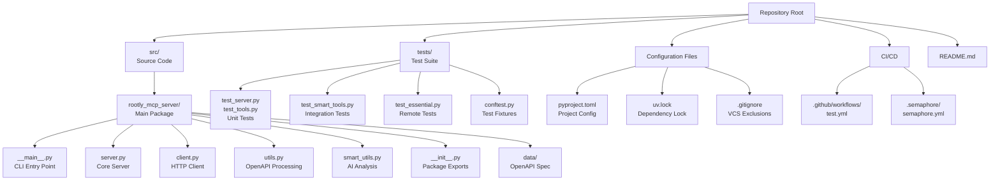

**Sources:** [pyproject.toml:1-87](), [.gitignore:1-194](), [src/rootly_mcp_server/__init__.py:1-20]()

## Source Code Organization

The main package is located at `src/rootly_mcp_server/` and contains all runtime code. This `src/` layout ensures clean separation between source code and development artifacts, and prevents accidental imports during development.

### Package Structure

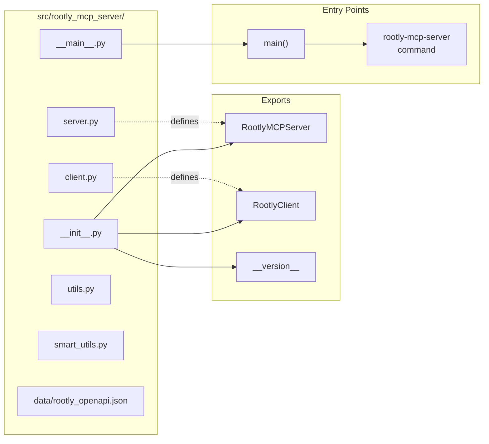

**Sources:** [src/rootly_mcp_server/__init__.py:1-20](), [pyproject.toml:48-49]()

### Module Responsibilities

| Module | Primary Purpose | Key Classes/Functions |
|--------|----------------|----------------------|
| `__init__.py` | Package initialization and public API exports | `RootlyMCPServer`, `RootlyClient`, `__version__` |
| `__main__.py` | CLI entry point and server startup | `main()` |
| `server.py` | FastMCP server creation and tool registration | `create_rootly_mcp_server()`, `DEFAULT_ALLOWED_PATHS` |
| `client.py` | HTTP client for Rootly API communication | `RootlyClient`, `AuthenticatedHTTPXClient` |
| `utils.py` | OpenAPI spec processing and parameter sanitization | `sanitize_parameters_in_spec()` |
| `smart_utils.py` | AI-powered analysis tools | `TextSimilarityAnalyzer`, `SolutionExtractor` |
| `data/rootly_openapi.json` | Rootly API OpenAPI specification | N/A (data file) |

**Sources:** [src/rootly_mcp_server/__init__.py:1-20](), [pyproject.toml:36-49]()

## Core Module Dependencies

This diagram shows how the main modules import and depend on each other:

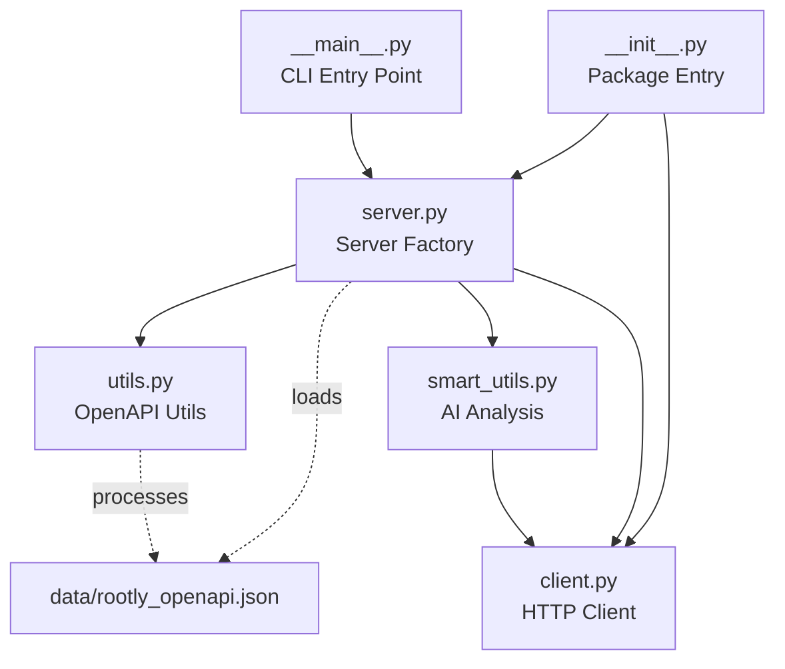

**Sources:** [src/rootly_mcp_server/__init__.py:13-14](), high-level architecture diagrams

## Configuration Files

The repository root contains several configuration files that define the project metadata, dependencies, build system, and development tools.

### pyproject.toml Structure

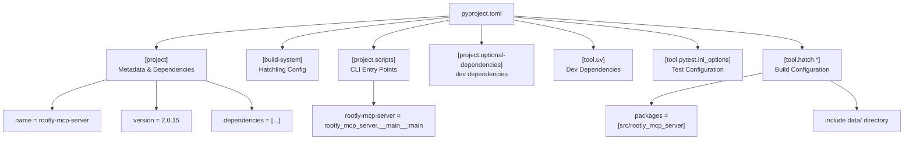

**Sources:** [pyproject.toml:1-87]()

### Key Configuration Sections

| Section | Purpose | Key Settings |
|---------|---------|--------------|
| `[project]` | Package metadata | `name`, `version`, `dependencies`, `requires-python` |
| `[project.scripts]` | CLI entry points | `rootly-mcp-server` command |
| `[build-system]` | Build backend configuration | `hatchling` as build backend |
| `[tool.hatch.build.targets.wheel]` | Package contents | `src/rootly_mcp_server` directory |
| `[tool.hatch.build.targets.wheel.include]` | Additional files | `data/` directory inclusion |
| `[tool.uv]` | Development dependencies | Testing, linting, type checking tools |
| `[tool.pytest.ini_options]` | Test configuration | Test paths, markers, coverage settings |

**Sources:** [pyproject.toml:1-87]()

## Runtime Dependencies

The project's core runtime dependencies are defined in the `dependencies` array:

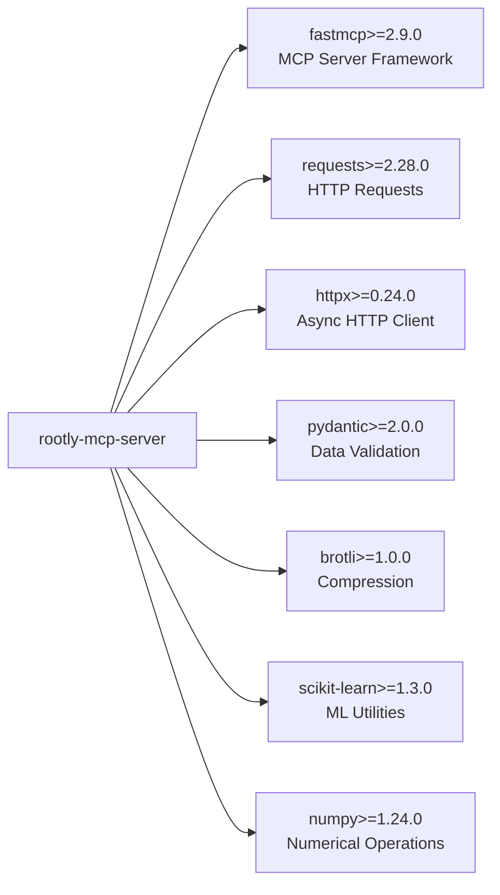

**Sources:** [pyproject.toml:18-26]()

## Development Dependencies

Development dependencies are managed separately under `[tool.uv]`:

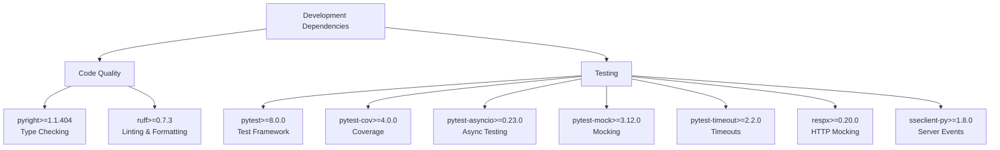

**Sources:** [pyproject.toml:54-65]()

## Test Structure

Tests are organized in the `tests/` directory with a clear separation between unit tests, integration tests, and remote tests.

### Test Organization

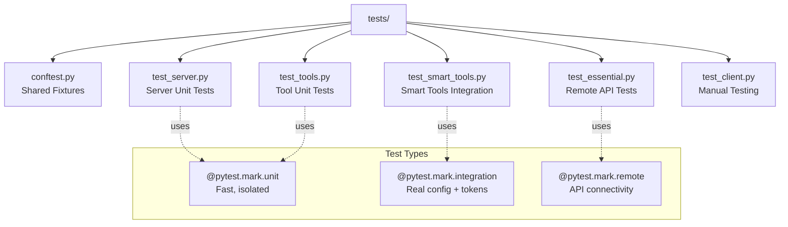

**Sources:** [pyproject.toml:67-86]()

### Test Markers

The project uses pytest markers to categorize tests:

| Marker | Purpose | Example Tests |
|--------|---------|---------------|
| `unit` | Fast, isolated unit tests with mocked dependencies | Server creation, parameter sanitization |
| `integration` | Local integration tests requiring real configuration | Smart tools with local API tokens |
| `remote` | Remote server tests requiring API connectivity | End-to-end API calls |
| `slow` | Tests that take longer to run | Large dataset processing |

**Sources:** [pyproject.toml:80-85]()

### Test Configuration

Test execution is configured in the `[tool.pytest.ini_options]` section:

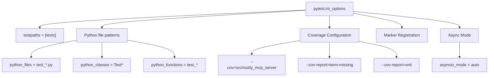

**Sources:** [pyproject.toml:67-86]()

## Build System Configuration

The project uses Hatchling as its build backend with specific configuration for wheel creation:

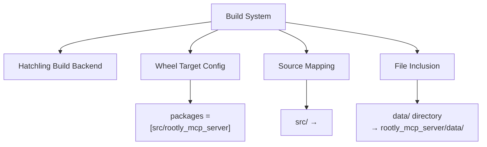

**Sources:** [pyproject.toml:32-46]()

### Build Artifact Structure

When built, the package creates the following structure in the wheel:

```
rootly_mcp_server/
├── __init__.py
├── __main__.py
├── server.py
├── client.py
├── utils.py
├── smart_utils.py
└── data/
    └── rootly_openapi.json
```

**Sources:** [pyproject.toml:36-46]()

## Package Entry Points

The project defines a CLI entry point that makes the server available as a command-line tool:

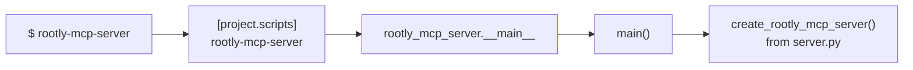

**Sources:** [pyproject.toml:48-49]()

## Version Control Exclusions

The `.gitignore` file defines patterns for files that should not be tracked in version control:

### Key Exclusion Categories

| Category | Patterns | Reason |
|----------|----------|--------|
| Python artifacts | `__pycache__/`, `*.pyc`, `*.egg-info/` | Compiled bytecode and build artifacts |
| Virtual environments | `.venv/`, `venv/`, `ENV/` | Local development environments |
| Test outputs | `.pytest_cache/`, `.coverage`, `htmlcov/` | Test execution artifacts |
| Build artifacts | `build/`, `dist/`, `*.egg` | Distribution packages |
| IDE files | `.vscode/`, `.cursor/`, `*.swp` | Editor-specific configurations |
| Lock files (commented) | `#uv.lock` | Dependency locks (kept in repo) |
| Downloaded specs | `swagger.json` | Auto-fetched OpenAPI specs |

**Sources:** [.gitignore:1-194]()

## Data Files

The `src/rootly_mcp_server/data/` directory contains the OpenAPI specification that defines the Rootly API:

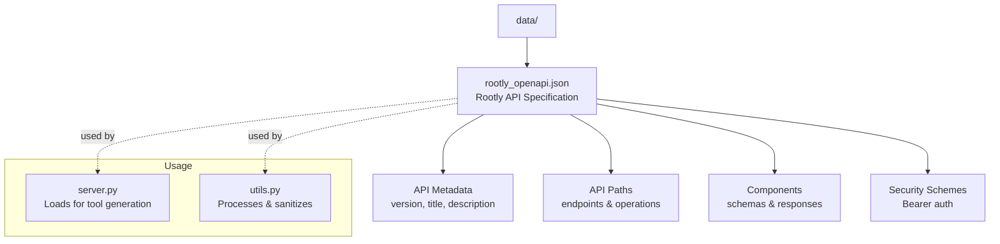

**Sources:** [pyproject.toml:45-46](), [rootly_openapi.json:1-12]()

## CI/CD Structure

The repository includes configuration for two CI/CD systems:

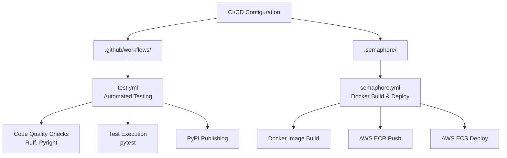

**Sources:** High-level architecture diagrams

## File Path Mapping

This table maps logical components to their physical file locations:

| Logical Component | File Path | Line Range |
|-------------------|-----------|------------|
| Package exports | `src/rootly_mcp_server/__init__.py` | 1-20 |
| CLI entry point | `src/rootly_mcp_server/__main__.py` | Full file |
| Server factory | `src/rootly_mcp_server/server.py` | Full file |
| HTTP client | `src/rootly_mcp_server/client.py` | Full file |
| OpenAPI utilities | `src/rootly_mcp_server/utils.py` | Full file |
| Smart analysis | `src/rootly_mcp_server/smart_utils.py` | Full file |
| OpenAPI spec | `src/rootly_mcp_server/data/rootly_openapi.json` | Full file |
| Project config | `pyproject.toml` | 1-87 |
| Dependency lock | `uv.lock` | Full file |
| Test fixtures | `tests/conftest.py` | Full file |

**Sources:** [pyproject.toml:1-87](), [src/rootly_mcp_server/__init__.py:1-20]()

## Distribution Package

When installed via pip, the package structure is:

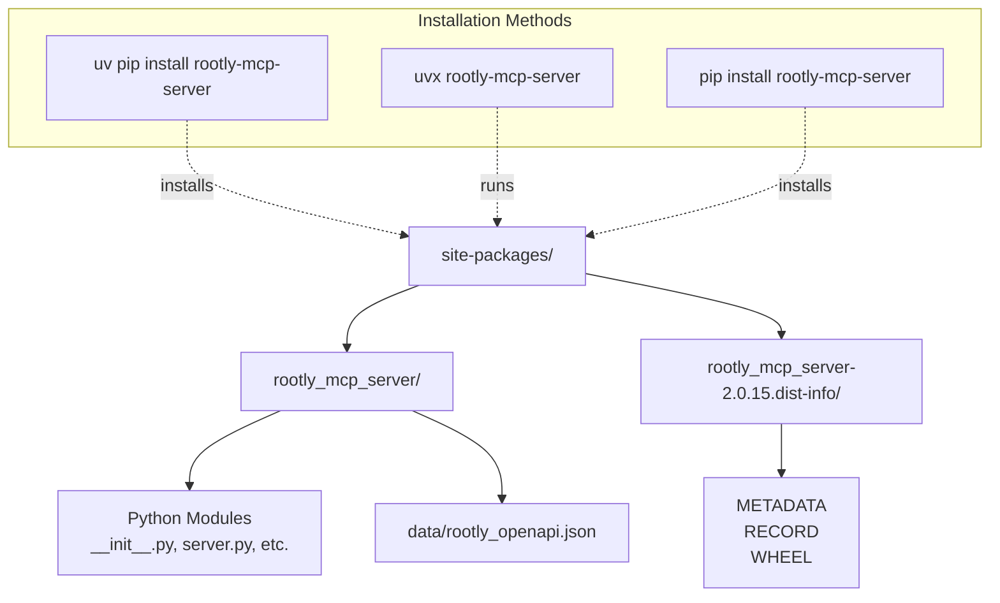

**Sources:** [pyproject.toml:2-3](), [pyproject.toml:36-46]()

---

