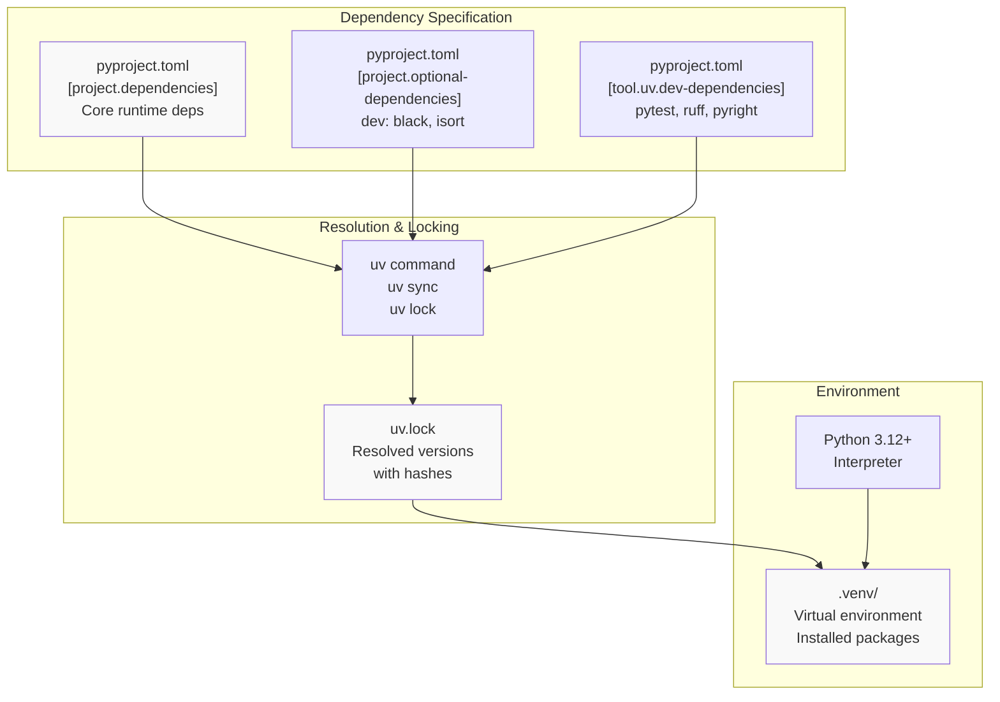
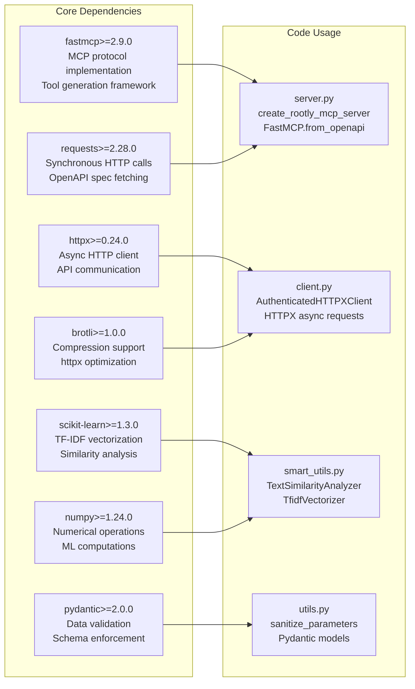
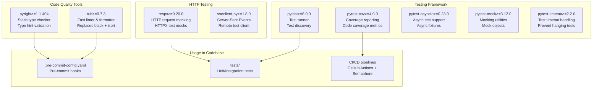
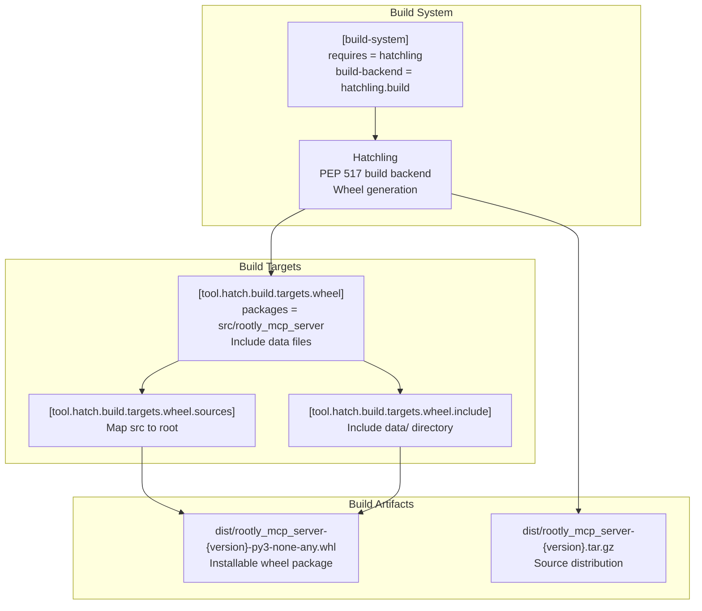
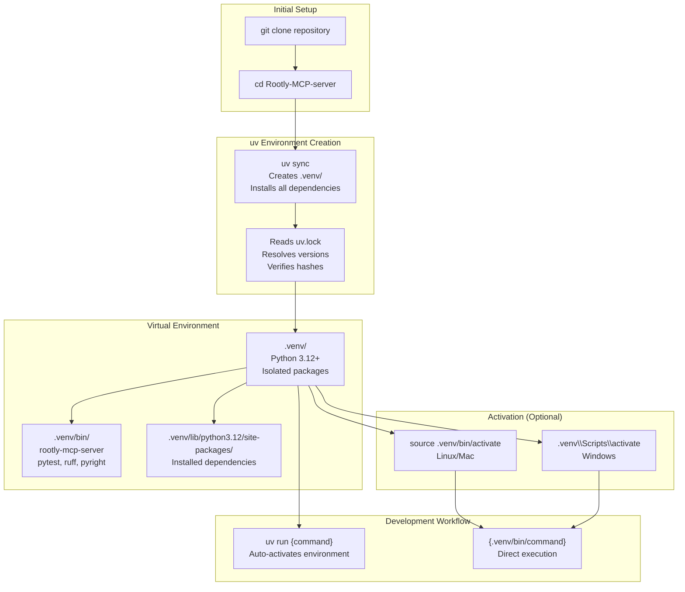
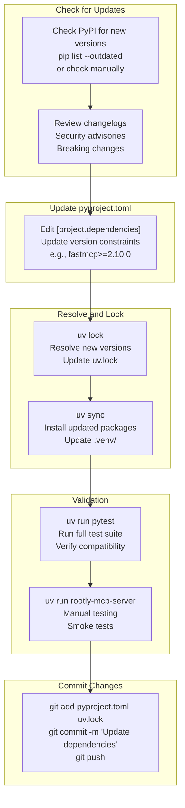

<!-- source: DeepWiki mcp.deepwiki.com · repo Rootly-AI-Labs/Rootly-MCP-server · page 5.2 Dependencies & Environment · fetched 2026-10-26 -->

# Dependencies & Environment

<details>
<summary>Relevant source files</summary>

The following files were used as context for generating this wiki page:

- [pyproject.toml](pyproject.toml)
- [uv.lock](uv.lock)

</details>


This document details the dependency management strategy and environment setup for the Rootly MCP Server. It covers the Python version requirements, core runtime dependencies, development and testing dependencies, the uv-based dependency management workflow, and virtual environment configuration. For information about project structure and module organization, see [Project Structure](#5.1). For testing-specific setup and fixtures, see [Testing Strategy](#5.3) and [Test Fixtures & Utilities](#5.5).

## Purpose and Scope

This page explains how dependencies are declared, managed, and resolved in the Rootly MCP Server project. It documents:

- Python version requirements and compatibility constraints
- Core runtime dependencies required for server operation
- Development dependencies for code quality and testing
- The uv-based dependency management workflow
- Lock file management and reproducible environments
- Virtual environment setup and activation

The project uses **uv** as its primary dependency management tool, with all dependencies declared in `pyproject.toml` and resolved versions locked in `uv.lock`. This ensures reproducible builds across development, testing, and production environments.

**Sources:** [pyproject.toml:1-87]()

## Python Version Requirements

The Rootly MCP Server requires **Python 3.12 or higher**. This requirement is strictly enforced in the project configuration.

```toml
requires-python = ">=3.12"
```

### Why Python 3.12+

Python 3.12 provides several features and improvements that the server depends on:

- **Performance improvements**: Faster interpreter execution for compute-intensive ML operations
- **Type system enhancements**: Better support for modern type hints used throughout the codebase
- **Standard library updates**: Improved `asyncio` and `typing` modules critical for MCP protocol handling
- **Error messages**: Enhanced error reporting for debugging tool generation issues

### Compatibility Considerations

| Component | Python Version | Notes |
|-----------|----------------|-------|
| Runtime Server | 3.12+ | Required for FastMCP compatibility |
| Development Tools | 3.12+ | Pyright and Ruff require modern Python |
| CI/CD Pipelines | 3.12+ | GitHub Actions and Semaphore use 3.12 |
| Docker Container | 3.12+ | Base image uses `python:3.12-slim` |

**Sources:** [pyproject.toml:6]()

## Dependency Management with uv

The project uses **uv** for fast, reliable dependency management. uv is a modern Python package installer and resolver written in Rust, providing significantly faster dependency resolution compared to pip.

### Dependency Declaration Files



### Common uv Commands

| Command | Purpose | When to Use |
|---------|---------|-------------|
| `uv sync` | Install all dependencies | Initial setup, after dependency changes |
| `uv lock` | Update lock file | After modifying `pyproject.toml` dependencies |
| `uv pip install -e .` | Install package in editable mode | Development workflow |
| `uv run pytest` | Run pytest with project dependencies | Testing |
| `uv run rootly-mcp-server` | Run server with correct environment | Manual testing |

### Lock File Management

The `uv.lock` file (not shown in provided files but referenced in diagrams) contains resolved dependency versions with cryptographic hashes. This file should be:

- **Committed to version control** for reproducible builds
- **Updated** when dependencies change in `pyproject.toml`
- **Synchronized** across team members to ensure consistent environments

**Sources:** [pyproject.toml:54-65]()

## Core Runtime Dependencies

The server requires six core runtime dependencies for operation. These are declared in the `[project.dependencies]` section and are always installed.

### Runtime Dependency Mapping



### Dependency Details

#### FastMCP (>=2.9.0)

The FastMCP library provides the core MCP protocol implementation and is the foundation of the server.

**Purpose:**
- MCP protocol server implementation
- Tool generation from OpenAPI specifications
- Request/response handling
- Resource exposure

**Used in:**
- [server.py:1-500]() - `FastMCP.from_openapi()`, server initialization
- All tool definitions and MCP resource handlers

**Version constraint:** `>=2.9.0` ensures compatibility with the OpenAPI integration features and tool registration APIs.

#### HTTPX (>=0.24.0)

HTTPX is the async HTTP client used for all Rootly API communication.

**Purpose:**
- Asynchronous HTTP requests to Rootly API
- Connection pooling and timeout management
- Request/response streaming
- Authentication header injection

**Used in:**
- [client.py]() - `AuthenticatedHTTPXClient` class
- All API calls from tools and smart analysis functions

**Brotli dependency:** The `brotli>=1.0.0` package is required for HTTPX to support Brotli compression, improving API response transfer efficiency.

#### Pydantic (>=2.0.0)

Pydantic provides data validation and schema enforcement throughout the server.

**Purpose:**
- OpenAPI schema validation
- Parameter type checking
- Configuration validation
- Error response models

**Used in:**
- [utils.py]() - Parameter sanitization and validation
- [server.py]() - Configuration models
- Tool parameter validation

**Version constraint:** `>=2.0.0` uses Pydantic V2's improved performance and Rust-based core.

#### Scikit-learn (>=1.3.0) and NumPy (>=1.24.0)

These ML libraries power the intelligent analysis features.

**Purpose:**
- TF-IDF text vectorization
- Cosine similarity computation
- Pattern recognition in incident data
- Numerical array operations

**Used in:**
- [smart_utils.py]() - `TextSimilarityAnalyzer`, `SolutionExtractor`
- `find_related_incidents` tool
- `suggest_solutions` tool

**Version constraints:** Ensure compatibility with modern Python 3.12+ and provide performance optimizations for text processing.

#### Requests (>=2.28.0)

The requests library is used for synchronous HTTP operations during initialization.

**Purpose:**
- Fetch OpenAPI specification from remote URL
- Synchronous HTTP calls during server setup
- Simple API requests in scripts

**Used in:**
- [server.py]() - Loading OpenAPI spec from `SWAGGER_URL`
- Initial configuration validation

**Sources:** [pyproject.toml:18-26]()

## Development Dependencies

Development dependencies are split into two categories: optional development tools and uv-managed development dependencies.

### Optional Development Dependencies

Declared in `[project.optional-dependencies]`:

```toml
dev = ["black>=23.0.0", "isort>=5.0.0"]
```

| Package | Version | Purpose |
|---------|---------|---------|
| `black` | >=23.0.0 | Code formatting (legacy, now using Ruff) |
| `isort` | >=5.0.0 | Import sorting (legacy, now using Ruff) |

**Note:** These are legacy dependencies. The project now uses Ruff for both formatting and import sorting, as declared in the uv dev-dependencies.

### uv Development Dependencies

Declared in `[tool.uv.dev-dependencies]`:



### Development Dependency Details

#### Pyright (>=1.1.404)

Static type checker for Python, ensuring type safety across the codebase.

**Features:**
- Type hint validation
- Interface checking
- Null safety analysis
- Import resolution

**Configuration:** Type checking strictness and settings defined in `pyproject.toml` or `pyrightconfig.json`.

**Usage:** Run via pre-commit hooks and CI pipelines to catch type errors before runtime.

#### Ruff (>=0.7.3)

Fast all-in-one linter and formatter written in Rust, replacing Black and isort.

**Features:**
- Code linting with 700+ rules
- Automatic code formatting
- Import sorting
- Fast execution (10-100x faster than alternatives)

**Usage:** Configured in `.ruff.toml` or `pyproject.toml`, runs on every commit via pre-commit hooks.

**Sources:** [pyproject.toml:54-65]()

## Testing Dependencies

The project uses a comprehensive testing stack centered on pytest.

### Testing Dependency Hierarchy

| Dependency | Version | Purpose | Used By |
|------------|---------|---------|---------|
| `pytest` | >=8.0.0 | Core test framework | All test files |
| `pytest-cov` | >=4.0.0 | Coverage reporting | CI pipelines, local coverage checks |
| `pytest-asyncio` | >=0.23.0 | Async test support | Tests for async functions in `client.py` |
| `pytest-mock` | >=3.12.0 | Mocking utilities | Unit tests mocking API responses |
| `pytest-timeout` | >=2.2.0 | Timeout handling | Integration tests preventing hangs |
| `respx` | >=0.20.0 | HTTPX mocking | Unit tests mocking `AuthenticatedHTTPXClient` |
| `sseclient-py` | >=1.8.0 | SSE client | Remote integration tests |

### Pytest Configuration

The pytest configuration is defined in `[tool.pytest.ini_options]`:

```toml
testpaths = ["tests"]
python_files = "test_*.py"
python_classes = "Test*"
python_functions = "test_*"
```

#### Test Markers

The project defines custom markers for test categorization:

```toml
markers = [
    "unit: Unit tests",
    "integration: Integration tests", 
    "remote: Remote server tests (require API token)",
    "slow: Tests that take longer to run",
]
```

**Usage:**
```bash
# Run only unit tests
uv run pytest -m unit

# Run integration tests excluding remote
uv run pytest -m "integration and not remote"

# Skip slow tests
uv run pytest -m "not slow"
```

#### Coverage Configuration

```toml
addopts = [
    "--cov=src/rootly_mcp_server",  # Coverage for main package
    "--cov-report=term-missing",    # Show missing lines
    "--cov-report=xml",             # XML for CI
]
```

This configuration:
- Measures coverage for the `src/rootly_mcp_server` package
- Displays missing lines in terminal output
- Generates XML coverage report for CI integration (e.g., Codecov)

#### Async Test Mode

```toml
asyncio_mode = "auto"
```

Automatically detects and runs async test functions without explicit markers, simplifying test authoring for async code.

**Sources:** [pyproject.toml:67-86]()

## Build System Dependencies

The project uses **Hatchling** as its build backend, providing modern Python packaging capabilities.

### Build Configuration



### Package Configuration

#### Package Inclusion

```toml
[tool.hatch.build.targets.wheel]
packages = ["src/rootly_mcp_server"]
```

This tells Hatchling to include the `src/rootly_mcp_server` package in the wheel.

#### Source Mapping

```toml
[tool.hatch.build.targets.wheel.sources]
"src" = ""
```

Maps the `src/` directory to the root of the wheel, so `src/rootly_mcp_server` becomes `rootly_mcp_server` in the installed package.

#### Data Files

```toml
[tool.hatch.build.targets.wheel.include]
"src/rootly_mcp_server/data" = "rootly_mcp_server/data"
```

Ensures the `data/` directory (containing `rootly_openapi.json`) is included in the wheel package. This is critical for the server to function when the remote OpenAPI spec is unavailable.

#### Metadata Configuration

```toml
[tool.hatch.metadata]
allow-direct-references = true
```

Allows dependencies to be specified as direct URL references (e.g., Git repositories), useful for development dependencies that aren't on PyPI.

**Sources:** [pyproject.toml:32-46]()

## Entry Points and Scripts

The project defines a console script entry point for the server executable:

```toml
[project.scripts]
rootly-mcp-server = "rootly_mcp_server.__main__:main"
```

### Entry Point Details

| Component | Value | Description |
|-----------|-------|-------------|
| **Script name** | `rootly-mcp-server` | Command name available in PATH after installation |
| **Module** | `rootly_mcp_server.__main__` | Entry module |
| **Function** | `main` | Entry function to execute |

### Usage After Installation

Once installed, the server can be invoked directly:

```bash
# Via installed script
rootly-mcp-server

# Via uvx (no installation)
uvx rootly-mcp-server

# Via uv run (development)
uv run rootly-mcp-server

# Via Python module
python -m rootly_mcp_server
```

All methods invoke the `main()` function defined in [__main__.py]().

**Sources:** [pyproject.toml:48-49]()

## Virtual Environment Setup

The project uses `.venv/` as the virtual environment directory (standard uv convention).

### Environment Setup Workflow



### Environment Creation Commands

```bash
# Clone repository
git clone https://github.com/Rootly-AI-Labs/Rootly-MCP-server.git
cd Rootly-MCP-server

# Create environment and install all dependencies
uv sync

# Install in editable mode (development)
uv pip install -e .

# Verify installation
uv run rootly-mcp-server --help
```

### Environment Activation

While uv can run commands without activation using `uv run`, manual activation is supported:

**Linux/macOS:**
```bash
source .venv/bin/activate
```

**Windows:**
```bash
.venv\Scripts\activate
```

**Deactivation:**
```bash
deactivate
```

### Environment Variables

The virtual environment should have these environment variables configured:

| Variable | Required | Purpose | Example |
|----------|----------|---------|---------|
| `ROOTLY_API_TOKEN` | Yes (local mode) | Rootly API authentication | `sk_...` |
| `SWAGGER_URL` | No | Custom OpenAPI spec URL | `https://api.rootly.com/docs/v1/openapi` |
| `PATH` | Auto-set | Include `.venv/bin` for scripts | `.venv/bin:...` |

**Sources:** [pyproject.toml:1-87]()

## Dependency Update Workflow

### Regular Dependency Updates



### Security Updates

For security vulnerabilities:

1. **Identify vulnerable dependency** via security advisories or `pip-audit`
2. **Update to patched version** in `pyproject.toml`
3. **Lock immediately**: `uv lock --upgrade-package <package>`
4. **Test thoroughly**: Run full test suite including integration tests
5. **Deploy urgently**: Follow expedited CI/CD pipeline if critical

### Adding New Dependencies

When adding a new runtime dependency:

```bash
# 1. Manually edit pyproject.toml
# Add to [project.dependencies]

# 2. Lock and sync
uv lock
uv sync

# 3. Verify import works
uv run python -c "import new_package"

# 4. Update documentation
# Add to this wiki page under "Core Runtime Dependencies"

# 5. Commit changes
git add pyproject.toml uv.lock
git commit -m "Add new_package dependency for feature X"
```

**Sources:** [pyproject.toml:18-26](), [pyproject.toml:54-65]()

## Dependency Constraints and Rationale

### Version Constraint Strategy

The project uses **minimum version constraints** with `>=` operators for most dependencies, allowing compatible newer versions while establishing a baseline.

| Constraint Type | Example | When Used | Rationale |
|----------------|---------|-----------|-----------|
| Minimum (`>=`) | `fastmcp>=2.9.0` | Most dependencies | Allow minor/patch updates, establish baseline |
| Exact (`==`) | Not used | Never | Too restrictive, prevents updates |
| Compatible (`~=`) | Not used | Rarely | Could be used for strict API contracts |
| Exclude (`!=`) | Not used | Bug workarounds | Avoid broken versions if needed |

### Constraint Rationale by Package

#### FastMCP (>=2.9.0)

**Constraint:** Minimum version 2.9.0

**Reason:** Version 2.9.0 introduced critical features:
- `FastMCP.from_openapi()` method for OpenAPI tool generation
- Improved parameter handling for complex schemas
- MCP protocol updates required by clients

**Risk:** Major version changes (3.x) may require code updates.

#### Scikit-learn (>=1.3.0)

**Constraint:** Minimum version 1.3.0

**Reason:**
- Modern TF-IDF vectorizer API
- Performance improvements in cosine similarity
- Python 3.12 compatibility

**Risk:** Major version changes (2.x) would require ML code refactoring.

#### Pytest (>=8.0.0)

**Constraint:** Minimum version 8.0.0

**Reason:**
- Improved async test support
- Better error reporting
- Modern pytest features (better fixtures, parametrization)

**Risk:** Minimal, pytest maintains backward compatibility.

### Dependency Security

All dependencies are regularly monitored for security vulnerabilities via:

- **GitHub Dependabot**: Automated pull requests for security updates
- **CI pipeline checks**: Security scanning in GitHub Actions
- **uv.lock verification**: Cryptographic hashes ensure integrity

**Sources:** [pyproject.toml:18-26]()

## Summary

The Rootly MCP Server uses a modern, reproducible dependency management strategy:

- **Package Manager**: uv for fast, reliable dependency resolution
- **Python Version**: 3.12+ for modern language features
- **Runtime Dependencies**: 7 core packages (FastMCP, HTTPX, Pydantic, scikit-learn, etc.)
- **Development Dependencies**: Comprehensive testing and code quality tools
- **Build System**: Hatchling for modern Python packaging
- **Lock File**: uv.lock ensures reproducible environments
- **Virtual Environment**: `.venv/` for isolated package installation

This architecture ensures consistent behavior across development, testing, and production environments while allowing flexibility for updates and security patches.

**Sources:** [pyproject.toml:1-87]()

---

