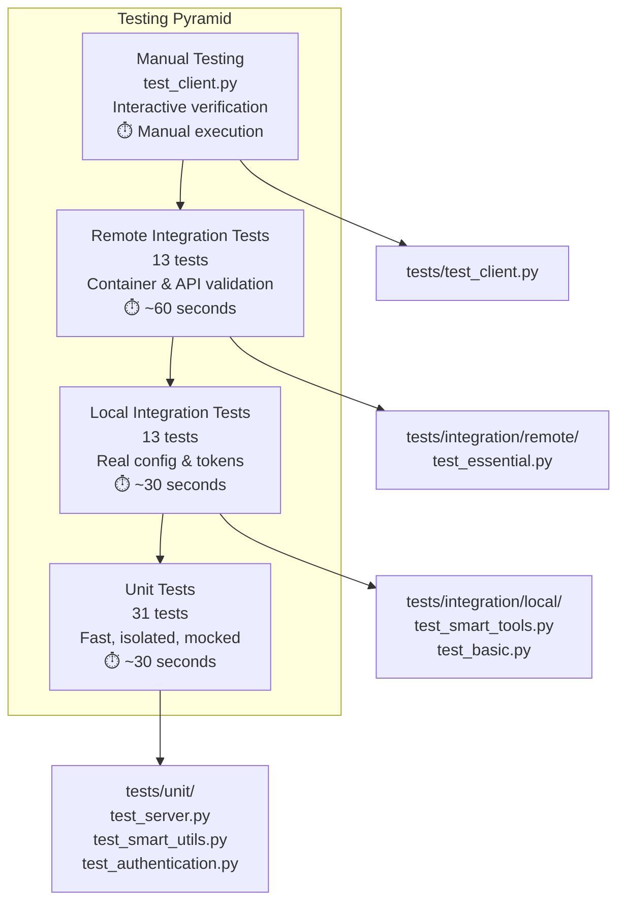
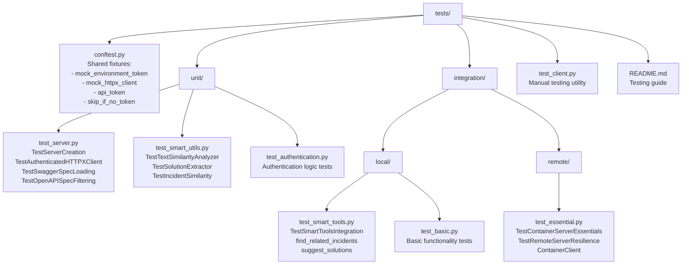
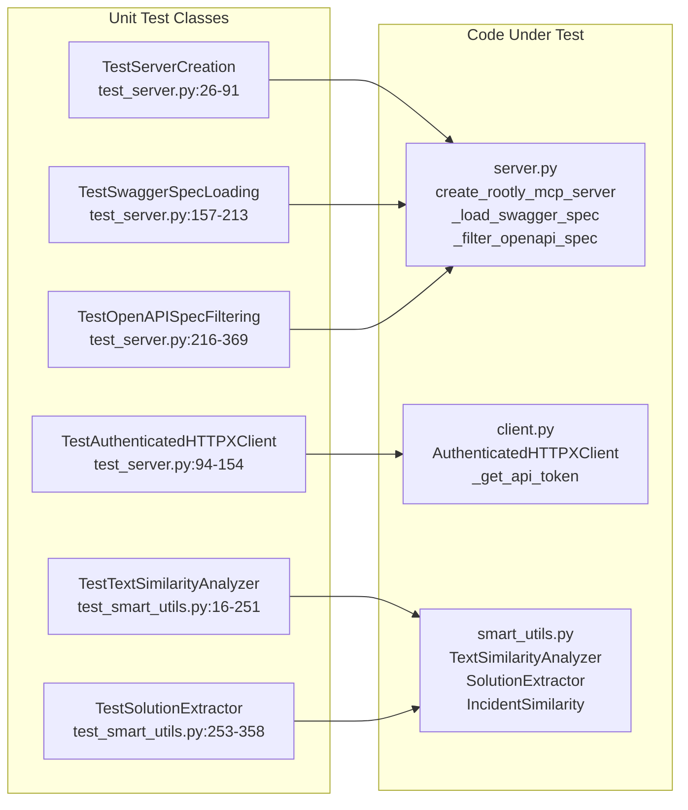
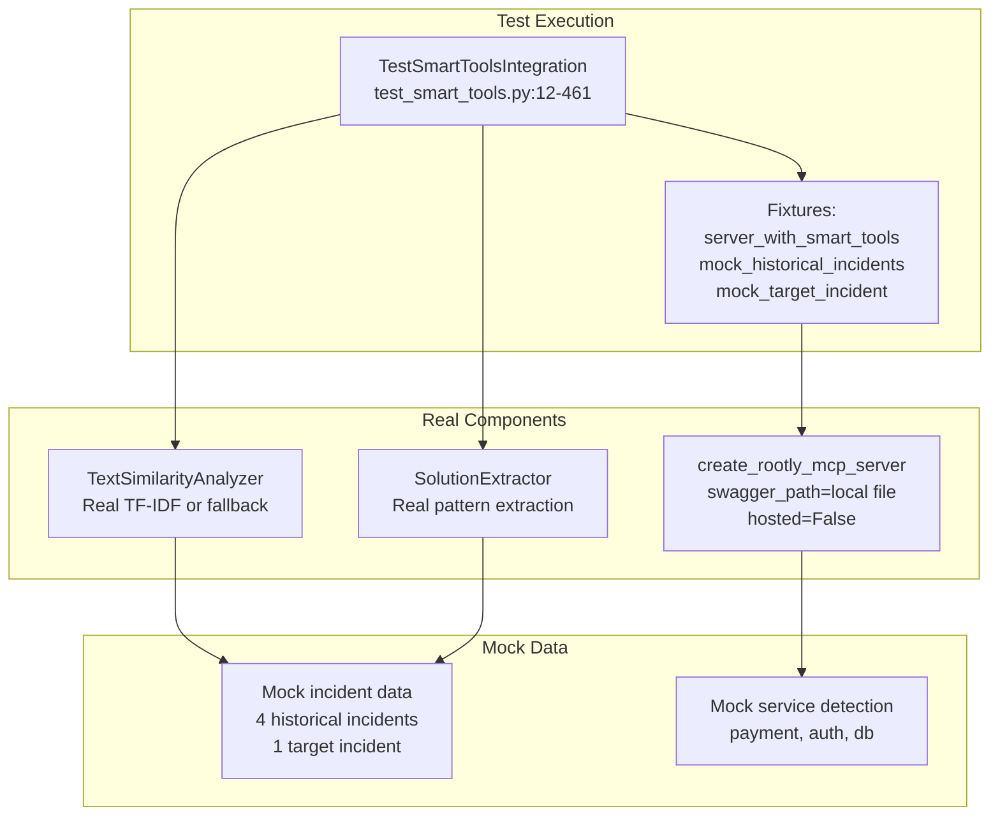
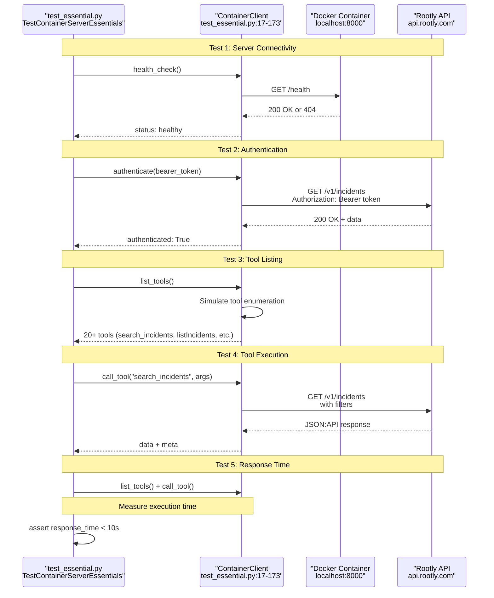
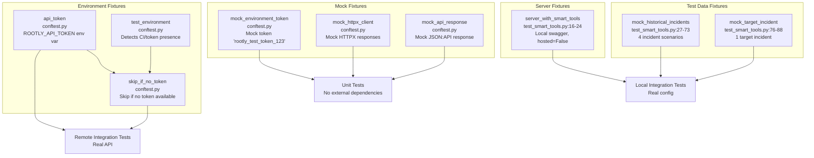
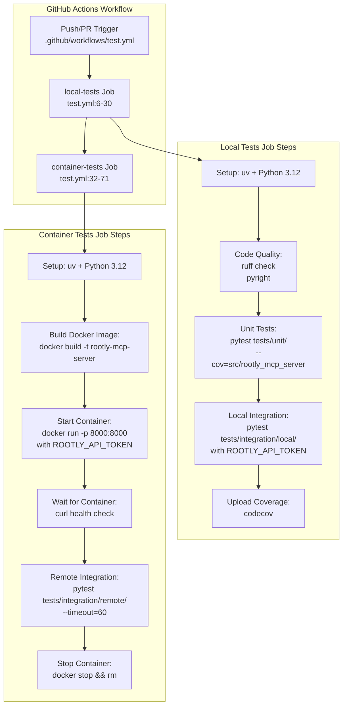
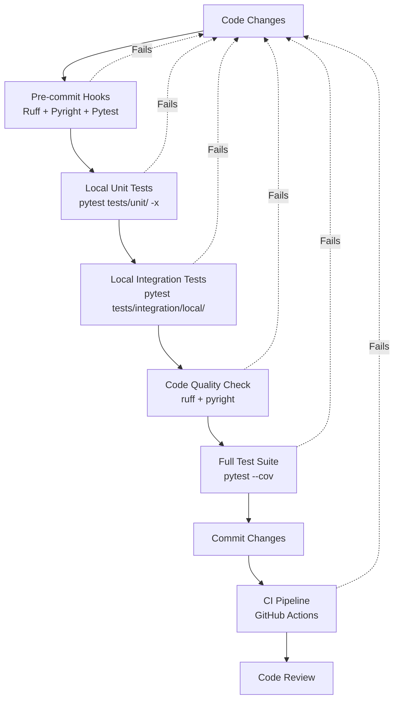

<!-- source: DeepWiki mcp.deepwiki.com · repo Rootly-AI-Labs/Rootly-MCP-server · page 5.3 Testing Strategy · fetched 2026-10-26 -->

# Testing Strategy

<details>
<summary>Relevant source files</summary>

The following files were used as context for generating this wiki page:

- [.github/workflows/test.yml](.github/workflows/test.yml)
- [src/rootly_mcp_server/smart_utils.py](src/rootly_mcp_server/smart_utils.py)
- [tests/README.md](tests/README.md)
- [tests/integration/local/test_smart_tools.py](tests/integration/local/test_smart_tools.py)
- [tests/integration/remote/test_essential.py](tests/integration/remote/test_essential.py)
- [tests/unit/test_server.py](tests/unit/test_server.py)
- [tests/unit/test_smart_utils.py](tests/unit/test_smart_utils.py)

</details>


## Purpose and Scope

This document describes the comprehensive testing strategy for the Rootly MCP Server. It covers the testing pyramid architecture (unit tests, local integration tests, remote integration tests), test organization and structure, shared fixtures and utilities, execution workflows, and coverage requirements.

For information about code quality tools and pre-commit hooks, see [Code Quality & Hooks](#5.4).  
For information about CI/CD pipelines that execute these tests, see [CI/CD Overview](#6.1).  
For information about test fixtures and shared utilities, see [Test Fixtures & Utilities](#5.5).

---

## Testing Pyramid Architecture

The Rootly MCP Server employs a classic testing pyramid with four distinct layers, each serving a specific purpose in the validation strategy.

**Diagram: Testing Pyramid with Test Counts and Execution Speed**



Sources: [tests/README.md:80-119]()

**Test Layer Characteristics:**

| Layer | Test Count | Speed | Dependencies | Purpose |
|-------|-----------|-------|--------------|---------|
| Unit | 31 tests | ~30s | None (mocked) | Test isolated logic, server creation, authentication, utilities |
| Local Integration | 13 tests | ~30s | Local config, env token | Test with real configuration and smart tools |
| Remote Integration | 13 tests | ~60s | Docker container, API | Test containerized server and API connectivity |
| Manual | Interactive | Manual | Live server | Manual verification and debugging |

Sources: [tests/README.md:82-119]()

---

## Test Organization and Directory Structure

**Diagram: Test Directory Structure with Key Files**



Sources: [tests/README.md:32-46]()

The test suite is organized hierarchically:

- **`tests/conftest.py`**: Shared fixtures and configuration used across all test files
- **`tests/unit/`**: Unit tests with no external dependencies, fully mocked
- **`tests/integration/local/`**: Integration tests using local server configuration
- **`tests/integration/remote/`**: Integration tests against containerized server
- **`tests/test_client.py`**: Interactive manual testing utility

Sources: [tests/README.md:32-46]()

---

## Unit Tests

Unit tests provide fast, isolated validation of individual components without external dependencies. All external services are mocked.

**Diagram: Unit Test Coverage Map**



Sources: [tests/unit/test_server.py:1-393](), [tests/unit/test_smart_utils.py:1-482]()

### Unit Test Categories

**1. Server Creation and Configuration** ([tests/unit/test_server.py:26-91]()):
- `test_create_server_with_defaults`: Default parameter validation
- `test_create_server_with_custom_name`: Custom naming
- `test_create_server_hosted_mode`: Hosted vs local mode
- `test_create_server_with_custom_paths`: Allowed path filtering
- `test_create_server_with_swagger_path`: Explicit spec path

**2. HTTP Client Functionality** ([tests/unit/test_server.py:94-154]()):
- `test_client_initialization_local_mode`: Local mode with environment token
- `test_client_initialization_hosted_mode`: Hosted mode without token
- `test_client_with_custom_base_url`: Custom base URL configuration
- `test_get_api_token_success`: Token retrieval
- `test_get_api_token_missing`: Missing token handling

**3. OpenAPI Spec Processing** ([tests/unit/test_server.py:157-369]()):
- `test_load_spec_from_file`: Local file loading
- `test_load_spec_from_url`: Remote URL fetching
- `test_filter_spec_with_allowed_paths`: Path filtering logic
- `test_filter_spec_adds_pagination_to_alerts`: Pagination injection
- `test_filter_spec_preserve_structure`: Structure preservation

**4. Smart Utilities** ([tests/unit/test_smart_utils.py:16-482]()):
- `test_preprocess_text`: Text normalization
- `test_extract_services`: Service name extraction
- `test_extract_error_patterns`: Error pattern detection
- `test_calculate_similarity_with_ml`: TF-IDF similarity with ML libraries
- `test_calculate_similarity_fallback`: Keyword-based similarity fallback
- `test_extract_action_items`: Action extraction from resolution text
- `test_identify_common_patterns`: Pattern identification across incidents

Sources: [tests/unit/test_server.py:26-393](), [tests/unit/test_smart_utils.py:16-482]()

### Running Unit Tests

```bash
# Run all unit tests
uv run pytest tests/unit/ -v

# Run with coverage
uv run pytest tests/unit/ --cov=src/rootly_mcp_server --cov-report=xml

# Run specific test class
uv run pytest tests/unit/test_server.py::TestServerCreation -v

# Stop on first failure
uv run pytest tests/unit/ -x
```

Sources: [tests/README.md:88-95]()

---

## Local Integration Tests

Local integration tests validate functionality with real configuration and environment tokens, but still use local resources (no Docker containers).

**Diagram: Local Integration Test Architecture**



Sources: [tests/integration/local/test_smart_tools.py:12-461]()

### Local Integration Test Cases

**1. Smart Tool Functionality** ([tests/integration/local/test_smart_tools.py:90-118]()):
- `test_find_related_incidents_success`: Similarity calculation with payment incidents
- `test_suggest_solutions_with_incident_id`: Solution extraction with incident ID
- `test_suggest_solutions_with_text_input`: Solution extraction with text description
- `test_related_incidents_no_matches`: Empty result handling

**2. Advanced Similarity Features** ([tests/integration/local/test_smart_tools.py:195-328]()):
- `test_high_similarity_threshold`: Threshold filtering
- `test_solution_extraction_patterns`: Action pattern extraction (restart, clear, update, fix, rollback, scale)
- `test_service_extraction_patterns`: Service name detection (payment-service, authapi, user.service, elasticsearch)
- `test_partial_matching_improvements`: Fuzzy keyword matching
- `test_find_related_incidents_with_text_description`: Text-based similarity without incident ID

**3. Status Filtering** ([tests/integration/local/test_smart_tools.py:409-461]()):
- `test_status_filter_functionality`: Status-based incident filtering (resolved, investigating, open)

### Mock Data Structure

Local integration tests use realistic mock incident data:

```python
# Example mock incident structure
{
    "id": "1001",
    "attributes": {
        "title": "Payment API timeout errors",
        "summary": "Users cannot complete payments due to timeout",
        "status": "resolved",
        "created_at": "2024-01-01T10:00:00Z",
        "resolved_at": "2024-01-01T11:30:00Z"
    }
}
```

Sources: [tests/integration/local/test_smart_tools.py:27-73]()

### Running Local Integration Tests

```bash
# Run all local integration tests
uv run pytest tests/integration/local/ -v

# With API token
export ROOTLY_API_TOKEN="rootly_your_token"
uv run pytest tests/integration/local/ -v

# Stop on first failure
uv run pytest tests/integration/local/ -x
```

Sources: [tests/README.md:97-106]()

---

## Remote Integration Tests

Remote integration tests validate the containerized server against real API endpoints, simulating production deployment.

**Diagram: Remote Integration Test Flow**



Sources: [tests/integration/remote/test_essential.py:176-324]()

### Remote Test Categories

**1. Essential Container Tests** ([tests/integration/remote/test_essential.py:178-324]()):
- `test_container_server_connectivity`: Verify container is reachable
- `test_container_authentication`: Validate Bearer token authentication
- `test_remote_tool_listing`: Verify 20+ tools are available
- `test_remote_search_incidents_execution`: Test core search functionality
- `test_remote_response_time`: Validate response time < 10s for tools, < 15s for execution

**2. Resilience Tests** ([tests/integration/remote/test_essential.py:328-375]()):
- `test_remote_server_handles_malformed_requests`: Graceful error handling
- `test_remote_server_concurrent_requests`: Concurrent request handling (3 simultaneous)

**3. Environment Validation** ([tests/integration/remote/test_essential.py:379-398]()):
- `test_skip_without_token_fixture_usage`: Skip logic when no token
- `test_token_environment_detection`: Environment detection

### ContainerClient Implementation

The `ContainerClient` class ([tests/integration/remote/test_essential.py:17-173]()) provides a test harness for remote server validation:

```python
class ContainerClient:
    """Container client for testing Docker-containerized MCP server."""
    
    def __init__(self, url: str | None = None):
        self.url = url or os.getenv("MCP_SERVER_URL", "http://localhost:8000")
        self.authenticated = False
        self._token = None
        self.client = httpx.AsyncClient(timeout=30.0)
    
    async def health_check(self)
    async def authenticate(self, bearer_token: str)
    async def list_tools(self)
    async def call_tool(self, tool_name: str, arguments: dict)
    async def close(self)
```

Sources: [tests/integration/remote/test_essential.py:17-173]()

### Running Remote Integration Tests

```bash
# Run remote tests
export ROOTLY_API_TOKEN="rootly_your_token"
export MCP_SERVER_URL="http://localhost:8000"
uv run pytest tests/integration/remote/ -v

# With timeout
uv run pytest tests/integration/remote/ --timeout=60

# Specific test
uv run pytest tests/integration/remote/test_essential.py::TestContainerServerEssentials::test_container_server_connectivity -v
```

Sources: [tests/README.md:107-119](), [.github/workflows/test.yml:62-66]()

---

## Test Markers and Filtering

The test suite uses pytest markers for selective test execution.

**Test Marker Hierarchy:**

| Marker | Purpose | Test Count | Files |
|--------|---------|-----------|-------|
| `@pytest.mark.unit` | Fast, isolated, mocked tests | 31 | `tests/unit/*.py` |
| `@pytest.mark.integration` | Tests with real dependencies | 26 | `tests/integration/**/*.py` |
| `@pytest.mark.remote` | Remote server/container tests | 13 | `tests/integration/remote/*.py` |

**Marker Usage Examples:**

```bash
# Run only unit tests
uv run pytest -m unit

# Run only integration tests
uv run pytest -m integration

# Run only remote tests
uv run pytest -m remote

# Skip remote tests
uv run pytest -m "not remote"

# Combine markers
uv run pytest -m "integration and not remote"
```

Sources: [tests/README.md:120-137]()

**Marker Application in Code:**

```python
# Unit test example
@pytest.mark.unit
class TestServerCreation:
    """Test server creation with various configurations."""
    
    def test_create_server_with_defaults(self):
        # Test implementation
        pass

# Remote integration test example
@pytest.mark.remote
@pytest.mark.integration
class TestContainerServerEssentials:
    """Test only the critical container server functionality."""
    
    async def test_container_server_connectivity(self):
        # Test implementation
        pass
```

Sources: [tests/unit/test_server.py:26-27](), [tests/integration/remote/test_essential.py:176-178]()

---

## Manual Testing Utility

The `test_client.py` script provides an interactive testing interface for manual verification and debugging.

**Manual Testing Tool Features:**

```python
# tests/test_client.py structure
class TestClient:
    """Interactive test client for manual server verification."""
    
    def test_server_initialization(self):
        """Test server creates with expected tool count (24+ tools)."""
    
    def test_authentication_modes(self):
        """Test both hosted and local authentication modes."""
    
    def test_search_incidents(self):
        """Test search_incidents tool with pagination limits."""
    
    def test_api_connectivity(self):
        """Test API connectivity and error handling."""
```

**Usage Scenarios:**

1. **Debugging Authentication Issues**: Test both hosted and local modes
2. **Verifying New Functionality**: Manual validation before automated tests
3. **Troubleshooting API Connectivity**: Direct API interaction
4. **Testing Against Live Server**: Real-time server validation

**Running Manual Tests:**

```bash
# Interactive mode
python tests/test_client.py

# With specific token
export ROOTLY_API_TOKEN="rootly_your_token"
python tests/test_client.py
```

Sources: [tests/README.md:167-186]()

---

## Test Fixtures and Shared Utilities

Shared test fixtures are defined in `tests/conftest.py` and provide reusable test infrastructure.

**Diagram: Test Fixture Dependency Graph**



Sources: [tests/conftest.py]() (implied), [tests/integration/local/test_smart_tools.py:15-88]()

### Key Fixture Categories

**1. Environment Fixtures:**
- `test_environment`: Detects CI environment and token availability
- `api_token`: Provides `ROOTLY_API_TOKEN` from environment
- `skip_if_no_token`: Skips tests when token is unavailable

**2. Mock Fixtures:**
- `mock_environment_token`: Returns `"rootly_test_token_123..."` for unit tests
- `mock_httpx_client`: Mocks HTTPX client for HTTP operations
- `mock_api_response`: Provides mock JSON:API response structure

**3. Server Fixtures:**
- `server_with_smart_tools`: Creates server instance with local swagger spec

**4. Test Data Fixtures:**
- `mock_historical_incidents`: 4 resolved incidents with various patterns
- `mock_target_incident`: Current incident for similarity matching

Sources: [tests/integration/local/test_smart_tools.py:15-88](), [tests/unit/test_server.py:29-47]()

---

## CI/CD Test Execution

The GitHub Actions workflow defines the automated test execution strategy.

**Diagram: CI/CD Test Pipeline**



Sources: [.github/workflows/test.yml:1-71]()

### CI/CD Test Stages

**Stage 1: Local Tests Job** ([.github/workflows/test.yml:6-30]()):
1. Setup Python 3.12 and uv
2. Run code quality checks (ruff, pyright)
3. Execute unit tests with coverage
4. Execute local integration tests with `ROOTLY_API_TOKEN`
5. Upload coverage to Codecov

**Stage 2: Container Tests Job** ([.github/workflows/test.yml:32-71]()):
1. Setup Python 3.12 and uv (depends on local-tests passing)
2. Build Docker image
3. Start containerized server with token
4. Wait for container health check
5. Execute remote integration tests against container
6. Cleanup (stop and remove container)

Sources: [.github/workflows/test.yml:1-71]()

### CI/CD Performance Targets

| Stage | Target Time | Actual Time |
|-------|-------------|-------------|
| Code Quality | <30 seconds | ~15 seconds |
| Unit Tests | <30 seconds | ~25 seconds |
| Local Integration | <30 seconds | ~25 seconds |
| Container Build | <2 minutes | ~90 seconds |
| Remote Integration | <60 seconds | ~45 seconds |
| **Total Pipeline** | **<5 minutes** | **~3-4 minutes** |

Sources: [tests/README.md:289-296]()

---

## Coverage Requirements and Reporting

The test suite targets comprehensive code coverage with specific thresholds for different components.

**Coverage Strategy:**

```bash
# Generate coverage report
uv run pytest tests/unit/ --cov=src/rootly_mcp_server --cov-report=xml

# Generate HTML coverage report
uv run pytest --cov=src/rootly_mcp_server --cov-report=html

# Check coverage with missing lines
uv run pytest --cov=src/rootly_mcp_server --cov-report=term-missing
```

**Coverage Targets by Module:**

| Module | Target Coverage | Test Files | Critical Paths |
|--------|----------------|------------|----------------|
| `server.py` | 85%+ | `test_server.py` | `create_rootly_mcp_server`, `_filter_openapi_spec`, `_load_swagger_spec` |
| `client.py` | 80%+ | `test_server.py` | `AuthenticatedHTTPXClient`, `_get_api_token` |
| `smart_utils.py` | 85%+ | `test_smart_utils.py`, `test_smart_tools.py` | `TextSimilarityAnalyzer`, `SolutionExtractor` |
| `utils.py` | 90%+ | `test_server.py` | `sanitize_parameters_in_spec` |

**Uncovered Code Exceptions:**
- Error handling branches for rare edge cases
- Defensive programming assertions
- Logging statements
- Type checking branches

Sources: [.github/workflows/test.yml:19-20](), [tests/README.md:162-164]()

---

## Development Workflow Integration

The testing strategy integrates with the development workflow at multiple points.

**Diagram: Development Testing Workflow**



**Workflow Steps:**

1. **Pre-commit**: Hooks run automatically on `git commit`
2. **Local Unit Tests**: Fast feedback loop (`uv run pytest tests/unit/ -x`)
3. **Local Integration**: Validate with real config
4. **Code Quality**: Linting and type checking
5. **Full Suite**: Complete validation with coverage
6. **CI Pipeline**: Automated validation on push
7. **Code Review**: Manual validation

Sources: [tests/README.md:139-164]()

### Quick Feedback Commands

```bash
# Fastest: Unit tests only, stop on first failure
uv run pytest tests/unit/ -x

# Medium: Unit + local integration
uv run pytest tests/unit/ tests/integration/local/

# Full: All tests with coverage
uv run pytest --cov=src/rootly_mcp_server --cov-report=term-missing

# Targeted: Specific test
uv run pytest tests/unit/test_server.py::TestServerCreation::test_create_server_with_defaults -v

# Debug: Verbose with print statements
uv run pytest tests/unit/test_smart_utils.py -v -s
```

Sources: [tests/README.md:148-164]()

---

## Troubleshooting Common Test Issues

**Token Configuration Issues:**

```bash
# Check if token is set
env | grep ROOTLY_API_TOKEN

# Validate token format
echo "Token prefix: ${ROOTLY_API_TOKEN:0:7}"  # Should be "rootly_"
echo "Token length: ${#ROOTLY_API_TOKEN}"     # Should be ~71

# Test token directly
curl -H "Authorization: Bearer $ROOTLY_API_TOKEN" \
     -H "Content-Type: application/vnd.api+json" \
     "https://api.rootly.com/v1/incidents" | head -20
```

**Test Timeout Issues:**

```bash
# Run with timeout
uv run pytest --timeout=60

# Specific timeout for slow tests
uv run pytest tests/integration/remote/ --timeout=120

# Check for async issues
uv run pytest -v --tb=short
```

**Import and Dependency Issues:**

```bash
# Reinstall dependencies
uv sync --dev

# Verify installation
uv run python -c "import rootly_mcp_server; print('OK')"

# Check Python path
uv run python -c "import sys; print('\n'.join(sys.path))"
```

**Debugging Specific Tests:**

```bash
# Verbose output with print statements
uv run pytest tests/unit/test_server.py -v -s

# Drop into debugger on failure
uv run pytest tests/unit/test_authentication.py -k "test_local_mode" --pdb

# Show fixtures used
uv run pytest --fixtures tests/unit/test_server.py
```

Sources: [tests/README.md:200-254]()

---

