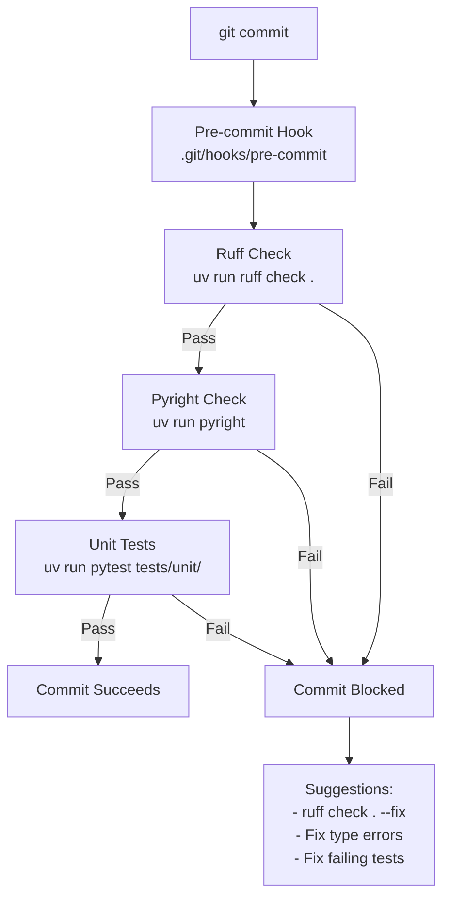
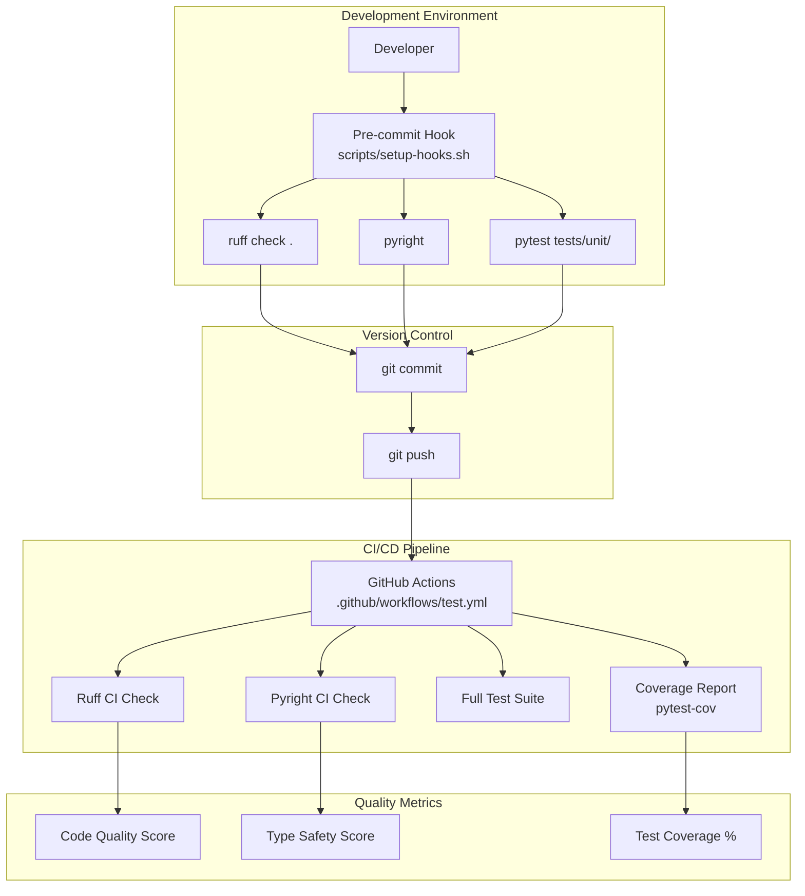
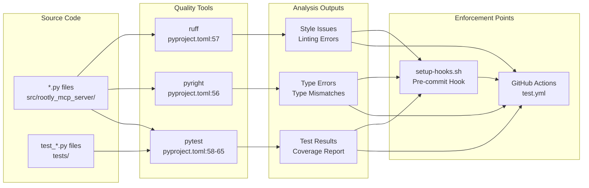

<!-- source: DeepWiki mcp.deepwiki.com · repo Rootly-AI-Labs/Rootly-MCP-server · page 5.4 Code Quality & Hooks · fetched 2026-10-26 -->

# Code Quality & Hooks

<details>
<summary>Relevant source files</summary>

The following files were used as context for generating this wiki page:

- [pyproject.toml](pyproject.toml)
- [scripts/setup-hooks.sh](scripts/setup-hooks.sh)

</details>


This document describes the code quality enforcement mechanisms in the Rootly MCP Server. It covers the pre-commit hook system, linting with Ruff, type checking with Pyright, and the quality standards enforced during development. For information about testing strategies and test execution, see [Testing Strategy](#5.3). For details on dependency management and virtual environments, see [Dependencies & Environment](#5.2).

## Purpose and Scope

The Rootly MCP Server maintains code quality through automated checks that run before every commit. This page documents the pre-commit hook system, the tools used for code quality enforcement, and how to configure and use them during development.

## Pre-commit Hook System

The repository includes a setup script that installs git hooks to enforce quality checks before commits are accepted. The hook system is implemented in [scripts/setup-hooks.sh:1-67]() and creates a pre-commit hook that runs three sequential checks.

### Hook Installation

To install the pre-commit hooks after cloning the repository:

```bash
./scripts/setup-hooks.sh
```

This script creates a pre-commit hook at `.git/hooks/pre-commit` that executes automatically before each commit. The hook can be bypassed using `git commit --no-verify`, though this is not recommended for normal development.

**Sources:** [scripts/setup-hooks.sh:1-67]()

### Pre-commit Workflow

The following diagram shows the execution flow when a developer attempts to commit code:



**Diagram: Pre-commit Hook Execution Flow**

The hook runs three checks in sequence:

1. **Ruff Linting** - Checks code style and common errors [scripts/setup-hooks.sh:23-31]()
2. **Pyright Type Checking** - Validates type annotations [scripts/setup-hooks.sh:33-41]()
3. **Unit Tests** - Runs fast unit tests to catch regressions [scripts/setup-hooks.sh:43-51]()

If any check fails, the commit is blocked and suggestions are provided for fixing the issues.

**Sources:** [scripts/setup-hooks.sh:13-55]()

## Ruff Linting

Ruff is a fast Python linter that enforces code style and detects common programming errors. It is configured as a development dependency in [pyproject.toml:57]().

### Running Ruff

To check code style:

```bash
# Check all files
uv run ruff check .

# Auto-fix issues where possible
uv run ruff check . --fix

# Check specific files
uv run ruff check src/rootly_mcp_server/server.py
```

The pre-commit hook runs Ruff automatically [scripts/setup-hooks.sh:24-30](). If Ruff fails, the commit is blocked with a suggestion to run `ruff check . --fix`.

### Ruff Configuration

Ruff configuration is managed through `pyproject.toml` or `ruff.toml`. The current setup uses Ruff's default rules, which include:

| Category | Description |
|----------|-------------|
| **Pyflakes** | Detects unused imports, undefined names |
| **pycodestyle** | Enforces PEP 8 style guidelines |
| **McCabe** | Checks cyclomatic complexity |

Common issues Ruff catches:
- Unused imports and variables
- Undefined names
- Line length violations
- Import ordering issues
- Missing trailing commas
- Whitespace inconsistencies

**Sources:** [pyproject.toml:57](), [scripts/setup-hooks.sh:23-31]()

## Pyright Type Checking

Pyright is a static type checker for Python that validates type annotations and catches type-related errors. It is included as a development dependency [pyproject.toml:56]().

### Running Pyright

To run type checking:

```bash
# Check all files
uv run pyright

# Check specific files
uv run pyright src/rootly_mcp_server/server.py

# Check with verbose output
uv run pyright --verbose
```

The pre-commit hook runs Pyright after Ruff passes [scripts/setup-hooks.sh:34-40]().

### Type Checking Strategy

The codebase uses type hints extensively to ensure type safety. Key areas with type annotations include:

| Module | Type Coverage |
|--------|---------------|
| **server.py** | Function signatures, return types |
| **client.py** | HTTP client methods, request/response types |
| **utils.py** | Parameter transformation functions |
| **smart_utils.py** | ML analysis functions, data structures |

When Pyright detects type errors, developers can:
1. Fix the type error by correcting the code
2. Add proper type annotations
3. Use `# type: ignore` comments for intentional violations (with justification)

**Sources:** [pyproject.toml:56](), [scripts/setup-hooks.sh:33-41]()

## Quality Check Integration

The following diagram shows how the quality tools integrate with the development and CI/CD workflows:



**Diagram: Quality Checks Across Development and CI/CD**

This shows the two-stage quality enforcement:
1. **Local Stage**: Pre-commit hooks catch issues before code reaches version control
2. **CI/CD Stage**: GitHub Actions performs comprehensive checks on all commits (see [GitHub Actions Pipeline](#6.2))

**Sources:** [scripts/setup-hooks.sh:1-67](), [pyproject.toml:56-57]()

## Running Quality Checks Manually

Developers can run quality checks manually outside of the commit workflow:

### Full Pre-commit Check Simulation

To run all checks exactly as the pre-commit hook does:

```bash
# Ruff linting
uv run ruff check .

# Pyright type checking
uv run pyright

# Unit tests only
uv run pytest tests/unit/ -q --tb=line
```

### Comprehensive Quality Check

To run a more comprehensive check including all tests:

```bash
# All tests with coverage
uv run pytest --cov=src/rootly_mcp_server --cov-report=term-missing

# Specific test categories
uv run pytest -m unit          # Unit tests only
uv run pytest -m integration   # Integration tests
uv run pytest -m remote        # Remote API tests
```

The pytest configuration is defined in [pyproject.toml:67-86](), which sets up:
- Test discovery patterns [pyproject.toml:68-71]()
- Coverage reporting [pyproject.toml:76-78]()
- Test markers for categorization [pyproject.toml:80-85]()

**Sources:** [scripts/setup-hooks.sh:23-51](), [pyproject.toml:67-86]()

## Tool Configuration Matrix

The following table summarizes the quality tools and their configurations:

| Tool | Purpose | Configuration | Version Requirement |
|------|---------|---------------|---------------------|
| **Ruff** | Linting & style | Default rules | >=0.7.3 |
| **Pyright** | Static type checking | Default strict mode | >=1.1.404 |
| **pytest** | Testing framework | pyproject.toml[tool.pytest] | >=8.0.0 |
| **pytest-cov** | Coverage reporting | --cov=src/rootly_mcp_server | >=4.0.0 |
| **pytest-asyncio** | Async test support | asyncio_mode = "auto" | >=0.23.0 |
| **pytest-mock** | Mocking utilities | N/A | >=3.12.0 |
| **pytest-timeout** | Test timeout handling | N/A | >=2.2.0 |

**Sources:** [pyproject.toml:55-65]()

## Quality Standards and Best Practices

### Code Style Standards

The codebase follows these conventions:

1. **PEP 8 Compliance**: Enforced by Ruff
2. **Type Annotations**: Required for public functions and methods
3. **Docstrings**: Required for modules, classes, and public functions
4. **Import Organization**: Stdlib, third-party, local imports (grouped)
5. **Line Length**: Follows Ruff defaults (typically 88-100 characters)

### Type Annotation Guidelines

```
# Good: Explicit type annotations
def create_rootly_mcp_server(
    api_token: str | None = None,
    hosted: bool = False,
    allowed_paths: list[str] | None = None
) -> FastMCP:
    ...

# Good: Return type annotation
def sanitize_parameter_name(name: str) -> str:
    ...

# Acceptable: Type ignore with justification
result = some_complex_operation()  # type: ignore  # Complex union type
```

### Testing Requirements

Pre-commit hooks run unit tests [scripts/setup-hooks.sh:44-50]() to catch regressions early. Unit tests should be:

- **Fast**: Complete in under 1 second per test
- **Isolated**: No external dependencies (use mocks)
- **Focused**: Test one unit of functionality

Integration and remote tests are run in CI/CD but not in pre-commit hooks to maintain fast commit cycles.

**Sources:** [scripts/setup-hooks.sh:43-51](), [pyproject.toml:67-86]()

## Bypassing Quality Checks

While not recommended for normal development, quality checks can be bypassed:

### Skip Pre-commit Hook

```bash
# Skip all pre-commit checks (use with caution)
git commit --no-verify

# Or set environment variable
SKIP=1 git commit
```

### When to Skip

Valid reasons to bypass checks:
- Emergency hotfix commits (fix in next commit)
- Work-in-progress commits on feature branches
- Commits that intentionally break tests (e.g., refactoring)

**Always ensure CI/CD checks pass before merging to main branch.**

**Sources:** [scripts/setup-hooks.sh:66]()

## Code Quality Tool Chain

The following diagram maps the tool chain from source code to quality assurance:



**Diagram: Code Quality Tool Chain**

This diagram shows how source files flow through quality tools to produce analysis outputs, which are then enforced at both local (pre-commit) and remote (CI/CD) checkpoints.

**Sources:** [scripts/setup-hooks.sh:1-67](), [pyproject.toml:55-86]()

## Developer Workflow

The typical development workflow with quality checks:

1. **Clone Repository**
   ```bash
   git clone https://github.com/Rootly-AI-Labs/Rootly-MCP-server.git
   cd Rootly-MCP-server
   ```

2. **Install Dependencies and Hooks**
   ```bash
   uv sync
   ./scripts/setup-hooks.sh
   ```

3. **Develop Features**
   ```bash
   # Write code in src/rootly_mcp_server/
   # Write tests in tests/
   ```

4. **Manual Quality Checks (Optional)**
   ```bash
   uv run ruff check .
   uv run pyright
   uv run pytest tests/unit/
   ```

5. **Commit Changes**
   ```bash
   git add .
   git commit -m "Add feature"
   # Pre-commit hooks run automatically
   ```

6. **Push to Remote**
   ```bash
   git push origin feature-branch
   # GitHub Actions runs full quality checks
   ```

The pre-commit hooks provide immediate feedback, catching issues before they reach CI/CD. This reduces the feedback loop and maintains high code quality throughout the development process.

**Sources:** [scripts/setup-hooks.sh:1-67](), [pyproject.toml:55-86]()

---

