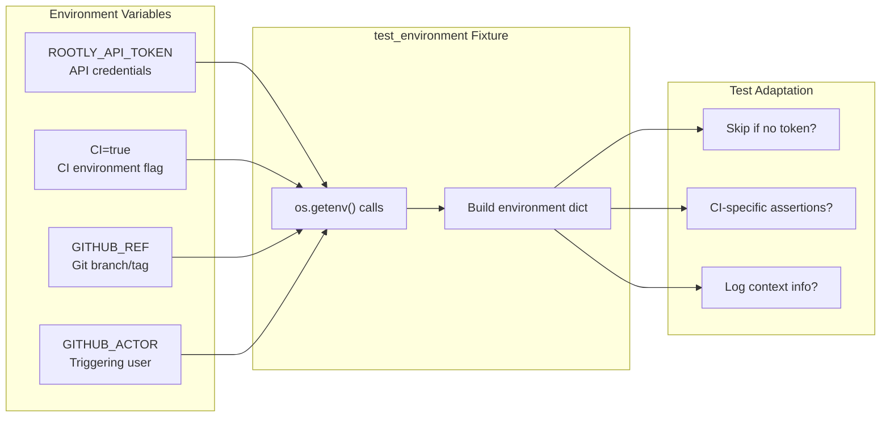
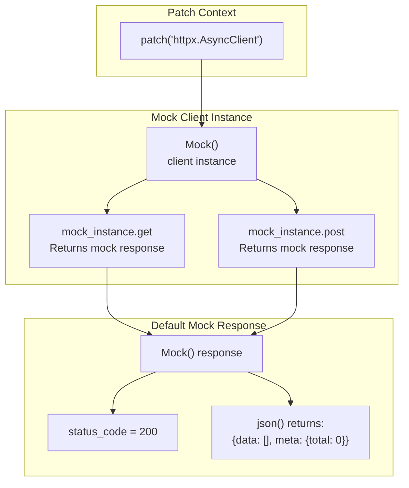
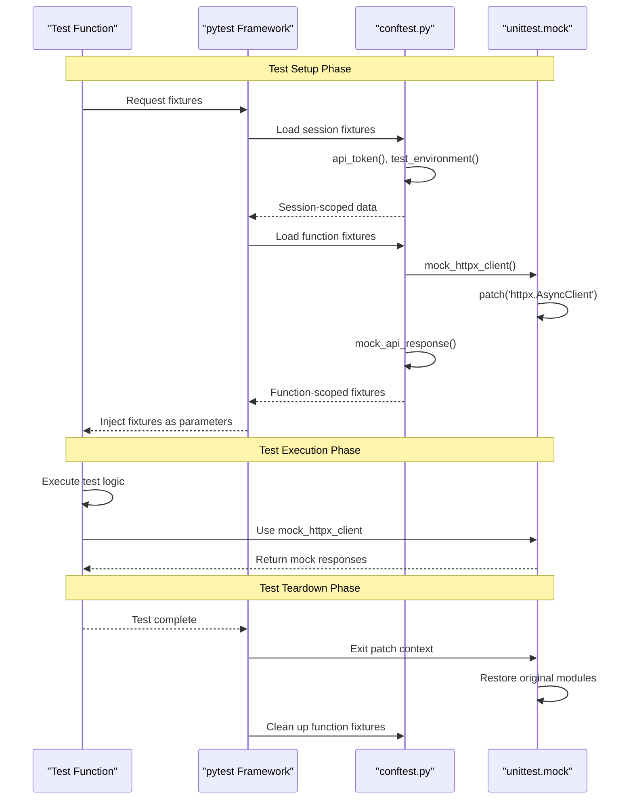
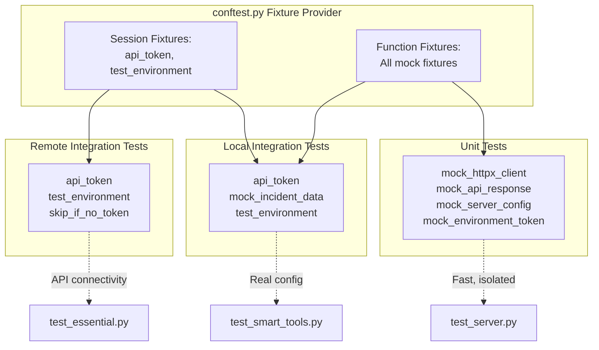

<!-- source: DeepWiki mcp.deepwiki.com · repo Rootly-AI-Labs/Rootly-MCP-server · page 5.5 Test Fixtures & Utilities · fetched 2026-10-26 -->

# Test Fixtures & Utilities

<details>
<summary>Relevant source files</summary>

The following files were used as context for generating this wiki page:

- [tests/conftest.py](tests/conftest.py)
- [tests/unit/test_server.py](tests/unit/test_server.py)

</details>


This page documents the shared test fixtures and utilities provided by `tests/conftest.py`, which serve as the foundation for the test suite across unit, integration, and remote tests. These fixtures provide consistent API token management, mock configurations, sample data, and HTTP client mocking capabilities.

For information about the overall testing strategy and test organization, see [Testing Strategy](#5.3). For code quality tooling and pre-commit hooks, see [Code Quality & Hooks](#5.4).

## Purpose and Scope

The `conftest.py` module centralizes reusable test infrastructure to ensure consistent behavior across all test modules. It provides:

- **Token Management**: Secure loading of API tokens with graceful skipping when unavailable
- **Environment Detection**: CI/CD and local environment identification
- **Mock Utilities**: Factory functions for creating realistic API responses
- **Sample Data**: Pre-configured incident and configuration data
- **HTTP Mocking**: HTTPX client mocking for isolated unit tests
- **Test Markers**: Pytest markers for async support and test categorization

Sources: [tests/conftest.py:1-167]()

## Fixture Architecture

The fixture system is organized into three scopes: session-level (shared across entire test run), function-level (created per test), and mock utilities (contextual patches).

### Fixture Dependency Graph

```mermaid
graph TB
    subgraph "Session Scope (Shared)"
        api_token["api_token()<br/>ROOTLY_API_TOKEN env var<br/>Skips if unavailable"]
        test_environment["test_environment()<br/>has_token, is_ci, github_ref"]
    end
    
    subgraph "Function Scope (Per Test)"
        mock_api_response["mock_api_response()<br/>Returns: create_response factory"]
        mock_incident_data["mock_incident_data()<br/>Returns: List of incident dicts"]
        mock_server_config["mock_server_config()<br/>Returns: Server config dict"]
        skip_if_no_token["skip_if_no_token()<br/>pytest.skip() conditional"]
    end
    
    subgraph "Context Managers (Patches)"
        mock_httpx_client["mock_httpx_client()<br/>patch httpx.AsyncClient"]
        mock_environment_token["mock_environment_token()<br/>patch os.environ"]
    end
    
    subgraph "Test Classes"
        TestServerCreation["TestServerCreation<br/>test_server.py:26-91"]
        TestAuthenticatedHTTPXClient["TestAuthenticatedHTTPXClient<br/>test_server.py:94-154"]
        TestSwaggerSpecLoading["TestSwaggerSpecLoading<br/>test_server.py:157-213"]
    end
    
    api_token --> TestAuthenticatedHTTPXClient
    test_environment -.-> TestServerCreation
    
    mock_httpx_client --> TestServerCreation
    mock_httpx_client --> TestAuthenticatedHTTPXClient
    mock_environment_token --> TestAuthenticatedHTTPXClient
    
    mock_api_response --> TestServerCreation
    mock_incident_data -.-> TestServerCreation
    mock_server_config -.-> TestServerCreation
```



Sources: [tests/conftest.py:17-167](), [tests/unit/test_server.py:26-154]()

## Token Management System

Token management fixtures provide secure access to API credentials while gracefully handling environments where tokens are unavailable (e.g., pull requests from forks).

### api_token Fixture

The `api_token` fixture is session-scoped and loads the `ROOTLY_API_TOKEN` environment variable. If the token is not available, it automatically skips the test with an informative message.

**Fixture Definition**: [tests/conftest.py:17-28]()

**Key Characteristics**:
- **Scope**: Session (loaded once per test run)
- **Source**: `os.getenv("ROOTLY_API_TOKEN")`
- **Behavior**: Calls `pytest.skip()` if token is unavailable
- **Usage**: Required for integration and remote tests

**Example Usage**:
```python
@pytest.mark.integration
def test_list_incidents(api_token):
    client = RootlyClient(api_token=api_token)
    result = client.list_incidents()
    assert result["data"] is not None
```

### skip_if_no_token Fixture

For tests that can proceed with mock data but require skipping in certain scenarios, the `skip_if_no_token` fixture provides conditional skipping logic.

**Fixture Definition**: [tests/conftest.py:155-163]()

**Usage Pattern**:
```python
def test_api_dependent_feature(skip_if_no_token, other_fixtures):
    # Test proceeds only if token is available
    pass
```

### mock_environment_token Fixture

The `mock_environment_token` fixture temporarily patches `os.environ` with a test token, useful for testing token loading logic without requiring actual credentials.

**Fixture Definition**: [tests/conftest.py:143-152]()

**Key Features**:
- Creates temporary test token: `"rootly_test_token_123456789"`
- Uses `patch.dict(os.environ)` context manager
- Automatically restores original environment after test
- Returns the mock token value

**Example Usage**: [tests/unit/test_server.py:97-109]()

Sources: [tests/conftest.py:17-28](), [tests/conftest.py:143-163](), [tests/unit/test_server.py:97-109]()

## Test Environment Detection

The `test_environment` fixture provides comprehensive information about the test execution context, enabling tests to adapt behavior based on where they're running.

### Environment Information Dictionary

**Fixture Definition**: [tests/conftest.py:31-47]()

**Returns**:
```python
{
    "has_token": bool,      # Whether ROOTLY_API_TOKEN is set
    "is_ci": bool,          # Whether running in CI (CI=true)
    "github_ref": str,      # Git reference (e.g., refs/heads/main)
    "github_actor": str     # GitHub username triggering the workflow
}
```

### Test Environment Flow



Sources: [tests/conftest.py:31-47]()

## Mock Response Utilities

The `mock_api_response` fixture provides a factory function for creating realistic Rootly API responses without making actual HTTP calls.

### Response Factory Function

**Fixture Definition**: [tests/conftest.py:50-73]()

**Factory Signature**:
```python
def create_response(
    data: Optional[List] = None,
    meta: Optional[Dict] = None,
    status_code: int = 200
) -> Dict[str, Any]
```

**Default Response Structure**:
```python
{
    "data": [],                    # List of resource objects
    "meta": {                      # Pagination metadata
        "total": 0,
        "page": 1
    },
    "status_code": 200
}
```

### Usage in Unit Tests

The factory is used extensively in unit tests to simulate API responses:

**Example**: [tests/unit/test_server.py:29-47]()
```python
def test_create_server_with_defaults(self, mock_httpx_client, mock_api_response):
    # mock_api_response provides the factory function
    # mock_httpx_client uses it to configure responses
    response = mock_api_response(
        data=[{"id": "1", "type": "incidents"}],
        meta={"total": 1}
    )
```

Sources: [tests/conftest.py:50-73](), [tests/unit/test_server.py:29-47]()

## Sample Data Fixtures

Sample data fixtures provide realistic data structures matching the Rootly API's JSON:API format, useful for testing parsing, transformation, and display logic.

### mock_incident_data Fixture

The `mock_incident_data` fixture returns a list of two sample incidents with different statuses and severities.

**Fixture Definition**: [tests/conftest.py:76-106]()

**Data Structure**:
```python
[
    {
        "id": "1",
        "type": "incidents",
        "attributes": {
            "title": "Database connection timeout",
            "summary": "Users experiencing slow response times",
            "status": "investigating",
            "severity": "high",
            "created_at": "2025-08-21T10:00:00Z"
        }
    },
    {
        "id": "2",
        "type": "incidents",
        "attributes": {
            "title": "API rate limiting activated",
            "summary": "High traffic causing rate limits",
            "status": "resolved",
            "severity": "medium",
            "created_at": "2025-08-21T09:30:00Z"
        }
    }
]
```

**Key Characteristics**:
- **Format**: JSON:API compliant (type + attributes structure)
- **Diversity**: Multiple statuses (investigating, resolved) and severities
- **Timestamps**: ISO 8601 formatted timestamps
- **Realistic Content**: Plausible incident titles and summaries

Sources: [tests/conftest.py:76-106]()

## Mock HTTP Client

The `mock_httpx_client` fixture provides a fully configured mock HTTPX client for testing HTTP interactions without network calls.

### Mock Client Configuration

**Fixture Definition**: [tests/conftest.py:124-140]()

**Mocking Strategy**:


### Integration with Test Classes

The mock client is used extensively in unit tests to isolate server logic from HTTP layer:

**Test Class Usage**: [tests/unit/test_server.py:26-91]()

Example test signatures:
```python
def test_create_server_with_defaults(self, mock_httpx_client, mock_api_response)
def test_create_server_with_custom_name(self, mock_httpx_client)
def test_create_server_hosted_mode(self, mock_httpx_client)
```

The fixture ensures:
- No actual network calls during unit tests
- Consistent response structure for all HTTP methods
- Easy customization of response data per test
- Automatic cleanup after test completion

Sources: [tests/conftest.py:124-140](), [tests/unit/test_server.py:26-91]()

## Configuration Mocking

The `mock_server_config` fixture provides a complete server configuration dictionary suitable for testing without external dependencies.

### Configuration Structure

**Fixture Definition**: [tests/conftest.py:109-121]()

**Configuration Keys**:
| Key | Value | Purpose |
|-----|-------|---------|
| `name` | `"TestServer"` | Server instance identifier |
| `hosted` | `False` | Local mode (uses env token) |
| `swagger_path` | `None` | Triggers URL-based spec loading |
| `api_base` | `"https://api.rootly.com/v1"` | Base URL for API requests |

**Usage Context**:
This configuration mirrors the structure expected by `create_rootly_mcp_server()` but with safe defaults that don't require external resources or network access.

Sources: [tests/conftest.py:109-121]()

## Fixture Usage Patterns

The following diagram illustrates how fixtures flow through a typical unit test execution:



### Typical Test Structure

```python
@pytest.mark.unit
class TestServerCreation:
    def test_create_server_with_defaults(
        self, 
        mock_httpx_client,    # Patches httpx.AsyncClient
        mock_api_response     # Provides response factory
    ):
        with patch('rootly_mcp_server.server._load_swagger_spec') as mock_load_spec:
            mock_spec = {...}
            mock_load_spec.return_value = mock_spec
            
            server = create_rootly_mcp_server()
            
            assert server is not None
            assert hasattr(server, 'get_tools')
```

Sources: [tests/unit/test_server.py:26-47](), [tests/conftest.py:1-167]()

## Test Markers and Configuration

The `conftest.py` module configures pytest markers for test categorization and async support.

### Async Support

**Configuration**: [tests/conftest.py:166-167]()

```python
pytestmark = pytest.mark.asyncio  # Default async support for all tests
```

This enables automatic async test support across the entire test suite without requiring explicit marking on each test function.

### Marker Usage in Tests

Tests use markers for categorization:

**Unit Test Marker**: [tests/unit/test_server.py:25-27]()
```python
@pytest.mark.unit
class TestServerCreation:
    """Test server creation with various configurations."""
```

**Available Markers**:
- `@pytest.mark.unit` - Fast, isolated unit tests
- `@pytest.mark.integration` - Local integration tests requiring configuration
- `@pytest.mark.remote` - Remote API tests requiring network access
- `@pytest.mark.asyncio` - Async test support (applied globally by default)

Sources: [tests/conftest.py:166-167](), [tests/unit/test_server.py:25]()

## Fixture Reference Table

| Fixture | Scope | Returns | Purpose |
|---------|-------|---------|---------|
| `api_token` | session | `str` | Real API token from env, skips if unavailable |
| `test_environment` | session | `Dict[str, Any]` | Environment metadata (has_token, is_ci, etc.) |
| `mock_api_response` | function | `Callable` | Factory for creating mock API responses |
| `mock_incident_data` | function | `List[Dict]` | Sample incident data in JSON:API format |
| `mock_server_config` | function | `Dict[str, Any]` | Server configuration for testing |
| `mock_httpx_client` | function | `Mock` | Patched httpx.AsyncClient instance |
| `mock_environment_token` | function | `str` | Temporary test token in environment |
| `skip_if_no_token` | function | `None` | Conditional skip based on token availability |

Sources: [tests/conftest.py:17-167]()

## Integration with Test Suite

The fixtures integrate seamlessly with the test pyramid structure:

### Fixture Distribution Across Test Levels



**Design Principles**:
- **Unit tests**: Use only mock fixtures, no real tokens
- **Local integration tests**: Use real tokens but mock data where appropriate
- **Remote integration tests**: Use real tokens and make actual API calls
- **Session fixtures**: Loaded once per test run for efficiency
- **Function fixtures**: Fresh instance per test for isolation

Sources: [tests/conftest.py:17-167](), [tests/unit/test_server.py:1-393]()

---

