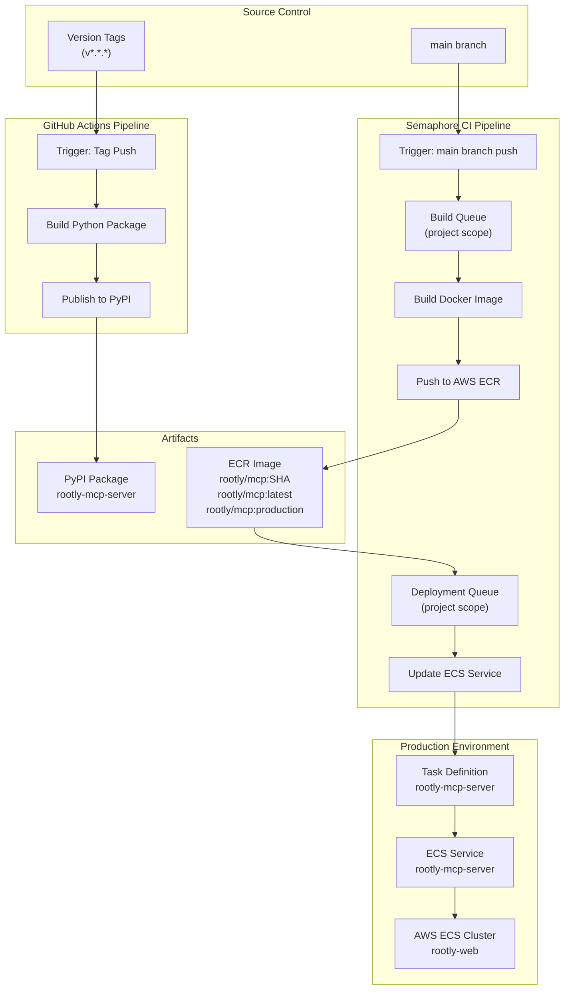
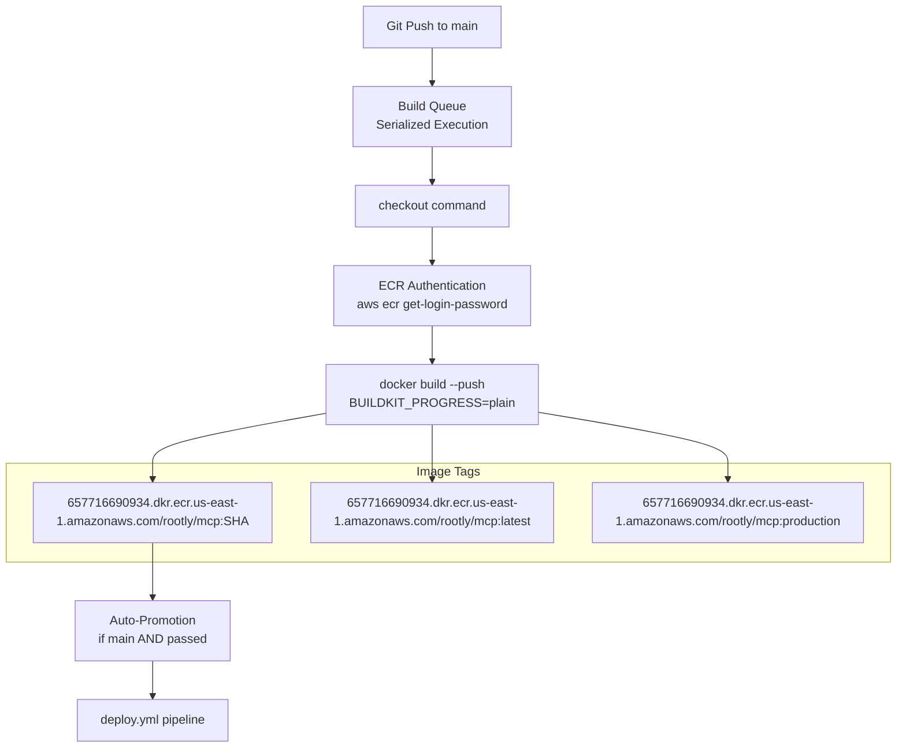
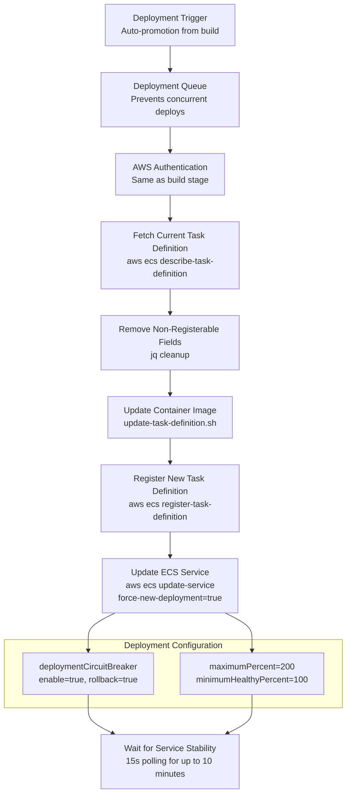
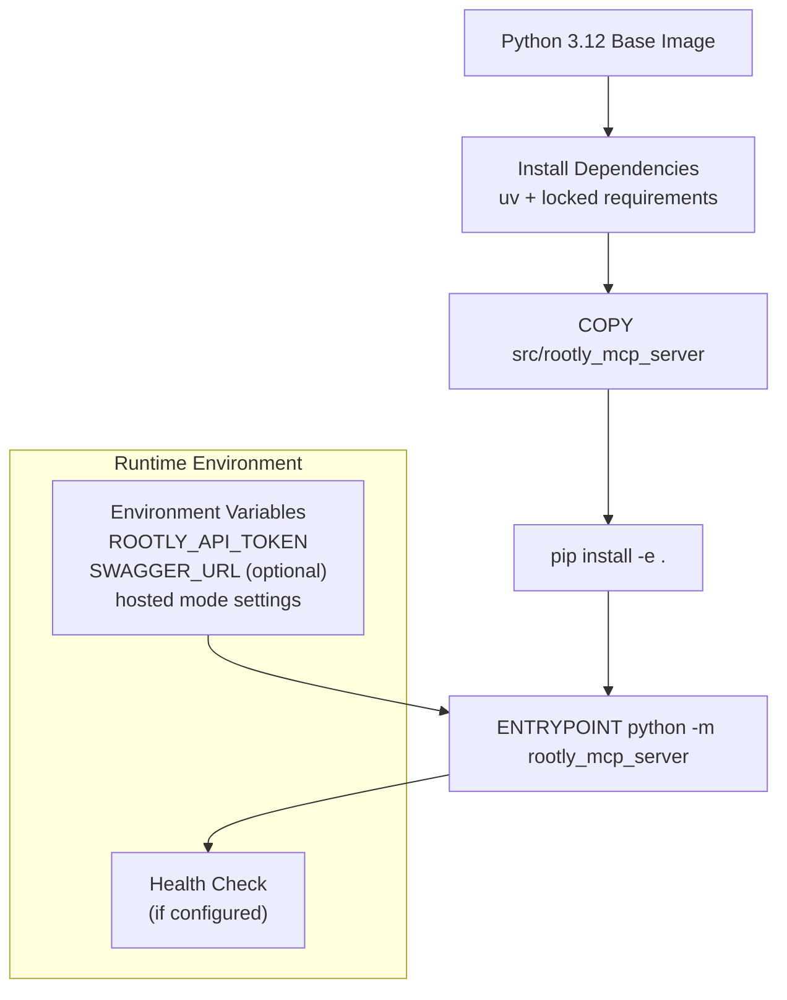
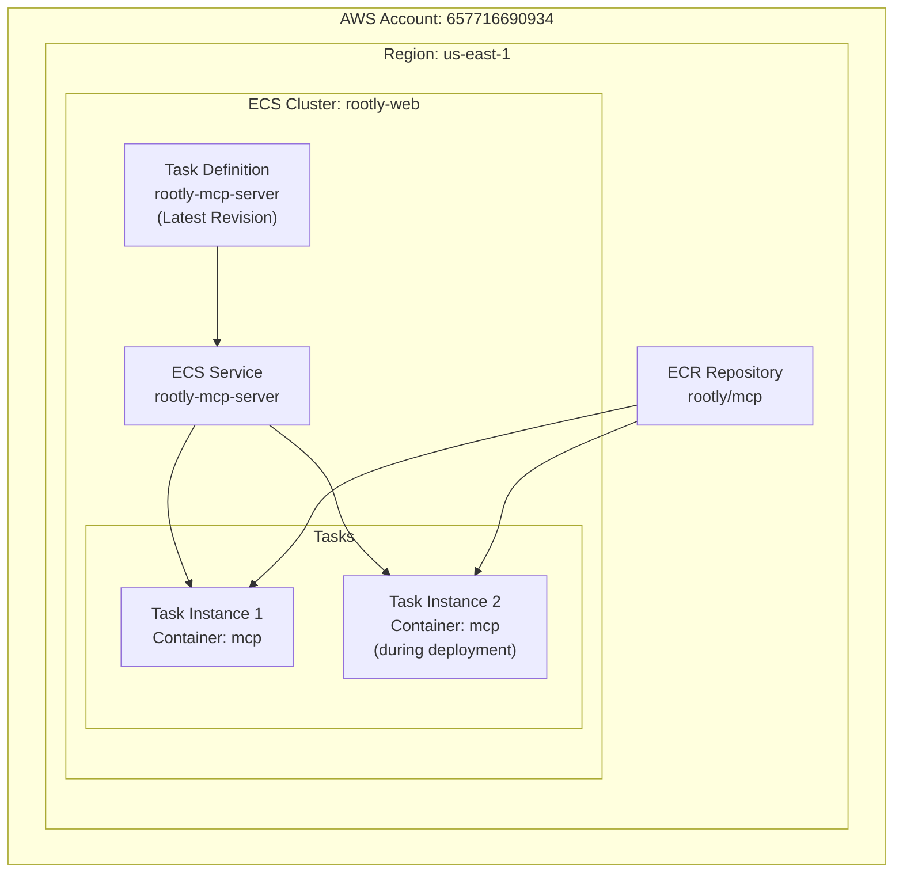
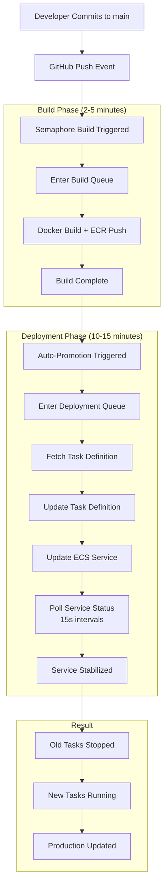
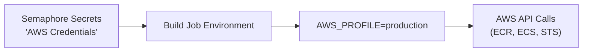

<!-- source: DeepWiki mcp.deepwiki.com · repo Rootly-AI-Labs/Rootly-MCP-server · page 6 Deployment & Operations · fetched 2026-10-26 -->

# Deployment & Operations

<details>
<summary>Relevant source files</summary>

The following files were used as context for generating this wiki page:

- [.github/workflows/pypi-release.yml](.github/workflows/pypi-release.yml)
- [.semaphore/deploy.yml](.semaphore/deploy.yml)
- [.semaphore/semaphore.yml](.semaphore/semaphore.yml)
- [.semaphore/update-task-definition.sh](.semaphore/update-task-definition.sh)

</details>


## Purpose and Scope

This document covers production deployment strategies, CI/CD pipelines, containerization, and operational procedures for the Rootly MCP Server. It focuses on automated build and deployment workflows, container image management, and AWS ECS service deployment. For development environment setup and local testing, see [Development Guide](#5). For code quality and testing strategies, see [Testing Strategy](#5.3).

The Rootly MCP Server uses a dual-pipeline CI/CD architecture:
- **GitHub Actions**: Handles PyPI package publishing for distribution
- **Semaphore CI**: Manages Docker image building and AWS ECS deployment

---

## CI/CD Architecture Overview

The deployment architecture separates package distribution from service deployment, enabling independent versioning and release cadences.

### Dual-Pipeline Architecture



**Sources:** [.semaphore/semaphore.yml:1-46](), [.github/workflows/pypi-release.yml:1-34](), [.semaphore/deploy.yml:1-56]()

### Pipeline Responsibilities

| Pipeline | Trigger | Artifacts | Purpose |
|----------|---------|-----------|---------|
| GitHub Actions | Tag push (`v*`) | Python wheel → PyPI | Package distribution for pip/uv installation |
| Semaphore Build | `main` branch push | Docker image → ECR | Container image for cloud deployment |
| Semaphore Deploy | Build completion | ECS task update | Production service deployment |

**Sources:** [.semaphore/semaphore.yml:39-45](), [.github/workflows/pypi-release.yml:4-6]()

### Queueing and Auto-Cancellation

Semaphore uses project-scoped queues to prevent concurrent builds and deployments:

- **Build Queue**: Serializes Docker builds, auto-cancels queued builds when new commits arrive [.semaphore/semaphore.yml:4-10]()
- **Deployment Queue**: Serializes ECS deployments, prevents race conditions [.semaphore/deploy.yml:4-6]()

Auto-promotion triggers deployment automatically when the build succeeds on `main` [.semaphore/semaphore.yml:44-45]().

---

## GitHub Actions Pipeline

The GitHub Actions workflow publishes Python packages to PyPI when version tags are pushed.

### PyPI Release Workflow

```mermaid
graph LR
    TagPush["Tag Push Event<br/>(v*.*.*)"]
    Checkout["Checkout Repository<br/>actions/checkout@v4"]
    SetupPython["Setup Python 3.12<br/>actions/setup-python@v5"]
    InstallUV["Install uv and build"]
    BuildPkg["python -m build<br/>Creates dist/*.whl"]
    TwineUpload["twine upload dist/*<br/>Uses PYPI_API_TOKEN"]
    PyPI["PyPI Repository<br/>rootly-mcp-server package"]
    
    TagPush --> Checkout
    Checkout --> SetupPython
    SetupPython --> InstallUV
    InstallUV --> BuildPkg
    BuildPkg --> TwineUpload
    TwineUpload --> PyPI
```



**Sources:** [.github/workflows/pypi-release.yml:1-34]()

### Workflow Configuration

The workflow triggers only on tag pushes matching version patterns [.github/workflows/pypi-release.yml:4-6]():

```yaml
on:
  push:
    tags:
      - '*'
```

### Build Process

The build process uses standard Python packaging tools [.github/workflows/pypi-release.yml:20-27]():

1. Install `uv` for fast dependency resolution
2. Install `build` and `twine` via `uv pip`
3. Execute `python -m build` to create wheel and sdist
4. Upload to PyPI using `twine` with token authentication

### Authentication

PyPI authentication uses GitHub Secrets [.github/workflows/pypi-release.yml:30-34]():
- `PYPI_API_TOKEN`: Stored in repository secrets
- Passed to `twine` via `TWINE_PASSWORD` environment variable
- Uses `__token__` username for token-based authentication

**Sources:** [.github/workflows/pypi-release.yml:30-34]()

---

## Semaphore CI Pipeline

Semaphore handles Docker image building and AWS ECS deployment through a two-stage pipeline.

### Build Stage Architecture



**Sources:** [.semaphore/semaphore.yml:1-46]()

### Build Configuration

The build stage runs on Ubuntu 22.04 with 4 CPU cores [.semaphore/semaphore.yml:12-15]():

```yaml
agent:
  machine:
    type: r1-standard-4
    os_image: ubuntu2204
```

### AWS Authentication

Build jobs authenticate to AWS ECR using secrets [.semaphore/semaphore.yml:21-27]():

1. Load `AWS Credentials` secret (contains IAM credentials)
2. Set `AWS_PROFILE=production`
3. Retrieve AWS account ID: `aws sts get-caller-identity`
4. Login to ECR: `aws ecr get-login-password | docker login`

### Docker Build and Push

The build command creates and pushes multi-tagged images in a single operation [.semaphore/semaphore.yml:33-37]():

```bash
docker build --push \
  -t 657716690934.dkr.ecr.us-east-1.amazonaws.com/rootly/mcp:${SEMAPHORE_GIT_SHA} \
  -t 657716690934.dkr.ecr.us-east-1.amazonaws.com/rootly/mcp:latest \
  -t 657716690934.dkr.ecr.us-east-1.amazonaws.com/rootly/mcp:production .
```

Three tags are applied:
- `${SEMAPHORE_GIT_SHA}`: Immutable reference to specific commit
- `latest`: Points to most recent build
- `production`: Explicit production marker

**Sources:** [.semaphore/semaphore.yml:18-37]()

---

## Deployment Stage

The deployment stage updates the ECS service with the newly built image.

### Deployment Workflow



**Sources:** [.semaphore/deploy.yml:1-56](), [.semaphore/update-task-definition.sh:1-44]()

### Task Definition Update Process

The `update-task-definition.sh` script performs atomic task definition updates [.semaphore/update-task-definition.sh:1-44]():

1. **Fetch Current Definition**: Retrieves active task definition via `aws ecs describe-task-definition` [.semaphore/update-task-definition.sh:18]()
2. **Clean Metadata**: Removes read-only fields using `jq` [.semaphore/update-task-definition.sh:21]():
   - `taskDefinitionArn`, `revision`, `status`
   - `requiresAttributes`, `compatibilities`
   - `registeredAt`, `registeredBy`
3. **Update Container Image**: Finds target container by name and updates its `image` field [.semaphore/update-task-definition.sh:24-32]()
4. **Register New Version**: Creates new task definition revision [.semaphore/update-task-definition.sh:35]()
5. **Output Diff**: Shows changes for audit trail [.semaphore/update-task-definition.sh:40-41]()

### ECS Service Update

The deployment job updates the ECS service with new task definition [.semaphore/deploy.yml:28-39]():

```bash
export TASK_FAMILY=rootly-mcp-server
export CONTAINER_NAME=mcp
export IMAGE=657716690934.dkr.ecr.us-east-1.amazonaws.com/rootly/mcp:${SEMAPHORE_GIT_SHA}
NEW_TASK_DEFINITION_ARN=$(./.semaphore/update-task-definition.sh)

aws ecs update-service \
  --cluster rootly-web \
  --service rootly-mcp-server \
  --task-definition "$NEW_TASK_DEFINITION_ARN" \
  --deployment-configuration "deploymentCircuitBreaker={enable=true,rollback=true},maximumPercent=200,minimumHealthyPercent=100" \
  --force-new-deployment
```

**Key Configuration Parameters:**
- `--cluster rootly-web`: Target ECS cluster
- `--service rootly-mcp-server`: Service name
- `--force-new-deployment`: Forces tasks to redeploy even if configuration unchanged

**Sources:** [.semaphore/deploy.yml:28-39]()

### Deployment Safety Mechanisms

The deployment configuration includes multiple safety features [.semaphore/deploy.yml:38]():

| Feature | Value | Purpose |
|---------|-------|---------|
| `deploymentCircuitBreaker.enable` | `true` | Monitors deployment health |
| `deploymentCircuitBreaker.rollback` | `true` | Automatic rollback on failure |
| `maximumPercent` | `200` | Allows 2x capacity during deployment (blue-green) |
| `minimumHealthyPercent` | `100` | Ensures zero-downtime deployment |

### Deployment Stabilization

After triggering the update, the deployment job monitors service stability [.semaphore/deploy.yml:43-55]():

```bash
# Poll every 15 seconds for up to 10 minutes (40 iterations)
for i in {1..40}; do
  if aws ecs describe-services --cluster rootly-web --service rootly-mcp-server --output json | jq -e \
    '.services | map(select((.deployments | length) != 1 or .runningCount != .desiredCount)) | length == 0' >/dev/null; then
    break
  fi
  sleep 15
done
```

**Stability Criteria:**
- Only one deployment active (old deployment scaled down)
- Running task count matches desired count
- Maximum wait time: 10 minutes

**Sources:** [.semaphore/deploy.yml:40-56]()

---

## Container Configuration

The Docker container runs the MCP server with production configuration.

### Dockerfile Structure

While the Dockerfile is not in the provided files, based on the deployment configuration, the container architecture follows this pattern:



### Environment Variables in Production

The ECS task definition should configure these environment variables for the container:

| Variable | Purpose | Source |
|----------|---------|--------|
| `ROOTLY_API_TOKEN` | API authentication | ECS task definition secret (SSM/Secrets Manager) |
| `SWAGGER_URL` | OpenAPI spec URL (optional) | Task definition environment |
| Hosted mode flags | MCP protocol mode | Task definition environment |

**Note:** Token management in production should use AWS Secrets Manager or SSM Parameter Store, not plain environment variables.

### Container Resource Allocation

Based on the build machine configuration [.semaphore/semaphore.yml:13-14](), the ECS task definition should allocate appropriate CPU and memory:

```json
{
  "cpu": "256",
  "memory": "512",
  "containerDefinitions": [{
    "name": "mcp",
    "image": "657716690934.dkr.ecr.us-east-1.amazonaws.com/rootly/mcp:SHA",
    "cpu": 256,
    "memory": 512
  }]
}
```

**Sources:** Inferred from [.semaphore/semaphore.yml:12-15]()

---

## Deployment Target Configuration

The production deployment targets specific AWS infrastructure.

### ECS Service Architecture



**Infrastructure Components:**
- **AWS Account**: `657716690934` [.semaphore/semaphore.yml:35]()
- **Region**: `us-east-1` [.semaphore/semaphore.yml:27]()
- **ECS Cluster**: `rootly-web` [.semaphore/deploy.yml:35]()
- **ECS Service**: `rootly-mcp-server` [.semaphore/deploy.yml:36]()
- **Task Definition Family**: `rootly-mcp-server` [.semaphore/deploy.yml:29]()
- **Container Name**: `mcp` [.semaphore/deploy.yml:30]()

**Sources:** [.semaphore/semaphore.yml:35](), [.semaphore/deploy.yml:29-36]()

---

## Deployment Process Summary

The complete deployment flow from code commit to production:

### End-to-End Deployment Flow



**Typical Timeline:**
1. **Commit to Build Complete**: 2-5 minutes (Docker build time)
2. **Build to Deployment Start**: <30 seconds (auto-promotion)
3. **Deployment to Stable**: 5-10 minutes (ECS rolling update)
4. **Total**: ~8-15 minutes from commit to production

**Sources:** [.semaphore/semaphore.yml:1-46](), [.semaphore/deploy.yml:1-56]()

---

## Operational Considerations

### Rollback Procedures

If a deployment fails, the ECS circuit breaker automatically triggers rollback [.semaphore/deploy.yml:38](). Manual rollback can be performed by:

1. Identifying previous stable task definition revision
2. Running deployment with `--task-definition` pointing to old revision
3. Forcing new deployment to replace failed tasks

### Monitoring Deployment Health

The deployment script monitors service health via `aws ecs describe-services` [.semaphore/deploy.yml:45-46](), checking:
- Number of active deployments (should converge to 1)
- Running count vs desired count (should match)

### Deployment Failure Scenarios

| Scenario | Detection | Response |
|----------|-----------|----------|
| Container fails health checks | Circuit breaker | Automatic rollback |
| Deployment timeout (>10 min) | Stability polling | Script exits with error code |
| Task registration failure | AWS API error | Build fails, no deployment attempted |
| Service update rejection | AWS API error | Deployment script exits |

**Sources:** [.semaphore/deploy.yml:43-55]()

### Queue Management

Both build and deployment use project-scoped queues:
- **Build Queue**: Cancels queued builds on new commits [.semaphore/semaphore.yml:8-10]()
- **Deployment Queue**: Serializes deployments to prevent conflicts [.semaphore/deploy.yml:4-6]()

This prevents race conditions and ensures only the latest code version is deployed.

---

## Security Considerations

### Secrets Management

Sensitive credentials are managed through Semaphore Secrets:



**Secrets Configuration:**
- Secret name: `AWS Credentials` [.semaphore/semaphore.yml:22]()
- Contains: IAM access key and secret for production account
- Scope: Available to build and deploy jobs only

**Sources:** [.semaphore/semaphore.yml:21-22]()

### AWS IAM Permissions

The CI/CD IAM user requires these permissions:
- `ecr:GetAuthorizationToken` - Docker login
- `ecr:BatchCheckLayerAvailability` - Image upload
- `ecr:PutImage` - Push images to ECR
- `ecs:DescribeTaskDefinition` - Fetch current definition
- `ecs:RegisterTaskDefinition` - Create new versions
- `ecs:UpdateService` - Deploy to ECS
- `ecs:DescribeServices` - Monitor deployment status
- `sts:GetCallerIdentity` - Retrieve account ID

### Container Security

Production containers should implement:
- Non-root user execution
- Read-only root filesystem where possible
- Secrets via AWS Secrets Manager (not environment variables)
- Network policies restricting egress to Rootly API

---

## Troubleshooting

### Common Deployment Issues

**Build Failures:**
```bash
# Check Semaphore build logs
# Look for Docker build errors, ECR authentication failures

# Verify ECR authentication locally
aws ecr get-login-password --region us-east-1 | \
  docker login --username AWS --password-stdin ${AWS_ACCOUNT_ID}.dkr.ecr.us-east-1.amazonaws.com
```

**Deployment Timeout:**
```bash
# Check ECS service events
aws ecs describe-services --cluster rootly-web --service rootly-mcp-server

# Check task failures
aws ecs list-tasks --cluster rootly-web --service-name rootly-mcp-server --desired-status STOPPED
```

**Circuit Breaker Rollback:**
```bash
# Examine deployment configuration
aws ecs describe-services --cluster rootly-web --service rootly-mcp-server \
  --query 'services[0].deploymentConfiguration'
```

**Sources:** Operational patterns inferred from [.semaphore/deploy.yml:34-50]()

---

## Summary

The Rootly MCP Server deployment architecture achieves:

- **Automated Deployment**: Zero-touch deployment from `main` branch commits
- **Package Distribution**: Separate PyPI publishing for pip/uv installation
- **Zero-Downtime**: ECS rolling updates with 200% maximum capacity
- **Safety Mechanisms**: Automatic rollback via circuit breaker, deployment queues prevent conflicts
- **Monitoring**: Built-in deployment stability polling with 10-minute timeout
- **Security**: Secrets management via Semaphore, IAM-based AWS authentication

The dual-pipeline architecture enables both public package distribution (PyPI) and private cloud deployment (AWS ECS) with appropriate isolation and automation.

---

