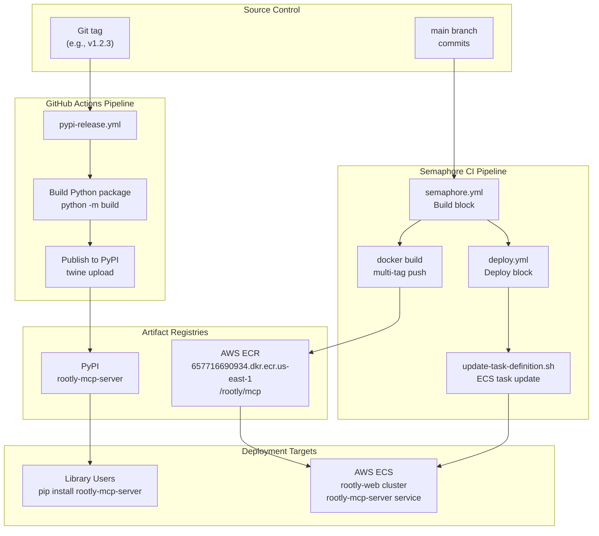
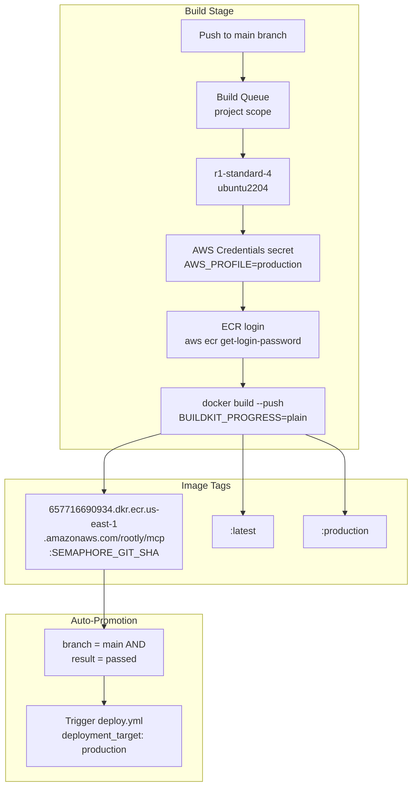
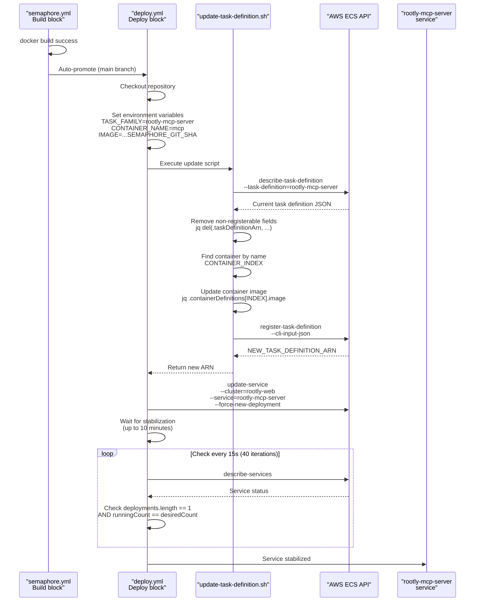
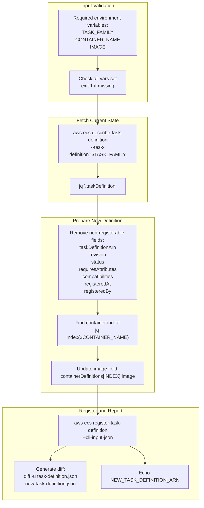
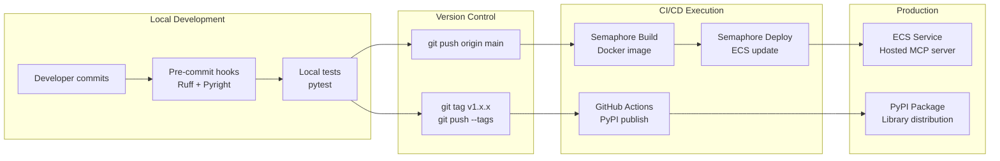

<!-- source: DeepWiki mcp.deepwiki.com · repo Rootly-AI-Labs/Rootly-MCP-server · page 6.1 CI/CD Overview · fetched 2026-10-26 -->

# CI/CD Overview

<details>
<summary>Relevant source files</summary>

The following files were used as context for generating this wiki page:

- [.github/workflows/pypi-release.yml](.github/workflows/pypi-release.yml)
- [.semaphore/deploy.yml](.semaphore/deploy.yml)
- [.semaphore/semaphore.yml](.semaphore/semaphore.yml)
- [.semaphore/update-task-definition.sh](.semaphore/update-task-definition.sh)

</details>


## Purpose and Scope

This page provides a comprehensive overview of the Continuous Integration and Continuous Deployment (CI/CD) architecture for the Rootly MCP Server. The system employs a dual-pipeline approach: GitHub Actions handles automated testing, code quality validation, and PyPI package publishing, while Semaphore CI manages Docker image building and AWS ECS deployment.

For detailed information about specific pipelines, see:
- GitHub Actions testing and PyPI publishing: [6.2](#6.2)
- Semaphore CI and AWS deployment process: [6.3](#6.3)
- Docker containerization details: [6.4](#6.4)

This page focuses on the high-level architecture, how the pipelines interact, and the overall deployment strategy.

---

## Dual-Pipeline Architecture

The Rootly MCP Server uses two independent CI/CD pipelines that serve distinct purposes:

| Pipeline | Platform | Trigger | Purpose | Artifacts |
|----------|----------|---------|---------|-----------|
| **Package Pipeline** | GitHub Actions | Git tags (`*`) | Build and publish Python packages to PyPI | Python wheel (`.whl`) |
| **Service Pipeline** | Semaphore CI | Push to `main` branch | Build Docker images and deploy to AWS ECS | Docker image in ECR |

This separation allows for:
- **Independent versioning**: PyPI packages can be released independently of service deployments
- **Different deployment cadences**: Library users get stable releases via PyPI, while hosted service gets continuous deployment
- **Isolated concerns**: Package distribution (GitHub) is separate from infrastructure deployment (Semaphore)

### Dual-Pipeline Interaction Diagram



**Sources**: [.github/workflows/pypi-release.yml:1-34](), [.semaphore/semaphore.yml:1-46](), [.semaphore/deploy.yml:1-56]()

---

## Pipeline Workflows

### GitHub Actions: PyPI Release Workflow

The GitHub Actions pipeline is triggered exclusively by Git tags and handles Python package distribution.

**Workflow File**: `.github/workflows/pypi-release.yml`

**Trigger Configuration**:
```yaml
on:
  push:
    tags:
      - '*'
```

**Key Steps**:
1. **Checkout**: Repository checkout with `actions/checkout@v4`
2. **Python Setup**: Python 3.12 installation via `actions/setup-python@v5`
3. **Build Tools**: Install `uv`, `build`, and `twine` using `uv pip install --system`
4. **Package Build**: Generate distribution artifacts with `python -m build`
5. **PyPI Upload**: Publish to PyPI using `twine upload` with token authentication

**Authentication**: Uses `PYPI_API_TOKEN` secret stored in GitHub repository settings.

**Sources**: [.github/workflows/pypi-release.yml:1-34]()

### Semaphore CI: Build and Deploy Workflow

Semaphore CI handles Docker containerization and AWS deployment through a two-stage pipeline.

#### Stage 1: Build Pipeline (`semaphore.yml`)



**Configuration Details**:
- **Queue Management**: `Build Queue` with project scope prevents concurrent builds
- **Auto-Cancel**: Queued jobs are cancelled when newer commits arrive ([.semaphore/semaphore.yml:8-10]())
- **Agent**: `r1-standard-4` machine type with Ubuntu 22.04
- **Authentication**: AWS credentials from Semaphore secrets
- **Multi-Tag Push**: Each image receives three tags simultaneously:
  - `${SEMAPHORE_GIT_SHA}`: Specific commit identifier for traceability
  - `latest`: Always points to most recent successful build
  - `production`: Marks production-ready images

**Sources**: [.semaphore/semaphore.yml:1-46]()

#### Stage 2: Deploy Pipeline (`deploy.yml`)

The deployment stage is automatically triggered via promotion when the build succeeds on the `main` branch.



**Deployment Configuration**:
- **Cluster**: `rootly-web` (shared ECS cluster)
- **Service**: `rootly-mcp-server`
- **Circuit Breaker**: Enabled with automatic rollback on failure
- **Rolling Update**: `maximumPercent=200`, `minimumHealthyPercent=100` ([.semaphore/deploy.yml:38]())
- **Stabilization Timeout**: 10 minutes (40 iterations × 15 seconds)

**Sources**: [.semaphore/deploy.yml:1-56](), [.semaphore/update-task-definition.sh:1-44]()

---

## Task Definition Update Mechanism

The `update-task-definition.sh` script implements a sophisticated update strategy for ECS task definitions.

### Update Process Flow



**Key Implementation Details**:

1. **Field Filtering**: Lines [.semaphore/update-task-definition.sh:21]() removes AWS-managed fields that would cause registration to fail
2. **Container Lookup**: Lines [.semaphore/update-task-definition.sh:24]() finds the container by name, not position
3. **Image Update**: Lines [.semaphore/update-task-definition.sh:32]() updates only the image field, preserving all other container configuration
4. **Diff Output**: Lines [.semaphore/update-task-definition.sh:40-41]() displays the exact changes for audit purposes

**Error Handling**:
- Validates all required environment variables are set
- Exits with error code 1 if container name not found in task definition
- Uses `set -e` to fail fast on any command error

**Sources**: [.semaphore/update-task-definition.sh:1-44]()

---

## Queue Management and Concurrency

Both pipelines implement queue management to prevent resource conflicts and ensure predictable deployments.

### GitHub Actions Concurrency

GitHub Actions uses implicit concurrency control:
- Only triggered by Git tags (infrequent events)
- No explicit concurrency group configured
- Multiple tag pushes would run in parallel (acceptable for package builds)

### Semaphore Queue Configuration

Semaphore implements explicit queue management for both build and deployment:

**Build Queue** ([.semaphore/semaphore.yml:4-6]()):
```yaml
queue:
  name: Build Queue
  scope: project
```

**Deployment Queue** ([.semaphore/deploy.yml:4-6]()):
```yaml
queue:
  name: Deployment Queue
  scope: project
```

**Auto-Cancel Policy** ([.semaphore/semaphore.yml:8-10]()):
```yaml
auto_cancel:
  queued:
    when: 'true'
```

This configuration ensures:
- Only one build runs at a time per project
- Only one deployment runs at a time per project
- Queued builds are automatically cancelled when newer commits arrive
- Prevents deployment race conditions on ECS service

---

## Deployment Strategy Summary

| Aspect | GitHub Actions | Semaphore CI |
|--------|----------------|--------------|
| **Trigger** | Git tag push | Main branch commit |
| **Frequency** | Manual (tagged releases) | Automatic (continuous) |
| **Build Time** | ~2-3 minutes | ~5-10 minutes (includes Docker build) |
| **Artifact** | Python wheel | Docker image (multi-tagged) |
| **Registry** | PyPI | AWS ECR (us-east-1) |
| **Target** | Library consumers | AWS ECS production service |
| **Rollback** | Version pinning | ECS circuit breaker + auto-rollback |
| **Concurrency** | Parallel allowed | Serialized via queues |
| **Health Check** | N/A (package only) | 10-minute stabilization wait |

**Sources**: [.github/workflows/pypi-release.yml:1-34](), [.semaphore/semaphore.yml:1-46](), [.semaphore/deploy.yml:1-56]()

---

## Integration with Development Workflow

The CI/CD pipelines integrate with the development workflow described in [Development Guide](#5):



**Key Integration Points**:
1. Pre-commit hooks ([5.4](#5.4)) provide first-line quality checks
2. Local tests ([5.3](#5.3)) validate functionality before push
3. Main branch pushes trigger containerized deployment
4. Tagged releases trigger library distribution
5. Both pipelines depend on the same source code and dependencies

**Sources**: [.github/workflows/pypi-release.yml:1-34](), [.semaphore/semaphore.yml:1-46]()

---

