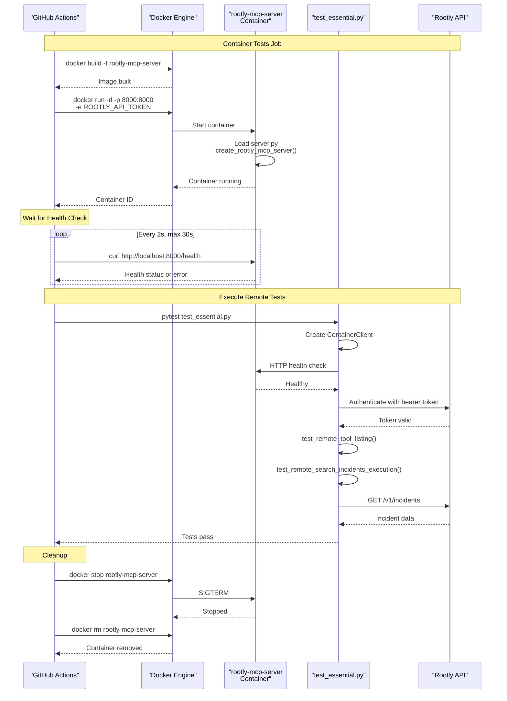
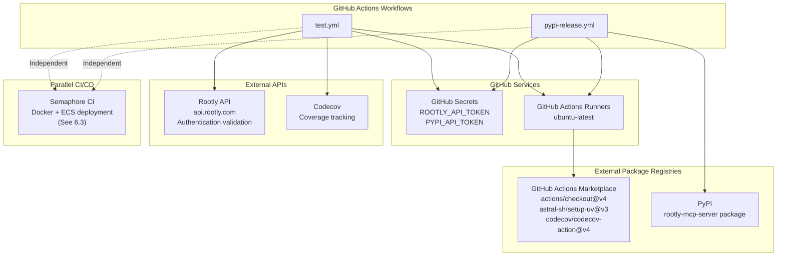

<!-- source: DeepWiki mcp.deepwiki.com · repo Rootly-AI-Labs/Rootly-MCP-server · page 6.2 GitHub Actions Pipeline · fetched 2026-10-26 -->

# GitHub Actions Pipeline

<details>
<summary>Relevant source files</summary>

The following files were used as context for generating this wiki page:

- [.github/workflows/pypi-release.yml](.github/workflows/pypi-release.yml)
- [.github/workflows/test.yml](.github/workflows/test.yml)
- [tests/integration/remote/test_essential.py](tests/integration/remote/test_essential.py)

</details>


## Purpose and Scope

This document describes the GitHub Actions CI/CD pipeline for the Rootly MCP Server. The pipeline provides automated testing, code quality validation, and package publishing to PyPI. For AWS deployment and Semaphore CI configuration, see [Semaphore & AWS Deployment](#6.3). For an overview of the entire CI/CD architecture, see [CI/CD Overview](#6.1).

The GitHub Actions pipeline consists of two primary workflows:
- **Test Workflow** (`.github/workflows/test.yml`): Runs on every push and pull request, executing code quality checks, unit tests, local integration tests, and containerized server tests
- **PyPI Release Workflow** (`.github/workflows/pypi-release.yml`): Triggers on Git tags to build and publish the Python package to PyPI

---

## Workflow Architecture

The GitHub Actions pipeline implements a two-stage testing strategy followed by conditional publishing. The test workflow validates code quality and functionality through both local and containerized environments, while the release workflow handles package distribution.

### Pipeline Overview Diagram

```mermaid
graph TB
    subgraph "Triggers"
        Push["git push"]
        PR["Pull Request"]
        Tag["git tag"]
    end
    
    subgraph "Test Workflow (.github/workflows/test.yml)"
        LocalJob["Job: local-tests"]
        ContainerJob["Job: container-tests"]
        
        subgraph "Local Tests Job"
            Checkout1["actions/checkout@v4"]
            SetupUV1["astral-sh/setup-uv@v3"]
            InstallPython1["uv python install 3.12"]
            Sync1["uv sync --dev"]
            Ruff["uv run ruff check ."]
            Pyright["uv run pyright"]
            UnitTests["pytest tests/unit/<br/>--cov=src/rootly_mcp_server"]
            LocalInteg["pytest tests/integration/local/"]
            UploadCov["codecov/codecov-action@v4"]
        end
        
        subgraph "Container Tests Job"
            Checkout2["actions/checkout@v4"]
            SetupUV2["astral-sh/setup-uv@v3"]
            InstallPython2["uv python install 3.12"]
            DockerBuild["docker build -t rootly-mcp-server"]
            DockerRun["docker run -d -p 8000:8000"]
            WaitHealth["Wait for /health endpoint"]
            RemoteTests["pytest tests/integration/remote/<br/>test_essential.py"]
            Cleanup["docker stop && docker rm"]
        end
    end
    
    subgraph "PyPI Release Workflow (.github/workflows/pypi-release.yml)"
        subgraph "Build & Publish Job"
            Checkout3["actions/checkout@v4"]
            SetupPython["actions/setup-python@v5"]
            InstallBuild["pip install uv<br/>uv pip install build twine"]
            Build["python -m build"]
            Publish["twine upload dist/*"]
        end
    end
    
    Push --> LocalJob
    PR --> LocalJob
    Tag --> Checkout3
    
    Checkout1 --> SetupUV1
    SetupUV1 --> InstallPython1
    InstallPython1 --> Sync1
    Sync1 --> Ruff
    Sync1 --> Pyright
    Ruff --> UnitTests
    Pyright --> UnitTests
    UnitTests --> LocalInteg
    LocalInteg --> UploadCov
    
    LocalJob --> ContainerJob
    Checkout2 --> SetupUV2
    SetupUV2 --> InstallPython2
    InstallPython2 --> DockerBuild
    DockerBuild --> DockerRun
    DockerRun --> WaitHealth
    WaitHealth --> RemoteTests
    RemoteTests --> Cleanup
    
    Checkout3 --> SetupPython
    SetupPython --> InstallBuild
    InstallBuild --> Build
    Build --> Publish
```



**Sources:** [.github/workflows/test.yml:1-71](), [.github/workflows/pypi-release.yml:1-34]()

---

## Test Workflow

The test workflow ([.github/workflows/test.yml:1-71]()) runs on all pushes and pull requests, implementing a comprehensive validation pipeline with two sequential jobs.

### Workflow Configuration

```yaml
name: Tests
on: [push, pull_request]
```

The workflow triggers on any push to the repository or when a pull request is created/updated.

### Job 1: Local Tests

The `local-tests` job ([.github/workflows/test.yml:6-30]()) runs on `ubuntu-latest` and performs fast validation checks without requiring external infrastructure.

#### Setup Steps

| Step | Action | Command | Purpose |
|------|--------|---------|---------|
| Checkout | `actions/checkout@v4` | - | Clone repository code |
| Setup uv | `astral-sh/setup-uv@v3` | - | Install uv package manager |
| Install Python | - | `uv python install 3.12` | Setup Python 3.12 runtime |
| Sync Dependencies | - | `uv sync --dev` | Install project + dev dependencies |

#### Code Quality Checks

The workflow runs two quality validation tools ([.github/workflows/test.yml:14-17]()):

```bash
uv run ruff check .
uv run pyright
```

- **Ruff**: Fast Python linter checking code style and common errors
- **Pyright**: Static type checker validating type annotations

These checks must pass before proceeding to tests. For more on code quality tooling, see [Code Quality & Hooks](#5.4).

#### Unit Tests with Coverage

```bash
uv run pytest tests/unit/ --cov=src/rootly_mcp_server --cov-report=xml
```

Unit tests ([.github/workflows/test.yml:20]()) run against the `tests/unit/` directory with coverage tracking. The `--cov` flag measures code coverage for the `src/rootly_mcp_server` package, generating an XML report for upload to Codecov.

#### Local Integration Tests

```bash
uv run pytest tests/integration/local/ -x
```

Local integration tests ([.github/workflows/test.yml:25]()) validate the server using the `ROOTLY_API_TOKEN` secret. The `-x` flag stops on first failure for faster feedback. These tests exercise the server with real configuration but without containerization. For details on the testing strategy, see [Testing Strategy](#5.3).

#### Coverage Upload

Coverage data is uploaded to Codecov ([.github/workflows/test.yml:27-30]()) using `codecov/codecov-action@v4` for trend tracking across commits.

**Sources:** [.github/workflows/test.yml:6-30]()

---

### Job 2: Container Tests

The `container-tests` job ([.github/workflows/test.yml:32-71]()) runs after `local-tests` succeeds and validates the server in a production-like containerized environment.

#### Job Dependencies

```yaml
needs: local-tests
```

The job only runs if `local-tests` passes, creating a fail-fast pipeline that conserves CI resources.

#### Container Build and Launch

The workflow builds and runs the Docker container ([.github/workflows/test.yml:41-52]()):

```bash
# Build image
docker build -t rootly-mcp-server .

# Launch container
docker run -d \
  --name rootly-mcp-server \
  -p 8000:8000 \
  -e ROOTLY_API_TOKEN="${ROOTLY_API_TOKEN}" \
  rootly-mcp-server
```

This creates a detached container with:
- **Name**: `rootly-mcp-server` for reference in cleanup
- **Port mapping**: `8000:8000` exposing the MCP server
- **Environment**: `ROOTLY_API_TOKEN` from GitHub Secrets

For container configuration details, see [Container Setup](#6.4).

#### Health Check Wait Loop

```bash
timeout 30s bash -c 'until curl -f http://localhost:8000/health || curl -f http://localhost:8000/; do sleep 2; done'
```

The workflow waits ([.github/workflows/test.yml:56-59]()) up to 30 seconds for the container to become healthy, attempting connections to either `/health` or the root endpoint. This prevents race conditions where tests run before the server is ready.

#### Remote Integration Tests

```bash
uv run pytest tests/integration/remote/test_essential.py -v --timeout=60
```

The workflow executes containerized tests ([.github/workflows/test.yml:62-66]()) with:
- **Test file**: `tests/integration/remote/test_essential.py`
- **Verbosity**: `-v` flag for detailed output
- **Timeout**: `60` seconds maximum per test
- **Environment**: `MCP_SERVER_URL=http://localhost:8000`

#### Container Lifecycle Diagram



**Sources:** [.github/workflows/test.yml:32-71](), [tests/integration/remote/test_essential.py:1-398]()

#### Container Test Execution

The remote integration tests ([tests/integration/remote/test_essential.py:176-398]()) validate essential functionality:

| Test Class | Tests | Purpose |
|------------|-------|---------|
| `TestContainerServerEssentials` | 5 critical tests | Connectivity, authentication, tool listing, tool execution, response time |
| `TestRemoteServerResilience` | 2 resilience tests | Malformed request handling, concurrent request processing |
| `TestRemoteServerEnvironmentSkipping` | 2 environment tests | Token detection, environment validation |

The tests use a `ContainerClient` class ([tests/integration/remote/test_essential.py:17-173]()) that makes HTTP requests to the running container and validates responses against expected formats.

#### Cleanup

The workflow always runs cleanup ([.github/workflows/test.yml:69-71]()), even if tests fail:

```bash
docker stop rootly-mcp-server && docker rm rootly-mcp-server
```

This prevents orphaned containers from consuming resources in the CI environment.

**Sources:** [.github/workflows/test.yml:32-71](), [tests/integration/remote/test_essential.py:1-398]()

---

## PyPI Release Workflow

The PyPI release workflow ([.github/workflows/pypi-release.yml:1-34]()) automates package publishing when Git tags are pushed to the repository.

### Trigger Configuration

```yaml
name: Publish Python 🐍 distribution 📦 to PyPI on tag
on:
  push:
    tags:
      - '*'
```

The workflow triggers on any tag push, supporting semantic versioning patterns like `v1.0.0`, `1.2.3`, or custom tags.

### Build and Publish Job

The single job ([.github/workflows/pypi-release.yml:8-34]()) runs on `ubuntu-latest` and executes package building and uploading.

#### Setup and Build Tools

```bash
pip install uv
uv pip install --system build twine
```

The workflow installs ([.github/workflows/pypi-release.yml:20-23]()):
- **uv**: Package manager for fast installation
- **build**: PEP 517 build frontend
- **twine**: Secure PyPI upload utility

#### Package Building

```bash
python -m build
```

The `build` command ([.github/workflows/pypi-release.yml:26-27]()) creates distribution artifacts in the `dist/` directory:
- **Source distribution** (`*.tar.gz`): Complete source package
- **Wheel** (`*.whl`): Pre-built binary distribution

The build process reads configuration from `pyproject.toml` (see [Dependencies & Environment](#5.2)).

#### PyPI Publishing

```bash
twine upload dist/*
```

Twine ([.github/workflows/pypi-release.yml:29-34]()) uploads all distribution files to PyPI with authentication:
- **Username**: `__token__` (PyPI token authentication)
- **Password**: `${{ secrets.PYPI_API_TOKEN }}` from GitHub Secrets

### Release Flow Diagram

```mermaid
graph LR
    subgraph "Developer Actions"
        Commit["git commit"]
        Tag["git tag v1.0.0"]
        Push["git push --tags"]
    end
    
    subgraph "GitHub Actions (pypi-release.yml)"
        Trigger["Workflow triggered<br/>on: push: tags"]
        Checkout["actions/checkout@v4"]
        SetupPy["actions/setup-python@v5<br/>Python 3.12"]
        InstallTools["pip install uv<br/>uv pip install build twine"]
        BuildPkg["python -m build"]
        DistFiles["dist/<br/>*.tar.gz<br/>*.whl"]
        UploadPyPI["twine upload dist/*<br/>PYPI_API_TOKEN"]
    end
    
    subgraph "PyPI Repository"
        Package["rootly-mcp-server<br/>Published Package"]
    end
    
    subgraph "Users"
        Install["pip install rootly-mcp-server"]
        Download["uvx rootly-mcp-server"]
    end
    
    Commit --> Tag
    Tag --> Push
    Push --> Trigger
    Trigger --> Checkout
    Checkout --> SetupPy
    SetupPy --> InstallTools
    InstallTools --> BuildPkg
    BuildPkg --> DistFiles
    DistFiles --> UploadPyPI
    UploadPyPI --> Package
    Package --> Install
    Package --> Download
```



**Sources:** [.github/workflows/pypi-release.yml:1-34]()

---

## Secrets and Environment Variables

The GitHub Actions workflows require two secrets configured in the repository settings:

### Required Secrets

| Secret Name | Used In | Purpose |
|-------------|---------|---------|
| `ROOTLY_API_TOKEN` | `test.yml` | Authenticates integration tests against Rootly API |
| `PYPI_API_TOKEN` | `pypi-release.yml` | Authenticates package uploads to PyPI |

### Token Format

The `ROOTLY_API_TOKEN` must be a valid Rootly API token starting with `rootly_` prefix. Tests validate this format ([tests/integration/remote/test_essential.py:46-47]()):

```python
if not bearer_token or not bearer_token.startswith("rootly_"):
    return {"authenticated": False, "error": "Invalid token format"}
```

For more on authentication modes, see [Authentication System](#3.3).

---

## Workflow Dependencies and Ordering

The GitHub Actions pipeline implements explicit job dependencies to optimize resource usage and provide fast feedback:

```mermaid
graph TB
    subgraph "Test Workflow Execution Order"
        Start["Workflow Triggered<br/>(push/PR)"]
        
        subgraph "Stage 1: Fast Validation"
            Quality["Code Quality<br/>ruff + pyright<br/>~30s"]
            Unit["Unit Tests<br/>tests/unit/<br/>~1m"]
            LocalInt["Local Integration<br/>tests/integration/local/<br/>~2m"]
        end
        
        subgraph "Stage 2: Container Validation (needs: local-tests)"
            DockerBuildStep["Docker Build<br/>~2m"]
            ContainerRun["Container Start<br/>~30s"]
            RemoteInt["Remote Tests<br/>test_essential.py<br/>~2m"]
        end
        
        Complete["All Tests Pass"]
    end
    
    subgraph "Release Workflow (independent)"
        TagPush["Tag Push"]
        BuildDist["Build Package<br/>~1m"]
        PublishPyPI["Publish to PyPI<br/>~30s"]
    end
    
    Start --> Quality
    Quality --> Unit
    Unit --> LocalInt
    
    LocalInt --> DockerBuildStep
    DockerBuildStep --> ContainerRun
    ContainerRun --> RemoteInt
    RemoteInt --> Complete
    
    TagPush --> BuildDist
    BuildDist --> PublishPyPI
```



**Sources:** [.github/workflows/test.yml:1-71](), [.github/workflows/pypi-release.yml:1-34]()

### Execution Characteristics

| Job | Duration | Failure Rate | Purpose |
|-----|----------|--------------|---------|
| Code Quality | ~30s | Low | Fast syntax/style feedback |
| Unit Tests | ~1m | Medium | Isolated component validation |
| Local Integration | ~2m | Medium | Real configuration testing |
| Container Tests | ~5m total | Low | Production environment simulation |
| PyPI Release | ~2m | Very Low | Package distribution |

The pipeline prioritizes fast feedback by running quick checks first. Container tests only run after local tests pass, avoiding expensive Docker operations when code has basic issues.

---

## Integration with Other Systems

The GitHub Actions pipeline integrates with multiple external systems:

### External Service Dependencies



**Sources:** [.github/workflows/test.yml:1-71](), [.github/workflows/pypi-release.yml:1-34]()

### Relationship with Semaphore CI

The GitHub Actions pipeline operates independently from Semaphore CI ([Semaphore & AWS Deployment](#6.3)). While GitHub Actions handles testing and PyPI publishing, Semaphore manages Docker image building and AWS ECS deployment. This separation allows:
- **Independent release cycles**: Package versions can be published to PyPI independently of Docker deployments
- **Platform-specific optimization**: GitHub Actions for package distribution, Semaphore for container orchestration
- **Redundant validation**: Both pipelines run tests, providing additional confidence

---

## Common Issues and Troubleshooting

### Test Workflow Failures

| Issue | Symptom | Solution |
|-------|---------|----------|
| Missing API Token | Local integration tests skipped | Add `ROOTLY_API_TOKEN` to repository secrets |
| Container startup timeout | "Waiting for container to start..." hangs | Check container logs with `docker logs rootly-mcp-server` |
| Remote tests fail | `test_essential.py` errors | Verify token validity and API connectivity |
| Coverage upload fails | Codecov step fails | Check Codecov token configuration |

### Release Workflow Failures

| Issue | Symptom | Solution |
|-------|---------|----------|
| Build fails | `python -m build` errors | Validate `pyproject.toml` syntax |
| PyPI upload fails | Authentication error | Verify `PYPI_API_TOKEN` secret is valid |
| Package already exists | "File already exists" error | Version number in `pyproject.toml` must be unique |

### Debugging Container Tests

When container tests fail, examine logs ([tests/integration/remote/test_essential.py:27-42]()):

```python
async def health_check(self):
    """Test container server health endpoint."""
    try:
        response = await self.client.get(f"{self.url}/health")
        if response.status_code == 200:
            return {"status": "healthy", "timestamp": time.time()}
        # ... fallback checks
```

The health check tries multiple endpoints to determine container status. Check GitHub Actions logs for the specific failure point.

---

## Performance Optimization

The GitHub Actions pipeline is optimized for speed and resource efficiency:

### Caching Strategy

While not explicitly configured in the current workflows, the pipeline benefits from:
- **Docker layer caching**: Reuses unchanged layers in container builds
- **uv dependency caching**: `astral-sh/setup-uv@v3` includes built-in caching
- **GitHub Actions caching**: Automatic caching of setup actions

### Parallel Execution

Tests within each job run sequentially, but the pipeline could be optimized with parallel test execution. Currently:
- **Sequential jobs**: `container-tests` waits for `local-tests`
- **Sequential tests**: Each pytest run is serial
- **Independent workflows**: Test and release workflows run independently

### Resource Allocation

| Job | CPU | Memory | Duration | Cost Impact |
|-----|-----|--------|----------|-------------|
| local-tests | 2 cores | 7GB | ~3m | Low |
| container-tests | 2 cores | 7GB | ~5m | Medium |
| release | 2 cores | 7GB | ~2m | Low |

All jobs run on `ubuntu-latest` runners with standard GitHub Actions allocations.

**Sources:** [.github/workflows/test.yml:1-71](), [.github/workflows/pypi-release.yml:1-34]()

---

