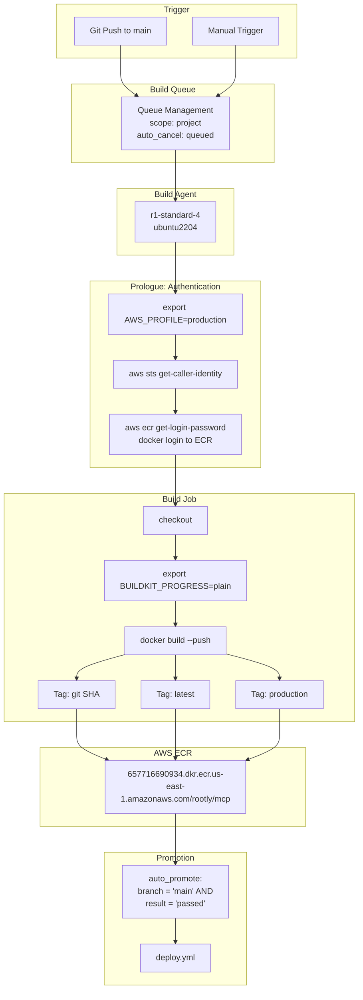
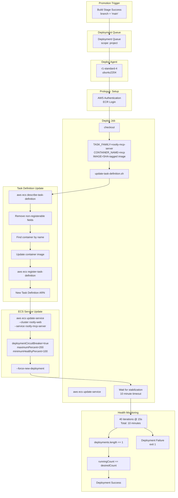
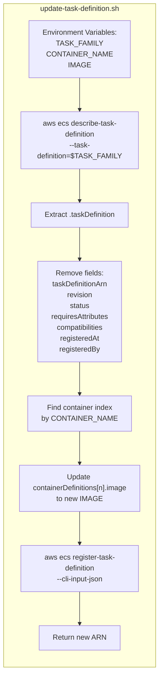
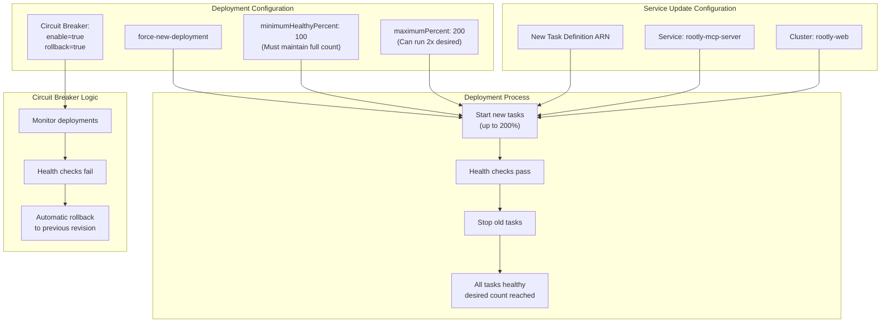
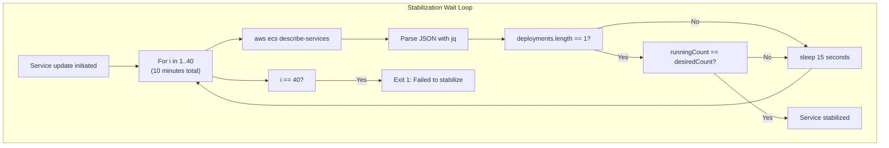
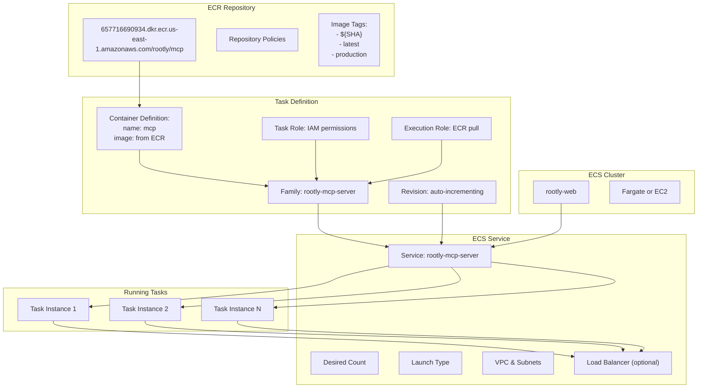
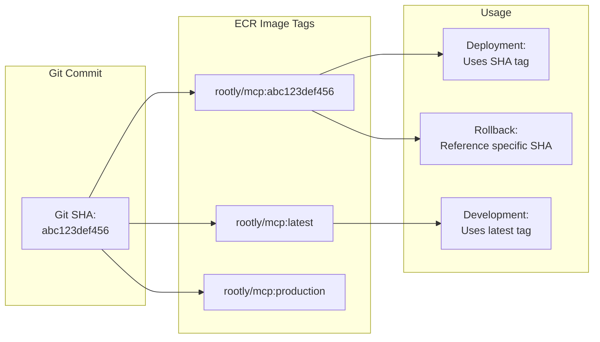
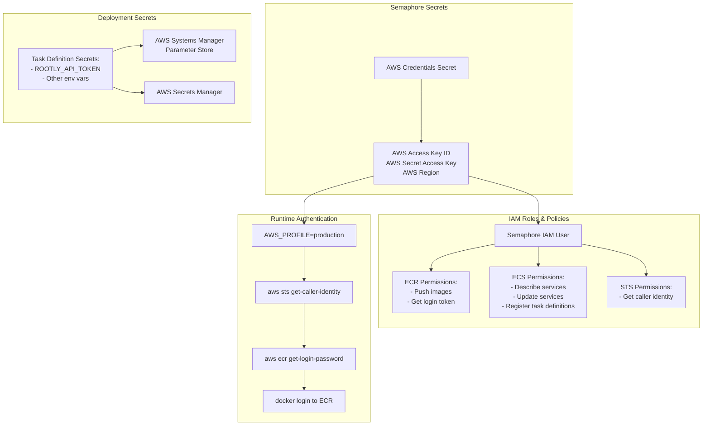
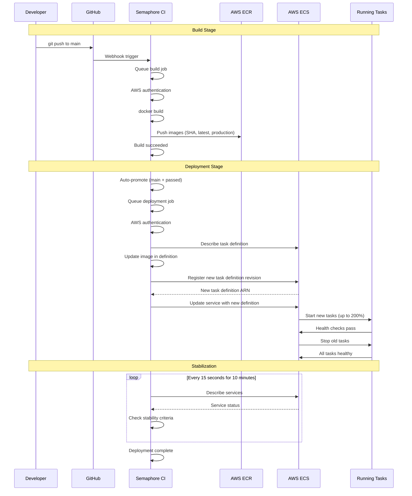

<!-- source: DeepWiki mcp.deepwiki.com · repo Rootly-AI-Labs/Rootly-MCP-server · page 6.3 Semaphore & AWS Deployment · fetched 2026-10-26 -->

# Semaphore & AWS Deployment

<details>
<summary>Relevant source files</summary>

The following files were used as context for generating this wiki page:

- [.semaphore/deploy.yml](.semaphore/deploy.yml)
- [.semaphore/semaphore.yml](.semaphore/semaphore.yml)
- [.semaphore/update-task-definition.sh](.semaphore/update-task-definition.sh)

</details>


## Purpose and Scope

This document covers the Semaphore CI/CD pipeline configuration and AWS deployment infrastructure for the Rootly MCP Server. It details how Docker images are built, pushed to AWS Elastic Container Registry (ECR), and deployed to AWS Elastic Container Service (ECS) in production.

For GitHub Actions-based testing and PyPI publishing, see [GitHub Actions Pipeline](#6.2). For Docker container configuration details, see [Container Setup](#6.4). For general CI/CD architecture, see [CI/CD Overview](#6.1).

---

## Semaphore CI Overview

The Rootly MCP Server uses Semaphore CI for containerized deployment to AWS infrastructure. The pipeline consists of two stages:

1. **Build Stage**: Builds Docker images and pushes to AWS ECR
2. **Deploy Stage**: Updates ECS task definitions and deploys to production

The pipeline automatically promotes from build to deploy on successful builds of the `main` branch.

**Key Components:**

| Component | Purpose | Configuration |
|-----------|---------|---------------|
| Build Queue | Serializes build operations | Project scope, auto-cancel queued |
| Deployment Queue | Serializes deployments | Project scope |
| AWS Secrets | Production credentials | Semaphore secret: `AWS Credentials` |
| ECR Repository | Container image storage | `657716690934.dkr.ecr.us-east-1.amazonaws.com/rootly/mcp` |
| ECS Cluster | Container orchestration | `rootly-web` |
| ECS Service | Running containers | `rootly-mcp-server` |

Sources: [.semaphore/semaphore.yml:1-46](), [.semaphore/deploy.yml:1-56]()

---

## Build Pipeline Architecture



**Build Pipeline: Image Creation and Publishing**

Sources: [.semaphore/semaphore.yml:1-46]()

### Build Configuration

The build block uses a queue to serialize operations and prevent concurrent builds from conflicting:

[.semaphore/semaphore.yml:4-10]()

**Queue Behavior:**
- **Scope**: `project` - All builds for this project use the same queue
- **Auto-cancel**: Queued builds are cancelled when a newer commit is pushed

### Authentication Setup

The build prologue authenticates to AWS and logs into ECR:

[.semaphore/semaphore.yml:23-27]()

**Authentication Steps:**
1. Set AWS profile to `production`
2. Retrieve AWS account ID using STS
3. Obtain ECR login credentials
4. Authenticate Docker to ECR registry

### Docker Image Building

The build job creates and pushes multi-tagged images:

[.semaphore/semaphore.yml:29-37]()

**Image Tags:**
- `${SEMAPHORE_GIT_SHA}` - Specific commit SHA for traceability
- `latest` - Points to most recent successful build
- `production` - Indicates production-ready image

**Build Options:**
- `--push` - Pushes images to ECR immediately after build
- `BUILDKIT_PROGRESS=plain` - Verbose build output for debugging

Sources: [.semaphore/semaphore.yml:18-37]()

---

## Deployment Pipeline Architecture



**Deployment Pipeline: ECS Service Updates**

Sources: [.semaphore/deploy.yml:1-56](), [.semaphore/update-task-definition.sh:1-44]()

### Promotion Configuration

Deployment automatically triggers when the build stage succeeds on `main`:

[.semaphore/semaphore.yml:39-45]()

**Promotion Criteria:**
- Branch must be `main`
- Build result must be `passed`
- Targets `production` deployment environment
- Uses separate pipeline file: `deploy.yml`

### Deployment Job Structure

The deployment job runs in a dedicated queue with the same AWS authentication setup as the build:

[.semaphore/deploy.yml:4-23]()

**Environment Variables:**
- `TASK_FAMILY`: `rootly-mcp-server` - ECS task definition family name
- `CONTAINER_NAME`: `mcp` - Container to update within the task
- `IMAGE`: SHA-tagged image from build stage

Sources: [.semaphore/deploy.yml:25-39]()

---

## Task Definition Update Process



**Task Definition Update: Immutable Updates via New Revisions**

The `update-task-definition.sh` script handles the atomic update of ECS task definitions:

[.semaphore/update-task-definition.sh:1-16]()

### Update Algorithm

**Step 1: Retrieve Current Task Definition**

[.semaphore/update-task-definition.sh:18]()

Fetches the latest task definition for the specified family.

**Step 2: Clean Non-Registerable Fields**

[.semaphore/update-task-definition.sh:21]()

AWS ECS task definitions are immutable. To create a new revision, fields specific to the existing revision must be removed:
- `taskDefinitionArn` - ARN of current revision
- `revision` - Revision number
- `status` - Current status
- `requiresAttributes`, `compatibilities` - Computed fields
- `registeredAt`, `registeredBy` - Metadata

**Step 3: Locate Target Container**

[.semaphore/update-task-definition.sh:24-29]()

Finds the index of the container to update by name. Exits with error if container not found.

**Step 4: Update Container Image**

[.semaphore/update-task-definition.sh:32]()

Updates the `image` field for the target container to the new Docker image.

**Step 5: Register New Revision**

[.semaphore/update-task-definition.sh:35]()

Registers the modified definition as a new task definition revision.

**Step 6: Output and Verification**

[.semaphore/update-task-definition.sh:37-43]()

- Saves both old and new definitions to files
- Displays a unified diff showing the changes
- Returns the new task definition ARN

Sources: [.semaphore/update-task-definition.sh:1-44]()

---

## ECS Service Update Strategy



**ECS Service Update: Blue-Green Deployment with Rollback**

The service update command configures a blue-green deployment strategy:

[.semaphore/deploy.yml:34-39]()

### Deployment Configuration Parameters

| Parameter | Value | Effect |
|-----------|-------|--------|
| `--cluster` | `rootly-web` | ECS cluster hosting the service |
| `--service` | `rootly-mcp-server` | Service name to update |
| `--task-definition` | New ARN | Task definition revision to deploy |
| `deploymentCircuitBreaker.enable` | `true` | Enables automatic failure detection |
| `deploymentCircuitBreaker.rollback` | `true` | Auto-rollback on failure |
| `maximumPercent` | `200` | Can run up to 2x desired count during deployment |
| `minimumHealthyPercent` | `100` | Must always maintain desired count of healthy tasks |
| `--force-new-deployment` | - | Forces new tasks even if definition unchanged |

### Blue-Green Deployment Process

**Phase 1: New Task Launch**
- ECS starts new tasks with the updated task definition
- Can run up to 200% of desired count (old + new tasks)
- New tasks must pass health checks

**Phase 2: Traffic Migration**
- Once new tasks are healthy, traffic shifts to them
- Old tasks remain running during validation period

**Phase 3: Old Task Termination**
- After successful traffic migration, old tasks are stopped
- Maintains `minimumHealthyPercent: 100` throughout

**Circuit Breaker Behavior:**
- If new tasks fail health checks repeatedly, deployment is marked as failed
- With `rollback: true`, ECS automatically reverts to the previous task definition
- Prevents bad deployments from taking down the service

Sources: [.semaphore/deploy.yml:34-39]()

---

## Deployment Stabilization



**Deployment Monitoring: Ensuring Stable Deployment**

After initiating the service update, the pipeline waits for the service to stabilize:

[.semaphore/deploy.yml:41-55]()

### Stabilization Logic

**Wait Loop Configuration:**
- **Iterations**: 40 attempts
- **Interval**: 15 seconds
- **Total Timeout**: 10 minutes (40 × 15s)

**Stability Criteria:**

The service is considered stable when both conditions are met:

1. **Single Deployment**: `deployments.length == 1`
   - Only one deployment is active (no old deployment lingering)
   - Indicates successful transition to new task definition

2. **Desired Capacity**: `runningCount == desiredCount`
   - All desired tasks are running
   - No tasks are pending, stopping, or failed

**Timeout Handling:**

If the service fails to stabilize within 10 minutes:
- The pipeline exits with status code 1
- Marks the deployment as failed
- Circuit breaker may trigger automatic rollback (if configured)

### Health Check Integration

The stabilization check relies on ECS health checks defined in the task definition. For the MCP server, these include:
- Container health checks (see [Container Setup](#6.4))
- Load balancer health checks (if applicable)
- Essential container checks (container must stay running)

Sources: [.semaphore/deploy.yml:41-55]()

---

## AWS Infrastructure Components



**AWS Infrastructure: Container Registry and Orchestration**

### ECR Repository

**Repository URI**: `657716690934.dkr.ecr.us-east-1.amazonaws.com/rootly/mcp`

The ECR repository stores Docker images built by the Semaphore pipeline. Each image is tagged with:
- Commit SHA for precise version tracking
- `latest` for convenience
- `production` for production-ready images

**Repository Features:**
- **Lifecycle Policies**: Automatically clean up old images
- **Scan on Push**: Security vulnerability scanning
- **Encryption**: Images encrypted at rest

### ECS Cluster

**Cluster Name**: `rootly-web`

The ECS cluster provides the compute infrastructure for running containerized workloads. It likely hosts multiple services beyond the MCP server.

**Cluster Configuration:**
- **Launch Type**: Fargate (serverless) or EC2 (managed instances)
- **Region**: `us-east-1`
- **Network Mode**: `awsvpc` (each task gets its own ENI)

### Task Definition

**Family**: `rootly-mcp-server`

Task definitions are immutable specifications for running containers. Each update creates a new revision.

**Key Components:**
- **Container Name**: `mcp` - Referenced in deployment updates
- **Image**: Pulled from ECR repository
- **CPU/Memory**: Allocated resources per task
- **Environment Variables**: Configuration from Semaphore secrets
- **Health Checks**: Container liveness probes (see [Container Setup](#6.4))

**IAM Roles:**
- **Task Role**: Permissions for the running container
- **Execution Role**: Permissions for ECS to pull images and write logs

### ECS Service

**Service Name**: `rootly-mcp-server`

The ECS service ensures the desired number of tasks are always running:

**Service Responsibilities:**
- Maintains desired task count
- Performs rolling deployments
- Integrates with load balancers
- Handles task failures and restarts
- Monitors task health

Sources: [.semaphore/semaphore.yml:35-37](), [.semaphore/deploy.yml:29-36]()

---

## Image Tagging Strategy



**Image Tagging: Multi-Tag Strategy for Flexibility**

The build pipeline applies three tags to each Docker image:

[.semaphore/semaphore.yml:34-37]()

### Tag Purposes

| Tag | Format | Purpose | Use Case |
|-----|--------|---------|----------|
| SHA Tag | `${SEMAPHORE_GIT_SHA}` | Immutable reference to specific commit | Production deployments, rollbacks, auditing |
| `latest` | `latest` | Most recent successful build | Development, testing, debugging |
| `production` | `production` | Current production image | Quick reference to production state |

### Tag Benefits

**Immutability**: SHA tags never change, ensuring reproducible deployments
- Deploy specific versions with confidence
- Roll back to any previous version by SHA
- Audit trail of deployed code

**Convenience**: Mutable tags for common patterns
- `latest` always points to newest build
- `production` indicates current production state
- Simplifies development workflows

**Traceability**: Git SHA directly links image to source
- Find source code for any running container
- Track which commits are deployed where
- Debug issues by checking out exact code

### Tag Updates

During build:
1. SHA tag is created for current commit (immutable)
2. `latest` tag is updated to current build
3. `production` tag is updated to current build

During deployment:
- Service pulls image by SHA tag (from `${SEMAPHORE_GIT_SHA}`)
- `latest` and `production` tags are not used for deployment (for stability)

Sources: [.semaphore/semaphore.yml:34-37](), [.semaphore/deploy.yml:31]()

---

## Security and Secrets Management



**Security: Secrets Management and IAM Permissions**

### Semaphore Secrets

Both build and deployment pipelines use the `AWS Credentials` secret:

[.semaphore/semaphore.yml:21-22](), [.semaphore/deploy.yml:17-18]()

This secret contains:
- AWS Access Key ID
- AWS Secret Access Key
- AWS Region (us-east-1)

### IAM Permissions

The Semaphore IAM user requires the following permissions:

**ECR Permissions:**
```
ecr:GetAuthorizationToken
ecr:BatchCheckLayerAvailability
ecr:GetDownloadUrlForLayer
ecr:PutImage
ecr:InitiateLayerUpload
ecr:UploadLayerPart
ecr:CompleteLayerUpload
```

**ECS Permissions:**
```
ecs:DescribeTaskDefinition
ecs:RegisterTaskDefinition
ecs:DescribeServices
ecs:UpdateService
```

**STS Permissions:**
```
sts:GetCallerIdentity
```

### Authentication Flow

The prologue establishes AWS authentication:

[.semaphore/semaphore.yml:24-27]()

1. **Set Profile**: `AWS_PROFILE=production` - Uses production credentials
2. **Get Account ID**: Retrieves AWS account ID for ECR URI construction
3. **ECR Login**: Obtains temporary ECR password (valid for 12 hours)
4. **Docker Login**: Authenticates Docker client to ECR

### Runtime Secrets

The MCP server running in ECS needs access to secrets at runtime:
- `ROOTLY_API_TOKEN` - For Rootly API authentication
- Other configuration environment variables

These are typically stored in:
- **AWS Systems Manager Parameter Store** - For configuration values
- **AWS Secrets Manager** - For sensitive credentials

The task definition references these secrets, and the ECS execution role has permissions to retrieve them.

Sources: [.semaphore/semaphore.yml:21-27](), [.semaphore/deploy.yml:17-23]()

---

## Deployment Workflow Summary



**Complete Deployment Flow: From Push to Production**

### Typical Deployment Timeline

| Phase | Duration | Activities |
|-------|----------|------------|
| Queue Wait | 0-5 minutes | Waiting for build queue |
| Build | 5-10 minutes | Docker build and ECR push |
| Deploy Queue | 0-2 minutes | Waiting for deployment queue |
| Task Definition | 30 seconds | Update and register new definition |
| Service Update | 1 minute | ECS processes update request |
| New Task Start | 2-5 minutes | Start and health check new tasks |
| Old Task Stop | 1-2 minutes | Graceful shutdown of old tasks |
| Stabilization Check | 0-10 minutes | Verify stable deployment |
| **Total** | **10-35 minutes** | End-to-end deployment |

### Success Criteria

A deployment is successful when:
1. Build completes without errors
2. Images pushed to ECR successfully
3. Task definition registered with new image
4. Service update accepted by ECS
5. New tasks start and pass health checks
6. Old tasks stop cleanly
7. Service reaches stable state within 10 minutes

### Failure Scenarios

**Build Failures:**
- Docker build errors → Fix code and retry
- ECR push failures → Check IAM permissions

**Deployment Failures:**
- Task definition registration errors → Check task definition format
- Service update rejected → Check service configuration
- New tasks fail health checks → Circuit breaker rolls back
- Stabilization timeout → Manual intervention required

Sources: [.semaphore/semaphore.yml:1-46](), [.semaphore/deploy.yml:1-56](), [.semaphore/update-task-definition.sh:1-44]()

---

