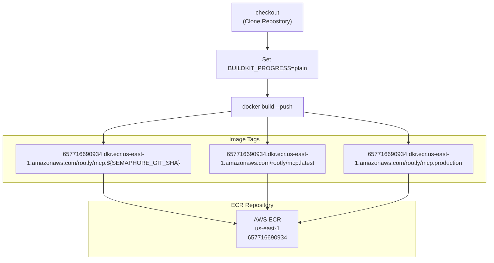
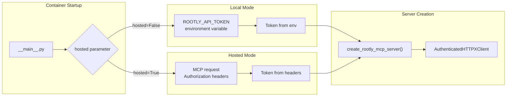
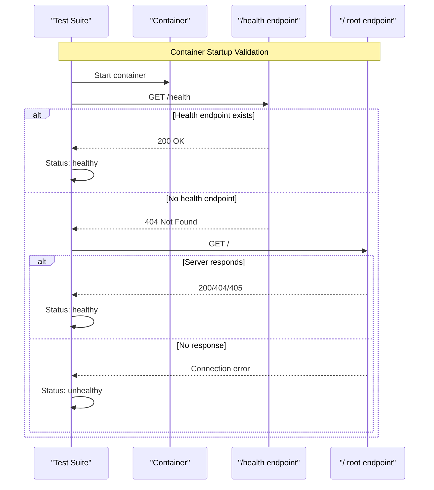
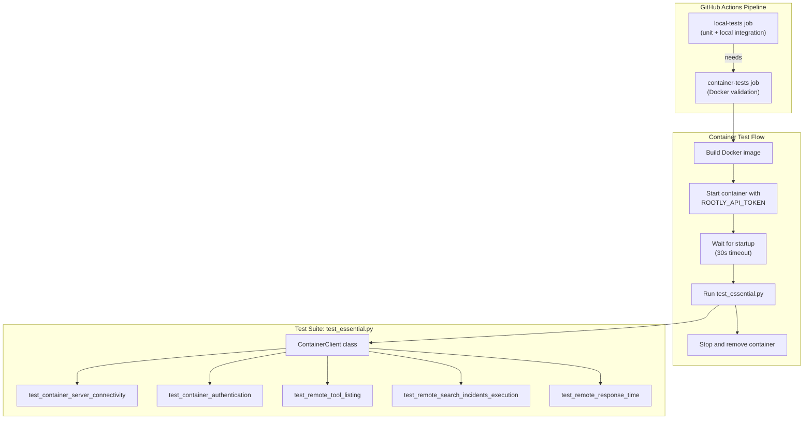
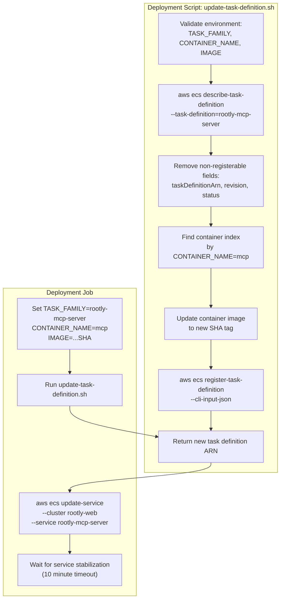

<!-- source: DeepWiki mcp.deepwiki.com · repo Rootly-AI-Labs/Rootly-MCP-server · page 6.4 Container Setup · fetched 2026-10-26 -->

# Container Setup

<details>
<summary>Relevant source files</summary>

The following files were used as context for generating this wiki page:

- [.github/workflows/test.yml](.github/workflows/test.yml)
- [.semaphore/deploy.yml](.semaphore/deploy.yml)
- [.semaphore/semaphore.yml](.semaphore/semaphore.yml)
- [.semaphore/update-task-definition.sh](.semaphore/update-task-definition.sh)
- [tests/integration/remote/test_essential.py](tests/integration/remote/test_essential.py)

</details>


This page documents the Docker containerization of the Rootly MCP Server, including container build configuration, environment setup, health checks, and container testing strategies. This covers how the server is packaged as a Docker image and deployed to production environments.

For CI/CD pipeline configuration that builds these containers, see [Semaphore & AWS Deployment](#6.3). For deployment to AWS ECS, see the same section. For local development without containers, see [Installation](#2.1).

## Overview

The Rootly MCP Server is containerized for production deployment on AWS ECS. The containerization process involves:

1. Building a Docker image from the Python codebase
2. Configuring environment variables for API authentication
3. Running the server in hosted mode (accepting MCP protocol requests)
4. Health checking and startup verification
5. Testing the containerized server before deployment

**Sources:** [.semaphore/semaphore.yml:1-46](), [.github/workflows/test.yml:32-71]()

## Docker Image Build Process

### Build Configuration

The Docker image is built using a multi-stage build process orchestrated by Semaphore CI. The build occurs in the "Build" block:



**Diagram: Docker Build and Push Pipeline**

The build process creates three tags simultaneously [.semaphore/semaphore.yml:34-37]():
- **Commit-specific tag**: `${SEMAPHORE_GIT_SHA}` for traceability
- **Latest tag**: `latest` for convenience
- **Environment tag**: `production` for deployment targeting

**Sources:** [.semaphore/semaphore.yml:18-37]()

### Build Authentication

Before building, the pipeline authenticates with AWS ECR:

| Step | Command | Purpose |
|------|---------|---------|
| Set AWS Profile | `export AWS_PROFILE=production` | Configure AWS credentials |
| Get Account ID | `aws sts get-caller-identity --query Account --output text` | Retrieve AWS account ID |
| ECR Login | `aws ecr get-login-password --region us-east-1 \| docker login` | Authenticate Docker with ECR |

**Sources:** [.semaphore/semaphore.yml:25-27]()

## Container Environment Configuration

### Required Environment Variables

The container requires specific environment variables to function:

| Variable | Purpose | Mode | Required |
|----------|---------|------|----------|
| `ROOTLY_API_TOKEN` | Rootly API authentication token | Local mode | No (hosted mode uses MCP headers) |
| `MCP_SERVER_URL` | Container endpoint URL | Testing only | No (defaults to localhost:8000) |

**Container Runtime Example (GitHub Actions):**

```bash
docker run -d \
  --name rootly-mcp-server \
  -p 8000:8000 \
  -e ROOTLY_API_TOKEN="${ROOTLY_API_TOKEN}" \
  rootly-mcp-server
```

**Sources:** [.github/workflows/test.yml:47-52](), [tests/integration/remote/test_essential.py:22]()

### Hosted vs Local Mode

The container can operate in two authentication modes:



**Diagram: Container Authentication Modes**

In production (ECS), the container runs in **hosted mode**, expecting authentication via MCP protocol request headers. In local development and testing, it can run in **local mode** with `ROOTLY_API_TOKEN` environment variable.

**Sources:** [tests/integration/remote/test_essential.py:44-74]()

## Health Checks and Startup Validation

### Container Health Endpoint

The container testing suite implements a health check mechanism:



**Diagram: Container Health Check Sequence**

The `ContainerClient.health_check()` method [tests/integration/remote/test_essential.py:27-42]() implements a fallback strategy:
1. Try `/health` endpoint (status 200 = healthy)
2. If not found, try root endpoint `/` (any server response = healthy)
3. Return unhealthy status on connection errors

**GitHub Actions Startup Wait:**

```bash
timeout 30s bash -c 'until curl -f http://localhost:8000/health || curl -f http://localhost:8000/; do sleep 2; done'
```

This script polls the health endpoint with a 30-second timeout, checking every 2 seconds until the container responds.

**Sources:** [tests/integration/remote/test_essential.py:27-42](), [.github/workflows/test.yml:56-59]()

## Container Testing Strategy

### Test Architecture

Container tests validate that the Docker image functions correctly in an isolated environment:



**Diagram: Container Testing Pipeline**

**Sources:** [.github/workflows/test.yml:32-71](), [tests/integration/remote/test_essential.py:1-398]()

### ContainerClient Test Utility

The `ContainerClient` class [tests/integration/remote/test_essential.py:17-173]() provides test methods for validating containerized server functionality:

| Method | Purpose | Line Reference |
|--------|---------|----------------|
| `__init__(url)` | Initialize client with server URL (default: localhost:8000) | [20-25]() |
| `health_check()` | Test container health endpoint | [27-42]() |
| `authenticate(bearer_token)` | Test authentication with real Rootly API | [44-74]() |
| `list_tools()` | Verify tools are available | [76-111]() |
| `call_tool(tool_name, arguments)` | Execute tool and validate response | [113-168]() |
| `close()` | Clean up connection | [170-173]() |

### Essential Tests

The `TestContainerServerEssentials` class [tests/integration/remote/test_essential.py:178-324]() validates five critical aspects:

1. **Container Connectivity** [tests/integration/remote/test_essential.py:188-200]()
   - Verifies container is reachable at `MCP_SERVER_URL`
   - Tests health endpoint response
   - Validates URL configuration

2. **Authentication** [tests/integration/remote/test_essential.py:202-214]()
   - Tests Bearer token authentication against real Rootly API
   - Validates token format (`rootly_` prefix)
   - Confirms client state updates after successful auth

3. **Tool Listing** [tests/integration/remote/test_essential.py:224-244]()
   - Verifies at least 20 tools are available
   - Confirms critical tools exist: `search_incidents`, `listIncidents`, `listTeams`
   - Validates tool schema structure

4. **Tool Execution** [tests/integration/remote/test_essential.py:252-281]()
   - Executes `search_incidents` tool with real API call
   - Validates response structure (data, meta fields)
   - Confirms Rootly API JSON:API format (id, type, attributes)

5. **Response Time** [tests/integration/remote/test_essential.py:290-310]()
   - Tool listing must complete in <10 seconds
   - Tool execution must complete in <15 seconds
   - Uses `@pytest.mark.timeout(30)` decorator

**Sources:** [tests/integration/remote/test_essential.py:178-324]()

### Resilience Testing

The `TestRemoteServerResilience` class [tests/integration/remote/test_essential.py:328-374]() validates error handling:

- **Malformed Requests** [tests/integration/remote/test_essential.py:338-351](): Server gracefully handles invalid parameters
- **Concurrent Requests** [tests/integration/remote/test_essential.py:353-374](): Server handles 3 concurrent requests without crashes

**Sources:** [tests/integration/remote/test_essential.py:328-374]()

## Production Deployment (ECS)

### Task Definition Update Process

The deployment uses an ECS task definition update script:



**Diagram: ECS Task Definition Update Flow**

**Sources:** [.semaphore/update-task-definition.sh:1-44](), [.semaphore/deploy.yml:25-56]()

### Deployment Configuration

The deployment block [.semaphore/deploy.yml:14-56]() configures ECS service updates:

| Parameter | Value | Purpose |
|-----------|-------|---------|
| Cluster | `rootly-web` | ECS cluster name |
| Service | `rootly-mcp-server` | Service to update |
| Task Family | `rootly-mcp-server` | Task definition family |
| Container Name | `mcp` | Container to update |
| Image | `657716690934.dkr.ecr.us-east-1.amazonaws.com/rootly/mcp:${SEMAPHORE_GIT_SHA}` | New image with commit SHA |

### Deployment Safety Features

The ECS update command [.semaphore/deploy.yml:34-39]() includes circuit breaker configuration:

```json
{
  "deploymentCircuitBreaker": {
    "enable": true,
    "rollback": true
  },
  "maximumPercent": 200,
  "minimumHealthyPercent": 100
}
```

- **Circuit Breaker**: Automatically rolls back failed deployments
- **Maximum Percent**: Allows 200% capacity during deployment (for blue-green)
- **Minimum Healthy Percent**: Maintains 100% healthy tasks throughout

### Stabilization Wait

The deployment script waits up to 10 minutes for service stabilization [.semaphore/deploy.yml:44-55]():

```bash
for i in {1..40}; do
  if aws ecs describe-services --cluster rootly-web --service rootly-mcp-server --output json | jq -e \
    '.services | map(select((.deployments | length) != 1 or .runningCount != .desiredCount)) | length == 0' >/dev/null; then
    break
  fi
  sleep 15
done
```

This checks every 15 seconds (40 iterations) that:
- Only one deployment exists
- Running count equals desired count

**Sources:** [.semaphore/deploy.yml:25-56]()

## Container Configuration Summary

### Build-Time Configuration

| Configuration | Location | Description |
|--------------|----------|-------------|
| Base Image | Dockerfile | Python base image with dependencies |
| Build Context | Repository root | Full source code |
| Build Tool | Docker BuildKit | `BUILDKIT_PROGRESS=plain` for verbose output |

### Runtime Configuration

| Configuration | Source | Purpose |
|--------------|--------|---------|
| API Token | Environment variable or MCP headers | Authentication with Rootly API |
| Server URL | Environment variable (testing only) | Override default localhost:8000 |
| Port Mapping | Docker run `-p 8000:8000` | Expose server port |

### Deployment Configuration

| Configuration | Value | Purpose |
|--------------|-------|---------|
| ECR Repository | `657716690934.dkr.ecr.us-east-1.amazonaws.com/rootly/mcp` | Container registry |
| ECS Cluster | `rootly-web` | Production cluster |
| ECS Service | `rootly-mcp-server` | Service name |
| Container Name | `mcp` | Container identifier in task definition |

**Sources:** [.semaphore/semaphore.yml:34-37](), [.semaphore/deploy.yml:29-36](), [.github/workflows/test.yml:47-52]()

---

