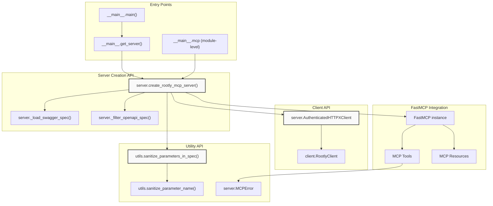
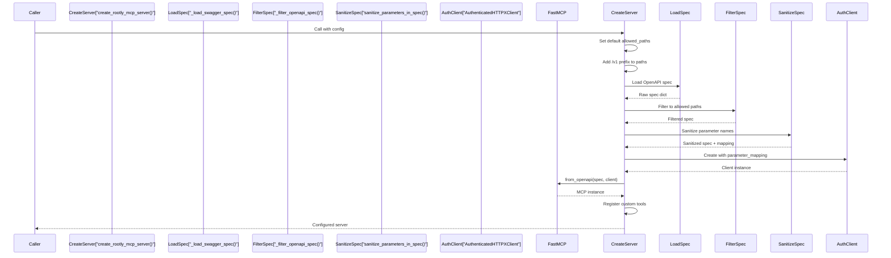
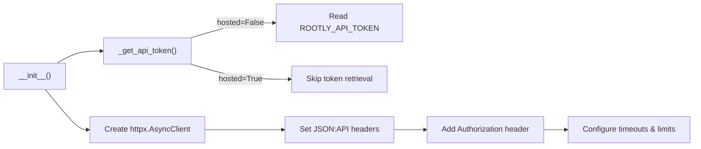
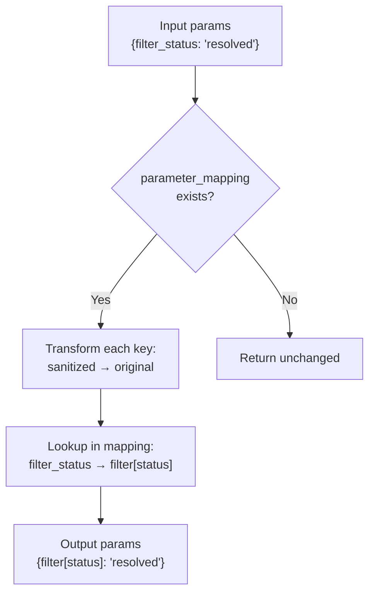
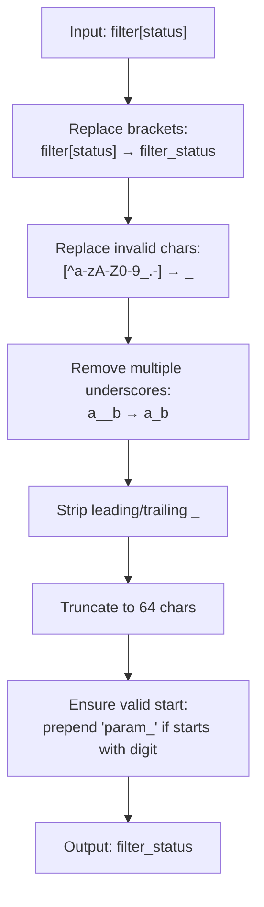
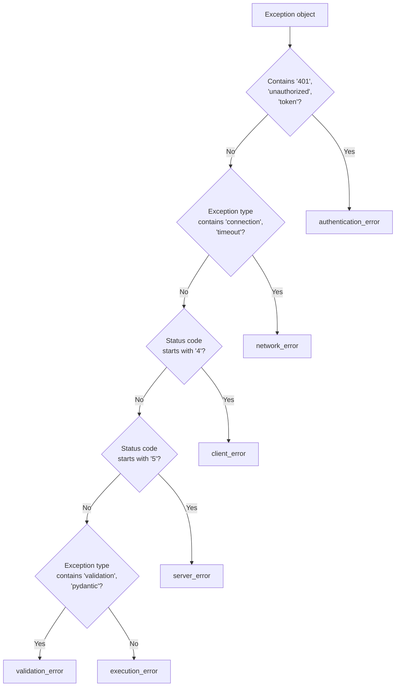
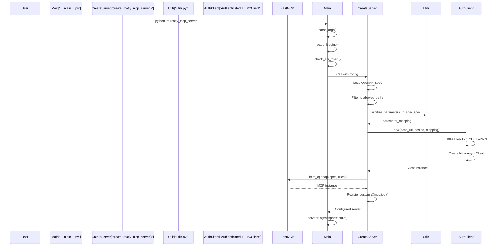
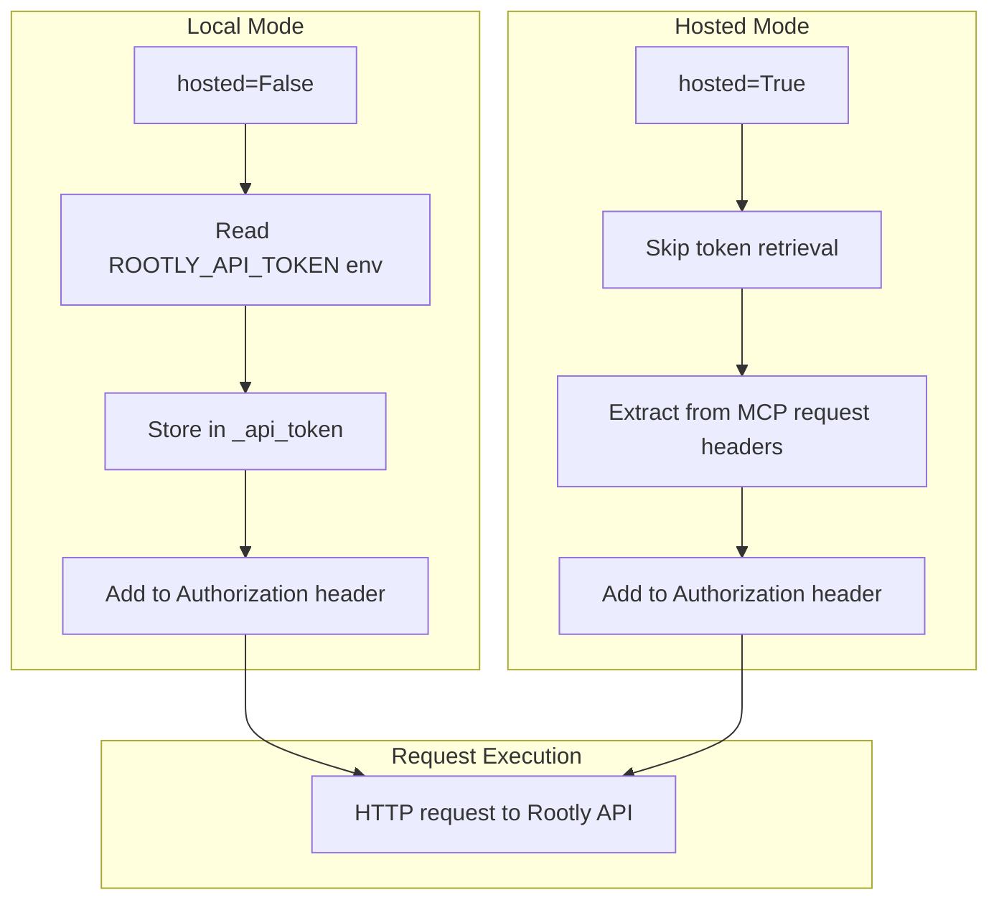
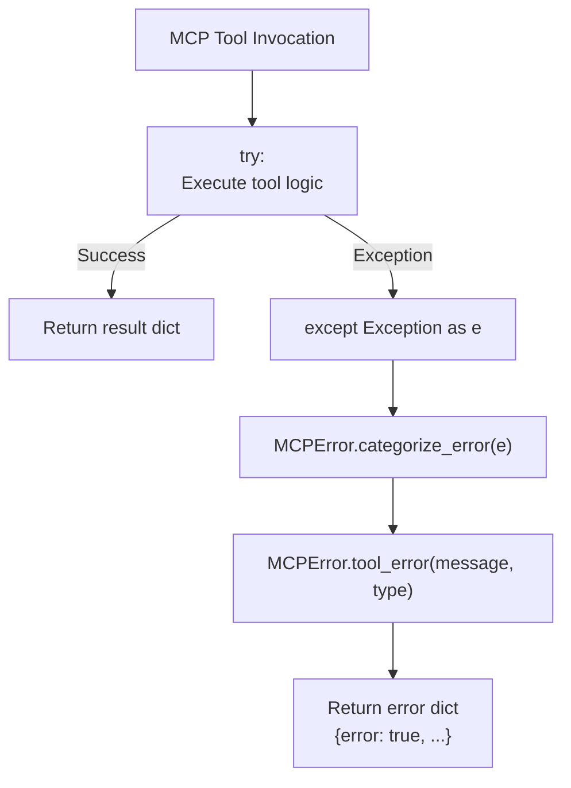

<!-- source: DeepWiki mcp.deepwiki.com · repo Rootly-AI-Labs/Rootly-MCP-server · page 7 API Reference · fetched 2026-10-26 -->

# API Reference

<details>
<summary>Relevant source files</summary>

The following files were used as context for generating this wiki page:

- [src/rootly_mcp_server/__main__.py](src/rootly_mcp_server/__main__.py)
- [src/rootly_mcp_server/client.py](src/rootly_mcp_server/client.py)
- [src/rootly_mcp_server/server.py](src/rootly_mcp_server/server.py)
- [src/rootly_mcp_server/utils.py](src/rootly_mcp_server/utils.py)

</details>


This page documents the complete public API surface of the Rootly MCP Server. It covers all functions, classes, and methods that developers use to create, configure, and interact with the server. For information about internal implementation details and custom tool development, see [Custom Tool Development](#4.5). For information about testing utilities and fixtures, see [Test Fixtures & Utilities](#5.5).

## Overview

The Rootly MCP Server exposes three primary API layers:

1. **Server Creation API** - Functions for initializing and configuring the MCP server
2. **HTTP Client API** - Classes for authenticated communication with the Rootly API
3. **Utility API** - Helper functions for parameter sanitization and error handling



**Sources:** [src/rootly_mcp_server/server.py:278-344](), [src/rootly_mcp_server/__main__.py:120-145](), [src/rootly_mcp_server/client.py:15-28](), [src/rootly_mcp_server/utils.py:45-105]()

---

## Server Creation API

### create_rootly_mcp_server()

The primary function for creating a configured Rootly MCP Server instance.

**Function Signature:**

```python
def create_rootly_mcp_server(
    swagger_path: Optional[str] = None,
    name: str = "Rootly",
    allowed_paths: Optional[List[str]] = None,
    hosted: bool = False,
    base_url: Optional[str] = None,
) -> FastMCP
```

**Parameters:**

| Parameter | Type | Default | Description |
|-----------|------|---------|-------------|
| `swagger_path` | `Optional[str]` | `None` | Path to local Swagger JSON file. If `None`, fetches from `SWAGGER_URL` |
| `name` | `str` | `"Rootly"` | Name of the MCP server instance |
| `allowed_paths` | `Optional[List[str]]` | `None` | API paths to expose as tools. If `None`, uses `DEFAULT_ALLOWED_PATHS` |
| `hosted` | `bool` | `False` | Enable hosted mode (authentication from MCP headers instead of env) |
| `base_url` | `Optional[str]` | `None` | Rootly API base URL. If `None`, uses `ROOTLY_BASE_URL` env var or default |

**Returns:** `FastMCP` - Configured FastMCP server instance with generated tools

**Implementation Details:**

The function performs the following initialization sequence:



**Sources:** [src/rootly_mcp_server/server.py:278-344]()

### DEFAULT_ALLOWED_PATHS

Pre-configured list of Rootly API paths that are exposed as MCP tools by default.

**Type:** `List[str]`

**Contents:** 40+ API endpoints including:
- Incident operations: `/incidents/{incident_id}/alerts`, `/alerts`, `/alerts/{alert_id}`
- Team management: `/teams`, `/teams/{team_id}`
- Service catalog: `/services`, `/services/{service_id}`, `/environments`
- On-call schedules: `/schedules`, `/schedules/{schedule_id}/shifts`, `/shifts`
- Workflow management: `/workflows`, `/workflow_runs`
- Status pages: `/status_pages`, `/status_pages/{status_page_id}`

**Sources:** [src/rootly_mcp_server/server.py:121-172]()

### Entry Point Functions

#### get_server()

Factory function for creating server instances from environment variables. Used by FastMCP CLI.

**Function Signature:**

```python
def get_server() -> FastMCP
```

**Environment Variables:**

| Variable | Description | Default |
|----------|-------------|---------|
| `ROOTLY_SWAGGER_PATH` | Path to local Swagger file | `None` (fetch remote) |
| `ROOTLY_SERVER_NAME` | Server instance name | `"Rootly"` |
| `ROOTLY_HOSTED` | Enable hosted mode | `"false"` |
| `ROOTLY_BASE_URL` | API base URL | `None` (use default) |
| `ROOTLY_ALLOWED_PATHS` | Comma-separated path list | `None` (use defaults) |

**Returns:** Configured `FastMCP` instance

**Sources:** [src/rootly_mcp_server/__main__.py:120-141]()

#### main()

Command-line entry point with argument parsing and logging configuration.

**Function Signature:**

```python
def main() -> None
```

**Command-Line Arguments:**

| Argument | Type | Default | Description |
|----------|------|---------|-------------|
| `--swagger-path` | `str` | Auto-discover | Path to Swagger JSON file |
| `--log-level` | `str` | `"INFO"` | Logging level (DEBUG, INFO, WARNING, ERROR, CRITICAL) |
| `--name` | `str` | `"Rootly"` | Server name |
| `--transport` | `str` | `"stdio"` | Transport protocol (stdio, sse) |
| `--debug` | flag | `False` | Enable debug mode |
| `--base-url` | `str` | `None` | Rootly API base URL |
| `--allowed-paths` | `str` | `None` | Comma-separated path list |
| `--hosted` | flag | `False` | Enable hosted mode |

**Behavior:**
- Validates `ROOTLY_API_TOKEN` environment variable (unless `--hosted`)
- Configures logging to stderr
- Creates and runs server with specified transport

**Sources:** [src/rootly_mcp_server/__main__.py:148-192]()

---

## HTTP Client API

### AuthenticatedHTTPXClient

HTTPX-based client wrapper that handles Rootly API authentication and bidirectional parameter transformation.

**Class Definition:**

```python
class AuthenticatedHTTPXClient:
    def __init__(
        self,
        base_url: str = "https://api.rootly.com",
        hosted: bool = False,
        parameter_mapping: Optional[Dict[str, str]] = None
    )
```

**Attributes:**

| Attribute | Type | Description |
|-----------|------|-------------|
| `_base_url` | `str` | Rootly API base URL |
| `hosted` | `bool` | Whether running in hosted mode |
| `_api_token` | `Optional[str]` | API token (local mode only) |
| `parameter_mapping` | `Dict[str, str]` | Map of sanitized → original parameter names |
| `client` | `httpx.AsyncClient` | Underlying async HTTP client |

**Methods:**

#### \_\_init\_\_()

Initializes the client with authentication and parameter transformation capabilities.



**Sources:** [src/rootly_mcp_server/server.py:178-203]()

#### _get_api_token()

Retrieves API token from environment variables.

**Returns:** `Optional[str]` - API token or `None` if not found

**Logs Warning:** If `ROOTLY_API_TOKEN` not set

**Sources:** [src/rootly_mcp_server/server.py:205-211]()

#### _transform_params()

Transforms sanitized parameter names back to original Rootly API format.

**Function Signature:**

```python
def _transform_params(self, params: Optional[Dict[str, Any]]) -> Optional[Dict[str, Any]]
```

**Parameter Transformation Flow:**



**Example:**

```python
# Mapping: {"filter_status": "filter[status]", "page_size": "page[size]"}
params = {"filter_status": "resolved", "page_size": 10}
transformed = client._transform_params(params)
# Result: {"filter[status]": "resolved", "page[size]": 10}
```

**Sources:** [src/rootly_mcp_server/server.py:213-225]()

#### request() / get() / post() / put() / patch() / delete()

HTTP method wrappers that apply parameter transformation before forwarding to underlying client.

**Function Signatures:**

```python
async def request(self, method: str, url: str, **kwargs)
async def get(self, url: str, **kwargs)
async def post(self, url: str, **kwargs)
async def put(self, url: str, **kwargs)
async def patch(self, url: str, **kwargs)
async def delete(self, url: str, **kwargs)
```

**Behavior:**
1. Transforms `params` kwarg using `_transform_params()`
2. Delegates to `httpx.AsyncClient.request()`
3. Returns `httpx.Response`

**Sources:** [src/rootly_mcp_server/server.py:227-254]()

#### Properties

**base_url**

**Type:** `str`

**Returns:** The configured base URL for API requests

**Sources:** [src/rootly_mcp_server/server.py:269-271]()

**headers**

**Type:** `httpx.Headers`

**Returns:** Current HTTP headers from underlying client

**Sources:** [src/rootly_mcp_server/server.py:273-275]()

---

### RootlyClient

Legacy synchronous HTTP client for Rootly API. Used in legacy code paths.

**Class Definition:**

```python
class RootlyClient:
    def __init__(self, base_url: Optional[str] = None, hosted: bool = False)
```

**Attributes:**

| Attribute | Type | Description |
|-----------|------|-------------|
| `base_url` | `str` | Rootly API base URL |
| `hosted` | `bool` | Whether running in hosted mode |
| `_api_token` | `str` | API token (local mode only) |

**Methods:**

#### make_request()

Synchronous HTTP request method with JSON:API support.

**Function Signature:**

```python
def make_request(
    self,
    method: str,
    path: str,
    query_params: Optional[Dict[str, Any]] = None,
    json_data: Optional[Dict[str, Any]] = None,
    json_api_type: Optional[str] = None,
    api_token: Optional[str] = None,
) -> str
```

**Parameters:**

| Parameter | Type | Description |
|-----------|------|-------------|
| `method` | `str` | HTTP method (GET, POST, PUT, PATCH, DELETE) |
| `path` | `str` | API path (auto-prefixed with `/v1` if missing) |
| `query_params` | `Optional[Dict]` | URL query parameters |
| `json_data` | `Optional[Dict]` | Request body data |
| `json_api_type` | `Optional[str]` | JSON:API type for wrapping payload |
| `api_token` | `Optional[str]` | Override token (hosted mode) |

**Returns:** `str` - JSON-formatted response or error

**JSON:API Format:**

When `json_api_type` is provided, the client automatically:
1. Sets `Content-Type: application/vnd.api+json` header
2. Wraps `json_data` in JSON:API envelope:

```json
{
  "data": {
    "type": "incidents",
    "attributes": { ...json_data... }
  }
}
```

**Sources:** [src/rootly_mcp_server/client.py:30-132]()

---

## Utility API

### Parameter Sanitization

#### sanitize_parameter_name()

Transforms parameter names to match MCP property key pattern `^[a-zA-Z0-9_.-]{1,64}$`.

**Function Signature:**

```python
def sanitize_parameter_name(name: str) -> str
```

**Transformation Rules:**



**Examples:**

| Input | Output | Notes |
|-------|--------|-------|
| `filter[status]` | `filter_status` | Brackets replaced |
| `page[size]` | `page_size` | Brackets replaced |
| `fields[incidents]` | `fields_incidents` | Brackets replaced |
| `filter[kind][]` | `filter_kind` | Multiple brackets handled |
| `include` | `include` | Already valid |
| `123invalid` | `param_123invalid` | Prepended with `param_` |

**Sources:** [src/rootly_mcp_server/utils.py:12-42]()

#### sanitize_parameters_in_spec()

Sanitizes all parameter names throughout an OpenAPI specification and builds a reverse mapping.

**Function Signature:**

```python
def sanitize_parameters_in_spec(spec: Dict[str, Any]) -> Dict[str, str]
```

**Parameters:**

| Parameter | Type | Description |
|-----------|------|-------------|
| `spec` | `Dict[str, Any]` | OpenAPI specification (modified in-place) |

**Returns:** `Dict[str, str]` - Mapping of sanitized names → original names

**Processing Locations:**

1. **Path-level parameters** - `spec['paths'][path]['parameters']`
2. **Operation-level parameters** - `spec['paths'][path][method]['parameters']`
3. **Component parameters** - `spec['components']['parameters']` (OpenAPI 3.0)

**Example Mapping:**

```python
{
    "filter_status": "filter[status]",
    "page_size": "page[size]",
    "page_number": "page[number]",
    "fields_incidents": "fields[incidents]"
}
```

**Sources:** [src/rootly_mcp_server/utils.py:45-105]()

---

### Error Handling

#### MCPError

Static error formatting utility for MCP-compliant error responses.

**Class Definition:**

```python
class MCPError:
    @staticmethod
    def protocol_error(code: int, message: str, data: Optional[Dict] = None)
    
    @staticmethod
    def tool_error(error_message: str, error_type: str = "execution_error", details: Optional[Dict] = None)
    
    @staticmethod
    def categorize_error(exception: Exception) -> tuple[str, str]
```

**Methods:**

#### protocol_error()

Creates JSON-RPC protocol-level error response.

**Function Signature:**

```python
@staticmethod
def protocol_error(code: int, message: str, data: Optional[Dict] = None) -> Dict
```

**Returns:**

```json
{
  "jsonrpc": "2.0",
  "error": {
    "code": -32000,
    "message": "Error description",
    "data": { "additional": "context" }
  }
}
```

**Sources:** [src/rootly_mcp_server/server.py:31-43]()

#### tool_error()

Creates tool-level error response (returned as successful tool execution with error flag).

**Function Signature:**

```python
@staticmethod
def tool_error(error_message: str, error_type: str = "execution_error", details: Optional[Dict] = None) -> Dict
```

**Error Types:**
- `authentication_error`
- `network_error`
- `client_error`
- `server_error`
- `validation_error`
- `execution_error`

**Returns:**

```json
{
  "error": true,
  "error_type": "authentication_error",
  "message": "Authentication failed: 401 Unauthorized",
  "details": { "status_code": 401 }
}
```

**Sources:** [src/rootly_mcp_server/server.py:45-55]()

#### categorize_error()

Analyzes an exception and returns appropriate error type and message.

**Function Signature:**

```python
@staticmethod
def categorize_error(exception: Exception) -> tuple[str, str]
```

**Returns:** `(error_type, error_message)` tuple

**Categorization Logic:**



**Sources:** [src/rootly_mcp_server/server.py:57-82]()

---

## Configuration Constants

### SWAGGER_URL

Default URL for fetching Rootly's OpenAPI specification.

**Value:** `"https://rootly-heroku.s3.amazonaws.com/swagger/v1/swagger.json"`

**Type:** `str`

**Sources:** [src/rootly_mcp_server/server.py:85]()

---

## API Usage Patterns

### Complete Initialization Flow



**Sources:** [src/rootly_mcp_server/__main__.py:148-192](), [src/rootly_mcp_server/server.py:278-344](), [src/rootly_mcp_server/utils.py:45-105](), [src/rootly_mcp_server/server.py:175-203]()

### Parameter Transformation Pipeline

```mermaid
graph LR
    subgraph "OpenAPI Spec"
        Original["Original names:<br/>filter[status]<br/>page[size]"]
    end
    
    subgraph "Sanitization Phase"
        Sanitize["sanitize_parameters_in_spec()"]
        Mapping["Build mapping:<br/>{filter_status: filter[status]}"]
    end
    
    subgraph "Tool Interface"
        MCPTools["MCP Tools with<br/>sanitized names:<br/>filter_status<br/>page_size"]
    end
    
    subgraph "Request Phase"
        Transform["_transform_params()"]
        Reverse["Apply reverse mapping"]
    end
    
    subgraph "API Call"
        HTTPX["httpx.AsyncClient.request()"]
        RootlyAPI["Rootly API with<br/>original names:<br/>filter[status]<br/>page[size]"]
    end
    
    Original --> Sanitize
    Sanitize --> Mapping
    Mapping --> MCPTools
    
    MCPTools --> Transform
    Transform --> Reverse
    Reverse --> HTTPX
    HTTPX --> RootlyAPI
```



**Sources:** [src/rootly_mcp_server/utils.py:45-105](), [src/rootly_mcp_server/server.py:213-234]()

---

## Advanced API Patterns

### Dual Authentication Mode



**Implementation:**

**Local Mode:**
```python
# AuthenticatedHTTPXClient.__init__()
if not self.hosted:
    self._api_token = os.getenv("ROOTLY_API_TOKEN")
    headers["Authorization"] = f"Bearer {self._api_token}"
```

**Hosted Mode:**
```python
# In custom tools (e.g., search_incidents)
if hosted:
    from fastmcp.server.dependencies import get_http_headers
    request_headers = get_http_headers()
    auth_header = request_headers.get("authorization", "")
    if auth_header:
        kwargs["headers"]["Authorization"] = auth_header
```

**Sources:** [src/rootly_mcp_server/server.py:178-211](), [src/rootly_mcp_server/server.py:375-392]()

### Error Handling Pattern



**Example Usage:**

```python
@mcp.tool()
async def search_incidents(...) -> dict:
    try:
        response = await make_authenticated_request("GET", "/v1/incidents", params=params)
        response.raise_for_status()
        return response.json()
    except Exception as e:
        error_type, error_message = MCPError.categorize_error(e)
        return MCPError.tool_error(error_message, error_type)
```

**Sources:** [src/rootly_mcp_server/server.py:28-82](), [src/rootly_mcp_server/server.py:394-424]()

---

