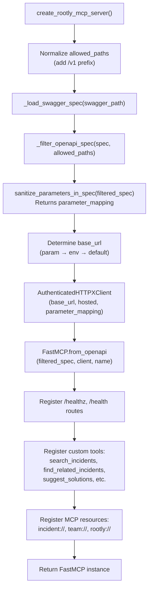
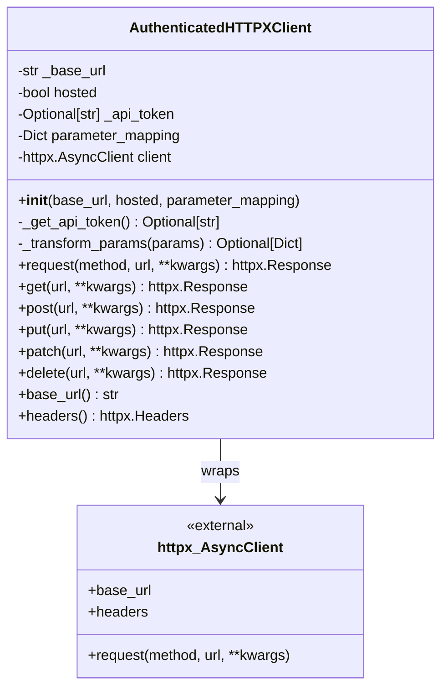
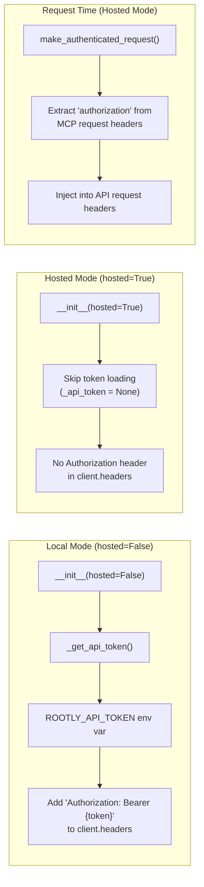
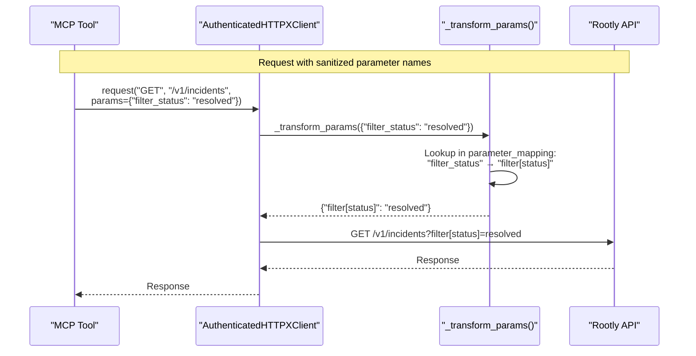
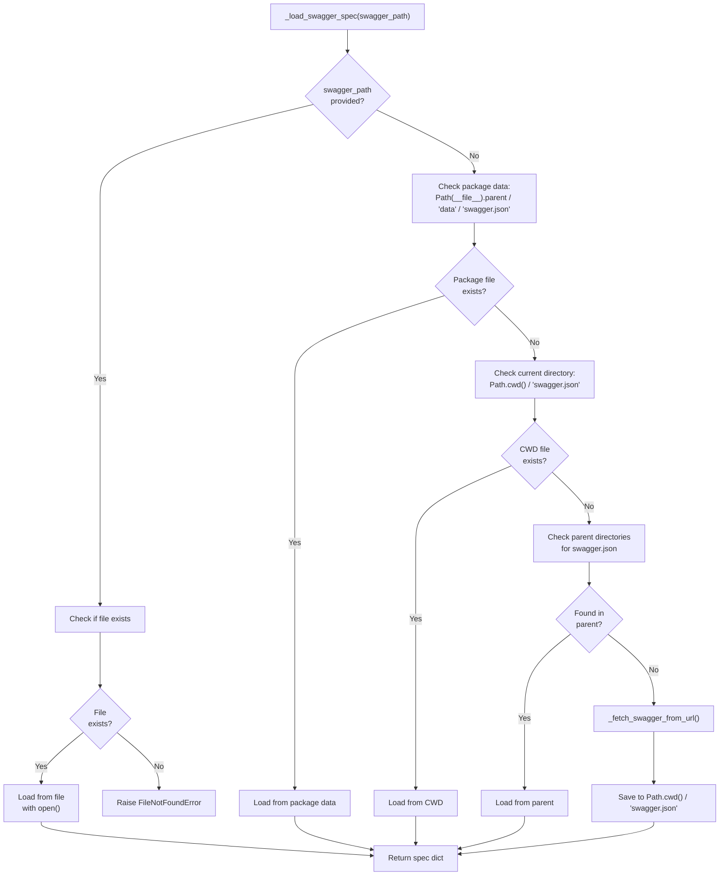
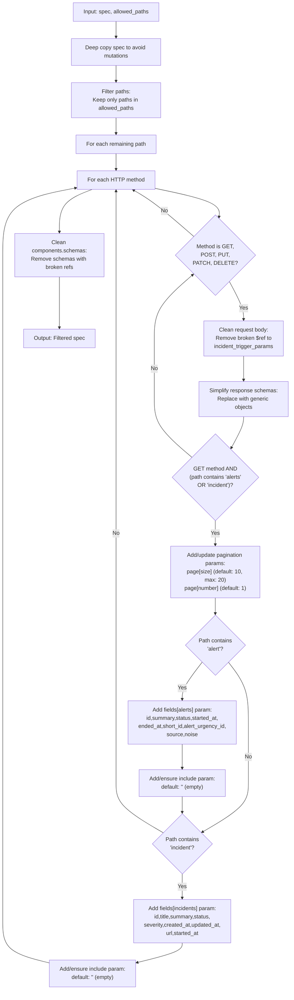
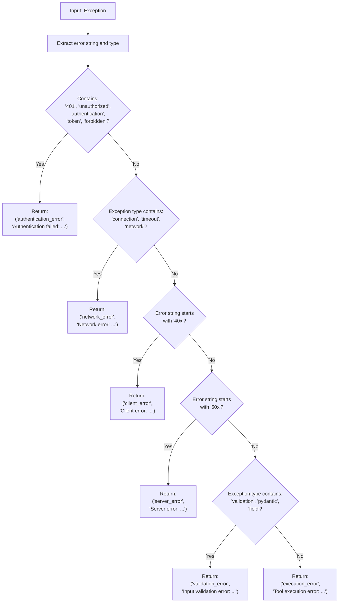

<!-- source: DeepWiki mcp.deepwiki.com · repo Rootly-AI-Labs/Rootly-MCP-server · page 7.1 Server API · fetched 2026-10-26 -->

# Server API

<details>
<summary>Relevant source files</summary>

The following files were used as context for generating this wiki page:

- [src/rootly_mcp_server/server.py](src/rootly_mcp_server/server.py)
- [tests/unit/test_server.py](tests/unit/test_server.py)

</details>


This document provides a comprehensive API reference for the core server creation and configuration functions in the Rootly MCP Server. It covers the `create_rootly_mcp_server` function, the `AuthenticatedHTTPXClient` class, and associated OpenAPI processing utilities.

For information about the server initialization process and data flow, see [Server Initialization Pipeline](#3.1). For the RootlyClient class used by custom tools, see [Client API](#7.2). For utility functions like parameter sanitization, see [Utilities Reference](#7.3).

## create_rootly_mcp_server Function

The `create_rootly_mcp_server` function is the primary entry point for creating a FastMCP server instance configured with Rootly API integration. It dynamically generates MCP tools from an OpenAPI specification and registers custom intelligent tools.

**Function Signature**

```python
def create_rootly_mcp_server(
    swagger_path: Optional[str] = None,
    name: str = "Rootly",
    allowed_paths: Optional[List[str]] = None,
    hosted: bool = False,
    base_url: Optional[str] = None,
) -> FastMCP
```

**Parameters**

| Parameter | Type | Default | Description |
|-----------|------|---------|-------------|
| `swagger_path` | `Optional[str]` | `None` | Path to local Swagger/OpenAPI JSON file. If `None`, fetches from `SWAGGER_URL` or searches local directories. |
| `name` | `str` | `"Rootly"` | Name of the MCP server instance. Used for identification in MCP protocol communication. |
| `allowed_paths` | `Optional[List[str]]` | `None` | List of API endpoint paths to expose as tools. If `None`, uses `DEFAULT_ALLOWED_PATHS`. Paths automatically get `/v1` prefix if not present. |
| `hosted` | `bool` | `False` | Whether server runs in hosted mode. `False` = local mode (uses `ROOTLY_API_TOKEN` env var), `True` = hosted mode (extracts token from MCP request headers). |
| `base_url` | `Optional[str]` | `None` | Base URL for Rootly API. If `None`, uses `ROOTLY_BASE_URL` env var or defaults to `"https://api.rootly.com"`. |

**Return Value**

Returns a `FastMCP` instance with:
- Auto-generated tools from filtered OpenAPI paths
- Custom tools: `search_incidents`, `find_related_incidents`, `suggest_solutions`, `get_oncall_shift_metrics`, `get_oncall_handoff_summary`, `get_shift_incidents`, `list_endpoints`
- MCP resources: `incident://{id}`, `team://{id}`, `rootly://incidents`
- Health check endpoints: `/healthz`, `/health`

**Server Creation Flow Diagram**



Sources: [src/rootly_mcp_server/server.py:278-751]()

**Configuration Examples**

```python
# Local development mode (uses ROOTLY_API_TOKEN env var)
server = create_rootly_mcp_server()

# Hosted mode (extracts token from MCP request headers)
server = create_rootly_mcp_server(hosted=True)

# Custom OpenAPI spec file
server = create_rootly_mcp_server(swagger_path="/path/to/swagger.json")

# Limited endpoint exposure
custom_paths = ["/incidents", "/alerts", "/teams"]
server = create_rootly_mcp_server(allowed_paths=custom_paths)

# Custom API base URL
server = create_rootly_mcp_server(base_url="https://staging-api.rootly.com")

# Full configuration
server = create_rootly_mcp_server(
    swagger_path="./openapi.json",
    name="StagingRootly",
    allowed_paths=["/incidents", "/alerts"],
    hosted=True,
    base_url="https://staging-api.rootly.com"
)
```

Sources: [src/rootly_mcp_server/server.py:278-297](), [tests/unit/test_server.py:29-90]()

## AuthenticatedHTTPXClient Class

The `AuthenticatedHTTPXClient` class wraps `httpx.AsyncClient` to provide authentication and parameter transformation capabilities. It handles the bidirectional mapping between MCP-compliant parameter names and original Rootly API parameter names.

**Constructor Signature**

```python
class AuthenticatedHTTPXClient:
    def __init__(
        self,
        base_url: str = "https://api.rootly.com",
        hosted: bool = False,
        parameter_mapping: Optional[Dict[str, str]] = None
    )
```

**Constructor Parameters**

| Parameter | Type | Default | Description |
|-----------|------|---------|-------------|
| `base_url` | `str` | `"https://api.rootly.com"` | Base URL for API requests. All requests are made relative to this URL. |
| `hosted` | `bool` | `False` | Authentication mode. `False` = load token from `ROOTLY_API_TOKEN` env var, `True` = skip token loading (relies on per-request headers). |
| `parameter_mapping` | `Optional[Dict[str, str]]` | `None` | Dictionary mapping sanitized parameter names (keys) to original API parameter names (values). Used for bidirectional transformation. |

**Class Structure Diagram**



Sources: [src/rootly_mcp_server/server.py:175-276]()

**Properties**

| Property | Type | Description |
|----------|------|-------------|
| `base_url` | `str` | Read-only property returning the base URL for API requests. |
| `headers` | `httpx.Headers` | Read-only property returning the underlying client's headers. |
| `client` | `httpx.AsyncClient` | The wrapped httpx async client instance. |

**Methods**

| Method | Signature | Description |
|--------|-----------|-------------|
| `_get_api_token()` | `() -> Optional[str]` | **Private.** Retrieves API token from `ROOTLY_API_TOKEN` environment variable. Returns `None` if not set or in hosted mode. |
| `_transform_params()` | `(params: Optional[Dict]) -> Optional[Dict]` | **Private.** Transforms MCP-compliant parameter names back to original API names using `parameter_mapping`. |
| `request()` | `async (method: str, url: str, **kwargs)` | Core request method. Transforms query parameters, then delegates to underlying client. |
| `get()` | `async (url: str, **kwargs)` | HTTP GET request. Proxies to `request('GET', ...)`. |
| `post()` | `async (url: str, **kwargs)` | HTTP POST request. Proxies to `request('POST', ...)`. |
| `put()` | `async (url: str, **kwargs)` | HTTP PUT request. Proxies to `request('PUT', ...)`. |
| `patch()` | `async (url: str, **kwargs)` | HTTP PATCH request. Proxies to `request('PATCH', ...)`. |
| `delete()` | `async (url: str, **kwargs)` | HTTP DELETE request. Proxies to `request('DELETE', ...)`. |

**Authentication Modes Diagram**



Sources: [src/rootly_mcp_server/server.py:175-276](), [src/rootly_mcp_server/server.py:375-392]()

**Parameter Transformation Flow**



Sources: [src/rootly_mcp_server/server.py:213-234](), [src/rootly_mcp_server/server.py:227-234]()

**Usage Example**

```python
# Local mode with environment token
client = AuthenticatedHTTPXClient(
    base_url="https://api.rootly.com",
    hosted=False,
    parameter_mapping={"filter_status": "filter[status]"}
)

# Hosted mode with per-request authentication
client = AuthenticatedHTTPXClient(
    base_url="https://api.rootly.com",
    hosted=True
)

# Making requests
response = await client.get("/v1/incidents", params={
    "filter_status": "resolved",  # Transformed to filter[status]
    "page_size": 10,              # Transformed to page[size]
})
```

Sources: [src/rootly_mcp_server/server.py:175-276](), [tests/unit/test_server.py:97-154]()

## OpenAPI Processing Functions

These functions handle loading, fetching, and filtering the Rootly OpenAPI specification to prepare it for tool generation.

### _load_swagger_spec Function

Loads the OpenAPI specification from a local file, package data, or remote URL with automatic fallback strategy.

**Signature**

```python
def _load_swagger_spec(swagger_path: Optional[str] = None) -> Dict[str, Any]
```

**Parameters**

| Parameter | Type | Default | Description |
|-----------|------|---------|-------------|
| `swagger_path` | `Optional[str]` | `None` | Explicit path to local Swagger JSON file. If `None`, searches in multiple locations. |

**Return Value**

Returns a dictionary containing the complete OpenAPI/Swagger specification.

**Loading Strategy**



Sources: [src/rootly_mcp_server/server.py:1754-1815]()

### _fetch_swagger_from_url Function

Fetches the OpenAPI specification from a remote URL using the `requests` library.

**Signature**

```python
def _fetch_swagger_from_url(url: str = SWAGGER_URL) -> Dict[str, Any]
```

**Parameters**

| Parameter | Type | Default | Description |
|-----------|------|---------|-------------|
| `url` | `str` | `SWAGGER_URL` | URL to fetch the Swagger JSON from. Defaults to `"https://rootly-heroku.s3.amazonaws.com/swagger/v1/swagger.json"`. |

**Return Value**

Returns a dictionary containing the fetched OpenAPI specification.

**Exceptions**

Raises `Exception` if:
- HTTP request fails (`requests.RequestException`)
- JSON parsing fails (`json.JSONDecodeError`)

Sources: [src/rootly_mcp_server/server.py:1818-1838]()

### _filter_openapi_spec Function

Filters an OpenAPI specification to include only allowed paths and applies various transformations for MCP compatibility and operational safety.

**Signature**

```python
def _filter_openapi_spec(spec: Dict[str, Any], allowed_paths: List[str]) -> Dict[str, Any]
```

**Parameters**

| Parameter | Type | Description |
|-----------|------|-------------|
| `spec` | `Dict[str, Any]` | Original OpenAPI specification dictionary. |
| `allowed_paths` | `List[str]` | List of API paths to retain in the filtered spec. |

**Return Value**

Returns a deep-copied and filtered OpenAPI specification dictionary.

**Transformations Applied**

| Transformation | Affected Paths | Purpose |
|----------------|----------------|---------|
| **Path filtering** | All paths | Retains only paths in `allowed_paths` list |
| **Schema reference cleaning** | All paths | Removes broken `$ref` to `incident_trigger_params` schemas |
| **Response schema simplification** | All paths | Replaces response schemas with generic objects to avoid validation errors |
| **Pagination limits** | Paths containing "alerts" or "incident" (GET only) | Adds/updates `page[size]` (default: 10, max: 20) and `page[number]` (default: 1) parameters |
| **Sparse fieldsets** | Paths containing "alert" (GET only) | Adds `fields[alerts]` parameter with essential fields as default |
| **Sparse fieldsets** | Paths containing "incident" (GET only) | Adds `fields[incidents]` parameter with essential fields as default |
| **Include parameter** | Paths containing "alert" or "incident" (GET only) | Adds/ensures `include` parameter with empty string default (minimal payload) |

**Filtering Logic Diagram**



Sources: [src/rootly_mcp_server/server.py:1841-2087]()

**Example Output**

For a GET endpoint at `/v1/alerts`, the function adds these parameters:

```json
{
  "parameters": [
    {
      "name": "page[size]",
      "in": "query",
      "required": false,
      "schema": {
        "type": "integer",
        "default": 10,
        "minimum": 1,
        "maximum": 20
      }
    },
    {
      "name": "page[number]",
      "in": "query",
      "required": false,
      "schema": {
        "type": "integer",
        "default": 1,
        "minimum": 1
      }
    },
    {
      "name": "fields[alerts]",
      "in": "query",
      "required": true,
      "schema": {
        "type": "string",
        "default": "id,summary,status,started_at,ended_at,short_id,alert_urgency_id,source,noise"
      }
    },
    {
      "name": "include",
      "in": "query",
      "required": true,
      "schema": {
        "type": "string",
        "default": ""
      }
    }
  ]
}
```

Sources: [src/rootly_mcp_server/server.py:1913-2038](), [tests/unit/test_server.py:300-368]()

## Configuration Constants

### DEFAULT_ALLOWED_PATHS

List of Rootly API paths exposed as MCP tools by default. Includes endpoints for incidents, alerts, teams, services, environments, workflows, action items, on-call schedules, and shifts.

**Type**: `List[str]`

**Value**: Defined at [src/rootly_mcp_server/server.py:121-172]()

**Categories**:

| Category | Example Paths |
|----------|---------------|
| **Incidents & Alerts** | `/incidents/{incident_id}/alerts`, `/alerts`, `/alerts/{alert_id}` |
| **Metadata** | `/severities`, `/teams`, `/services`, `/functionalities`, `/environments` |
| **Incident Types** | `/incident_types`, `/incident_types/{incident_type_id}` |
| **Action Items** | `/incident_action_items`, `/incidents/{incident_id}/action_items` |
| **Workflows** | `/workflows`, `/workflow_runs` |
| **Users & Status Pages** | `/users`, `/users/me`, `/status_pages` |
| **On-Call Schedules** | `/schedules`, `/schedules/{schedule_id}/shifts`, `/shifts` |
| **Schedule Rotations** | `/schedule_rotations/{schedule_rotation_id}`, `/schedule_rotations/{schedule_rotation_id}/schedule_rotation_users` |
| **On-Call Overrides** | `/schedules/{schedule_id}/override_shifts`, `/override_shifts/{override_shift_id}` |
| **On-Call Shadows & Roles** | `/schedules/{schedule_id}/on_call_shadows`, `/on_call_roles` |

Sources: [src/rootly_mcp_server/server.py:121-172]()

### SWAGGER_URL

Default URL for fetching the Rootly OpenAPI specification when no local file is available.

**Type**: `str`

**Value**: `"https://rootly-heroku.s3.amazonaws.com/swagger/v1/swagger.json"`

Sources: [src/rootly_mcp_server/server.py:85]()

## MCPError Class

Utility class providing protocol-compliant error handling for MCP tools. Categorizes exceptions and formats error responses according to JSON-RPC and MCP specifications.

**Class Structure**

```python
class MCPError:
    @staticmethod
    def protocol_error(code: int, message: str, data: Optional[Dict] = None) -> Dict
    
    @staticmethod
    def tool_error(error_message: str, error_type: str = "execution_error", 
                   details: Optional[Dict] = None) -> Dict
    
    @staticmethod
    def categorize_error(exception: Exception) -> tuple[str, str]
```

**Methods**

| Method | Return Type | Description |
|--------|-------------|-------------|
| `protocol_error()` | `Dict` | Creates JSON-RPC protocol-level error response with `jsonrpc`, `error.code`, `error.message`, and optional `error.data`. |
| `tool_error()` | `Dict` | Creates tool-level error response (returned as successful tool result) with `error`, `error_type`, `message`, and optional `details`. |
| `categorize_error()` | `tuple[str, str]` | Analyzes exception and returns `(error_type, formatted_message)` tuple. Error types: `authentication_error`, `network_error`, `client_error`, `server_error`, `validation_error`, `execution_error`. |

**Error Categorization Logic**



Sources: [src/rootly_mcp_server/server.py:28-82]()

**Usage Examples**

```python
# Tool-level error (returned as successful tool response)
try:
    result = await some_operation()
except Exception as e:
    error_type, error_message = MCPError.categorize_error(e)
    return MCPError.tool_error(error_message, error_type)

# Protocol-level error (JSON-RPC error response)
error_response = MCPError.protocol_error(
    code=-32603,
    message="Internal server error",
    data={"details": "Database connection failed"}
)

# Categorize exception
try:
    response.raise_for_status()
except httpx.HTTPStatusError as e:
    error_type, message = MCPError.categorize_error(e)
    # error_type might be 'client_error' or 'server_error'
    # message will be formatted appropriately
```

**Error Type Table**

| Error Type | Trigger Conditions | Example Messages |
|------------|-------------------|------------------|
| `authentication_error` | "401", "unauthorized", "authentication", "token", "forbidden" in error string | "Authentication failed: 401 Unauthorized" |
| `network_error` | "connection", "timeout", "network" in exception type name | "Network error: Connection timeout" |
| `client_error` | Error string starts with "40" (4xx codes) | "Client error: 404 Not Found" |
| `server_error` | Error string starts with "50" (5xx codes) | "Server error: 503 Service Unavailable" |
| `validation_error` | "validation", "pydantic", "field" in exception type name | "Input validation error: Invalid field type" |
| `execution_error` | Default for all other exceptions | "Tool execution error: Unexpected failure" |

Sources: [src/rootly_mcp_server/server.py:28-82]()

## Health Check Endpoints

The server registers two health check endpoints for monitoring and load balancer integration.

**Endpoints**

| Path | Method | Description | Response |
|------|--------|-------------|----------|
| `/healthz` | GET | Health check endpoint (Kubernetes-style) | Plain text: `"OK"` |
| `/health` | GET | Health check endpoint (alternative) | Plain text: `"OK"` |

**Implementation**

```python
@mcp.custom_route("/healthz", methods=["GET"])
@mcp.custom_route("/health", methods=["GET"])
async def health_check(request):
    from starlette.responses import PlainTextResponse
    return PlainTextResponse("OK")
```

These endpoints return HTTP 200 with body `"OK"` and can be used for:
- Kubernetes liveness/readiness probes
- Load balancer health checks
- Service monitoring systems
- Uptime verification

Sources: [src/rootly_mcp_server/server.py:346-350]()

## Tool and Resource Registration

The `create_rootly_mcp_server` function registers several categories of functionality beyond the auto-generated OpenAPI tools.

**Registration Flow**


**Custom Tools Registered**

| Tool | Description | Reference |
|------|-------------|-----------|
| `list_endpoints` | Returns all available OpenAPI endpoints with descriptions | [server.py:354-373]() |
| `search_incidents` | Search incidents with flexible pagination | [server.py:394-498]() |
| `find_related_incidents` | Find similar incidents using TF-IDF analysis | [server.py:504-604]() |
| `suggest_solutions` | Mine solutions from historical incidents | [server.py:606-702]() |
| `get_oncall_shift_metrics` | Calculate on-call shift statistics | [server.py:704-1053]() |
| `get_oncall_handoff_summary` | Get current/next on-call info | [server.py:1055-1393]() |
| `get_shift_incidents` | Get incidents during specific time range | [server.py:1621-1641]() |

For detailed documentation on these custom tools, see [Smart Analysis Tools](#4.2) and [On-Call Intelligence Tools](#4.3).

**MCP Resources Registered**

| URI Scheme | Description | Reference |
|------------|-------------|-----------|
| `incident://{incident_id}` | Fetch incident details as formatted text | [server.py:1643-1678]() |
| `team://{team_id}` | Fetch team details as formatted text | [server.py:1680-1712]() |
| `rootly://incidents` | List recent incidents as formatted text | [server.py:1714-1746]() |

For detailed documentation on MCP resources, see [MCP Resources](#4.4).

Sources: [src/rootly_mcp_server/server.py:346-1746]()

---

