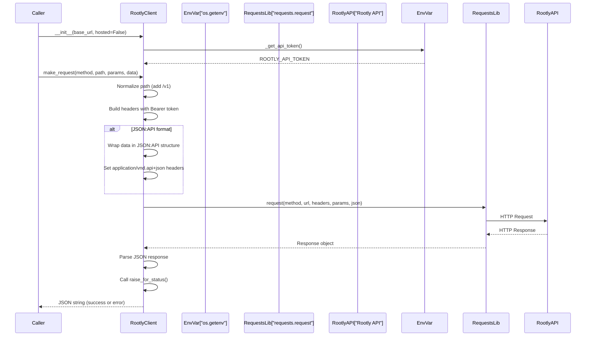
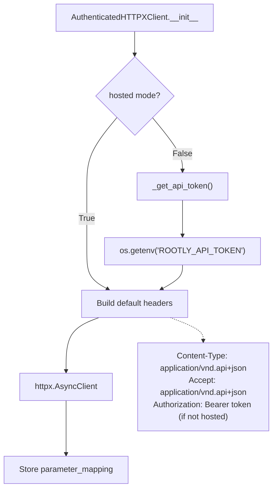
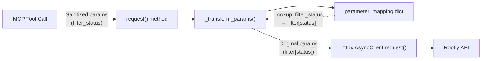
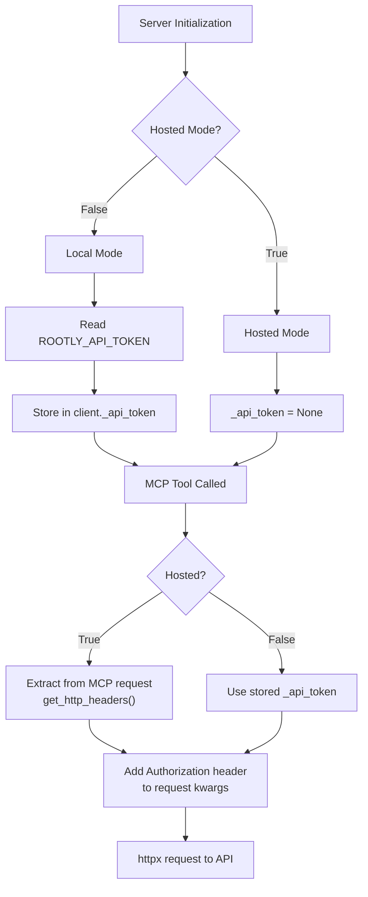
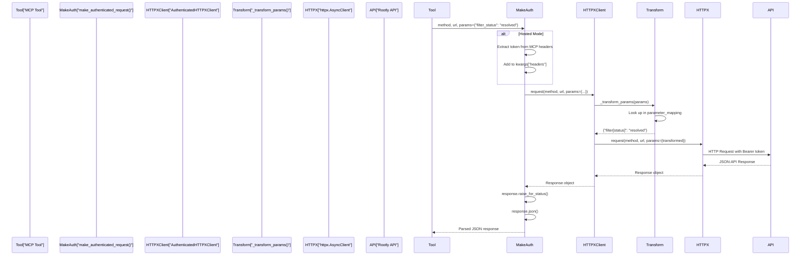
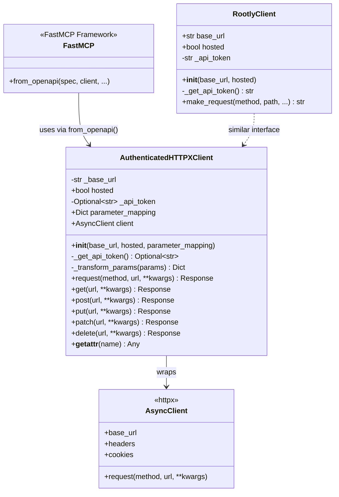

<!-- source: DeepWiki mcp.deepwiki.com · repo Rootly-AI-Labs/Rootly-MCP-server · page 7.2 Client API · fetched 2026-10-26 -->

# Client API

<details>
<summary>Relevant source files</summary>

The following files were used as context for generating this wiki page:

- [src/rootly_mcp_server/client.py](src/rootly_mcp_server/client.py)
- [src/rootly_mcp_server/server.py](src/rootly_mcp_server/server.py)

</details>


## Purpose and Scope

This page documents the HTTP client implementations used by the Rootly MCP Server to communicate with the Rootly API. It covers two client classes: `RootlyClient` (synchronous) and `AuthenticatedHTTPXClient` (async), their authentication mechanisms, parameter transformation capabilities, and request/response handling.

For server initialization and tool generation, see [Server API](#7.1). For utility functions like parameter sanitization, see [Utilities Reference](#7.3). For deployment authentication configuration, see [Authentication System](#3.3).

---

## Client Architecture Overview

The Rootly MCP Server provides two HTTP client implementations that handle authenticated requests to the Rootly API:

| Client Class | Location | Protocol | Primary Use | Authentication Mode |
|--------------|----------|----------|-------------|---------------------|
| `RootlyClient` | [client.py:15-133]() | Synchronous (requests) | Testing, standalone scripts | Token from environment |
| `AuthenticatedHTTPXClient` | [server.py:175-276]() | Asynchronous (httpx) | Server runtime, all MCP tools | Dual-mode (env or headers) |

The `AuthenticatedHTTPXClient` is the primary client used by the server and includes advanced features like bidirectional parameter transformation and streaming support.

**Sources:** [src/rootly_mcp_server/client.py:1-133](), [src/rootly_mcp_server/server.py:175-276]()

---

## RootlyClient (Synchronous)

### Class Definition

The `RootlyClient` provides a synchronous HTTP interface to the Rootly API using the `requests` library.

```python
# From client.py
class RootlyClient:
    def __init__(self, base_url: Optional[str] = None, hosted: bool = False)
    def _get_api_token(self) -> str
    def make_request(self, method: str, path: str, ...) -> str
```

### Constructor Parameters

| Parameter | Type | Default | Description |
|-----------|------|---------|-------------|
| `base_url` | `Optional[str]` | `None` | API base URL (defaults to `https://api.rootly.com`) |
| `hosted` | `bool` | `False` | Whether running in hosted mode (affects token source) |

### Authentication

In non-hosted mode, the client retrieves the API token from the `ROOTLY_API_TOKEN` environment variable during initialization:

```
RootlyClient.__init__ → _get_api_token() → os.getenv("ROOTLY_API_TOKEN")
```

If the token is missing, `_get_api_token()` raises `ValueError` at [client.py:27]().

In hosted mode, tokens must be provided via the `api_token` parameter to `make_request()`.

### make_request Method

**Signature:**
```python
def make_request(
    method: str,
    path: str,
    query_params: Optional[Dict[str, Any]] = None,
    json_data: Optional[Dict[str, Any]] = None,
    json_api_type: Optional[str] = None,
    api_token: Optional[str] = None,
) -> str
```

**Returns:** JSON-formatted string containing the API response or error details.

**Path Normalization:**
The method automatically normalizes paths:
1. Ensures path starts with `/` [client.py:75-76]()
2. Prepends `/v1` if not present [client.py:79-80]()

**JSON:API Format:**
When `json_api_type` is specified, the client:
- Sets `Content-Type` and `Accept` headers to `application/vnd.api+json` [client.py:67-68]()
- Wraps `json_data` in JSON:API structure: `{"data": {"type": json_api_type, "attributes": json_data}}` [client.py:70]()

### Request Flow Diagram



**Sources:** [src/rootly_mcp_server/client.py:30-132]()

---

## AuthenticatedHTTPXClient (Async)

### Class Definition

The `AuthenticatedHTTPXClient` is an async wrapper around `httpx.AsyncClient` that adds authentication and parameter transformation capabilities.

```python
# From server.py
class AuthenticatedHTTPXClient:
    def __init__(self, base_url: str = "https://api.rootly.com", 
                 hosted: bool = False, 
                 parameter_mapping: Optional[Dict[str, str]] = None)
    def _get_api_token(self) -> Optional[str]
    def _transform_params(self, params: Optional[Dict[str, Any]]) -> Optional[Dict[str, Any]]
    async def request(self, method: str, url: str, **kwargs)
    async def get/post/put/patch/delete(self, url: str, **kwargs)
```

### Constructor Parameters

| Parameter | Type | Default | Description |
|-----------|------|---------|-------------|
| `base_url` | `str` | `"https://api.rootly.com"` | Rootly API base URL |
| `hosted` | `bool` | `False` | Hosted mode (MCP header auth) |
| `parameter_mapping` | `Optional[Dict[str, str]]` | `None` | Map of sanitized → original param names |

### Initialization Flow



**Sources:** [src/rootly_mcp_server/server.py:178-203]()

### HTTP Client Configuration

The underlying `httpx.AsyncClient` is configured with:

```python
httpx.AsyncClient(
    base_url=base_url,
    headers=headers,
    timeout=30.0,
    follow_redirects=True,
    limits=httpx.Limits(max_keepalive_connections=5, max_connections=10)
)
```

Location: [server.py:196-203]()

### Parameter Transformation

The client implements bidirectional parameter name transformation to maintain MCP protocol compliance while using Rootly's original parameter names.

**Transformation Method:**
```python
def _transform_params(self, params: Optional[Dict[str, Any]]) -> Optional[Dict[str, Any]]
```

**Algorithm:**
1. If no `parameter_mapping` or `params` are provided, return params unchanged [server.py:215-216]()
2. For each parameter key, look up the original name in `parameter_mapping` [server.py:221]()
3. Use the original name if found, otherwise keep the sanitized name [server.py:222]()
4. Log the transformation for debugging [server.py:223-224]()

**Example Transformation:**
```
Input (from MCP tool):  {"filter_status": "resolved", "page_size": 10}
Mapping:                {"filter_status": "filter[status]", "page_size": "page[size]"}
Output (to Rootly API): {"filter[status]": "resolved", "page[size]": 10}
```

### Parameter Transformation Flow



**Sources:** [src/rootly_mcp_server/server.py:213-225]()

### Request Method Proxies

The client provides async proxy methods that wrap the underlying `httpx.AsyncClient`:

```python
async def get(self, url: str, **kwargs)     # Line 236
async def post(self, url: str, **kwargs)    # Line 240
async def put(self, url: str, **kwargs)     # Line 244
async def patch(self, url: str, **kwargs)   # Line 248
async def delete(self, url: str, **kwargs)  # Line 252
```

All methods delegate to `request()`, which applies parameter transformation before calling the underlying client.

### Attribute Delegation

The client uses `__getattr__` to delegate non-request attributes to the underlying `httpx.AsyncClient`:

```python
def __getattr__(self, name):
    if name in ['request', 'get', 'post', 'put', 'patch', 'delete']:
        return getattr(self, name)  # Use overridden methods
    return getattr(self.client, name)  # Delegate to httpx client
```

Location: [server.py:262-267]()

This allows accessing properties like `client.base_url`, `client.headers`, and `client.cookies` directly.

**Sources:** [src/rootly_mcp_server/server.py:227-276]()

---

## Authentication Flow

### Dual-Mode Authentication



### Local Mode Authentication

**Process:**
1. Client initialization calls `_get_api_token()` [server.py:185]()
2. Reads `ROOTLY_API_TOKEN` from environment [server.py:207]()
3. Stores token in `self._api_token` [server.py:211]()
4. Adds `Authorization: Bearer {token}` to default headers [server.py:194]()
5. All requests automatically include the header [server.py:196-203]()

### Hosted Mode Authentication

**Process:**
1. Client initializes with `hosted=True` [server.py:180]()
2. No token retrieved during initialization (`_api_token = None`) [server.py:184-185]()
3. During tool execution, server extracts token from MCP request headers [server.py:378-388]()
4. Token passed to `make_authenticated_request()` via kwargs [server.py:384-387]()
5. Added to request as `Authorization` header [server.py:387]()

**Code reference for hosted mode token extraction:**
```python
# From server.py:375-392
async def make_authenticated_request(method: str, url: str, **kwargs):
    if hosted:
        try:
            from fastmcp.server.dependencies import get_http_headers
            request_headers = get_http_headers()
            auth_header = request_headers.get("authorization", "")
            if auth_header:
                if "headers" not in kwargs:
                    kwargs["headers"] = {}
                kwargs["headers"]["Authorization"] = auth_header
        except Exception:
            pass
    
    return await http_client.request(method, url, **kwargs)
```

**Sources:** [src/rootly_mcp_server/server.py:175-211](), [src/rootly_mcp_server/server.py:375-392]()

---

## Request/Response Flow

### Complete Request Pipeline



### Error Response Flow

When an error occurs, the response propagates through:

1. **HTTP Error:** `httpx` raises exception [server.py:420-424]()
2. **Categorization:** `MCPError.categorize_error()` analyzes exception [server.py:423]()
3. **Tool Error:** `MCPError.tool_error()` formats response [server.py:424]()
4. **Return:** Error dict returned to MCP client [server.py:424]()

**Error Categories:** (from [server.py:58-82]())

| Category | Detection Pattern | Example |
|----------|-------------------|---------|
| `authentication_error` | "401", "unauthorized", "token" in error | Missing or invalid token |
| `network_error` | Exception type contains "connection", "timeout" | Network unavailable |
| `client_error` | "40" in first 10 chars | 400 Bad Request, 404 Not Found |
| `server_error` | "50" in first 10 chars | 500 Internal Server Error |
| `validation_error` | "validation", "pydantic" in exception type | Invalid input parameters |
| `execution_error` | Default fallback | Generic tool execution error |

**Sources:** [src/rootly_mcp_server/server.py:375-424](), [src/rootly_mcp_server/server.py:28-82]()

---

## Usage Examples

### Creating a Client Instance

```python
# Local mode (development)
client = AuthenticatedHTTPXClient(
    base_url="https://api.rootly.com",
    hosted=False,
    parameter_mapping={"filter_status": "filter[status]"}
)

# Hosted mode (production)
client = AuthenticatedHTTPXClient(
    base_url="https://api.rootly.com", 
    hosted=True,
    parameter_mapping=mapping
)
```

### Making a Request

```python
# Without parameter transformation
response = await client.get("/v1/incidents", params={"page[size]": 10})

# With parameter transformation (using mapping)
response = await client.get("/v1/incidents", params={"page_size": 10})
# Automatically transforms to: {"page[size]": 10}
```

### Accessing Underlying Client Properties

```python
# Access base_url
print(client.base_url)  # Delegates to httpx.AsyncClient.base_url

# Access headers
print(client.headers)   # Delegates to httpx.AsyncClient.headers

# Access cookies
cookies = client.cookies  # Delegates to httpx.AsyncClient.cookies
```

**Sources:** [src/rootly_mcp_server/server.py:175-276]()

---

## Class Relationships



**Sources:** [src/rootly_mcp_server/client.py:15-133](), [src/rootly_mcp_server/server.py:175-276](), [src/rootly_mcp_server/server.py:336-344]()

---

## Method Reference Tables

### RootlyClient Methods

| Method | Parameters | Returns | Description |
|--------|------------|---------|-------------|
| `__init__` | `base_url`, `hosted` | `None` | Initialize client |
| `_get_api_token` | None | `str` | Get token from `ROOTLY_API_TOKEN` env var |
| `make_request` | `method`, `path`, `query_params`, `json_data`, `json_api_type`, `api_token` | `str` | Make authenticated HTTP request |

### AuthenticatedHTTPXClient Methods

| Method | Parameters | Returns | Description |
|--------|------------|---------|-------------|
| `__init__` | `base_url`, `hosted`, `parameter_mapping` | `None` | Initialize async client |
| `_get_api_token` | None | `Optional[str]` | Get token from environment |
| `_transform_params` | `params` | `Optional[Dict]` | Transform parameter names using mapping |
| `request` | `method`, `url`, `**kwargs` | `Response` | Make async HTTP request with transformation |
| `get` | `url`, `**kwargs` | `Response` | Make async GET request |
| `post` | `url`, `**kwargs` | `Response` | Make async POST request |
| `put` | `url`, `**kwargs` | `Response` | Make async PUT request |
| `patch` | `url`, `**kwargs` | `Response` | Make async PATCH request |
| `delete` | `url`, `**kwargs` | `Response` | Make async DELETE request |
| `__getattr__` | `name` | `Any` | Delegate attributes to underlying httpx client |

**Sources:** [src/rootly_mcp_server/client.py:15-133](), [src/rootly_mcp_server/server.py:175-276]()

---

