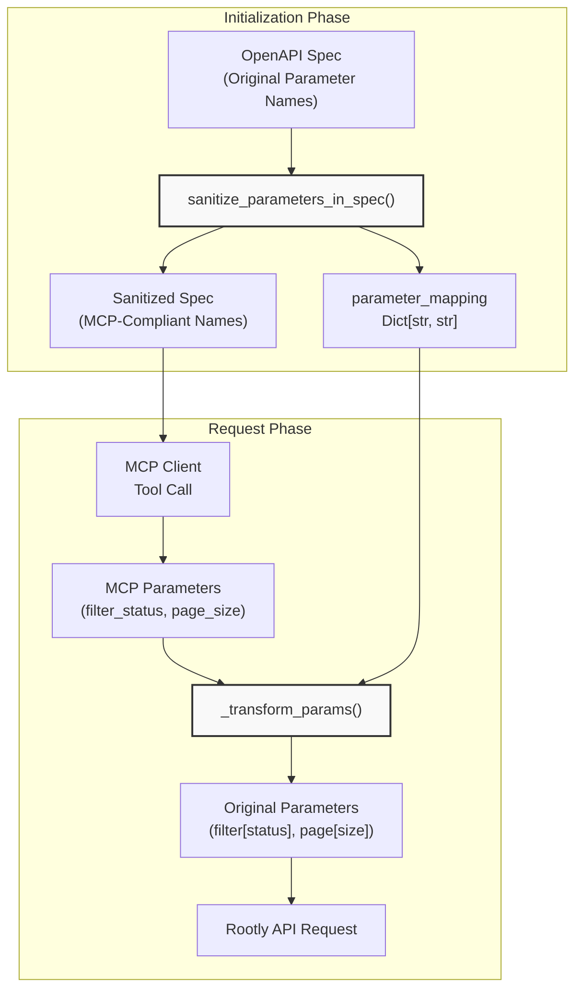
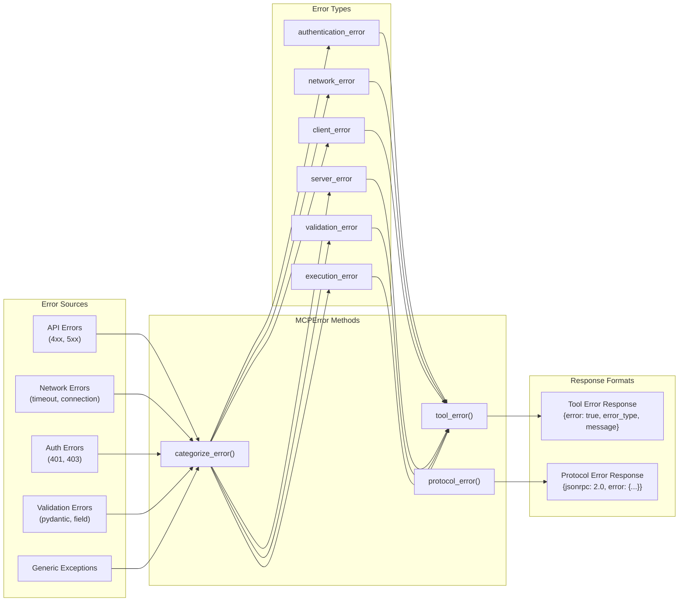

<!-- source: DeepWiki mcp.deepwiki.com · repo Rootly-AI-Labs/Rootly-MCP-server · page 7.3 Utilities Reference · fetched 2026-10-26 -->

# Utilities Reference

<details>
<summary>Relevant source files</summary>

The following files were used as context for generating this wiki page:

- [src/rootly_mcp_server/__main__.py](src/rootly_mcp_server/__main__.py)
- [src/rootly_mcp_server/server.py](src/rootly_mcp_server/server.py)
- [src/rootly_mcp_server/utils.py](src/rootly_mcp_server/utils.py)

</details>


This page documents the utility functions and helper classes that support the Rootly MCP Server's core functionality. These utilities handle critical tasks including parameter sanitization for MCP protocol compliance, error handling, CLI argument parsing, and logging configuration.

For information about the server's main initialization logic, see [Server Initialization Pipeline](#3.1). For details on authentication mechanisms, see [Authentication System](#3.3).

---

## Parameter Sanitization

The parameter sanitization system transforms Rootly API parameter names (which often contain special characters like brackets) into MCP-compliant names that match the pattern `^[a-zA-Z0-9_.-]{1,64}$`. This transformation is bidirectional, allowing the server to accept MCP-compliant names and translate them back to original Rootly API names before making HTTP requests.

### sanitize_parameter_name

```
sanitize_parameter_name(name: str) -> str
```

Transforms a single parameter name into an MCP-compliant format.

**Transformation Rules:**
- Square brackets replaced with underscores: `filter[kind]` → `filter_kind`
- Invalid characters replaced with underscores
- Multiple consecutive underscores collapsed to single underscore
- Leading/trailing underscores removed
- Names truncated to 64 characters maximum
- Names starting with digits prefixed with `param_`

**Common Transformations:**

| Original Name | Sanitized Name | Reason |
|--------------|----------------|--------|
| `filter[status]` | `filter_status` | Bracket notation |
| `page[size]` | `page_size` | Bracket notation |
| `filter[created_at][gte]` | `filter_created_at_gte` | Nested brackets |
| `include` | `include` | Already compliant |
| `123invalid` | `param_123invalid` | Starts with digit |

**Sources:** [src/rootly_mcp_server/utils.py:12-42]()

### sanitize_parameters_in_spec

```
sanitize_parameters_in_spec(spec: Dict[str, Any]) -> Dict[str, str]
```

Processes an entire OpenAPI specification, sanitizing all parameter names in-place and building a bidirectional mapping for parameter transformation.

**Processing Targets:**
- Path-level parameters
- Operation-level parameters (GET, POST, PUT, DELETE, PATCH)
- Component parameters (OpenAPI 3.0 `components.parameters`)

**Return Value:**
Returns a dictionary mapping sanitized names back to original names:
```python
{
    "filter_status": "filter[status]",
    "page_size": "page[size]",
    "filter_created_at_gte": "filter[created_at][gte]"
}
```

This mapping is stored in `AuthenticatedHTTPXClient.parameter_mapping` and used for request-time parameter transformation.

**Sources:** [src/rootly_mcp_server/utils.py:45-105]()

### Parameter Transformation Flow



**Bidirectional Transformation:**
1. **Forward (Initialization):** Original names → Sanitized names via `sanitize_parameter_name()`
2. **Reverse (Request Time):** Sanitized names → Original names via `parameter_mapping` lookup in `AuthenticatedHTTPXClient._transform_params()`

**Sources:** [src/rootly_mcp_server/utils.py:1-105](), [src/rootly_mcp_server/server.py:213-225](), [src/rootly_mcp_server/server.py:318-333]()

---

## Error Handling System

The `MCPError` class provides standardized error handling for both protocol-level and tool-level errors, ensuring MCP specification compliance.

### MCPError Class

Located in [src/rootly_mcp_server/server.py:28-82](), this static utility class provides three primary methods for error handling.



**Sources:** [src/rootly_mcp_server/server.py:28-82]()

### protocol_error

```python
@staticmethod
def protocol_error(code: int, message: str, data: Optional[Dict] = None)
```

Creates JSON-RPC 2.0 protocol-level error responses for low-level protocol violations.

**Response Format:**
```json
{
    "jsonrpc": "2.0",
    "error": {
        "code": -32600,
        "message": "Invalid Request",
        "data": {"details": "..."}
    }
}
```

**Common Error Codes:**
- `-32700`: Parse error
- `-32600`: Invalid Request
- `-32601`: Method not found
- `-32602`: Invalid params
- `-32603`: Internal error

**Sources:** [src/rootly_mcp_server/server.py:31-43]()

### tool_error

```python
@staticmethod
def tool_error(error_message: str, error_type: str = "execution_error", 
               details: Optional[Dict] = None)
```

Creates tool-level error responses that are returned as successful tool executions (but with error indicators). This is the standard way to report errors from MCP tools.

**Response Format:**
```json
{
    "error": true,
    "error_type": "authentication_error",
    "message": "Authentication failed: 401 Unauthorized",
    "details": {"status_code": 401}
}
```

**Usage Example:**
```python
return MCPError.tool_error(
    "Incident not found",
    "not_found",
    details={"incident_id": incident_id}
)
```

**Sources:** [src/rootly_mcp_server/server.py:45-55]()

### categorize_error

```python
@staticmethod
def categorize_error(exception: Exception) -> tuple[str, str]
```

Analyzes an exception and returns a tuple of `(error_type, error_message)` for consistent error categorization.

**Error Type Detection:**

| Keywords in Exception | Error Type | Message Prefix |
|----------------------|------------|----------------|
| `401`, `unauthorized`, `authentication`, `token`, `forbidden` | `authentication_error` | "Authentication failed: ..." |
| Exception type contains `connection`, `timeout`, `network` | `network_error` | "Network error: ..." |
| `40` in first 10 chars (4xx codes) | `client_error` | "Client error: ..." |
| `50` in first 10 chars (5xx codes) | `server_error` | "Server error: ..." |
| Exception type contains `validation`, `pydantic`, `field` | `validation_error` | "Input validation error: ..." |
| All others | `execution_error` | "Tool execution error: ..." |

**Usage Pattern:**
```python
try:
    # API call
except Exception as e:
    error_type, error_message = MCPError.categorize_error(e)
    return MCPError.tool_error(error_message, error_type)
```

**Sources:** [src/rootly_mcp_server/server.py:58-82]()

---

## Entry Point Utilities

The `__main__.py` module provides utilities for server initialization, configuration, and execution.

### Command-Line Argument Parsing

```mermaid
graph TB
    subgraph "parse_args()"
        Parser["argparse.ArgumentParser"]
        SwaggerPath["--swagger-path"]
        LogLevel["--log-level"]
        Name["--name"]
        Transport["--transport"]
        Debug["--debug"]
        BaseURL["--base-url"]
        AllowedPaths["--allowed-paths"]
        Hosted["--hosted / --host"]
    end
    
    subgraph "Environment Variables"
        EnvSwagger["ROOTLY_SWAGGER_PATH"]
        EnvServerName["ROOTLY_SERVER_NAME"]
        EnvHosted["ROOTLY_HOSTED"]
        EnvBaseURL["ROOTLY_BASE_URL"]
        EnvAllowedPaths["ROOTLY_ALLOWED_PATHS"]
        EnvDebug["DEBUG"]
    end
    
    subgraph "Server Configuration"
        ServerConfig["create_rootly_mcp_server()"]
    end
    
    Parser --> SwaggerPath
    Parser --> LogLevel
    Parser --> Name
    Parser --> Transport
    Parser --> Debug
    Parser --> BaseURL
    Parser --> AllowedPaths
    Parser --> Hosted
    
    EnvSwagger -.->|"Fallback"| ServerConfig
    EnvServerName -.->|"Fallback"| ServerConfig
    EnvHosted -.->|"Fallback"| ServerConfig
    EnvBaseURL -.->|"Fallback"| ServerConfig
    EnvAllowedPaths -.->|"Fallback"| ServerConfig
    EnvDebug -.->|"Override"| Debug
    
    SwaggerPath --> ServerConfig
    Name --> ServerConfig
    BaseURL --> ServerConfig
    AllowedPaths --> ServerConfig
    Hosted --> ServerConfig
```



**Sources:** [src/rootly_mcp_server/__main__.py:16-72]()

### parse_args

```python
def parse_args() -> argparse.Namespace
```

Parses command-line arguments for server configuration.

**Arguments:**

| Argument | Type | Default | Description |
|----------|------|---------|-------------|
| `--swagger-path` | str | None | Path to Swagger JSON file |
| `--log-level` | str | "INFO" | Logging level (DEBUG, INFO, WARNING, ERROR, CRITICAL) |
| `--name` | str | "Rootly" | MCP server name |
| `--transport` | str | "stdio" | Transport protocol (stdio, sse) |
| `--debug` | flag | False | Enable debug mode |
| `--base-url` | str | None | Rootly API base URL |
| `--allowed-paths` | str | None | Comma-separated allowed API paths |
| `--hosted` | flag | False | Enable hosted mode |
| `--host` | flag | False | Deprecated alias for `--hosted` |

**Sources:** [src/rootly_mcp_server/__main__.py:16-72]()

### setup_logging

```python
def setup_logging(log_level: str, debug: bool = False)
```

Configures Python's logging system with appropriate handlers and formatters.

**Behavior:**
- Debug mode overrides log level to DEBUG
- Environment variable `DEBUG=true|1|yes` also enables debug mode
- Logs written to `stderr` (compatible with stdio transport)
- Sets specific logger levels for `rootly_mcp_server` and `mcp` modules
- Logs configuration details including Python version, working directory, and environment variables (with token masking)

**Log Format:**
```
%(asctime)s - %(name)s - %(levelname)s - %(message)s
```

**Example Output:**
```
2025-01-15 10:30:45 - rootly_mcp_server.server - INFO - Creating Rootly MCP Server with allowed paths: ['/v1/incidents', ...]
2025-01-15 10:30:45 - rootly_mcp_server.server - DEBUG - Sanitized parameter: 'filter[status]' -> 'filter_status'
```

**Sources:** [src/rootly_mcp_server/__main__.py:75-101]()

### check_api_token

```python
def check_api_token() -> None
```

Validates that the `ROOTLY_API_TOKEN` environment variable is set. Exits with code 1 if not found.

**Validation Logic:**
- Only called when `hosted=False` (local mode)
- Logs first 5 characters of token for debugging
- Provides helpful error message with setup instructions

**Error Output:**
```
Error: ROOTLY_API_TOKEN environment variable is not set.
Please set it with: export ROOTLY_API_TOKEN='your-api-token-here'
```

**Sources:** [src/rootly_mcp_server/__main__.py:103-117]()

### get_server

```python
def get_server() -> FastMCP
```

Factory function that creates a configured Rootly MCP server instance using environment variables. This function is used by FastMCP CLI for server instantiation.

**Configuration Sources:**
- `ROOTLY_SWAGGER_PATH`: Custom OpenAPI spec path
- `ROOTLY_SERVER_NAME`: Server name (default: "Rootly")
- `ROOTLY_HOSTED`: Hosted mode flag (default: "false")
- `ROOTLY_BASE_URL`: API base URL override
- `ROOTLY_ALLOWED_PATHS`: Comma-separated path list

**Module-Level Instance:**
The module creates a global `mcp` instance for FastMCP CLI usage:
```python
mcp = get_server()
```

**Sources:** [src/rootly_mcp_server/__main__.py:120-145]()

---

## Helper Functions

### _generate_recommendation

```python
def _generate_recommendation(solution_data: dict) -> str
```

Generates human-readable recommendations from solution analysis data for the `suggest_solutions` tool.

**Input Data Structure:**
```python
{
    "solutions": [
        {"suggested_actions": ["action1", "action2"], ...}
    ],
    "average_resolution_time": 2.5,  # hours
    "common_patterns": ["pattern1", "pattern2"]
}
```

**Recommendation Logic:**

| Condition | Recommendation |
|-----------|----------------|
| No solutions found | "No similar incidents found. This may be a novel issue requiring escalation." |
| avg_time < 1 hour | "Similar incidents typically resolve quickly (< 1 hour)." |
| avg_time > 4 hours | "Similar incidents typically require more time (> 4 hours)." |
| Solutions available | "Consider trying: [top 2 actions]" |
| Patterns available | "Common patterns: [first pattern]" |
| Fallback | "Review similar incidents above for resolution guidance." |

**Example Output:**
```
"Similar incidents typically resolve quickly (< 1 hour). Consider trying: restart service, check logs. Common patterns: database connection timeout"
```

**Sources:** [src/rootly_mcp_server/server.py:88-117]()

### OpenAPI Spec Manipulation

The server includes several inline helper functions for OpenAPI specification processing:

**_load_swagger_spec:**
- Loads OpenAPI spec from file or remote URL
- Falls back to local `rootly_openapi.json` if remote fetch fails
- Located in [src/rootly_mcp_server/server.py](around line 310-350)

**_filter_openapi_spec:**
- Filters OpenAPI paths to only include allowed endpoints
- Creates a new spec with only specified paths
- Located in [src/rootly_mcp_server/server.py](around line 315)

**_clean_broken_references:**
- Removes broken schema references from OpenAPI spec
- Prevents validation errors from malformed specs

**_add_pagination_defaults:**
- Injects default pagination parameters into all list operations
- Adds `page[size]` and `page[number]` parameters

**_add_sparse_fieldsets:**
- Injects sparse fieldset parameters for resource selection
- Adds `fields[resource_type]` parameters

**Sources:** [src/rootly_mcp_server/server.py:278-344]()

---

## Utility Function Reference Table

| Function | Module | Purpose | Key Features |
|----------|--------|---------|--------------|
| `sanitize_parameter_name` | utils.py | Sanitize single parameter | Bracket transformation, MCP compliance |
| `sanitize_parameters_in_spec` | utils.py | Sanitize entire OpenAPI spec | In-place modification, mapping generation |
| `MCPError.protocol_error` | server.py | JSON-RPC protocol errors | Standard error codes, data field |
| `MCPError.tool_error` | server.py | Tool execution errors | Error categorization, details field |
| `MCPError.categorize_error` | server.py | Exception analysis | Pattern matching, error type detection |
| `parse_args` | __main__.py | CLI argument parsing | 8+ arguments, backward compatibility |
| `setup_logging` | __main__.py | Logging configuration | stderr output, debug mode, token masking |
| `check_api_token` | __main__.py | Token validation | Environment check, helpful errors |
| `get_server` | __main__.py | Server factory | Environment-based config |
| `_generate_recommendation` | server.py | Solution recommendations | Multi-source analysis, time estimates |

**Sources:** [src/rootly_mcp_server/utils.py:1-105](), [src/rootly_mcp_server/server.py:28-117](), [src/rootly_mcp_server/__main__.py:16-145]()

---

