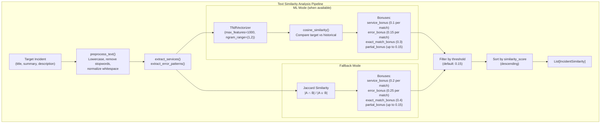
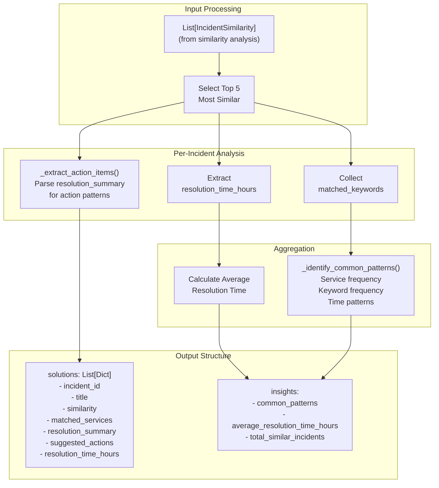
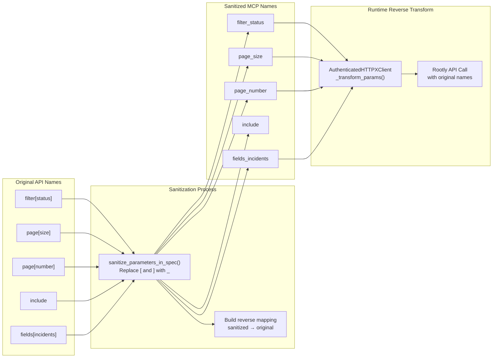
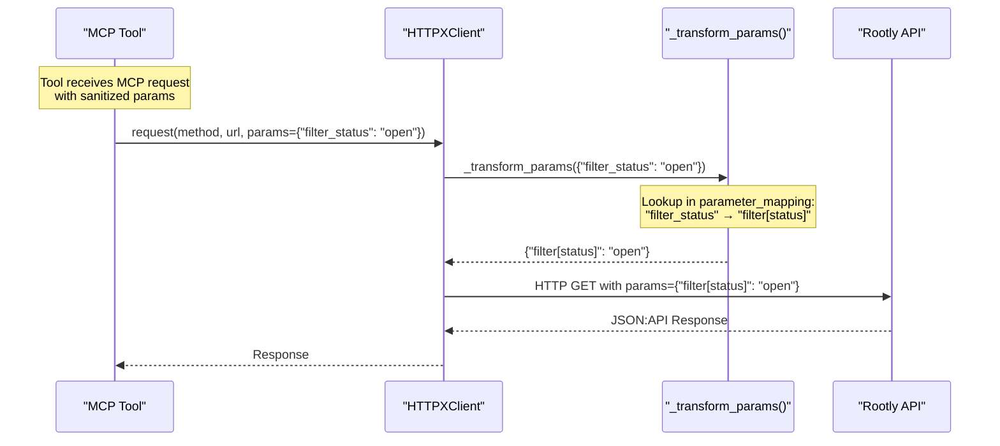
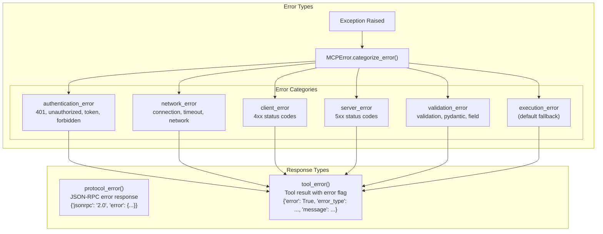

<!-- source: DeepWiki mcp.deepwiki.com · repo Rootly-AI-Labs/Rootly-MCP-server · page 8 Advanced Topics · fetched 2026-10-26 -->

# Advanced Topics

<details>
<summary>Relevant source files</summary>

The following files were used as context for generating this wiki page:

- [src/rootly_mcp_server/server.py](src/rootly_mcp_server/server.py)
- [src/rootly_mcp_server/smart_utils.py](src/rootly_mcp_server/smart_utils.py)
- [tests/integration/local/test_smart_tools.py](tests/integration/local/test_smart_tools.py)
- [tests/unit/test_smart_utils.py](tests/unit/test_smart_utils.py)

</details>


This document provides deep technical dives into specialized subsystems of the Rootly MCP Server. Topics covered include machine learning-based incident analysis, parameter name transformation for MCP protocol compliance, solution pattern extraction, and error handling strategies.

For basic tool usage and configuration, see [Getting Started](#2). For general server architecture, see [Core Architecture](#3). For developer guidance on creating custom tools, see [Custom Tool Development](#4.5).

---

## 8.1 Text Similarity Analysis

The `TextSimilarityAnalyzer` class implements intelligent incident matching using either TF-IDF vectorization with cosine similarity (when scikit-learn is available) or keyword-based fallback matching. This enables the `find_related_incidents` tool to identify similar historical incidents based on textual content.

### Dual-Mode Architecture

The analyzer operates in two modes depending on ML library availability:

| Mode | Condition | Algorithm | Accuracy | Performance |
|------|-----------|-----------|----------|-------------|
| **ML Mode** | `ML_AVAILABLE=True` | TF-IDF + Cosine Similarity | High | Moderate |
| **Fallback Mode** | `ML_AVAILABLE=False` | Jaccard Similarity | Moderate | Fast |

The mode is detected at module initialization [src/rootly_mcp_server/smart_utils.py:14-22]().



**Text Similarity Analysis Pipeline - ML and Fallback Modes**

Sources: [src/rootly_mcp_server/smart_utils.py:39-143](), [src/rootly_mcp_server/smart_utils.py:170-223](), [src/rootly_mcp_server/smart_utils.py:225-269]()

### Text Preprocessing

The `preprocess_text` method performs normalization to improve matching accuracy [src/rootly_mcp_server/smart_utils.py:49-68]():

1. **Lowercase conversion**: Normalize case for consistent matching
2. **Special character removal**: Keep only alphanumeric, hyphens, dots, and spaces using `r'[^\w\s\-\.]'`
3. **Whitespace normalization**: Replace multiple spaces with single space
4. **Stopword removal**: Filter common words (`the`, `a`, `an`, `and`, `or`, `but`, `in`, `on`, `at`, `to`, `for`, `of`, `with`, `by`, `is`, `are`, `was`, `were`)
5. **Length filtering**: Remove words with length ≤ 1

### Service Detection Patterns

The `extract_services` method uses regular expressions and known service lists to identify affected services [src/rootly_mcp_server/smart_utils.py:70-101]():

| Pattern Type | Regular Expression | Example Matches |
|--------------|-------------------|-----------------|
| Hyphenated | `r'\b(\w+)-(?:service\|api\|app\|server\|db)\b'` | `payment-service`, `auth-api` |
| Concatenated | `r'\b(\w+)(?:service\|api\|app\|server\|db)\b'` | `paymentapi`, `authservice` |
| Dotted | `r'\b(\w+)\.(?:service\|api\|app\|com)\b'` | `auth.service`, `api.com` |
| Spaced | `r'\b(\w+)\s+(?:api\|service\|app\|server\|db)\b'` | `payment api`, `auth service` |

Known services (exact word boundary matches):
- Databases: `elasticsearch`, `elastic`, `redis`, `postgres`, `mysql`, `mongodb`
- Message queues: `kafka`, `rabbitmq`
- Infrastructure: `nginx`, `apache`, `docker`, `kubernetes`
- Monitoring: `kibana`

### Error Pattern Detection

The `extract_error_patterns` method identifies common error categories [src/rootly_mcp_server/smart_utils.py:103-123]():

| Error Category | Detection Pattern | Example Pattern |
|----------------|-------------------|-----------------|
| HTTP Status Codes | `r'\b[45]\d\d\b'` | `http-500`, `http-404` |
| Database Errors | Keywords: `connection`, `timeout`, `database`, `db` | `database-error` |
| Resource Errors | Keywords: `memory`, `cpu`, `disk`, `resource` | `resource-error` |
| Network Errors | Keywords: `network`, `dns`, `connection`, `unreachable` | `network-error` |

Sources: [src/rootly_mcp_server/smart_utils.py:103-123]()

### TF-IDF Similarity Calculation

When scikit-learn is available, the `_calculate_tfidf_similarity` method implements advanced text matching [src/rootly_mcp_server/smart_utils.py:170-223]():

```mermaid
graph LR
    subgraph "TF-IDF Vectorization"
        AllTexts["All Texts<br/>(historical + target)"]
        Vectorizer["TfidfVectorizer<br/>max_features=1000<br/>ngram_range=(1,2)"]
        Matrix["TF-IDF Matrix<br/>(sparse)"]
    end
    
    subgraph "Similarity Calculation"
        TargetVec["Target Vector<br/>(last row)"]
        HistoricalVecs["Historical Vectors<br/>(all other rows)"]
        CosSim["cosine_similarity()<br/>Target vs Each Historical"]
        Scores["Base Similarity Scores"]
    end
    
    subgraph "Score Enhancement"
        ServiceMatch["Service Match Bonus<br/>+0.1 per common service"]
        ErrorMatch["Error Pattern Bonus<br/>+0.15 per common pattern"]
        ExactMatch["Exact Text Match<br/>+0.3 bonus"]
        PartialMatch["Partial Similarity<br/>+0.0 to +0.15"]
        FinalScore["final_score = min(1.0, base + bonuses)"]
    end
    
    AllTexts --> Vectorizer
    Vectorizer --> Matrix
    Matrix --> TargetVec
    Matrix --> HistoricalVecs
    TargetVec --> CosSim
    HistoricalVecs --> CosSim
    CosSim --> Scores
    
    Scores --> ServiceMatch
    ServiceMatch --> ErrorMatch
    ErrorMatch --> ExactMatch
    ExactMatch --> PartialMatch
    PartialMatch --> FinalScore
```



**TF-IDF Similarity Scoring with Multi-Factor Bonuses**

The vectorizer configuration:
- `max_features=1000`: Limits vocabulary to top 1000 terms by TF-IDF weight
- `ngram_range=(1, 2)`: Captures both unigrams and bigrams (e.g., "payment" and "payment api")

Score bonuses are applied to increase accuracy:
- **Service bonus**: `0.1 × |matched_services|` [src/rootly_mcp_server/smart_utils.py:200]()
- **Error bonus**: `0.15 × |matched_error_patterns|` [src/rootly_mcp_server/smart_utils.py:201]()
- **Exact match bonus**: `0.3` if preprocessed texts are identical [src/rootly_mcp_server/smart_utils.py:204-206]()
- **Partial match bonus**: Up to `0.15` based on fuzzy keyword matching [src/rootly_mcp_server/smart_utils.py:209]()

Sources: [src/rootly_mcp_server/smart_utils.py:170-223]()

### Partial Matching and Fuzzy Keywords

The `_words_similar` method implements fuzzy matching to catch related but not identical terms [src/rootly_mcp_server/smart_utils.py:294-326]():

**Variation Dictionary**:
```python
{
    'elastic': ['elasticsearch', 'elk'],
    'payment': ['payments', 'pay', 'billing'],
    'database': ['db', 'postgres', 'mysql', 'mongo'],
    'timeout': ['timeouts', 'timed-out', 'timing-out'],
    'service': ['services', 'svc', 'api', 'app'],
    'error': ['errors', 'err', 'failure', 'failed', 'failing'],
    'down': ['outage', 'offline', 'unavailable']
}
```

**Similarity Rules**:
1. **Variation matching**: Check if words are in same variation group
2. **Substring matching**: For words ≥5 chars, accept if substring overlap ≥70%
3. **Prefix matching**: For words ≥4 chars, accept if one starts with the other

The `_calculate_partial_similarity_bonus` method quantifies fuzzy matches [src/rootly_mcp_server/smart_utils.py:328-359]():
- Only considers words with length >3
- Counts unique fuzzy matches (each target word matched once)
- Returns `min(0.15, fuzzy_matches / min(meaningful_words) × 0.3)`

Sources: [src/rootly_mcp_server/smart_utils.py:271-359]()

### Keyword-Based Fallback

When ML libraries are unavailable, `_calculate_keyword_similarity` uses Jaccard similarity [src/rootly_mcp_server/smart_utils.py:225-269]():

**Jaccard Similarity Formula**:
```
similarity = |target_words ∩ incident_words| / |target_words ∪ incident_words|
```

This fallback mode applies higher bonuses to compensate for lower base accuracy:
- Service bonus: `0.2 × |matched_services|`
- Error bonus: `0.25 × |matched_error_patterns|`
- Exact match bonus: `0.4`
- Partial match bonus: Up to `0.15`

Minimum threshold: `0.15` (only incidents with `final_score > 0.15` are returned)

Sources: [src/rootly_mcp_server/smart_utils.py:225-269]()

### Resolution Time Calculation

The `_calculate_resolution_time` method parses incident timestamps to compute resolution duration [src/rootly_mcp_server/smart_utils.py:361-377]():

1. Extract `created_at` and `resolved_at` (or `updated_at` as fallback) from incident attributes
2. Parse ISO 8601 timestamps using `datetime.fromisoformat`, replacing `Z` with `+00:00`
3. Calculate difference: `(resolved - created).total_seconds() / 3600`
4. Return `None` on any parsing error

Sources: [src/rootly_mcp_server/smart_utils.py:361-377]()

---

## 8.2 Solution Extraction

The `SolutionExtractor` class analyzes resolved incidents to extract actionable solutions, common patterns, and resolution time estimates. This powers the `suggest_solutions` tool [src/rootly_mcp_server/server.py:606-702]().

### Solution Extraction Pipeline



**Solution Extraction Data Flow**

Sources: [src/rootly_mcp_server/smart_utils.py:380-430]()

### Action Item Extraction

The `_extract_action_items` method uses regex patterns to identify resolution actions [src/rootly_mcp_server/smart_utils.py:432-482]():

| Action Pattern | Regular Expression | Example Matches |
|----------------|-------------------|-----------------|
| Restart | `r'restart(?:ed)?\s+(\w+(?:\s+\w+)*)'` | "restarted payment service" |
| Clear | `r'clear(?:ed)?\s+(\w+(?:\s+\w+)*)'` | "cleared redis cache" |
| Update | `r'update(?:d)?\s+(\w+(?:\s+\w+)*)'` | "updated database config" |
| Fix | `r'fix(?:ed)?\s+(\w+(?:\s+\w+)*)'` | "fixed connection pool" |
| Rollback | `r'roll(?:ed)?\s+back\s+(\w+(?:\s+\w+)*)'` | "rolled back deployment" |
| Scale | `r'scale(?:d)?\s+(\w+(?:\s+\w+)*)'` | "scaled up instances" |
| Deploy | `r'deploy(?:ed)?\s+(\w+(?:\s+\w+)*)'` | "deployed hotfix" |

The method also searches for explicit step/action markers:
- Sentences containing keywords: `step`, `action`, `fix`, `solution`
- Extracted sentences are included verbatim as contextual actions

Return limit: Top 5 actions [src/rootly_mcp_server/smart_utils.py:482]()

**Example Extraction**:
```
Input: "Restarted the payment service and cleared Redis cache. Updated database configuration to fix connection pool settings."

Output: [
  "restart payment service",
  "clear redis cache", 
  "update database configuration",
  "fix connection pool settings"
]
```

Sources: [src/rootly_mcp_server/smart_utils.py:432-482](), [tests/integration/local/test_smart_tools.py:222-244]()

### Common Pattern Identification

The `_identify_common_patterns` method aggregates signals across similar incidents [src/rootly_mcp_server/smart_utils.py:484-519]():

**Service Pattern Analysis**:
- Collect all `matched_services` from incidents
- Identify services appearing in ≥2 incidents
- Format: `"Common services affected: payment, auth, database"`

**Keyword Pattern Analysis**:
- Count keyword frequencies across incidents
- Filter to keywords appearing ≥2 times with length >3
- Format: `"Common keywords: timeout, error, connection"`
- Limit: Top 3 keywords

**Resolution Time Pattern Analysis**:
- Calculate average of non-null `resolution_time_hours`
- Categorize into time bands:
  - `avg_time < 1`: "These incidents typically resolve quickly (< 1 hour)"
  - `avg_time > 4`: "These incidents typically take longer to resolve (> 4 hours)"
  - Otherwise: "These incidents typically resolve in X.X hours"

Sources: [src/rootly_mcp_server/smart_utils.py:484-519]()

### Solution Data Structure

The `extract_solutions` method returns a comprehensive solution dictionary [src/rootly_mcp_server/smart_utils.py:383-430]():

```python
{
  "solutions": [
    {
      "incident_id": str,
      "title": str,
      "similarity": float,  # rounded to 3 decimals
      "matched_services": List[str],
      "resolution_summary": str,
      "resolution_time_hours": Optional[float],
      "suggested_actions": List[str]  # optional, if actions extracted
    },
    ...  # up to 5 solutions
  ],
  "common_patterns": List[str],  # pattern descriptions
  "average_resolution_time": Optional[float],  # rounded to 2 decimals
  "total_similar_incidents": int
}
```

This structure is consumed by the `suggest_solutions` tool to generate user-facing recommendations [src/rootly_mcp_server/server.py:685-698]().

Sources: [src/rootly_mcp_server/smart_utils.py:383-430]()

### High-Level Recommendation Generation

The `_generate_recommendation` function in `server.py` synthesizes solution data into actionable guidance [src/rootly_mcp_server/server.py:88-117]():

**Recommendation Logic**:
1. **No solutions found**: `"No similar incidents found. This may be a novel issue requiring escalation."`
2. **Time expectation**: Based on `average_resolution_time`:
   - `< 1 hour`: "Similar incidents typically resolve quickly"
   - `> 4 hours`: "Similar incidents typically require more time"
3. **Top actions**: Extract first 2 actions from most similar solution
4. **Pattern insights**: Include first common pattern
5. **Fallback**: `"Review similar incidents above for resolution guidance."`

Example output:
```
"Similar incidents typically resolve quickly (< 1 hour). Consider trying: restart payment service, clear redis cache. Common patterns: Common services affected: payment, auth"
```

Sources: [src/rootly_mcp_server/server.py:88-117]()

---

## 8.3 Parameter Sanitization

MCP protocol requires parameter names to conform to specific naming conventions. The Rootly API uses JSON:API syntax with bracket notation (e.g., `filter[status]`, `page[size]`) which violates MCP naming rules. The `sanitize_parameters_in_spec` function transforms parameter names for MCP compatibility while maintaining a bidirectional mapping for API calls.

### Parameter Name Transformation Rules



**Parameter Transformation Bidirectional Flow**

Sources: [src/rootly_mcp_server/utils.py:1-144](), [src/rootly_mcp_server/server.py:175-276]()

### Sanitization Implementation

The `sanitize_parameters_in_spec` function walks the OpenAPI specification and transforms all parameter names [src/rootly_mcp_server/utils.py:14-144]():

**Core Transformation Logic** [src/rootly_mcp_server/utils.py:25-32]():
```python
def sanitize_parameter_name(param_name: str) -> str:
    """Replace [ and ] with _ to make parameter names MCP-compliant."""
    sanitized = param_name.replace("[", "_").replace("]", "")
    return sanitized
```

**Examples**:
| Original Name | Sanitized Name |
|---------------|----------------|
| `filter[status]` | `filter_status` |
| `page[size]` | `page_size` |
| `page[number]` | `page_number` |
| `fields[incidents]` | `fields_incidents` |
| `schedule_ids[]` | `schedule_ids` |
| `user_ids[]` | `user_ids` |

### OpenAPI Spec Traversal

The function traverses multiple OpenAPI locations [src/rootly_mcp_server/utils.py:35-144]():

1. **Path Parameters**: `/incidents/{incident_id}/alerts` paths
2. **Operation Parameters**: Query parameters in GET, POST, PUT, DELETE, PATCH operations
3. **Request Body Properties**: JSON request body schemas
4. **Component Schemas**: Reusable schema definitions
5. **Component Parameters**: Reusable parameter definitions

**Key Processing** [src/rootly_mcp_server/utils.py:75-91]():
```python
for param in operation_params:
    original_name = param.get("name", "")
    sanitized_name = sanitize_parameter_name(original_name)
    
    if sanitized_name != original_name:
        param["name"] = sanitized_name
        param_mapping[sanitized_name] = original_name
        
        # Preserve original in extension for documentation
        if "x-original-name" not in param:
            param["x-original-name"] = original_name
```

The function returns a `Dict[str, str]` mapping sanitized names back to originals: `{"filter_status": "filter[status]", ...}`

Sources: [src/rootly_mcp_server/utils.py:14-144]()

### Runtime Parameter Transformation

The `AuthenticatedHTTPXClient` class applies reverse transformation at request time [src/rootly_mcp_server/server.py:213-225]():



**Runtime Parameter Transformation Sequence**

The `_transform_params` method [src/rootly_mcp_server/server.py:213-225]():
1. Iterates through provided parameters
2. Looks up each key in `parameter_mapping`
3. Uses original name if found, otherwise keeps sanitized name
4. Logs transformations for debugging
5. Returns transformed parameter dictionary

Sources: [src/rootly_mcp_server/server.py:213-225]()

### Edge Cases and Special Handling

**Array Parameter Handling**:
- Input: `schedule_ids[]` → Sanitized: `schedule_ids`
- Transformation preserves array syntax when needed
- Example: `{"schedule_ids": ["id1", "id2"]}` → API receives `{"schedule_ids[]": ["id1", "id2"]}`

**Nested Parameter Handling**:
- Double-bracket parameters: `filter[service][name]` → `filter_service_name`
- Maintains full path in reverse mapping

**No-Op Parameters**:
- Simple names like `include`, `query`, `id` pass through unchanged
- Not added to mapping dictionary (identity transform)

**Missing Mapping Handling** [src/rootly_mcp_server/server.py:220-224]():
```python
original_key = self.parameter_mapping.get(key, key)
transformed[original_key] = value
if original_key != key:
    logger.debug(f"Transformed parameter: '{key}' -> '{original_key}'")
```

If a parameter isn't in the mapping, it's passed through as-is. This handles:
- Parameters added after spec sanitization
- Custom parameters not in OpenAPI spec
- Headers and other non-parameter request options

Sources: [src/rootly_mcp_server/server.py:213-225]()

### Integration with Server Initialization

Parameter sanitization is integrated into the server creation pipeline [src/rootly_mcp_server/server.py:318-334]():

1. **Load and filter OpenAPI spec** [src/rootly_mcp_server/server.py:310-316]()
2. **Sanitize parameters** [src/rootly_mcp_server/server.py:319](): `parameter_mapping = sanitize_parameters_in_spec(filtered_spec)`
3. **Create HTTP client with mapping** [src/rootly_mcp_server/server.py:330-334]():
   ```python
   http_client = AuthenticatedHTTPXClient(
       base_url=base_url,
       hosted=hosted,
       parameter_mapping=parameter_mapping
   )
   ```
4. **Generate MCP tools from sanitized spec** [src/rootly_mcp_server/server.py:338-344]()

This ensures all auto-generated tools use MCP-compliant parameter names while API calls use correct Rootly syntax.

Sources: [src/rootly_mcp_server/server.py:278-344]()

---

## 8.4 Error Handling & MCPError

The `MCPError` class provides standardized error handling that distinguishes between JSON-RPC protocol-level errors and tool-level execution errors. This ensures MCP protocol compliance while providing useful debugging information.

### Error Classification System



**MCPError Classification and Response Flow**

Sources: [src/rootly_mcp_server/server.py:28-82]()

### MCPError Class Methods

The `MCPError` class provides static methods for error handling [src/rootly_mcp_server/server.py:28-82]():

| Method | Purpose | Return Type | Usage |
|--------|---------|-------------|-------|
| `protocol_error(code, message, data)` | JSON-RPC protocol errors | Dict (JSON-RPC error) | Protocol violations, invalid requests |
| `tool_error(message, error_type, details)` | Tool execution errors | Dict (error result) | Tool runtime errors, API failures |
| `categorize_error(exception)` | Classify exception type | Tuple[str, str] | Automatic error categorization |

### Protocol-Level Errors

The `protocol_error` method creates JSON-RPC 2.0 compliant error responses [src/rootly_mcp_server/server.py:31-43]():

```python
{
    "jsonrpc": "2.0",
    "error": {
        "code": int,        # JSON-RPC error code
        "message": str,     # Human-readable message
        "data": dict        # Optional additional context
    }
}
```

**Standard JSON-RPC Error Codes**:
- `-32700`: Parse error
- `-32600`: Invalid request
- `-32601`: Method not found
- `-32602`: Invalid params
- `-32603`: Internal error
- `-32000` to `-32099`: Server-defined errors

This method is rarely used directly in the current implementation, as most errors are handled as tool-level errors.

Sources: [src/rootly_mcp_server/server.py:31-43]()

### Tool-Level Errors

The `tool_error` method creates error responses that are returned as successful tool results [src/rootly_mcp_server/server.py:45-55]():

```python
{
    "error": True,
    "error_type": str,     # Categorized error type
    "message": str,        # Descriptive error message
    "details": dict        # Optional debug information
}
```

This approach allows tools to gracefully handle errors while preserving the MCP call-response flow. Clients can check for `error: True` in results.

Sources: [src/rootly_mcp_server/server.py:45-55]()

### Error Categorization Logic

The `categorize_error` method analyzes exception content to determine error type [src/rootly_mcp_server/server.py:57-82]():

**Authentication/Authorization** [src/rootly_mcp_server/server.py:64-65]():
```python
if any(keyword in error_str.lower() for keyword in 
       ["401", "unauthorized", "authentication", "token", "forbidden"]):
    return "authentication_error", f"Authentication failed: {error_str}"
```

**Network/Connection** [src/rootly_mcp_server/server.py:67-69]():
```python
if any(keyword in exception_type.lower() for keyword in 
       ["connection", "timeout", "network"]):
    return "network_error", f"Network error: {error_str}"
```

**HTTP Status Codes** [src/rootly_mcp_server/server.py:71-75]():
```python
if "40" in error_str[:10]:  # 4xx client errors
    return "client_error", f"Client error: {error_str}"
elif "50" in error_str[:10]:  # 5xx server errors
    return "server_error", f"Server error: {error_str}"
```

**Validation Errors** [src/rootly_mcp_server/server.py:77-79]():
```python
if any(keyword in exception_type.lower() for keyword in 
       ["validation", "pydantic", "field"]):
    return "validation_error", f"Input validation error: {error_str}"
```

**Default Fallback** [src/rootly_mcp_server/server.py:81-82]():
```python
return "execution_error", f"Tool execution error: {error_str}"
```

Sources: [src/rootly_mcp_server/server.py:57-82]()

### Error Handling Patterns in Tools

**Example: search_incidents Tool** [src/rootly_mcp_server/server.py:418-424]():
```python
try:
    response = await make_authenticated_request("GET", "/v1/incidents", params=params)
    response.raise_for_status()
    return response.json()
except Exception as e:
    error_type, error_message = MCPError.categorize_error(e)
    return MCPError.tool_error(error_message, error_type)
```

**Example: find_related_incidents Tool** [src/rootly_mcp_server/server.py:602-604]():
```python
except Exception as e:
    error_type, error_message = MCPError.categorize_error(e)
    return MCPError.tool_error(f"Failed to find related incidents: {error_message}", error_type)
```

**Early Authentication Check** [src/rootly_mcp_server/server.py:476-478]():
```python
# Re-raise authentication or critical errors for immediate handling
if "401" in str(e) or "Unauthorized" in str(e) or "authentication" in str(e).lower():
    error_type, error_message = MCPError.categorize_error(e)
    return MCPError.tool_error(error_message, error_type)
```

Sources: [src/rootly_mcp_server/server.py:418-424](), [src/rootly_mcp_server/server.py:602-604](), [src/rootly_mcp_server/server.py:476-478]()

### Error Handling in Complex Tools

For complex tools like `get_oncall_shift_metrics`, errors include detailed debugging context [src/rootly_mcp_server/server.py:1041-1053]():

```python
except Exception as e:
    import traceback
    error_type, error_message = MCPError.categorize_error(e)
    return MCPError.tool_error(
        f"Failed to get on-call shift metrics: {error_message}",
        error_type,
        details={
            "params": {"start_date": start_date, "end_date": end_date},
            "exception_type": type(e).__name__,
            "exception_str": str(e),
            "traceback": traceback.format_exc()
        }
    )
```

The `details` field provides:
- Input parameters that caused the error
- Python exception type
- Full exception message
- Stack traceback for debugging

Sources: [src/rootly_mcp_server/server.py:1041-1053]()

### Debugging Strategy

**Error Response Analysis**:
1. Check `error` field: `True` indicates tool-level error
2. Examine `error_type`: Identifies error category for targeted fixes
3. Read `message`: Human-readable description
4. Review `details`: Technical debugging information

**Common Error Patterns**:

| Error Type | Common Causes | Resolution |
|------------|---------------|------------|
| `authentication_error` | Invalid/missing `ROOTLY_API_TOKEN`, expired token | Check environment variable, regenerate token |
| `network_error` | API unavailable, DNS issues, timeout | Verify connectivity, check API status |
| `client_error` | Invalid request parameters, missing required fields | Validate input parameters against OpenAPI spec |
| `server_error` | Rootly API internal error, rate limiting | Retry with backoff, contact Rootly support |
| `validation_error` | Type mismatch, out-of-range values | Check parameter types and constraints |
| `execution_error` | Unexpected runtime error | Review `details.traceback` for root cause |

**Testing Error Handling** [tests/unit/test_smart_utils.py:212-220]():
```python
def test_error_handling_invalid_incident_id(self, server_with_smart_tools):
    """Test error handling for invalid incident ID."""
    from rootly_mcp_server.server import MCPError
    
    # Test error categorization
    error_type, error_message = MCPError.categorize_error(Exception("404 Not Found"))
    assert error_type in ["client_error", "execution_error"]
    assert "404" in error_message or "Not Found" in error_message
```

Sources: [src/rootly_mcp_server/server.py:28-82](), [tests/unit/test_smart_utils.py:212-220]()

---

