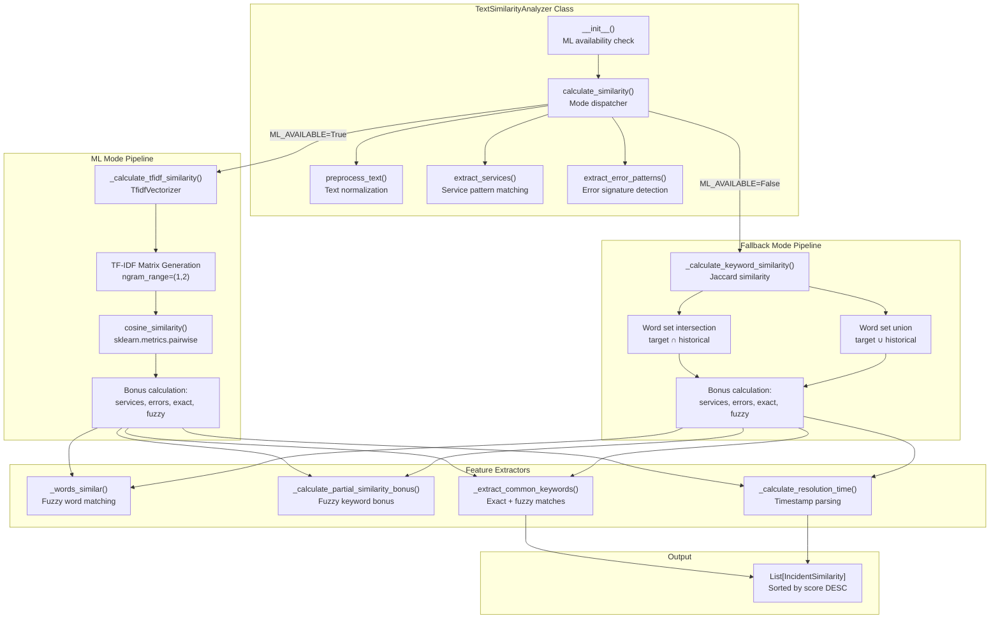
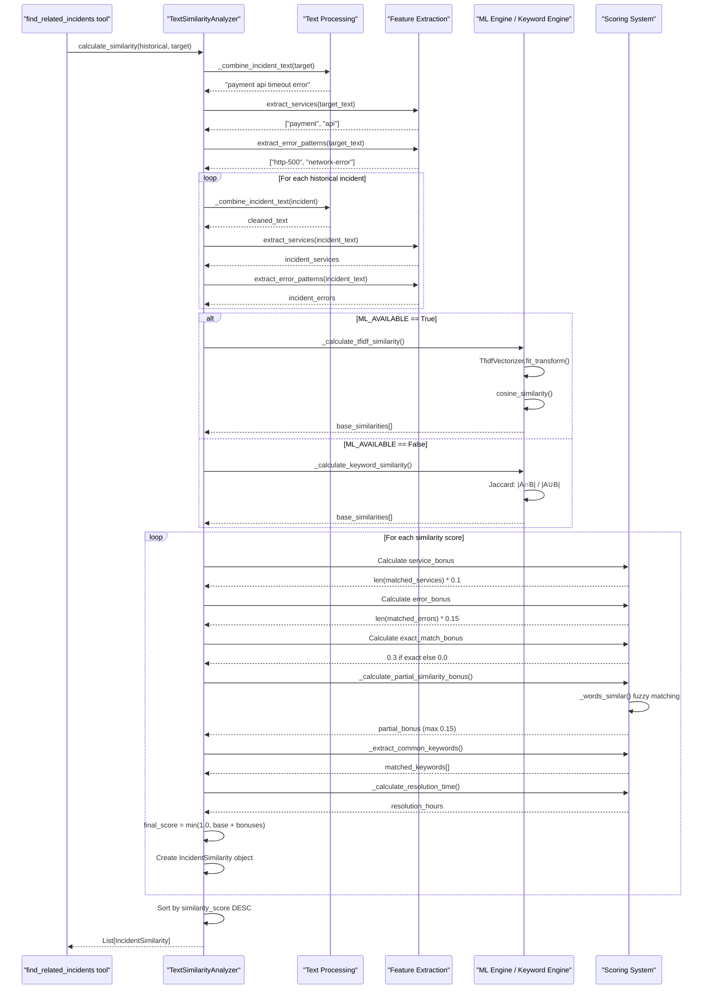
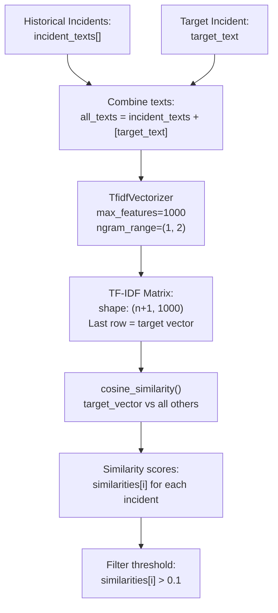
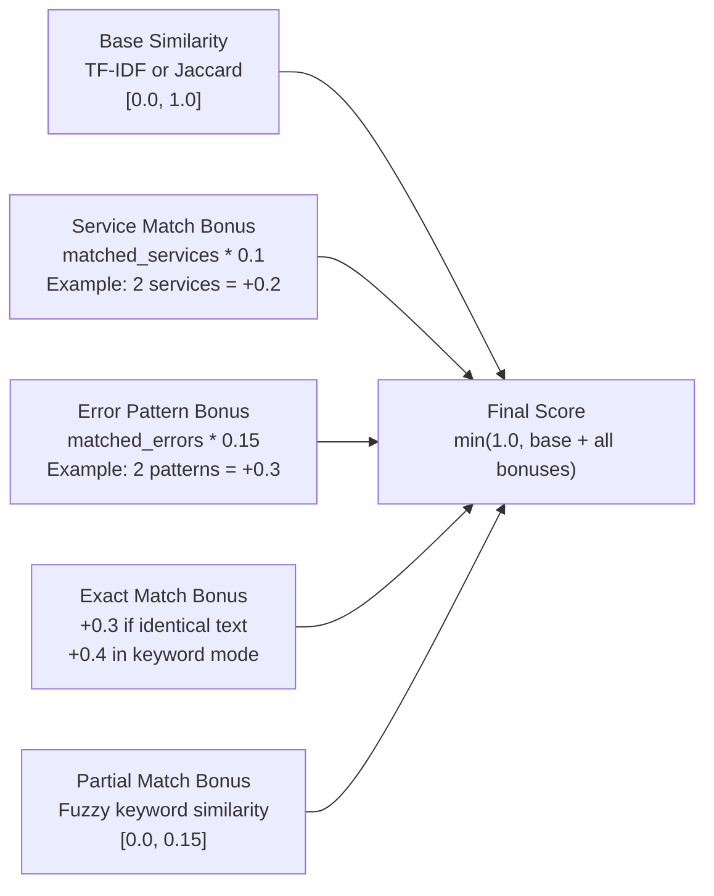
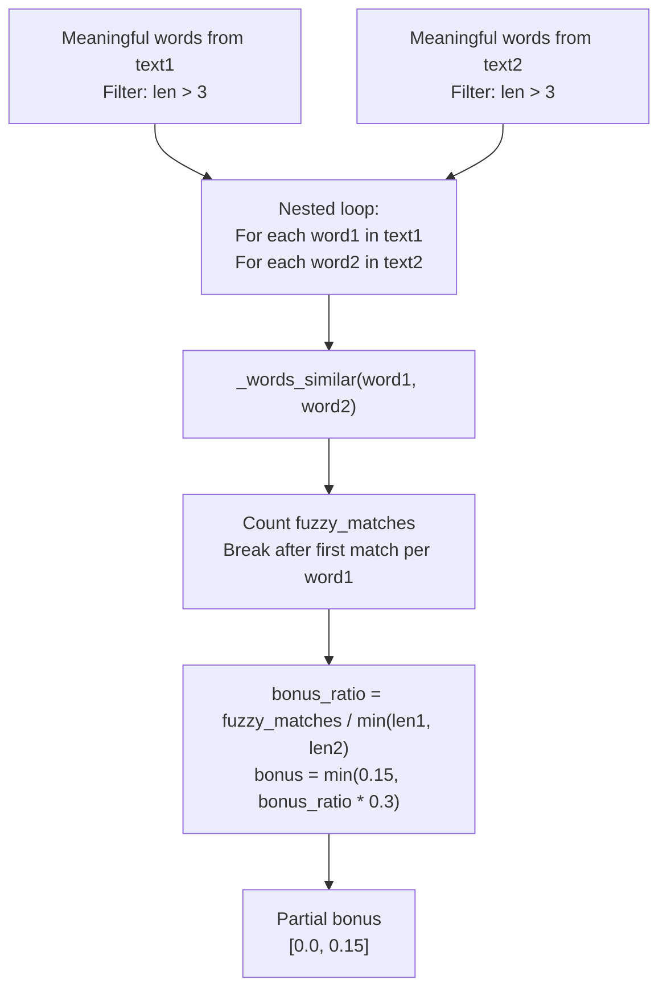
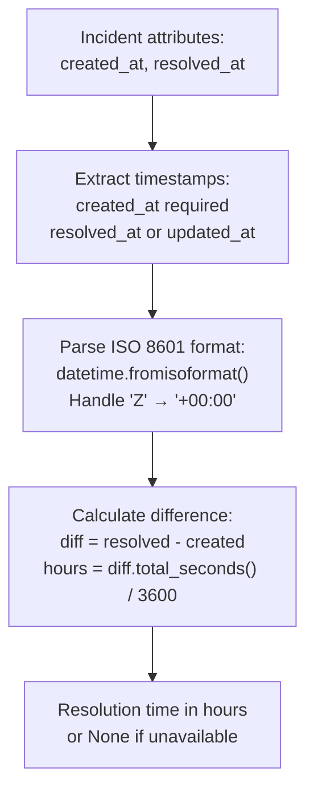

<!-- source: DeepWiki mcp.deepwiki.com · repo Rootly-AI-Labs/Rootly-MCP-server · page 8.1 Text Similarity Analysis · fetched 2026-10-26 -->

# Text Similarity Analysis

<details>
<summary>Relevant source files</summary>

The following files were used as context for generating this wiki page:

- [src/rootly_mcp_server/smart_utils.py](src/rootly_mcp_server/smart_utils.py)
- [tests/integration/local/test_smart_tools.py](tests/integration/local/test_smart_tools.py)
- [tests/unit/test_smart_utils.py](tests/unit/test_smart_utils.py)

</details>


## Purpose and Scope

This document describes the `TextSimilarityAnalyzer` system, which implements machine learning-based incident similarity detection using TF-IDF vectorization and cosine similarity. The analyzer enables the `find_related_incidents` tool to identify historically similar incidents based on text content, service patterns, and error signatures.

For information about how extracted solutions are processed and formatted, see [Solution Extraction](#8.2). For the overall smart tools architecture, see [Smart Analysis Tools](#4.2).

**Sources:** [src/rootly_mcp_server/smart_utils.py:1-519]()

## System Overview

The `TextSimilarityAnalyzer` class provides ML-powered incident similarity analysis with automatic fallback to keyword-based matching when scikit-learn libraries are unavailable. The system preprocesses incident text, extracts semantic features (services, error patterns), calculates similarity scores, and applies bonuses for structural matches.

The analyzer supports two operational modes:

| Mode | Availability | Algorithm | Use Case |
|------|--------------|-----------|----------|
| ML Mode | scikit-learn installed | TF-IDF + Cosine Similarity | Production environments with full dependencies |
| Fallback Mode | Always available | Jaccard Similarity + Keywords | Development, minimal installations, testing |

The system automatically detects library availability at import time and selects the appropriate mode.

**Sources:** [src/rootly_mcp_server/smart_utils.py:14-23](), [src/rootly_mcp_server/smart_utils.py:39-47]()

## Architecture and Data Flow

### Component Architecture



**Description**: This diagram shows the complete `TextSimilarityAnalyzer` architecture with both ML and fallback modes. The system preprocesses text, extracts features, dispatches to the appropriate similarity algorithm, applies scoring bonuses, and returns ranked results.

**Sources:** [src/rootly_mcp_server/smart_utils.py:39-378](), [tests/integration/local/test_smart_tools.py:94-118]()

### Similarity Calculation Flow



**Description**: This sequence diagram illustrates the complete similarity calculation pipeline, showing how text is preprocessed, features are extracted, similarity is calculated using either ML or keyword methods, and multiple scoring bonuses are applied to produce the final ranked results.

**Sources:** [src/rootly_mcp_server/smart_utils.py:125-143](), [src/rootly_mcp_server/smart_utils.py:170-223](), [src/rootly_mcp_server/smart_utils.py:225-269]()

## Text Preprocessing

The `preprocess_text()` method normalizes incident text through a multi-stage pipeline:

```mermaid
graph LR
    Input["Raw Text:<br/>'Payment API<br/>returning 500 errors!'"]
    
    Lowercase["Convert to lowercase<br/>'payment api<br/>returning 500 errors!'"]
    
    SpecialChars["Remove special chars<br/>Keep: alphanumeric, -, .<br/>'payment api<br/>returning 500 errors'"]
    
    MultiSpace["Collapse multiple spaces<br/>'payment api<br/>returning 500 errors'"]
    
    Stopwords["Remove stopwords<br/>the, a, is, are, etc.<br/>'payment api<br/>returning 500 errors'"]
    
    Filter["Filter short words<br/>len > 1<br/>'payment api<br/>returning 500 errors'"]
    
    Output["Normalized Text:<br/>'payment api<br/>returning 500 errors'"]
    
    Input --> Lowercase
    Lowercase --> SpecialChars
    SpecialChars --> MultiSpace
    MultiSpace --> Stopwords
    Stopwords --> Filter
    Filter --> Output
```



**Implementation Details:**

| Step | Regex/Logic | Purpose |
|------|-------------|---------|
| Lowercase | `text.lower()` | Case-insensitive matching |
| Special chars | `r'[^\w\s\-\.]'` → space | Keep meaningful separators |
| Multiple spaces | `r'\s+'` → single space | Normalize whitespace |
| Stopwords | Manual set of 15 words | Remove noise words |
| Short words | `len(word) > 1` | Remove single characters |

The method handles `None` input gracefully by returning an empty string.

**Sources:** [src/rootly_mcp_server/smart_utils.py:49-68](), [tests/unit/test_smart_utils.py:23-41]()

## Feature Extraction

### Service Name Extraction

The `extract_services()` method identifies service names using pattern matching and a curated list of known services:

```python
# Pattern-based extraction
r'\b(\w+)-(?:service|api|app|server|db)\b'  # payment-service, auth-api
r'\b(\w+)(?:service|api|app|server|db)\b'   # paymentapi, authservice
r'\b(\w+)\.(?:service|api|app|com)\b'       # auth.service, api.com
r'\b(\w+)\s+(?:api|service|app|server|db)\b'  # payment api, auth service
```

Known services list includes: `elasticsearch`, `elastic`, `kibana`, `redis`, `postgres`, `mysql`, `mongodb`, `kafka`, `rabbitmq`, `nginx`, `apache`, `docker`, `kubernetes`.

**Example Extractions:**

| Input Text | Extracted Services |
|------------|-------------------|
| "payment-service is down" | `["payment"]` |
| "authapi connection failed" | `["auth"]` |
| "Error in notification-api and billing-service" | `["notification", "billing"]` |
| "postgres-db connection issue" | `["postgres"]` |
| "elasticsearch cluster failing" | `["elasticsearch"]` |

**Sources:** [src/rootly_mcp_server/smart_utils.py:70-101](), [tests/integration/local/test_smart_tools.py:246-267]()

### Error Pattern Detection

The `extract_error_patterns()` method identifies common error signatures:

| Pattern Type | Regex/Logic | Output |
|-------------|-------------|--------|
| HTTP Status Codes | `r'\b[45]\d\d\b'` | `"http-500"`, `"http-404"` |
| Database Errors | Keywords: connection, timeout, database, db | `"database-error"` |
| Resource Errors | Keywords: memory, cpu, disk, resource | `"resource-error"` |
| Network Errors | Keywords: network, dns, connection, unreachable | `"network-error"` |

Error patterns provide categorical bonuses during similarity scoring, helping match incidents with similar failure modes even when text differs.

**Sources:** [src/rootly_mcp_server/smart_utils.py:103-123](), [tests/unit/test_smart_utils.py:66-86]()

## Similarity Calculation Methods

### ML Mode: TF-IDF + Cosine Similarity

The `_calculate_tfidf_similarity()` method implements industry-standard text similarity using scikit-learn:



**TF-IDF Configuration:**
- **max_features**: 1000 - Limits vocabulary size for performance
- **ngram_range**: (1, 2) - Captures both unigrams and bigrams
- Automatically handles IDF weighting for common vs. rare terms

**Cosine Similarity:**
```
similarity = (A · B) / (||A|| × ||B||)
Range: [0, 1] where 1 = identical direction
```

The method only includes results with base similarity > 0.1 to filter noise.

**Sources:** [src/rootly_mcp_server/smart_utils.py:170-223](), [tests/unit/test_smart_utils.py:151-200]()

### Fallback Mode: Keyword-Based Jaccard Similarity

The `_calculate_keyword_similarity()` method provides a lightweight alternative when ML libraries are unavailable:

```python
# Jaccard similarity calculation
target_words = set(target_text.split())
incident_words = set(incident_text.split())

if len(target_words | incident_words) > 0:
    word_similarity = len(target_words & incident_words) / len(target_words | incident_words)
else:
    word_similarity = 0
```

**Jaccard Index Formula:**
```
J(A, B) = |A ∩ B| / |A ∪ B|
```

This method:
- Converts preprocessed text to word sets
- Calculates intersection (common words) and union (all unique words)
- Produces similarity score in range [0, 1]
- Filters results with final score > 0.15

The fallback mode applies the same bonus system as ML mode, ensuring consistent behavior across both operational modes.

**Sources:** [src/rootly_mcp_server/smart_utils.py:225-269](), [tests/unit/test_smart_utils.py:202-237]()

## Scoring System and Bonuses

Both similarity calculation modes apply a multi-factor scoring system to enhance accuracy:

### Base Similarity + Bonuses



### Bonus Calculation Examples

| Scenario | Base Similarity | Service Bonus | Error Bonus | Exact Bonus | Partial Bonus | Final Score |
|----------|----------------|---------------|-------------|-------------|---------------|-------------|
| Perfect match | 0.85 | +0.0 | +0.0 | +0.3 | +0.0 | **1.0** (capped) |
| 2 services, 1 error | 0.45 | +0.2 | +0.15 | +0.0 | +0.0 | **0.80** |
| Partial text match | 0.30 | +0.1 | +0.0 | +0.0 | +0.12 | **0.52** |
| Minimal match | 0.15 | +0.0 | +0.0 | +0.0 | +0.0 | **0.15** |

The scoring system ensures that structural matches (services, errors) and semantic similarity (partial keywords) supplement the base text similarity.

**Sources:** [src/rootly_mcp_server/smart_utils.py:199-221](), [src/rootly_mcp_server/smart_utils.py:244-266]()

## Fuzzy Matching and Partial Similarity

### Word Similarity Detection

The `_words_similar()` method implements fuzzy matching to detect related but not identical terms:

**Matching Strategies:**

1. **Variation Mapping**: Predefined synonym groups
   ```python
   variations = {
       'elastic': ['elasticsearch', 'elk'],
       'payment': ['payments', 'pay', 'billing'],
       'database': ['db', 'postgres', 'mysql', 'mongo'],
       'timeout': ['timeouts', 'timed-out', 'timing-out'],
       'service': ['services', 'svc', 'api', 'app'],
       'error': ['errors', 'err', 'failure', 'failed', 'failing'],
       'down': ['outage', 'offline', 'unavailable']
   }
   ```

2. **Substring Similarity**: For words ≥5 chars, check if shorter word is ≥70% of longer word
   ```python
   if len(shorter) / len(longer) >= 0.7 and shorter in longer:
       return True
   ```

3. **Prefix Matching**: For words ≥4 chars, check if one starts with the other
   ```python
   if word1.startswith(word2) or word2.startswith(word1):
       return True
   ```

**Sources:** [src/rootly_mcp_server/smart_utils.py:294-326]()

### Partial Similarity Bonus Calculation

The `_calculate_partial_similarity_bonus()` method quantifies fuzzy match quality:



**Example Calculation:**
- Text1: "payment api timeout error" → 4 meaningful words
- Text2: "payments service timeouts errors" → 4 meaningful words
- Fuzzy matches: payment~payments, timeout~timeouts, error~errors = 3 matches
- bonus_ratio = 3 / min(4, 4) = 0.75
- bonus = min(0.15, 0.75 * 0.3) = min(0.15, 0.225) = **0.15**

The method uses the smaller word set as denominator to provide conservative bonuses.

**Sources:** [src/rootly_mcp_server/smart_utils.py:328-359](), [tests/integration/local/test_smart_tools.py:269-328]()

### Common Keywords Extraction

The `_extract_common_keywords()` method combines exact and fuzzy matching:

```python
# Exact matches
exact_common = words1 & words2

# Fuzzy matches for partial similarity
fuzzy_common = []
for word1 in words1:
    if len(word1) > 3:  # Only check longer words
        for word2 in words2:
            if len(word2) > 3 and word1 != word2:
                if _words_similar(word1, word2):
                    fuzzy_common.append(f"{word1}~{word2}")

# Combine and filter
all_matches = list(exact_common) + fuzzy_common
meaningful = [word for word in all_matches if len(word.split('~')[0]) > 2]
return meaningful[:8]  # Top 8 matches
```

Fuzzy matches are represented as `"word1~word2"` strings to indicate approximate matching.

**Sources:** [src/rootly_mcp_server/smart_utils.py:271-292](), [tests/unit/test_smart_utils.py:239-250]()

## Resolution Time Calculation

The `_calculate_resolution_time()` method extracts temporal metrics from incident timestamps:



**Timestamp Handling:**
- Accepts ISO 8601 format: `"2024-01-01T10:00:00Z"`
- Converts `Z` suffix to `+00:00` for Python compatibility
- Falls back to `updated_at` if `resolved_at` is missing
- Returns `None` gracefully for missing or invalid timestamps

**Example:**
```python
created_at = "2024-01-01T10:00:00Z"
resolved_at = "2024-01-01T12:30:00Z"
# Result: 2.5 hours
```

**Sources:** [src/rootly_mcp_server/smart_utils.py:361-377](), [tests/unit/test_smart_utils.py:116-149]()

## Data Structures

### IncidentSimilarity Dataclass

The `IncidentSimilarity` dataclass encapsulates similarity analysis results:

```python
@dataclass
class IncidentSimilarity:
    """Represents similarity between two incidents."""
    incident_id: str
    title: str
    similarity_score: float
    matched_services: List[str]
    matched_keywords: List[str]
    resolution_summary: str = ""
    resolution_time_hours: Optional[float] = None
```

**Field Descriptions:**

| Field | Type | Description | Source |
|-------|------|-------------|--------|
| `incident_id` | str | Historical incident identifier | `incident.get('id')` |
| `title` | str | Incident title | `incident['attributes']['title']` |
| `similarity_score` | float | Final similarity [0.0, 1.0] | Base + bonuses, capped at 1.0 |
| `matched_services` | List[str] | Common service names | Set intersection of extracted services |
| `matched_keywords` | List[str] | Common meaningful keywords | Exact + fuzzy matches (max 8) |
| `resolution_summary` | str | Resolution text | `incident['attributes']['summary']` |
| `resolution_time_hours` | Optional[float] | Resolution duration | Calculated from timestamps |

This dataclass is consumed by `SolutionExtractor` for generating actionable recommendations.

**Sources:** [src/rootly_mcp_server/smart_utils.py:27-37](), [tests/unit/test_smart_utils.py:361-395]()

## Usage Example

Complete example showing the analyzer in action:

```python
from rootly_mcp_server.smart_utils import TextSimilarityAnalyzer

# Initialize analyzer
analyzer = TextSimilarityAnalyzer()

# Historical incidents
historical = [
    {
        "id": "1001",
        "attributes": {
            "title": "Payment API timeout errors",
            "summary": "Users cannot complete payments due to timeout",
            "status": "resolved",
            "created_at": "2024-01-01T10:00:00Z",
            "resolved_at": "2024-01-01T11:30:00Z"
        }
    },
    {
        "id": "1002",
        "attributes": {
            "title": "Database connection timeout",
            "summary": "Cannot connect to postgres database",
            "status": "resolved",
            "created_at": "2024-01-04T11:00:00Z",
            "resolved_at": "2024-01-04T13:30:00Z"
        }
    }
]

# Target incident
target = {
    "id": "2001",
    "attributes": {
        "title": "Payment API returning errors",
        "summary": "Users getting errors during payment processing",
        "status": "open",
        "created_at": "2024-01-05T15:00:00Z"
    }
}

# Calculate similarities
similar_incidents = analyzer.calculate_similarity(historical, target)

# Results sorted by similarity score (descending)
for incident in similar_incidents:
    print(f"ID: {incident.incident_id}")
    print(f"Title: {incident.title}")
    print(f"Similarity: {incident.similarity_score:.3f}")
    print(f"Matched Services: {incident.matched_services}")
    print(f"Resolution Time: {incident.resolution_time_hours} hours")
    print("---")
```

**Expected Output:**
```
ID: 1001
Title: Payment API timeout errors
Similarity: 0.852
Matched Services: ['payment', 'api']
Resolution Time: 1.5 hours
---
ID: 1002
Title: Database connection timeout
Similarity: 0.234
Matched Services: []
Resolution Time: 2.5 hours
---
```

**Sources:** [tests/integration/local/test_smart_tools.py:90-117](), [tests/unit/test_smart_utils.py:406-451]()

## Performance Characteristics

### Complexity Analysis

| Operation | ML Mode | Fallback Mode |
|-----------|---------|---------------|
| Text preprocessing | O(n) per text | O(n) per text |
| Service extraction | O(n) per text | O(n) per text |
| Vectorization | O(m × d) | N/A |
| Similarity calculation | O(m × d) | O(m × k) |
| Bonus calculation | O(m × s × k) | O(m × s × k) |

Where:
- n = text length
- m = number of historical incidents
- d = TF-IDF feature dimensions (1000)
- k = average word count
- s = average service/keyword count

### Memory Usage

- **ML Mode**: O(m × d) for TF-IDF matrix storage
- **Fallback Mode**: O(m × k) for word sets

The ML mode trades memory for accuracy, while fallback mode prioritizes minimal resource usage.

**Sources:** [src/rootly_mcp_server/smart_utils.py:170-269]()

## Testing Strategy

The system includes comprehensive test coverage across multiple levels:

| Test Type | File | Focus |
|-----------|------|-------|
| Unit Tests | `tests/unit/test_smart_utils.py` | Individual method behavior |
| Integration Tests | `tests/integration/local/test_smart_tools.py` | End-to-end scenarios |
| ML Mode Tests | Both files | TF-IDF with mocked sklearn |
| Fallback Mode Tests | Both files | Keyword-based with `ML_AVAILABLE=False` |
| Edge Cases | Both files | Empty inputs, invalid data, threshold testing |

Key test scenarios include:
- Service extraction patterns
- Error pattern detection
- Partial matching improvements
- Status filtering
- Text description matching
- Resolution time calculation
- Fuzzy keyword matching

**Sources:** [tests/unit/test_smart_utils.py:1-482](), [tests/integration/local/test_smart_tools.py:1-461]()

---

