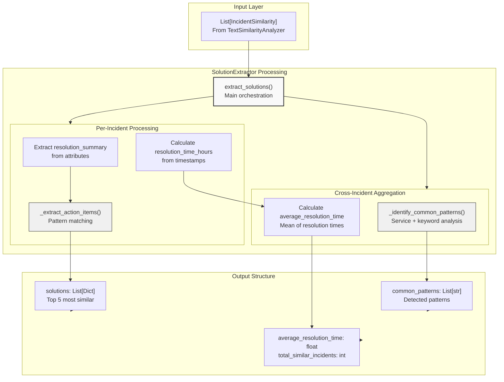
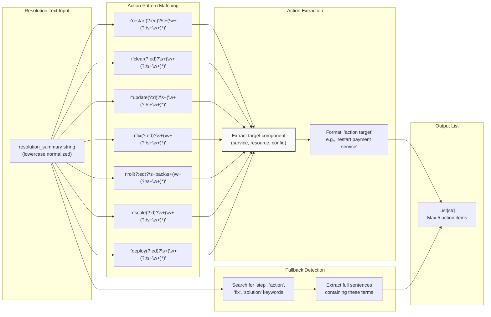
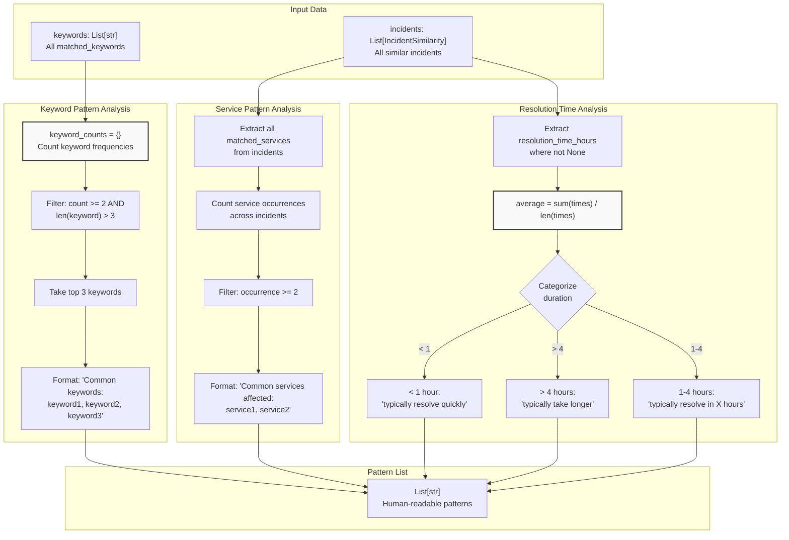
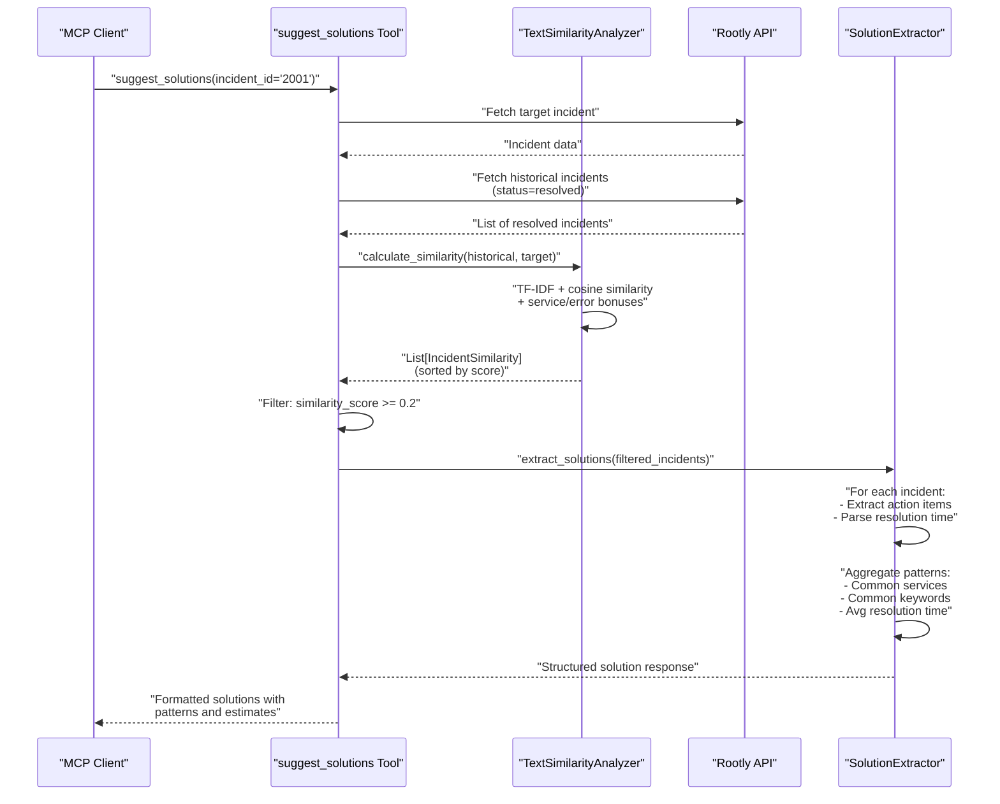

<!-- source: DeepWiki mcp.deepwiki.com · repo Rootly-AI-Labs/Rootly-MCP-server · page 8.2 Solution Extraction · fetched 2026-10-26 -->

# Solution Extraction

<details>
<summary>Relevant source files</summary>

The following files were used as context for generating this wiki page:

- [src/rootly_mcp_server/smart_utils.py](src/rootly_mcp_server/smart_utils.py)
- [tests/integration/local/test_smart_tools.py](tests/integration/local/test_smart_tools.py)
- [tests/unit/test_smart_utils.py](tests/unit/test_smart_utils.py)

</details>


## Purpose and Scope

This document describes the `SolutionExtractor` component, which analyzes resolved incidents to extract actionable solutions, identify common resolution patterns, and estimate resolution timeframes. This system mines historical incident data to provide practical remediation guidance for new incidents.

For information about finding similar incidents using text analysis, see [Text Similarity Analysis](#8.1). For the complete smart tools implementation including the `suggest_solutions` tool, see [Smart Analysis Tools](#4.2).

**Sources:** [src/rootly_mcp_server/smart_utils.py:380-519]()

---

## Overview

The `SolutionExtractor` class transforms similarity analysis results into structured, actionable solution recommendations. It processes `IncidentSimilarity` objects from the `TextSimilarityAnalyzer` and extracts:

- **Resolution summaries** from historical incidents
- **Action items** identified through pattern matching
- **Common patterns** across multiple similar incidents
- **Average resolution times** for estimation purposes

The extractor is designed to handle incomplete data gracefully and provides both specific solutions (from individual incidents) and aggregated insights (from patterns across incidents).

**Sources:** [src/rootly_mcp_server/smart_utils.py:380-391](), [tests/integration/local/test_smart_tools.py:119-150]()

---

## System Architecture

### Solution Extraction Pipeline



**Sources:** [src/rootly_mcp_server/smart_utils.py:383-430]()

---

## Core Components

### SolutionExtractor Class

The `SolutionExtractor` class provides methods for transforming incident similarity data into actionable recommendations.

**Location:** [src/rootly_mcp_server/smart_utils.py:380-382]()

**Key Methods:**

| Method | Purpose | Return Type |
|--------|---------|-------------|
| `extract_solutions()` | Main entry point for solution extraction | `Dict[str, Any]` |
| `_extract_action_items()` | Parse resolution text for action patterns | `List[str]` |
| `_identify_common_patterns()` | Find recurring patterns across incidents | `List[str]` |

**Sources:** [src/rootly_mcp_server/smart_utils.py:380-519]()

### IncidentSimilarity Data Structure

Input to the extractor comes from the `IncidentSimilarity` dataclass:

```python
@dataclass
class IncidentSimilarity:
    incident_id: str
    title: str
    similarity_score: float
    matched_services: List[str]
    matched_keywords: List[str]
    resolution_summary: str = ""
    resolution_time_hours: Optional[float] = None
```

**Fields Used by SolutionExtractor:**
- `resolution_summary` - Raw text describing how incident was resolved
- `resolution_time_hours` - Calculated duration from creation to resolution
- `matched_services` - Service names common to both incidents
- `matched_keywords` - Shared keywords for pattern detection
- `similarity_score` - Weight for ranking solutions

**Sources:** [src/rootly_mcp_server/smart_utils.py:27-36]()

---

## Action Item Extraction

### Pattern Recognition System

The `_extract_action_items()` method uses regular expressions to identify common remediation actions from resolution text.



**Sources:** [src/rootly_mcp_server/smart_utils.py:432-482]()

### Supported Action Patterns

The extractor recognizes seven primary action types:

| Pattern | Regex | Example Match | Formatted Output |
|---------|-------|---------------|------------------|
| Restart | `restart(?:ed)?\s+(\w+)` | "restarted the payment service" | "restart payment service" |
| Clear | `clear(?:ed)?\s+(\w+)` | "cleared Redis cache" | "clear redis cache" |
| Update | `update(?:d)?\s+(\w+)` | "updated database configuration" | "update database configuration" |
| Fix | `fix(?:ed)?\s+(\w+)` | "fixed connection pool settings" | "fix connection pool settings" |
| Rollback | `roll(?:ed)?\s+back\s+(\w+)` | "rolled back deployment to v1.2.3" | "rollback deployment to v1.2.3" |
| Scale | `scale(?:d)?\s+(\w+)` | "scaled up instances" | "scale up instances" |
| Deploy | `deploy(?:ed)?\s+(\w+)` | "deployed hotfix" | "deploy hotfix" |

**Implementation:** [src/rootly_mcp_server/smart_utils.py:441-473]()

**Test Coverage:** [tests/integration/local/test_smart_tools.py:222-244](), [tests/unit/test_smart_utils.py:260-281]()

**Sources:** [src/rootly_mcp_server/smart_utils.py:441-473](), [tests/integration/local/test_smart_tools.py:222-244]()

### Fallback Step Detection

When explicit action patterns aren't found, the extractor searches for sentences containing resolution keywords:

**Keywords:** `step`, `action`, `fix`, `solution`

**Process:**
1. Split resolution text into sentences (by `.`)
2. Check each sentence for keyword presence
3. Extract full sentence as action item
4. Append to actions list

**Implementation:** [src/rootly_mcp_server/smart_utils.py:476-481]()

**Sources:** [src/rootly_mcp_server/smart_utils.py:476-481]()

---

## Pattern Identification

### Common Pattern Detection

The `_identify_common_patterns()` method aggregates data across multiple similar incidents to identify recurring themes.



**Sources:** [src/rootly_mcp_server/smart_utils.py:484-519]()

### Pattern Categories

**1. Service Patterns**

Identifies services that appear in multiple similar incidents:
- **Threshold:** Service must appear in >= 2 incidents
- **Format:** `"Common services affected: payment, auth"`
- **Implementation:** [src/rootly_mcp_server/smart_utils.py:488-496]()

**2. Keyword Patterns**

Identifies frequently occurring keywords across incidents:
- **Threshold:** Keyword must appear >= 2 times AND length > 3
- **Limit:** Top 3 keywords shown
- **Format:** `"Common keywords: timeout, error, connection"`
- **Implementation:** [src/rootly_mcp_server/smart_utils.py:498-506]()

**3. Resolution Time Patterns**

Categorizes typical resolution duration:
- **Fast:** < 1 hour → `"These incidents typically resolve quickly (< 1 hour)"`
- **Slow:** > 4 hours → `"These incidents typically take longer to resolve (> 4 hours)"`
- **Medium:** 1-4 hours → `"These incidents typically resolve in 2.5 hours"`
- **Implementation:** [src/rootly_mcp_server/smart_utils.py:508-517]()

**Sources:** [src/rootly_mcp_server/smart_utils.py:484-519](), [tests/unit/test_smart_utils.py:283-314]()

---

## Output Structure

### Solution Response Format

The `extract_solutions()` method returns a structured dictionary:

```python
{
    "solutions": [
        {
            "incident_id": "123",
            "title": "Payment API timeout",
            "similarity": 0.850,
            "matched_services": ["payment", "auth"],
            "resolution_summary": "Restarted payment service and cleared cache",
            "resolution_time_hours": 1.0,
            "suggested_actions": [
                "restart payment service",
                "clear cache"
            ]
        },
        # ... up to 5 solutions
    ],
    "common_patterns": [
        "Common services affected: payment",
        "Common keywords: timeout, api",
        "These incidents typically resolve in 1.2 hours"
    ],
    "average_resolution_time": 1.2,
    "total_similar_incidents": 15
}
```

**Sources:** [src/rootly_mcp_server/smart_utils.py:383-430]()

### Field Descriptions

| Field | Type | Description |
|-------|------|-------------|
| `solutions` | `List[Dict]` | Top 5 most similar incidents with extracted solutions |
| `common_patterns` | `List[str]` | Aggregated patterns across all similar incidents |
| `average_resolution_time` | `float \| None` | Mean resolution time in hours, or `None` if no data |
| `total_similar_incidents` | `int` | Total count of similar incidents analyzed |

**Per-Solution Fields:**

| Field | Type | Description |
|-------|------|-------------|
| `incident_id` | `str` | Unique identifier of the historical incident |
| `title` | `str` | Incident title for reference |
| `similarity` | `float` | Rounded similarity score (3 decimal places) |
| `matched_services` | `List[str]` | Services common to both incidents |
| `resolution_summary` | `str` | How the incident was resolved (raw text) |
| `resolution_time_hours` | `float \| None` | Time to resolution, if calculable |
| `suggested_actions` | `List[str]` | Extracted action items (only if found) |

**Sources:** [src/rootly_mcp_server/smart_utils.py:397-412]()

### Empty Result Handling

When no similar incidents are provided, the extractor returns a safe empty structure:

```python
{
    "solutions": [],
    "common_patterns": [],
    "average_resolution_time": None,
    "total_similar_incidents": 0
}
```

**Implementation:** [src/rootly_mcp_server/smart_utils.py:385-391]()

**Test Coverage:** [tests/unit/test_smart_utils.py:351-358]()

**Sources:** [src/rootly_mcp_server/smart_utils.py:385-391](), [tests/unit/test_smart_utils.py:351-358]()

---

## Integration with Smart Tools

### Usage in suggest_solutions Tool

The `SolutionExtractor` is used by the `suggest_solutions` custom tool in the MCP server:

**Workflow:**
1. Tool receives incident ID or text description
2. `TextSimilarityAnalyzer` finds similar incidents
3. Filter results by similarity threshold (>= 0.2)
4. `SolutionExtractor.extract_solutions()` processes filtered results
5. Formatted response returned to MCP client

**Test Example:** [tests/integration/local/test_smart_tools.py:119-150]()

**Sources:** [tests/integration/local/test_smart_tools.py:119-182]()

### Data Flow Through System



**Sources:** [tests/integration/local/test_smart_tools.py:119-150](), [src/rootly_mcp_server/smart_utils.py:383-430]()

---

## Test Coverage

### Unit Tests

**Test File:** [tests/unit/test_smart_utils.py:253-358]()

**Key Test Cases:**

| Test | Purpose | Implementation |
|------|---------|----------------|
| `test_extract_action_items` | Validates pattern matching for all action types | [tests/unit/test_smart_utils.py:260-281]() |
| `test_identify_common_patterns` | Verifies pattern aggregation logic | [tests/unit/test_smart_utils.py:283-314]() |
| `test_extract_solutions` | Tests complete solution extraction flow | [tests/unit/test_smart_utils.py:316-349]() |
| `test_extract_solutions_empty_input` | Validates empty result handling | [tests/unit/test_smart_utils.py:351-358]() |

**Sources:** [tests/unit/test_smart_utils.py:253-358]()

### Integration Tests

**Test File:** [tests/integration/local/test_smart_tools.py:119-182]()

**Key Scenarios:**

| Test | Scenario | Validation |
|------|----------|------------|
| `test_suggest_solutions_with_incident_id` | Full workflow with real incident ID | Solution structure and content |
| `test_suggest_solutions_with_text_input` | Synthetic incident from text description | Pattern matching without ID |
| `test_solution_extraction_patterns` | Multiple resolution text patterns | Action extraction accuracy |

**Sources:** [tests/integration/local/test_smart_tools.py:119-244]()

---

## Performance Considerations

### Processing Limits

| Limit | Value | Rationale |
|-------|-------|-----------|
| Solutions returned | 5 | Focus on most relevant matches |
| Action items per solution | 5 | Prevent information overload |
| Common keywords shown | 3 | Highlight key patterns only |
| Common keywords matched | 8 | Includes fuzzy matches |

**Configuration:** Hardcoded in [src/rootly_mcp_server/smart_utils.py:397]() and [src/rootly_mcp_server/smart_utils.py:482]()

**Sources:** [src/rootly_mcp_server/smart_utils.py:397](), [src/rootly_mcp_server/smart_utils.py:482]()

### Graceful Degradation

The extractor handles missing data gracefully:

- **Missing resolution_summary:** Returns "No resolution summary available"
- **Missing timestamps:** `resolution_time_hours` set to `None`
- **No action patterns found:** `suggested_actions` field omitted
- **Empty incident list:** Returns safe empty structure

**Implementation:** [src/rootly_mcp_server/smart_utils.py:385-412]()

**Sources:** [src/rootly_mcp_server/smart_utils.py:385-412]()

---

## Extension Points

### Adding New Action Patterns

To add new action types:

1. Add regex pattern to `action_patterns` list in [src/rootly_mcp_server/smart_utils.py:441-449]()
2. Add formatting logic in match processing [src/rootly_mcp_server/smart_utils.py:451-473]()
3. Add test case in [tests/integration/local/test_smart_tools.py:222-244]()

**Example Pattern:**
```python
r'diagnose(?:d)?\s+(\w+(?:\s+\w+)*)'  # Matches "diagnosed the issue"
```

**Sources:** [src/rootly_mcp_server/smart_utils.py:441-449]()

### Custom Pattern Categories

To add new pattern identification categories:

1. Extract relevant data from `incidents` and `keywords` in [src/rootly_mcp_server/smart_utils.py:484-519]()
2. Calculate statistics or aggregations
3. Format as human-readable string
4. Append to `patterns` list

**Example:**
```python
# Severity pattern
severities = [inc.severity for inc in incidents if hasattr(inc, 'severity')]
if severities:
    most_common = max(set(severities), key=severities.count)
    patterns.append(f"Most incidents were {most_common} severity")
```

**Sources:** [src/rootly_mcp_server/smart_utils.py:484-519]()

---

