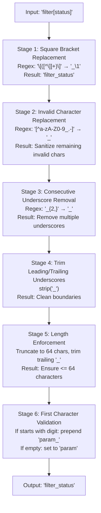
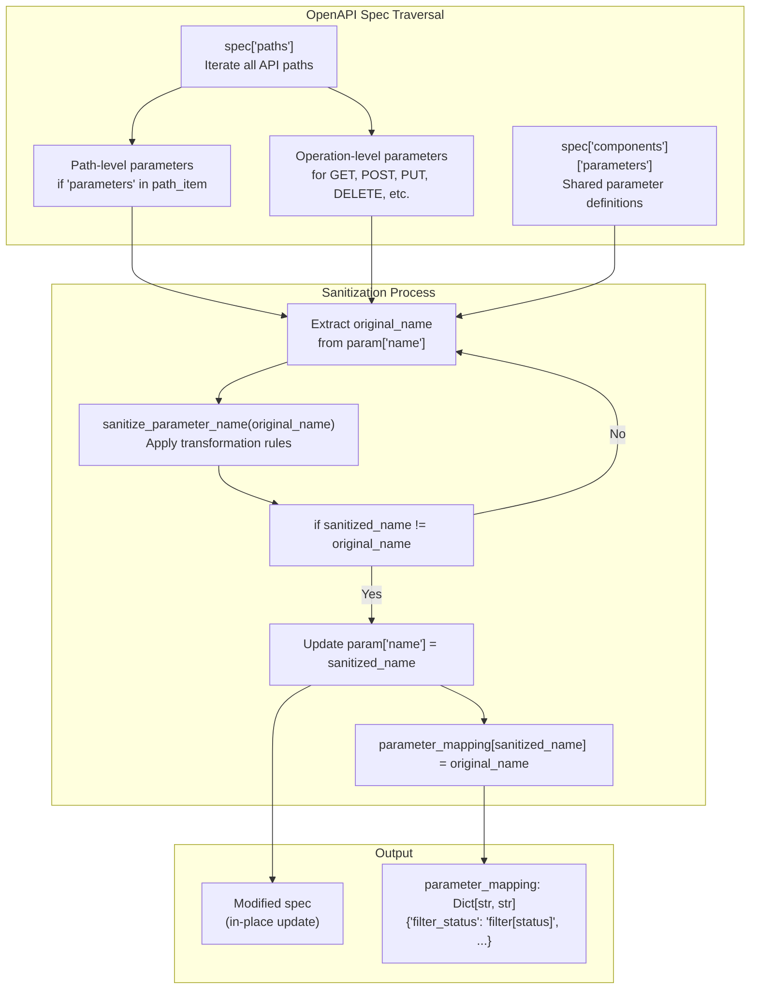
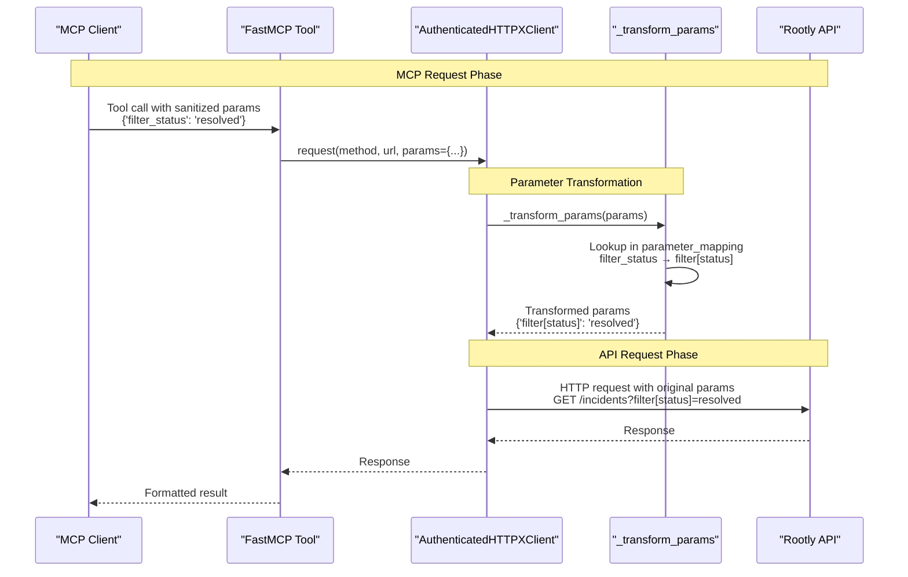
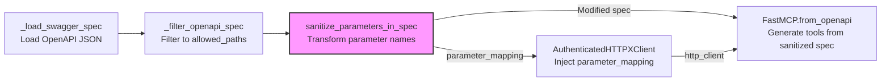
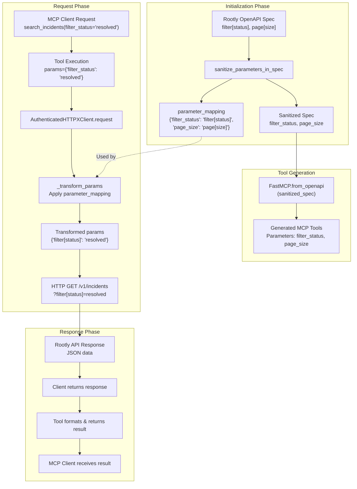

<!-- source: DeepWiki mcp.deepwiki.com · repo Rootly-AI-Labs/Rootly-MCP-server · page 8.3 Parameter Sanitization · fetched 2026-10-26 -->

# Parameter Sanitization

<details>
<summary>Relevant source files</summary>

The following files were used as context for generating this wiki page:

- [src/rootly_mcp_server/__main__.py](src/rootly_mcp_server/__main__.py)
- [src/rootly_mcp_server/server.py](src/rootly_mcp_server/server.py)
- [src/rootly_mcp_server/utils.py](src/rootly_mcp_server/utils.py)

</details>


## Purpose and Scope

This document provides a deep dive into the parameter sanitization system that enables MCP (Model Context Protocol) compatibility with the Rootly API. Parameter sanitization solves a critical incompatibility: the Rootly API uses parameter names like `filter[status]` and `page[size]` that violate MCP's strict parameter naming requirements. The system implements a bidirectional transformation pipeline that converts these names to MCP-compliant forms while preserving the ability to communicate with the Rootly API using its original parameter names.

For information about the broader OpenAPI processing pipeline, see [OpenAPI Processing](#3.2). For details on how the HTTP client executes requests, see [HTTP Client & Request Flow](#3.4).

**Sources:** [src/rootly_mcp_server/utils.py:1-105](), [src/rootly_mcp_server/server.py:175-276]()

---

## The Parameter Naming Challenge

### MCP Protocol Constraints

The MCP protocol enforces strict parameter naming requirements. All parameter names must match the regular expression pattern `^[a-zA-Z0-9_.-]{1,64}$`. This means:

| Requirement | Description |
|-------------|-------------|
| **Allowed Characters** | Letters (a-z, A-Z), digits (0-9), underscores (_), periods (.), hyphens (-) |
| **Length Limit** | Maximum 64 characters |
| **First Character** | Must not be a digit |
| **No Special Characters** | Square brackets, parentheses, or other special characters are forbidden |

### Rootly API Parameter Conventions

The Rootly API uses JSON:API specification conventions, which include square-bracket notation for structured parameters:

```
filter[status]          # Filter by status field
filter[search]          # Search filter
page[size]              # Pagination page size
page[number]            # Pagination page number
fields[incidents]       # Sparse fieldsets for incidents
include                 # Relationship includes
schedule_ids[]          # Array parameter
```

**Sources:** [src/rootly_mcp_server/utils.py:12-42](), [src/rootly_mcp_server/server.py:409-416]()

---

## Transformation Rules

### Core Sanitization Algorithm

The `sanitize_parameter_name` function implements a multi-stage transformation pipeline:



**Transformation Examples:**

| Original Parameter | Sanitized Parameter | Applied Rules |
|-------------------|---------------------|---------------|
| `filter[status]` | `filter_status` | Square bracket replacement |
| `page[size]` | `page_size` | Square bracket replacement |
| `filter[search]` | `filter_search` | Square bracket replacement |
| `schedule_ids[]` | `schedule_ids` | Square bracket removal, trailing underscore trim |
| `filter[starts_at][gte]` | `filter_starts_at_gte` | Nested bracket replacement |
| `fields[incidents]` | `fields_incidents` | Square bracket replacement |
| `123invalid` | `param_123invalid` | First character validation |
| `very-long-parameter-name-that-exceeds-sixty-four-characters-limit` | `very-long-parameter-name-that-exceeds-sixty-four-characters-l` | Length truncation |

**Sources:** [src/rootly_mcp_server/utils.py:12-42]()

---

## Bidirectional Mapping Architecture

### Mapping Dictionary Generation

The `sanitize_parameters_in_spec` function traverses the entire OpenAPI specification and builds a mapping dictionary that enables bidirectional transformation:



**Key Implementation Details:**

The function processes three locations in the OpenAPI specification:

1. **Path-level parameters** ([utils.py:67-75]()): Parameters defined at the path level, shared by all operations on that path
2. **Operation-level parameters** ([utils.py:78-92]()): Parameters specific to individual HTTP methods (GET, POST, etc.)
3. **Component parameters** ([utils.py:95-103]()): Reusable parameter definitions in the `components` section

The mapping dictionary returned enables reverse transformation during API requests.

**Sources:** [src/rootly_mcp_server/utils.py:45-105](), [src/rootly_mcp_server/server.py:318-320]()

---

## Integration with HTTP Client

### AuthenticatedHTTPXClient Parameter Transformation

The `AuthenticatedHTTPXClient` class orchestrates the reverse transformation when making actual API requests:



**Transformation Logic:**

The `_transform_params` method ([server.py:213-225]()) implements the reverse mapping:

```python
# Pseudocode representation
for key, value in params.items():
    # Lookup original name from mapping
    original_key = parameter_mapping.get(key, key)
    transformed[original_key] = value
    
    # Log transformation for debugging
    if original_key != key:
        logger.debug(f"Transformed parameter: '{key}' -> '{original_key}'")
```

**Key Design Decisions:**

1. **Fallback behavior**: If no mapping exists for a parameter, the method uses the parameter name as-is, ensuring compatibility with parameters that didn't require sanitization
2. **Logging**: All transformations are logged at DEBUG level for troubleshooting
3. **Preservation**: The original `params` dictionary is never modified; a new dictionary is constructed

**Sources:** [src/rootly_mcp_server/server.py:175-276]()

---

## Server Initialization Pipeline Integration

### Sanitization in Server Creation

Parameter sanitization occurs during the server initialization pipeline, between OpenAPI spec filtering and tool generation:



**Code Flow in create_rootly_mcp_server:**

1. **Line 311-312**: Load and log the OpenAPI specification
2. **Line 315-316**: Filter to allowed paths
3. **Line 319-320**: Execute parameter sanitization and capture mapping
4. **Line 330-334**: Create HTTP client with parameter mapping
5. **Line 338-344**: Generate MCP tools from sanitized specification

The sanitized specification is passed to `FastMCP.from_openapi`, ensuring all generated tools use MCP-compliant parameter names. The parameter mapping is injected into the HTTP client, enabling reverse transformation during requests.

**Sources:** [src/rootly_mcp_server/server.py:278-344]()

---

## Complete Parameter Flow

### End-to-End Request Pipeline

This diagram shows the complete journey of a parameter from MCP client to Rootly API:



**Sources:** [src/rootly_mcp_server/server.py:278-344](), [src/rootly_mcp_server/server.py:213-234]()

---

## Concrete Examples

### Example 1: Search Incidents with Filters

**MCP Tool Call:**
```python
# Tool signature generated from sanitized spec
search_incidents(
    query="database timeout",
    page_size=10,           # Sanitized from page[size]
    page_number=1,          # Sanitized from page[number]
    filter_status="resolved"  # Sanitized from filter[status]
)
```

**Internal Transformation:**
```python
# Client receives sanitized parameters
params_in = {
    "page[size]": 10,  # Already transformed by tool signature
    "page[number]": 1,
    "filter[search]": "database timeout"
}

# _transform_params applies reverse mapping
params_out = {
    "page[size]": 10,     # filter_size -> page[size]
    "page[number]": 1,    # page_number -> page[number]
    "filter[search]": "database timeout"  # filter_search -> filter[search]
}
```

**Actual API Request:**
```
GET /v1/incidents?page[size]=10&page[number]=1&filter[search]=database+timeout&filter[status]=resolved
```

**Sources:** [src/rootly_mcp_server/server.py:394-424]()

---

### Example 2: On-Call Shift Metrics

**MCP Tool Call:**
```python
get_oncall_shift_metrics(
    start_date="2025-10-01",
    end_date="2025-10-31",
    user_ids="123,456",
    schedule_ids="sched-1,sched-2"
)
```

**Internal Parameter Construction:**
```python
# Tool builds params dict
params = {
    "from": "2025-10-01",
    "to": "2025-10-31",
    "user_ids[]": ["123", "456"],      # Array parameter
    "schedule_ids[]": ["sched-1", "sched-2"]  # Array parameter
}

# _transform_params handles array parameters
# schedule_ids -> schedule_ids[] (already in original form)
```

**Sources:** [src/rootly_mcp_server/server.py:704-821]()

---

### Example 3: Complex Nested Parameters

**Original Rootly API Parameters:**
```
filter[starts_at][gte]=2025-01-01T00:00:00Z
filter[starts_at][lte]=2025-01-31T23:59:59Z
```

**Sanitized to:**
```
filter_starts_at_gte=2025-01-01T00:00:00Z
filter_starts_at_lte=2025-01-31T23:59:59Z
```

**Reverse Transformation:**
```python
parameter_mapping = {
    "filter_starts_at_gte": "filter[starts_at][gte]",
    "filter_starts_at_lte": "filter[starts_at][lte]"
}

# Applied during request:
params_in = {
    "filter_starts_at_gte": "2025-01-01T00:00:00Z",
    "filter_starts_at_lte": "2025-01-31T23:59:59Z"
}

params_out = {
    "filter[starts_at][gte]": "2025-01-01T00:00:00Z",
    "filter[starts_at][lte]": "2025-01-31T23:59:59Z"
}
```

**Sources:** [src/rootly_mcp_server/server.py:1187-1196]()

---

## Edge Cases and Special Handling

### Empty Array Parameters

**Challenge:** Rootly API uses `schedule_ids[]` for array parameters, which sanitizes to `schedule_ids`.

**Handling:**
- The sanitization removes the trailing `[]`
- The parameter mapping stores: `{"schedule_ids": "schedule_ids[]"}`
- During transformation, `schedule_ids` is converted back to `schedule_ids[]`
- The HTTP client correctly sends array values

**Code Location:** [src/rootly_mcp_server/server.py:793]()

---

### Parameters Not Requiring Sanitization

**Scenario:** Some parameters like `include`, `from`, `to` don't contain special characters.

**Handling:**
- `sanitize_parameter_name` returns the original name unchanged
- No entry is added to `parameter_mapping`
- `_transform_params` uses the parameter name as-is (fallback behavior)

**Result:** No overhead for already-compliant parameters.

**Sources:** [src/rootly_mcp_server/utils.py:12-42]()

---

### Long Parameter Names

**Truncation Rule:** If a sanitized name exceeds 64 characters, it is truncated and any trailing underscores are removed.

**Example:**
```
filter[very_long_nested_structure][with_many_parts][and_more] 
→ filter_very_long_nested_structure_with_many_parts_and_more (59 chars, OK)

filter[extremely_long_parameter_name_that_definitely_exceeds_limit][nested]
→ filter_extremely_long_parameter_name_that_definitely_exceeds_l (64 chars)
```

**Risk:** Truncation could theoretically create name collisions, but this is extremely rare in practice with the Rootly API.

**Sources:** [src/rootly_mcp_server/utils.py:34-36]()

---

## Debugging Parameter Transformations

### Logging Strategy

All parameter transformations are logged at DEBUG level:

```python
# During sanitization
logger.debug(f"Sanitized operation parameter: '{original_name}' -> '{sanitized_name}'")

# During transformation
logger.debug(f"Transformed parameter: '{key}' -> '{original_key}'")
```

**Enabling Debug Logs:**
```bash
# Command line
python -m rootly_mcp_server --debug

# Environment variable
export DEBUG=true
```

**Log Output Example:**
```
2025-01-15 10:30:45 - rootly_mcp_server.utils - DEBUG - Sanitized operation parameter: 'filter[status]' -> 'filter_status'
2025-01-15 10:30:45 - rootly_mcp_server.utils - DEBUG - Sanitized operation parameter: 'page[size]' -> 'page_size'
2025-01-15 10:30:52 - rootly_mcp_server.server - DEBUG - Transformed parameter: 'filter_status' -> 'filter[status]'
```

**Sources:** [src/rootly_mcp_server/utils.py:73](), [src/rootly_mcp_server/utils.py:90](), [src/rootly_mcp_server/server.py:224](), [src/rootly_mcp_server/__main__.py:75-100]()

---

## Performance Considerations

### One-Time Cost

Parameter sanitization occurs only once during server initialization:

| Phase | Time Complexity | Impact |
|-------|----------------|---------|
| Spec traversal | O(n) where n = total parameters | One-time startup cost |
| Sanitization | O(m) where m = parameter name length | Negligible per parameter |
| Mapping storage | O(1) per parameter | Constant memory per parameter |

**Typical Performance:**
- Full spec with ~200 parameters: < 10ms
- Mapping dictionary size: < 50KB

### Per-Request Cost

Parameter transformation during requests:

| Operation | Time Complexity | Impact |
|-----------|----------------|---------|
| Dictionary lookup | O(1) | Constant per parameter |
| Dictionary construction | O(k) where k = request parameters | Linear with request size |

**Typical Performance:**
- Request with 5 parameters: < 1ms
- No network overhead (transformation happens in-process)

**Sources:** [src/rootly_mcp_server/utils.py:45-105](), [src/rootly_mcp_server/server.py:213-225]()

---

## Testing Strategy

### Unit Tests

The sanitization functions are tested independently:

**Test Coverage:**
- Square bracket replacement
- Invalid character handling
- Length truncation
- First character validation
- Edge cases (empty strings, long names, etc.)

**Test Location:** Tests are part of the unit test suite that validates the `utils.py` module.

### Integration Tests

The bidirectional transformation is tested through actual tool calls:

1. **Test Setup**: Create server with sanitized spec
2. **Test Execution**: Call tools with sanitized parameter names
3. **Test Verification**: Verify correct API calls with original parameter names
4. **Mock Strategy**: Mock the HTTP client to inspect actual request parameters

**Sources:** [src/rootly_mcp_server/utils.py:1-105](), [src/rootly_mcp_server/server.py:175-276]()

---

