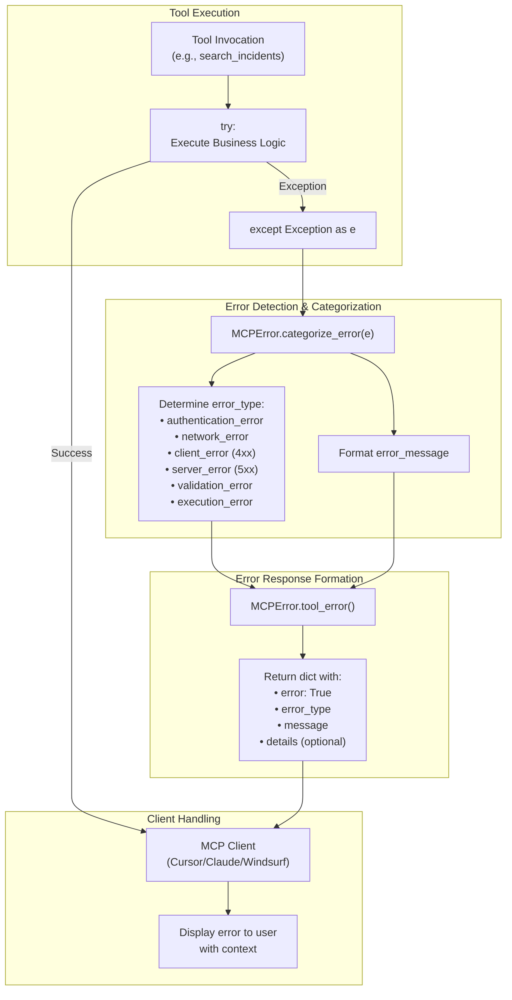
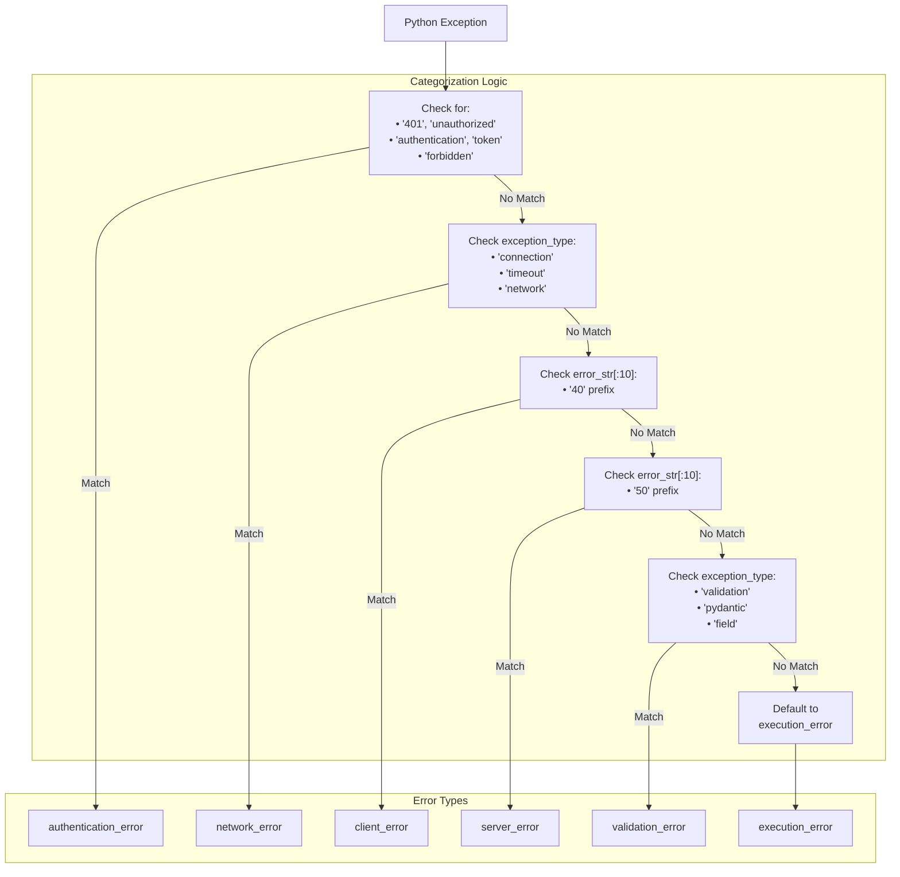
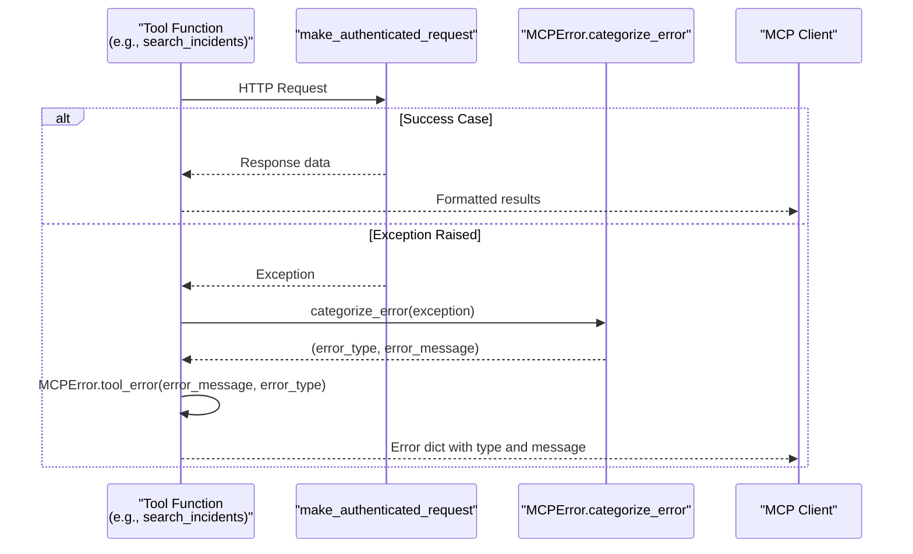
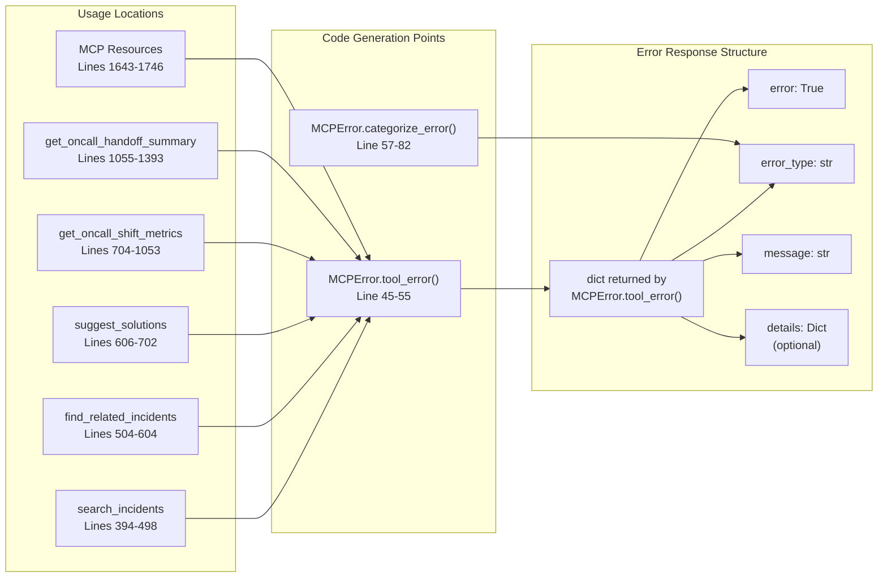

<!-- source: DeepWiki mcp.deepwiki.com · repo Rootly-AI-Labs/Rootly-MCP-server · page 8.4 Error Handling & MCPError · fetched 2026-10-26 -->

# Error Handling & MCPError

<details>
<summary>Relevant source files</summary>

The following files were used as context for generating this wiki page:

- [src/rootly_mcp_server/server.py](src/rootly_mcp_server/server.py)

</details>


This document covers the error handling architecture of the Rootly MCP Server, focusing on the `MCPError` class and error categorization system. It explains how errors are detected, categorized, and returned to MCP clients in a protocol-compliant manner.

For information about testing error scenarios, see [Testing Strategy](#5.3). For general server architecture, see [Core Architecture](#3).

---

## Overview

The Rootly MCP Server implements a two-tier error handling system that distinguishes between **protocol-level errors** (JSON-RPC failures) and **tool-level errors** (operational failures within tools). This design ensures MCP protocol compliance while providing detailed diagnostic information for debugging.

The `MCPError` class provides static methods for creating standardized error responses and automatically categorizing exceptions into specific error types based on their characteristics.

**Sources:** [src/rootly_mcp_server/server.py:28-82]()

---

## Error Handling Architecture

### High-Level Error Flow



**Sources:** [src/rootly_mcp_server/server.py:423-424](), [src/rootly_mcp_server/server.py:477-478](), [src/rootly_mcp_server/server.py:497-498](), [src/rootly_mcp_server/server.py:603-604]()

---

## The MCPError Class

The `MCPError` class at [src/rootly_mcp_server/server.py:28-82]() provides three static methods for error handling:

### Class Structure

| Method | Purpose | Return Type |
|--------|---------|-------------|
| `protocol_error()` | JSON-RPC protocol-level errors | `Dict[str, Any]` |
| `tool_error()` | Tool-level operational errors | `Dict[str, Any]` |
| `categorize_error()` | Classify Python exceptions | `tuple[str, str]` |

### Method Details

#### `protocol_error(code, message, data=None)`

Creates JSON-RPC 2.0 compliant error responses for protocol-level failures.

```python
# Example usage (hypothetical protocol error)
MCPError.protocol_error(
    code=-32600,
    message="Invalid Request",
    data={"detail": "Missing required field"}
)

# Returns:
{
    "jsonrpc": "2.0",
    "error": {
        "code": -32600,
        "message": "Invalid Request",
        "data": {"detail": "Missing required field"}
    }
}
```

**Sources:** [src/rootly_mcp_server/server.py:31-43]()

#### `tool_error(error_message, error_type="execution_error", details=None)`

Creates standardized tool-level error responses returned as successful MCP responses (the tool executes successfully, but returns an error result).

```python
# Example from validation
MCPError.tool_error(
    "Incident not found",
    "not_found"
)

# Returns:
{
    "error": True,
    "error_type": "not_found",
    "message": "Incident not found"
}
```

**Sources:** [src/rootly_mcp_server/server.py:45-55](), [src/rootly_mcp_server/server.py:524]()

#### `categorize_error(exception)`

Analyzes a Python exception and returns a tuple of `(error_type, formatted_message)`.

**Sources:** [src/rootly_mcp_server/server.py:57-82]()

---

## Error Categorization System

### Error Type Classification



**Sources:** [src/rootly_mcp_server/server.py:58-82]()

### Error Type Reference Table

| Error Type | Detection Criteria | Example Scenarios | Usage Count |
|------------|-------------------|-------------------|-------------|
| `authentication_error` | `"401"`, `"unauthorized"`, `"authentication"`, `"token"`, `"forbidden"` in error string | Invalid API token, expired credentials | [Line 64-65]() |
| `network_error` | `"connection"`, `"timeout"`, `"network"` in exception type | Connection refused, DNS failure, timeout | [Line 68-69]() |
| `client_error` | `"40"` in first 10 chars of error string | 400 Bad Request, 404 Not Found, 422 Validation | [Line 72-73]() |
| `server_error` | `"50"` in first 10 chars of error string | 500 Internal Server Error, 503 Service Unavailable | [Line 74-75]() |
| `validation_error` | `"validation"`, `"pydantic"`, `"field"` in exception type | Invalid input parameters, schema validation failure | [Line 78-79]() |
| `execution_error` | Default fallback for all other exceptions | Generic operational failures, unexpected exceptions | [Line 82]() |
| `not_found` | Manually specified in code | Resource not found (e.g., incident ID doesn't exist) | [Line 524]() |

**Sources:** [src/rootly_mcp_server/server.py:58-82]()

---

## Error Handling Patterns in Tools

### Pattern 1: Try-Catch with Automatic Categorization

This is the most common pattern throughout the codebase:



**Example Implementation:**

```python
# Pattern used in search_incidents, find_related_incidents, suggest_solutions
try:
    response = await make_authenticated_request("GET", "/v1/incidents", params=params)
    response.raise_for_status()
    return response.json()
except Exception as e:
    error_type, error_message = MCPError.categorize_error(e)
    return MCPError.tool_error(error_message, error_type)
```

**Occurrences:**
- [src/rootly_mcp_server/server.py:418-424]() - `search_incidents` single-page mode
- [src/rootly_mcp_server/server.py:474-480]() - `search_incidents` multi-page error handling
- [src/rootly_mcp_server/server.py:496-498]() - `search_incidents` outer catch
- [src/rootly_mcp_server/server.py:602-604]() - `find_related_incidents`
- [src/rootly_mcp_server/server.py:700-702]() - `suggest_solutions`
- [src/rootly_mcp_server/server.py:1041-1053]() - `get_oncall_shift_metrics`
- [src/rootly_mcp_server/server.py:1382-1393]() - `get_oncall_handoff_summary`
- [src/rootly_mcp_server/server.py:1607-1619]() - `_fetch_shift_incidents_internal`

**Sources:** [src/rootly_mcp_server/server.py:418-424](), [src/rootly_mcp_server/server.py:496-498]()

---

### Pattern 2: Direct Tool Error for Validation

Used when validation logic detects invalid input before making API calls:

```python
# Pattern used for input validation
if not incident_id and not incident_description:
    return MCPError.tool_error(
        "Must provide either incident_id or incident_description",
        "validation_error"
    )
```

**Occurrences:**
- [src/rootly_mcp_server/server.py:524]() - Incident not found
- [src/rootly_mcp_server/server.py:537]() - Missing required parameters in `find_related_incidents`
- [src/rootly_mcp_server/server.py:626]() - Missing required parameters in `suggest_solutions`
- [src/rootly_mcp_server/server.py:639]() - Validation error with explicit type

**Sources:** [src/rootly_mcp_server/server.py:524](), [src/rootly_mcp_server/server.py:537]()

---

### Pattern 3: Tool Error with Details

Used for complex errors requiring additional diagnostic information:

```python
# Pattern from get_oncall_shift_metrics
except Exception as e:
    import traceback
    error_type, error_message = MCPError.categorize_error(e)
    return MCPError.tool_error(
        f"Failed to get on-call shift metrics: {error_message}",
        error_type,
        details={
            "params": {"start_date": start_date, "end_date": end_date},
            "exception_type": type(e).__name__,
            "exception_str": str(e),
            "traceback": traceback.format_exc()
        }
    )
```

**Benefits:**
- Full stack trace for debugging
- Parameter values that caused the error
- Exception type information
- Contextual information

**Occurrences:**
- [src/rootly_mcp_server/server.py:1041-1053]() - `get_oncall_shift_metrics`
- [src/rootly_mcp_server/server.py:1382-1393]() - `get_oncall_handoff_summary`
- [src/rootly_mcp_server/server.py:1607-1619]() - `_fetch_shift_incidents_internal`
- [src/rootly_mcp_server/server.py:808-821]() - Shift fetching errors with response diagnostics

**Sources:** [src/rootly_mcp_server/server.py:1041-1053]()

---

### Pattern 4: Early Exit with Authentication Errors

Special handling for authentication failures in loops to prevent retries:

```python
# Pattern from search_incidents multi-page loop
except Exception as e:
    # Re-raise authentication or critical errors for immediate handling
    if "401" in str(e) or "Unauthorized" in str(e) or "authentication" in str(e).lower():
        error_type, error_message = MCPError.categorize_error(e)
        return MCPError.tool_error(error_message, error_type)
    # For other errors, break loop and return partial results
    break
```

**Purpose:** Authentication errors should fail fast, while other errors allow graceful degradation with partial results.

**Sources:** [src/rootly_mcp_server/server.py:474-480]()

---

### Pattern 5: Resource Error Handling

MCP resources use error responses that maintain the resource structure:

```python
# Pattern from get_incident_resource
except Exception as e:
    error_type, error_message = MCPError.categorize_error(e)
    return {
        "uri": f"incident://{incident_id}",
        "name": f"Incident #{incident_id} (Error)",
        "text": f"Error ({error_type}): {error_message}",
        "mimeType": "text/plain"
    }
```

**Occurrences:**
- [src/rootly_mcp_server/server.py:1671-1678]() - `get_incident_resource`
- [src/rootly_mcp_server/server.py:1705-1712]() - `get_team_resource`
- [src/rootly_mcp_server/server.py:1739-1746]() - `list_incidents_resource`

**Sources:** [src/rootly_mcp_server/server.py:1671-1678]()

---

## Error Response Structure Mapping

### Tool Error Response to Code Entities



**Sources:** [src/rootly_mcp_server/server.py:45-55](), [src/rootly_mcp_server/server.py:57-82]()

---

## Debugging Strategies

### Error Type Analysis

When investigating failures, the error type provides immediate classification:

| Error Type | First Investigation Step |
|------------|-------------------------|
| `authentication_error` | Check `ROOTLY_API_TOKEN` environment variable or MCP request headers |
| `network_error` | Verify network connectivity, check firewall rules, validate `ROOTLY_BASE_URL` |
| `client_error` | Review request parameters, check input validation, verify API endpoint exists |
| `server_error` | Check Rootly API status page, review server logs, retry with backoff |
| `validation_error` | Review input parameters against tool schema, check data types |
| `execution_error` | Check traceback in `details` field, review tool-specific logic |

### Accessing Detailed Error Information

When `details` field is present, it contains:

```python
{
    "error": True,
    "error_type": "execution_error",
    "message": "Failed to get on-call shift metrics: ...",
    "details": {
        "params": {...},           # Parameters that caused the error
        "exception_type": "...",   # Python exception class name
        "exception_str": "...",    # Full exception message
        "traceback": "..."         # Complete stack trace
    }
}
```

**Sources:** [src/rootly_mcp_server/server.py:1041-1053]()

### Common Error Scenarios

#### Authentication Failures

```python
# Error response structure
{
    "error": True,
    "error_type": "authentication_error",
    "message": "Authentication failed: 401 Unauthorized"
}
```

**Resolution:** Verify API token is set correctly in environment or request headers.

**Detection Logic:** [src/rootly_mcp_server/server.py:64-65]()

#### Network Timeouts

```python
# Error response structure  
{
    "error": True,
    "error_type": "network_error",
    "message": "Network error: Connection timeout"
}
```

**Resolution:** Check network connectivity, increase timeout values, verify base URL.

**Detection Logic:** [src/rootly_mcp_server/server.py:68-69]()

#### API Rate Limiting (429 Client Error)

```python
# Error response structure
{
    "error": True,
    "error_type": "client_error",
    "message": "Client error: 429 Too Many Requests"
}
```

**Resolution:** Implement retry logic with exponential backoff, reduce request frequency.

**Detection Logic:** [src/rootly_mcp_server/server.py:72-73]()

---

## Error Handling Best Practices

### 1. Always Use Categorization for Exceptions

Instead of:
```python
except Exception as e:
    return {"error": str(e)}
```

Use:
```python
except Exception as e:
    error_type, error_message = MCPError.categorize_error(e)
    return MCPError.tool_error(error_message, error_type)
```

### 2. Add Details for Complex Operations

For operations with multiple steps:
```python
except Exception as e:
    error_type, error_message = MCPError.categorize_error(e)
    return MCPError.tool_error(
        f"Failed during operation: {error_message}",
        error_type,
        details={
            "step": "data_aggregation",
            "params": params,
            "traceback": traceback.format_exc()
        }
    )
```

### 3. Handle Authentication Errors Separately

In pagination loops, fail fast on auth errors:
```python
if "401" in str(e) or "unauthorized" in str(e).lower():
    error_type, error_message = MCPError.categorize_error(e)
    return MCPError.tool_error(error_message, error_type)
```

### 4. Validate Inputs Before API Calls

Catch validation errors early:
```python
if not required_param:
    return MCPError.tool_error(
        "Missing required parameter: required_param",
        "validation_error"
    )
```

**Sources:** [src/rootly_mcp_server/server.py:418-498](), [src/rootly_mcp_server/server.py:537]()

---

## Error Handling in Related Systems

### HTTP Client Error Handling

The `AuthenticatedHTTPXClient` (see [HTTP Client & Request Flow](#3.4)) delegates exception handling to tool-level code. It raises exceptions for HTTP errors via `response.raise_for_status()`, which are then caught and categorized by tools.

**Sources:** [src/rootly_mcp_server/server.py:227-234]()

### Parameter Transformation Errors

Parameter sanitization errors (see [Parameter Sanitization](#8.3)) are typically caught during server initialization rather than tool execution, preventing malformed requests.

**Sources:** [src/rootly_mcp_server/server.py:319-320]()

### Smart Tools Error Handling

ML-based tools (`find_related_incidents`, `suggest_solutions`) use the same error handling patterns but may include algorithm-specific error scenarios like insufficient training data.

**Sources:** [src/rootly_mcp_server/server.py:504-604](), [src/rootly_mcp_server/server.py:606-702]()

---

## Summary

The `MCPError` class provides a systematic approach to error handling with:

- **Automatic categorization** of Python exceptions into semantic error types
- **Protocol compliance** through standardized error response structures  
- **Debugging support** via optional detailed error information
- **Consistent patterns** used across all 35+ tools and resources

This design ensures that MCP clients receive actionable error information while maintaining protocol compliance and providing developers with sufficient debugging context.

---

