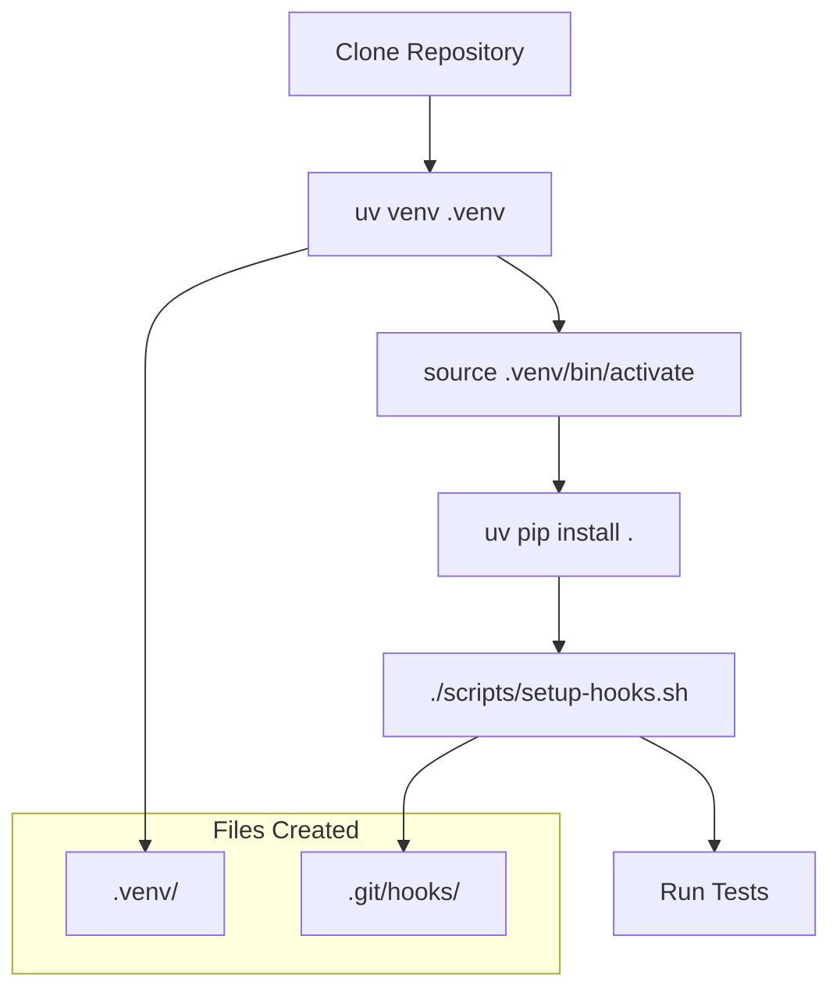
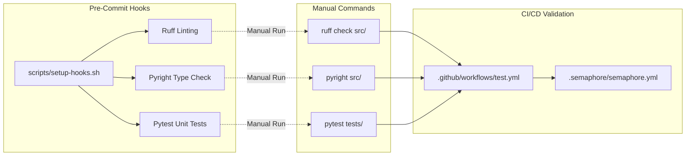
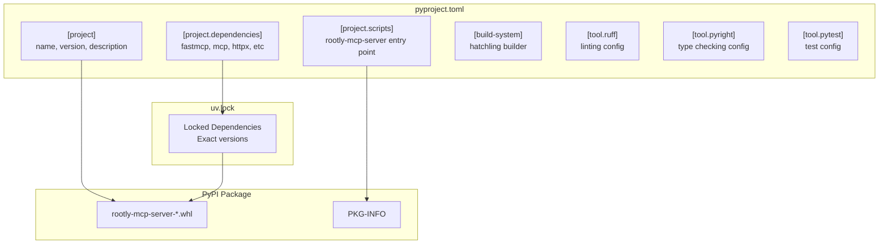
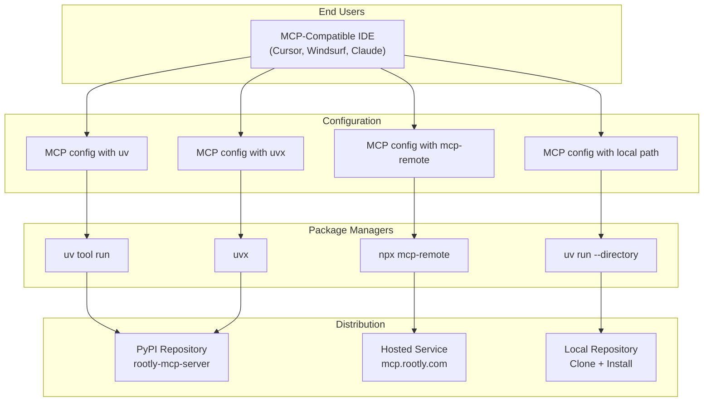
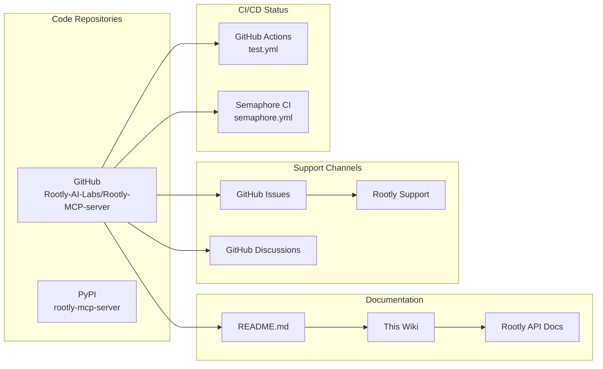

<!-- source: DeepWiki mcp.deepwiki.com · repo Rootly-AI-Labs/Rootly-MCP-server · page 9 Appendix · fetched 2026-10-26 -->

# Appendix

<details>
<summary>Relevant source files</summary>

The following files were used as context for generating this wiki page:

- [LICENSE](LICENSE)
- [README.md](README.md)
- [tests/unit/test_oncall_handoff.py](tests/unit/test_oncall_handoff.py)

</details>


This page provides reference materials that supplement the main documentation, including license information, contribution guidelines, project metadata, and additional resources. This material is intended for developers who want to understand the project's legal framework, contribute to the codebase, or access supplementary information not covered in the primary documentation.

For operational deployment information, see [Deployment & Operations](#6). For development workflows and testing, see [Development Guide](#5).

## License Information

The Rootly MCP Server is released under the Apache License, Version 2.0. This is a permissive open-source license that allows for both commercial and non-commercial use, modification, and distribution of the software.

### License Terms

The project is licensed under Apache License 2.0 (January 2004). Key terms include:

| Permission | Description |
|------------|-------------|
| **Use** | Free to use for any purpose, including commercial applications |
| **Modification** | Free to create derivative works |
| **Distribution** | Free to distribute original and modified versions |
| **Patent Grant** | Express patent license from contributors |
| **Sublicensing** | Can sublicense to third parties |

| Requirement | Description |
|-------------|-------------|
| **License Notice** | Must include copy of license with distributions |
| **Copyright Notice** | Must retain copyright notices |
| **State Changes** | Must document modifications to files |
| **Disclaimer** | Software provided "AS IS" without warranty |

The copyright holder is Rootly (2025). The full license text is available in [LICENSE:1-203]().

### Attribution

When using or redistributing this software:

```
Copyright [2025] [Rootly]

Licensed under the Apache License, Version 2.0 (the "License");
you may not use this file except in compliance with the License.
You may obtain a copy of the License at

    http://www.apache.org/licenses/LICENSE-2.0
```

Sources: [LICENSE:1-203]()

## Contributing Guidelines

### Developer Prerequisites

The project requires specific tools and environment setup for development:

| Component | Version | Installation |
|-----------|---------|--------------|
| Python | 3.12+ | System package manager |
| `uv` | Latest | `curl -LsSf https://astral.sh/uv/install.sh \| sh` |
| Git | Any | System package manager |
| Pre-commit | Auto-installed | Via setup script |

### Environment Setup Workflow

**Development Environment Initialization**



Sources: [README.md:291-328]()

### Development Workflow

**Code Quality Pipeline**



Sources: [README.md:313-325]()

### Virtual Environment Management

Always activate the virtual environment before running any development commands:

```bash
# Activate environment
source .venv/bin/activate

# Install dependencies
uv pip install .

# Add new dependencies
uv pip install <package-name>

# Deactivate when done
deactivate
```

The virtual environment is created by `uv venv .venv` and contains all project dependencies isolated from system Python packages.

Sources: [README.md:291-312]()

### Testing Requirements

Contributions must pass all test levels:

| Test Type | Command | Purpose |
|-----------|---------|---------|
| Unit Tests | `pytest tests/unit/` | Fast, isolated component tests |
| Local Integration | `pytest tests/integration/local/` | Real configuration + token tests |
| Remote Integration | `pytest tests/integration/remote/` | Live API connectivity tests |
| Manual Verification | `python tests/test_client.py` | Interactive validation |

For detailed testing strategy, see [Testing Strategy](#5.3).

Sources: [README.md:313-331]()

### Code Quality Standards

All contributions must meet these quality standards:

**Linting**: Ruff enforces style and code quality
- Configuration: [pyproject.toml]()
- Run: `ruff check src/`
- Auto-fix: `ruff check --fix src/`

**Type Checking**: Pyright enforces type safety
- Configuration: [pyproject.toml]()
- Run: `pyright src/`
- Strict mode enabled

**Testing**: Pytest with coverage tracking
- Minimum coverage: Not specified but encouraged
- Test markers: `@pytest.mark.unit`, `@pytest.mark.integration`

For details on code quality tools, see [Code Quality & Hooks](#5.4).

Sources: [README.md:313-325]()

## Project Metadata

### Package Information

**Project Configuration Structure**



Sources: [README.md:1-7]()

### Package Distribution

The package is distributed through multiple channels:

| Channel | Location | Update Frequency |
|---------|----------|------------------|
| **PyPI** | `pip install rootly-mcp-server` | On release |
| **uvx** | `uvx rootly-mcp-server` | On release |
| **Hosted Service** | `https://mcp.rootly.com/sse` | Continuous |
| **Docker/ECR** | AWS ECR container registry | On merge to main |

Package badges display real-time status:

```markdown
[]
[]
[]
```

Sources: [README.md:3-6]()

### Installation Methods

**Installation Pathways**



Sources: [README.md:31-120]()

### Authentication Requirements

API token permissions vary by use case:

| Token Type | Access Level | Use Case |
|------------|-------------|----------|
| **Global API Key** | Full access to all entities | Organization-wide tools, recommended |
| **Team API Key** | Team admin permissions | Team-specific workflows |
| **Personal API Key** | User's permissions | Individual use cases |

The `get_oncall_handoff_summary`, `get_oncall_shift_metrics`, and organization-wide incident search tools require a **Global API Key** for full functionality.

Token configuration:
- **Local Mode**: `ROOTLY_API_TOKEN` environment variable
- **Hosted Mode**: `Authorization: Bearer <token>` in MCP request headers

Sources: [README.md:19-29]()

## About Rootly AI Labs

This project is developed and maintained by Rootly AI Labs, an open-source incubator focused on building the future of system reliability and operational excellence.

### Mission

Rootly AI Labs serves as an experimental platform for:
- **Open-Source Innovation**: Sharing ideas and prototypes with the community
- **Rapid Prototyping**: Testing new approaches to incident management
- **Community Collaboration**: Building solutions that benefit the entire SRE ecosystem
- **Operational Excellence**: Advancing best practices in reliability engineering

### Project Context

The Rootly MCP Server is part of a broader initiative to:
1. Enable AI-powered incident resolution workflows
2. Integrate incident management into developer tools
3. Reduce mean time to resolution (MTTR) through intelligent automation
4. Bridge the gap between ChatOps, IDEs, and incident management platforms

The goal is to enable developers to "resolve production incidents in under a minute without leaving your IDE."

Sources: [README.md:280-283]()

## Additional Resources

### Documentation Links

| Resource | Description |
|----------|-------------|
| [Rootly API Docs](https://docs.rootly.com/api-reference/overview) | Official Rootly API documentation |
| [MCP Protocol](https://modelcontextprotocol.io/) | Model Context Protocol specification |
| [FastMCP](https://github.com/jlowin/fastmcp) | FastMCP framework documentation |
| [GitHub Repository](https://github.com/Rootly-AI-Labs/Rootly-MCP-server) | Source code and issue tracker |

### API Key Generation

To generate a Rootly API key:
1. Navigate to your Rootly organization settings
2. Select "API Keys" from the sidebar
3. Choose the appropriate key type (Global, Team, or Personal)
4. Generate and securely store the token
5. Configure in your MCP client using environment variables

Detailed instructions: [Rootly API Documentation](https://docs.rootly.com/api-reference/overview#how-to-generate-an-api-key%3F)

Sources: [README.md:19-29]()

### Quick Install Button

For Cursor IDE users, a one-click installation option is available:

```markdown
[]
```

This button provides a deeplink that automatically configures the MCP server in Cursor with the correct command and environment variable placeholders.

Sources: [README.md:6]()

### Community and Support

**Project Resources**



Sources: [README.md:1-7](), [README.md:280-283]()

### Version Information

The project uses semantic versioning. Current version information is maintained in:
- [pyproject.toml]() - `[project].version` field
- PyPI package metadata
- Git tags in the repository

For the latest version, check the PyPI badge at the top of [README.md:3]().

Sources: [README.md:3]()

---

**Document Version**: This appendix corresponds to the latest version of the Rootly MCP Server codebase. For historical versions, consult the Git repository tags and release notes on GitHub.