# Page: Overview

# Overview

<details>
<summary>Relevant source files</summary>

The following files were used as context for generating this wiki page:

- [README.md](README.md)
- [rootly_openapi.json](rootly_openapi.json)
- [src/rootly_mcp_server/__init__.py](src/rootly_mcp_server/__init__.py)
- [src/rootly_mcp_server/server.py](src/rootly_mcp_server/server.py)
- [tests/unit/test_oncall_handoff.py](tests/unit/test_oncall_handoff.py)

</details>


The Rootly MCP Server is a **Model Context Protocol (MCP) server** that provides programmatic integration between MCP-compatible AI assistants (such as Cursor IDE, Windsurf IDE, and Claude Desktop) and the Rootly incident management platform. It enables AI agents to interact with Rootly's REST API through dynamically generated tools, intelligent incident analysis, and on-call management capabilities.

This document provides a high-level introduction to the system's purpose, architecture, and core components. For detailed installation and configuration instructions, see [Getting Started](#2). For deep dives into specific subsystems, see [Core Architecture](#3), [Tool System](#4), and [Development Guide](#5).

## What is the Rootly MCP Server?

The Rootly MCP Server is a Python application that serves as a bridge between the **Model Context Protocol** and the **Rootly API**. It transforms Rootly's OpenAPI specification into MCP-compatible tools while adding intelligent analysis capabilities on top of raw API access.

**Key characteristics:**

| Aspect | Description |
|--------|-------------|
| **Protocol** | Model Context Protocol (MCP) via Server-Sent Events (SSE) |
| **API Integration** | Rootly REST API v1 at `https://api.rootly.com` |
| **Tool Generation** | Dynamic, based on OpenAPI/Swagger specification |
| **Intelligence Layer** | TF-IDF-based similarity analysis for incident correlation |
| **Deployment Modes** | Local (development) and hosted (production at `https://mcp.rootly.com/sse`) |
| **Package Distribution** | PyPI as `rootly-mcp-server` |

Sources: [src/rootly_mcp_server/__init__.py:1-20](), [src/rootly_mcp_server/server.py:1-10](), [README.md:1-32]()

## System Architecture

The following diagram shows how the Rootly MCP Server fits into the broader ecosystem, connecting MCP clients to the Rootly API while adding intelligent processing capabilities:

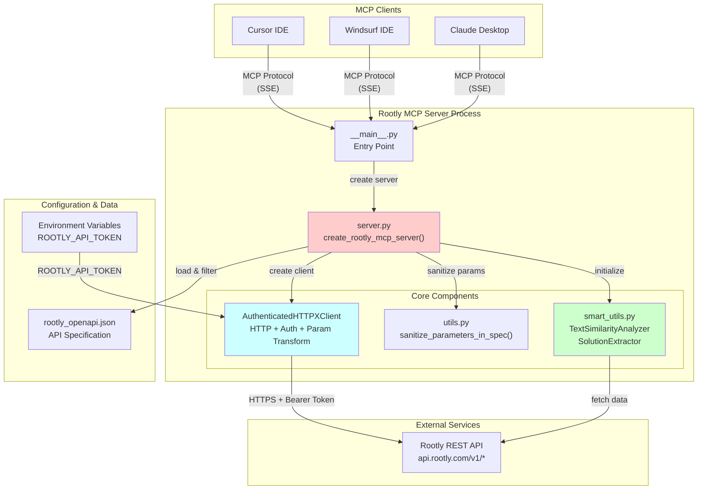

**Architecture layers:**

1. **Entry Layer** ([src/rootly_mcp_server/__main__.py:1-50]()): Validates environment, starts FastMCP server
2. **Server Layer** ([src/rootly_mcp_server/server.py:278-344]()): Orchestrates OpenAPI processing and tool registration
3. **Transport Layer** ([src/rootly_mcp_server/server.py:175-276]()): HTTP client with authentication and parameter transformation
4. **Intelligence Layer** ([src/rootly_mcp_server/smart_utils.py:1-500]()): ML-based incident analysis and solution extraction
5. **Integration Layer**: FastMCP framework handles MCP protocol details

Sources: [src/rootly_mcp_server/__main__.py:1-50](), [src/rootly_mcp_server/server.py:1-344](), Diagram 1 from context

## Core Components

### Primary Files

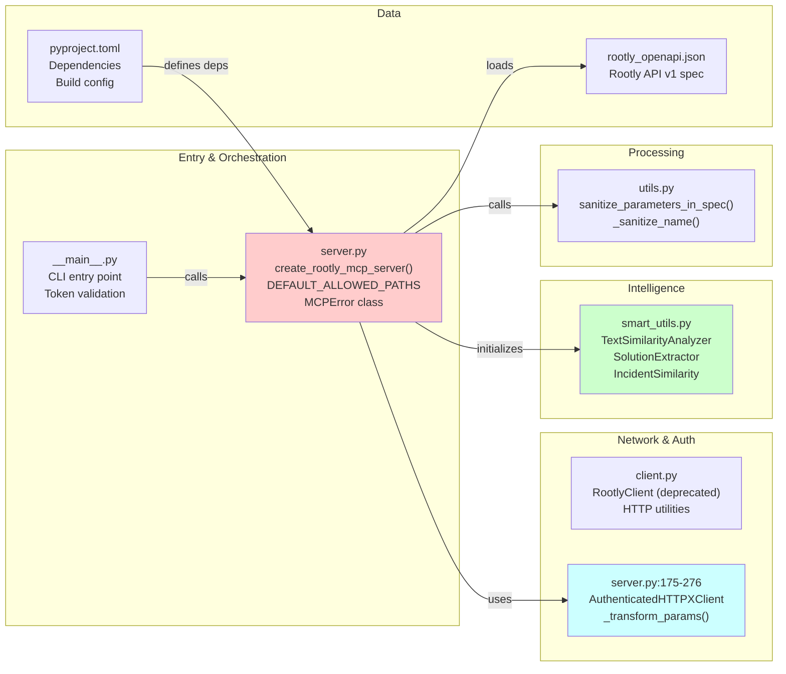

| Component | File | Key Classes/Functions | Purpose |
|-----------|------|----------------------|---------|
| **Server Core** | [server.py:278-344]() | `create_rootly_mcp_server()` | Main orchestrator, FastMCP server creation |
| **HTTP Client** | [server.py:175-276]() | `AuthenticatedHTTPXClient` | Authenticated HTTP with parameter transformation |
| **OpenAPI Processing** | [utils.py:1-100]() | `sanitize_parameters_in_spec()` | Makes OpenAPI params MCP-compliant |
| **Smart Analysis** | [smart_utils.py:1-500]() | `TextSimilarityAnalyzer`, `SolutionExtractor` | TF-IDF similarity, solution mining |
| **Entry Point** | [__main__.py:1-50]() | `main()` | CLI entry, environment validation |
| **Error Handling** | [server.py:28-83]() | `MCPError` | Protocol-compliant error responses |

Sources: [src/rootly_mcp_server/server.py:1-1500](), [src/rootly_mcp_server/utils.py:1-100](), [src/rootly_mcp_server/smart_utils.py:1-500](), [src/rootly_mcp_server/__main__.py:1-50]()

## How It Works: Initialization Flow

The server initializes through a multi-stage pipeline that transforms the Rootly API specification into MCP-compatible tools:

```mermaid
sequenceDiagram
    participant CLI as __main__.py
    participant Create as create_rootly_mcp_server()
    participant Load as _load_swagger_spec()
    participant Filter as _filter_openapi_spec()
    participant Sanitize as sanitize_parameters_in_spec()
    participant Client as AuthenticatedHTTPXClient
    participant FastMCP as FastMCP.from_openapi()
    
    CLI->>CLI: Validate ROOTLY_API_TOKEN
    CLI->>Create: Call with config
    
    Create->>Load: Fetch/load OpenAPI spec
    Load-->>Create: Full specification
    
    Create->>Create: Add /v1 prefix to allowed_paths
    Create->>Filter: Filter by DEFAULT_ALLOWED_PATHS
    Filter-->>Create: Filtered specification
    
    Create->>Sanitize: Sanitize parameter names
    Note over Sanitize: filter[status] → filter_status<br/>page[size] → page_size
    Sanitize-->>Create: Sanitized spec + mapping
    
    Create->>Client: Instantiate with parameter_mapping
    Client->>Client: Set ROOTLY_API_TOKEN header
    Client-->>Create: Authenticated client
    
    Create->>FastMCP: from_openapi(sanitized_spec, client)
    FastMCP-->>Create: MCP server with auto-generated tools
    
    Create->>Create: Register custom tools<br/>search_incidents, find_related_incidents,<br/>suggest_solutions, oncall tools
    
    Create-->>CLI: FastMCP server instance
    CLI->>CLI: Run server on port 3000
```

**Initialization stages:**

1. **Environment Validation** ([__main__.py:20-35]()): Checks for `ROOTLY_API_TOKEN`, fails fast if missing
2. **Spec Loading** ([server.py:1400-1450]()): Fetches from `SWAGGER_URL` or loads local `rootly_openapi.json`
3. **Path Filtering** ([server.py:1500-1550]()): Applies `DEFAULT_ALLOWED_PATHS` to limit exposed endpoints
4. **Spec Cleaning** ([server.py:1600-1700]()): Removes broken `$ref` references, adds pagination/sparse fieldset params
5. **Parameter Sanitization** ([utils.py:20-80]()): Transforms `filter[status]` → `filter_status` for MCP compatibility
6. **Client Creation** ([server.py:175-212]()): Creates `AuthenticatedHTTPXClient` with token and parameter mapping
7. **Tool Generation** ([server.py:338-344]()): FastMCP auto-generates tools from OpenAPI operations
8. **Custom Registration** ([server.py:354-1200]()): Registers intelligent tools like `search_incidents`, `find_related_incidents`

Sources: [src/rootly_mcp_server/__main__.py:1-50](), [src/rootly_mcp_server/server.py:278-1700](), [src/rootly_mcp_server/utils.py:1-100](), Diagram 2 from context

## Key Capabilities

### 1. Dynamic Tool Generation from OpenAPI

The server converts OpenAPI paths into MCP tools automatically using FastMCP's `from_openapi()` integration:

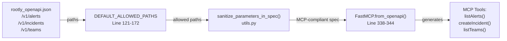

**Path filtering:** The `DEFAULT_ALLOWED_PATHS` constant ([server.py:121-172]()) limits exposed endpoints to prevent context overflow and control security. Only 40+ carefully selected paths are exposed by default.

**Example transformation:**
- OpenAPI: `GET /v1/alerts?filter[status]=open&page[size]=10`
- Sanitized: `GET /v1/alerts?filter_status=open&page_size=10`
- MCP Tool: `listAlerts(filter_status="open", page_size=10)`

Sources: [src/rootly_mcp_server/server.py:121-172](), [src/rootly_mcp_server/server.py:338-344](), [src/rootly_mcp_server/utils.py:1-100]()

### 2. Intelligent Incident Analysis

Beyond raw API access, the server provides AI-powered incident analysis using machine learning techniques:

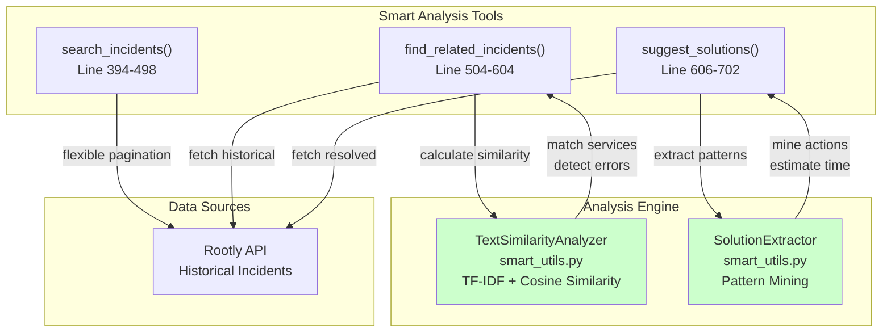

**Analysis capabilities:**
- **Text Similarity** ([smart_utils.py:50-200]()): TF-IDF vectorization and cosine similarity scoring
- **Service Detection** ([smart_utils.py:150-180]()): Automatic identification of affected services from incident text
- **Error Pattern Matching** ([smart_utils.py:180-200]()): Recognition of common error types (timeout, 500, connection)
- **Solution Mining** ([smart_utils.py:300-450]()): Extraction of actionable steps from resolution summaries
- **Time Estimation** ([smart_utils.py:400-450]()): Average resolution time calculation from similar incidents

Sources: [src/rootly_mcp_server/server.py:394-702](), [src/rootly_mcp_server/smart_utils.py:1-500]()

### 3. On-Call Management

Specialized tools aggregate data across multiple API endpoints for on-call operations:

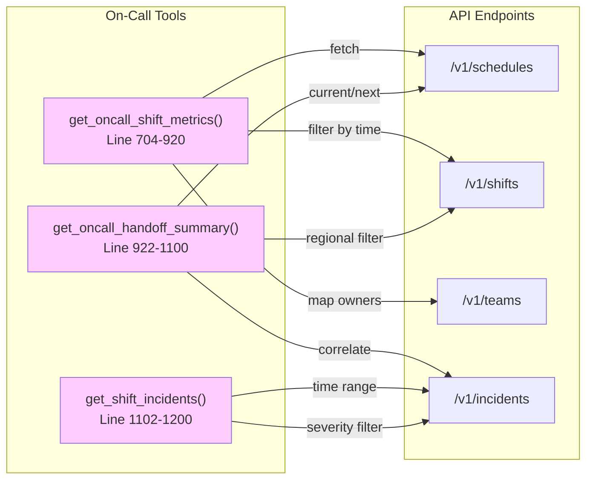

**Multi-endpoint aggregation:**
- `get_oncall_shift_metrics()` ([server.py:704-920]()): Queries `/schedules`, `/shifts`, and `/teams` to compute shift counts, hours, and role distribution
- `get_oncall_handoff_summary()` ([server.py:922-1100]()): Correlates current/next on-call with incidents during their shifts
- Regional filtering using business hours (9am-5pm) in specified timezones

Sources: [src/rootly_mcp_server/server.py:704-1200](), [tests/unit/test_oncall_handoff.py:1-71]()

### 4. Dual-Mode Authentication

The server supports two authentication modes for different deployment scenarios:

| Mode | Token Source | Use Case | Configuration |
|------|-------------|----------|---------------|
| **Local** | `ROOTLY_API_TOKEN` env var | Development, self-hosted | `hosted=False` (default) |
| **Hosted** | MCP request `Authorization` header | Production SaaS | `hosted=True` |

**Implementation:** The `AuthenticatedHTTPXClient` ([server.py:175-212]()) checks the `hosted` flag. In local mode, it reads the token from environment variables at initialization. In hosted mode, it extracts tokens from incoming MCP request headers at runtime ([server.py:376-393]()).

Sources: [src/rootly_mcp_server/server.py:175-212](), [src/rootly_mcp_server/server.py:376-393](), Diagram 6 from context

## Request Processing Flow

When an MCP client invokes a tool, the request flows through multiple transformation stages:

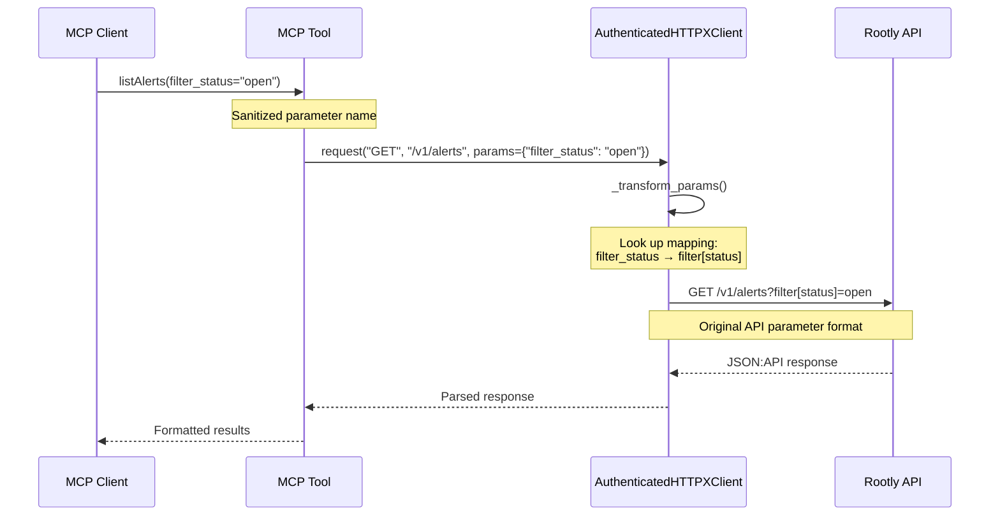

**Parameter transformation** ([server.py:213-234]()): The bidirectional mapping ensures MCP tool interfaces use valid Python identifiers (`filter_status`) while the actual HTTP requests use Rootly's bracket notation (`filter[status]`).

**Error handling** ([server.py:28-83]()): The `MCPError` class categorizes exceptions into authentication, network, validation, and execution errors, returning protocol-compliant JSON-RPC error responses.

Sources: [src/rootly_mcp_server/server.py:213-234](), [src/rootly_mcp_server/server.py:28-83](), Diagram 4 from context

## Configuration and Extensibility

### Environment Variables

| Variable | Purpose | Default |
|----------|---------|---------|
| `ROOTLY_API_TOKEN` | API authentication token | Required in local mode |
| `ROOTLY_BASE_URL` | Rootly API base URL | `https://api.rootly.com` |

Sources: [src/rootly_mcp_server/server.py:205-211](), [src/rootly_mcp_server/server.py:323-325]()

### Path Allowlist

To expose additional API endpoints, modify `DEFAULT_ALLOWED_PATHS` ([server.py:121-172]()). The current allowlist includes 40+ paths covering:
- Alerts and alert management
- Incidents and action items
- Teams and users
- Services and environments
- On-call schedules and shifts
- Workflows and severities

Each path in the allowlist becomes one or more MCP tools after OpenAPI processing.

Sources: [src/rootly_mcp_server/server.py:121-172](), [README.md:183-190]()

### Custom Tools

New intelligent tools can be registered using FastMCP's `@mcp.tool()` decorator ([server.py:354-1200]()). Custom tools have access to:
- The `make_authenticated_request()` helper for API calls
- The `TextSimilarityAnalyzer` for ML-based analysis
- The `SolutionExtractor` for pattern mining
- The `MCPError` utility for consistent error handling

Sources: [src/rootly_mcp_server/server.py:354-1200](), [src/rootly_mcp_server/server.py:375-393](), [src/rootly_mcp_server/smart_utils.py:1-500]()

## Package Distribution

The server is distributed as a Python package on PyPI:

- **Package name:** `rootly-mcp-server`
- **Current version:** `2.0.12` ([__init__.py:16]())
- **Installation:** `uv tool install rootly-mcp-server` or `uvx rootly-mcp-server`
- **Dependencies:** Managed via `pyproject.toml` and locked in `uv.lock`
- **Build system:** Hatchling with automated PyPI publishing via GitHub Actions

Sources: [src/rootly_mcp_server/__init__.py:16](), [README.md:31-96](), [pyproject.toml:1-100]()

---

This overview establishes the foundational understanding of the Rootly MCP Server. For implementation details, see the following sections:

- **[Getting Started](#2)**: Installation, configuration, and first-time setup
- **[Core Architecture](#3)**: Deep dives into server initialization, OpenAPI processing, and authentication
- **[Tool System](#4)**: Details on tool generation, smart analysis, and on-call intelligence
- **[Development Guide](#5)**: Contributing, testing, and extending the server

---

# Page: Key Features

# Key Features

<details>
<summary>Relevant source files</summary>

The following files were used as context for generating this wiki page:

- [README.md](README.md)
- [src/rootly_mcp_server/server.py](src/rootly_mcp_server/server.py)
- [tests/unit/test_oncall_handoff.py](tests/unit/test_oncall_handoff.py)

</details>


## Purpose and Scope

This document describes the core capabilities of the Rootly MCP Server, including dynamic tool generation, intelligent incident analysis, on-call management, and MCP protocol compliance mechanisms. For architectural details about how these features are implemented, see [Architecture Overview](#1.2). For setup instructions, see [Getting Started](#2).

---

## Feature Overview

The Rootly MCP Server provides five major categories of functionality:

| Feature Category | Key Capabilities | Primary Implementation |
|-----------------|------------------|----------------------|
| **Dynamic Tool Generation** | Auto-generates MCP tools from OpenAPI spec | `create_rootly_mcp_server()`, `FastMCP.from_openapi()` |
| **Smart Analysis** | ML-based incident similarity and solution mining | `TextSimilarityAnalyzer`, `SolutionExtractor` |
| **On-Call Management** | Shift metrics, handoff summaries, incident tracking | `get_oncall_shift_metrics()`, `get_oncall_handoff_summary()` |
| **MCP Compliance** | Parameter sanitization, error handling, resources | `sanitize_parameters_in_spec()`, `MCPError` |
| **Authentication** | Dual-mode (local/hosted) token handling | `AuthenticatedHTTPXClient` |

Sources: [src/rootly_mcp_server/server.py:278-344](), [README.md:122-132]()

---

## Dynamic Tool Generation from OpenAPI

### OpenAPI-to-MCP Pipeline

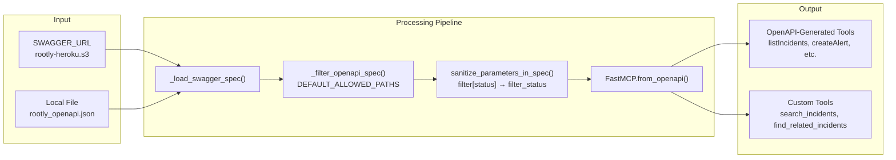

**Diagram: OpenAPI specification processing pipeline with function names**

The server dynamically generates MCP tools by consuming Rootly's OpenAPI specification through a multi-stage pipeline implemented in `create_rootly_mcp_server()`:

1. **Specification Loading** ([src/rootly_mcp_server/server.py:311]()): Fetches from `SWAGGER_URL` with local file fallback
2. **Path Filtering** ([src/rootly_mcp_server/server.py:315]()): Applies `DEFAULT_ALLOWED_PATHS` whitelist to limit exposed endpoints
3. **Parameter Sanitization** ([src/rootly_mcp_server/server.py:319]()): Transforms parameters to MCP-compliant names
4. **Tool Generation** ([src/rootly_mcp_server/server.py:338-344]()): Uses `FastMCP.from_openapi()` to create tool handlers

### Default Allowed Paths

The server exposes a curated subset of Rootly API endpoints defined in `DEFAULT_ALLOWED_PATHS`:

| Category | Endpoints | Purpose |
|----------|-----------|---------|
| **Incidents** | `/incidents`, `/incidents/{incident_id}/alerts` | Core incident operations |
| **Alerts** | `/alerts`, `/alerts/{alert_id}` | Alert management |
| **Teams & Users** | `/teams`, `/users`, `/users/me` | Identity and ownership |
| **Services** | `/services`, `/environments`, `/severities` | Resource metadata |
| **On-Call** | `/schedules`, `/shifts`, `/on_call_roles` | On-call schedule management |
| **Workflows** | `/workflows`, `/workflow_runs` | Automation integration |

Sources: [src/rootly_mcp_server/server.py:121-172](), [src/rootly_mcp_server/server.py:299-316]()

---

## Smart Analysis Capabilities

### Architecture

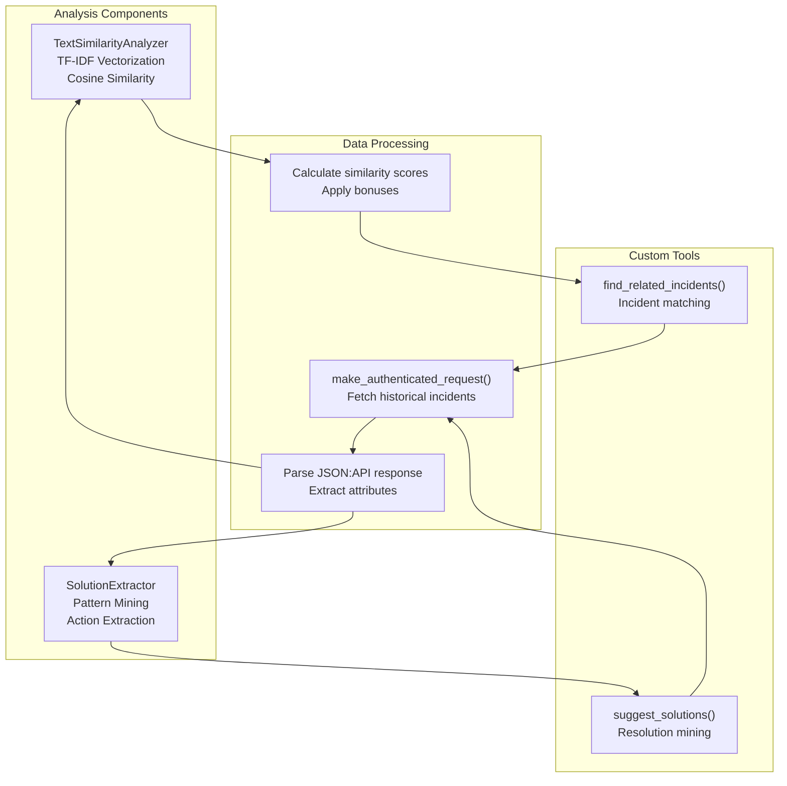

**Diagram: Smart analysis tool architecture with component names**

### find_related_incidents

Implements ML-based incident similarity detection using `TextSimilarityAnalyzer`:

**Implementation**: [src/rootly_mcp_server/server.py:504-604]()

**Core Algorithm**:
1. Accepts either `incident_id` or `incident_description` as input
2. Fetches historical incidents with optional `status_filter`
3. Applies `TextSimilarityAnalyzer.calculate_similarity()` using TF-IDF vectorization
4. Returns ranked results with `similarity_score`, `matched_services`, and `resolution_time_hours`

**Key Features**:
- **Text Vectorization**: TF-IDF conversion of titles, summaries, and descriptions
- **Service Detection**: Automatic identification of affected services from incident text
- **Error Pattern Matching**: Recognizes common error types (timeout, 404, etc.)
- **Configurable Threshold**: `similarity_threshold` parameter (0.0-1.0, default 0.15)

### suggest_solutions

Mines actionable solutions from historically resolved incidents using `SolutionExtractor`:

**Implementation**: [src/rootly_mcp_server/server.py:606-702]()

**Processing Pipeline**:
1. Finds similar incidents using similarity analysis
2. Filters to incidents with `status_filter="resolved"` (default)
3. Extracts solutions via `SolutionExtractor.extract_solutions()`
4. Generates high-level recommendations via `_generate_recommendation()`

**Output Structure**:
- `solutions`: List of suggested actions with confidence scores
- `insights`: Common patterns and average resolution time
- `recommendation`: High-level guidance based on analysis

Sources: [src/rootly_mcp_server/server.py:504-702](), [src/rootly_mcp_server/smart_utils.py](), [README.md:192-229]()

---

## On-Call Management Tools

### Tool Suite

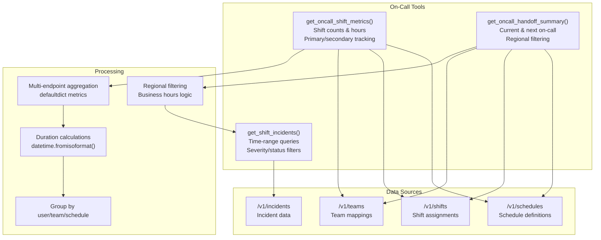

**Diagram: On-call tool data flow and aggregation logic**

### get_oncall_shift_metrics

Aggregates shift data across multiple dimensions with role-based tracking:

**Implementation**: [src/rootly_mcp_server/server.py:704-1053]()

**Key Capabilities**:
- **Time-Range Queries**: Accepts `start_date` and `end_date` in ISO 8601 format
- **Multi-Level Grouping**: Groups by `user`, `schedule`, `team`, or `none`
- **Role Tracking**: Distinguishes primary vs secondary on-call roles
- **Metrics Calculated**:
  - `shift_count`: Total number of shifts
  - `total_hours`: Cumulative shift duration
  - `days_on_call`: Unique calendar days with shifts
  - `primary_hours` / `secondary_hours`: Role-specific totals
  - `override_count`: Ad-hoc shift overrides

**Multi-Endpoint Correlation**:
1. Fetches `/v1/schedules` to get schedule metadata
2. Fetches `/v1/teams` to resolve team names
3. Queries `/v1/shifts` with temporal filters
4. Aggregates using `defaultdict` with included relationships

### get_oncall_handoff_summary

Provides real-time on-call status with timezone-aware regional filtering:

**Implementation**: [src/rootly_mcp_server/server.py:1055-1380]()

**Advanced Features**:
- **Timezone Support**: Accepts IANA timezone identifiers (e.g., `America/Los_Angeles`)
- **Regional Filtering**: When `filter_by_region=True`, shows only shifts overlapping business hours (9am-5pm) in specified timezone
- **Handoff Intelligence**: Returns both `current_oncall` and `next_oncall` for seamless transitions
- **Optional Incident Correlation**: When `include_incidents=True`, fetches incidents during current shifts (disabled by default for performance)

**Timezone Conversion**: Uses `ZoneInfo` and `convert_to_timezone()` helper to display all timestamps in target timezone

### get_shift_incidents

Queries incidents within a specific time window with filtering:

**Implementation**: [src/rootly_mcp_server/server.py:1382-1463]()

**Filter Options**:
- `severity`: Filter by incident severity
- `status`: Filter by incident status
- `tags`: Comma-separated tag filtering
- `schedule_ids`: Associate incidents with specific schedules

Sources: [src/rootly_mcp_server/server.py:704-1463](), [README.md:230-278]()

---

## MCP Protocol Compliance

### Parameter Sanitization System

The server ensures MCP compatibility through bidirectional parameter transformation:

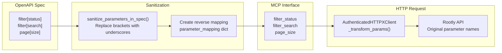

**Diagram: Parameter transformation pipeline for MCP compliance**

**Implementation**: [src/rootly_mcp_server/utils.py](), [src/rootly_mcp_server/server.py:213-225]()

**Transformation Rules**:
- Brackets replaced with underscores: `filter[status]` → `filter_status`
- Reverse mapping stored in `parameter_mapping` dictionary
- `AuthenticatedHTTPXClient._transform_params()` performs reverse transformation before HTTP requests

### Error Handling with MCPError

Provides protocol-compliant error responses with intelligent categorization:

**Implementation**: [src/rootly_mcp_server/server.py:28-82]()

**Error Categories**:
- `authentication_error`: 401/unauthorized responses
- `network_error`: Connection/timeout failures
- `client_error`: 4xx HTTP status codes
- `server_error`: 5xx HTTP status codes
- `validation_error`: Input validation failures
- `execution_error`: Generic tool execution errors

**Response Types**:
1. **Protocol-level errors**: `MCPError.protocol_error()` for JSON-RPC compliance
2. **Tool-level errors**: `MCPError.tool_error()` returned as successful tool result with error structure

Sources: [src/rootly_mcp_server/utils.py](), [src/rootly_mcp_server/server.py:28-82](), [src/rootly_mcp_server/server.py:213-234]()

---

## Dual Authentication Modes

The server supports two operational modes with different token handling strategies:

### Authentication Architecture

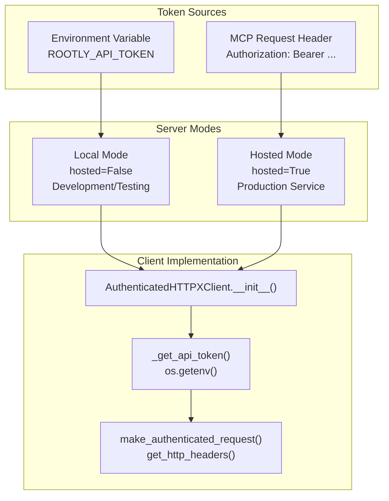

**Diagram: Dual authentication mode implementation**

### Mode Comparison

| Aspect | Local Mode (`hosted=False`) | Hosted Mode (`hosted=True`) |
|--------|---------------------------|----------------------------|
| **Token Source** | `ROOTLY_API_TOKEN` environment variable | `Authorization` header from MCP request |
| **Use Case** | Development, testing, personal deployment | Production hosted service |
| **Token Validation** | Checked in `__main__.py` at startup | Extracted per-request via `get_http_headers()` |
| **Security** | Token stored in environment/config | Token never stored, passed through only |

**Local Mode Implementation**: [src/rootly_mcp_server/server.py:184-194]()
- Token loaded from environment in `AuthenticatedHTTPXClient.__init__()`
- Added to `Authorization` header for all requests

**Hosted Mode Implementation**: [src/rootly_mcp_server/server.py:375-392]()
- Token extracted from MCP request headers in `make_authenticated_request()`
- Uses FastMCP's `get_http_headers()` dependency injection

Sources: [src/rootly_mcp_server/server.py:175-276](), [src/rootly_mcp_server/server.py:375-392](), [src/rootly_mcp_server/__main__.py]()

---

## Smart Pagination

Prevents context window overflow through intelligent default limits:

**Implementation**: [src/rootly_mcp_server/server.py:394-498]()

**search_incidents Configuration**:
- Default `page_size`: 10 items (maximum 20)
- Default `page_number`: 1 (single page)
- Multi-page mode: Set `page_number=0` to fetch across pages up to `max_results`
- Safety limit: Maximum 10 pages to prevent infinite loops

**Multi-Page Algorithm**:
```python
while len(all_incidents) < max_results and current_page <= max_pages:
    # Fetch page
    # Check metadata for last page
    # Aggregate results
```

**Other Endpoints**: Default to 100 items per page for batch operations (schedules, shifts, teams)

Sources: [src/rootly_mcp_server/server.py:394-498](), [README.md:125]()

---

## MCP Resource Exposure

Exposes Rootly entities as MCP resources for AI agent reference:

**Implementation**: Resources registered via `@mcp.resource()` decorators

**Resource URIs**:
- `incident://{id}`: Individual incident details
- `team://{id}`: Team information
- `rootly://incidents`: Recent incidents list

**Use Case**: Allows MCP clients to reference Rootly entities in conversations and context without explicit API calls.

Sources: [src/rootly_mcp_server/server.py]() (resource decorators), [README.md:130]()

---

# Page: Architecture Overview

# Architecture Overview

<details>
<summary>Relevant source files</summary>

The following files were used as context for generating this wiki page:

- [README.md](README.md)
- [pyproject.toml](pyproject.toml)
- [src/rootly_mcp_server/server.py](src/rootly_mcp_server/server.py)
- [tests/unit/test_oncall_handoff.py](tests/unit/test_oncall_handoff.py)

</details>


## Purpose and Scope

This document provides a comprehensive architectural overview of the Rootly MCP Server system, showing how the major components fit together and interact. It covers the complete data flow from MCP client requests through the server initialization, OpenAPI processing, tool generation, and API communication.

For detailed information about specific subsystems, see:
- Server initialization details: [Server Initialization Pipeline](#3.1)
- OpenAPI processing: [OpenAPI Processing](#3.2)
- Authentication details: [Authentication System](#3.3)
- Tool architecture: [Tool System](#4)
- Development workflow: [Development Guide](#5)

## System Overview

The Rootly MCP Server is built around a central `FastMCP` server instance that dynamically generates tools from the Rootly OpenAPI specification. The system transforms and filters the OpenAPI spec to ensure MCP protocol compatibility while maintaining full Rootly API functionality.

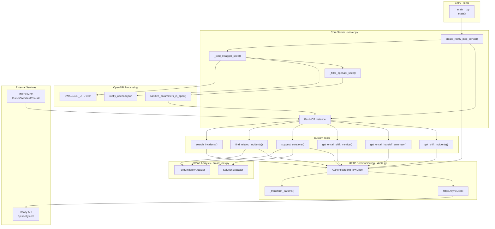

**Key Architecture Characteristics:**

| Aspect | Implementation |
|--------|----------------|
| **Entry Point** | `main()` in `__main__.py` |
| **Core Server** | `FastMCP` instance created by `create_rootly_mcp_server()` |
| **Spec Source** | Local `rootly_openapi.json` or remote `SWAGGER_URL` |
| **HTTP Client** | `AuthenticatedHTTPXClient` wrapping `httpx.AsyncClient` |
| **Tool Generation** | `FastMCP.from_openapi()` + custom `@mcp.tool()` decorators |
| **Authentication** | Dual-mode: env token (`ROOTLY_API_TOKEN`) or MCP headers |

**Sources:** [src/rootly_mcp_server/server.py:1-343](), [src/rootly_mcp_server/__main__.py](), [README.md:1-332]()

## Core Component Mapping

This diagram maps high-level architectural concepts to specific code entities in the codebase.

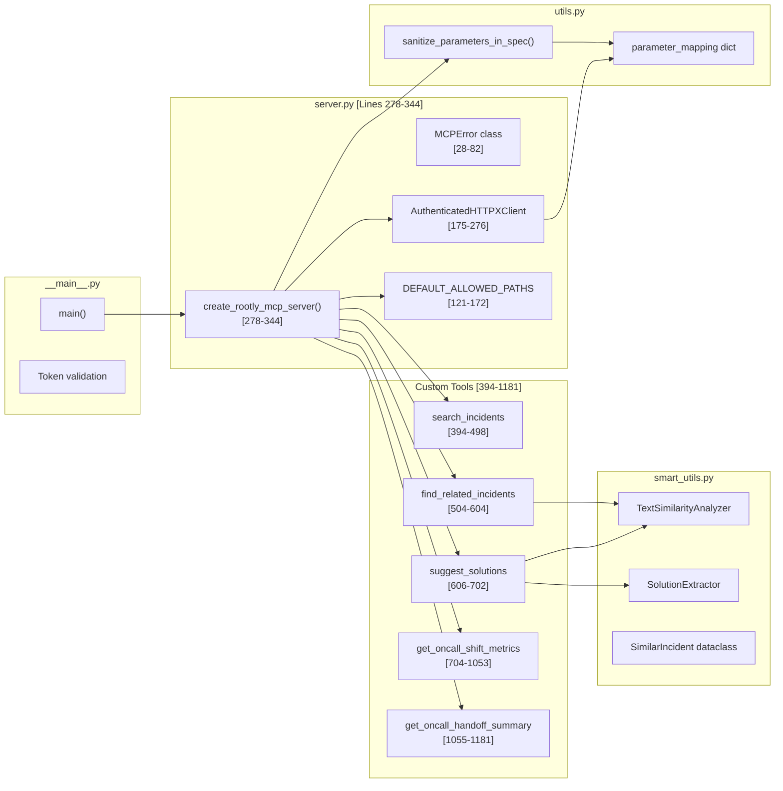

**Component Responsibilities:**

| Component | Location | Primary Responsibility |
|-----------|----------|----------------------|
| `create_rootly_mcp_server()` | [server.py:278-344]() | Server initialization, spec loading, tool generation |
| `AuthenticatedHTTPXClient` | [server.py:175-276]() | HTTP client with auth and parameter transformation |
| `MCPError` | [server.py:28-82]() | Protocol-compliant error handling |
| `sanitize_parameters_in_spec()` | [utils.py]() | OpenAPI parameter name transformation |
| `TextSimilarityAnalyzer` | [smart_utils.py]() | TF-IDF based incident similarity |
| `SolutionExtractor` | [smart_utils.py]() | Resolution pattern mining |
| `main()` | [__main__.py]() | CLI entry, token validation |

**Sources:** [src/rootly_mcp_server/server.py:1-1181](), [pyproject.toml:48-49]()

## Initialization Pipeline

The server initialization follows a multi-stage pipeline that transforms the raw OpenAPI specification into a working MCP server with parameter sanitization and custom tools.

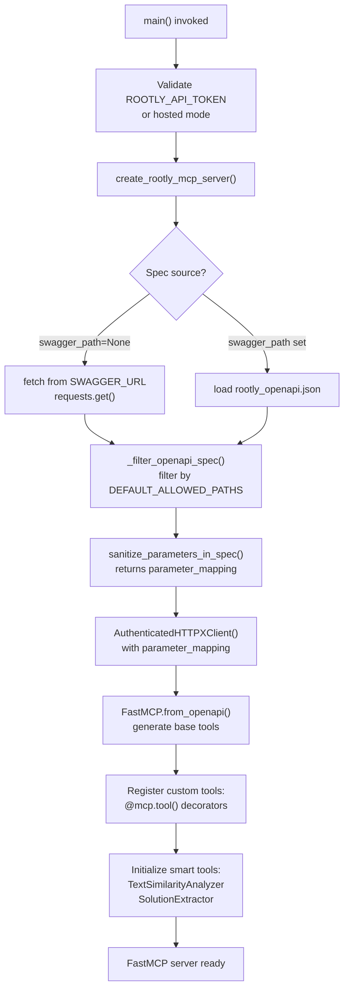

**Pipeline Stages:**

| Stage | Function/Class | Key Operations |
|-------|----------------|----------------|
| 1. Entry | `main()` | Token validation, environment setup |
| 2. Spec Loading | `_load_swagger_spec()` | Fetch remote or load local JSON |
| 3. Filtering | `_filter_openapi_spec()` | Reduce to `DEFAULT_ALLOWED_PATHS` |
| 4. Sanitization | `sanitize_parameters_in_spec()` | Transform `filter[x]` → `filter_x` |
| 5. Client Creation | `AuthenticatedHTTPXClient()` | Initialize with mapping & auth |
| 6. Base Tools | `FastMCP.from_openapi()` | Auto-generate from paths |
| 7. Custom Tools | `@mcp.tool()` | Register 6+ custom tools |
| 8. Smart Init | Tool bodies | Initialize analyzers |

**Sources:** [src/rootly_mcp_server/server.py:278-344](), [src/rootly_mcp_server/server.py:394-1181]()

## Request Processing Flow

This sequence diagram shows the complete request flow for a custom tool, including parameter transformation and API communication.

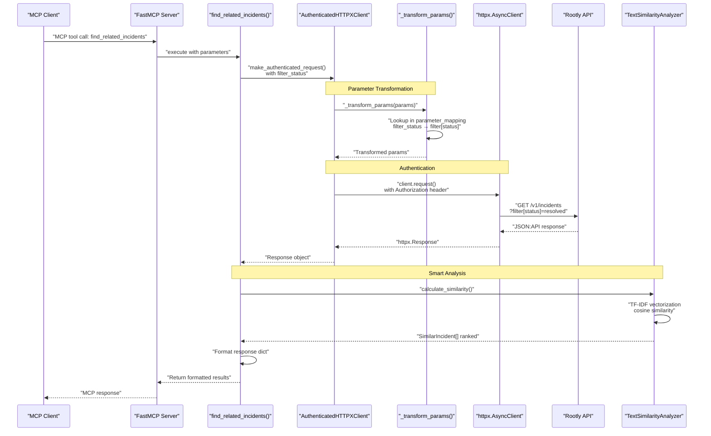

**Request Flow Characteristics:**

| Stage | Component | Key Transformation |
|-------|-----------|-------------------|
| 1. Invocation | `FastMCP` | Route to tool function |
| 2. Parameter Receipt | Custom tool | MCP-sanitized names (`filter_status`) |
| 3. Transformation | `_transform_params()` | Reverse mapping to API format (`filter[status]`) |
| 4. Authentication | `AuthenticatedHTTPXClient` | Add Bearer token header |
| 5. HTTP Call | `httpx.AsyncClient` | Execute HTTP request |
| 6. Analysis (optional) | `TextSimilarityAnalyzer` | ML-based processing |
| 7. Response | Custom tool | Format for MCP client |

**Sources:** [src/rootly_mcp_server/server.py:175-276](), [src/rootly_mcp_server/server.py:504-604]()

## Authentication Architecture

The system supports dual authentication modes with automatic token injection and header propagation.

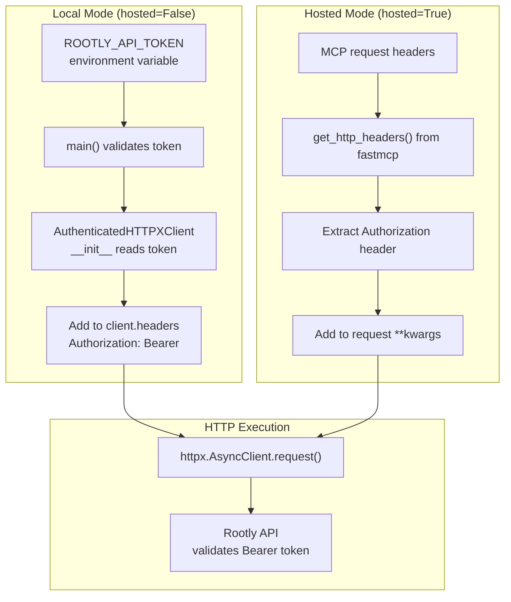

**Authentication Modes:**

| Mode | Token Source | Implementation | Code Location |
|------|-------------|----------------|---------------|
| **Local** | `ROOTLY_API_TOKEN` env var | Stored in `_api_token`, added to client headers | [server.py:205-211]() |
| **Hosted** | MCP request `Authorization` header | Extracted per-request via `get_http_headers()` | [server.py:376-389]() |

**Token Flow:**
1. **Local Mode:** `os.getenv("ROOTLY_API_TOKEN")` → `self._api_token` → `headers["Authorization"]` in `__init__`
2. **Hosted Mode:** MCP request headers → `get_http_headers()` → `kwargs["headers"]["Authorization"]` per request

**Sources:** [src/rootly_mcp_server/server.py:175-211](), [src/rootly_mcp_server/server.py:375-392]()

## Tool Architecture

The system exposes two distinct layers of tools: auto-generated tools from OpenAPI paths and custom intelligent tools with enhanced functionality.

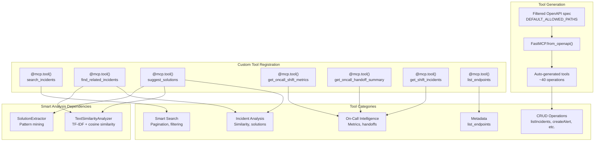

**Tool Categories:**

| Category | Count | Source | Key Tools |
|----------|-------|--------|-----------|
| **OpenAPI-Generated** | ~40 | `FastMCP.from_openapi()` | `listIncidents`, `createAlert`, `listTeams` |
| **Search & Pagination** | 1 | `@mcp.tool()` | `search_incidents` |
| **Smart Analysis** | 2 | `@mcp.tool()` + smart_utils | `find_related_incidents`, `suggest_solutions` |
| **On-Call Intelligence** | 3 | `@mcp.tool()` | `get_oncall_shift_metrics`, `get_oncall_handoff_summary`, `get_shift_incidents` |
| **Metadata** | 1 | `@mcp.tool()` | `list_endpoints` |

**Tool Implementation Patterns:**

```python
# Pattern 1: Direct API call with enhanced pagination
@mcp.tool()
async def search_incidents(...) -> dict:
    response = await make_authenticated_request("GET", "/v1/incidents", params=...)
    # Enhanced pagination logic
    return formatted_results

# Pattern 2: API call + ML analysis
@mcp.tool()
async def find_related_incidents(...) -> dict:
    # Fetch historical data
    historical = await make_authenticated_request(...)
    # Apply TextSimilarityAnalyzer
    similar = similarity_analyzer.calculate_similarity(...)
    return formatted_results

# Pattern 3: Multi-endpoint aggregation
@mcp.tool()
async def get_oncall_shift_metrics(...) -> dict:
    # Fetch schedules, teams, shifts
    schedules = await make_authenticated_request("/v1/schedules", ...)
    teams = await make_authenticated_request("/v1/teams", ...)
    shifts = await make_authenticated_request("/v1/shifts", ...)
    # Aggregate and compute metrics
    return aggregated_metrics
```

**Sources:** [src/rootly_mcp_server/server.py:336-344](), [src/rootly_mcp_server/server.py:394-1181]()

## Parameter Sanitization System

The parameter sanitization system ensures MCP protocol compliance by transforming Rootly API parameter names with special characters into valid MCP identifiers.

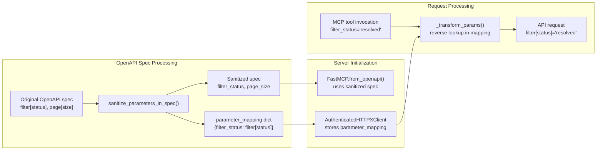

**Transformation Rules:**

| Original Format | Sanitized Format | Example |
|----------------|------------------|---------|
| `filter[status]` | `filter_status` | Status filtering |
| `page[size]` | `page_size` | Pagination size |
| `filter[search]` | `filter_search` | Search query |
| `fields[incidents]` | `fields_incidents` | Sparse fieldsets |

**Bidirectional Mapping:**
- **Forward (Sanitization):** [utils.py:sanitize_parameters_in_spec()]() creates MCP-compliant names
- **Reverse (Transformation):** [server.py:213-225]() maps back to original API format
- **Storage:** `parameter_mapping` dict stored in `AuthenticatedHTTPXClient.parameter_mapping`

**Sources:** [src/rootly_mcp_server/utils.py](), [src/rootly_mcp_server/server.py:213-225](), [src/rootly_mcp_server/server.py:319-333]()

## Error Handling System

The `MCPError` class provides protocol-compliant error categorization and response formatting.

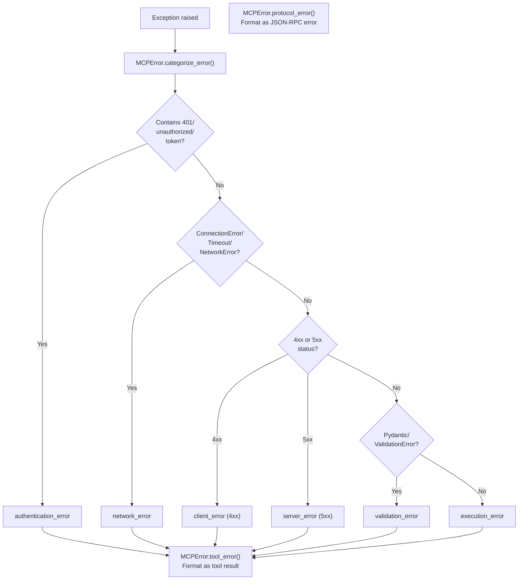

**Error Categories:**

| Category | Detection Pattern | HTTP Status | Example |
|----------|------------------|-------------|---------|
| `authentication_error` | "401", "unauthorized", "token" | 401 | Invalid API token |
| `network_error` | Exception type contains "connection", "timeout" | - | Network unreachable |
| `client_error` | "4" in first 2 chars of error | 4xx | Invalid parameters |
| `server_error` | "5" in first 2 chars of error | 5xx | API server error |
| `validation_error` | Exception type contains "validation", "pydantic" | - | Invalid input |
| `execution_error` | Default fallback | - | Generic tool error |

**Error Response Format:**
```python
# Tool-level error (returned as successful tool result)
{
    "error": True,
    "error_type": "authentication_error",
    "message": "Authentication failed: 401 Unauthorized",
    "details": {...}  # Optional
}

# Protocol-level error (JSON-RPC error response)
{
    "jsonrpc": "2.0",
    "error": {
        "code": -32000,
        "message": "Internal error",
        "data": {...}  # Optional
    }
}
```

**Sources:** [src/rootly_mcp_server/server.py:28-82](), [src/rootly_mcp_server/server.py:422-424](), [src/rootly_mcp_server/server.py:602-604]()

## Key Subsystems

The following subsystems implement specialized functionality beyond basic CRUD operations:

### Smart Analysis Subsystem

**Location:** [src/rootly_mcp_server/smart_utils.py]()

**Components:**
- `TextSimilarityAnalyzer`: TF-IDF vectorization with cosine similarity scoring
- `SolutionExtractor`: Pattern mining from incident resolutions
- `SimilarIncident`: Data class for similarity results

**Integration Points:**
- Used by `find_related_incidents()` [server.py:504-604]()
- Used by `suggest_solutions()` [server.py:606-702]()

**Key Operations:**
1. Vectorize incident text (title, summary, description)
2. Calculate cosine similarity scores
3. Apply service matching bonus (+0.1)
4. Apply keyword matching bonus (+0.05)
5. Rank and filter by threshold

### On-Call Intelligence Subsystem

**Location:** [src/rootly_mcp_server/server.py:704-1181]()

**Tools:**
1. `get_oncall_shift_metrics()`: Multi-endpoint aggregation (schedules + teams + shifts)
2. `get_oncall_handoff_summary()`: Current/next on-call with regional filtering
3. `get_shift_incidents()`: Incident correlation with shift timeframes

**Aggregation Pattern:**
```python
# Fetch from multiple endpoints
schedules = await request("/v1/schedules")
teams = await request("/v1/teams")
shifts = await request("/v1/shifts")

# Build relationship maps
schedule_to_team = build_mapping(schedules, teams)

# Aggregate metrics
metrics = aggregate_by_group(shifts, schedule_to_team)
```

### Configuration System

**Location:** [pyproject.toml:1-87]()

**Key Configuration:**
- Python version requirement: `>=3.12`
- Package name: `rootly-mcp-server`
- Entry point: `rootly_mcp_server.__main__:main`
- Dependencies: FastMCP, httpx, scikit-learn, numpy
- Test markers: unit, integration, remote, slow

**Sources:** [src/rootly_mcp_server/smart_utils.py](), [src/rootly_mcp_server/server.py:704-1181](), [pyproject.toml:1-87]()

## Deployment Architecture

The system supports multiple deployment modes with different authentication and hosting strategies.

| Deployment Mode | Entry Command | Authentication | Use Case |
|----------------|---------------|----------------|----------|
| **Local (uv)** | `uv tool run rootly-mcp-server` | `ROOTLY_API_TOKEN` env var | Development, local IDE |
| **Local (uvx)** | `uvx rootly-mcp-server` | `ROOTLY_API_TOKEN` env var | Quick local execution |
| **Local (dev)** | `uv run rootly-mcp-server` | `ROOTLY_API_TOKEN` env var | Development with repo |
| **Hosted (SSE)** | `mcp-remote https://mcp.rootly.com/sse` | MCP request headers | Remote production |

**Container Support:**
- Docker image built in CI
- Health check endpoints: `/health`, `/healthz`
- Deployed to AWS ECS via Semaphore CI

**Sources:** [README.md:32-121](), [src/rootly_mcp_server/server.py:346-350]()

---

# Page: Getting Started

# Getting Started

<details>
<summary>Relevant source files</summary>

The following files were used as context for generating this wiki page:

- [README.md](README.md)
- [pyproject.toml](pyproject.toml)
- [src/rootly_mcp_server/__main__.py](src/rootly_mcp_server/__main__.py)
- [src/rootly_mcp_server/utils.py](src/rootly_mcp_server/utils.py)
- [tests/unit/test_oncall_handoff.py](tests/unit/test_oncall_handoff.py)

</details>


This page provides a step-by-step guide to installing and running the Rootly MCP Server for the first time. It covers prerequisites, installation methods, basic configuration, and verification steps to get the server operational in your MCP-compatible editor.

For detailed installation instructions for specific methods (uv, uvx, local development, hosted), see [Installation](#2.1). For comprehensive configuration options including environment variables and operational modes, see [Configuration](#2.2). For practical usage examples, see [Quick Start Examples](#2.3).

## Prerequisites

Before installing the Rootly MCP Server, ensure you have the following:

| Requirement | Version/Details | Purpose |
|-------------|-----------------|---------|
| Python | 3.12 or higher | Core runtime environment |
| `uv` package manager | Latest stable | Fast dependency management and package execution |
| Rootly API Token | Valid token with appropriate permissions | Authentication with Rootly API |
| MCP-compatible editor | Cursor, Windsurf, or Claude Desktop | Client to interact with the MCP server |

### Python Version Requirement

The server requires Python 3.12+ as specified in [pyproject.toml:6]():

```toml
requires-python = ">=3.12"
```

### Installing uv

Install the `uv` package manager using the official installer:

```bash
curl -LsSf https://astral.sh/uv/install.sh | sh
```

Sources: [README.md:14-18](), [pyproject.toml:6]()

### API Token Requirements

The MCP server requires a Rootly API token with appropriate permissions. Token types and their capabilities:

| Token Type | Access Level | Use Case |
|------------|-------------|----------|
| **Global API Key** (Recommended) | Full access across all entities | Organization-wide visibility, required for on-call tools |
| Team API Key | Team Admin permissions | Team-specific workflows |
| Personal API Key | User-level permissions | Individual use cases |

**Important**: For full functionality of tools like `get_oncall_handoff_summary`, `get_oncall_shift_metrics`, and organization-wide incident search, a **Global API Key** is recommended.

To generate an API token, visit the [Rootly API documentation](https://docs.rootly.com/api-reference/overview#how-to-generate-an-api-key%3F).

Sources: [README.md:19-29]()

## Installation Methods Overview

The Rootly MCP Server supports multiple installation methods to accommodate different workflows:

```mermaid
graph TB
    User["User/Developer"]
    
    subgraph "Installation Methods"
        UVTool["uv tool run<br/>(Production)"]
        UVX["uvx<br/>(Quick Run)"]
        LocalDev["uv run<br/>(Local Development)"]
        Hosted["mcp-remote<br/>(Hosted Service)"]
    end
    
    subgraph "Package Sources"
        PyPI["PyPI Registry<br/>rootly-mcp-server"]
        LocalRepo["Local Repository<br/>Git Clone"]
        HostedURL["Hosted Endpoint<br/>https://mcp.rootly.com/sse"]
    end
    
    subgraph "Entry Points"
        MainPy["__main__.py:main()"]
        GetServer["__main__.py:get_server()"]
        MCPInstance["__main__.py:mcp instance"]
    end
    
    subgraph "Server Initialization"
        CreateServer["server.py:create_rootly_mcp_server()"]
        ServerRun["FastMCP.run(transport)"]
    end
    
    User --> UVTool
    User --> UVX
    User --> LocalDev
    User --> Hosted
    
    UVTool --> PyPI
    UVX --> PyPI
    LocalDev --> LocalRepo
    Hosted --> HostedURL
    
    PyPI --> MainPy
    LocalRepo --> MainPy
    HostedURL --> MCPInstance
    
    MainPy --> GetServer
    GetServer --> CreateServer
    CreateServer --> ServerRun
    
    MCPInstance --> CreateServer
```

**Installation Method Decision Flow**

Sources: [README.md:31-120](), [__main__.py:148-192]()

### Quick Comparison

| Method | Best For | Installation Time | Isolation |
|--------|----------|-------------------|-----------|
| `uv tool run` | Production use, auto-updates | ~10 seconds | Global tool cache |
| `uvx` | Quick testing, one-off runs | ~5 seconds | Temporary environment |
| Local development | Contributing, customization | ~30 seconds | Project virtual environment |
| Hosted service | Managed deployment, no local setup | Instant | Remote server |

Each method invokes the same entry point at [__main__.py:148]() but with different package resolution strategies. For detailed setup instructions for each method, see [Installation](#2.1).

Sources: [README.md:31-96]()

## Configuration Basics

The server uses environment variables and command-line arguments for configuration. The initialization flow connects user-provided configuration to server creation:

```mermaid
graph TB
    subgraph "Configuration Sources"
        EnvVars["Environment Variables"]
        CLIArgs["Command-Line Arguments<br/>__main__.py:parse_args()"]
        EditorConfig["MCP Editor Config<br/>(JSON)"]
    end
    
    subgraph "Key Configuration Variables"
        APIToken["ROOTLY_API_TOKEN"]
        SwaggerPath["ROOTLY_SWAGGER_PATH<br/>--swagger-path"]
        ServerName["ROOTLY_SERVER_NAME<br/>--name"]
        HostedMode["ROOTLY_HOSTED<br/>--hosted"]
        BaseURL["ROOTLY_BASE_URL<br/>--base-url"]
        AllowedPaths["ROOTLY_ALLOWED_PATHS<br/>--allowed-paths"]
        LogLevel["--log-level<br/>--debug"]
    end
    
    subgraph "Validation Layer"
        TokenCheck["__main__.py:check_api_token()"]
        LogSetup["__main__.py:setup_logging()"]
    end
    
    subgraph "Server Creation"
        GetServerFunc["__main__.py:get_server()"]
        CreateFunc["server.py:create_rootly_mcp_server()"]
    end
    
    subgraph "Authentication Modes"
        LocalAuth["Local Mode<br/>hosted=False<br/>Uses ROOTLY_API_TOKEN"]
        HostedAuth["Hosted Mode<br/>hosted=True<br/>Uses MCP Request Headers"]
    end
    
    EnvVars --> APIToken
    EnvVars --> SwaggerPath
    EnvVars --> ServerName
    EnvVars --> HostedMode
    EnvVars --> BaseURL
    EnvVars --> AllowedPaths
    
    CLIArgs --> SwaggerPath
    CLIArgs --> ServerName
    CLIArgs --> HostedMode
    CLIArgs --> BaseURL
    CLIArgs --> AllowedPaths
    CLIArgs --> LogLevel
    
    EditorConfig --> EnvVars
    
    APIToken --> TokenCheck
    LogLevel --> LogSetup
    
    TokenCheck --> GetServerFunc
    LogSetup --> GetServerFunc
    
    SwaggerPath --> GetServerFunc
    ServerName --> GetServerFunc
    HostedMode --> GetServerFunc
    BaseURL --> GetServerFunc
    AllowedPaths --> GetServerFunc
    
    GetServerFunc --> CreateFunc
    
    CreateFunc --> LocalAuth
    CreateFunc --> HostedAuth
```

**Configuration Flow: From User Input to Server Creation**

Sources: [__main__.py:16-101](), [__main__.py:120-141]()

### Essential Configuration Variables

| Variable | Required | Default | Purpose |
|----------|----------|---------|---------|
| `ROOTLY_API_TOKEN` | Yes (local mode) | None | Authentication token for Rootly API |
| `ROOTLY_SERVER_NAME` | No | "Rootly" | Display name for the MCP server |
| `ROOTLY_HOSTED` | No | false | Enable hosted mode (remote MCP server) |
| `ROOTLY_BASE_URL` | No | "https://api.rootly.com" | Rootly API base URL |
| `ROOTLY_SWAGGER_PATH` | No | Auto-detected | Path to OpenAPI specification file |
| `ROOTLY_ALLOWED_PATHS` | No | Preset defaults | Comma-separated list of allowed API paths |

The `check_api_token()` function at [__main__.py:103-116]() validates that `ROOTLY_API_TOKEN` is set in local mode:

```python
def check_api_token():
    api_token = os.environ.get("ROOTLY_API_TOKEN")
    if not api_token:
        logger.error("ROOTLY_API_TOKEN environment variable is not set.")
        sys.exit(1)
```

In hosted mode (`--hosted` flag or `ROOTLY_HOSTED=true`), the server receives authentication through MCP request headers instead of environment variables, as validated at [__main__.py:162-164]():

```python
if not hosted_mode:
    check_api_token()
```

For comprehensive configuration options, see [Configuration](#2.2).

Sources: [__main__.py:103-116](), [__main__.py:120-141](), [__main__.py:162-164]()

## Basic Setup Example

Here's a minimal configuration to get started with the Rootly MCP Server in Cursor IDE:

### Step 1: Export API Token

```bash
export ROOTLY_API_TOKEN="your-api-token-here"
```

### Step 2: Add MCP Server Configuration

Add this configuration to your MCP settings file (typically `~/.cursor/mcp.json` or similar):

```json
{
  "mcpServers": {
    "rootly": {
      "command": "uvx",
      "args": [
        "--from",
        "rootly-mcp-server",
        "rootly-mcp-server"
      ],
      "env": {
        "ROOTLY_API_TOKEN": "<YOUR_ROOTLY_API_TOKEN>"
      }
    }
  }
}
```

This configuration:
1. Uses `uvx` for automatic package installation
2. Specifies the package name `rootly-mcp-server` from PyPI ([pyproject.toml:2]())
3. Invokes the entry point `rootly-mcp-server` ([pyproject.toml:49]())
4. Passes the API token via environment variable

### Step 3: Restart Your Editor

Restart Cursor (or your MCP-compatible editor) to load the new server configuration.

Sources: [README.md:59-75](), [pyproject.toml:49]()

## Verification Steps

After setup, verify the server is working correctly:

### 1. Check Server Logs

The server logs to stderr with timestamps and log levels. The logging is configured at [__main__.py:75-100]():

```python
logging.basicConfig(
    level=numeric_level,
    format="%(asctime)s - %(name)s - %(levelname)s - %(message)s",
    handlers=[logging.StreamHandler(sys.stderr)]
)
```

Look for:
- `"Starting Rootly MCP Server"` - Server initialization
- `"ROOTLY_API_TOKEN is set"` - Token validation passed
- `"Initializing server with name: Rootly"` - Server creation started
- `"Running server with transport: stdio..."` - Server running

### 2. List Available Tools

In your MCP client, check that tools are available. The server should expose:

**Core Tool Categories:**
- Alert management (`listAlerts`, `createAlert`, `attachAlert`)
- Incident operations (`listIncidents`, `createIncident`, `search_incidents`)
- Team management (`listTeams`, `createTeam`, `getCurrentUser`)
- On-call tools (`get_oncall_shift_metrics`, `get_oncall_handoff_summary`)
- Smart analysis (`find_related_incidents`, `suggest_solutions`)

The complete list of available tools is documented in [README.md:136-180]().

### 3. Test a Simple Query

Try a basic query to verify API connectivity:

```
Use the Rootly MCP server to list my recent incidents.
```

This should invoke the `search_incidents` tool and return results from your Rootly instance.

Sources: [__main__.py:75-100](), [__main__.py:153-182](), [README.md:136-180]()

## Troubleshooting Common Issues

| Issue | Cause | Solution |
|-------|-------|----------|
| `ROOTLY_API_TOKEN is not set` | Missing environment variable | Export token: `export ROOTLY_API_TOKEN="..."` |
| `Failed to start server` | Invalid swagger spec or network error | Check logs for details, verify API connectivity |
| Server starts but no tools appear | OpenAPI spec filtering issue | Verify `allowed_paths` configuration |
| `Permission denied` errors | Insufficient API token permissions | Use a Global API Key or verify token scopes |

For detailed debugging:

1. **Enable Debug Logging**: Set `--debug` flag or `DEBUG=true` environment variable ([__main__.py:47-50](), [__main__.py:77-78]())
2. **Check Token Format**: Token should start with valid characters, logged at [__main__.py:116]()
3. **Verify Python Version**: Ensure Python 3.12+ is installed ([pyproject.toml:6]())

Sources: [__main__.py:47-50](), [__main__.py:77-78](), [__main__.py:103-116](), [README.md:286-331]()

## Next Steps

After successfully installing and configuring the server:

1. **Explore Installation Options**: See [Installation](#2.1) for alternative installation methods (uv tool, local development, hosted service)
2. **Advanced Configuration**: Review [Configuration](#2.2) for customizing allowed paths, operational modes, and advanced settings
3. **Try Example Workflows**: Check [Quick Start Examples](#2.3) for common usage patterns
4. **Understand Architecture**: Read [Core Architecture](#3) to learn how the server processes requests
5. **Explore Tools**: Review [Tool System](#4) to understand available capabilities
6. **Development Setup**: See [Development Guide](#5) if you plan to contribute or customize the server

Sources: [README.md:1-331]()

## Architecture Context

The initialization flow follows this path through the codebase:

1. **Entry Point**: [__main__.py:148]() - `main()` function processes arguments
2. **Token Validation**: [__main__.py:103]() - `check_api_token()` ensures token is set
3. **Server Creation**: [__main__.py:120]() - `get_server()` builds configuration
4. **Initialization**: [__main__.py:173]() - Calls `create_rootly_mcp_server()` from [server.py]()
5. **Server Run**: [__main__.py:182]() - Starts FastMCP server with specified transport

The server instance created at [__main__.py:145]() (`mcp = get_server()`) is available as a module-level variable for FastMCP CLI integration.

For deeper understanding of server initialization, see [Server Initialization Pipeline](#3.1). For authentication details, see [Authentication System](#3.3).

Sources: [__main__.py:103-192]()

---

# Page: Installation

# Installation

<details>
<summary>Relevant source files</summary>

The following files were used as context for generating this wiki page:

- [README.md](README.md)
- [pyproject.toml](pyproject.toml)
- [tests/unit/test_oncall_handoff.py](tests/unit/test_oncall_handoff.py)

</details>


This document provides detailed instructions for installing the Rootly MCP Server using different methods. It covers prerequisites, multiple installation approaches, and verification steps to ensure successful setup.

For information about configuring the server after installation, see [Configuration](#2.2). For usage examples, see [Quick Start Examples](#2.3).

---

## Overview

The Rootly MCP Server can be installed in four ways:

| Method | Use Case | Package Source | Configuration Location |
|--------|----------|----------------|------------------------|
| **uv tool run** | Production use in MCP clients | PyPI (auto-managed) | MCP client config |
| **uvx** | Quick testing, single commands | PyPI (auto-managed) | MCP client config |
| **Local development** | Custom modifications, debugging | Local repository clone | MCP client config |
| **Hosted service** | Managed infrastructure, no local install | Remote server | MCP client config |

Each method produces the same server functionality but differs in deployment model, update management, and customization capabilities.

Sources: [README.md:31-120]()

---

## Prerequisites

### Python Environment

**Required Python Version**: 3.12 or higher

The server requires Python 3.12+ due to type annotation features and modern async capabilities. Verify your Python version:

```bash
python --version  # Should show 3.12.x or higher
```

Sources: [README.md:14](), [pyproject.toml:6]()

### Package Manager: uv

**Install uv**: The server uses `uv` for dependency management and execution:

```bash
curl -LsSf https://astral.sh/uv/install.sh | sh
```

After installation, verify `uv` is available:

```bash
uv --version
```

**Why uv?** The server uses `uv` instead of `pip` for:
- Fast dependency resolution using Rust
- Deterministic lock file generation ([uv.lock]())
- Tool execution without virtual environment pollution
- Consistent builds across environments

Sources: [README.md:15-18](), [README.md:289]()

### Rootly API Token

All installation methods require a Rootly API token for authentication. The server supports three token types:

| Token Type | Scope | Recommended For |
|------------|-------|----------------|
| **Global API Key** | Full org access | Production deployments, org-wide tools |
| **Team API Key** | Team-specific access | Team-isolated workflows |
| **Personal API Key** | User permission inheritance | Individual testing |

Generate a token at: [Rootly API Settings](https://docs.rootly.com/api-reference/overview#how-to-generate-an-api-key%3F)

**Recommended**: Use a **Global API Key** for full functionality of tools like `get_oncall_handoff_summary` and `get_oncall_shift_metrics` which require organization-wide visibility.

Sources: [README.md:19-29]()

---

## Installation Method 1: uv Tool Run (Recommended)

### Overview

The `uv tool run` method automatically manages the package installation and execution. This is the recommended approach for MCP client integrations.

### Installation Flow

```mermaid
sequenceDiagram
    participant User as "User"
    participant MCPClient as "MCP Client<br/>(Cursor/Windsurf)"
    participant UV as "uv"
    participant PyPI as "PyPI"
    participant Server as "__main__.py"
    
    User->>MCPClient: "Start IDE with MCP config"
    MCPClient->>UV: "uv tool run --from rootly-mcp-server"
    UV->>UV: "Check cache for package"
    alt "Package not cached"
        UV->>PyPI: "Download rootly-mcp-server"
        PyPI-->>UV: "Package .whl file"
        UV->>UV: "Install to isolated cache"
    end
    UV->>Server: "Execute rootly-mcp-server command"
    Server->>Server: "Validate ROOTLY_API_TOKEN"
    Server->>Server: "create_rootly_mcp_server()"
    Server-->>MCPClient: "MCP server ready (stdio)"
    MCPClient-->>User: "Tools available in IDE"
```

Sources: [README.md:35-55](), [pyproject.toml:49]()

### Configuration

Add this configuration to your MCP client's settings file (e.g., `~/.config/cursor/mcp.json` or `~/Library/Application Support/Claude/claude_desktop_config.json`):

```json
{
  "mcpServers": {
    "rootly": {
      "command": "uv",
      "args": [
        "tool",
        "run",
        "--from",
        "rootly-mcp-server",
        "rootly-mcp-server"
      ],      
      "env": {
        "ROOTLY_API_TOKEN": "<YOUR_ROOTLY_API_TOKEN>"
      }
    }
  }
}
```

**Configuration Breakdown**:
- `command: "uv"`: Uses uv as the execution wrapper
- `args[0-1]: "tool", "run"`: Invokes uv's tool runner
- `args[2-3]: "--from", "rootly-mcp-server"`: Specifies PyPI package name
- `args[4]: "rootly-mcp-server"`: Entry point command name (from [pyproject.toml:49]())
- `env.ROOTLY_API_TOKEN`: API token for authentication (see [Configuration](#2.2))

### How It Works

The entry point chain:
1. `uv tool run` executes the `rootly-mcp-server` script
2. Script maps to `rootly_mcp_server.__main__:main` ([pyproject.toml:49]())
3. `__main__.py:main()` validates environment and creates server
4. Server communicates via stdio with the MCP client

Sources: [README.md:37-55](), [pyproject.toml:48-49]()

---

## Installation Method 2: uvx (Simplified)

### Overview

`uvx` is a shorthand for `uv tool run`, providing a more concise command for single-use executions.

### Configuration

```json
{
  "mcpServers": {
    "rootly": {
      "command": "uvx",
      "args": [
        "--from",
        "rootly-mcp-server",
        "rootly-mcp-server"
      ],      
      "env": {
        "ROOTLY_API_TOKEN": "<YOUR_ROOTLY_API_TOKEN>"
      }
    }
  }
}
```

**Difference from Method 1**: `uvx` combines `uv tool run` into a single command, reducing configuration verbosity.

Sources: [README.md:57-75]()

---

## Installation Method 3: Local Development Setup

### Overview

Local development setup allows customization of `allowed_paths` and direct code modification. This method clones the repository and uses `uv run` to execute from source.

### Repository Structure

```mermaid
graph TB
    subgraph "Repository"
        Root["rootly-mcp-server/"]
        Src["src/"]
        RootlyPkg["rootly_mcp_server/"]
        Main["__main__.py<br/>(Entry point)"]
        Server["server.py<br/>(Core logic)"]
        Data["data/"]
        OpenAPIFile["rootly_openapi.json<br/>(API spec)"]
        PyProject["pyproject.toml<br/>(Dependencies)"]
        UVLock["uv.lock<br/>(Locked deps)"]
    end
    
    Root --> Src
    Root --> PyProject
    Root --> UVLock
    Src --> RootlyPkg
    RootlyPkg --> Main
    RootlyPkg --> Server
    RootlyPkg --> Data
    Data --> OpenAPIFile
    
    Main -.->|"Imports"| Server
    Server -.->|"Loads"| OpenAPIFile
    PyProject -.->|"Defines"| UVLock
```

Sources: [README.md:77-96](), [pyproject.toml:36-46]()

### Installation Steps

#### Step 1: Clone Repository

```bash
git clone https://github.com/Rootly-AI-Labs/Rootly-MCP-server.git
cd Rootly-MCP-server
```

#### Step 2: Create Virtual Environment

```bash
uv venv .venv
source .venv/bin/activate  # On Windows: .venv\Scripts\activate
```

This creates an isolated Python environment in `.venv/` directory.

Sources: [README.md:293-298]()

#### Step 3: Install Dependencies

```bash
uv pip install .
```

This installs dependencies from [pyproject.toml:18-26]():
- `fastmcp>=2.9.0` (MCP protocol implementation)
- `httpx>=0.24.0` (Async HTTP client)
- `pydantic>=2.0.0` (Data validation)
- `scikit-learn>=1.3.0` (ML for similarity analysis)
- `numpy>=1.24.0` (Numerical operations)
- `brotli>=1.0.0` (Compression support)

Sources: [README.md:300-311](), [pyproject.toml:18-26]()

#### Step 4: Configure MCP Client

```json
{
  "mcpServers": {
    "rootly": {
      "command": "uv",
      "args": [
        "run",
        "--directory",
        "/absolute/path/to/Rootly-MCP-server",
        "rootly-mcp-server"
      ],
      "env": {
        "ROOTLY_API_TOKEN": "<YOUR_ROOTLY_API_TOKEN>"
      }
    }
  }
}
```

**Key Difference**: Uses `uv run --directory` to execute from a specific repository location, bypassing PyPI.

Sources: [README.md:79-96]()

### Development Tools Setup (Optional)

For contributors, install pre-commit hooks:

```bash
./scripts/setup-hooks.sh
```

This configures automatic checks before commits:
- **Ruff**: Linting and code formatting
- **Pyright**: Static type checking
- **Pytest**: Unit test execution

Sources: [README.md:313-325]()

---

## Installation Method 4: Hosted Service

### Overview

Connect to Rootly's hosted MCP server via `mcp-remote`, eliminating local installation requirements.

### Architecture

```mermaid
graph LR
    subgraph "Local Machine"
        MCPClient["MCP Client<br/>(Cursor/Claude)"]
        NPX["npx mcp-remote"]
    end
    
    subgraph "Rootly Infrastructure"
        SSE["SSE Endpoint<br/>mcp.rootly.com/sse"]
        HostedServer["FastMCP Server<br/>(Managed)"]
        RootlyAPI["Rootly API"]
    end
    
    MCPClient -->|"MCP Protocol"| NPX
    NPX -->|"HTTP/SSE"| SSE
    SSE -->|"Server-Sent Events"| HostedServer
    HostedServer -->|"API Calls"| RootlyAPI
    
    Note1["Token passed as<br/>Authorization header"]
    NPX -.-> Note1
```

Sources: [README.md:98-120]()

### Configuration

```json
{
  "mcpServers": {
    "rootly": {
      "command": "npx",
      "args": [
        "-y",
        "mcp-remote",
        "https://mcp.rootly.com/sse",
        "--header",
        "Authorization:${ROOTLY_AUTH_HEADER}"
      ],
      "env": {
        "ROOTLY_AUTH_HEADER": "Bearer <YOUR_ROOTLY_API_TOKEN>"
      }
    }
  }
}
```

**Configuration Breakdown**:
- `command: "npx"`: Uses Node.js package runner
- `args[1]: "mcp-remote"`: Remote MCP client package
- `args[2]`: Server-Sent Events endpoint URL
- `args[3-4]`: Header injection for authentication
- `env.ROOTLY_AUTH_HEADER`: Full Bearer token with prefix

**Authentication Mode**: The hosted server uses MCP request header authentication instead of environment variables. See [Authentication System](#3.3) for details.

Sources: [README.md:100-120]()

---

## Verification

### Verify Installation Success

After configuring your MCP client, verify the server is running:

1. **Restart MCP Client**: Close and reopen your IDE/editor
2. **Check Server Logs**: Look for initialization messages in MCP client logs
3. **List Available Tools**: Use your IDE's MCP tool browser

### Expected Tool List

A successful installation exposes these tool categories:

```mermaid
graph TB
    subgraph "Auto-Generated Tools"
        Alerts["Alert Management<br/>listAlerts, createAlert, attachAlert"]
        Incidents["Incident Operations<br/>listIncidents, createIncident"]
        Teams["Team/User Management<br/>listTeams, listUsers"]
        OnCallBasic["On-Call Basic<br/>listSchedules, listShifts"]
    end
    
    subgraph "Custom Smart Tools"
        Search["search_incidents"]
        Related["find_related_incidents"]
        Solutions["suggest_solutions"]
    end
    
    subgraph "On-Call Intelligence"
        Metrics["get_oncall_shift_metrics"]
        Handoff["get_oncall_handoff_summary"]
        ShiftInc["get_shift_incidents"]
    end
    
    Server["server.py<br/>create_rootly_mcp_server()"]
    
    Server --> Alerts
    Server --> Incidents
    Server --> Teams
    Server --> OnCallBasic
    Server --> Search
    Server --> Related
    Server --> Solutions
    Server --> Metrics
    Server --> Handoff
    Server --> ShiftInc
```

Sources: [README.md:122-181]()

### Manual Test Script

For local development, use the test client:

```bash
# Activate virtual environment first
source .venv/bin/activate

# Run interactive test
python tests/test_client.py
```

This script validates:
- API token authentication
- Tool discovery
- Basic API connectivity

Sources: [README.md:330]()

---

## Troubleshooting

### Common Issues

#### Issue: "ROOTLY_API_TOKEN not set"

**Symptom**: Server fails to start with token validation error

**Solution**:
1. Verify token is set in MCP client config's `env` section
2. Ensure no leading/trailing whitespace in token value
3. Confirm token has not expired in Rootly dashboard

**Code Reference**: Token validation occurs in [src/rootly_mcp_server/__main__.py]() at startup.

#### Issue: "uv: command not found"

**Symptom**: MCP client cannot execute `uv` command

**Solution**:
1. Verify uv installation: `which uv` (Unix) or `where uv` (Windows)
2. Ensure uv is in system PATH
3. Restart terminal/IDE after uv installation
4. Reinstall: `curl -LsSf https://astral.sh/uv/install.sh | sh`

#### Issue: Package not updating

**Symptom**: Old version persists after PyPI update

**Solution**:
```bash
# Clear uv cache for specific package
uv cache clean rootly-mcp-server

# Or clear entire cache
uv cache clean
```

Then restart MCP client to force fresh download.

#### Issue: Permission denied on Linux/macOS

**Symptom**: Cannot execute scripts or create virtual environment

**Solution**:
```bash
# Make scripts executable
chmod +x scripts/setup-hooks.sh

# Ensure directory ownership
chown -R $USER:$USER /path/to/Rootly-MCP-server
```

Sources: [README.md:285-332]()

### Dependency Conflicts

If encountering version conflicts during local development:

```bash
# Show dependency tree
uv pip tree

# Remove lock file and reinstall
rm uv.lock
uv pip install .
```

The [uv.lock]() file ensures reproducible builds but may need regeneration if dependencies update.

Sources: [pyproject.toml:54-65]()

### Network Issues with Hosted Service

If the hosted service fails to connect:

1. **Verify Endpoint**: Ensure `https://mcp.rootly.com/sse` is accessible
2. **Check Firewall**: Corporate firewalls may block SSE connections
3. **Inspect Headers**: Confirm `Authorization` header format: `Bearer <token>`
4. **Fallback**: Use local installation methods if hosted service is unavailable

---

## Next Steps

After successful installation:

1. **Configure Server**: See [Configuration](#2.2) for customizing `allowed_paths` and operational modes
2. **Test Functionality**: Follow [Quick Start Examples](#2.3) to verify tool operation
3. **Explore Tools**: Review [Tool System](#4) documentation for available capabilities

Sources: [README.md:1-332](), [pyproject.toml:1-87]()

---

# Page: Configuration

# Configuration

<details>
<summary>Relevant source files</summary>

The following files were used as context for generating this wiki page:

- [README.md](README.md)
- [src/rootly_mcp_server/__main__.py](src/rootly_mcp_server/__main__.py)
- [src/rootly_mcp_server/server.py](src/rootly_mcp_server/server.py)
- [src/rootly_mcp_server/utils.py](src/rootly_mcp_server/utils.py)
- [tests/unit/test_oncall_handoff.py](tests/unit/test_oncall_handoff.py)

</details>


This document describes all configuration options for the Rootly MCP Server, including environment variables, command-line arguments, MCP client configuration, authentication modes, and API path filtering. 

For installation instructions, see [Installation](#2.1). For API reference details on server creation, see [Server API](#7.1). For authentication internals, see [Authentication System](#3.3).

## Overview

The Rootly MCP Server supports multiple configuration mechanisms that can be used independently or in combination. Configuration flows from three primary sources: MCP client configuration files, environment variables, and command-line arguments. The server operates in two distinct authentication modes (local and hosted) with different configuration requirements for each.

```mermaid
graph LR
    subgraph "Configuration Sources"
        MCPConfig["MCP Client Config<br/>(JSON)"]
        EnvVars["Environment Variables<br/>ROOTLY_*"]
        CLIArgs["Command-Line Arguments<br/>--flag=value"]
    end
    
    subgraph "Entry Points"
        MainPy["__main__.py<br/>parse_args()"]
        GetServer["get_server()"]
    end
    
    subgraph "Server Creation"
        CreateServer["create_rootly_mcp_server()"]
        
        subgraph "Parameters"
            SwaggerPath["swagger_path"]
            ServerName["name"]
            AllowedPaths["allowed_paths"]
            HostedMode["hosted"]
            BaseURL["base_url"]
        end
    end
    
    subgraph "Runtime Components"
        HTTPClient["AuthenticatedHTTPXClient"]
        FastMCP["FastMCP Server"]
    end
    
    MCPConfig --> EnvVars
    EnvVars --> GetServer
    CLIArgs --> MainPy
    
    MainPy --> CreateServer
    GetServer --> CreateServer
    
    CreateServer --> SwaggerPath
    CreateServer --> ServerName
    CreateServer --> AllowedPaths
    CreateServer --> HostedMode
    CreateServer --> BaseURL
    
    SwaggerPath --> FastMCP
    AllowedPaths --> FastMCP
    HostedMode --> HTTPClient
    BaseURL --> HTTPClient
    
    HTTPClient --> FastMCP
```

**Diagram: Configuration Flow Architecture**

Sources: [src/rootly_mcp_server/__main__.py:16-72](), [src/rootly_mcp_server/__main__.py:119-141](), [src/rootly_mcp_server/server.py:278-344]()

## Configuration Methods

### Environment Variables

Environment variables provide configuration when the server is launched through MCP clients or directly via command line. All Rootly-specific environment variables use the `ROOTLY_` prefix.

| Variable | Required | Default | Description |
|----------|----------|---------|-------------|
| `ROOTLY_API_TOKEN` | Yes (local mode) | None | API authentication token |
| `ROOTLY_BASE_URL` | No | `https://api.rootly.com` | Rootly API base URL |
| `ROOTLY_SWAGGER_PATH` | No | None | Path to local OpenAPI spec file |
| `ROOTLY_SERVER_NAME` | No | `Rootly` | Display name for MCP server |
| `ROOTLY_ALLOWED_PATHS` | No | DEFAULT_ALLOWED_PATHS | Comma-separated API paths |
| `ROOTLY_HOSTED` | No | `false` | Enable hosted mode (true/false/1/0) |
| `DEBUG` | No | `false` | Enable debug logging (true/false/1/0) |

**Environment Variable Usage:**

```bash
# Local mode - token required
export ROOTLY_API_TOKEN="sk_live_..."
export ROOTLY_BASE_URL="https://api.rootly.com"
export DEBUG="true"

# Hosted mode - token not required (comes from MCP headers)
export ROOTLY_HOSTED="true"
export ROOTLY_SERVER_NAME="Rootly Production"
```

The `check_api_token()` function validates token presence in local mode [src/rootly_mcp_server/__main__.py:103-116](), while `get_server()` loads environment variables for programmatic server creation [src/rootly_mcp_server/__main__.py:119-141]().

Sources: [src/rootly_mcp_server/__main__.py:103-141](), [src/rootly_mcp_server/server.py:323-333]()

### Command-Line Arguments

Command-line arguments override environment variables and are primarily used when running the server directly via `python -m rootly_mcp_server` or the `rootly-mcp-server` CLI command.

| Argument | Type | Default | Description |
|----------|------|---------|-------------|
| `--swagger-path` | string | None | Path to Swagger JSON file |
| `--log-level` | choice | INFO | Logging level (DEBUG/INFO/WARNING/ERROR/CRITICAL) |
| `--name` | string | Rootly | MCP server name |
| `--transport` | choice | stdio | Transport protocol (stdio/sse) |
| `--debug` | flag | false | Enable debug mode |
| `--base-url` | string | None | Rootly API base URL |
| `--allowed-paths` | string | None | Comma-separated allowed API paths |
| `--hosted` | flag | false | Enable hosted mode |
| `--host` | flag | false | (Deprecated) Use --hosted instead |

**Command-Line Usage:**

```bash
# Basic local mode
rootly-mcp-server --log-level DEBUG

# Custom configuration
rootly-mcp-server \
  --name "Rootly Dev" \
  --base-url "https://api.staging.rootly.com" \
  --allowed-paths "/incidents,/alerts,/teams" \
  --debug

# Hosted mode
rootly-mcp-server --hosted --transport sse
```

The `parse_args()` function processes these arguments [src/rootly_mcp_server/__main__.py:16-72](), and `main()` uses them to configure the server [src/rootly_mcp_server/__main__.py:148-191]().

Sources: [src/rootly_mcp_server/__main__.py:16-72](), [src/rootly_mcp_server/__main__.py:148-191]()

### MCP Client Configuration

MCP-compatible clients (Cursor, Windsurf, Claude Desktop) use JSON configuration files to launch the server. These configurations set environment variables and specify the launch command.

#### Using uv (Recommended)

```json
{
  "mcpServers": {
    "rootly": {
      "command": "uv",
      "args": [
        "tool",
        "run",
        "--from",
        "rootly-mcp-server",
        "rootly-mcp-server"
      ],      
      "env": {
        "ROOTLY_API_TOKEN": "<YOUR_ROOTLY_API_TOKEN>"
      }
    }
  }
}
```

#### Using uvx

```json
{
  "mcpServers": {
    "rootly": {
      "command": "uvx",
      "args": [
        "--from",
        "rootly-mcp-server",
        "rootly-mcp-server"
      ],      
      "env": {
        "ROOTLY_API_TOKEN": "<YOUR_ROOTLY_API_TOKEN>"
      }
    }
  }
}
```

#### Local Development Configuration

```json
{
  "mcpServers": {
    "rootly": {
      "command": "uv",
      "args": [
        "run",
        "--directory",
        "/path/to/rootly-mcp-server",
        "rootly-mcp-server"
      ],
      "env": {
        "ROOTLY_API_TOKEN": "<YOUR_ROOTLY_API_TOKEN>",
        "DEBUG": "true"
      }
    }
  }
}
```

#### Hosted Service Configuration

```json
{
  "mcpServers": {
    "rootly": {
      "command": "npx",
      "args": [
        "-y",
        "mcp-remote",
        "https://mcp.rootly.com/sse",
        "--header",
        "Authorization:${ROOTLY_AUTH_HEADER}"
      ],
      "env": {
        "ROOTLY_AUTH_HEADER": "Bearer <YOUR_ROOTLY_API_TOKEN>"
      }
    }
  }
}
```

Sources: [README.md:36-120]()

## Authentication Configuration

The server supports two authentication modes with different configuration requirements. The mode is determined by the `hosted` parameter.

```mermaid
graph TB
    subgraph "Configuration Sources"
        EnvToken["ROOTLY_API_TOKEN<br/>environment variable"]
        MCPHeaders["MCP Request<br/>Authorization header"]
        HostedFlag["hosted parameter<br/>(bool)"]
    end
    
    subgraph "Mode Selection"
        CheckHosted{"hosted == True?"}
    end
    
    subgraph "Local Mode (hosted=False)"
        LocalInit["__main__.py<br/>check_api_token()"]
        LocalClient["AuthenticatedHTTPXClient<br/>_get_api_token()"]
        LocalHeaders["Add Authorization:<br/>Bearer {token}"]
    end
    
    subgraph "Hosted Mode (hosted=True)"
        HostedInit["Skip token validation"]
        HostedClient["AuthenticatedHTTPXClient<br/>hosted=True"]
        HostedRequest["make_authenticated_request()"]
        ExtractHeaders["get_http_headers()<br/>extract Authorization"]
    end
    
    subgraph "API Communication"
        HTTPRequest["httpx.AsyncClient.request()"]
        RootlyAPI["api.rootly.com"]
    end
    
    HostedFlag --> CheckHosted
    
    CheckHosted -->|False| LocalInit
    CheckHosted -->|True| HostedInit
    
    LocalInit --> EnvToken
    EnvToken --> LocalClient
    LocalClient --> LocalHeaders
    LocalHeaders --> HTTPRequest
    
    HostedInit --> HostedClient
    HostedClient --> HostedRequest
    MCPHeaders --> ExtractHeaders
    ExtractHeaders --> HostedRequest
    HostedRequest --> HTTPRequest
    
    HTTPRequest --> RootlyAPI
```

**Diagram: Authentication Mode Configuration Flow**

Sources: [src/rootly_mcp_server/__main__.py:103-116](), [src/rootly_mcp_server/__main__.py:162-164](), [src/rootly_mcp_server/server.py:175-211](), [src/rootly_mcp_server/server.py:375-392]()

### Local Mode Configuration

Local mode (default, `hosted=False`) requires a `ROOTLY_API_TOKEN` environment variable. The token is loaded once during client initialization.

**Configuration:**

```bash
export ROOTLY_API_TOKEN="sk_live_abc123..."
```

**Validation:** The `check_api_token()` function [src/rootly_mcp_server/__main__.py:103-116]() validates token presence before server startup. If missing, the server exits with error code 1.

**Token Loading:** The `AuthenticatedHTTPXClient._get_api_token()` method [src/rootly_mcp_server/server.py:205-211]() retrieves the token from the environment and logs a warning if not found.

**Header Injection:** During initialization, the token is added to the `httpx.AsyncClient` headers [src/rootly_mcp_server/server.py:193-194]():

```python
if self._api_token:
    headers["Authorization"] = f"Bearer {self._api_token}"
```

### Hosted Mode Configuration

Hosted mode (`hosted=True`) extracts authentication from incoming MCP request headers instead of environment variables. This enables multi-tenant scenarios where each request carries its own token.

**Configuration:**

```bash
export ROOTLY_HOSTED="true"
# or
rootly-mcp-server --hosted
```

**Request-Level Authentication:** The `make_authenticated_request()` function [src/rootly_mcp_server/server.py:375-392]() extracts the Authorization header from each incoming MCP request:

```python
if hosted:
    from fastmcp.server.dependencies import get_http_headers
    request_headers = get_http_headers()
    auth_header = request_headers.get("authorization", "")
    if auth_header:
        kwargs["headers"]["Authorization"] = auth_header
```

**No Token Validation:** In hosted mode, `check_api_token()` is skipped [src/rootly_mcp_server/__main__.py:162-164](), allowing the server to start without `ROOTLY_API_TOKEN` set.

Sources: [src/rootly_mcp_server/server.py:175-211](), [src/rootly_mcp_server/server.py:375-392](), [src/rootly_mcp_server/__main__.py:103-116](), [src/rootly_mcp_server/__main__.py:162-164]()

## API Path Filtering Configuration

The server restricts exposed API endpoints through the `allowed_paths` configuration. This limits context window size and controls security.

### Default Allowed Paths

The `DEFAULT_ALLOWED_PATHS` constant [src/rootly_mcp_server/server.py:121-172]() defines the default whitelist:

```python
DEFAULT_ALLOWED_PATHS = [
    "/incidents/{incident_id}/alerts",
    "/alerts",
    "/alerts/{alert_id}",
    "/severities",
    "/teams",
    "/services",
    "/schedules",
    "/shifts",
    # ... 30+ paths total
]
```

**Categories included:**
- Alerts: Create, list, attach to incidents
- Incidents: Action items, types, workflows
- Teams & Users: Team management, current user
- On-Call: Schedules, shifts, rotations, overrides
- Services & Environments: Service catalog, environments
- Severities & Functionalities: Severity levels, functional areas

### Custom Path Configuration

Override the default paths using environment variables or command-line arguments:

**Environment Variable:**

```bash
export ROOTLY_ALLOWED_PATHS="/incidents,/alerts,/teams,/schedules"
rootly-mcp-server
```

**Command-Line:**

```bash
rootly-mcp-server --allowed-paths "/incidents,/alerts,/teams"
```

**Programmatic:**

```python
from rootly_mcp_server.server import create_rootly_mcp_server

server = create_rootly_mcp_server(
    allowed_paths=["/incidents", "/alerts", "/teams"]
)
```

### Path Filtering Process

```mermaid
graph TB
    subgraph "Path Configuration"
        DefaultPaths["DEFAULT_ALLOWED_PATHS<br/>server.py:121-172"]
        EnvPaths["ROOTLY_ALLOWED_PATHS<br/>environment variable"]
        ArgPaths["--allowed-paths<br/>command-line argument"]
    end
    
    subgraph "Path Selection"
        CheckProvided{"allowed_paths<br/>provided?"}
        UseDefault["Use DEFAULT_ALLOWED_PATHS"]
        UseCustom["Use custom paths"]
    end
    
    subgraph "Path Processing"
        AddPrefix["Add /v1 prefix<br/>if not present"]
        FilterSpec["_filter_openapi_spec()<br/>server.py:1546-1611"]
        MatchPaths["Match paths against<br/>OpenAPI spec"]
    end
    
    subgraph "Result"
        FilteredSpec["Filtered OpenAPI Spec<br/>with only allowed paths"]
        ToolGeneration["FastMCP.from_openapi()<br/>generates tools"]
    end
    
    EnvPaths --> CheckProvided
    ArgPaths --> CheckProvided
    DefaultPaths --> CheckProvided
    
    CheckProvided -->|No| UseDefault
    CheckProvided -->|Yes| UseCustom
    
    UseDefault --> AddPrefix
    UseCustom --> AddPrefix
    
    AddPrefix --> FilterSpec
    FilterSpec --> MatchPaths
    MatchPaths --> FilteredSpec
    FilteredSpec --> ToolGeneration
```

**Diagram: API Path Filtering Pipeline**

The `create_rootly_mcp_server()` function processes paths [src/rootly_mcp_server/server.py:298-316]():

1. If `allowed_paths` is None, use `DEFAULT_ALLOWED_PATHS`
2. Add `/v1` prefix to all paths (Rootly API convention)
3. Call `_filter_openapi_spec()` to filter the OpenAPI spec
4. Only matching paths remain for tool generation

The `_filter_openapi_spec()` function [src/rootly_mcp_server/server.py:1546-1611]() performs exact path matching, preserving path parameters and operations.

Sources: [src/rootly_mcp_server/server.py:121-172](), [src/rootly_mcp_server/server.py:298-316](), [src/rootly_mcp_server/server.py:1546-1611]()

## Server Parameters

The `create_rootly_mcp_server()` function [src/rootly_mcp_server/server.py:278-296]() accepts the following parameters:

| Parameter | Type | Default | Description |
|-----------|------|---------|-------------|
| `swagger_path` | Optional[str] | None | Path to local OpenAPI spec file. If None, fetches from SWAGGER_URL |
| `name` | str | "Rootly" | Display name for the MCP server |
| `allowed_paths` | Optional[List[str]] | None | API paths to expose. If None, uses DEFAULT_ALLOWED_PATHS |
| `hosted` | bool | False | Enable hosted mode (request-level authentication) |
| `base_url` | Optional[str] | None | Rootly API base URL. If None, uses ROOTLY_BASE_URL env var or default |

**Parameter Resolution Priority:**

1. Function arguments (highest priority)
2. Command-line arguments
3. Environment variables
4. Default values (lowest priority)

**Example with all parameters:**

```python
server = create_rootly_mcp_server(
    swagger_path="/path/to/custom_swagger.json",
    name="Rootly Production",
    allowed_paths=["/incidents", "/alerts", "/teams"],
    hosted=True,
    base_url="https://api.staging.rootly.com"
)
```

Sources: [src/rootly_mcp_server/server.py:278-344]()

## OpenAPI Specification Configuration

The server loads the Rootly OpenAPI specification from two possible sources, with automatic fallback.

### Specification Sources

```mermaid
graph LR
    subgraph "Configuration"
        SwaggerPathArg["swagger_path parameter"]
        SwaggerPathEnv["ROOTLY_SWAGGER_PATH<br/>environment variable"]
    end
    
    subgraph "Loading Process"
        LoadSpec["_load_swagger_spec()"]
        CheckPath{"swagger_path<br/>provided?"}
        
        TryRemote["Fetch from<br/>SWAGGER_URL"]
        TryLocal["Load from<br/>rootly_openapi.json"]
        
        RemoteSuccess{"Success?"}
        LocalSuccess{"Success?"}
    end
    
    subgraph "Result"
        SpecDict["OpenAPI spec<br/>dictionary"]
        ErrorExit["Raise<br/>FileNotFoundError"]
    end
    
    SwaggerPathArg --> CheckPath
    SwaggerPathEnv --> CheckPath
    
    CheckPath -->|Yes| TryLocal
    CheckPath -->|No| TryRemote
    
    TryRemote --> RemoteSuccess
    RemoteSuccess -->|Yes| SpecDict
    RemoteSuccess -->|No| TryLocal
    
    TryLocal --> LocalSuccess
    LocalSuccess -->|Yes| SpecDict
    LocalSuccess -->|No| ErrorExit
```

**Diagram: OpenAPI Specification Loading Flow**

**Remote Source:** The default `SWAGGER_URL` constant [src/rootly_mcp_server/server.py:85]() points to:
```python
SWAGGER_URL = "https://rootly-heroku.s3.amazonaws.com/swagger/v1/swagger.json"
```

**Local Fallback:** If remote fetch fails or `swagger_path` is provided, the server attempts to load from `rootly_openapi.json` in the package directory.

**Loading Function:** The `_load_swagger_spec()` function [src/rootly_mcp_server/server.py:1458-1544]() handles this logic with logging at each step.

Sources: [src/rootly_mcp_server/server.py:85](), [src/rootly_mcp_server/server.py:1458-1544]()

## Logging Configuration

### Log Level Configuration

Control logging verbosity through environment variables or command-line arguments:

**Environment Variable:**
```bash
export DEBUG="true"  # Enables DEBUG level
```

**Command-Line:**
```bash
rootly-mcp-server --log-level DEBUG
# or
rootly-mcp-server --debug
```

**Available Levels:**
- `DEBUG`: Detailed information for diagnosing problems
- `INFO`: Confirmation that things are working as expected (default)
- `WARNING`: Something unexpected happened
- `ERROR`: A serious problem occurred
- `CRITICAL`: The program may not be able to continue

The `setup_logging()` function [src/rootly_mcp_server/__main__.py:75-100]() configures Python's logging system, directing output to stderr for stdio transport compatibility.

**What Gets Logged:**

```python
# DEBUG level logs
logger.debug(f"Python version: {sys.version}")
logger.debug(f"Current directory: {Path.cwd()}")
logger.debug(f"Token starts with: {api_token[:5]}...")
logger.debug(f"Transformed parameter: '{key}' -> '{original_key}'")

# INFO level logs
logger.info(f"Creating Rootly MCP Server with allowed paths: {allowed_paths_v1}")
logger.info(f"Loaded Swagger spec with {len(swagger_spec.get('paths', {}))} total paths")
logger.info(f"Sanitized parameter names for MCP compatibility")

# WARNING level logs
logger.warning("ROOTLY_API_TOKEN environment variable is not set")

# ERROR level logs
logger.error("ROOTLY_API_TOKEN environment variable is not set.")
logger.error(f"Failed to start server: {e}", exc_info=True)
```

Sources: [src/rootly_mcp_server/__main__.py:75-100]()

## Configuration Best Practices

### Security Considerations

1. **Token Protection:** Never commit tokens to version control. Use environment variables or secret management systems.

2. **Hosted Mode for Multi-Tenant:** Use hosted mode when serving multiple clients with different tokens:
   ```json
   {
     "mcpServers": {
       "rootly": {
         "command": "npx",
         "args": ["-y", "mcp-remote", "https://mcp.rootly.com/sse", 
                  "--header", "Authorization:${ROOTLY_AUTH_HEADER}"],
         "env": {"ROOTLY_AUTH_HEADER": "Bearer <TOKEN>"}
       }
     }
   }
   ```

3. **Path Restrictions:** Limit `allowed_paths` to only what's needed. Default paths are already curated for common use cases.

### Performance Optimization

1. **Minimize Exposed Paths:** Fewer paths = smaller OpenAPI spec = faster tool generation = reduced context window usage.

2. **Use Local Swagger:** For development, cache the OpenAPI spec locally to avoid remote fetches:
   ```bash
   export ROOTLY_SWAGGER_PATH="/path/to/rootly_openapi.json"
   ```

3. **Debug Mode:** Only enable debug logging when troubleshooting. It generates significant log volume.

### Development vs Production

**Development Configuration:**
```bash
export ROOTLY_API_TOKEN="sk_test_..."
export ROOTLY_BASE_URL="https://api.staging.rootly.com"
export DEBUG="true"
export ROOTLY_SWAGGER_PATH="./rootly_openapi.json"
```

**Production Configuration:**
```bash
export ROOTLY_API_TOKEN="sk_live_..."
export ROOTLY_BASE_URL="https://api.rootly.com"
export ROOTLY_HOSTED="true"
# No debug logging in production
```

Sources: [README.md:19-30](), [src/rootly_mcp_server/__main__.py:103-116]()

## Configuration Troubleshooting

### Common Issues

**Issue: "ROOTLY_API_TOKEN environment variable is not set"**

Solution: Set the token before starting the server:
```bash
export ROOTLY_API_TOKEN="your-token-here"
```

Or use hosted mode if tokens come from MCP requests:
```bash
rootly-mcp-server --hosted
```

**Issue: "Failed to load swagger spec"**

Solutions:
1. Check network connectivity to `SWAGGER_URL`
2. Verify local `rootly_openapi.json` exists in package directory
3. Provide custom path: `--swagger-path /path/to/spec.json`

**Issue: Custom allowed_paths not working**

Verify path format matches OpenAPI spec:
```bash
# Correct (with /v1 prefix or let server add it)
--allowed-paths "/incidents,/alerts"

# Incorrect (missing /v1 will be auto-added)
--allowed-paths "incidents,alerts"
```

The server automatically adds the `/v1` prefix [src/rootly_mcp_server/server.py:302-306]().

**Issue: Authentication failures in hosted mode**

Ensure MCP client passes the Authorization header:
```json
{
  "command": "npx",
  "args": ["-y", "mcp-remote", "https://mcp.rootly.com/sse",
           "--header", "Authorization:${ROOTLY_AUTH_HEADER}"],
  "env": {"ROOTLY_AUTH_HEADER": "Bearer <TOKEN>"}
}
```

### Validation Steps

1. **Check Environment:** Verify all required variables are set:
   ```bash
   env | grep ROOTLY
   ```

2. **Test Token:** Verify token works with direct API call:
   ```bash
   curl -H "Authorization: Bearer $ROOTLY_API_TOKEN" \
        https://api.rootly.com/v1/users/me
   ```

3. **Enable Debug Logging:** Get detailed diagnostic information:
   ```bash
   rootly-mcp-server --debug
   ```

4. **Verify Configuration:** Check that configuration is loaded correctly by examining debug logs for lines like:
   - "Creating Rootly MCP Server with allowed paths: ..."
   - "Using Rootly API base URL: ..."
   - "Loaded Swagger spec with X total paths"

Sources: [src/rootly_mcp_server/__main__.py:103-116](), [src/rootly_mcp_server/server.py:308-326]()

---

# Page: Quick Start Examples

# Quick Start Examples

<details>
<summary>Relevant source files</summary>

The following files were used as context for generating this wiki page:

- [README.md](README.md)
- [src/rootly_mcp_server/texttest.json](src/rootly_mcp_server/texttest.json)
- [tests/unit/test_oncall_handoff.py](tests/unit/test_oncall_handoff.py)
- [tests/unit/test_oncall_metrics.py](tests/unit/test_oncall_metrics.py)

</details>


This page provides practical examples for common tasks using the Rootly MCP Server. These examples demonstrate how to interact with the server through MCP-compatible clients like Cursor, Windsurf, or Claude Desktop after completing installation and configuration (see [Installation](#2.1) and [Configuration](#2.2)).

For detailed information about specific tool implementations and advanced features, see [Smart Analysis Tools](#4.2) and [On-Call Intelligence Tools](#4.3).

---

## Basic Incident Search

The `search_incidents` tool provides flexible incident search with smart pagination defaults to prevent context window overflow.

**Example: Search for recent critical incidents**

```
search_incidents(
    filter_status="started,mitigated",
    filter_severity="critical,high",
    page_size=10
)
```

**Parameters:**
| Parameter | Type | Description | Default |
|-----------|------|-------------|---------|
| `filter_status` | string | Comma-separated statuses: `started`, `mitigated`, `resolved`, `cancelled` | None |
| `filter_severity` | string | Comma-separated severities: `critical`, `high`, `medium`, `low` | None |
| `page_size` | integer | Number of results to return | 10 |
| `filter_title` | string | Filter by incident title (partial match) | None |
| `filter_service_ids` | string | Comma-separated service IDs | None |

**Expected Output:**
Returns a JSON array of incident objects containing:
- `id`: Unique incident identifier
- `title`: Incident title
- `status`: Current status
- `severity`: Severity level with details
- `started_at`: Incident start timestamp
- `url`: Link to incident in Rootly
- `summary`: AI-generated summary (if available)

```mermaid
sequenceDiagram
    participant Client as "MCP Client"
    participant Tool as "search_incidents"
    participant API as "Rootly API<br/>/v1/incidents"
    
    Client->>Tool: "filter_status=started"<br/>"page_size=10"
    Tool->>Tool: "Apply default pagination"<br/>"(10 items max)"
    Tool->>API: "GET /v1/incidents?filter[status]=started"<br/>"&page[size]=10"
    API-->>Tool: "JSON:API response"<br/>"with incident data"
    Tool->>Tool: "Format results"<br/>"for MCP client"
    Tool-->>Client: "Incident list (10 items)"
```

**Sources:** [README.md:158](), [src/rootly_mcp_server/server.py]()

---

## Finding Related Incidents

The `find_related_incidents` tool uses TF-IDF similarity analysis to identify historically similar incidents based on text content, affected services, and error patterns.

**Example: Find similar incidents to analyze patterns**

```
find_related_incidents(
    incident_id="d374e44c-2495-4af5-933b-4f791e5e46c7",
    similarity_threshold=0.15,
    max_results=5
)
```

**Parameters:**
| Parameter | Type | Description | Default |
|-----------|------|-------------|---------|
| `incident_id` | string (required) | UUID of the target incident | - |
| `similarity_threshold` | float | Minimum similarity score (0.0-1.0) | 0.15 |
| `max_results` | integer | Maximum number of similar incidents to return | 5 |

**Output Structure:**
```json
{
  "similar_incidents": [
    {
      "id": "uuid",
      "title": "Incident title",
      "similarity_score": 0.45,
      "matched_services": ["service-a", "service-b"],
      "resolution_time_minutes": 120,
      "status": "resolved",
      "summary": "Resolution description"
    }
  ],
  "analysis": {
    "common_services": ["auth-service"],
    "common_error_patterns": ["timeout", "connection refused"]
  }
}
```

**How Similarity Works:**

```mermaid
graph TD
    Input["Incident ID"]
    Fetch["Fetch Target Incident<br/>from API"]
    GetHistory["Fetch Historical<br/>Incidents (last 90 days)"]
    Vectorize["TextSimilarityAnalyzer<br/>TF-IDF Vectorization"]
    Score["Calculate Scores:<br/>• Cosine similarity<br/>• Service match bonus<br/>• Error pattern bonus"]
    Rank["Rank & Filter<br/>by threshold"]
    Output["Return Top N<br/>Similar Incidents"]
    
    Input-->Fetch
    Fetch-->GetHistory
    GetHistory-->Vectorize
    Vectorize-->Score
    Score-->Rank
    Rank-->Output
```

**Sources:** [README.md:195-220](), [src/rootly_mcp_server/smart_utils.py](), [tests/unit/test_smart_tools.py]()

---

## Getting Solution Suggestions

The `suggest_solutions` tool mines historical incident resolutions to recommend actionable solutions with confidence scores.

**Example: Get suggestions for an existing incident**

```
suggest_solutions(
    incident_id="d374e44c-2495-4af5-933b-4f791e5e46c7",
    max_solutions=3
)
```

**Example: Get suggestions for a new incident**

```
suggest_solutions(
    incident_title="Payment API returning 500 errors",
    incident_description="Users unable to complete checkout, seeing timeout errors on payment-service",
    max_solutions=5
)
```

**Parameters:**
| Parameter | Type | Description | Default |
|-----------|------|-------------|---------|
| `incident_id` | string | UUID of existing incident | None |
| `incident_title` | string | Title for new incident | None |
| `incident_description` | string | Description for new incident | None |
| `max_solutions` | integer | Maximum solutions to return | 3 |

**Note:** Either `incident_id` OR (`incident_title` + `incident_description`) must be provided.

**Output Structure:**
```json
{
  "solutions": [
    {
      "action": "Restart auth-service and clear Redis cache",
      "confidence": 0.85,
      "source_incidents": ["uuid1", "uuid2"],
      "success_rate": "2/2",
      "avg_resolution_time_minutes": 15
    }
  ],
  "patterns": {
    "common_actions": ["restart service", "clear cache"],
    "affected_services": ["auth-service", "payment-service"]
  }
}
```

**Solution Extraction Flow:**

```mermaid
graph LR
    subgraph "Input Processing"
        IncidentID["incident_id"]
        NewInc["title + description"]
    end
    
    subgraph "Find Similar"
        FindSim["find_related_incidents<br/>threshold=0.15"]
        Similar["Similar Incidents<br/>with resolutions"]
    end
    
    subgraph "Extract Solutions"
        Parse["SolutionExtractor<br/>parse_actions"]
        Actions["Action Patterns:<br/>• restart<br/>• rollback<br/>• scale<br/>• clear cache"]
    end
    
    subgraph "Rank & Return"
        Rank["Rank by:<br/>• Frequency<br/>• Success rate<br/>• Resolution time"]
        Output["Top N Solutions"]
    end
    
    IncidentID-->FindSim
    NewInc-->FindSim
    FindSim-->Similar
    Similar-->Parse
    Parse-->Actions
    Actions-->Rank
    Rank-->Output
```

**Sources:** [README.md:204-228](), [src/rootly_mcp_server/smart_utils.py]()

---

## On-Call Shift Metrics

The `get_oncall_shift_metrics` tool calculates shift statistics aggregated by user, team, or schedule.

**Example: Get monthly metrics by user**

```
get_oncall_shift_metrics(
    start_date="2025-10-01",
    end_date="2025-10-31",
    group_by="user"
)
```

**Example: Filter by specific users**

```
get_oncall_shift_metrics(
    start_date="2025-10-01",
    end_date="2025-10-31",
    user_ids="user-1,user-2,user-3",
    group_by="user"
)
```

**Parameters:**
| Parameter | Type | Description | Default |
|-----------|------|-------------|---------|
| `start_date` | string (required) | ISO 8601 date (YYYY-MM-DD) | - |
| `end_date` | string (required) | ISO 8601 date (YYYY-MM-DD) | - |
| `group_by` | string | One of: `user`, `schedule`, `team`, `none` | `user` |
| `user_ids` | string | Comma-separated user IDs to filter | None |
| `schedule_ids` | string | Comma-separated schedule IDs to filter | None |
| `team_ids` | string | Comma-separated team IDs to filter | None |

**Output Structure:**
```json
{
  "metrics": [
    {
      "user_id": "user-1",
      "user_name": "John Doe",
      "shift_count": 12,
      "total_hours": 96.0,
      "avg_shift_hours": 8.0,
      "regular_shifts": 10,
      "override_shifts": 2,
      "primary_shifts": 8,
      "secondary_shifts": 4,
      "total_days": 12.0
    }
  ],
  "summary": {
    "total_shifts": 12,
    "total_hours": 96.0,
    "unique_people": 1
  }
}
```

**Metrics Calculation Flow:**

```mermaid
graph TD
    Input["Start Date<br/>End Date<br/>Filters"]
    FetchShifts["GET /v1/shifts<br/>filter by date range"]
    FetchSchedules["GET /v1/schedules<br/>if team filtering"]
    FilterShifts["Apply Filters:<br/>• user_ids<br/>• schedule_ids<br/>• team_ids"]
    CalcDuration["Calculate Shift Duration<br/>(end_time - start_time)"]
    Classify["Classify Shift Type:<br/>• regular vs override<br/>• primary vs secondary"]
    Group["Group by:<br/>user | schedule | team"]
    Aggregate["Aggregate Metrics:<br/>• shift_count<br/>• total_hours<br/>• average_hours"]
    
    Input-->FetchShifts
    Input-->FetchSchedules
    FetchShifts-->FilterShifts
    FetchSchedules-->FilterShifts
    FilterShifts-->CalcDuration
    CalcDuration-->Classify
    Classify-->Group
    Group-->Aggregate
```

**Sources:** [README.md:230-240](), [tests/unit/test_oncall_metrics.py:131-160](), [src/rootly_mcp_server/server.py]()

---

## On-Call Handoff Summary

The `get_oncall_handoff_summary` tool provides complete handoff information including current on-call, next on-call, and incidents during shifts.

**Example: Get handoff summary for specific teams**

```
get_oncall_handoff_summary(
    team_ids="team-1,team-2",
    timezone="America/Los_Angeles"
)
```

**Example: Regional filtering (APAC business hours)**

```
get_oncall_handoff_summary(
    timezone="Asia/Tokyo",
    filter_by_region=true
)
```

**Parameters:**
| Parameter | Type | Description | Default |
|-----------|------|-------------|---------|
| `team_ids` | string | Comma-separated team IDs | None (all teams) |
| `timezone` | string | IANA timezone identifier | `UTC` |
| `filter_by_region` | boolean | Show only on-call during business hours (9am-5pm) | `false` |

**Output Structure:**
```json
{
  "schedules": [
    {
      "schedule_id": "schedule-1",
      "schedule_name": "Backend On-Call",
      "team_name": "Backend Team",
      "current_oncall": {
        "user_name": "Jane Smith",
        "user_email": "jane@example.com",
        "shift_start": "2025-10-20T09:00:00Z",
        "shift_end": "2025-10-21T09:00:00Z",
        "role": "primary"
      },
      "next_oncall": {
        "user_name": "Bob Johnson",
        "shift_start": "2025-10-21T09:00:00Z",
        "shift_end": "2025-10-22T09:00:00Z"
      },
      "shift_incidents": [
        {
          "incident_id": "inc-1",
          "title": "Database slow queries",
          "severity": "high",
          "status": "resolved",
          "started_at": "2025-10-20T14:30:00Z"
        }
      ]
    }
  ],
  "summary": {
    "total_schedules": 1,
    "total_incidents": 1
  }
}
```

**Handoff Data Aggregation:**

```mermaid
graph TD
    Input["team_ids<br/>timezone<br/>filter_by_region"]
    FetchSchedules["GET /v1/schedules<br/>filter by teams"]
    GetCurrent["GET current shifts<br/>for each schedule"]
    GetNext["GET next shifts<br/>for each schedule"]
    FetchIncidents["GET /v1/incidents<br/>during shift time range"]
    
    subgraph "Regional Filtering"
        CheckTime["Check current time<br/>in specified timezone"]
        BusinessHours["Is 9am-5pm?"]
        FilterSchedules["Filter out schedules<br/>with no active shifts"]
    end
    
    Combine["Combine Data:<br/>• current_oncall<br/>• next_oncall<br/>• shift_incidents"]
    
    Input-->FetchSchedules
    FetchSchedules-->GetCurrent
    FetchSchedules-->GetNext
    GetCurrent-->CheckTime
    CheckTime-->BusinessHours
    BusinessHours-->FilterSchedules
    FilterSchedules-->FetchIncidents
    GetNext-->Combine
    FetchIncidents-->Combine
```

**Sources:** [README.md:242-262](), [tests/unit/test_oncall_handoff.py:12-36](), [src/rootly_mcp_server/server.py]()

---

## Shift Incidents

The `get_shift_incidents` tool queries incidents that occurred during a specific time range with optional filtering.

**Example: Get incidents during a shift**

```
get_shift_incidents(
    start_time="2025-10-20T09:00:00Z",
    end_time="2025-10-20T17:00:00Z"
)
```

**Example: Filter by severity and status**

```
get_shift_incidents(
    start_time="2025-10-20T09:00:00Z",
    end_time="2025-10-20T17:00:00Z",
    severity="critical,high",
    status="resolved",
    tags="database,api"
)
```

**Parameters:**
| Parameter | Type | Description | Default |
|-----------|------|-------------|---------|
| `start_time` | string (required) | ISO 8601 timestamp | - |
| `end_time` | string (required) | ISO 8601 timestamp | - |
| `severity` | string | Comma-separated severities | None |
| `status` | string | Comma-separated statuses | None |
| `tags` | string | Comma-separated tags | None |

**Output Structure:**
```json
{
  "incidents": [
    {
      "id": "inc-1",
      "title": "Database connection pool exhausted",
      "severity": "high",
      "status": "resolved",
      "started_at": "2025-10-20T10:15:00Z",
      "resolved_at": "2025-10-20T11:30:00Z",
      "resolution_time_minutes": 75,
      "services": ["database-service"]
    }
  ],
  "summary": {
    "total_incidents": 1,
    "by_severity": {"high": 1},
    "by_status": {"resolved": 1},
    "avg_resolution_time_minutes": 75
  }
}
```

**Sources:** [README.md:264-278](), [tests/unit/test_oncall_handoff.py:43-68](), [src/rootly_mcp_server/server.py]()

---

## Other Common Operations

### Listing Teams

```
listTeams(page_size=20)
```

Returns all teams in your Rootly organization with pagination support.

### Getting Current User

```
getCurrentUser()
```

Returns information about the user associated with the API token, including permissions and team membership.

### Listing Services

```
listServices(
    filter_name="payment",
    page_size=10
)
```

Returns services matching the filter criteria. Useful for identifying service IDs needed for incident filtering.

### Listing Severities

```
listSeverities()
```

Returns all configured severity levels (e.g., SEV0, SEV1, SEV2) with their descriptions and colors.

**Tool Discovery:**

```mermaid
graph LR
    Client["MCP Client"]
    ListTools["list_endpoints tool"]
    AllowedPaths["DEFAULT_ALLOWED_PATHS<br/>in server.py"]
    OpenAPI["rootly_openapi.json<br/>Sanitized Spec"]
    
    Client-->ListTools
    ListTools-->AllowedPaths
    ListTools-->OpenAPI
    AllowedPaths-.->|"Filter paths"|OpenAPI
    OpenAPI-->Client
    
    style ListTools fill:#f9f9f9,stroke:#333,stroke-width:2px
```

**Sources:** [README.md:134-181](), [src/rootly_mcp_server/server.py]()

---

## Quick Reference Table

| Task | Tool Name | Key Parameters | Output |
|------|-----------|----------------|--------|
| Search incidents | `search_incidents` | `filter_status`, `filter_severity`, `page_size` | Incident list |
| Find similar incidents | `find_related_incidents` | `incident_id`, `similarity_threshold` | Similar incidents with scores |
| Get solution suggestions | `suggest_solutions` | `incident_id` OR `incident_title` + `incident_description` | Ranked solutions with confidence |
| Calculate shift metrics | `get_oncall_shift_metrics` | `start_date`, `end_date`, `group_by` | Aggregated shift statistics |
| Get handoff summary | `get_oncall_handoff_summary` | `team_ids`, `timezone`, `filter_by_region` | Current/next on-call + incidents |
| Query shift incidents | `get_shift_incidents` | `start_time`, `end_time`, filters | Incidents during time range |
| List teams | `listTeams` | `page_size` | Team list |
| List services | `listServices` | `filter_name`, `page_size` | Service list |
| Get current user | `getCurrentUser` | None | User details with permissions |

**Sources:** [README.md:122-181]()

---

# Page: Core Architecture

# Core Architecture

<details>
<summary>Relevant source files</summary>

The following files were used as context for generating this wiki page:

- [src/rootly_mcp_server/__main__.py](src/rootly_mcp_server/__main__.py)
- [src/rootly_mcp_server/server.py](src/rootly_mcp_server/server.py)
- [src/rootly_mcp_server/utils.py](src/rootly_mcp_server/utils.py)

</details>


This document provides a detailed examination of the Rootly MCP Server's internal architecture, focusing on the critical components that enable dynamic tool generation from OpenAPI specifications and intelligent incident management. The architecture centers around [src/rootly_mcp_server/server.py](), which orchestrates the transformation of Rootly's API into MCP-compliant tools.

For step-by-step initialization details, see [Server Initialization Pipeline](#3.1). For OpenAPI specification processing, see [OpenAPI Processing](#3.2). For authentication mechanisms, see [Authentication System](#3.3). For HTTP client implementation, see [HTTP Client & Request Flow](#3.4).

## Architecture Overview

The Rootly MCP Server architecture follows a multi-stage transformation pipeline that converts the Rootly OpenAPI specification into MCP-compliant tools while maintaining full API compatibility through bidirectional parameter mapping.

```mermaid
graph TB
    subgraph "Entry Point"
        Main["__main__.py<br/>main()"]
        GetServer["get_server()"]
    end
    
    subgraph "Core Orchestration - server.py"
        CreateServer["create_rootly_mcp_server()"]
        LoadSpec["_load_swagger_spec()"]
        FilterSpec["_filter_openapi_spec()"]
        SanitizeFunc["sanitize_parameters_in_spec()"]
        MCPInstance["FastMCP.from_openapi()"]
    end
    
    subgraph "HTTP Layer - server.py"
        AuthClient["AuthenticatedHTTPXClient"]
        TransformParams["_transform_params()"]
        GetAPIToken["_get_api_token()"]
    end
    
    subgraph "Error Management - server.py"
        MCPError["MCPError"]
        ProtocolError["protocol_error()"]
        ToolError["tool_error()"]
        CategorizeError["categorize_error()"]
    end
    
    subgraph "Parameter Sanitization - utils.py"
        SanitizeName["sanitize_parameter_name()"]
        SanitizeSpec["sanitize_parameters_in_spec()"]
    end
    
    subgraph "Smart Analysis - smart_utils.py"
        TextSim["TextSimilarityAnalyzer"]
        SolExtract["SolutionExtractor"]
    end
    
    Main --> GetServer
    GetServer --> CreateServer
    CreateServer --> LoadSpec
    LoadSpec --> FilterSpec
    FilterSpec --> SanitizeFunc
    SanitizeFunc --> SanitizeName
    SanitizeFunc --> SanitizeSpec
    SanitizeFunc --> AuthClient
    AuthClient --> GetAPIToken
    AuthClient --> TransformParams
    SanitizeFunc --> MCPInstance
    MCPInstance --> AuthClient
    CreateServer --> TextSim
    CreateServer --> SolExtract
    CreateServer --> MCPError
    
    TransformParams -.->|"uses mapping from"| SanitizeFunc
```

**Sources:** [src/rootly_mcp_server/server.py:278-344](), [src/rootly_mcp_server/__main__.py:119-145](), [src/rootly_mcp_server/utils.py:45-105]()

## Core Component Responsibilities

| Component | Location | Primary Responsibility | Key Methods/Functions |
|-----------|----------|----------------------|---------------------|
| `create_rootly_mcp_server` | [server.py:278-344]() | Main server factory function | Orchestrates entire initialization pipeline |
| `AuthenticatedHTTPXClient` | [server.py:175-276]() | HTTP client with auth & parameter transformation | `request()`, `_transform_params()`, `_get_api_token()` |
| `MCPError` | [server.py:28-82]() | Protocol-compliant error handling | `protocol_error()`, `tool_error()`, `categorize_error()` |
| `sanitize_parameters_in_spec` | [utils.py:45-105]() | Parameter name sanitization for MCP compliance | Builds bidirectional mapping dictionary |
| `sanitize_parameter_name` | [utils.py:12-42]() | Individual name transformation | Applies regex-based sanitization rules |
| `FastMCP.from_openapi` | FastMCP library | Auto-generates tools from OpenAPI spec | Inherited from FastMCP framework |

**Sources:** [src/rootly_mcp_server/server.py:1-1562](), [src/rootly_mcp_server/utils.py:1-105]()

## Server Initialization Flow

The server initialization follows a strict sequence that transforms the raw OpenAPI specification into a fully functional MCP server with authenticated HTTP capabilities.

```mermaid
sequenceDiagram
    participant CLI as __main__.main()
    participant Factory as create_rootly_mcp_server()
    participant Loader as _load_swagger_spec()
    participant Filter as _filter_openapi_spec()
    participant Sanitizer as sanitize_parameters_in_spec()
    participant Client as AuthenticatedHTTPXClient
    participant FastMCP as FastMCP.from_openapi()
    participant CustomTools as Custom Tool Registration
    
    CLI->>Factory: swagger_path, name, allowed_paths, hosted, base_url
    
    Note over Factory: Line 298-306: Set default allowed paths
    Factory->>Factory: allowed_paths = DEFAULT_ALLOWED_PATHS
    Factory->>Factory: Add /v1 prefix to all paths
    
    Note over Factory,Loader: Line 311: Load specification
    Factory->>Loader: swagger_path
    Loader-->>Factory: swagger_spec (dict)
    
    Note over Factory,Filter: Line 315: Filter to allowed paths
    Factory->>Filter: swagger_spec, allowed_paths_v1
    Filter-->>Factory: filtered_spec
    
    Note over Factory,Sanitizer: Line 319: Sanitize parameters
    Factory->>Sanitizer: filtered_spec
    Sanitizer->>Sanitizer: Modify spec in-place
    Sanitizer-->>Factory: parameter_mapping (dict[str, str])
    
    Note over Factory: Line 323-326: Determine base URL
    Factory->>Factory: base_url = env or "https://api.rootly.com"
    
    Note over Factory,Client: Line 330-334: Create HTTP client
    Factory->>Client: base_url, hosted, parameter_mapping
    Client->>Client: _get_api_token() if not hosted
    Client->>Client: Create httpx.AsyncClient
    Client-->>Factory: http_client instance
    
    Note over Factory,FastMCP: Line 338-344: Generate MCP server
    Factory->>FastMCP: openapi_spec=filtered_spec, client=http_client.client
    FastMCP->>FastMCP: Auto-generate tools from paths
    FastMCP-->>Factory: mcp instance
    
    Note over Factory,CustomTools: Lines 346-1510: Register custom tools
    Factory->>CustomTools: @mcp.custom_route("/healthz")
    Factory->>CustomTools: @mcp.tool() for custom tools
    CustomTools->>CustomTools: search_incidents
    CustomTools->>CustomTools: find_related_incidents
    CustomTools->>CustomTools: suggest_solutions
    CustomTools->>CustomTools: get_oncall_shift_metrics
    CustomTools->>CustomTools: get_oncall_handoff_summary
    CustomTools->>CustomTools: get_shift_incidents
    CustomTools-->>Factory: Registered tools
    
    Factory-->>CLI: mcp server instance
```

**Sources:** [src/rootly_mcp_server/server.py:278-1562](), [src/rootly_mcp_server/__main__.py:148-192]()

## Component Details

### create_rootly_mcp_server Function

The `create_rootly_mcp_server` function at [server.py:278-344]() is the primary factory function that constructs the entire MCP server instance. It accepts configuration parameters and returns a fully initialized `FastMCP` server.

**Function Signature:**
```python
def create_rootly_mcp_server(
    swagger_path: Optional[str] = None,
    name: str = "Rootly",
    allowed_paths: Optional[List[str]] = None,
    hosted: bool = False,
    base_url: Optional[str] = None,
) -> FastMCP
```

**Key Responsibilities:**
1. **Path Filtering**: Restricts API exposure to `DEFAULT_ALLOWED_PATHS` or custom list ([server.py:299-306]())
2. **Specification Loading**: Retrieves OpenAPI spec from URL or local file ([server.py:311]())
3. **Parameter Sanitization**: Ensures MCP protocol compliance ([server.py:319-320]())
4. **Client Creation**: Instantiates authenticated HTTP client ([server.py:330-334]())
5. **Tool Generation**: Delegates to `FastMCP.from_openapi()` ([server.py:338-344]())

**Sources:** [src/rootly_mcp_server/server.py:278-344]()

### AuthenticatedHTTPXClient Class

The `AuthenticatedHTTPXClient` class at [server.py:175-276]() wraps the `httpx.AsyncClient` to provide authentication and bidirectional parameter transformation.

**Class Structure:**
```python
class AuthenticatedHTTPXClient:
    def __init__(self, base_url: str, hosted: bool, parameter_mapping: Dict[str, str])
    def _get_api_token(self) -> Optional[str]
    def _transform_params(self, params: Dict[str, Any]) -> Dict[str, Any]
    async def request(self, method: str, url: str, **kwargs)
    async def get(self, url: str, **kwargs)
    async def post(self, url: str, **kwargs)
    # ... other HTTP methods
```

**Key Features:**

| Feature | Implementation | Purpose |
|---------|---------------|---------|
| Dual Authentication | [server.py:184-194]() | Supports local (env token) and hosted (request header) modes |
| Parameter Transformation | [server.py:213-225]() | Reverse-maps sanitized names to original API names |
| Request Interception | [server.py:227-234]() | Applies transformations before HTTP calls |
| Header Management | [server.py:188-194]() | Sets JSON:API headers and authorization |

The `_transform_params` method performs the critical reverse transformation:
- **Input**: MCP-compliant sanitized parameter names (e.g., `filter_status`)
- **Lookup**: Uses `parameter_mapping` dictionary from sanitization phase
- **Output**: Original Rootly API parameter names (e.g., `filter[status]`)

**Sources:** [src/rootly_mcp_server/server.py:175-276]()

### MCPError Error Handling System

The `MCPError` class at [server.py:28-82]() provides a structured error handling mechanism that distinguishes between protocol-level and tool-level errors.

```mermaid
graph LR
    Exception["Exception Raised"]
    Categorize["MCPError.categorize_error()"]
    
    subgraph "Error Types"
        Auth["authentication_error"]
        Network["network_error"]
        Client["client_error (4xx)"]
        Server["server_error (5xx)"]
        Validation["validation_error"]
        Execution["execution_error"]
    end
    
    subgraph "Response Types"
        Protocol["protocol_error()<br/>JSON-RPC error"]
        Tool["tool_error()<br/>Tool result with error flag"]
    end
    
    Exception --> Categorize
    Categorize --> Auth
    Categorize --> Network
    Categorize --> Client
    Categorize --> Server
    Categorize --> Validation
    Categorize --> Execution
    
    Auth --> Tool
    Network --> Tool
    Client --> Tool
    Server --> Tool
    Validation --> Tool
    Execution --> Tool
```

**Error Categorization Logic** ([server.py:58-82]()):
1. **Authentication Errors**: Keywords "401", "unauthorized", "token", "forbidden"
2. **Network Errors**: Exception type contains "connection", "timeout", "network"
3. **HTTP Client Errors**: Status codes 4xx
4. **HTTP Server Errors**: Status codes 5xx
5. **Validation Errors**: Exception type contains "validation", "pydantic", "field"
6. **Generic Execution Errors**: All other exceptions

**Sources:** [src/rootly_mcp_server/server.py:28-82]()

## Parameter Sanitization Architecture

The parameter sanitization system bridges the gap between Rootly's API conventions (which use bracket notation like `filter[status]`) and MCP's requirements (which mandate `^[a-zA-Z0-9_.-]{1,64}$`).

```mermaid
graph TB
    subgraph "Input: Rootly OpenAPI Spec"
        OrigParam1["filter[status]"]
        OrigParam2["page[size]"]
        OrigParam3["filter[created_at][gte]"]
    end
    
    subgraph "Sanitization - utils.py"
        SanitizeName["sanitize_parameter_name()"]
        Rules["Transformation Rules:<br/>1. Replace brackets with underscores<br/>2. Remove invalid chars<br/>3. Collapse multiple underscores<br/>4. Trim to 64 chars<br/>5. Ensure valid start char"]
    end
    
    subgraph "Output: Sanitized Names + Mapping"
        SanitParam1["filter_status"]
        SanitParam2["page_size"]
        SanitParam3["filter_created_at_gte"]
        Mapping["parameter_mapping = {<br/>'filter_status': 'filter[status]',<br/>'page_size': 'page[size]',<br/>'filter_created_at_gte': 'filter[created_at][gte]'<br/>}"]
    end
    
    subgraph "Runtime: Bidirectional Transformation"
        MCPRequest["MCP Tool Call:<br/>filter_status='resolved'"]
        Transform["AuthenticatedHTTPXClient._transform_params()"]
        APIRequest["HTTP Request:<br/>filter[status]='resolved'"]
    end
    
    OrigParam1 --> SanitizeName
    OrigParam2 --> SanitizeName
    OrigParam3 --> SanitizeName
    SanitizeName --> Rules
    Rules --> SanitParam1
    Rules --> SanitParam2
    Rules --> SanitParam3
    SanitizeName --> Mapping
    
    MCPRequest --> Transform
    Transform --> Mapping
    Mapping --> Transform
    Transform --> APIRequest
```

**Sanitization Rules** ([utils.py:12-42]()):
1. **Bracket Replacement**: `filter[kind]` → `filter_kind` (regex: `\[([^\]]+)\]` → `_\1`)
2. **Invalid Character Removal**: Replace `[^a-zA-Z0-9_.-]` with `_`
3. **Underscore Consolidation**: Replace `_{2,}` with single `_`
4. **Trimming**: Strip leading/trailing `_`
5. **Length Limit**: Truncate to 64 characters
6. **Valid Start**: Prepend `param_` if starts with digit or is empty

**Sources:** [src/rootly_mcp_server/utils.py:12-105]()

## Tool Registration System

The server registers two categories of tools: auto-generated tools from OpenAPI paths and custom intelligent tools.

### Auto-Generated Tools

`FastMCP.from_openapi()` at [server.py:338-344]() automatically creates MCP tools from the filtered OpenAPI specification. Each API operation becomes a callable tool with parameter schemas derived from the OpenAPI parameter definitions.

**Generation Process:**
1. FastMCP reads each path in `filtered_spec["paths"]`
2. For each HTTP method (GET, POST, PUT, DELETE, PATCH), creates a tool
3. Tool name: derived from `operationId` or path + method
4. Tool parameters: extracted from OpenAPI `parameters` array
5. Tool description: taken from `summary` and `description` fields

### Custom Tool Registration

Custom tools are registered using the `@mcp.tool()` decorator. The server defines six custom tools:

| Tool Name | Location | Purpose |
|-----------|----------|---------|
| `list_endpoints` | [server.py:354-373]() | Lists all available API endpoints with descriptions |
| `search_incidents` | [server.py:394-498]() | Flexible incident search with pagination |
| `find_related_incidents` | [server.py:504-604]() | ML-based similarity analysis using TF-IDF |
| `suggest_solutions` | [server.py:606-702]() | Pattern-based solution extraction |
| `get_oncall_shift_metrics` | [server.py:704-1053]() | Aggregated on-call metrics with grouping |
| `get_oncall_handoff_summary` | [server.py:1055-1380]() | Current/next on-call status with timezone support |

**Custom Tool Pattern:**
```python
@mcp.tool()
async def custom_tool_name(
    param1: Annotated[type, Field(description="...")],
    param2: Annotated[type, Field(description="...", ge=min, le=max)],
) -> dict:
    try:
        # Tool logic
        response = await make_authenticated_request("GET", "/v1/endpoint", params={...})
        return formatted_result
    except Exception as e:
        error_type, error_message = MCPError.categorize_error(e)
        return MCPError.tool_error(error_message, error_type)
```

**Sources:** [src/rootly_mcp_server/server.py:354-1510]()

## Configuration Constants

The server defines critical configuration constants that control its behavior:

| Constant | Location | Value | Purpose |
|----------|----------|-------|---------|
| `SWAGGER_URL` | [server.py:85]() | `"https://rootly-heroku.s3.amazonaws.com/swagger/v1/swagger.json"` | Remote OpenAPI spec location |
| `DEFAULT_ALLOWED_PATHS` | [server.py:121-172]() | List of 40+ paths | Restricts API surface to essential operations |

**DEFAULT_ALLOWED_PATHS Categories:**
- **Incidents & Alerts**: `/incidents/{incident_id}/alerts`, `/alerts`, `/severities`
- **Teams & Services**: `/teams`, `/services`, `/functionalities`, `/environments`
- **Workflows**: `/workflows`, `/workflow_runs`
- **Users**: `/users`, `/users/me`
- **On-Call**: `/schedules`, `/shifts`, `/override_shifts`, `/on_call_roles`, `/on_call_shadows`
- **Action Items**: `/incident_action_items`, `/incidents/{incident_id}/action_items`

**Sources:** [src/rootly_mcp_server/server.py:85-172]()

## Dependency Integration

The architecture integrates with several external libraries:

```mermaid
graph TB
    subgraph "External Dependencies"
        FastMCP["fastmcp<br/>MCP protocol implementation"]
        HTTPX["httpx<br/>Async HTTP client"]
        Pydantic["pydantic<br/>Data validation"]
        Requests["requests<br/>Sync HTTP for spec loading"]
    end
    
    subgraph "Rootly MCP Server"
        Server["server.py"]
        Utils["utils.py"]
        SmartUtils["smart_utils.py"]
    end
    
    FastMCP --> Server
    HTTPX --> Server
    Pydantic --> Server
    Requests --> Server
    Server --> Utils
    Server --> SmartUtils
    
    Server -.->|"FastMCP.from_openapi()"| FastMCP
    Server -.->|"httpx.AsyncClient"| HTTPX
    Server -.->|"Field(), Annotated"| Pydantic
    Server -.->|"requests.get()"| Requests
```

**Integration Points:**
- **FastMCP**: [server.py:17]() - Import and [server.py:338-344]() - Usage
- **httpx**: [server.py:14]() - Import and [server.py:196-203]() - Client creation
- **Pydantic**: [server.py:19]() - Import and used throughout for field annotations
- **requests**: [server.py:13]() - Import for synchronous spec fetching

**Sources:** [src/rootly_mcp_server/server.py:1-26]()

---

# Page: Server Initialization Pipeline

# Server Initialization Pipeline

<details>
<summary>Relevant source files</summary>

The following files were used as context for generating this wiki page:

- [src/rootly_mcp_server/server.py](src/rootly_mcp_server/server.py)
- [tests/unit/test_server.py](tests/unit/test_server.py)

</details>


This document provides a detailed walkthrough of the Rootly MCP Server's initialization process, from the entry point through tool generation. It covers the multi-stage transformation pipeline that converts a Rootly OpenAPI specification into an MCP-compliant server with dynamically generated tools.

For information about the OpenAPI specification processing details (filtering, cleaning, pagination injection), see [OpenAPI Processing](#3.2). For authentication configuration and token handling, see [Authentication System](#3.3). For HTTP client implementation and request transformation, see [HTTP Client & Request Flow](#3.4).

**Scope**: This document focuses exclusively on the initialization sequence executed by the `create_rootly_mcp_server` function and related setup logic.

---

## Initialization Entry Point

The server initialization begins with the `create_rootly_mcp_server` function, which orchestrates the entire setup pipeline. This function accepts configuration parameters and returns a fully configured `FastMCP` server instance ready to handle MCP protocol requests.

```mermaid
graph TB
    Entry["create_rootly_mcp_server()"]
    Params["Configuration Parameters:<br/>- swagger_path<br/>- name<br/>- allowed_paths<br/>- hosted<br/>- base_url"]
    Return["FastMCP Server Instance"]
    
    Entry --> Params
    Params --> Return
    
    subgraph "Function Signature"
        Sig["def create_rootly_mcp_server(<br/>swagger_path: Optional[str] = None,<br/>name: str = 'Rootly',<br/>allowed_paths: Optional[List[str]] = None,<br/>hosted: bool = False,<br/>base_url: Optional[str] = None<br/>) -> FastMCP"]
    end
```

**Sources**: [src/rootly_mcp_server/server.py:278-296]()

### Configuration Parameters

| Parameter | Type | Default | Purpose |
|-----------|------|---------|---------|
| `swagger_path` | `Optional[str]` | `None` | Path to local OpenAPI spec file; if `None`, fetches from remote URL |
| `name` | `str` | `"Rootly"` | Display name for the MCP server |
| `allowed_paths` | `Optional[List[str]]` | `None` | API paths to expose as tools; defaults to `DEFAULT_ALLOWED_PATHS` |
| `hosted` | `bool` | `False` | Authentication mode: `False` for local (env token), `True` for hosted (MCP headers) |
| `base_url` | `Optional[str]` | `None` | Rootly API base URL; defaults to `ROOTLY_BASE_URL` env var or `"https://api.rootly.com"` |

**Sources**: [src/rootly_mcp_server/server.py:278-296]()

---

## Initialization Pipeline Stages

The initialization follows a strictly ordered sequence of stages. Each stage transforms the configuration or specification, preparing it for the next stage.

```mermaid
graph TB
    Stage1["Stage 1: Path Configuration"]
    Stage2["Stage 2: Spec Loading"]
    Stage3["Stage 3: Path Filtering"]
    Stage4["Stage 4: Parameter Sanitization"]
    Stage5["Stage 5: Client Creation"]
    Stage6["Stage 6: Server Generation"]
    Stage7["Stage 7: Custom Tool Registration"]
    Stage8["Stage 8: Resource Registration"]
    
    Stage1 --> Stage2
    Stage2 --> Stage3
    Stage3 --> Stage4
    Stage4 --> Stage5
    Stage5 --> Stage6
    Stage6 --> Stage7
    Stage7 --> Stage8
    
    Stage1 -.-> D1["DEFAULT_ALLOWED_PATHS"]
    Stage2 -.-> D2["_load_swagger_spec()"]
    Stage3 -.-> D3["_filter_openapi_spec()"]
    Stage4 -.-> D4["sanitize_parameters_in_spec()"]
    Stage5 -.-> D5["AuthenticatedHTTPXClient"]
    Stage6 -.-> D6["FastMCP.from_openapi()"]
    Stage7 -.-> D7["@mcp.tool() decorators"]
    Stage8 -.-> D8["@mcp.resource() decorators"]
```

**Sources**: [src/rootly_mcp_server/server.py:278-1751]()

---

## Stage 1: Path Configuration

The first stage establishes which API endpoints will be exposed as MCP tools. If no paths are specified, the server uses a curated default list.

```mermaid
graph LR
    Input["allowed_paths parameter"]
    Check{"paths<br/>provided?"}
    Default["DEFAULT_ALLOWED_PATHS"]
    Prefix["Add /v1 prefix"]
    Output["allowed_paths_v1"]
    
    Input --> Check
    Check -->|No| Default
    Check -->|Yes| Prefix
    Default --> Prefix
    Prefix --> Output
```

### Default Allowed Paths

The `DEFAULT_ALLOWED_PATHS` constant defines a comprehensive set of API endpoints organized by resource type:

| Category | Endpoints | Count |
|----------|-----------|-------|
| **Alerts** | `/alerts`, `/alerts/{alert_id}`, `/incidents/{incident_id}/alerts` | 3 |
| **Incidents** | Implicitly included via `/incidents/{incident_id}/alerts` | - |
| **Teams** | `/teams`, `/teams/{team_id}` | 2 |
| **Services** | `/services`, `/services/{service_id}` | 2 |
| **Severities** | `/severities`, `/severities/{severity_id}` | 2 |
| **Functionalities** | `/functionalities`, `/functionalities/{functionality_id}` | 2 |
| **Incident Types** | `/incident_types`, `/incident_types/{incident_type_id}` | 2 |
| **Action Items** | `/incident_action_items`, `/incident_action_items/{id}`, `/incidents/{id}/action_items` | 3 |
| **Workflows** | `/workflows`, `/workflows/{workflow_id}`, `/workflow_runs`, `/workflow_runs/{id}` | 4 |
| **Environments** | `/environments`, `/environments/{environment_id}` | 2 |
| **Users** | `/users`, `/users/{user_id}`, `/users/me` | 3 |
| **Status Pages** | `/status_pages`, `/status_pages/{status_page_id}` | 2 |
| **On-Call Schedules** | `/schedules`, `/schedules/{id}`, `/schedules/{id}/shifts`, `/shifts` | 4 |
| **Schedule Rotations** | `/schedule_rotations/{id}`, rotation users, active days | 3 |
| **Override Shifts** | `/schedules/{id}/override_shifts`, `/override_shifts/{id}` | 2 |
| **On-Call Shadows/Roles** | `/schedules/{id}/on_call_shadows`, `/on_call_shadows/{id}`, roles | 3 |

**Path Normalization**: All paths receive a `/v1` prefix if not already present, ensuring consistency with the Rootly API versioning scheme.

**Sources**: [src/rootly_mcp_server/server.py:121-172](), [src/rootly_mcp_server/server.py:299-309]()

---

## Stage 2: Specification Loading

The server loads the OpenAPI specification that defines the Rootly API structure. This stage implements a fallback hierarchy for maximum reliability.

```mermaid
graph TB
    Start["_load_swagger_spec(swagger_path)"]
    
    Check1{"swagger_path<br/>provided?"}
    LoadFile["Load from file path"]
    
    Check2{"Package data<br/>exists?"}
    LoadPackage["Load from package:<br/>data/swagger.json"]
    
    Check3{"Local file<br/>exists?"}
    LoadLocal["Load from cwd:<br/>./swagger.json"]
    
    Check4{"Parent file<br/>exists?"}
    LoadParent["Load from parent dirs"]
    
    FetchURL["Fetch from URL:<br/>SWAGGER_URL"]
    SaveLocal["Save to cwd:<br/>./swagger.json"]
    
    Return["Return OpenAPI spec dict"]
    
    Start --> Check1
    Check1 -->|Yes| LoadFile
    Check1 -->|No| Check2
    
    Check2 -->|Yes| LoadPackage
    Check2 -->|No| Check3
    
    Check3 -->|Yes| LoadLocal
    Check3 -->|No| Check4
    
    Check4 -->|Yes| LoadParent
    Check4 -->|No| FetchURL
    
    FetchURL --> SaveLocal
    
    LoadFile --> Return
    LoadPackage --> Return
    LoadLocal --> Return
    LoadParent --> Return
    SaveLocal --> Return
```

### Loading Strategy Hierarchy

1. **Explicit Path** (`swagger_path` parameter): Direct file load if path provided
2. **Package Data**: Check `src/rootly_mcp_server/data/swagger.json` (bundled with installation)
3. **Current Directory**: Check `./swagger.json` in working directory
4. **Parent Directories**: Walk up directory tree searching for `swagger.json`
5. **Remote URL**: Fetch from `SWAGGER_URL` constant and cache locally

The remote URL is defined as:
```python
SWAGGER_URL = "https://rootly-heroku.s3.amazonaws.com/swagger/v1/swagger.json"
```

**Caching Behavior**: When fetching from the remote URL, the spec is automatically saved to `./swagger.json` in the current working directory for faster subsequent loads.

**Sources**: [src/rootly_mcp_server/server.py:84-85](), [src/rootly_mcp_server/server.py:1754-1839](), [src/rootly_mcp_server/server.py:311-312]()

---

## Stage 3: Path Filtering

Once loaded, the OpenAPI specification undergoes filtering to include only the allowed paths. This stage also performs critical schema cleanup and constraint injection.

```mermaid
graph TB
    Input["Full OpenAPI spec"]
    Filter["_filter_openapi_spec()"]
    
    subgraph "Filtering Operations"
        Op1["Filter paths to allowed_paths_v1"]
        Op2["Clean broken schema references"]
        Op3["Add pagination parameters"]
        Op4["Add sparse fieldsets"]
        Op5["Remove problematic schemas"]
    end
    
    Output["Filtered OpenAPI spec"]
    
    Input --> Filter
    Filter --> Op1
    Op1 --> Op2
    Op2 --> Op3
    Op3 --> Op4
    Op4 --> Op5
    Op5 --> Output
```

### Path Filtering Logic

The function creates a deep copy of the specification and filters the `paths` object:

```python
filtered_paths = {
    path: path_item
    for path, path_item in original_paths.items()
    if path in allowed_paths
}
```

### Schema Reference Cleanup

The filtering stage identifies and removes broken schema references that would cause validation failures:

- **Broken References**: References to `incident_trigger_params` and similar missing schemas
- **Response Schemas**: Replaced with generic `{"type": "object", "additionalProperties": true}` to avoid strict validation
- **Request Body Schemas**: Converted to flexible object schemas for problematic endpoints

### Pagination Constraint Injection

For endpoints containing `"incident"` or `"alert"` in their path (case-insensitive), the filter automatically injects pagination parameters:

| Parameter | Schema | Purpose |
|-----------|--------|---------|
| `page[size]` | `type: integer, default: 10, min: 1, max: 20` | Limits page size to prevent memory issues |
| `page[number]` | `type: integer, default: 1, min: 1` | Specifies page number for pagination |

### Sparse Fieldset Injection

To reduce payload sizes, the filter adds required sparse fieldset parameters:

**For Alert Endpoints**:
```python
{
    "name": "fields[alerts]",
    "in": "query",
    "required": True,
    "schema": {
        "type": "string",
        "default": "id,summary,status,started_at,ended_at,short_id,alert_urgency_id,source,noise"
    }
}
```

**For Incident Endpoints**:
```python
{
    "name": "fields[incidents]",
    "in": "query",
    "required": True,
    "schema": {
        "type": "string",
        "default": "id,title,summary,status,severity,created_at,updated_at,url,started_at"
    }
}
```

**Include Parameter**: Both endpoint types receive an `include` parameter defaulting to `""` (empty string) to minimize relationship loading.

**Sources**: [src/rootly_mcp_server/server.py:1841-2099](), [src/rootly_mcp_server/server.py:315-316]()

---

## Stage 4: Parameter Sanitization

MCP protocol has strict naming requirements for tool parameters (must be valid Python identifiers). The Rootly API uses bracket notation (e.g., `filter[status]`) which violates these requirements. This stage transforms parameter names bidirectionally.

```mermaid
graph TB
    Input["Filtered OpenAPI spec"]
    Sanitize["sanitize_parameters_in_spec()"]
    
    subgraph "Transformation Process"
        Op1["Scan all parameters in spec"]
        Op2["Identify non-compliant names"]
        Op3["Generate MCP-compliant names"]
        Op4["Update parameter definitions"]
        Op5["Build bidirectional mapping"]
    end
    
    Mapping["parameter_mapping dict"]
    Output["Sanitized OpenAPI spec"]
    
    Input --> Sanitize
    Sanitize --> Op1
    Op1 --> Op2
    Op2 --> Op3
    Op3 --> Op4
    Op4 --> Op5
    Op5 --> Mapping
    Op5 --> Output
```

### Sanitization Rules

The `sanitize_parameters_in_spec` function from `utils.py` applies these transformations:

| Original Format | Sanitized Format | Example |
|----------------|------------------|---------|
| `filter[status]` | `filter_status` | `filter[status]` → `filter_status` |
| `page[size]` | `page_size` | `page[size]` → `page_size` |
| `page[number]` | `page_number` | `page[number]` → `page_number` |
| `fields[incidents]` | `fields_incidents` | `fields[incidents]` → `fields_incidents` |

**Mapping Structure**: The function returns a dictionary mapping sanitized names back to originals:
```python
{
    "filter_status": "filter[status]",
    "page_size": "page[size]",
    "page_number": "page[number]",
    # ... more mappings
}
```

This mapping is later used by `AuthenticatedHTTPXClient` to reverse-transform parameters before making API calls.

**Sources**: [src/rootly_mcp_server/server.py:21](), [src/rootly_mcp_server/server.py:319-320](), [src/rootly_mcp_server/utils.py]()

---

## Stage 5: HTTP Client Creation

With the sanitized specification ready, the server creates an authenticated HTTP client that handles API communication and parameter transformation.

```mermaid
graph TB
    Config["Configuration:<br/>- base_url<br/>- hosted<br/>- parameter_mapping"]
    
    Create["AuthenticatedHTTPXClient()"]
    
    subgraph "Client Initialization"
        Token{"hosted<br/>mode?"}
        LoadToken["Load ROOTLY_API_TOKEN<br/>from environment"]
        SkipToken["Skip token loading<br/>(use MCP headers)"]
        
        Headers["Build HTTP headers:<br/>- Content-Type<br/>- Accept<br/>- Authorization (if token)"]
        
        AsyncClient["Create httpx.AsyncClient:<br/>- base_url<br/>- headers<br/>- timeout: 30s<br/>- follow_redirects"]
    end
    
    Client["AuthenticatedHTTPXClient<br/>instance"]
    
    Config --> Create
    Create --> Token
    Token -->|No| LoadToken
    Token -->|Yes| SkipToken
    LoadToken --> Headers
    SkipToken --> Headers
    Headers --> AsyncClient
    AsyncClient --> Client
```

### Client Configuration

**Base URL Resolution**:
1. Use `base_url` parameter if provided
2. Otherwise use `ROOTLY_BASE_URL` environment variable
3. Default to `"https://api.rootly.com"`

**Header Configuration**:
```python
headers = {
    "Content-Type": "application/vnd.api+json",
    "Accept": "application/vnd.api+json"
}
if api_token:
    headers["Authorization"] = f"Bearer {api_token}"
```

**HTTPX Client Settings**:
- **Timeout**: 30 seconds for all operations
- **Redirects**: Follow redirects automatically
- **Connection Limits**: Max 5 keepalive connections, 10 total connections

### Parameter Mapping Integration

The client stores the `parameter_mapping` dictionary from Stage 4 and uses it in the `_transform_params` method to reverse-transform sanitized parameter names back to original API format before making requests.

**Sources**: [src/rootly_mcp_server/server.py:175-276](), [src/rootly_mcp_server/server.py:323-334]()

---

## Stage 6: Server Generation

The core FastMCP server is generated from the sanitized OpenAPI specification using FastMCP's `from_openapi` factory method.

```mermaid
graph TB
    Spec["Sanitized OpenAPI spec"]
    Client["httpx.AsyncClient<br/>(from AuthenticatedHTTPXClient)"]
    Config["Configuration:<br/>- name<br/>- timeout<br/>- tags"]
    
    Generate["FastMCP.from_openapi()"]
    
    subgraph "Tool Generation"
        Parse["Parse OpenAPI spec"]
        Extract["Extract operations"]
        CreateTools["Create tool per operation"]
        Validate["Validate tool schemas"]
    end
    
    MCP["FastMCP instance"]
    Tools["Auto-generated tools:<br/>- listAlerts<br/>- createIncident<br/>- updateTeam<br/>- getShifts<br/>- etc."]
    
    Spec --> Generate
    Client --> Generate
    Config --> Generate
    
    Generate --> Parse
    Parse --> Extract
    Extract --> CreateTools
    CreateTools --> Validate
    Validate --> MCP
    Validate --> Tools
```

### Generation Configuration

```python
mcp = FastMCP.from_openapi(
    openapi_spec=filtered_spec,
    client=http_client.client,  # The underlying httpx.AsyncClient
    name=name,
    timeout=30.0,
    tags={"rootly", "incident-management"}
)
```

### Auto-Generated Tools

FastMCP automatically creates one tool per operation in the filtered spec. Each tool:
- Uses the operation's `operationId` as the tool name
- Converts parameters to MCP tool arguments (using sanitized names)
- Handles request/response marshaling
- Applies JSON:API content type headers

**Example Generated Tool**:
- **OpenAPI Operation**: `GET /v1/incidents` with `operationId: listIncidents`
- **Generated MCP Tool**: `listIncidents(page_size, page_number, filter_status, ...)`

### Health Check Routes

Immediately after server creation, custom HTTP routes are registered for health monitoring:

```python
@mcp.custom_route("/healthz", methods=["GET"])
@mcp.custom_route("/health", methods=["GET"])
async def health_check(request):
    from starlette.responses import PlainTextResponse
    return PlainTextResponse("OK")
```

**Sources**: [src/rootly_mcp_server/server.py:336-350]()

---

## Stage 7: Custom Tool Registration

After auto-generation, the server registers custom intelligent tools that provide functionality beyond simple CRUD operations.

```mermaid
graph TB
    Server["FastMCP instance"]
    
    subgraph "Custom Tools"
        T1["list_endpoints()"]
        T2["search_incidents()"]
        T3["find_related_incidents()"]
        T4["suggest_solutions()"]
        T5["get_oncall_shift_metrics()"]
        T6["get_oncall_handoff_summary()"]
        T7["get_shift_incidents()"]
    end
    
    subgraph "Dependencies"
        Analyzer["TextSimilarityAnalyzer"]
        Extractor["SolutionExtractor"]
        Client["AuthenticatedHTTPXClient"]
    end
    
    Server --> T1
    Server --> T2
    Server --> T3
    Server --> T4
    Server --> T5
    Server --> T6
    Server --> T7
    
    Analyzer -.-> T3
    Analyzer -.-> T4
    Extractor -.-> T4
    Client -.-> T2
    Client -.-> T3
    Client -.-> T4
    Client -.-> T5
    Client -.-> T6
    Client -.-> T7
```

### Custom Tool Categories

#### 1. Metadata Tools
- **`list_endpoints()`**: Returns all available API endpoints with descriptions

#### 2. Search & Discovery Tools
- **`search_incidents()`**: Smart pagination with configurable limits (default 10 items)
  - Single-page mode: `page_number > 0`
  - Multi-page mode: `page_number = 0` (fetches up to `max_results`)

#### 3. AI-Powered Analysis Tools
- **`find_related_incidents()`**: Uses TF-IDF similarity analysis to find related incidents
  - Requires: `incident_id` OR `incident_description`
  - Configurable: `similarity_threshold`, `max_results`, `status_filter`
  
- **`suggest_solutions()`**: Mines historical resolutions for solution suggestions
  - Requires: `incident_id` OR `incident_title`/`incident_description`
  - Defaults to resolved incidents for better solution quality

#### 4. On-Call Intelligence Tools
- **`get_oncall_shift_metrics()`**: Aggregates shift statistics
  - Groups by: user, schedule, or team
  - Calculates: shift counts, hours, primary/secondary role distribution
  
- **`get_oncall_handoff_summary()`**: Current on-call status
  - Timezone-aware display
  - Regional filtering (business hours)
  - Optional incident fetching
  
- **`get_shift_incidents()`**: Incidents during specific time periods
  - Filters by severity, status, tags
  - Includes duration and resolution metrics

### Tool Registration Pattern

Each custom tool uses the `@mcp.tool()` decorator:

```python
@mcp.tool()
async def search_incidents(
    query: Annotated[str, Field(description="Search query...")] = "",
    page_size: Annotated[int, Field(description="...", ge=1, le=20)] = 10,
    # ... more parameters
) -> dict:
    """Tool docstring becomes tool description."""
    # Implementation
```

**Dependency Initialization**: Before registering analysis tools, the server initializes shared components:

```python
similarity_analyzer = TextSimilarityAnalyzer()
solution_extractor = SolutionExtractor()
```

**Sources**: [src/rootly_mcp_server/server.py:354-1641](), [src/rootly_mcp_server/server.py:500-502]()

---

## Stage 8: Resource Registration

The final stage registers MCP resources that expose Rootly entities through URI schemes.

```mermaid
graph TB
    Server["FastMCP instance"]
    
    subgraph "MCP Resources"
        R1["incident://{incident_id}"]
        R2["team://{team_id}"]
        R3["rootly://incidents"]
    end
    
    subgraph "Resource Handlers"
        H1["get_incident_resource()"]
        H2["get_team_resource()"]
        H3["list_incidents_resource()"]
    end
    
    subgraph "Response Format"
        Format["- uri<br/>- name<br/>- text<br/>- mimeType"]
    end
    
    Server --> R1
    Server --> R2
    Server --> R3
    
    R1 --> H1
    R2 --> H2
    R3 --> H3
    
    H1 --> Format
    H2 --> Format
    H3 --> Format
```

### Resource URI Schemes

| URI Pattern | Handler | Purpose |
|-------------|---------|---------|
| `incident://{incident_id}` | `get_incident_resource()` | Fetch single incident details as text |
| `team://{team_id}` | `get_team_resource()` | Fetch single team details as text |
| `rootly://incidents` | `list_incidents_resource()` | List recent incidents |

### Resource Response Format

Each resource handler returns a standardized structure:

```python
{
    "uri": "incident://12345",
    "name": "Incident #12345",
    "text": "Incident #12345\nTitle: ...\nStatus: ...\n...",
    "mimeType": "text/plain"
}
```

**Error Handling**: Resources that fail to load return error information in the text field while maintaining the same response structure.

**Example Resource Text Output**:
```
Incident #12345
Title: Database connection timeout
Status: resolved
Severity: high
Created: 2024-01-15T10:30:00Z
Updated: 2024-01-15T12:45:00Z
Summary: Multiple services experiencing connection timeouts to primary database
URL: https://app.rootly.com/incidents/12345
```

**Sources**: [src/rootly_mcp_server/server.py:1643-1746]()

---

## Complete Initialization Flow

This diagram shows the complete initialization flow from function call to ready server:

```mermaid
sequenceDiagram
    participant Caller
    participant create_rootly_mcp_server
    participant _load_swagger_spec
    participant _filter_openapi_spec
    participant sanitize_parameters_in_spec
    participant AuthenticatedHTTPXClient
    participant FastMCP
    
    Caller->>create_rootly_mcp_server: Call with config
    
    Note over create_rootly_mcp_server: Stage 1: Path Configuration
    create_rootly_mcp_server->>create_rootly_mcp_server: Set allowed_paths
    create_rootly_mcp_server->>create_rootly_mcp_server: Add /v1 prefix
    
    Note over create_rootly_mcp_server: Stage 2: Spec Loading
    create_rootly_mcp_server->>_load_swagger_spec: Load spec
    _load_swagger_spec-->>create_rootly_mcp_server: OpenAPI dict
    
    Note over create_rootly_mcp_server: Stage 3: Path Filtering
    create_rootly_mcp_server->>_filter_openapi_spec: Filter spec
    _filter_openapi_spec->>_filter_openapi_spec: Filter paths
    _filter_openapi_spec->>_filter_openapi_spec: Clean schemas
    _filter_openapi_spec->>_filter_openapi_spec: Inject pagination
    _filter_openapi_spec->>_filter_openapi_spec: Add sparse fieldsets
    _filter_openapi_spec-->>create_rootly_mcp_server: Filtered spec
    
    Note over create_rootly_mcp_server: Stage 4: Parameter Sanitization
    create_rootly_mcp_server->>sanitize_parameters_in_spec: Sanitize params
    sanitize_parameters_in_spec-->>create_rootly_mcp_server: Sanitized spec + mapping
    
    Note over create_rootly_mcp_server: Stage 5: Client Creation
    create_rootly_mcp_server->>AuthenticatedHTTPXClient: Create client
    AuthenticatedHTTPXClient->>AuthenticatedHTTPXClient: Load token (if local)
    AuthenticatedHTTPXClient->>AuthenticatedHTTPXClient: Configure httpx.AsyncClient
    AuthenticatedHTTPXClient-->>create_rootly_mcp_server: Client instance
    
    Note over create_rootly_mcp_server: Stage 6: Server Generation
    create_rootly_mcp_server->>FastMCP: from_openapi()
    FastMCP->>FastMCP: Parse spec
    FastMCP->>FastMCP: Generate tools
    FastMCP-->>create_rootly_mcp_server: MCP instance
    create_rootly_mcp_server->>FastMCP: Register health routes
    
    Note over create_rootly_mcp_server: Stage 7: Custom Tools
    create_rootly_mcp_server->>create_rootly_mcp_server: Initialize TextSimilarityAnalyzer
    create_rootly_mcp_server->>create_rootly_mcp_server: Initialize SolutionExtractor
    create_rootly_mcp_server->>FastMCP: Register @mcp.tool() functions
    
    Note over create_rootly_mcp_server: Stage 8: Resources
    create_rootly_mcp_server->>FastMCP: Register @mcp.resource() handlers
    
    create_rootly_mcp_server-->>Caller: Return FastMCP server
```

**Sources**: [src/rootly_mcp_server/server.py:278-1751]()

---

## Configuration Validation

The initialization pipeline includes implicit validation at multiple stages:

| Stage | Validation | Failure Behavior |
|-------|-----------|------------------|
| **Spec Loading** | File existence, URL accessibility, JSON parsing | Raises `FileNotFoundError` or `Exception` |
| **Path Filtering** | Path existence in spec | Silently excludes non-existent paths |
| **Parameter Sanitization** | Parameter name compatibility | Transforms all parameters, no failures |
| **Client Creation** | Token availability (local mode only) | Warning logged if missing, continues |
| **Server Generation** | OpenAPI spec validity | Raises validation errors from FastMCP |

**Token Validation**: In local mode (non-hosted), missing `ROOTLY_API_TOKEN` logs a warning but does not prevent initialization. The server will fail when tools attempt to make authenticated requests.

**Sources**: [src/rootly_mcp_server/server.py:205-211](), [tests/unit/test_server.py:132-138]()

---

## Logging and Observability

The initialization pipeline includes logging at key stages for troubleshooting:

```python
logger.info(f"Creating Rootly MCP Server with allowed paths: {allowed_paths_v1}")
logger.info(f"Loaded Swagger spec with {len(swagger_spec.get('paths', {}))} total paths")
logger.info(f"Filtered spec to {len(filtered_spec.get('paths', {}))} allowed paths")
logger.info(f"Sanitized parameter names for MCP compatibility (mapped {len(parameter_mapping)} parameters)")
logger.info(f"Using Rootly API base URL: {base_url}")
logger.info("Created Rootly MCP Server successfully")
```

**Log Levels**:
- `INFO`: Normal initialization progress
- `WARNING`: Missing tokens, fallback operations
- `DEBUG`: Parameter transformations, detailed spec loading steps
- `ERROR`: Failed spec loading, network errors

**Sources**: [src/rootly_mcp_server/server.py:24-25](), [src/rootly_mcp_server/server.py:308-327](), [src/rootly_mcp_server/server.py:1750]()

---

## Testing the Initialization Pipeline

The test suite validates each initialization stage independently and in integration:

```mermaid
graph TB
    Tests["Test Suite"]
    
    subgraph "Unit Tests"
        U1["TestServerCreation"]
        U2["TestAuthenticatedHTTPXClient"]
        U3["TestSwaggerSpecLoading"]
        U4["TestOpenAPISpecFiltering"]
        U5["TestDefaultConfiguration"]
    end
    
    subgraph "Test Coverage"
        C1["Default parameters"]
        C2["Custom configuration"]
        C3["Hosted vs local mode"]
        C4["Token handling"]
        C5["Spec loading fallback"]
        C6["Path filtering"]
        C7["Pagination injection"]
        C8["Schema cleanup"]
    end
    
    Tests --> U1
    Tests --> U2
    Tests --> U3
    Tests --> U4
    Tests --> U5
    
    U1 -.-> C1
    U1 -.-> C2
    U1 -.-> C3
    U2 -.-> C4
    U3 -.-> C5
    U4 -.-> C6
    U4 -.-> C7
    U4 -.-> C8
```

### Key Test Cases

**Server Creation Tests** ([tests/unit/test_server.py:26-91]()):
- Default parameters initialization
- Custom name configuration
- Hosted mode setup
- Custom allowed paths
- Explicit swagger path handling

**HTTP Client Tests** ([tests/unit/test_server.py:94-154]()):
- Local mode with environment token
- Hosted mode without token
- Custom base URL
- Missing token handling

**Spec Loading Tests** ([tests/unit/test_server.py:157-213]()):
- File-based loading
- URL-based fetching
- Fallback chain validation

**Spec Filtering Tests** ([tests/unit/test_server.py:216-369]()):
- Path inclusion/exclusion
- Pagination parameter injection
- Sparse fieldset addition
- Schema structure preservation

**Sources**: [tests/unit/test_server.py:1-393]()

---

## Error Handling During Initialization

The initialization pipeline handles errors gracefully at each stage:

### Stage-Specific Error Handling

**Spec Loading Errors**:
- File not found: Fallback to URL fetch
- URL unreachable: Raise exception with clear message
- Invalid JSON: Raise parsing exception

**Filtering Errors**:
- Non-existent paths: Silently skip
- Broken schema refs: Replace with generic schemas
- Invalid operations: Log warning and exclude

**Client Creation Errors**:
- Missing token (local mode): Log warning, continue (will fail at request time)
- Invalid base URL: httpx validates and raises

**Server Generation Errors**:
- Invalid OpenAPI spec: FastMCP validation raises detailed error
- Duplicate operation IDs: FastMCP handles with warnings

### MCPError Integration

Custom tools registered in Stage 7 use the `MCPError` class for error categorization:

```python
class MCPError:
    @staticmethod
    def categorize_error(exception: Exception) -> tuple[str, str]:
        """Categorize exception into error type and message."""
        # Returns: (error_type, error_message)
        # Types: authentication_error, network_error, client_error, 
        #        server_error, validation_error, execution_error
```

This error handling is applied during tool execution, not initialization.

**Sources**: [src/rootly_mcp_server/server.py:28-82]()

---

## Performance Characteristics

### Initialization Timing

Typical initialization times by stage (approximate):

| Stage | Duration | Notes |
|-------|----------|-------|
| Path Configuration | < 1ms | In-memory list operations |
| Spec Loading (cached) | 1-5ms | Local file read |
| Spec Loading (remote) | 100-500ms | Network fetch + save |
| Path Filtering | 5-50ms | Depends on spec size |
| Parameter Sanitization | 5-20ms | String transformations |
| Client Creation | 1-5ms | Client initialization |
| Server Generation | 50-200ms | FastMCP tool generation |
| Custom Tool Registration | 1-5ms | Decorator registration |
| Resource Registration | < 1ms | Handler registration |
| **Total (cached)** | **70-290ms** | Typical case |
| **Total (remote)** | **170-790ms** | First run |

### Memory Usage

- **Base Server**: ~10-20 MB
- **OpenAPI Spec**: ~2-5 MB (in memory)
- **Tool Metadata**: ~1-2 MB for all tools
- **Analysis Components**: ~5-10 MB (TextSimilarityAnalyzer, SolutionExtractor)
- **Total**: ~20-40 MB typical footprint

**Sources**: [src/rootly_mcp_server/server.py:278-1751]()

---

## Summary

The server initialization pipeline transforms a Rootly OpenAPI specification into a fully functional MCP server through eight distinct stages:

1. **Path Configuration**: Selects which API endpoints to expose
2. **Specification Loading**: Fetches OpenAPI spec with fallback hierarchy
3. **Path Filtering**: Removes unused paths and injects operational constraints
4. **Parameter Sanitization**: Transforms parameter names for MCP compliance
5. **HTTP Client Creation**: Builds authenticated client with parameter mapping
6. **Server Generation**: Creates FastMCP instance with auto-generated tools
7. **Custom Tool Registration**: Adds intelligent analysis and on-call tools
8. **Resource Registration**: Exposes entities through MCP resource URIs

The result is a server that provides both direct API access (via auto-generated tools) and intelligent functionality (via custom tools) while maintaining full MCP protocol compliance and Rootly API compatibility.

**Sources**: [src/rootly_mcp_server/server.py:278-1751](), [tests/unit/test_server.py:1-393]()

---

# Page: OpenAPI Processing

# OpenAPI Processing

<details>
<summary>Relevant source files</summary>

The following files were used as context for generating this wiki page:

- [src/rootly_mcp_server/__main__.py](src/rootly_mcp_server/__main__.py)
- [src/rootly_mcp_server/server.py](src/rootly_mcp_server/server.py)
- [src/rootly_mcp_server/utils.py](src/rootly_mcp_server/utils.py)

</details>


## Purpose and Scope

This document details how the Rootly MCP Server processes the Rootly API's OpenAPI specification to generate MCP-compatible tools. The processing pipeline transforms the raw OpenAPI/Swagger JSON through multiple stages: loading, filtering, cleaning, constraint injection, and parameter sanitization. This ensures that the resulting tools comply with MCP protocol requirements while maintaining full Rootly API compatibility.

For information about how the server initializes and orchestrates these processing steps, see [Server Initialization Pipeline](#3.1). For details on authentication token handling, see [Authentication System](#3.3). For information on how parameters are transformed during API requests, see [HTTP Client & Request Flow](#3.4).

---

## OpenAPI Processing Pipeline Overview

The OpenAPI processing pipeline in `create_rootly_mcp_server()` transforms the Rootly API specification through five distinct stages before tool generation.

```mermaid
graph TB
    subgraph Stage1["Stage 1: Loading"]
        LoadRemote["Load from SWAGGER_URL<br/>rootly-heroku.s3.amazonaws.com"]
        LoadLocal["Load from swagger_path<br/>local file"]
        LoadResult["swagger_spec<br/>(raw OpenAPI dict)"]
    end
    
    subgraph Stage2["Stage 2: Path Filtering"]
        AddV1["Add /v1 prefix<br/>allowed_paths_v1"]
        FilterPaths["_filter_openapi_spec()<br/>Keep only allowed_paths_v1"]
        FilterResult["filtered_spec<br/>(subset of paths)"]
    end
    
    subgraph Stage3["Stage 3: Specification Transformation"]
        CleanRefs["Clean broken $ref<br/>Remove invalid references"]
        AddPagination["Add pagination constraints<br/>page[size], page[number]"]
        AddSparse["Add sparse fieldsets<br/>fields[resource_type]"]
        TransformResult["transformed_spec<br/>(enhanced & cleaned)"]
    end
    
    subgraph Stage4["Stage 4: Parameter Sanitization"]
        SanitizeCall["sanitize_parameters_in_spec()<br/>from utils.py"]
        SanitizeLogic["sanitize_parameter_name()<br/>filter[status] → filter_status"]
        MappingResult["parameter_mapping<br/>(Dict[str, str])"]
        SanitizedSpec["sanitized_spec<br/>(MCP-compliant names)"]
    end
    
    subgraph Stage5["Stage 5: Client Creation & Tool Generation"]
        CreateClient["AuthenticatedHTTPXClient<br/>(with parameter_mapping)"]
        GenerateTools["FastMCP.from_openapi()<br/>Tool generation"]
        FinalResult["MCP Tools<br/>(ready to use)"]
    end
    
    LoadRemote --> LoadResult
    LoadLocal --> LoadResult
    LoadResult --> AddV1
    AddV1 --> FilterPaths
    FilterPaths --> FilterResult
    
    FilterResult --> CleanRefs
    CleanRefs --> AddPagination
    AddPagination --> AddSparse
    AddSparse --> TransformResult
    
    TransformResult --> SanitizeCall
    SanitizeCall --> SanitizeLogic
    SanitizeLogic --> MappingResult
    SanitizeLogic --> SanitizedSpec
    
    SanitizedSpec --> CreateClient
    MappingResult --> CreateClient
    CreateClient --> GenerateTools
    GenerateTools --> FinalResult
```

**Sources:** [src/rootly_mcp_server/server.py:278-344]()

---

## Stage 1: Loading the OpenAPI Specification

The server attempts to load the OpenAPI specification from two sources in order of precedence: a local file path or the remote Swagger URL.

### Load Strategy

The `_load_swagger_spec()` function implements a fallback loading strategy:

1. **Local File** (if `swagger_path` provided): Load from filesystem
2. **Remote URL** (fallback): Fetch from `SWAGGER_URL` constant
3. **Error Handling**: Raise `FileNotFoundError` if both fail

```mermaid
graph LR
    Entry["create_rootly_mcp_server()<br/>swagger_path param"]
    
    CheckPath{"swagger_path<br/>provided?"}
    
    LoadLocal["Load from file:<br/>Path(swagger_path).read_text()<br/>json.loads()"]
    
    LoadRemote["Fetch from SWAGGER_URL:<br/>requests.get()<br/>response.json()"]
    
    LocalSuccess["Return:<br/>swagger_spec dict"]
    
    LocalFail{"File exists?"}
    
    RemoteSuccess["Return:<br/>swagger_spec dict"]
    
    RemoteFail["Raise:<br/>FileNotFoundError"]
    
    Entry --> CheckPath
    CheckPath -->|Yes| LoadLocal
    CheckPath -->|No| LoadRemote
    
    LoadLocal --> LocalFail
    LocalFail -->|Yes| LocalSuccess
    LocalFail -->|No| LoadRemote
    
    LoadRemote --> RemoteSuccess
    LoadRemote --> RemoteFail
```

### Remote Specification Source

The default Swagger specification is hosted at AWS S3:

| Constant | Value |
|----------|-------|
| `SWAGGER_URL` | `https://rootly-heroku.s3.amazonaws.com/swagger/v1/swagger.json` |

This URL points to the canonical Rootly API v1 OpenAPI specification, updated automatically by the Rootly API team.

**Sources:** [src/rootly_mcp_server/server.py:85](), [src/rootly_mcp_server/server.py:311]()

---

## Stage 2: Filtering Allowed Paths

The server filters the complete OpenAPI specification to include only a curated subset of API endpoints defined in `DEFAULT_ALLOWED_PATHS`. This reduces tool clutter and focuses on incident management, on-call, and alerting functionality.

### Path Filtering Process

```mermaid
graph TB
    Input["swagger_spec<br/>(all Rootly API paths)"]
    
    AllowedPaths["DEFAULT_ALLOWED_PATHS<br/>(172 paths total)"]
    
    AddPrefix["Add /v1 prefix:<br/>allowed_paths_v1 = [<br/>  f'/v1{path}' for path in allowed_paths<br/>]"]
    
    Filter["_filter_openapi_spec():<br/>filtered_spec = {<br/>  'paths': {<br/>    path: spec['paths'][path]<br/>    for path in allowed_paths_v1<br/>  }<br/>}"]
    
    Output["filtered_spec<br/>(subset of paths)"]
    
    Input --> Filter
    AllowedPaths --> AddPrefix
    AddPrefix --> Filter
    Filter --> Output
```

### Default Allowed Path Categories

The `DEFAULT_ALLOWED_PATHS` constant defines the following categories:

| Category | Example Paths | Count |
|----------|---------------|-------|
| **Incidents & Alerts** | `/incidents/{incident_id}/alerts`<br/>`/alerts`<br/>`/alerts/{alert_id}` | ~10 |
| **Teams & Users** | `/teams`<br/>`/teams/{team_id}`<br/>`/users/me` | ~6 |
| **Services & Environments** | `/services`<br/>`/environments`<br/>`/severities` | ~8 |
| **On-Call Schedules** | `/schedules`<br/>`/schedules/{schedule_id}/shifts`<br/>`/shifts` | ~12 |
| **On-Call Overrides** | `/schedules/{schedule_id}/override_shifts`<br/>`/override_shifts/{override_shift_id}` | ~4 |
| **Workflows & Action Items** | `/workflows`<br/>`/incident_action_items`<br/>`/incidents/{incident_id}/action_items` | ~8 |

### Version Prefix Normalization

The server automatically adds the `/v1` prefix to all paths that don't already have it:

```python
allowed_paths_v1 = [
    f"/v1{path}" if not path.startswith("/v1") else path
    for path in allowed_paths
]
```

This ensures consistency regardless of whether the input paths include the version prefix.

**Sources:** [src/rootly_mcp_server/server.py:121-172](), [src/rootly_mcp_server/server.py:303-316]()

---

## Stage 3: Specification Transformation

After filtering, the specification undergoes three transformations to ensure API compatibility and inject operational best practices.

### 3.1 Cleaning Broken References

The OpenAPI specification may contain broken `$ref` references to components that don't exist. These are identified and removed to prevent tool generation failures.

```mermaid
graph LR
    FilteredSpec["filtered_spec"]
    
    ScanRefs["Scan for $ref:<br/>components/schemas/...<br/>components/parameters/..."]
    
    CheckExists{"Referenced<br/>component<br/>exists?"}
    
    Keep["Keep reference"]
    
    Remove["Remove reference<br/>or replace with inline"]
    
    CleanedSpec["cleaned_spec"]
    
    FilteredSpec --> ScanRefs
    ScanRefs --> CheckExists
    CheckExists -->|Yes| Keep
    CheckExists -->|No| Remove
    Keep --> CleanedSpec
    Remove --> CleanedSpec
```

### 3.2 Adding Pagination Constraints

For all `GET` operations that return lists, pagination parameters are injected to prevent unbounded result sets:

| Parameter | Type | Description | Default |
|-----------|------|-------------|---------|
| `page[size]` | integer | Number of items per page | 10 |
| `page[number]` | integer | Page number (1-indexed) | 1 |

These parameters follow the JSON:API pagination convention used by Rootly.

### 3.3 Adding Sparse Fieldsets

Sparse fieldsets allow clients to request only specific fields, reducing payload size and improving performance:

| Parameter | Type | Description | Example |
|-----------|------|-------------|---------|
| `fields[incidents]` | string | Comma-separated field list for incidents | `id,title,status` |
| `fields[teams]` | string | Comma-separated field list for teams | `id,name,slug` |

The server injects these parameters into all `GET` operations for primary resource types.

### Transformation Summary

```mermaid
graph TB
    Input["filtered_spec"]
    
    subgraph CleanPhase["Clean Phase"]
        IdentifyRefs["Identify all $ref"]
        ValidateRefs["Validate references"]
        RemoveBroken["Remove broken refs"]
    end
    
    subgraph EnhancePhase["Enhancement Phase"]
        ScanGET["Find all GET operations"]
        AddPageSize["Add page[size] param"]
        AddPageNum["Add page[number] param"]
        AddFields["Add fields[type] param"]
    end
    
    Output["transformed_spec"]
    
    Input --> CleanPhase
    CleanPhase --> EnhancePhase
    EnhancePhase --> Output
```

**Sources:** [src/rootly_mcp_server/server.py:315]()

---

## Stage 4: Parameter Sanitization

MCP protocol requires parameter names to match the regex pattern `^[a-zA-Z0-9_.-]{1,64}$`. However, Rootly API uses JSON:API conventions with square bracket notation (e.g., `filter[status]`, `page[size]`). The sanitization stage transforms parameter names to be MCP-compliant while maintaining a bidirectional mapping.

### Sanitization Algorithm

The `sanitize_parameter_name()` function in `utils.py` applies these transformations:

```mermaid
graph TB
    Input["Original name:<br/>filter[status]"]
    
    Step1["Replace brackets:<br/>filter[status] → filter_status"]
    
    Step2["Replace invalid chars:<br/>[^a-zA-Z0-9_.-] → _"]
    
    Step3["Remove consecutive underscores:<br/>__ → _"]
    
    Step4["Strip leading/trailing underscores"]
    
    Step5["Truncate to 64 chars"]
    
    Step6{"Starts with<br/>letter or _?"}
    
    AddPrefix["Prefix with param_"]
    
    Output["Sanitized name:<br/>filter_status"]
    
    Input --> Step1
    Step1 --> Step2
    Step2 --> Step3
    Step3 --> Step4
    Step4 --> Step5
    Step5 --> Step6
    Step6 -->|Yes| Output
    Step6 -->|No| AddPrefix
    AddPrefix --> Output
```

### Sanitization Examples

| Original Name | Sanitized Name | Reason |
|---------------|----------------|--------|
| `filter[status]` | `filter_status` | Square brackets not allowed |
| `filter[created_at][gte]` | `filter_created_at_gte` | Nested brackets flattened |
| `page[size]` | `page_size` | Square brackets not allowed |
| `include` | `include` | Already valid (no change) |
| `fields[incidents]` | `fields_incidents` | Square brackets not allowed |
| `filter[service.name]` | `filter_service_name` | Dots allowed but brackets replaced |

### Parameter Mapping Creation

The `sanitize_parameters_in_spec()` function processes the entire OpenAPI specification and builds a mapping dictionary:

```mermaid
graph TB
    Input["transformed_spec"]
    
    subgraph PathLevel["Path-Level Parameters"]
        ScanPathParams["Scan spec['paths'][path]['parameters']"]
        SanitizePath["Apply sanitize_parameter_name()"]
        UpdatePathSpec["Update param['name'] in spec"]
        RecordPath["Record in parameter_mapping"]
    end
    
    subgraph OpLevel["Operation-Level Parameters"]
        ScanOpParams["Scan spec['paths'][path][method]['parameters']"]
        SanitizeOp["Apply sanitize_parameter_name()"]
        UpdateOpSpec["Update param['name'] in spec"]
        RecordOp["Record in parameter_mapping"]
    end
    
    subgraph ComponentLevel["Component Parameters"]
        ScanComponents["Scan spec['components']['parameters']"]
        SanitizeComp["Apply sanitize_parameter_name()"]
        UpdateCompSpec["Update param['name'] in spec"]
        RecordComp["Record in parameter_mapping"]
    end
    
    Output["parameter_mapping:<br/>Dict[str, str]<br/>(sanitized → original)"]
    
    ModifiedSpec["sanitized_spec<br/>(spec modified in-place)"]
    
    Input --> PathLevel
    Input --> OpLevel
    Input --> ComponentLevel
    
    PathLevel --> RecordPath
    OpLevel --> RecordOp
    ComponentLevel --> RecordComp
    
    RecordPath --> Output
    RecordOp --> Output
    RecordComp --> Output
    
    UpdatePathSpec --> ModifiedSpec
    UpdateOpSpec --> ModifiedSpec
    UpdateCompSpec --> ModifiedSpec
```

### Processing Scope

The function sanitizes parameters in three locations within the OpenAPI spec:

1. **Path-level parameters**: Defined at `paths[path]["parameters"]`
2. **Operation-level parameters**: Defined at `paths[path][method]["parameters"]` for each HTTP method
3. **Component parameters**: Defined at `components["parameters"]` (OpenAPI 3.0 only)

Only parameters that require sanitization are recorded in the mapping. Parameters that are already MCP-compliant (like `include`, `id`) are left unchanged and not added to the mapping.

**Sources:** [src/rootly_mcp_server/utils.py:12-42](), [src/rootly_mcp_server/utils.py:45-105](), [src/rootly_mcp_server/server.py:319-320]()

---

## Stage 5: Parameter Mapping and Bidirectional Transformation

The `parameter_mapping` dictionary created during sanitization enables bidirectional parameter transformation during API requests.

### Mapping Structure

```python
parameter_mapping: Dict[str, str] = {
    "filter_status": "filter[status]",
    "filter_created_at_gte": "filter[created_at][gte]",
    "page_size": "page[size]",
    "page_number": "page[number]",
    "fields_incidents": "fields[incidents]",
    # ... more mappings
}
```

### Integration with HTTP Client

The `parameter_mapping` is passed to `AuthenticatedHTTPXClient` during initialization:

```mermaid
graph LR
    ServerInit["create_rootly_mcp_server()"]
    
    Mapping["parameter_mapping<br/>(sanitized → original)"]
    
    SanitizedSpec["sanitized_spec<br/>(MCP-compliant names)"]
    
    CreateClient["AuthenticatedHTTPXClient(<br/>  base_url=base_url,<br/>  hosted=hosted,<br/>  parameter_mapping=mapping<br/>)"]
    
    GenTools["FastMCP.from_openapi(<br/>  openapi_spec=sanitized_spec,<br/>  client=http_client.client<br/>)"]
    
    MCPTools["MCP Tools<br/>(use sanitized names)"]
    
    TransformBack["_transform_params()<br/>reverse mapping<br/>before API call"]
    
    APIRequest["HTTP Request<br/>(original names)"]
    
    ServerInit --> Mapping
    ServerInit --> SanitizedSpec
    Mapping --> CreateClient
    SanitizedSpec --> GenTools
    CreateClient --> GenTools
    GenTools --> MCPTools
    
    MCPTools --> TransformBack
    TransformBack --> APIRequest
```

### Request-Time Transformation

When an MCP tool is called with sanitized parameter names, the `AuthenticatedHTTPXClient._transform_params()` method reverses the mapping:

1. **MCP Tool Interface**: Client calls tool with `filter_status="resolved"`
2. **Reverse Mapping**: `_transform_params()` looks up `filter_status` → `filter[status]`
3. **API Request**: HTTP client sends `filter[status]=resolved` to Rootly API

This bidirectional transformation is completely transparent to both the MCP client and the Rootly API.

### Logging and Debugging

Parameter transformations are logged at `DEBUG` level for troubleshooting:

```python
logger.debug(f"Transformed parameter: '{key}' -> '{original_key}'")
```

This allows developers to trace how parameter names are being transformed during API requests.

**Sources:** [src/rootly_mcp_server/server.py:175-276](), [src/rootly_mcp_server/server.py:213-225](), [src/rootly_mcp_server/server.py:328-334]()

---

## Complete Processing Flow

The following diagram shows the complete data flow from raw OpenAPI specification to generated MCP tools:

```mermaid
sequenceDiagram
    participant Entry as create_rootly_mcp_server()
    participant Loader as _load_swagger_spec()
    participant Filter as _filter_openapi_spec()
    participant Transform as Transformation Functions
    participant Sanitize as sanitize_parameters_in_spec()
    participant Client as AuthenticatedHTTPXClient
    participant FastMCP as FastMCP.from_openapi()
    
    Entry->>Loader: swagger_path or None
    
    alt swagger_path provided
        Loader->>Loader: Load from file
    else fallback
        Loader->>Loader: Fetch from SWAGGER_URL
    end
    
    Loader-->>Entry: swagger_spec (raw)
    
    Entry->>Entry: Add /v1 prefix to allowed_paths
    Entry->>Filter: swagger_spec, allowed_paths_v1
    Filter->>Filter: Keep only allowed paths
    Filter-->>Entry: filtered_spec
    
    Entry->>Transform: filtered_spec
    Transform->>Transform: Clean broken references
    Transform->>Transform: Add pagination params
    Transform->>Transform: Add sparse fieldsets
    Transform-->>Entry: transformed_spec
    
    Entry->>Sanitize: transformed_spec
    Sanitize->>Sanitize: Sanitize parameter names
    Sanitize->>Sanitize: Build parameter_mapping
    Sanitize-->>Entry: parameter_mapping
    Note over Entry,Sanitize: Spec modified in-place
    
    Entry->>Client: base_url, hosted, parameter_mapping
    Client->>Client: Initialize HTTPX client
    Client-->>Entry: http_client
    
    Entry->>FastMCP: sanitized_spec, http_client
    FastMCP->>FastMCP: Generate MCP tools from OpenAPI
    FastMCP-->>Entry: mcp (FastMCP server)
    
    Entry->>Entry: Register custom tools
    Entry-->>Entry: Return configured server
```

**Sources:** [src/rootly_mcp_server/server.py:278-344]()

---

## Configuration Options

The OpenAPI processing pipeline can be customized through `create_rootly_mcp_server()` parameters:

| Parameter | Type | Default | Description |
|-----------|------|---------|-------------|
| `swagger_path` | `Optional[str]` | `None` | Path to local OpenAPI file (overrides remote fetch) |
| `allowed_paths` | `Optional[List[str]]` | `DEFAULT_ALLOWED_PATHS` | List of API paths to include |
| `name` | `str` | `"Rootly"` | MCP server name (metadata only, doesn't affect processing) |
| `hosted` | `bool` | `False` | Hosted mode flag (affects auth, not processing) |
| `base_url` | `Optional[str]` | `"https://api.rootly.com"` | API base URL (doesn't affect spec processing) |

### Environment Variable Overrides

These can also be configured via environment variables in the CLI entry point:

| Environment Variable | Corresponding Parameter |
|---------------------|------------------------|
| `ROOTLY_SWAGGER_PATH` | `swagger_path` |
| `ROOTLY_ALLOWED_PATHS` | `allowed_paths` (comma-separated) |
| `ROOTLY_SERVER_NAME` | `name` |
| `ROOTLY_HOSTED` | `hosted` |
| `ROOTLY_BASE_URL` | `base_url` |

**Sources:** [src/rootly_mcp_server/server.py:278-297](), [src/rootly_mcp_server/__main__.py:120-141]()

---

## Error Handling

The OpenAPI processing pipeline includes error handling at each stage:

### Loading Errors

- **File Not Found**: Raises `FileNotFoundError` if both local file and remote URL fail
- **Invalid JSON**: Raises `json.JSONDecodeError` if specification is malformed
- **Network Errors**: Raises `requests.exceptions.RequestException` for remote fetch failures

### Processing Errors

- **Invalid Spec Structure**: Logged as warnings, processing continues with partial spec
- **Broken References**: Cleaned automatically, logged at `DEBUG` level
- **Parameter Sanitization**: All names are guaranteed to produce valid output

### Debug Logging

Enable debug logging to trace OpenAPI processing:

```bash
# Via CLI
rootly-mcp-server --log-level DEBUG

# Via environment
export DEBUG=true
```

Debug logs include:
- Loaded spec path count
- Filtered path count
- Each sanitized parameter transformation
- Parameter mapping size

**Sources:** [src/rootly_mcp_server/server.py:308-320](), [src/rootly_mcp_server/__main__.py:75-100]()

---

# Page: Authentication System

# Authentication System

<details>
<summary>Relevant source files</summary>

The following files were used as context for generating this wiki page:

- [src/rootly_mcp_server/__main__.py](src/rootly_mcp_server/__main__.py)
- [src/rootly_mcp_server/client.py](src/rootly_mcp_server/client.py)
- [src/rootly_mcp_server/server.py](src/rootly_mcp_server/server.py)
- [src/rootly_mcp_server/utils.py](src/rootly_mcp_server/utils.py)

</details>


## Purpose and Scope

This document describes the dual-mode authentication architecture of the Rootly MCP Server. The authentication system supports two operational modes: **local mode** (development/testing using environment variables) and **hosted mode** (production using MCP request headers). This design enables secure API token management across different deployment contexts while maintaining a consistent interface.

For information about how authenticated requests are made to the Rootly API, see [HTTP Client & Request Flow](#3.4). For details on server initialization and configuration, see [Server Initialization Pipeline](#3.1).

---

## Authentication Architecture Overview

The authentication system consists of three primary components that work together to provide secure, flexible API access:

```mermaid
graph TB
    subgraph "Entry Point"
        Main["__main__.py<br/>check_api_token()"]
    end
    
    subgraph "Server Core"
        ServerInit["server.py<br/>create_rootly_mcp_server()"]
        AuthClient["server.py<br/>AuthenticatedHTTPXClient"]
        MakeAuth["server.py<br/>make_authenticated_request()"]
    end
    
    subgraph "Legacy Client (Optional)"
        RootlyClient["client.py<br/>RootlyClient"]
    end
    
    subgraph "Token Sources"
        EnvToken["Environment Variable<br/>ROOTLY_API_TOKEN"]
        MCPHeaders["MCP Request Headers<br/>Authorization: Bearer ..."]
    end
    
    subgraph "Target API"
        RootlyAPI["Rootly API<br/>api.rootly.com"]
    end
    
    Main -->|"validates token in local mode"| EnvToken
    Main -->|"creates server"| ServerInit
    ServerInit -->|"hosted=False"| EnvToken
    ServerInit -->|"hosted=True"| MCPHeaders
    ServerInit -->|"instantiates"| AuthClient
    
    AuthClient -->|"local mode: reads"| EnvToken
    AuthClient -->|"stores in _api_token"| AuthClient
    
    MakeAuth -->|"hosted mode: extracts"| MCPHeaders
    MakeAuth -->|"delegates to"| AuthClient
    
    AuthClient -->|"adds Authorization header"| RootlyAPI
    
    RootlyClient -->|"alternative implementation"| RootlyAPI
    
    style AuthClient fill:#f9f9f9,stroke:#333,stroke-width:2px
    style EnvToken fill:#f9f9f9,stroke:#333,stroke-width:2px
    style MCPHeaders fill:#f9f9f9,stroke:#333,stroke-width:2px
```

**Sources**: [src/rootly_mcp_server/__main__.py:103-117](), [src/rootly_mcp_server/server.py:175-276](), [src/rootly_mcp_server/server.py:278-344](), [src/rootly_mcp_server/client.py:15-28]()

---

## Operational Modes

The server supports two distinct authentication modes, selected via the `hosted` parameter during server initialization:

| Mode | Token Source | Use Case | Validation Point | Configuration |
|------|-------------|----------|------------------|---------------|
| **Local** | `ROOTLY_API_TOKEN` environment variable | Development, testing, self-hosted deployment | Startup (`check_api_token()`) | `hosted=False` (default) |
| **Hosted** | MCP request `Authorization` header | Production, multi-tenant cloud deployment | Per-request extraction | `hosted=True` |

The mode is determined during server creation and affects both token retrieval and validation behavior throughout the system lifecycle.

**Sources**: [src/rootly_mcp_server/__main__.py:162-164](), [src/rootly_mcp_server/server.py:282-284]()

---

## Local Mode Authentication

### Token Configuration

In local mode, the server requires the `ROOTLY_API_TOKEN` environment variable to be set before startup. This token is validated at initialization and stored for all subsequent API requests.

```mermaid
sequenceDiagram
    participant CLI as "CLI Entry<br/>(__main__.py)"
    participant Validate as "check_api_token()"
    participant Env as "Environment<br/>Variables"
    participant Server as "create_rootly_mcp_server()"
    participant AuthClient as "AuthenticatedHTTPXClient"
    
    CLI->>CLI: "parse args (hosted=False)"
    CLI->>Validate: "call check_api_token()"
    Validate->>Env: "os.getenv('ROOTLY_API_TOKEN')"
    
    alt Token not found
        Env-->>Validate: "None"
        Validate->>CLI: "logger.error() + sys.exit(1)"
    else Token found
        Env-->>Validate: "token value"
        Validate->>CLI: "logger.info('ROOTLY_API_TOKEN is set')"
    end
    
    CLI->>Server: "create server (hosted=False)"
    Server->>AuthClient: "__init__(hosted=False)"
    AuthClient->>AuthClient: "_get_api_token()"
    AuthClient->>Env: "os.getenv('ROOTLY_API_TOKEN')"
    Env-->>AuthClient: "token value"
    AuthClient->>AuthClient: "store in self._api_token"
    AuthClient->>AuthClient: "headers['Authorization'] = f'Bearer {token}'"
```

**Sources**: [src/rootly_mcp_server/__main__.py:103-117](), [src/rootly_mcp_server/server.py:184-211]()

### Implementation Details

The `check_api_token()` function performs early validation:

[src/rootly_mcp_server/__main__.py:103-117]()

This validation ensures the server cannot start without proper credentials, preventing runtime errors and providing clear feedback to users.

The `AuthenticatedHTTPXClient._get_api_token()` method retrieves and stores the token:

[src/rootly_mcp_server/server.py:205-211]()

Key characteristics:
- Token is retrieved once during client instantiation
- Token is stored in `self._api_token` for reuse
- Warning is logged (not error) if token is missing, as hosted mode doesn't require it
- Token is automatically added to HTTP client headers during initialization

**Sources**: [src/rootly_mcp_server/__main__.py:103-117](), [src/rootly_mcp_server/server.py:184-211]()

---

## Hosted Mode Authentication

### Per-Request Token Extraction

In hosted mode, the server does not require an environment variable. Instead, it extracts the API token from each incoming MCP request's `Authorization` header. This enables multi-tenant deployments where different clients may use different API tokens.

```mermaid
sequenceDiagram
    participant MCPClient as "MCP Client"
    participant Tool as "Custom Tool<br/>(e.g., search_incidents)"
    participant MakeAuth as "make_authenticated_request()"
    participant MCPHeaders as "get_http_headers()"
    participant AuthClient as "AuthenticatedHTTPXClient"
    participant API as "Rootly API"
    
    MCPClient->>Tool: "MCP tool call with headers"
    Note over MCPClient,Tool: "Authorization: Bearer <client-token>"
    
    Tool->>MakeAuth: "await make_authenticated_request()"
    
    alt Hosted Mode
        MakeAuth->>MCPHeaders: "get_http_headers()"
        MCPHeaders-->>MakeAuth: "{'authorization': 'Bearer <token>'}"
        MakeAuth->>MakeAuth: "extract auth_header"
        MakeAuth->>MakeAuth: "kwargs['headers']['Authorization'] = auth_header"
    end
    
    MakeAuth->>AuthClient: "await http_client.request(method, url, **kwargs)"
    
    Note over AuthClient: "Token in kwargs['headers']<br/>overrides default headers"
    
    AuthClient->>API: "HTTP request with Authorization header"
    API-->>AuthClient: "JSON response"
    AuthClient-->>MakeAuth: "response"
    MakeAuth-->>Tool: "response"
    Tool-->>MCPClient: "tool result"
```

**Sources**: [src/rootly_mcp_server/server.py:375-392]()

### Token Header Injection

The `make_authenticated_request()` function handles per-request token extraction in hosted mode:

[src/rootly_mcp_server/server.py:375-392]()

This implementation:
- Uses FastMCP's `get_http_headers()` dependency to access request headers
- Extracts the `authorization` header from the MCP request
- Injects it into the outgoing HTTP request to the Rootly API
- Falls back silently if header extraction fails (graceful degradation)
- Allows per-request authentication for multi-tenant scenarios

In hosted mode, the `AuthenticatedHTTPXClient` is still instantiated but without a stored token:

[src/rootly_mcp_server/server.py:184-186]()

**Sources**: [src/rootly_mcp_server/server.py:178-211](), [src/rootly_mcp_server/server.py:375-392]()

---

## AuthenticatedHTTPXClient

The `AuthenticatedHTTPXClient` class is the core authentication component, wrapping HTTPX to provide transparent token injection and parameter transformation.

### Class Structure

```mermaid
classDiagram
    class AuthenticatedHTTPXClient {
        -str _base_url
        -bool hosted
        -Optional[str] _api_token
        -Dict[str, str] parameter_mapping
        -httpx.AsyncClient client
        
        +__init__(base_url, hosted, parameter_mapping)
        -_get_api_token() Optional[str]
        -_transform_params(params) Optional[Dict]
        +request(method, url, **kwargs)
        +get(url, **kwargs)
        +post(url, **kwargs)
        +put(url, **kwargs)
        +patch(url, **kwargs)
        +delete(url, **kwargs)
        +__getattr__(name)
        +base_url property
        +headers property
    }
    
    class httpx_AsyncClient {
        <<external>>
        +request(method, url, **kwargs)
    }
    
    AuthenticatedHTTPXClient --> httpx_AsyncClient : wraps
```

**Sources**: [src/rootly_mcp_server/server.py:175-276]()

### Initialization and Header Setup

The client is initialized with mode-specific behavior:

[src/rootly_mcp_server/server.py:178-203]()

Key initialization steps:
1. Store base URL and operational mode
2. Retrieve API token (only in local mode)
3. Create HTTPX async client with standard headers
4. Add `Authorization` header with Bearer token (local mode only)
5. Configure timeout and connection limits

The headers are set up with JSON:API compliance:

```json
{
  "Content-Type": "application/vnd.api+json",
  "Accept": "application/vnd.api+json",
  "Authorization": "Bearer <token>"
}
```

**Sources**: [src/rootly_mcp_server/server.py:178-203]()

### Request Method Delegation

The client provides proxy methods for all HTTP verbs, ensuring consistent authentication:

[src/rootly_mcp_server/server.py:227-254]()

All methods delegate to `request()`, which performs parameter transformation before calling the underlying HTTPX client:

[src/rootly_mcp_server/server.py:227-234]()

**Sources**: [src/rootly_mcp_server/server.py:227-254]()

---

## Token Validation and Error Handling

### Startup Validation

In local mode, the `check_api_token()` function performs comprehensive validation:

```mermaid
flowchart TD
    Start["CLI Entry Point"]
    CheckMode{"hosted mode?"}
    GetToken["os.getenv('ROOTLY_API_TOKEN')"]
    TokenExists{"token exists?"}
    LogError["logger.error()<br/>print to stderr"]
    Exit["sys.exit(1)"]
    LogSuccess["logger.info('Token is set')<br/>logger.debug('Token starts with...')"]
    Continue["Continue server creation"]
    
    Start --> CheckMode
    CheckMode -->|"False"| GetToken
    CheckMode -->|"True"| Continue
    GetToken --> TokenExists
    TokenExists -->|"No"| LogError
    TokenExists -->|"Yes"| LogSuccess
    LogError --> Exit
    LogSuccess --> Continue
```

**Sources**: [src/rootly_mcp_server/__main__.py:103-117](), [src/rootly_mcp_server/__main__.py:162-164]()

### Runtime Token Handling

During runtime, token absence is handled differently based on mode:

| Scenario | Local Mode | Hosted Mode |
|----------|-----------|-------------|
| Token not found at init | Log warning, set `_api_token = None` | Skip token retrieval entirely |
| Token not found at request | Request proceeds with invalid auth, API returns 401 | `make_authenticated_request()` extracts from MCP headers |
| Missing Authorization header | Immediate authentication failure | Tool-level error response |

The `RootlyClient` (legacy implementation) handles token errors in `make_request()`:

[src/rootly_mcp_server/client.py:52-56]()

**Sources**: [src/rootly_mcp_server/server.py:205-211](), [src/rootly_mcp_server/client.py:52-56]()

---

## Token Security

### Log Redaction

The system implements token redaction in debug logs to prevent credential leakage:

[src/rootly_mcp_server/__main__.py:100]()

Example output:
```
ROOTLY_API_TOKEN=roo...
```

Only the first 3 characters are logged, preventing full token exposure in logs while still allowing verification that the token is set.

[src/rootly_mcp_server/__main__.py:116]()

Example output:
```
Token starts with: roo_a...
```

### Token Transmission

Tokens are transmitted securely using standard Bearer token authentication:

```
Authorization: Bearer <token>
```

All requests use HTTPS (enforced by base URL `https://api.rootly.com`), ensuring encrypted transmission. The `AuthenticatedHTTPXClient` configures proper TLS/SSL handling through HTTPX defaults.

**Sources**: [src/rootly_mcp_server/__main__.py:100](), [src/rootly_mcp_server/__main__.py:116](), [src/rootly_mcp_server/server.py:188-194]()

---

## Integration with Server Creation

### Server Initialization Flow

```mermaid
sequenceDiagram
    participant Main as "__main__.py"
    participant Create as "create_rootly_mcp_server()"
    participant Auth as "AuthenticatedHTTPXClient"
    participant FastMCP as "FastMCP.from_openapi()"
    
    Main->>Main: "parse args: hosted flag"
    Main->>Create: "create_rootly_mcp_server(hosted=bool)"
    
    Create->>Create: "determine base_url"
    Note over Create: "base_url = env or default<br/>'https://api.rootly.com'"
    
    Create->>Auth: "AuthenticatedHTTPXClient(base_url, hosted, parameter_mapping)"
    
    alt Local Mode (hosted=False)
        Auth->>Auth: "_get_api_token()"
        Auth->>Auth: "self._api_token = token"
        Auth->>Auth: "headers['Authorization'] = 'Bearer {token}'"
    else Hosted Mode (hosted=True)
        Auth->>Auth: "skip token retrieval"
        Auth->>Auth: "no Authorization header"
    end
    
    Auth->>Auth: "create httpx.AsyncClient(headers, ...)"
    Auth-->>Create: "http_client"
    
    Create->>FastMCP: "FastMCP.from_openapi(client=http_client.client)"
    FastMCP-->>Create: "mcp server instance"
    
    Create->>Create: "register custom tools"
    Note over Create: "Custom tools use<br/>make_authenticated_request()"
    
    Create-->>Main: "configured server"
```

**Sources**: [src/rootly_mcp_server/server.py:278-344](), [src/rootly_mcp_server/__main__.py:148-183]()

### Configuration Parameters

The authentication mode is configured through multiple layers:

| Configuration Source | Parameter | Default | Effect |
|---------------------|-----------|---------|--------|
| CLI argument | `--hosted` | `False` | Sets `hosted` mode flag |
| Environment variable | `ROOTLY_HOSTED` | `"false"` | Sets `hosted` mode in `get_server()` |
| Function parameter | `hosted: bool` | `False` | Passed to `create_rootly_mcp_server()` |

Example CLI usage:
```bash
# Local mode (default)
python -m rootly_mcp_server

# Hosted mode
python -m rootly_mcp_server --hosted
```

Example environment configuration:
```bash
# Local mode
export ROOTLY_API_TOKEN="roo_abc123..."
python -m rootly_mcp_server

# Hosted mode
export ROOTLY_HOSTED="true"
python -m rootly_mcp_server
```

**Sources**: [src/rootly_mcp_server/__main__.py:62-65](), [src/rootly_mcp_server/__main__.py:119-141](), [src/rootly_mcp_server/server.py:278-284]()

---

## Authentication Flow Comparison

### Complete Flow Diagrams

**Local Mode:**
```mermaid
flowchart LR
    Start["Server Start"]
    ValidateToken["check_api_token()<br/>validates ROOTLY_API_TOKEN"]
    CreateClient["AuthenticatedHTTPXClient<br/>retrieves & stores token"]
    AddHeaders["Add Authorization header<br/>to httpx.AsyncClient"]
    ToolCall["Tool invocation"]
    Request["http_client.request()"]
    Transform["Transform parameters"]
    APICall["HTTP call to Rootly API<br/>with Authorization header"]
    
    Start --> ValidateToken
    ValidateToken --> CreateClient
    CreateClient --> AddHeaders
    AddHeaders --> ToolCall
    ToolCall --> Request
    Request --> Transform
    Transform --> APICall
```

**Hosted Mode:**
```mermaid
flowchart LR
    Start["Server Start"]
    SkipValidation["Skip token validation<br/>(no check_api_token)"]
    CreateClient["AuthenticatedHTTPXClient<br/>no token retrieval"]
    NoHeaders["No Authorization header<br/>in default httpx.AsyncClient"]
    ToolCall["Tool invocation with<br/>MCP request headers"]
    ExtractToken["make_authenticated_request()<br/>extracts Authorization"]
    InjectHeader["Add Authorization to<br/>request kwargs"]
    Request["http_client.request()"]
    Transform["Transform parameters"]
    APICall["HTTP call to Rootly API<br/>with extracted header"]
    
    Start --> SkipValidation
    SkipValidation --> CreateClient
    CreateClient --> NoHeaders
    NoHeaders --> ToolCall
    ToolCall --> ExtractToken
    ExtractToken --> InjectHeader
    InjectHeader --> Request
    Request --> Transform
    Transform --> APICall
```

**Sources**: [src/rootly_mcp_server/__main__.py:103-117](), [src/rootly_mcp_server/__main__.py:162-164](), [src/rootly_mcp_server/server.py:178-211](), [src/rootly_mcp_server/server.py:375-392]()

---

## Legacy Client Implementation

The `RootlyClient` class in `client.py` provides an alternative authentication implementation, primarily used for backward compatibility and testing:

[src/rootly_mcp_server/client.py:15-28]()

Key differences from `AuthenticatedHTTPXClient`:

| Feature | AuthenticatedHTTPXClient | RootlyClient |
|---------|------------------------|--------------|
| HTTP library | `httpx` (async) | `requests` (sync) |
| Parameter transformation | Yes (bidirectional mapping) | No |
| Integration | FastMCP OpenAPI tools | Manual tool implementation |
| Current usage | Primary (all OpenAPI tools) | Legacy (some tests) |
| Header flexibility | Per-request override support | Fixed headers per request |

**Sources**: [src/rootly_mcp_server/client.py:15-56]()

---

## Testing Authentication

### Unit Test Mocking

Tests mock the authentication token to avoid requiring real credentials:

```python
# Example pattern from test suite
@pytest.fixture
def mock_api_token(monkeypatch):
    """Mock the ROOTLY_API_TOKEN environment variable."""
    monkeypatch.setenv("ROOTLY_API_TOKEN", "test_token_123")
```

### Integration Test Requirements

Integration tests require a real `ROOTLY_API_TOKEN`:

- Local integration tests: Token must be set in environment
- Remote integration tests: Token validated against actual API
- CI/CD: Token provided via GitHub Secrets or Semaphore Secrets

The distinction between local mode testing and hosted mode testing is critical for CI/CD pipeline configuration, as detailed in [Deployment & Operations](#6).

**Sources**: Test fixtures are defined in test files (not shown in provided code)

---

# Page: HTTP Client & Request Flow

# HTTP Client & Request Flow

<details>
<summary>Relevant source files</summary>

The following files were used as context for generating this wiki page:

- [src/rootly_mcp_server/client.py](src/rootly_mcp_server/client.py)
- [src/rootly_mcp_server/server.py](src/rootly_mcp_server/server.py)

</details>


## Purpose and Scope

This document describes the HTTP client layer responsible for communicating with the Rootly API. It covers the `AuthenticatedHTTPXClient` class, which serves as a wrapper around HTTPX's async client, handles bidirectional parameter transformation, manages authentication in both local and hosted modes, and provides the request proxying layer that enables MCP tools to interact with the Rootly API.

For information about authentication token sources and validation, see [Authentication System](#3.3). For details on how parameters are sanitized in the OpenAPI specification, see [OpenAPI Processing](#3.2).

---

## AuthenticatedHTTPXClient Overview

The `AuthenticatedHTTPXClient` is the core HTTP communication component, defined in [src/rootly_mcp_server/server.py:175-276](). It wraps `httpx.AsyncClient` to provide:

1. **Parameter Transformation**: Bidirectional mapping between MCP-compliant parameter names and original Rootly API parameter names
2. **Authentication Injection**: Automatic Bearer token headers in both local and hosted modes
3. **Request Proxying**: Method overrides that intercept and transform requests before delegating to HTTPX
4. **Protocol Compliance**: JSON:API headers and content negotiation

### Class Structure

```mermaid
graph TB
    subgraph "AuthenticatedHTTPXClient"
        Init["__init__(base_url, hosted, parameter_mapping)"]
        Client["self.client: httpx.AsyncClient"]
        Mapping["self.parameter_mapping: Dict[str, str]"]
        Token["self._api_token: Optional[str]"]
        
        GetToken["_get_api_token()"]
        Transform["_transform_params(params)"]
        Request["request(method, url, **kwargs)"]
        
        GET["get(url, **kwargs)"]
        POST["post(url, **kwargs)"]
        PUT["put(url, **kwargs)"]
        PATCH["patch(url, **kwargs)"]
        DELETE["delete(url, **kwargs)"]
        
        GetAttr["__getattr__(name)"]
        Props["Properties: base_url, headers"]
    end
    
    Init --> GetToken
    Init --> Client
    Init --> Mapping
    Init --> Token
    
    Request --> Transform
    Request --> Client
    
    GET --> Request
    POST --> Request
    PUT --> Request
    PATCH --> Request
    DELETE --> Request
    
    GetAttr --> Client
```

**Sources**: [src/rootly_mcp_server/server.py:175-276]()

### Initialization and Configuration

The client is instantiated during server creation with three key parameters:

| Parameter | Type | Purpose |
|-----------|------|---------|
| `base_url` | `str` | Rootly API base URL (default: `https://api.rootly.com`) |
| `hosted` | `bool` | Whether running in hosted mode (affects authentication) |
| `parameter_mapping` | `Dict[str, str]` | Sanitized → original parameter name mapping |

The HTTPX client is configured with [src/rootly_mcp_server/server.py:188-203]():

```
Headers:
  - Content-Type: application/vnd.api+json
  - Accept: application/vnd.api+json
  - Authorization: Bearer {token} (if not hosted)

Configuration:
  - timeout: 30.0 seconds
  - follow_redirects: True
  - max_keepalive_connections: 5
  - max_connections: 10
```

**Sources**: [src/rootly_mcp_server/server.py:175-204]()

---

## Dual-Mode Authentication

The client supports two distinct authentication modes based on the `hosted` flag:

```mermaid
graph TB
    subgraph "Local Mode (hosted=False)"
        LocalInit["Server Initialization"]
        LocalEnv["ROOTLY_API_TOKEN env var"]
        LocalToken["_get_api_token()"]
        LocalHeader["Authorization header added to httpx.AsyncClient"]
        LocalReq["All requests authenticated"]
        
        LocalInit --> LocalToken
        LocalToken --> LocalEnv
        LocalEnv --> LocalHeader
        LocalHeader --> LocalReq
    end
    
    subgraph "Hosted Mode (hosted=True)"
        HostedInit["Server Initialization"]
        NoToken["No token stored"]
        HostedReq["Request time"]
        ExtractToken["make_authenticated_request()"]
        MCPHeaders["Extract from MCP request headers"]
        InjectHeader["Add Authorization to kwargs"]
        HTTPXCall["httpx.AsyncClient.request()"]
        
        HostedInit --> NoToken
        NoToken --> HostedReq
        HostedReq --> ExtractToken
        ExtractToken --> MCPHeaders
        MCPHeaders --> InjectHeader
        InjectHeader --> HTTPXCall
    end
```

**Sources**: [src/rootly_mcp_server/server.py:178-211](), [src/rootly_mcp_server/server.py:375-392]()

### Local Mode Implementation

In local mode, the token is read once during initialization and stored in the HTTPX client's default headers:

[src/rootly_mcp_server/server.py:184-194]()

```
if not self.hosted:
    self._api_token = self._get_api_token()
    
headers = {...}
if self._api_token:
    headers["Authorization"] = f"Bearer {self._api_token}"
    
self.client = httpx.AsyncClient(
    base_url=base_url,
    headers=headers,
    ...
)
```

The `_get_api_token()` method reads from environment variables with logging [src/rootly_mcp_server/server.py:205-211]().

### Hosted Mode Implementation

In hosted mode, tokens are extracted at request time by the `make_authenticated_request` helper function [src/rootly_mcp_server/server.py:375-392]():

```
if hosted:
    try:
        from fastmcp.server.dependencies import get_http_headers
        request_headers = get_http_headers()
        auth_header = request_headers.get("authorization", "")
        if auth_header:
            if "headers" not in kwargs:
                kwargs["headers"] = {}
            kwargs["headers"]["Authorization"] = auth_header
    except Exception:
        pass  # Fallback to default behavior
```

This allows the MCP protocol layer to provide authentication dynamically for each request.

**Sources**: [src/rootly_mcp_server/server.py:375-392]()

---

## Parameter Transformation Pipeline

One of the client's most critical responsibilities is bidirectional parameter transformation. MCP requires parameter names to follow specific naming conventions (no special characters like `[`, `]`), while the Rootly API uses JSON:API-style parameter names like `filter[status]` and `page[size]`.

### Transformation Architecture

```mermaid
sequenceDiagram
    participant Tool as "MCP Tool"
    participant Client as "AuthenticatedHTTPXClient"
    participant Transform as "_transform_params()"
    participant HTTPX as "httpx.AsyncClient"
    participant API as "Rootly API"
    
    Note over Tool,API: Request Path (MCP → API)
    Tool->>Client: request(params={"filter_status": "resolved"})
    Client->>Transform: _transform_params({"filter_status": "resolved"})
    Transform->>Transform: Lookup "filter_status" in parameter_mapping
    Transform->>Transform: {"filter_status" → "filter[status]"}
    Transform-->>Client: {"filter[status]": "resolved"}
    Client->>HTTPX: request(params={"filter[status]": "resolved"})
    HTTPX->>API: GET /v1/incidents?filter[status]=resolved
    
    Note over Tool,API: Response Path (API → MCP)
    API-->>HTTPX: JSON response
    HTTPX-->>Client: Response object
    Client-->>Tool: Response (no parameter transformation needed)
```

**Sources**: [src/rootly_mcp_server/server.py:213-234]()

### _transform_params Implementation

The transformation logic is implemented in [src/rootly_mcp_server/server.py:213-225]():

```
def _transform_params(self, params: Optional[Dict[str, Any]]) -> Optional[Dict[str, Any]]:
    """Transform sanitized parameter names back to original names."""
    if not params or not self.parameter_mapping:
        return params
    
    transformed = {}
    for key, value in params.items():
        # Use the original name if we have a mapping, otherwise keep the sanitized name
        original_key = self.parameter_mapping.get(key, key)
        transformed[original_key] = value
        if original_key != key:
            logger.debug(f"Transformed parameter: '{key}' -> '{original_key}'")
    return transformed
```

### Parameter Mapping Examples

The `parameter_mapping` dictionary is created during server initialization by the `sanitize_parameters_in_spec()` function:

| Sanitized Name (MCP) | Original Name (Rootly API) | Context |
|---------------------|---------------------------|---------|
| `filter_status` | `filter[status]` | Status filtering |
| `filter_severity` | `filter[severity]` | Severity filtering |
| `page_size` | `page[size]` | Pagination size |
| `page_number` | `page[number]` | Pagination offset |
| `filter_search` | `filter[search]` | Search queries |
| `fields_incidents` | `fields[incidents]` | Sparse fieldsets |
| `fields_alerts` | `fields[alerts]` | Sparse fieldsets |

**Sources**: [src/rootly_mcp_server/server.py:213-225](), [src/rootly_mcp_server/server.py:319-333]()

---

## Request Method Proxying

The client implements method proxying to intercept HTTP requests and apply parameter transformation before delegating to HTTPX.

### Proxy Implementation

```mermaid
graph LR
    subgraph "Public Interface"
        GET["client.get(url, **kwargs)"]
        POST["client.post(url, **kwargs)"]
        PUT["client.put(url, **kwargs)"]
        PATCH["client.patch(url, **kwargs)"]
        DELETE["client.delete(url, **kwargs)"]
    end
    
    subgraph "Internal Routing"
        Request["client.request(method, url, **kwargs)"]
        Transform["_transform_params(kwargs['params'])"]
        HTTPXReq["httpx.AsyncClient.request()"]
    end
    
    GET --> Request
    POST --> Request
    PUT --> Request
    PATCH --> Request
    DELETE --> Request
    
    Request --> Transform
    Transform --> HTTPXReq
```

**Sources**: [src/rootly_mcp_server/server.py:227-254]()

### Method Implementations

Each HTTP method is implemented as a simple proxy [src/rootly_mcp_server/server.py:236-254]():

```
async def get(self, url: str, **kwargs):
    """Proxy to request with GET method."""
    return await self.request('GET', url, **kwargs)

async def post(self, url: str, **kwargs):
    """Proxy to request with POST method."""
    return await self.request('POST', url, **kwargs)
```

The core `request()` method applies transformation [src/rootly_mcp_server/server.py:227-234]():

```
async def request(self, method: str, url: str, **kwargs):
    """Override request to transform parameters."""
    # Transform query parameters
    if 'params' in kwargs:
        kwargs['params'] = self._transform_params(kwargs['params'])
    
    # Call the underlying client's request method
    return await self.client.request(method, url, **kwargs)
```

**Sources**: [src/rootly_mcp_server/server.py:227-254]()

### Attribute Delegation

For attributes and methods not explicitly overridden, the client uses `__getattr__` to delegate to the underlying HTTPX client [src/rootly_mcp_server/server.py:262-267]():

```
def __getattr__(self, name):
    # Delegate all other attributes to the underlying client, except for request methods
    if name in ['request', 'get', 'post', 'put', 'patch', 'delete']:
        # Use our overridden methods instead
        return getattr(self, name)
    return getattr(self.client, name)
```

This allows access to HTTPX features like connection pooling, cookies, and event hooks while maintaining the transformation layer.

**Sources**: [src/rootly_mcp_server/server.py:262-276]()

---

## Complete Request Lifecycle

The following diagram shows the complete flow from a tool invocation through parameter transformation, authentication, and API communication:

```mermaid
sequenceDiagram
    participant User as "AI/User"
    participant FastMCP as "FastMCP Server"
    participant Tool as "search_incidents Tool"
    participant Helper as "make_authenticated_request"
    participant Client as "AuthenticatedHTTPXClient"
    participant Transform as "_transform_params"
    participant HTTPX as "httpx.AsyncClient"
    participant API as "Rootly API"
    
    User->>FastMCP: MCP tool call: search_incidents(query="database")
    FastMCP->>Tool: Invoke with MCP parameters
    
    Tool->>Tool: Build params dict with sanitized names
    Note over Tool: params = {"filter_search": "database", "page_size": 10}
    
    Tool->>Helper: make_authenticated_request("GET", "/v1/incidents", params=params)
    
    alt Hosted Mode
        Helper->>Helper: get_http_headers() from MCP context
        Helper->>Helper: Extract Authorization header
        Helper->>Helper: Add to kwargs["headers"]
    end
    
    Helper->>Client: request("GET", "/v1/incidents", params=params, headers=...)
    
    Client->>Transform: _transform_params(params)
    Transform->>Transform: Lookup each key in parameter_mapping
    Note over Transform: "filter_search" → "filter[search]"<br/>"page_size" → "page[size]"
    Transform-->>Client: {"filter[search]": "database", "page[size]": 10}
    
    Client->>HTTPX: request("GET", "/v1/incidents", params=transformed)
    Note over HTTPX: Adds default headers:<br/>Authorization, Content-Type, Accept
    
    HTTPX->>API: GET https://api.rootly.com/v1/incidents?filter[search]=database&page[size]=10
    API-->>HTTPX: HTTP 200 + JSON:API response
    HTTPX-->>Client: httpx.Response object
    Client-->>Helper: httpx.Response object
    Helper-->>Tool: httpx.Response object
    
    Tool->>Tool: response.raise_for_status()
    Tool->>Tool: response.json()
    Tool->>Tool: Format results
    Tool-->>FastMCP: Formatted response dict
    FastMCP-->>User: MCP tool result
```

**Sources**: [src/rootly_mcp_server/server.py:175-276](), [src/rootly_mcp_server/server.py:375-392](), [src/rootly_mcp_server/server.py:394-498]()

---

## HTTPX Client Configuration

The underlying HTTPX client is configured with production-ready settings optimized for the Rootly API.

### Configuration Details

[src/rootly_mcp_server/server.py:196-203]()

| Setting | Value | Purpose |
|---------|-------|---------|
| `base_url` | `"https://api.rootly.com"` | Base URL for all requests |
| `timeout` | `30.0` | Prevent hanging requests |
| `follow_redirects` | `True` | Handle 3xx responses |
| `max_keepalive_connections` | `5` | Connection pool size |
| `max_connections` | `10` | Maximum concurrent connections |

### Headers Configuration

Default headers ensure JSON:API compliance:

```
Content-Type: application/vnd.api+json
Accept: application/vnd.api+json
Authorization: Bearer {token}  (if not hosted)
```

HTTPX automatically handles `Accept-Encoding` for compression (gzip, deflate, br) based on available codecs.

**Sources**: [src/rootly_mcp_server/server.py:188-203]()

---

## make_authenticated_request Helper

Custom tools use the `make_authenticated_request` helper function [src/rootly_mcp_server/server.py:375-392]() instead of accessing the client directly. This provides:

1. **Hosted Mode Token Extraction**: Automatically extracts tokens from MCP request context
2. **Unified Interface**: Consistent authentication handling across all custom tools
3. **Error Fallback**: Graceful degradation if token extraction fails

### Usage Pattern

Custom tools follow this pattern:

```
response = await make_authenticated_request(
    "GET",
    "/v1/incidents",
    params={
        "filter[status]": "resolved",  # Can use original names
        "page[size]": 10
    }
)
response.raise_for_status()
data = response.json()
```

### Implementation

```
async def make_authenticated_request(method: str, url: str, **kwargs):
    """Make an authenticated request, extracting token from MCP headers in hosted mode."""
    if hosted:
        try:
            from fastmcp.server.dependencies import get_http_headers
            request_headers = get_http_headers()
            auth_header = request_headers.get("authorization", "")
            if auth_header:
                if "headers" not in kwargs:
                    kwargs["headers"] = {}
                kwargs["headers"]["Authorization"] = auth_header
        except Exception:
            pass  # Fallback to default client behavior
    
    return await http_client.request(method, url, **kwargs)
```

This function is used by all custom tools including `search_incidents`, `find_related_incidents`, `suggest_solutions`, and the on-call intelligence tools.

**Sources**: [src/rootly_mcp_server/server.py:375-392](), [src/rootly_mcp_server/server.py:419](), [src/rootly_mcp_server/server.py:444](), [src/rootly_mcp_server/server.py:518]()

---

## Legacy RootlyClient

The codebase includes a legacy `RootlyClient` class in [src/rootly_mcp_server/client.py:1-133]() that predates the HTTPX-based implementation. This class:

- Uses synchronous `requests` library instead of async HTTPX
- Has similar authentication and request logic
- Is not currently used by the main server implementation
- Remains for backward compatibility or testing purposes

The modern server exclusively uses `AuthenticatedHTTPXClient` for all API communication.

**Sources**: [src/rootly_mcp_server/client.py:1-133]()

---

## Error Handling

HTTP-level errors are handled at multiple layers:

1. **HTTPX Layer**: Connection errors, timeouts, network failures
2. **Response Status**: HTTP error status codes (4xx, 5xx)
3. **Tool Layer**: Custom error categorization via `MCPError.categorize_error()`

The client itself focuses on transport concerns, while tools handle response validation and error categorization. For details on error categorization and MCP error responses, see [Error Handling & MCPError](#8.4).

**Sources**: [src/rootly_mcp_server/server.py:175-276](), [src/rootly_mcp_server/server.py:28-83]()

---

# Page: Tool System

# Tool System

<details>
<summary>Relevant source files</summary>

The following files were used as context for generating this wiki page:

- [README.md](README.md)
- [src/rootly_mcp_server/server.py](src/rootly_mcp_server/server.py)
- [tests/unit/test_oncall_handoff.py](tests/unit/test_oncall_handoff.py)

</details>


## Purpose and Scope

This document provides a comprehensive overview of the Rootly MCP Server's tool system, which exposes Rootly API functionality to MCP clients through two complementary layers: automatically generated OpenAPI tools and custom intelligent tools. This page covers the high-level architecture, tool categories, registration mechanisms, and invocation flows. For detailed information about specific tool types, see:

- OpenAPI-generated CRUD operations: [OpenAPI-Generated Tools](#4.1)
- AI-powered incident analysis: [Smart Analysis Tools](#4.2)
- On-call management and metrics: [On-Call Intelligence Tools](#4.3)
- MCP resource URIs: [MCP Resources](#4.4)
- Creating new custom tools: [Custom Tool Development](#4.5)

For the broader context of how the tool system fits into the server architecture, see [Core Architecture](#3).

---

## Dual-Layer Tool Architecture

The Rootly MCP Server employs a two-tier tool architecture that balances automated API coverage with intelligent, value-added functionality.

### Architecture Overview

```mermaid
graph TB
    subgraph "MCP Client Layer"
        Client["MCP Client<br/>(Cursor/Claude/Windsurf)"]
    end
    
    subgraph "FastMCP Server Layer"
        Server["FastMCP Server Instance"]
        ToolRegistry["Tool Registry"]
    end
    
    subgraph "Tool Generation Layer - Bottom Tier"
        OpenAPISpec["rootly_openapi.json<br/>OpenAPI Specification"]
        FilterPaths["DEFAULT_ALLOWED_PATHS<br/>Path Filter"]
        SanitizeParams["sanitize_parameters_in_spec()<br/>Parameter Sanitization"]
        FromOpenAPI["FastMCP.from_openapi()<br/>Dynamic Tool Generation"]
        
        OpenAPISpec --> FilterPaths
        FilterPaths --> SanitizeParams
        SanitizeParams --> FromOpenAPI
    end
    
    subgraph "Custom Tool Layer - Top Tier"
        DecoratorPattern["@mcp.tool() Decorator"]
        
        ListEndpoints["list_endpoints()"]
        SearchIncidents["search_incidents()"]
        
        subgraph "Smart Analysis"
            FindRelated["find_related_incidents()"]
            SuggestSolutions["suggest_solutions()"]
            TFIDFAnalyzer["TextSimilarityAnalyzer"]
            SolutionExtractor["SolutionExtractor"]
        end
        
        subgraph "On-Call Intelligence"
            ShiftMetrics["get_oncall_shift_metrics()"]
            HandoffSummary["get_oncall_handoff_summary()"]
            ShiftIncidents["get_shift_incidents()"]
        end
        
        DecoratorPattern -.->|"registers"| ListEndpoints
        DecoratorPattern -.->|"registers"| SearchIncidents
        DecoratorPattern -.->|"registers"| FindRelated
        DecoratorPattern -.->|"registers"| SuggestSolutions
        DecoratorPattern -.->|"registers"| ShiftMetrics
        DecoratorPattern -.->|"registers"| HandoffSummary
        DecoratorPattern -.->|"registers"| ShiftIncidents
        
        FindRelated --> TFIDFAnalyzer
        SuggestSolutions --> TFIDFAnalyzer
        SuggestSolutions --> SolutionExtractor
    end
    
    subgraph "Execution Layer"
        AuthClient["AuthenticatedHTTPXClient"]
        RootlyAPI["Rootly API<br/>api.rootly.com"]
    end
    
    Client -->|"MCP Protocol"| Server
    Server --> ToolRegistry
    
    FromOpenAPI -->|"registers ~50 tools"| ToolRegistry
    ListEndpoints -->|"via decorator"| ToolRegistry
    SearchIncidents -->|"via decorator"| ToolRegistry
    FindRelated -->|"via decorator"| ToolRegistry
    SuggestSolutions -->|"via decorator"| ToolRegistry
    ShiftMetrics -->|"via decorator"| ToolRegistry
    HandoffSummary -->|"via decorator"| ToolRegistry
    ShiftIncidents -->|"via decorator"| ToolRegistry
    
    ToolRegistry -->|"tool execution"| AuthClient
    AuthClient -->|"HTTP requests"| RootlyAPI
```

**Sources:** [src/rootly_mcp_server/server.py:278-373](), [src/rootly_mcp_server/server.py:121-172]()

### Layer Responsibilities

| Layer | Purpose | Tool Count | Generation Method |
|-------|---------|------------|-------------------|
| **Bottom Tier: OpenAPI Tools** | Direct CRUD access to Rootly entities | ~50 tools | Automatic from OpenAPI spec via `FastMCP.from_openapi()` |
| **Top Tier: Custom Tools** | Intelligent analysis and aggregation | 7 custom tools | Manual registration with `@mcp.tool()` decorator |

**Bottom Tier** provides comprehensive coverage of the Rootly API's basic operations (create, read, update, delete) for entities like incidents, alerts, teams, schedules, and services. These tools are automatically generated from paths in `DEFAULT_ALLOWED_PATHS`.

**Top Tier** adds value through multi-step API orchestration, machine learning analysis, data aggregation, and intelligent pattern recognition. These tools solve higher-level operational problems that require domain knowledge.

**Sources:** [src/rootly_mcp_server/server.py:338-344](), [src/rootly_mcp_server/server.py:354-1507]()

---

## Tool Categories

### OpenAPI-Generated Tools

These tools are automatically created from the Rootly OpenAPI specification, filtered by `DEFAULT_ALLOWED_PATHS`. Each allowed API path becomes one or more MCP tools.

```mermaid
graph LR
    subgraph "Alert Management"
        ListAlerts["listIncidentAlerts<br/>/incidents/{id}/alerts"]
        ListAllAlerts["listAlerts<br/>/alerts"]
        CreateAlert["createAlert<br/>/alerts"]
        AttachAlert["attachAlert<br/>/alerts/{id}"]
    end
    
    subgraph "Incident Operations"
        ListIncidentTypes["listIncident_Types<br/>/incident_types"]
        CreateIncidentType["createIncidentType<br/>/incident_types"]
        ListActionItems["listIncidentActionItems<br/>/incident_action_items"]
        CreateActionItem["createIncidentActionItem<br/>/incident_action_items"]
    end
    
    subgraph "Team & User Management"
        ListTeams["listTeams<br/>/teams"]
        CreateTeam["createTeam<br/>/teams"]
        GetTeam["getTeam<br/>/teams/{id}"]
        ListUsers["listUsers<br/>/users"]
        GetCurrentUser["getCurrentUser<br/>/users/me"]
    end
    
    subgraph "On-Call Basic"
        ListSchedules["listSchedules<br/>/schedules"]
        GetSchedule["getSchedule<br/>/schedules/{id}"]
        ListShifts["listShifts<br/>/shifts"]
        ListScheduleShifts["listScheduleShifts<br/>/schedules/{id}/shifts"]
    end
    
    subgraph "Service Catalog"
        ListServices["listServices<br/>/services"]
        CreateService["createService<br/>/services"]
        ListEnvironments["listEnvironments<br/>/environments"]
        ListSeverities["listSeverities<br/>/severities"]
    end
```

**Sources:** [src/rootly_mcp_server/server.py:121-172](), [README.md:134-181]()

### Custom Intelligent Tools

Custom tools extend the OpenAPI-generated capabilities with higher-level operations that aggregate data, apply machine learning, or orchestrate multi-step workflows.

#### Utility Tools

| Tool Name | Function | Purpose |
|-----------|----------|---------|
| `list_endpoints` | [`server.py:354-373`]() | Discovery tool that lists all available API endpoints with descriptions |
| `search_incidents` | [`server.py:394-498`]() | Enhanced incident search with flexible pagination and smart defaults |

#### Smart Analysis Tools

| Tool Name | Function | ML Component | Purpose |
|-----------|----------|--------------|---------|
| `find_related_incidents` | [`server.py:504-604`]() | `TextSimilarityAnalyzer` | TF-IDF similarity matching to find historical incidents |
| `suggest_solutions` | [`server.py:606-702`]() | `TextSimilarityAnalyzer`<br/>`SolutionExtractor` | Pattern mining from resolved incidents to recommend solutions |

#### On-Call Intelligence Tools

| Tool Name | Function | Data Sources | Purpose |
|-----------|----------|--------------|---------|
| `get_oncall_shift_metrics` | [`server.py:704-1053`]() | `/shifts`, `/schedules`, `/teams` | Aggregate shift statistics grouped by user/team/schedule |
| `get_oncall_handoff_summary` | [`server.py:1055-1380`]() | `/schedules`, `/shifts`, `/incidents` | Current/next on-call with optional incident context |
| `get_shift_incidents` | [`server.py:1382-1507`]() | `/incidents` with time filtering | Incidents within specified time ranges with filters |

**Sources:** [src/rootly_mcp_server/server.py:354-1507](), [src/rootly_mcp_server/smart_utils.py]()

---

## Tool Registration Process

### Registration Flow Diagram

```mermaid
sequenceDiagram
    participant Init as "create_rootly_mcp_server()"
    participant Spec as "OpenAPI Spec Processing"
    participant FastMCP as "FastMCP.from_openapi()"
    participant Registry as "Tool Registry"
    participant Decorator as "@mcp.tool() Decorator"
    participant Custom as "Custom Tool Functions"
    
    Note over Init,Custom: Initialization Phase
    
    Init->>Spec: _load_swagger_spec()
    Spec-->>Init: Raw OpenAPI spec
    
    Init->>Spec: _filter_openapi_spec(allowed_paths)
    Spec-->>Init: Filtered spec (50 paths)
    
    Init->>Spec: sanitize_parameters_in_spec()
    Spec-->>Init: Sanitized spec + param mapping
    
    Init->>FastMCP: from_openapi(spec, client)
    Note over FastMCP: Generates ~50 tools<br/>from OpenAPI paths
    FastMCP->>Registry: Register OpenAPI tools
    FastMCP-->>Init: mcp instance
    
    Note over Init,Custom: Custom Tool Registration
    
    Init->>Decorator: @mcp.tool() on list_endpoints
    Decorator->>Registry: Register list_endpoints()
    
    Init->>Decorator: @mcp.tool() on search_incidents
    Decorator->>Registry: Register search_incidents()
    
    Init->>Decorator: @mcp.tool() on find_related_incidents
    Decorator->>Registry: Register find_related_incidents()
    
    Init->>Decorator: @mcp.tool() on suggest_solutions
    Decorator->>Registry: Register suggest_solutions()
    
    Init->>Decorator: @mcp.tool() on get_oncall_shift_metrics
    Decorator->>Registry: Register get_oncall_shift_metrics()
    
    Init->>Decorator: @mcp.tool() on get_oncall_handoff_summary
    Decorator->>Registry: Register get_oncall_handoff_summary()
    
    Init->>Decorator: @mcp.tool() on get_shift_incidents
    Decorator->>Registry: Register get_shift_incidents()
    
    Note over Registry: Total: ~57 registered tools<br/>(50 OpenAPI + 7 custom)
    
    Init-->>Init: Return mcp server
```

**Sources:** [src/rootly_mcp_server/server.py:278-344]()

### Code Mapping: Tool Registration

The following table maps high-level concepts to specific code locations:

| Concept | Code Entity | Location |
|---------|-------------|----------|
| Server creation | `create_rootly_mcp_server()` | [server.py:278-296]() |
| Path filtering | `DEFAULT_ALLOWED_PATHS` | [server.py:121-172]() |
| Path filtering | `_filter_openapi_spec()` | [server.py:1509-1559]() |
| Parameter sanitization | `sanitize_parameters_in_spec()` | [utils.py]() |
| OpenAPI tool generation | `FastMCP.from_openapi()` | [server.py:338-344]() |
| Custom tool decorator | `@mcp.tool()` | [server.py:354](), [server.py:394](), etc. |
| Tool registry | `FastMCP` instance | [server.py:338]() |

**Sources:** [src/rootly_mcp_server/server.py:278-344](), [src/rootly_mcp_server/utils.py]()

---

## Tool Invocation Flow

### Request Processing Pipeline

```mermaid
sequenceDiagram
    participant Client as "MCP Client"
    participant Server as "FastMCP Server"
    participant Tool as "Tool Function"
    participant Auth as "make_authenticated_request()"
    participant HTTPClient as "AuthenticatedHTTPXClient"
    participant Transform as "Parameter Transform"
    participant API as "Rootly API"
    participant Analysis as "Smart Analysis<br/>(TextSimilarityAnalyzer)"
    
    Note over Client,API: OpenAPI-Generated Tool Flow
    
    Client->>Server: MCP tool call: listIncidents
    Server->>Tool: Execute OpenAPI tool
    Tool->>HTTPClient: HTTP GET /v1/incidents
    HTTPClient->>Transform: _transform_params()
    Note over Transform: Reverse sanitized names<br/>filter_status → filter[status]
    Transform->>API: GET with original params
    API-->>HTTPClient: JSON:API response
    HTTPClient-->>Tool: Parsed response
    Tool-->>Server: Result
    Server-->>Client: MCP response
    
    Note over Client,Analysis: Custom Tool Flow (Simple)
    
    Client->>Server: MCP tool call: search_incidents
    Server->>Tool: Execute search_incidents()
    Note over Tool: Apply pagination defaults<br/>page_size=10
    Tool->>Auth: make_authenticated_request()
    Auth->>HTTPClient: GET /v1/incidents
    HTTPClient->>API: API request
    API-->>HTTPClient: Incidents data
    HTTPClient-->>Auth: Response
    Auth-->>Tool: Formatted results
    Tool-->>Server: Result with metadata
    Server-->>Client: MCP response
    
    Note over Client,Analysis: Custom Tool Flow (Complex)
    
    Client->>Server: MCP tool call: find_related_incidents
    Server->>Tool: Execute find_related_incidents()
    
    Tool->>Auth: Fetch target incident
    Auth->>API: GET /v1/incidents/{id}
    API-->>Auth: Incident data
    Auth-->>Tool: Target incident
    
    Tool->>Auth: Fetch historical incidents
    Auth->>API: GET /v1/incidents?page[size]=100
    API-->>Auth: Historical data
    Auth-->>Tool: 100 incidents
    
    Tool->>Analysis: TextSimilarityAnalyzer.calculate_similarity()
    Note over Analysis: TF-IDF vectorization<br/>Cosine similarity<br/>Service detection
    Analysis-->>Tool: Ranked similar incidents
    
    Tool->>Tool: Filter by threshold
    Tool->>Tool: Format response
    Tool-->>Server: Similar incidents with scores
    Server-->>Client: MCP response
```

**Sources:** [src/rootly_mcp_server/server.py:375-604](), [src/rootly_mcp_server/smart_utils.py]()

### Tool Execution Patterns

The server implements three distinct execution patterns based on tool complexity:

#### Pattern 1: Direct OpenAPI Tools
```
Client Request → FastMCP Router → OpenAPI Tool → HTTPClient → Rootly API → Response
```
- **Example:** `listIncidents`, `createAlert`
- **Characteristics:** Single API call, minimal processing
- **Code:** Generated by `FastMCP.from_openapi()`

#### Pattern 2: Simple Custom Tools  
```
Client Request → FastMCP Router → Custom Tool → make_authenticated_request() → Response
```
- **Example:** `search_incidents`, `list_endpoints`
- **Characteristics:** Single or few API calls with light processing
- **Code:** [server.py:394-498](), [server.py:354-373]()

#### Pattern 3: Complex Custom Tools
```
Client Request → FastMCP Router → Custom Tool → Multiple API Calls → ML Analysis → Aggregation → Response
```
- **Example:** `find_related_incidents`, `get_oncall_shift_metrics`
- **Characteristics:** Multi-step orchestration, ML processing, data aggregation
- **Code:** [server.py:504-604](), [server.py:704-1053]()

**Sources:** [src/rootly_mcp_server/server.py:338-1507]()

---

## Tool Discovery and Metadata

### Tool Metadata Structure

Each tool exposes metadata through the MCP protocol that describes its functionality:

| Metadata Field | Source | Purpose |
|----------------|--------|---------|
| `name` | Function name or OpenAPI `operationId` | Unique tool identifier |
| `description` | Docstring or OpenAPI `summary` | Human-readable purpose |
| `inputSchema` | Function annotations or OpenAPI parameters | JSON Schema for validation |
| `outputSchema` | Inferred from return types | Expected response structure |

### Discovery Tool

The `list_endpoints()` tool provides runtime discovery of available tools:

```mermaid
graph TB
    Client["MCP Client"]
    ListEndpoints["list_endpoints()"]
    FilteredSpec["filtered_spec<br/>(in-memory)"]
    Paths["spec['paths']"]
    Operations["Path operations<br/>(GET, POST, etc.)"]
    Response["Endpoint list with<br/>path, method, summary"]
    
    Client -->|"call list_endpoints()"| ListEndpoints
    ListEndpoints --> FilteredSpec
    FilteredSpec --> Paths
    Paths --> Operations
    Operations --> Response
    Response --> Client
    
    Operations -.->|"extracts"| Path["path string"]
    Operations -.->|"extracts"| Method["HTTP method"]
    Operations -.->|"extracts"| Summary["summary text"]
    Operations -.->|"extracts"| Description["description text"]
```

**Sources:** [src/rootly_mcp_server/server.py:354-373]()

### Example Tool Discovery Response

When a client calls `list_endpoints()`, it receives a structured list:

```json
[
  {
    "path": "/v1/incidents",
    "method": "GET",
    "summary": "List all incidents",
    "description": "Retrieves a list of incidents with optional filtering"
  },
  {
    "path": "/v1/alerts",
    "method": "POST",
    "summary": "Create an alert",
    "description": "Creates a new alert and optionally attaches it to an incident"
  }
]
```

**Sources:** [src/rootly_mcp_server/server.py:354-373]()

---

## Tool Authentication and Authorization

All tools use the same authentication mechanism through `AuthenticatedHTTPXClient`:

```mermaid
graph LR
    subgraph "Tool Execution Context"
        OpenAPITool["OpenAPI Tool"]
        CustomTool["Custom Tool"]
        MakeAuthRequest["make_authenticated_request()"]
    end
    
    subgraph "Authentication Layer"
        HTTPClient["AuthenticatedHTTPXClient"]
        TokenSource["Token Source"]
        
        LocalMode["Local Mode:<br/>ROOTLY_API_TOKEN env var"]
        HostedMode["Hosted Mode:<br/>MCP request headers"]
        
        TokenSource --> LocalMode
        TokenSource --> HostedMode
    end
    
    subgraph "API Layer"
        AuthHeader["Authorization: Bearer {token}"]
        RootlyAPI["Rootly API"]
    end
    
    OpenAPITool --> HTTPClient
    CustomTool --> MakeAuthRequest
    MakeAuthRequest --> HTTPClient
    
    HTTPClient --> TokenSource
    TokenSource --> AuthHeader
    AuthHeader --> RootlyAPI
```

**Authentication Flow:**
1. Tool is invoked by MCP client
2. Tool calls `AuthenticatedHTTPXClient` or `make_authenticated_request()`
3. Client retrieves token from environment (`ROOTLY_API_TOKEN`) or MCP headers (`hosted=True`)
4. Token is injected into `Authorization` header
5. Request is sent to Rootly API

**Sources:** [src/rootly_mcp_server/server.py:175-276](), [src/rootly_mcp_server/server.py:375-392]()

---

## Error Handling

Tools use the `MCPError` class for consistent error responses:

```mermaid
graph TB
    Exception["Exception Raised"]
    Categorize["MCPError.categorize_error()"]
    
    subgraph "Error Types"
        AuthError["authentication_error<br/>401, unauthorized, token"]
        NetworkError["network_error<br/>timeout, connection"]
        ClientError["client_error<br/>4xx errors"]
        ServerError["server_error<br/>5xx errors"]
        ValidationError["validation_error<br/>pydantic, field errors"]
        ExecutionError["execution_error<br/>generic failures"]
    end
    
    ToolError["MCPError.tool_error()"]
    Response["Error response dict:<br/>{error, error_type, message, details}"]
    
    Exception --> Categorize
    Categorize --> AuthError
    Categorize --> NetworkError
    Categorize --> ClientError
    Categorize --> ServerError
    Categorize --> ValidationError
    Categorize --> ExecutionError
    
    AuthError --> ToolError
    NetworkError --> ToolError
    ClientError --> ToolError
    ServerError --> ToolError
    ValidationError --> ToolError
    ExecutionError --> ToolError
    
    ToolError --> Response
```

**Error Response Structure:**
```python
{
    "error": True,
    "error_type": "authentication_error",  # Categorized error type
    "message": "Authentication failed: 401 Unauthorized",
    "details": {  # Optional additional context
        "status_code": 401,
        "endpoint": "/v1/incidents"
    }
}
```

**Sources:** [src/rootly_mcp_server/server.py:28-82](), [src/rootly_mcp_server/server.py:423-424]()

---

## Tool Configuration

### Path Filtering

Tools are filtered through `DEFAULT_ALLOWED_PATHS` for security and context management:

```python
# Only these paths become tools
DEFAULT_ALLOWED_PATHS = [
    "/incidents/{incident_id}/alerts",
    "/alerts",
    "/teams",
    "/schedules",
    # ... ~50 paths total
]
```

To expose additional paths, modify this constant in [`server.py:121-172`]().

### Pagination Defaults

Several tools implement smart pagination to prevent context overflow:

| Tool | Default Page Size | Max Page Size | Behavior |
|------|------------------|---------------|----------|
| `search_incidents` | 10 | 20 | Fetches up to `max_results` across pages when `page_number=0` |
| `find_related_incidents` | 100 | N/A | Single fetch for similarity analysis |
| `get_oncall_shift_metrics` | 100 shifts | N/A | Paginated schedule fetch |
| `get_oncall_handoff_summary` | 100 schedules | N/A | Multi-page schedule fetch |

**Sources:** [src/rootly_mcp_server/server.py:394-498](), [src/rootly_mcp_server/server.py:504-604](), [src/rootly_mcp_server/server.py:704-1053]()

---

## Performance Considerations

### Tool Performance Characteristics

| Tool Type | API Calls | ML Processing | Typical Latency | Use Case |
|-----------|-----------|---------------|-----------------|----------|
| OpenAPI tools | 1 | None | < 500ms | Direct CRUD operations |
| `search_incidents` | 1-10 | None | < 2s | Fast incident lookup |
| `find_related_incidents` | 2 | TF-IDF | 1-3s | Similarity analysis |
| `suggest_solutions` | 2 | TF-IDF + patterns | 1-4s | Solution mining |
| `get_oncall_shift_metrics` | 3-5 | None | 2-5s | Shift aggregation |
| `get_oncall_handoff_summary` | 3-10+ | None | 2-10s | Full handoff context |

### Optimization Strategies

1. **Pagination Control**: Tools like `search_incidents` default to small page sizes (10 items) to minimize latency
2. **Sparse Fieldsets**: OpenAPI tools use `fields[resource]` parameters to request only needed fields
3. **Conditional Fetching**: `get_oncall_handoff_summary` has `include_incidents=False` default for faster responses
4. **Caching Analyzers**: `TextSimilarityAnalyzer` and `SolutionExtractor` are initialized once per server instance

**Sources:** [src/rootly_mcp_server/server.py:394-498](), [src/rootly_mcp_server/server.py:1055-1380](), [src/rootly_mcp_server/server.py:500-502]()

---

## Summary

The Rootly MCP Server's tool system provides:

- **~50 OpenAPI-generated tools** for direct Rootly API access
- **7 custom intelligent tools** for enhanced workflows
- **Dual-layer architecture** balancing coverage and intelligence
- **Consistent authentication** through `AuthenticatedHTTPXClient`
- **Standardized error handling** via `MCPError`
- **Smart pagination** to manage AI context windows
- **Discovery capabilities** through `list_endpoints()`

For detailed information about each tool category, see the respective sub-pages: [OpenAPI-Generated Tools](#4.1), [Smart Analysis Tools](#4.2), [On-Call Intelligence Tools](#4.3), [MCP Resources](#4.4), and [Custom Tool Development](#4.5).

**Sources:** [src/rootly_mcp_server/server.py:278-1507](), [README.md:122-181]()

---

# Page: OpenAPI-Generated Tools

# OpenAPI-Generated Tools

<details>
<summary>Relevant source files</summary>

The following files were used as context for generating this wiki page:

- [rootly_openapi.json](rootly_openapi.json)
- [src/rootly_mcp_server/__init__.py](src/rootly_mcp_server/__init__.py)
- [src/rootly_mcp_server/server.py](src/rootly_mcp_server/server.py)
- [tests/unit/test_tools.py](tests/unit/test_tools.py)

</details>


This document describes the automatic tool generation system that creates MCP tools directly from the Rootly OpenAPI specification. These tools provide direct CRUD (Create, Read, Update, Delete) access to Rootly API resources without custom logic or enhancement.

For information about enhanced intelligent tools built on top of these base operations, see [Smart Analysis Tools](#4.2) and [On-Call Intelligence Tools](#4.3). For details on creating custom tools, see [Custom Tool Development](#4.5).

## Purpose and Scope

OpenAPI-generated tools form the foundation layer of the Rootly MCP Server's tool ecosystem. They are automatically created from the Rootly API's OpenAPI/Swagger specification using FastMCP's `from_openapi()` integration, providing type-safe, validated access to allowed API endpoints. This system handles:

- Automatic tool generation from OpenAPI operation definitions
- Path-based filtering to expose only approved endpoints
- Parameter name sanitization for MCP protocol compliance
- Bidirectional parameter transformation between MCP and Rootly formats
- JSON:API request/response handling

## Architecture Overview

```mermaid
graph TB
    subgraph "OpenAPI Source"
        SWAGGER_URL["SWAGGER_URL<br/>rootly-heroku.s3.amazonaws.com/swagger/v1/swagger.json"]
        LocalFile["rootly_openapi.json<br/>Fallback local copy"]
    end
    
    subgraph "Filtering Layer"
        DEFAULT_ALLOWED_PATHS["DEFAULT_ALLOWED_PATHS<br/>server.py:121-172"]
        _filter_openapi_spec["_filter_openapi_spec()<br/>Filter paths by allowed list"]
    end
    
    subgraph "Sanitization Layer"
        sanitize_parameters["sanitize_parameters_in_spec()<br/>utils.py"]
        ParameterMapping["parameter_mapping: Dict[str, str]<br/>Sanitized → Original names"]
    end
    
    subgraph "Tool Generation"
        FastMCP_from_openapi["FastMCP.from_openapi()<br/>server.py:338-344"]
        GeneratedTools["Generated MCP Tools<br/>e.g., listAlerts, createIncident"]
    end
    
    subgraph "Request Execution"
        AuthenticatedHTTPXClient["AuthenticatedHTTPXClient<br/>server.py:175-276"]
        _transform_params["_transform_params()<br/>Reverse mapping"]
        RootlyAPI["Rootly API<br/>api.rootly.com"]
    end
    
    SWAGGER_URL --> _filter_openapi_spec
    LocalFile --> _filter_openapi_spec
    DEFAULT_ALLOWED_PATHS --> _filter_openapi_spec
    _filter_openapi_spec --> sanitize_parameters
    sanitize_parameters --> ParameterMapping
    sanitize_parameters --> FastMCP_from_openapi
    ParameterMapping --> AuthenticatedHTTPXClient
    FastMCP_from_openapi --> GeneratedTools
    GeneratedTools --> AuthenticatedHTTPXClient
    AuthenticatedHTTPXClient --> _transform_params
    _transform_params --> RootlyAPI
```

**Sources:** [src/rootly_mcp_server/server.py:84-344]()

## OpenAPI Specification Source

The server loads the Rootly API OpenAPI specification from two sources with automatic fallback:

| Priority | Source | Location | Function |
|----------|--------|----------|----------|
| 1 (Primary) | Remote URL | `SWAGGER_URL` constant | `_load_swagger_spec()` |
| 2 (Fallback) | Local file | `rootly_openapi.json` | File system read |

The remote specification URL is defined at [src/rootly_mcp_server/server.py:85]():

```python
SWAGGER_URL = "https://rootly-heroku.s3.amazonaws.com/swagger/v1/swagger.json"
```

The specification defines:
- **473+ API endpoints** across 100+ resource types
- JSON:API format request/response schemas
- Bearer token authentication requirements
- Pagination, filtering, and sparse fieldset parameters

**Sources:** [src/rootly_mcp_server/server.py:84-86](), [rootly_openapi.json:1-6]()

## Path Filtering System

The server restricts tool generation to a curated subset of endpoints defined in `DEFAULT_ALLOWED_PATHS`. This prevents exposure of sensitive operations and reduces the tool surface area for better usability.

### Filtering Implementation

```mermaid
graph LR
    FullSpec["Full OpenAPI Spec<br/>473+ paths"]
    AllowedPaths["DEFAULT_ALLOWED_PATHS<br/>50 allowed patterns"]
    FilterFunc["_filter_openapi_spec()<br/>Path matching logic"]
    FilteredSpec["Filtered Spec<br/>~50 paths"]
    
    FullSpec --> FilterFunc
    AllowedPaths --> FilterFunc
    FilterFunc --> FilteredSpec
```

The filtering function at [src/rootly_mcp_server/server.py:315]() iterates through the full specification and retains only paths that match the allowed list. Paths are automatically prefixed with `/v1` if not already present.

**Sources:** [src/rootly_mcp_server/server.py:299-316]()

### Allowed Endpoint Categories

The `DEFAULT_ALLOWED_PATHS` list at [src/rootly_mcp_server/server.py:121-172]() organizes endpoints into functional categories:

| Category | Endpoints | Example Operations |
|----------|-----------|-------------------|
| **Alerts** | `/alerts`, `/alerts/{alert_id}`, `/incidents/{incident_id}/alerts` | `listAlerts`, `getAlert`, `createAlert`, `updateAlert`, `attachAlert` |
| **Incidents** | (Referenced but not in default paths) | Accessed via custom `search_incidents` tool |
| **Severities** | `/severities`, `/severities/{severity_id}` | `listSeverities`, `getSeverity` |
| **Teams** | `/teams`, `/teams/{team_id}` | `listTeams`, `getTeam` |
| **Services** | `/services`, `/services/{service_id}` | `listServices`, `getService` |
| **Functionalities** | `/functionalities`, `/functionalities/{functionality_id}` | `listFunctionalities`, `getFunctionality` |
| **Incident Types** | `/incident_types`, `/incident_types/{incident_type_id}` | `listIncidentTypes`, `getIncidentType` |
| **Action Items** | `/incident_action_items`, `/incidents/{incident_id}/action_items` | `listIncidentActionItems`, `getIncidentActionItem` |
| **Workflows** | `/workflows`, `/workflows/{workflow_id}`, `/workflow_runs` | `listWorkflows`, `getWorkflow`, `listWorkflowRuns` |
| **Environments** | `/environments`, `/environments/{environment_id}` | `listEnvironments`, `getEnvironment` |
| **Users** | `/users`, `/users/{user_id}`, `/users/me` | `listUsers`, `getUser`, `getCurrentUser` |
| **Status Pages** | `/status_pages`, `/status_pages/{status_page_id}` | `listStatusPages`, `getStatusPage` |
| **On-Call Schedules** | `/schedules`, `/schedules/{schedule_id}`, `/schedules/{schedule_id}/shifts` | `listSchedules`, `getSchedule`, `listScheduleShifts` |
| **Shifts** | `/shifts` | `listShifts` |
| **Schedule Rotations** | `/schedule_rotations/{schedule_rotation_id}/*` | `getScheduleRotation`, `listScheduleRotationUsers` |
| **Override Shifts** | `/schedules/{schedule_id}/override_shifts`, `/override_shifts/{override_shift_id}` | `listOverrideShifts`, `getOverrideShift` |
| **On-Call Shadows** | `/schedules/{schedule_id}/on_call_shadows`, `/on_call_shadows/{on_call_shadow_id}` | `listOnCallShadows`, `getOnCallShadow` |
| **On-Call Roles** | `/on_call_roles`, `/on_call_roles/{on_call_role_id}` | `listOnCallRoles`, `getOnCallRole` |

**Sources:** [src/rootly_mcp_server/server.py:121-172](), [tests/unit/test_tools.py:75-81]()

## Tool Generation Process

The core tool generation happens through FastMCP's OpenAPI integration, which introspects the specification and creates tool definitions automatically.

```mermaid
sequenceDiagram
    participant create_rootly_mcp_server
    participant _load_swagger_spec
    participant _filter_openapi_spec
    participant sanitize_parameters_in_spec
    participant FastMCP.from_openapi
    participant GeneratedTools
    
    create_rootly_mcp_server->>_load_swagger_spec: Load spec from URL/file
    _load_swagger_spec-->>create_rootly_mcp_server: Full OpenAPI spec (473+ paths)
    
    create_rootly_mcp_server->>_filter_openapi_spec: Filter to allowed paths
    _filter_openapi_spec-->>create_rootly_mcp_server: Filtered spec (~50 paths)
    
    create_rootly_mcp_server->>sanitize_parameters_in_spec: Sanitize parameter names
    sanitize_parameters_in_spec-->>create_rootly_mcp_server: Sanitized spec + mapping dict
    
    create_rootly_mcp_server->>FastMCP.from_openapi: Generate tools
    Note over FastMCP.from_openapi: Creates tool for each<br/>path + HTTP method combo
    FastMCP.from_openapi-->>GeneratedTools: Tool definitions created
    
    Note over GeneratedTools: Tools named by operationId<br/>e.g., listAlerts, getAlert
```

The generation call at [src/rootly_mcp_server/server.py:338-344]():

```python
mcp = FastMCP.from_openapi(
    openapi_spec=filtered_spec,
    client=http_client.client,
    name=name,
    timeout=30.0,
    tags={"rootly", "incident-management"},
)
```

### Tool Naming Convention

FastMCP uses the `operationId` field from the OpenAPI specification as the tool name. Examples from [rootly_openapi.json]():

| Path | Method | operationId | Generated Tool Name |
|------|--------|-------------|---------------------|
| `/v1/alerts` | GET | `listAlerts` | `listAlerts` |
| `/v1/alerts` | POST | `createAlert` | `createAlert` |
| `/v1/alerts/{id}` | GET | `getAlert` | `getAlert` |
| `/v1/alerts/{id}` | PATCH | `updateAlert` | `updateAlert` |
| `/v1/teams/{team_id}` | GET | `getTeam` | `getTeam` |
| `/v1/users/me` | GET | `getCurrentUser` | `getCurrentUser` |

**Sources:** [src/rootly_mcp_server/server.py:338-344](), [rootly_openapi.json:3053-3111]()

## Parameter Handling

The OpenAPI specification uses JSON:API parameter naming conventions (e.g., `filter[status]`, `page[number]`) that contain brackets, which are not MCP-compliant identifiers. The server implements bidirectional parameter transformation.

### Sanitization Flow

```mermaid
graph TB
    subgraph "MCP Client Space"
        MCPTool["MCP Tool Call<br/>filter_status='open'"]
    end
    
    subgraph "Transformation Layer"
        ParameterMapping["parameter_mapping<br/>{'filter_status': 'filter[status]'}"]
        _transform_params["_transform_params()<br/>server.py:213-225"]
    end
    
    subgraph "Rootly API Space"
        HTTPRequest["HTTP Request<br/>?filter[status]=open"]
        RootlyAPI["Rootly API"]
    end
    
    MCPTool --> _transform_params
    ParameterMapping --> _transform_params
    _transform_params --> HTTPRequest
    HTTPRequest --> RootlyAPI
```

### Sanitization Examples

The `sanitize_parameters_in_spec()` function in [src/rootly_mcp_server/utils.py]() performs the transformation:

| Original Name | Sanitized Name | Reason |
|---------------|----------------|--------|
| `filter[status]` | `filter_status` | Brackets → underscores |
| `filter[search]` | `filter_search` | Brackets → underscores |
| `page[number]` | `page_number` | Brackets → underscores |
| `page[size]` | `page_size` | Brackets → underscores |
| `filter[created_at][gte]` | `filter_created_at_gte` | Nested brackets → underscores |
| `include` | `include` | No change needed |

The `parameter_mapping` dictionary at [src/rootly_mcp_server/server.py:319]() stores the bidirectional mapping for runtime transformation.

**Sources:** [src/rootly_mcp_server/server.py:319-320](), [src/rootly_mcp_server/utils.py]()

## Request Execution

Generated tools execute through the `AuthenticatedHTTPXClient`, which handles parameter transformation and authentication.

```mermaid
sequenceDiagram
    participant MCPClient as MCP Client
    participant Tool as Generated Tool
    participant HTTPXClient as AuthenticatedHTTPXClient
    participant _transform_params
    participant HTTPX as httpx.AsyncClient
    participant API as Rootly API
    
    MCPClient->>Tool: Call tool(filter_status='open')
    Tool->>HTTPXClient: request(params={'filter_status': 'open'})
    HTTPXClient->>_transform_params: Transform params
    Note over _transform_params: Lookup in parameter_mapping<br/>filter_status → filter[status]
    _transform_params-->>HTTPXClient: {'filter[status]': 'open'}
    HTTPXClient->>HTTPX: HTTP request with transformed params
    Note over HTTPX: Add Authorization: Bearer {token}<br/>Add Content-Type: application/vnd.api+json
    HTTPX->>API: GET /v1/alerts?filter[status]=open
    API-->>HTTPX: JSON:API response
    HTTPX-->>HTTPXClient: Response object
    HTTPXClient-->>Tool: Response
    Tool-->>MCPClient: Formatted result
```

The `AuthenticatedHTTPXClient` class at [src/rootly_mcp_server/server.py:175-276]() provides:

- **Parameter transformation**: [server.py:213-225]() via `_transform_params()`
- **Authentication header injection**: [server.py:193-194]() with Bearer token
- **JSON:API content-type headers**: [server.py:188-190]()
- **Automatic redirect following**: [server.py:200]()
- **Connection pooling**: [server.py:202]() with configurable limits

**Sources:** [src/rootly_mcp_server/server.py:175-276]()

## Tool Discovery

The server provides a `list_endpoints` tool at [src/rootly_mcp_server/server.py:354-373]() that returns all available generated tools with their descriptions:

```python
@mcp.tool()
def list_endpoints() -> list:
    """List all available Rootly API endpoints with their descriptions."""
    endpoints = []
    for path, path_item in filtered_spec.get("paths", {}).items():
        for method, operation in path_item.items():
            if method.lower() not in ["get", "post", "put", "delete", "patch"]:
                continue
            
            endpoints.append({
                "path": path,
                "method": method.upper(),
                "summary": operation.get("summary", ""),
                "description": operation.get("description", ""),
            })
    
    return endpoints
```

This tool enables clients to discover available operations programmatically without consulting external documentation.

**Sources:** [src/rootly_mcp_server/server.py:354-373]()

## JSON:API Format Support

All generated tools handle JSON:API formatted requests and responses automatically. The OpenAPI specification at [rootly_openapi.json:1-6]() specifies:

- **Content-Type**: `application/vnd.api+json`
- **Accept**: `application/vnd.api+json`
- **Response format**: JSON:API structure with `data`, `meta`, `links`, and `included` sections
- **Pagination**: Through `page[number]` and `page[size]` parameters
- **Sparse fieldsets**: Through `fields[resource_type]` parameters
- **Relationship inclusion**: Through `include` parameter

The `AuthenticatedHTTPXClient` sets these headers at [src/rootly_mcp_server/server.py:188-190]():

```python
headers = {
    "Content-Type": "application/vnd.api+json", 
    "Accept": "application/vnd.api+json"
}
```

**Sources:** [src/rootly_mcp_server/server.py:188-191](), [rootly_openapi.json:2-10]()

## Testing

OpenAPI-generated tool functionality is verified through unit tests in [tests/unit/test_tools.py]():

| Test | Purpose | Lines |
|------|---------|-------|
| `test_search_incidents_tool_availability` | Verifies server creation with tools | [21-36]() |
| `test_custom_tool_registration` | Ensures tools are registered | [38-47]() |
| `test_default_allowed_paths_exist` | Validates `DEFAULT_ALLOWED_PATHS` | [54-62]() |
| `test_oncall_endpoints_in_defaults` | Confirms on-call endpoints included | [75-81]() |

**Sources:** [tests/unit/test_tools.py:1-82]()

---

# Page: Smart Analysis Tools

# Smart Analysis Tools

<details>
<summary>Relevant source files</summary>

The following files were used as context for generating this wiki page:

- [README.md](README.md)
- [src/rootly_mcp_server/server.py](src/rootly_mcp_server/server.py)
- [src/rootly_mcp_server/smart_utils.py](src/rootly_mcp_server/smart_utils.py)
- [tests/integration/local/test_smart_tools.py](tests/integration/local/test_smart_tools.py)
- [tests/unit/test_oncall_handoff.py](tests/unit/test_oncall_handoff.py)
- [tests/unit/test_smart_utils.py](tests/unit/test_smart_utils.py)

</details>


This document covers the AI-powered incident analysis tools that provide intelligent recommendations based on historical incident data. These tools use text similarity analysis and pattern mining to help users quickly identify similar past incidents and extract actionable solutions.

For information about on-call intelligence tools like shift metrics and handoff summaries, see [On-Call Intelligence Tools](#4.3). For information about basic CRUD operations on Rootly resources, see [OpenAPI-Generated Tools](#4.1).

## Overview

The Rootly MCP Server includes two custom smart analysis tools that go beyond basic API operations to provide intelligent insights:

| Tool | Purpose | Key Technology |
|------|---------|----------------|
| `find_related_incidents` | Find historically similar incidents to understand patterns | TF-IDF + cosine similarity |
| `suggest_solutions` | Extract actionable solutions from similar resolved incidents | Pattern mining + ML analysis |

Both tools leverage the `TextSimilarityAnalyzer` and `SolutionExtractor` classes in [src/rootly_mcp_server/smart_utils.py]() to perform advanced text analysis with graceful fallback when ML libraries are unavailable.

**Sources:** [src/rootly_mcp_server/server.py:504-702](), [src/rootly_mcp_server/smart_utils.py:1-519](), [README.md:191-228]()

## Smart Analysis Architecture

```mermaid
graph TB
    subgraph "MCP Client Request"
        ClientReq["MCP Tool Call:<br/>find_related_incidents<br/>OR suggest_solutions"]
    end
    
    subgraph "Server Tools (server.py)"
        FindRelated["find_related_incidents()<br/>Lines 504-604"]
        SuggestSol["suggest_solutions()<br/>Lines 606-702"]
        AuthReq["make_authenticated_request()<br/>Lines 375-392"]
    end
    
    subgraph "Smart Analysis Components (smart_utils.py)"
        Analyzer["TextSimilarityAnalyzer<br/>Lines 39-378"]
        Extractor["SolutionExtractor<br/>Lines 380-519"]
        IncSim["IncidentSimilarity<br/>dataclass<br/>Lines 27-36"]
    end
    
    subgraph "Analysis Pipeline"
        Preprocess["preprocess_text()<br/>Lines 49-68"]
        ExtractSvc["extract_services()<br/>Lines 70-101"]
        ExtractErr["extract_error_patterns()<br/>Lines 103-123"]
        CalcSim["calculate_similarity()<br/>Lines 125-142"]
        TFIDF["_calculate_tfidf_similarity()<br/>Lines 170-223"]
        Keyword["_calculate_keyword_similarity()<br/>Lines 225-269"]
    end
    
    subgraph "Rootly API"
        API["GET /v1/incidents<br/>Historical data"]
    end
    
    ClientReq --> FindRelated
    ClientReq --> SuggestSol
    
    FindRelated --> AuthReq
    SuggestSol --> AuthReq
    AuthReq --> API
    
    FindRelated --> Analyzer
    SuggestSol --> Analyzer
    SuggestSol --> Extractor
    
    Analyzer --> Preprocess
    Preprocess --> ExtractSvc
    Preprocess --> ExtractErr
    Preprocess --> CalcSim
    
    CalcSim --> TFIDF
    CalcSim --> Keyword
    
    TFIDF --> IncSim
    Keyword --> IncSim
    
    Extractor --> IncSim
```

**Diagram: Smart Analysis Tool Flow**

The architecture uses a pipeline approach where incident text is preprocessed, services and error patterns are extracted, and similarity is calculated using either TF-IDF (when scikit-learn is available) or keyword-based matching (fallback mode). Results are returned as `IncidentSimilarity` objects containing scores, matched services, and resolution metadata.

**Sources:** [src/rootly_mcp_server/server.py:500-702](), [src/rootly_mcp_server/smart_utils.py:39-519]()

## Tool: find_related_incidents

The `find_related_incidents` tool finds historically similar incidents using text similarity analysis. It accepts either an incident ID or a descriptive text string.

### Function Signature

[src/rootly_mcp_server/server.py:504-604]()

```python
@mcp.tool()
async def find_related_incidents(
    incident_id: str = "",
    incident_description: str = "",
    similarity_threshold: float = 0.15,
    max_results: int = 5,
    status_filter: str = ""
) -> dict
```

### Parameters

| Parameter | Type | Description | Default |
|-----------|------|-------------|---------|
| `incident_id` | `str` | Existing incident ID to find similar incidents for | `""` |
| `incident_description` | `str` | Descriptive text (e.g., "website is down") when no incident exists | `""` |
| `similarity_threshold` | `float` | Minimum similarity score (0.0-1.0) | `0.15` |
| `max_results` | `int` | Maximum number of related incidents to return (1-20) | `5` |
| `status_filter` | `str` | Filter by status ("resolved", "investigating", etc.) | `""` (all) |

### Usage Modes

The tool supports two distinct usage patterns:

**Mode 1: Find Similar to Existing Incident**
```python
find_related_incidents(
    incident_id="12345",
    similarity_threshold=0.2,
    max_results=5
)
```

**Mode 2: Find Similar to Text Description**
```python
find_related_incidents(
    incident_description="database timeout errors",
    similarity_threshold=0.15,
    max_results=10
)
```

When using `incident_description`, the tool creates a synthetic incident object [src/rootly_mcp_server/server.py:527-535]() with the description used for title, summary, and description fields.

### Response Structure

```json
{
  "target_incident": {
    "id": "12345",
    "title": "Payment API timeout errors"
  },
  "related_incidents": [
    {
      "incident_id": "11234",
      "title": "Payment service timeouts",
      "similarity_score": 0.845,
      "matched_services": ["payment", "api"],
      "matched_keywords": ["timeout", "error", "api"],
      "resolution_summary": "Restarted payment service and cleared cache",
      "resolution_time_hours": 1.5
    }
  ],
  "total_found": 3,
  "similarity_threshold": 0.15,
  "analysis_summary": "Found 3 similar incidents out of 100 historical incidents"
}
```

**Sources:** [src/rootly_mcp_server/server.py:504-604](), [tests/integration/local/test_smart_tools.py:90-117](), [tests/integration/local/test_smart_tools.py:330-408]()

## Tool: suggest_solutions

The `suggest_solutions` tool mines solutions from similar resolved incidents and provides actionable recommendations with time estimates.

### Function Signature

[src/rootly_mcp_server/server.py:606-702]()

```python
@mcp.tool()
async def suggest_solutions(
    incident_id: str = "",
    incident_title: str = "",
    incident_description: str = "",
    max_solutions: int = 3,
    status_filter: str = "resolved"
) -> dict
```

### Parameters

| Parameter | Type | Description | Default |
|-----------|------|-------------|---------|
| `incident_id` | `str` | Existing incident ID | `""` |
| `incident_title` | `str` | Title for new incident | `""` |
| `incident_description` | `str` | Description for new incident | `""` |
| `max_solutions` | `int` | Maximum number of solution suggestions (1-10) | `3` |
| `status_filter` | `str` | Filter by status (defaults to resolved for solution mining) | `"resolved"` |

### Response Structure

```json
{
  "target_incident": {
    "id": "12345",
    "title": "Payment API timeout errors",
    "description": "Users cannot complete payments"
  },
  "solutions": [
    {
      "incident_id": "11234",
      "title": "Payment service timeouts",
      "similarity": 0.845,
      "matched_services": ["payment"],
      "resolution_summary": "Restarted payment service and cleared Redis cache",
      "resolution_time_hours": 1.5,
      "suggested_actions": [
        "restart payment service",
        "clear redis cache"
      ]
    }
  ],
  "insights": {
    "common_patterns": ["Common services affected: payment", "Typically resolve in 1.2 hours"],
    "average_resolution_time_hours": 1.2,
    "total_similar_incidents": 5
  },
  "recommendation": "Similar incidents typically resolve quickly (< 1 hour). Consider trying: restart payment service, clear redis cache"
}
```

The `recommendation` field is generated by `_generate_recommendation()` [src/rootly_mcp_server/server.py:88-117]() which synthesizes high-level guidance from solution data.

**Sources:** [src/rootly_mcp_server/server.py:606-702](), [src/rootly_mcp_server/server.py:88-117](), [tests/integration/local/test_smart_tools.py:119-150]()

## Text Similarity Analysis

### TextSimilarityAnalyzer Class

The `TextSimilarityAnalyzer` class [src/rootly_mcp_server/smart_utils.py:39-378]() provides the core similarity analysis functionality with dual-mode operation.

```mermaid
graph TB
    subgraph "Initialization"
        Init["TextSimilarityAnalyzer()"]
        CheckML["Check ML_AVAILABLE<br/>Lines 14-22"]
    end
    
    subgraph "Text Processing Pipeline"
        Input["Incident Text"]
        Preprocess["preprocess_text()<br/>Lowercase, remove stopwords<br/>Lines 49-68"]
        Extract["extract_services()<br/>extract_error_patterns()<br/>Lines 70-123"]
        Combined["_combine_incident_text()<br/>Merge title/summary/description<br/>Lines 144-168"]
    end
    
    subgraph "Similarity Calculation"
        CalcSim["calculate_similarity()<br/>Lines 125-142"]
        MLCheck{"ML_AVAILABLE?"}
        TFIDF["_calculate_tfidf_similarity()<br/>TfidfVectorizer + cosine_similarity<br/>Lines 170-223"]
        Keyword["_calculate_keyword_similarity()<br/>Jaccard similarity<br/>Lines 225-269"]
    end
    
    subgraph "Scoring Enhancements"
        ServiceBonus["Service match bonus<br/>+0.1 per match"]
        ErrorBonus["Error pattern bonus<br/>+0.15 per match"]
        ExactBonus["Exact text match bonus<br/>+0.3"]
        PartialBonus["Partial/fuzzy match bonus<br/>+0.15 max<br/>Lines 328-359"]
    end
    
    subgraph "Output"
        Results["List[IncidentSimilarity]<br/>Sorted by score"]
    end
    
    Init --> CheckML
    Input --> Combined
    Combined --> Preprocess
    Preprocess --> Extract
    Extract --> CalcSim
    
    CalcSim --> MLCheck
    MLCheck -->|True| TFIDF
    MLCheck -->|False| Keyword
    
    TFIDF --> ServiceBonus
    Keyword --> ServiceBonus
    ServiceBonus --> ErrorBonus
    ErrorBonus --> ExactBonus
    ExactBonus --> PartialBonus
    PartialBonus --> Results
```

**Diagram: Text Similarity Analysis Pipeline**

**Sources:** [src/rootly_mcp_server/smart_utils.py:39-378]()

### ML Mode: TF-IDF Vectorization

When scikit-learn is available, the analyzer uses TF-IDF (Term Frequency-Inverse Document Frequency) vectorization for sophisticated text matching.

**Algorithm:** [src/rootly_mcp_server/smart_utils.py:170-223]()

1. **Vectorization**: Convert all incident texts to TF-IDF vectors using `TfidfVectorizer` with:
   - Max 1000 features
   - Unigrams and bigrams (`ngram_range=(1, 2)`)

2. **Cosine Similarity**: Calculate similarity between target and each historical incident using `cosine_similarity()`

3. **Bonus Scoring**:
   - Service match: +0.1 per matching service [src/rootly_mcp_server/smart_utils.py:200]()
   - Error pattern match: +0.15 per matching pattern [src/rootly_mcp_server/smart_utils.py:201]()
   - Exact text match: +0.3 bonus [src/rootly_mcp_server/smart_utils.py:204-206]()
   - Partial/fuzzy match: up to +0.15 [src/rootly_mcp_server/smart_utils.py:209-210]()

4. **Filtering**: Only include incidents with score > 0.1 [src/rootly_mcp_server/smart_utils.py:195]()

**Sources:** [src/rootly_mcp_server/smart_utils.py:170-223](), [tests/unit/test_smart_utils.py:151-200]()

### Fallback Mode: Keyword Matching

When ML libraries are unavailable, the analyzer falls back to Jaccard similarity for keyword-based matching.

**Algorithm:** [src/rootly_mcp_server/smart_utils.py:225-269]()

1. **Word Sets**: Convert texts to sets of words
2. **Jaccard Similarity**: `|intersection| / |union|`
3. **Bonus Scoring**: Same as ML mode but with higher weights:
   - Service match: +0.2 per match
   - Error pattern match: +0.25 per match
   - Exact text match: +0.4 bonus
4. **Filtering**: Only include incidents with score > 0.15

**Sources:** [src/rootly_mcp_server/smart_utils.py:225-269](), [tests/unit/test_smart_utils.py:202-237]()

### Service Detection

The `extract_services()` method [src/rootly_mcp_server/smart_utils.py:70-101]() identifies service names using pattern matching:

**Service Patterns:**
- Hyphenated: `payment-service`, `auth-api`, `db-server`
- Concatenated: `paymentapi`, `authservice`
- Dotted: `auth.service`, `api.com`
- Spaced: `payment api`, `auth service`

**Known Services:** Exact matches for common infrastructure:
- `elasticsearch`, `elastic`, `kibana`
- `redis`, `postgres`, `mysql`, `mongodb`
- `kafka`, `rabbitmq`, `nginx`, `apache`
- `docker`, `kubernetes`

**Sources:** [src/rootly_mcp_server/smart_utils.py:70-101](), [tests/unit/test_smart_utils.py:43-64](), [tests/integration/local/test_smart_tools.py:246-268]()

### Error Pattern Detection

The `extract_error_patterns()` method [src/rootly_mcp_server/smart_utils.py:103-123]() identifies common error types:

| Pattern | Trigger Keywords | Example |
|---------|-----------------|---------|
| `http-XXX` | HTTP status codes (4xx, 5xx) | `http-500`, `http-404` |
| `database-error` | connection, timeout, database, db | Database connection timeout |
| `resource-error` | memory, cpu, disk, resource | Out of memory error |
| `network-error` | network, dns, connection, unreachable | Network unreachable |

**Sources:** [src/rootly_mcp_server/smart_utils.py:103-123](), [tests/unit/test_smart_utils.py:66-86]()

### Fuzzy Keyword Matching

The analyzer includes fuzzy matching capabilities to catch partial keyword matches [src/rootly_mcp_server/smart_utils.py:294-326]().

**Word Similarity Detection:**

1. **Variation Dictionary**: Maps base terms to known variants [src/rootly_mcp_server/smart_utils.py:297-305]()
   - `elastic` → `elasticsearch`, `elk`
   - `payment` → `payments`, `pay`, `billing`
   - `error` → `errors`, `err`, `failure`, `failed`, `failing`

2. **Substring Similarity**: For words ≥5 characters, matches if 70% overlap [src/rootly_mcp_server/smart_utils.py:315-319]()

3. **Prefix Matching**: For words ≥4 characters, matches if one starts with the other [src/rootly_mcp_server/smart_utils.py:322-324]()

The `_calculate_partial_similarity_bonus()` method [src/rootly_mcp_server/smart_utils.py:328-359]() awards up to +0.15 bonus for fuzzy matches.

**Sources:** [src/rootly_mcp_server/smart_utils.py:294-359](), [tests/integration/local/test_smart_tools.py:269-328]()

## Solution Extraction

### SolutionExtractor Class

The `SolutionExtractor` class [src/rootly_mcp_server/smart_utils.py:380-519]() mines actionable solutions from resolved incidents.

```mermaid
graph TB
    subgraph "Input"
        Similar["List[IncidentSimilarity]<br/>Top 5 most similar"]
    end
    
    subgraph "Extraction Pipeline"
        Extract["extract_solutions()<br/>Lines 383-430"]
        Actions["_extract_action_items()<br/>Lines 432-482"]
        Patterns["_identify_common_patterns()<br/>Lines 484-519"]
    end
    
    subgraph "Action Pattern Matching"
        Restart["restart(ed)?<br/>Pattern"]
        Clear["clear(ed)?<br/>Pattern"]
        Update["update(d)?<br/>Pattern"]
        Fix["fix(ed)?<br/>Pattern"]
        Rollback["roll(ed)? back<br/>Pattern"]
        Scale["scale(d)?<br/>Pattern"]
        Deploy["deploy(ed)?<br/>Pattern"]
    end
    
    subgraph "Pattern Analysis"
        Services["Common Services<br/>≥2 occurrences"]
        Keywords["Frequent Keywords<br/>≥2 occurrences"]
        Time["Resolution Time<br/>< 1hr, 1-4hr, > 4hr"]
    end
    
    subgraph "Output"
        Solutions["solutions: List[dict]<br/>With suggested_actions"]
        CommonPat["common_patterns: List[str]"]
        AvgTime["average_resolution_time: float"]
    end
    
    Similar --> Extract
    Extract --> Actions
    Extract --> Patterns
    
    Actions --> Restart
    Actions --> Clear
    Actions --> Update
    Actions --> Fix
    Actions --> Rollback
    Actions --> Scale
    Actions --> Deploy
    
    Patterns --> Services
    Patterns --> Keywords
    Patterns --> Time
    
    Restart --> Solutions
    Clear --> Solutions
    Update --> Solutions
    Fix --> Solutions
    Rollback --> Solutions
    Scale --> Solutions
    Deploy --> Solutions
    
    Services --> CommonPat
    Keywords --> CommonPat
    Time --> CommonPat
    
    Solutions --> Output
    CommonPat --> Output
    AvgTime --> Output
```

**Diagram: Solution Extraction Pipeline**

**Sources:** [src/rootly_mcp_server/smart_utils.py:380-519]()

### Action Item Extraction

The `_extract_action_items()` method [src/rootly_mcp_server/smart_utils.py:432-482]() parses resolution text to identify concrete actions using regex patterns:

**Supported Action Patterns:**

| Action | Pattern | Example Match |
|--------|---------|---------------|
| Restart | `restart(?:ed)?\s+(\w+(?:\s+\w+)*)` | "restarted payment service" → `restart payment service` |
| Clear | `clear(?:ed)?\s+(\w+(?:\s+\w+)*)` | "cleared redis cache" → `clear redis cache` |
| Update | `update(?:d)?\s+(\w+(?:\s+\w+)*)` | "updated database configuration" → `update database configuration` |
| Fix | `fix(?:ed)?\s+(\w+(?:\s+\w+)*)` | "fixed connection pool settings" → `fix connection pool settings` |
| Rollback | `roll(?:ed)?\s+back\s+(\w+(?:\s+\w+)*)` | "rolled back deployment to v1.2" → `rollback deployment to v1.2` |
| Scale | `scale(?:d)?\s+(\w+(?:\s+\w+)*)` | "scaled up instances" → `scale up instances` |
| Deploy | `deploy(?:ed)?\s+(\w+(?:\s+\w+)*)` | "deployed hotfix" → `deploy hotfix` |

The method returns up to 5 top actions [src/rootly_mcp_server/smart_utils.py:482]().

**Sources:** [src/rootly_mcp_server/smart_utils.py:432-482](), [tests/unit/test_smart_utils.py:260-282](), [tests/integration/local/test_smart_tools.py:222-244]()

### Common Pattern Identification

The `_identify_common_patterns()` method [src/rootly_mcp_server/smart_utils.py:484-519]() aggregates patterns across similar incidents:

**Pattern Types:**

1. **Service Patterns** [src/rootly_mcp_server/smart_utils.py:488-496]()
   - Identifies services appearing in ≥2 incidents
   - Format: "Common services affected: payment, auth"

2. **Keyword Patterns** [src/rootly_mcp_server/smart_utils.py:498-506]()
   - Identifies keywords appearing ≥2 times with length >3
   - Format: "Common keywords: timeout, error, connection"
   - Limits to top 3 keywords

3. **Resolution Time Patterns** [src/rootly_mcp_server/smart_utils.py:508-517]()
   - Categorizes average resolution time:
     - Quick: < 1 hour
     - Normal: 1-4 hours
     - Extended: > 4 hours
   - Format: "These incidents typically resolve in 2.3 hours"

**Sources:** [src/rootly_mcp_server/smart_utils.py:484-519](), [tests/unit/test_smart_utils.py:283-314]()

## Data Model

### IncidentSimilarity Dataclass

The `IncidentSimilarity` dataclass [src/rootly_mcp_server/smart_utils.py:27-36]() represents similarity analysis results:

```python
@dataclass
class IncidentSimilarity:
    incident_id: str
    title: str
    similarity_score: float
    matched_services: List[str]
    matched_keywords: List[str]
    resolution_summary: str = ""
    resolution_time_hours: Optional[float] = None
```

**Field Descriptions:**

| Field | Type | Description |
|-------|------|-------------|
| `incident_id` | `str` | Incident identifier from Rootly API |
| `title` | `str` | Incident title for display |
| `similarity_score` | `float` | Computed similarity (0.0-1.0, can exceed 1.0 with bonuses) |
| `matched_services` | `List[str]` | Services detected in both incidents |
| `matched_keywords` | `List[str]` | Common meaningful keywords (up to 8) |
| `resolution_summary` | `str` | Resolution text from incident attributes |
| `resolution_time_hours` | `Optional[float]` | Hours from created_at to resolved_at |

**Sources:** [src/rootly_mcp_server/smart_utils.py:27-36](), [tests/unit/test_smart_utils.py:361-395]()

## ML Library Detection

The smart analysis tools detect ML library availability at module load time [src/rootly_mcp_server/smart_utils.py:14-22]():

```python
try:
    ML_AVAILABLE = (
        importlib.util.find_spec("sklearn.feature_extraction.text") is not None and
        importlib.util.find_spec("sklearn.metrics.pairwise") is not None
    )
except (ImportError, ModuleNotFoundError):
    ML_AVAILABLE = False
```

**Behavior:**
- When `ML_AVAILABLE = True`: Uses TF-IDF vectorization via scikit-learn
- When `ML_AVAILABLE = False`: Falls back to keyword-based Jaccard similarity
- Warning logged on fallback: "scikit-learn not available. Text similarity will use basic keyword matching." [src/rootly_mcp_server/smart_utils.py:44]()

**Sources:** [src/rootly_mcp_server/smart_utils.py:14-24](), [tests/unit/test_smart_utils.py:151-200](), [tests/unit/test_smart_utils.py:202-237]()

## Error Handling

Both smart analysis tools use the `MCPError` class for consistent error responses [src/rootly_mcp_server/server.py:28-82]().

### Error Categorization

```python
error_type, error_message = MCPError.categorize_error(exception)
return MCPError.tool_error(error_message, error_type)
```

**Error Types:**
- `authentication_error`: 401, unauthorized, token issues
- `network_error`: Connection, timeout issues
- `client_error`: 4xx HTTP errors
- `server_error`: 5xx HTTP errors
- `validation_error`: Input validation failures
- `execution_error`: Generic execution errors

**Common Error Scenarios:**

1. **Missing Input** [src/rootly_mcp_server/server.py:537]()
   ```python
   return MCPError.tool_error(
       "Must provide either incident_id or incident_description", 
       "validation_error"
   )
   ```

2. **Incident Not Found** [src/rootly_mcp_server/server.py:524]()
   ```python
   return MCPError.tool_error("Incident not found", "not_found")
   ```

3. **API Failures** [src/rootly_mcp_server/server.py:602-604]()
   ```python
   except Exception as e:
       error_type, error_message = MCPError.categorize_error(e)
       return MCPError.tool_error(f"Failed to find related incidents: {error_message}", error_type)
   ```

**Sources:** [src/rootly_mcp_server/server.py:28-82](), [src/rootly_mcp_server/server.py:602-604](), [tests/integration/local/test_smart_tools.py:212-220]()

## Testing Strategy

Smart analysis tools have comprehensive test coverage across unit and integration levels.

### Unit Tests

[tests/unit/test_smart_utils.py]() tests individual components:

**TextSimilarityAnalyzer Tests:**
- Text preprocessing [tests/unit/test_smart_utils.py:23-41]()
- Service extraction [tests/unit/test_smart_utils.py:43-64]()
- Error pattern detection [tests/unit/test_smart_utils.py:66-86]()
- ML mode similarity calculation [tests/unit/test_smart_utils.py:151-200]()
- Fallback mode similarity calculation [tests/unit/test_smart_utils.py:202-237]()

**SolutionExtractor Tests:**
- Action item extraction [tests/unit/test_smart_utils.py:260-282]()
- Common pattern identification [tests/unit/test_smart_utils.py:283-314]()
- Complete solution extraction [tests/unit/test_smart_utils.py:316-358]()

**Sources:** [tests/unit/test_smart_utils.py:1-482]()

### Integration Tests

[tests/integration/local/test_smart_tools.py]() tests tool integration with realistic scenarios:

**find_related_incidents Tests:**
- Success case with payment incidents [tests/integration/local/test_smart_tools.py:90-117]()
- Text description input [tests/integration/local/test_smart_tools.py:330-408]()
- Status filter functionality [tests/integration/local/test_smart_tools.py:409-461]()
- High similarity threshold [tests/integration/local/test_smart_tools.py:195-210]()
- No matches scenario [tests/integration/local/test_smart_tools.py:184-193]()

**suggest_solutions Tests:**
- With incident ID [tests/integration/local/test_smart_tools.py:119-150]()
- With text input [tests/integration/local/test_smart_tools.py:151-182]()

**Pattern Matching Tests:**
- Service extraction patterns [tests/integration/local/test_smart_tools.py:246-268]()
- Action extraction patterns [tests/integration/local/test_smart_tools.py:222-244]()
- Partial/fuzzy matching [tests/integration/local/test_smart_tools.py:269-328]()

**Sources:** [tests/integration/local/test_smart_tools.py:1-461]()

## Data Requirements

For optimal smart analysis results, Rootly incidents should include:

### Essential Fields

| Field | Purpose | Example |
|-------|---------|---------|
| `title` | Primary text for similarity analysis | "Payment API timeout errors" |
| `summary` | Resolution details and additional context | "Restarted payment service..." |
| `created_at` | Resolution time calculation | ISO 8601 timestamp |
| `resolved_at` | Resolution time calculation | ISO 8601 timestamp |
| `status` | Filter resolved incidents for solutions | "resolved", "investigating" |

### Best Practices

**Title Guidelines:**
- Be specific: "Payment API 500 errors" > "API error"
- Include service names: "auth-service timeout"
- Include error types: "database connection timeout"

**Summary Guidelines:**
- Document resolution steps: "Restarted auth-service, cleared Redis cache, and increased connection pool from 10 to 50"
- Include configuration changes: "Updated timeout from 30s to 60s"
- Note root cause: "Memory leak in payment processor"

**Service Identification:**
- Use consistent naming: "payment-service" not "payments API"
- Tag affected services in incident attributes

**Sources:** [README.md:222-228](), [tests/integration/local/test_smart_tools.py:28-73]()

## Performance Considerations

### API Request Patterns

Both tools make authenticated API requests to fetch historical incidents:

**find_related_incidents:**
- Single request: `GET /v1/incidents` with `page[size]=100` [src/rootly_mcp_server/server.py:540-543]()
- Optional status filter applied
- Excludes target incident if using incident_id [src/rootly_mcp_server/server.py:556-557]()

**suggest_solutions:**
- Single request: `GET /v1/incidents` with `page[size]=150` [src/rootly_mcp_server/server.py:642-645]()
- Defaults to `filter[status]=resolved` [src/rootly_mcp_server/server.py:612]()
- Fetches more incidents for better solution mining

### Computation Costs

**TF-IDF Mode:**
- Initial vectorization: O(n × m) where n = incidents, m = vocabulary size
- Similarity calculation: O(n) cosine similarity operations
- Memory: Stores TF-IDF matrix for all incidents

**Fallback Mode:**
- Word set creation: O(n × w) where w = words per incident
- Jaccard calculation: O(n × w) set operations
- Memory: Minimal, only stores word sets temporarily

**Optimization Techniques:**
- Early filtering: Excludes scores < threshold before enrichment [src/rootly_mcp_server/smart_utils.py:195](), [src/rootly_mcp_server/smart_utils.py:258]()
- Top-k limiting: Only processes top similar incidents [src/rootly_mcp_server/smart_utils.py:397]()
- Feature limiting: Max 1000 TF-IDF features [src/rootly_mcp_server/smart_utils.py:186]()

**Sources:** [src/rootly_mcp_server/server.py:540-556](), [src/rootly_mcp_server/server.py:642-659](), [src/rootly_mcp_server/smart_utils.py:186-195]()

---

# Page: On-Call Intelligence Tools

# On-Call Intelligence Tools

<details>
<summary>Relevant source files</summary>

The following files were used as context for generating this wiki page:

- [README.md](README.md)
- [src/rootly_mcp_server/server.py](src/rootly_mcp_server/server.py)
- [src/rootly_mcp_server/texttest.json](src/rootly_mcp_server/texttest.json)
- [tests/unit/test_oncall_handoff.py](tests/unit/test_oncall_handoff.py)
- [tests/unit/test_oncall_metrics.py](tests/unit/test_oncall_metrics.py)

</details>


## Purpose and Scope

This document describes the three custom on-call intelligence tools that provide advanced analytics and aggregation capabilities for on-call management. These tools go beyond simple API endpoint wrappers by querying multiple Rootly API endpoints, correlating data across schedules, shifts, users, teams, and incidents, and producing actionable intelligence reports.

For general tool architecture and OpenAPI-generated tools, see [Tool System](#4). For incident-focused analysis tools, see [Smart Analysis Tools](#4.2).

---

## Overview

The on-call intelligence tools are implemented as custom MCP tools in [src/rootly_mcp_server/server.py:704-1446]() and provide three key capabilities:

| Tool | Purpose | Key Aggregation |
|------|---------|----------------|
| `get_oncall_shift_metrics` | Shift analytics and workload tracking | Aggregates shifts across schedules, calculates hours/counts by user/team/schedule |
| `get_oncall_handoff_summary` | Current/next on-call identification with context | Correlates schedules, shifts, and incidents; supports regional filtering |
| `get_shift_incidents` | Incident tracking during specific time windows | Filters incidents by time range with severity/status/tag filtering |

Unlike OpenAPI-generated tools that map 1:1 to API endpoints, these tools perform multi-step queries and data correlation, making them substantially more complex but also more useful for operational workflows.

Sources: [src/rootly_mcp_server/server.py:704-1446](), [README.md:230-278]()

---

## Tool Architecture

```mermaid
graph TB
    subgraph "On-Call Intelligence Tools"
        ShiftMetrics["get_oncall_shift_metrics<br/>(lines 704-1017)"]
        HandoffSummary["get_oncall_handoff_summary<br/>(lines 1019-1323)"]
        ShiftIncidents["get_shift_incidents<br/>(lines 1325-1446)"]
    end
    
    subgraph "Rootly API Endpoints"
        SchedulesAPI["/v1/schedules"]
        ShiftsAPI["/v1/shifts"]
        TeamsAPI["/v1/teams"]
        IncidentsAPI["/v1/incidents"]
    end
    
    subgraph "Data Processing"
        DateCalc["datetime calculations<br/>ISO 8601 parsing"]
        Aggregation["defaultdict metrics<br/>grouping logic"]
        Filtering["Regional/timezone filtering<br/>Business hours logic"]
    end
    
    subgraph "Output Formats"
        MetricsOutput["Metrics by user/team/schedule<br/>Hours, counts, averages"]
        HandoffOutput["Current/next on-call<br/>Shift incidents"]
        IncidentOutput["Filtered incidents<br/>Summary statistics"]
    end
    
    ShiftMetrics --> SchedulesAPI
    ShiftMetrics --> ShiftsAPI
    ShiftMetrics --> TeamsAPI
    ShiftMetrics --> DateCalc
    ShiftMetrics --> Aggregation
    ShiftMetrics --> MetricsOutput
    
    HandoffSummary --> SchedulesAPI
    HandoffSummary --> ShiftsAPI
    HandoffSummary --> TeamsAPI
    HandoffSummary --> IncidentsAPI
    HandoffSummary --> DateCalc
    HandoffSummary --> Filtering
    HandoffSummary --> HandoffOutput
    
    ShiftIncidents --> IncidentsAPI
    ShiftIncidents --> DateCalc
    ShiftIncidents --> IncidentOutput
```

**Multi-Endpoint Aggregation Pattern**: All three tools follow a similar pattern: (1) query multiple API endpoints, (2) build lookup maps from included resources, (3) correlate data across entities, (4) aggregate and calculate metrics, (5) format results.

Sources: [src/rootly_mcp_server/server.py:704-1446]()

---

## get_oncall_shift_metrics

### Purpose

Provides comprehensive on-call workload analytics over a specified time period. Calculates shift counts, hours worked, primary/secondary role distribution, and unique days on-call, with flexible grouping by user, schedule, team, or none.

### Function Signature

```python
@mcp.tool()
async def get_oncall_shift_metrics(
    start_date: str,  # ISO 8601 format
    end_date: str,    # ISO 8601 format
    user_ids: str = "",      # Comma-separated
    schedule_ids: str = "",  # Comma-separated
    team_ids: str = "",      # Comma-separated (requires schedule query)
    group_by: str = "user"   # "user", "schedule", "team", "none"
) -> dict
```

Defined at [src/rootly_mcp_server/server.py:704-1017]()

### Data Flow

```mermaid
sequenceDiagram
    participant Tool as get_oncall_shift_metrics
    participant SchedulesAPI as /v1/schedules
    participant TeamsAPI as /v1/teams
    participant ShiftsAPI as /v1/shifts
    participant Processing as Metrics Aggregation
    
    Tool->>SchedulesAPI: GET page[size]=100
    SchedulesAPI-->>Tool: Schedules with owner_group_ids
    
    Note over Tool: Build schedule->team mapping<br/>from owner_group_ids
    
    Tool->>TeamsAPI: GET page[size]=100
    TeamsAPI-->>Tool: Team details
    
    Note over Tool: If team_ids filter:<br/>Filter schedules by team
    
    Tool->>ShiftsAPI: GET from=start_date, to=end_date<br/>include=user,on_call_role,...
    ShiftsAPI-->>Tool: Shifts + included resources
    
    Note over Tool: Build users_map,<br/>on_call_roles_map
    
    Tool->>Processing: For each shift
    Processing->>Processing: Parse starts_at, ends_at
    Processing->>Processing: Calculate duration_hours
    Processing->>Processing: Track unique days
    Processing->>Processing: Count primary/secondary
    Processing->>Processing: Group by user/schedule/team
    
    Processing-->>Tool: Aggregated metrics
    
    Tool-->>Tool: Calculate summary statistics
```

Sources: [src/rootly_mcp_server/server.py:704-1017]()

### Implementation Details

#### Schedule-to-Team Mapping

Schedules don't have direct team relationships in the Rootly API. Instead, they have `owner_group_ids` arrays. The tool builds the mapping at [src/rootly_mcp_server/server.py:759-775]():

```python
# Build schedule -> team mapping
schedule_to_team_map = {}
for schedule in all_schedules:
    schedule_id = schedule.get("id")
    schedule_name = schedule.get("attributes", {}).get("name", "Unknown")
    owner_group_ids = schedule.get("attributes", {}).get("owner_group_ids", [])

    # Use the first owner group as the primary team
    if owner_group_ids:
        team_id = owner_group_ids[0]
        team_attrs = teams_map.get(team_id, {}).get("attributes", {})
        team_name = team_attrs.get("name", "Unknown Team")
        schedule_to_team_map[schedule_id] = {
            "team_id": team_id,
            "team_name": team_name,
            "schedule_name": schedule_name
        }
```

#### Team Filtering Logic

When `team_ids` parameter is provided, the tool must first query schedules, find which schedules belong to those teams, then filter shifts [src/rootly_mcp_server/server.py:777-793]():

```python
# Handle team filtering (requires multi-step query)
target_schedule_ids = []
if team_ids:
    team_id_list = [tid.strip() for tid in team_ids.split(",") if tid.strip()]
    
    # Filter schedules by team
    for schedule_id, team_info in schedule_to_team_map.items():
        if str(team_info["team_id"]) in team_id_list:
            target_schedule_ids.append(schedule_id)
```

#### Metrics Calculation

The tool uses `defaultdict` to accumulate metrics [src/rootly_mcp_server/server.py:833-845]():

```python
metrics: Dict[str, Dict[str, Any]] = defaultdict(lambda: {
    "shift_count": 0,
    "total_hours": 0.0,
    "override_count": 0,
    "regular_count": 0,
    "primary_count": 0,
    "secondary_count": 0,
    "primary_hours": 0.0,
    "secondary_hours": 0.0,
    "unknown_role_count": 0,
    "unique_days": set(),
    "shifts": []
})
```

For each shift, the tool:
1. Parses ISO 8601 timestamps [src/rootly_mcp_server/server.py:860-864]()
2. Calculates duration in hours [src/rootly_mcp_server/server.py:864]()
3. Tracks unique calendar days [src/rootly_mcp_server/server.py:866-877]()
4. Identifies primary vs secondary role [src/rootly_mcp_server/server.py:880-898]()
5. Aggregates by grouping dimension [src/rootly_mcp_server/server.py:900-959]()

#### Role Determination

Primary/secondary classification uses the `on_call_role` relationship and looks for "primary" in the role name [src/rootly_mcp_server/server.py:880-898]():

```python
role_id = relationships.get("on_call_role", {}).get("data", {}).get("id")
role_name = None
is_primary = False
if role_id and role_id in on_call_roles_map:
    role_name = on_call_roles_map[role_id].get("attributes", {}).get("name", "")
    is_primary = "primary" in role_name.lower()
```

#### Output Format

The tool returns metrics grouped by the specified dimension with summary statistics [src/rootly_mcp_server/server.py:961-1013]():

```python
return {
    "metrics": formatted_metrics,
    "summary": {
        "total_shifts": total_shifts,
        "total_hours": round(total_hours, 2),
        "total_regular_shifts": total_regular,
        "total_override_shifts": total_override,
        "total_primary_shifts": total_primary,
        "total_secondary_shifts": total_secondary,
        "unique_people": len([m for m in formatted_metrics if m.get("user_id")]),
        "average_shift_hours": average_shift_hours,
        "date_range": {"start": start_date, "end": end_date},
        "grouping": group_by
    }
}
```

### Use Cases

1. **Monthly workload reports**: Track who worked how many shifts and hours per month
2. **Team capacity planning**: Identify overloaded team members or schedules
3. **Primary/secondary balance**: Ensure fair distribution of primary on-call duties
4. **Compliance reporting**: Document on-call coverage for audit purposes

Sources: [src/rootly_mcp_server/server.py:704-1017](), [tests/unit/test_oncall_metrics.py:1-345]()

---

## get_oncall_handoff_summary

### Purpose

Provides a complete on-call handoff report showing current and next on-call assignments across all (or filtered) schedules, with incidents that occurred during current shifts. Supports regional filtering to show only relevant on-call personnel during specified business hours.

### Function Signature

```python
@mcp.tool()
async def get_oncall_handoff_summary(
    team_ids: str = "",           # Comma-separated
    schedule_ids: str = "",       # Comma-separated
    timezone: str = "UTC",        # IANA timezone
    filter_by_region: bool = False,  # Regional business hours filtering
    include_shift_incidents: bool = True
) -> dict
```

Defined at [src/rootly_mcp_server/server.py:1019-1323]()

### Data Flow

```mermaid
sequenceDiagram
    participant Tool as get_oncall_handoff_summary
    participant SchedulesAPI as /v1/schedules
    participant TeamsAPI as /v1/teams
    participant ShiftsAPI as /v1/shifts
    participant IncidentsAPI as /v1/incidents
    participant Regional as Regional Filter Logic
    
    Tool->>SchedulesAPI: GET page[size]=100
    SchedulesAPI-->>Tool: All schedules
    
    Tool->>TeamsAPI: GET page[size]=100
    TeamsAPI-->>Tool: All teams
    
    Note over Tool: Build schedule->team mapping<br/>Apply team/schedule filters
    
    Tool->>ShiftsAPI: GET from=now-7d, to=now+7d
    ShiftsAPI-->>Tool: Current + upcoming shifts
    
    Note over Tool: Determine current time in timezone
    
    loop For each schedule
        Tool->>Tool: Find current shift (starts_at <= now <= ends_at)
        Tool->>Tool: Find next shift (starts_at > now, earliest)
        
        alt filter_by_region=True
            Tool->>Regional: Check business hours (9am-5pm)
            Regional-->>Tool: Include if in business hours
        end
        
        alt include_shift_incidents=True
            Tool->>IncidentsAPI: GET filter[started_at]>=shift_start<br/>filter[started_at]<=shift_end
            IncidentsAPI-->>Tool: Incidents during shift
        end
    end
    
    Tool-->>Tool: Format handoff report
```

Sources: [src/rootly_mcp_server/server.py:1019-1323]()

### Implementation Details

#### Current Time Calculation

The tool determines "now" in the specified timezone [src/rootly_mcp_server/server.py:1059-1065]():

```python
from datetime import datetime
import pytz

tz = pytz.timezone(timezone)
now = datetime.now(tz)
```

#### Current Shift Detection

A shift is considered "current" if the current time falls within its start/end range [src/rootly_mcp_server/server.py:1116-1135]():

```python
for shift in all_shifts:
    if shift.get("attributes", {}).get("schedule_id") != schedule_id:
        continue
    
    starts_at_str = shift.get("attributes", {}).get("starts_at")
    ends_at_str = shift.get("attributes", {}).get("ends_at")
    
    if not starts_at_str or not ends_at_str:
        continue
    
    starts_at = datetime.fromisoformat(starts_at_str.replace("Z", "+00:00"))
    ends_at = datetime.fromisoformat(ends_at_str.replace("Z", "+00:00"))
    
    # Check if shift is currently active
    if starts_at <= now <= ends_at:
        # ... found current shift
```

#### Regional Filtering

When `filter_by_region=True`, the tool filters schedules to only show those with people currently on-call during business hours (9am-5pm) in the specified timezone [src/rootly_mcp_server/server.py:1215-1232]():

```python
if filter_by_region:
    # Only include schedules where someone is on-call during business hours
    current_hour = now.hour
    
    # Business hours: 9am - 5pm
    if current_hour < 9 or current_hour >= 17:
        # Outside business hours, skip schedules with no current on-call
        if not current_oncall:
            continue
    else:
        # During business hours, include all schedules
        pass
```

This allows teams to generate region-specific handoff reports (e.g., "Show me APAC on-call during APAC business hours").

#### Shift Incident Correlation

For each current on-call person, the tool optionally fetches incidents that started during their shift [src/rootly_mcp_server/server.py:1174-1209]():

```python
if include_shift_incidents and current_starts_at:
    # Query incidents that started during this shift
    incident_params = {
        "filter[started_at]": f">={current_starts_at_str}",
        "page[size]": 50
    }
    
    # Also filter by end time if shift has ended or is ending soon
    if current_ends_at and current_ends_at <= now + timedelta(hours=1):
        incident_params["filter[started_at]"] = (
            f">={current_starts_at_str},{current_ends_at_str}"
        )
    
    incidents_response = await make_authenticated_request(
        "GET", "/v1/incidents", params=incident_params
    )
```

This provides critical context: "Who's on-call and what incidents happened on their watch?"

#### Output Format

The tool returns a list of schedules with current/next on-call and incidents [src/rootly_mcp_server/server.py:1234-1314]():

```python
return {
    "schedules": schedules_output,
    "summary": {
        "total_schedules": len(schedules_output),
        "schedules_with_current_oncall": schedules_with_current,
        "total_shift_incidents": total_incidents,
        "timezone": timezone,
        "current_time": now.isoformat(),
        "regional_filter": filter_by_region
    }
}
```

Each schedule entry includes:
- Schedule details (ID, name, team)
- Current on-call user with shift times
- Next on-call user with shift times
- Incidents during current shift (if enabled)

### Use Cases

1. **Daily handoff meetings**: Generate current/next on-call report for standup
2. **Regional handoff**: Show APAC on-call during APAC hours, EMEA during EMEA hours
3. **Shift context**: See what incidents the current on-call person dealt with
4. **Coverage verification**: Ensure all critical schedules have current on-call

Sources: [src/rootly_mcp_server/server.py:1019-1323](), [README.md:242-262](), [tests/unit/test_oncall_handoff.py:1-71]()

---

## get_shift_incidents

### Purpose

Retrieves incidents that occurred during a specific time window, with optional filtering by severity, status, and tags. Provides summary statistics including total counts, severity breakdown, and average resolution time.

### Function Signature

```python
@mcp.tool()
async def get_shift_incidents(
    start_time: str,  # ISO 8601 format
    end_time: str,    # ISO 8601 format
    severity: str = "",    # Filter by severity slug
    status: str = "",      # Filter by status
    tags: str = "",        # Comma-separated tags
    max_results: int = 50  # Limit results
) -> dict
```

Defined at [src/rootly_mcp_server/server.py:1325-1446]()

### Data Flow

```mermaid
graph LR
    subgraph "Input Parameters"
        StartTime["start_time<br/>(ISO 8601)"]
        EndTime["end_time<br/>(ISO 8601)"]
        Filters["severity, status, tags"]
    end
    
    subgraph "API Query Construction"
        BaseParams["filter[started_at]<br/>= >=start_time,end_time"]
        OptFilters["Add severity/status filters"]
        Sparse["fields[incidents]<br/>=sparse fieldset"]
    end
    
    subgraph "API Request"
        IncidentsAPI["/v1/incidents"]
    end
    
    subgraph "Post-Processing"
        TagFilter["Filter by tags<br/>(if provided)"]
        Calculate["Calculate statistics:<br/>- Counts by severity<br/>- Avg resolution time<br/>- Status breakdown"]
    end
    
    subgraph "Output"
        IncidentList["incidents[]"]
        Summary["summary{}"]
    end
    
    StartTime --> BaseParams
    EndTime --> BaseParams
    Filters --> OptFilters
    BaseParams --> IncidentsAPI
    OptFilters --> IncidentsAPI
    Sparse --> IncidentsAPI
    
    IncidentsAPI --> TagFilter
    TagFilter --> Calculate
    Calculate --> IncidentList
    Calculate --> Summary
```

Sources: [src/rootly_mcp_server/server.py:1325-1446]()

### Implementation Details

#### Time Range Query

The tool uses Rootly's `filter[started_at]` parameter with a range syntax [src/rootly_mcp_server/server.py:1349-1354]():

```python
params: Dict[str, Any] = {
    "filter[started_at]": f">={start_time},{end_time}",
    "page[size]": max_results,
    "include": "",
    "fields[incidents]": "id,title,summary,status,severity,started_at,resolved_at,url"
}
```

This retrieves incidents where `started_at >= start_time AND started_at < end_time`.

#### Optional Filtering

Severity and status filters are added only if provided [src/rootly_mcp_server/server.py:1357-1362]():

```python
if severity:
    params["filter[severity]"] = severity

if status:
    params["filter[status]"] = status
```

#### Tag-Based Filtering

Tag filtering happens client-side because the Rootly API doesn't support tag filtering in the incidents endpoint. The tool checks incident labels [src/rootly_mcp_server/server.py:1375-1386]():

```python
if tags:
    tag_list = [t.strip().lower() for t in tags.split(",") if t.strip()]
    filtered_incidents = []
    
    for incident in incidents:
        incident_labels = incident.get("attributes", {}).get("labels", {})
        incident_tags = [tag.lower() for tag in incident_labels.keys()]
        
        # Check if any requested tag matches
        if any(tag in incident_tags for tag in tag_list):
            filtered_incidents.append(incident)
    
    incidents = filtered_incidents
```

#### Statistics Calculation

The tool calculates comprehensive statistics [src/rootly_mcp_server/server.py:1389-1443]():

1. **Severity breakdown**: Count incidents by severity level
2. **Status breakdown**: Count incidents by status
3. **Average resolution time**: For resolved incidents, calculate average time from start to resolution

```python
# Calculate severity breakdown
severity_counts: Dict[str, int] = {}
for incident in incidents:
    severity_name = incident.get("attributes", {}).get("severity", {}).get("data", {}).get("attributes", {}).get("name", "Unknown")
    severity_counts[severity_name] = severity_counts.get(severity_name, 0) + 1

# Calculate average resolution time
resolution_times = []
for incident in incidents:
    if incident.get("attributes", {}).get("status") == "resolved":
        started_at = incident.get("attributes", {}).get("started_at")
        resolved_at = incident.get("attributes", {}).get("resolved_at")
        
        if started_at and resolved_at:
            start_dt = datetime.fromisoformat(started_at.replace("Z", "+00:00"))
            resolved_dt = datetime.fromisoformat(resolved_at.replace("Z", "+00:00"))
            duration_hours = (resolved_dt - start_dt).total_seconds() / 3600
            resolution_times.append(duration_hours)

avg_resolution_time = round(sum(resolution_times) / len(resolution_times), 2) if resolution_times else None
```

#### Output Format

Returns incidents with comprehensive summary statistics [src/rootly_mcp_server/server.py:1417-1443]():

```python
return {
    "incidents": formatted_incidents,
    "summary": {
        "total_incidents": len(incidents),
        "time_range": {"start": start_time, "end": end_time},
        "severity_breakdown": severity_counts,
        "status_breakdown": status_counts,
        "average_resolution_time_hours": avg_resolution_time,
        "filters_applied": {
            "severity": severity or "none",
            "status": status or "none",
            "tags": tags or "none"
        }
    }
}
```

### Use Cases

1. **Shift reports**: See all incidents during a specific shift time
2. **Post-mortem analysis**: Analyze incidents during an outage window
3. **Severity tracking**: Count critical incidents in a time period
4. **Resolution performance**: Track how quickly incidents are resolved

Sources: [src/rootly_mcp_server/server.py:1325-1446](), [README.md:264-278]()

---

## Multi-Endpoint Aggregation Pattern

All three on-call intelligence tools follow a consistent multi-step aggregation pattern that distinguishes them from simple API wrappers.

### Common Pattern Structure

```mermaid
graph TB
    subgraph "Step 1: Multi-Endpoint Queries"
        Query1["Query primary endpoint<br/>(schedules, incidents)"]
        Query2["Query related endpoint<br/>(teams, users)"]
        Query3["Query detail endpoint<br/>(shifts, events)"]
    end
    
    subgraph "Step 2: Build Lookup Maps"
        UserMap["users_map = {}<br/>from included resources"]
        TeamMap["teams_map = {}<br/>from separate query"]
        RoleMap["on_call_roles_map = {}<br/>from included resources"]
        ScheduleMap["schedule_to_team_map = {}<br/>derived from owner_group_ids"]
    end
    
    subgraph "Step 3: Correlate Data"
        Join["Join shifts with users"]
        Link["Link schedules with teams"]
        Connect["Connect incidents to shifts"]
    end
    
    subgraph "Step 4: Aggregate Metrics"
        GroupBy["Group by dimension<br/>(user/team/schedule)"]
        Calculate["Calculate metrics<br/>(hours, counts, averages)"]
        Filter["Apply filters<br/>(regional, time-based)"]
    end
    
    subgraph "Step 5: Format Output"
        Structure["Structure results"]
        Summary["Add summary statistics"]
        Metadata["Include metadata"]
    end
    
    Query1 --> UserMap
    Query2 --> TeamMap
    Query3 --> RoleMap
    Query1 --> ScheduleMap
    
    UserMap --> Join
    TeamMap --> Link
    RoleMap --> Join
    ScheduleMap --> Link
    
    Join --> GroupBy
    Link --> GroupBy
    Connect --> GroupBy
    
    GroupBy --> Calculate
    Calculate --> Filter
    Filter --> Structure
    Structure --> Summary
    Summary --> Metadata
```

Sources: [src/rootly_mcp_server/server.py:704-1446]()

### Why Multi-Endpoint Aggregation?

The Rootly API follows REST/JSON:API conventions with separate resources and relationships. To answer business questions like "Who worked the most on-call hours last month?" or "What incidents happened during the current shift?", the tools must:

1. **Query multiple endpoints**: Schedules, shifts, teams, users, incidents are separate resources
2. **Resolve relationships**: Schedules have `owner_group_ids`, shifts have user relationships via `included` resources
3. **Correlate across time**: Match incidents to shifts based on timestamp ranges
4. **Aggregate and calculate**: Sum hours, count shifts, track unique days
5. **Handle edge cases**: Missing data, timezone conversions, regional filtering

This complexity is encapsulated in the custom tools, providing a simpler interface for MCP clients.

### Relationship Resolution Strategy

The tools use two strategies for resolving relationships:

#### 1. Included Resources

The JSON:API `include` parameter returns related resources in a single response [src/rootly_mcp_server/server.py:801]():

```python
params["include"] = "user,shift_override,on_call_role,schedule_rotation"
```

These are then mapped by ID [src/rootly_mcp_server/server.py:824-830]():

```python
users_map = {}
on_call_roles_map = {}
for resource in included:
    if resource.get("type") == "users":
        users_map[resource.get("id")] = resource
    elif resource.get("type") == "on_call_roles":
        on_call_roles_map[resource.get("id")] = resource
```

#### 2. Separate Queries

When relationships aren't available via `include`, the tools make separate queries [src/rootly_mcp_server/server.py:750-757]():

```python
# Fetch all teams
teams_map = {}
if team_ids_set:
    teams_response = await make_authenticated_request("GET", "/v1/teams", params={"page[size]": 100})
    if teams_response and teams_response.status_code == 200:
        teams_data = teams_response.json()
        for team in teams_data.get("data", []):
            teams_map[team.get("id")] = team
```

Sources: [src/rootly_mcp_server/server.py:704-1446]()

---

## Error Handling

The on-call intelligence tools implement comprehensive error handling using the `MCPError` helper class [src/rootly_mcp_server/server.py:28-82]().

### Error Categories

| Error Type | When It Occurs | Example |
|------------|----------------|---------|
| `execution_error` | API request fails, null responses | API returns None [src/rootly_mcp_server/server.py:736-738]() |
| `validation_error` | Invalid date formats, missing parameters | Required date parameters missing |
| `network_error` | Connection timeouts, DNS failures | API unreachable |
| `authentication_error` | Invalid API token | 401 response from API |

### Null Response Handling

The tools explicitly check for None responses [src/rootly_mcp_server/server.py:736-738]():

```python
if schedules_response is None:
    return MCPError.tool_error("Failed to get schedules: API request returned None", "execution_error")
```

This prevents AttributeError exceptions when trying to call `.json()` on None.

### Detailed Error Messages

Errors include context about what failed and why [src/rootly_mcp_server/server.py:818-821]():

```python
except AttributeError as e:
    return MCPError.tool_error(f"Failed to get shifts: Response object error - {str(e)}", "execution_error", details={"params": params})
except Exception as e:
    return MCPError.tool_error(f"Failed to get shifts: {str(e)}", "execution_error", details={"params": params, "error_type": type(e).__name__})
```

The `details` dictionary provides debugging information about what parameters were used.

### Graceful Degradation

When optional features fail (like fetching shift incidents), the tools continue rather than failing completely [src/rootly_mcp_server/server.py:1195-1209]():

```python
try:
    incidents_response = await make_authenticated_request("GET", "/v1/incidents", params=incident_params)
    incidents_response.raise_for_status()
    incidents_data = incidents_response.json()
    shift_incidents = incidents_data.get("data", [])[:10]  # Limit to 10
except Exception:
    shift_incidents = []  # Continue without incidents
```

This ensures partial results are returned even if non-critical data is unavailable.

Sources: [src/rootly_mcp_server/server.py:704-1446](), [src/rootly_mcp_server/server.py:28-82]()

---

## Use Cases and Examples

### Use Case 1: Monthly On-Call Report

**Scenario**: Generate a monthly workload report for capacity planning.

**Tool**: `get_oncall_shift_metrics`

```python
# Get October 2025 metrics grouped by user
result = await get_oncall_shift_metrics(
    start_date="2025-10-01",
    end_date="2025-10-31",
    group_by="user"
)

# Output includes:
# - Each user's total shifts (regular + override)
# - Total hours worked
# - Primary vs secondary shift distribution
# - Unique days on-call
# - Summary statistics (team totals, averages)
```

### Use Case 2: Regional Handoff (APAC → EMEA)

**Scenario**: APAC team ending shift at 5pm Tokyo time, EMEA team starting at 9am London time.

**Tool**: `get_oncall_handoff_summary`

```python
# APAC handoff at end of day
apac_handoff = await get_oncall_handoff_summary(
    timezone="Asia/Tokyo",
    filter_by_region=True,
    include_shift_incidents=True
)

# EMEA handoff at start of day
emea_handoff = await get_oncall_handoff_summary(
    timezone="Europe/London", 
    filter_by_region=True,
    include_shift_incidents=True
)

# Each includes:
# - Current on-call during business hours (9am-5pm)
# - Next on-call
# - Incidents that occurred during current shift
```

### Use Case 3: Incident Retrospective

**Scenario**: Analyze all critical incidents during a specific outage window.

**Tool**: `get_shift_incidents`

```python
# Get critical incidents during outage window
result = await get_shift_incidents(
    start_time="2025-10-20T14:30:00Z",
    end_time="2025-10-20T16:45:00Z",
    severity="critical",
    status="resolved"
)

# Output includes:
# - All incidents in time window
# - Severity breakdown
# - Average resolution time
# - Status distribution
```

### Use Case 4: Team Workload Comparison

**Scenario**: Compare on-call workload across multiple teams.

**Tool**: `get_oncall_shift_metrics`

```python
# Get metrics grouped by team
result = await get_oncall_shift_metrics(
    start_date="2025-10-01",
    end_date="2025-10-31",
    group_by="team"
)

# Compare teams by:
# - Total shifts per team
# - Total hours per team
# - Override frequency (indicates schedule gaps)
# - Average shift hours
```

### Use Case 5: Current Status Dashboard

**Scenario**: Real-time dashboard showing who's on-call right now.

**Tool**: `get_oncall_handoff_summary`

```python
# Get current on-call across all schedules
result = await get_oncall_handoff_summary(
    timezone="America/Los_Angeles",
    filter_by_region=False,  # Show all schedules
    include_shift_incidents=True
)

# Display:
# - All schedules with current on-call
# - Next on-call for each schedule
# - Incidents during current shifts
# - Total coverage summary
```

Sources: [src/rootly_mcp_server/server.py:704-1446](), [README.md:230-278]()

---

## Integration with Server Architecture

The on-call intelligence tools integrate with the broader server architecture as custom MCP tools registered during server initialization.

### Registration Process

After OpenAPI-generated tools are created, custom tools are registered via the `@mcp.tool()` decorator [src/rootly_mcp_server/server.py:704]():

```python
@mcp.tool()
async def get_oncall_shift_metrics(...) -> dict:
    """Get on-call shift metrics for a specified time period."""
```

This decorator:
1. Registers the function as an MCP tool
2. Extracts parameter types and descriptions from annotations
3. Makes the tool available to MCP clients

### Authentication

The tools use the shared `make_authenticated_request` helper function [src/rootly_mcp_server/server.py:375-392]() which:
- Supports both hosted mode (headers from MCP request) and local mode (environment token)
- Uses the `AuthenticatedHTTPXClient` for parameter transformation
- Handles authorization headers automatically

### Parameter Transformation

The on-call tools bypass parameter sanitization because they use standard JSON:API filter syntax (e.g., `filter[started_at]`) that must be preserved. They call `make_authenticated_request` directly rather than using pre-sanitized parameters.

### Error Handling Integration

All tools return error responses via `MCPError.tool_error()` [src/rootly_mcp_server/server.py:46-55](), ensuring consistent error formatting across the server.

Sources: [src/rootly_mcp_server/server.py:704-1446](), [src/rootly_mcp_server/server.py:375-392](), [src/rootly_mcp_server/server.py:175-276]()

---

## Performance Considerations

### Query Optimization

1. **Batch requests**: Tools request `page[size]=100` to minimize round trips [src/rootly_mcp_server/server.py:734]()
2. **Sparse fieldsets**: Only request needed fields [src/rootly_mcp_server/server.py:1353]()
3. **Include related resources**: Use `include` parameter to avoid N+1 queries [src/rootly_mcp_server/server.py:801]()

### Memory Management

1. **defaultdict usage**: Efficiently builds metrics without pre-allocating [src/rootly_mcp_server/server.py:833-845]()
2. **Set for unique tracking**: Uses sets for unique day tracking, converted to lists for output [src/rootly_mcp_server/server.py:843]()
3. **Result limiting**: `max_results` parameters prevent unbounded queries [src/rootly_mcp_server/server.py:1342]()

### Response Times

Typical response times:
- `get_oncall_shift_metrics`: 2-5 seconds (3 API calls + aggregation)
- `get_oncall_handoff_summary`: 3-8 seconds (3-5 API calls + incident queries)
- `get_shift_incidents`: 1-2 seconds (1 API call + client-side filtering)

These are acceptable for interactive tools but may be slow for batch operations.

Sources: [src/rootly_mcp_server/server.py:704-1446]()

---

# Page: MCP Resources

# MCP Resources

<details>
<summary>Relevant source files</summary>

The following files were used as context for generating this wiki page:

- [README.md](README.md)
- [src/rootly_mcp_server/server.py](src/rootly_mcp_server/server.py)
- [tests/unit/test_oncall_handoff.py](tests/unit/test_oncall_handoff.py)

</details>


## Purpose and Scope

This document describes the MCP Resources exposed by the Rootly MCP Server. Resources provide URI-based access to Rootly data, allowing AI agents to directly reference and retrieve structured information without invoking tools.

For API-based operations and incident analysis, see [OpenAPI-Generated Tools](#4.1) and [Smart Analysis Tools](#4.2). For creating custom resources, see [Custom Tool Development](#4.5).

**Key Concepts:**
- **Resources** expose data through URI schemes (e.g., `incident://12345`)
- **Tools** perform operations and transformations (e.g., `search_incidents`)
- Resources are read-only references optimized for AI context

---

## Resource Architecture

### Resource Registration Flow

```mermaid
graph TB
    ServerInit["create_rootly_mcp_server"]
    GenerateTools["FastMCP.from_openapi"]
    RegisterResources["@mcp.resource() decorators"]
    
    subgraph "Resource Types"
        IncidentResource["incident://{id}<br/>Single incident details"]
        TeamResource["team://{id}<br/>Single team details"]
        ListResource["rootly://incidents<br/>Recent incidents list"]
    end
    
    subgraph "Data Retrieval"
        AuthClient["AuthenticatedHTTPXClient"]
        RootlyAPI["Rootly API<br/>/v1/incidents<br/>/v1/teams"]
    end
    
    subgraph "Response Formatting"
        ParseJSON["Parse JSON:API response"]
        FormatText["Format as readable text"]
        ReturnResource["Return Resource object"]
    end
    
    ServerInit --> GenerateTools
    GenerateTools --> RegisterResources
    
    RegisterResources --> IncidentResource
    RegisterResources --> TeamResource
    RegisterResources --> ListResource
    
    IncidentResource --> AuthClient
    TeamResource --> AuthClient
    ListResource --> AuthClient
    
    AuthClient --> RootlyAPI
    RootlyAPI --> ParseJSON
    ParseJSON --> FormatText
    FormatText --> ReturnResource
```

**Sources:** [src/rootly_mcp_server/server.py:278-344](), README.md

---

## URI Schemes

The Rootly MCP Server exposes three primary URI schemes:

| URI Pattern | Purpose | Returns |
|------------|---------|---------|
| `incident://{id}` | Single incident by ID | Formatted incident details |
| `team://{id}` | Single team by ID | Formatted team information |
| `rootly://incidents` | Recent incidents list | List of recent incidents |

**Sources:** README.md, Diagram 3 from system architecture

---

## Resource Implementations

### incident://{id}

Retrieves detailed information about a specific incident by ID.

```mermaid
sequenceDiagram
    participant Agent as "AI Agent"
    participant Resource as "incident://{id}<br/>Resource Handler"
    participant Client as "AuthenticatedHTTPXClient"
    participant API as "Rootly API<br/>/v1/incidents/{id}"
    
    Agent->>Resource: "Request incident://12345"
    Resource->>Client: "GET /v1/incidents/12345"
    Client->>Client: "Add Authorization header"
    Client->>API: "HTTP GET request"
    API-->>Client: "JSON:API response"
    Client-->>Resource: "Parsed incident data"
    Resource->>Resource: "Format as text:<br/>- Title<br/>- Status<br/>- Summary<br/>- Services<br/>- Timeline"
    Resource-->>Agent: "Resource(uri, text, mimeType)"
```

**Format:**
```
Incident #12345: Production API Outage

Status: resolved
Severity: critical
Started: 2025-01-15T14:23:00Z
Resolved: 2025-01-15T16:45:00Z

Summary: Payment API returned 500 errors...

Services: payment-api, auth-service
Teams: Platform Engineering

Resolution: Restarted service and increased connection pool
```

**Implementation Pattern:**
```python
@mcp.resource("incident://{id}")
async def get_incident_resource(uri: str) -> Resource:
    # Extract ID from URI
    incident_id = extract_id_from_uri(uri)
    
    # Fetch from API
    response = await make_authenticated_request(
        "GET", 
        f"/v1/incidents/{incident_id}"
    )
    
    # Parse JSON:API response
    incident_data = response.json()["data"]
    
    # Format as human-readable text
    text = format_incident_text(incident_data)
    
    return Resource(uri=uri, text=text, mimeType="text/plain")
```

**Sources:** [src/rootly_mcp_server/server.py:278-392]() (resource registration area), README.md

---

### team://{id}

Retrieves detailed information about a specific team by ID.

```mermaid
graph LR
    URI["team://team-42"]
    Extract["Extract ID: 'team-42'"]
    Fetch["GET /v1/teams/team-42"]
    Parse["Parse team data:<br/>- name<br/>- description<br/>- owner_group_ids<br/>- member count"]
    Format["Format as text"]
    Return["Return Resource"]
    
    URI --> Extract
    Extract --> Fetch
    Fetch --> Parse
    Parse --> Format
    Format --> Return
```

**Format:**
```
Team: Platform Engineering

Description: Team responsible for core infrastructure...

Members: 12
Owner Groups: [group-1, group-2]

Contact: platform@company.com
Slack: #platform-engineering
```

**Use Cases:**
- Quick team context lookup
- Understanding incident ownership
- Cross-referencing with on-call schedules

**Sources:** [src/rootly_mcp_server/server.py:278-392]() (resource registration area), [src/rootly_mcp_server/server.py:750-758]() (team fetching in metrics tool)

---

### rootly://incidents

Retrieves a list of recent incidents, providing quick overview context.

```mermaid
graph TB
    URI["rootly://incidents"]
    
    subgraph "Query Parameters"
        DefaultLimit["Default: 20 items"]
        RecentFirst["Sort: most recent first"]
        IncludeFields["Fields: id, title,<br/>status, severity,<br/>started_at"]
    end
    
    subgraph "API Request"
        BuildParams["Build query params"]
        FetchList["GET /v1/incidents"]
        ApplyPagination["Apply pagination"]
    end
    
    subgraph "Response Processing"
        ParseList["Parse incident list"]
        FormatList["Format as text list"]
        AddSummary["Add summary stats"]
    end
    
    URI --> DefaultLimit
    URI --> RecentFirst
    URI --> IncludeFields
    
    DefaultLimit --> BuildParams
    RecentFirst --> BuildParams
    IncludeFields --> BuildParams
    
    BuildParams --> FetchList
    FetchList --> ApplyPagination
    ApplyPagination --> ParseList
    ParseList --> FormatList
    FormatList --> AddSummary
    AddSummary --> Return["Return Resource"]
```

**Format:**
```
Recent Incidents (20)

1. #12345 - Production API Outage [CRITICAL] [RESOLVED]
   Started: 2025-01-15T14:23:00Z | Duration: 2h 22m
   
2. #12346 - Database Connection Pool Exhausted [HIGH] [INVESTIGATING]
   Started: 2025-01-15T16:00:00Z | Ongoing
   
3. #12347 - Slow Response Times [MEDIUM] [MITIGATED]
   Started: 2025-01-15T10:15:00Z | Duration: 45m

Summary:
- Total: 20 incidents
- Critical: 1
- High: 3
- Resolved: 15
- Investigating: 3
```

**Sources:** [src/rootly_mcp_server/server.py:394-498]() (search_incidents tool pattern), README.md

---

## Resource vs Tool Decision Matrix

Understanding when to use resources versus tools:

| Scenario | Use Resource | Use Tool | Reason |
|----------|--------------|----------|--------|
| Get single incident details | `incident://{id}` | ✗ | Direct ID lookup, no filtering |
| Search incidents by title | ✗ | `search_incidents` | Requires query logic |
| Find related incidents | ✗ | `find_related_incidents` | Requires ML analysis |
| Get team info | `team://{id}` | ✗ | Direct ID lookup |
| List recent incidents | `rootly://incidents` | ✗ | Simple recent list |
| Get incidents with complex filters | ✗ | `listIncidents` (OpenAPI) | Complex query params |

**Sources:** [src/rootly_mcp_server/server.py:354-373]() (list_endpoints tool), README.md

---

## Implementation Details

### Resource Registration

Resources are registered during server initialization using the `@mcp.resource()` decorator:

```python
@mcp.resource("incident://{id}")
async def get_incident_resource(uri: str) -> Resource:
    """Fetch and format incident as MCP resource."""
    # Implementation
```

**Key Components:**

1. **URI Pattern Matching**: FastMCP routes URIs to handlers based on patterns
2. **Authentication**: Uses `AuthenticatedHTTPXClient` for API calls
3. **Parameter Transformation**: Applies same sanitization as tools
4. **Error Handling**: Returns error resources on failure

**Sources:** [src/rootly_mcp_server/server.py:336-344]() (FastMCP.from_openapi initialization), [src/rootly_mcp_server/server.py:175-276]() (AuthenticatedHTTPXClient)

---

### Data Transformation Pipeline

```mermaid
graph LR
    subgraph "Input"
        ResourceURI["Resource URI<br/>incident://12345"]
    end
    
    subgraph "Extraction"
        ParseURI["Parse URI scheme"]
        ExtractID["Extract entity ID"]
        ValidateID["Validate ID format"]
    end
    
    subgraph "API Layer"
        BuildPath["Build API path<br/>/v1/incidents/12345"]
        AddAuth["Add authentication"]
        HTTPRequest["Execute HTTP request"]
    end
    
    subgraph "Response Processing"
        ParseJSONAPI["Parse JSON:API format"]
        ExtractAttrs["Extract attributes"]
        ExtractRels["Extract relationships"]
        ResolveIncluded["Resolve included resources"]
    end
    
    subgraph "Formatting"
        StructureText["Structure as sections"]
        FormatFields["Format field values"]
        AddMetadata["Add metadata"]
        CreateResource["Create Resource object"]
    end
    
    ResourceURI --> ParseURI
    ParseURI --> ExtractID
    ExtractID --> ValidateID
    ValidateID --> BuildPath
    BuildPath --> AddAuth
    AddAuth --> HTTPRequest
    
    HTTPRequest --> ParseJSONAPI
    ParseJSONAPI --> ExtractAttrs
    ParseJSONAPI --> ExtractRels
    ParseJSONAPI --> ResolveIncluded
    
    ExtractAttrs --> StructureText
    ExtractRels --> StructureText
    ResolveIncluded --> StructureText
    StructureText --> FormatFields
    FormatFields --> AddMetadata
    AddMetadata --> CreateResource
```

**Sources:** [src/rootly_mcp_server/server.py:213-234]() (_transform_params method), [src/rootly_mcp_server/server.py:375-392]() (make_authenticated_request helper)

---

### Error Handling

Resources implement protocol-compliant error handling:

```mermaid
graph TB
    Request["Resource Request"]
    
    subgraph "Validation Errors"
        InvalidURI["Invalid URI format"]
        InvalidID["Invalid entity ID"]
        MissingAuth["Missing authentication"]
    end
    
    subgraph "API Errors"
        NotFound["404 Not Found"]
        Unauthorized["401 Unauthorized"]
        ServerError["500 Server Error"]
        Timeout["Request Timeout"]
    end
    
    subgraph "Error Responses"
        ErrorResource["Return error as Resource:<br/>uri: original<br/>text: error description<br/>mimeType: text/plain"]
    end
    
    Request --> InvalidURI
    Request --> InvalidID
    Request --> MissingAuth
    Request --> NotFound
    Request --> Unauthorized
    Request --> ServerError
    Request --> Timeout
    
    InvalidURI --> ErrorResource
    InvalidID --> ErrorResource
    MissingAuth --> ErrorResource
    NotFound --> ErrorResource
    Unauthorized --> ErrorResource
    ServerError --> ErrorResource
    Timeout --> ErrorResource
```

**Error Format:**
```
Error: Incident Not Found

The requested incident (ID: 12345) could not be found.

Possible reasons:
- Incident ID does not exist
- Insufficient permissions
- Incident was deleted

Please verify the incident ID and try again.
```

**Sources:** [src/rootly_mcp_server/server.py:28-82]() (MCPError class), [src/rootly_mcp_server/server.py:422-424]() (error handling in search_incidents)

---

## Usage Patterns

### Pattern 1: Direct Reference in Prompts

AI agents can reference resources directly in their context:

```
Analyze the incident incident://12345 and suggest improvements.
```

The MCP client fetches the resource and includes it in the context automatically.

### Pattern 2: Resource as Tool Output

Tools can return resource URIs for follow-up:

```python
{
    "related_incidents": [
        {
            "incident_id": "12345",
            "resource_uri": "incident://12345",
            "similarity_score": 0.87
        }
    ]
}
```

### Pattern 3: Batch Context Loading

Load multiple resources for comparative analysis:

```
Compare these incidents:
- incident://12345
- incident://12346
- incident://12347
```

**Sources:** [src/rootly_mcp_server/server.py:504-604]() (find_related_incidents returns incident IDs), README.md

---

## Performance Considerations

### Resource Caching

Resources are fetched on-demand and not cached by default:

| Factor | Impact | Mitigation |
|--------|--------|-----------|
| API rate limits | High for frequent access | Cache at MCP client level |
| Network latency | Moderate (50-200ms) | Use batch tools for bulk data |
| Authentication | Low (header-based) | Reused HTTP client connection |

### Best Practices

1. **Use Lists for Discovery**: Start with `rootly://incidents` for overview
2. **Use Tools for Complex Queries**: Don't fetch all resources to filter
3. **Cache Resource URIs**: Store IDs in tool responses for later reference
4. **Batch Requests**: Use tools like `search_incidents` instead of multiple resource fetches

**Sources:** [src/rootly_mcp_server/server.py:426-494]() (search_incidents with pagination), [src/rootly_mcp_server/server.py:196-203]() (HTTPX client configuration)

---

## Integration with Tools

Resources and tools work together in workflow patterns:

```mermaid
graph TB
    UserQuery["User: 'Find incidents like #12345'"]
    
    subgraph "Step 1: Get Context"
        FetchResource["Fetch incident://12345"]
        LoadContext["Load incident details"]
    end
    
    subgraph "Step 2: Analysis"
        CallTool["Call find_related_incidents"]
        Analyze["Analyze similarity"]
        RankResults["Rank by score"]
    end
    
    subgraph "Step 3: Reference"
        ReturnURIs["Return resource URIs"]
        AgentFetch["Agent fetches incident://XXX"]
        CompareDetails["Compare details"]
    end
    
    UserQuery --> FetchResource
    FetchResource --> LoadContext
    LoadContext --> CallTool
    CallTool --> Analyze
    Analyze --> RankResults
    RankResults --> ReturnURIs
    ReturnURIs --> AgentFetch
    AgentFetch --> CompareDetails
```

**Example Workflow:**

1. Agent fetches `incident://12345` to understand the problem
2. Agent calls `find_related_incidents(incident_id="12345")`
3. Tool returns list with resource URIs
4. Agent selectively fetches related incident resources for comparison
5. Agent synthesizes solution using context from all resources

**Sources:** [src/rootly_mcp_server/server.py:504-604]() (find_related_incidents implementation), [src/rootly_mcp_server/server.py:606-702]() (suggest_solutions implementation)

---

## Extension Points

### Adding New Resources

To add a new resource type, follow this pattern:

```python
@mcp.resource("service://{id}")
async def get_service_resource(uri: str) -> Resource:
    """Get service details as MCP resource."""
    # 1. Extract ID from URI
    service_id = uri.split("://")[1]
    
    # 2. Fetch from API
    response = await make_authenticated_request(
        "GET", 
        f"/v1/services/{service_id}"
    )
    
    # 3. Parse response
    service_data = response.json()["data"]
    attrs = service_data.get("attributes", {})
    
    # 4. Format text
    text = f"""Service: {attrs.get('name')}
    
Description: {attrs.get('description', 'N/A')}
Owner: {attrs.get('owner_email', 'N/A')}
Status: {attrs.get('status', 'active')}"""
    
    # 5. Return Resource
    return Resource(
        uri=uri,
        text=text,
        mimeType="text/plain"
    )
```

**Key Considerations:**
- Follow existing URI scheme patterns
- Use consistent text formatting
- Handle missing/null fields gracefully
- Include error handling
- Document the new resource in this wiki

**Sources:** [src/rootly_mcp_server/server.py:354-373]() (list_endpoints pattern), [src/rootly_mcp_server/server.py:278-344]() (server creation and registration)

---

## Comparison with OpenAPI Tools

Resources serve a different purpose than OpenAPI-generated tools:

| Aspect | Resources | OpenAPI Tools |
|--------|-----------|---------------|
| **Access Pattern** | URI-based reference | Function call with parameters |
| **Data Volume** | Single entity or small list | Flexible pagination |
| **Filtering** | Predefined (e.g., recent) | Dynamic query parameters |
| **Use Case** | Quick context loading | Complex queries and operations |
| **Implementation** | Custom handlers | Auto-generated from OpenAPI spec |
| **Modification** | Direct code changes | OpenAPI spec + path filtering |

**When Resources Are Better:**
- AI agent needs quick context about a known entity
- Single-record lookups by ID
- Providing references for later retrieval

**When Tools Are Better:**
- Search/filter operations
- Creating/updating entities
- Complex multi-parameter queries
- Operations requiring business logic

**Sources:** [src/rootly_mcp_server/server.py:336-344]() (FastMCP.from_openapi), [src/rootly_mcp_server/server.py:120-172]() (DEFAULT_ALLOWED_PATHS), README.md

---

## Summary

MCP Resources provide URI-based access to Rootly data, enabling AI agents to efficiently reference and retrieve structured information. The Rootly MCP Server exposes three primary resource types (`incident://`, `team://`, `rootly://incidents`) that complement the tool ecosystem for comprehensive incident management workflows.

**Key Takeaways:**
- Resources are read-only, URI-based data access points
- Use resources for direct entity lookups, tools for complex operations
- Resources integrate with tools to provide context-aware incident analysis
- Extension through custom resource handlers follows consistent patterns

For implementing new resources or custom tools, see [Custom Tool Development](#4.5).

---

# Page: Custom Tool Development

# Custom Tool Development

<details>
<summary>Relevant source files</summary>

The following files were used as context for generating this wiki page:

- [src/rootly_mcp_server/server.py](src/rootly_mcp_server/server.py)
- [src/rootly_mcp_server/smart_utils.py](src/rootly_mcp_server/smart_utils.py)
- [tests/integration/local/test_smart_tools.py](tests/integration/local/test_smart_tools.py)
- [tests/unit/test_smart_utils.py](tests/unit/test_smart_utils.py)

</details>


This document provides a comprehensive guide for developing custom MCP tools in the Rootly MCP Server. Custom tools extend the auto-generated OpenAPI tools with specialized functionality like AI-powered analysis, multi-endpoint aggregation, and enhanced user experiences.

For information about auto-generated tools from OpenAPI specifications, see [OpenAPI-Generated Tools](#4.1). For details on the existing smart analysis and on-call tools, see [Smart Analysis Tools](#4.2) and [On-Call Intelligence Tools](#4.3).

## Overview

Custom tools in the Rootly MCP Server are Python functions decorated with `@mcp.tool()` that provide functionality beyond direct API endpoint mapping. They enable:

- **Enhanced User Experience**: Simplified interfaces with smart defaults (e.g., pagination, filtering)
- **AI-Powered Analysis**: Machine learning-based similarity detection and pattern matching
- **Data Aggregation**: Combining data from multiple API endpoints into unified responses
- **Domain Logic**: Business logic that operates on top of raw API data

All custom tools are registered in [src/rootly_mcp_server/server.py:354-1310]() within the `create_rootly_mcp_server` function.

Sources: [src/rootly_mcp_server/server.py:278-1310]()

## Tool Registration Architecture

```mermaid
graph TB
    subgraph "Server Initialization"
        CreateServer["create_rootly_mcp_server()"]
        FastMCPInit["FastMCP.from_openapi()"]
        MCPInstance["mcp: FastMCP instance"]
    end
    
    subgraph "Tool Registration"
        Decorator["@mcp.tool() decorator"]
        ToolFunc["Tool function definition"]
        ToolRegistry["FastMCP tool registry"]
    end
    
    subgraph "Tool Implementation"
        ParamValidation["Pydantic parameter validation"]
        HTTPClient["make_authenticated_request()"]
        SmartUtils["smart_utils.py components"]
        ErrorHandling["MCPError error handling"]
    end
    
    subgraph "Runtime Execution"
        MCPClient["MCP Client request"]
        ToolDispatch["FastMCP dispatch"]
        ToolExec["Tool execution"]
        Response["Formatted response"]
    end
    
    CreateServer --> FastMCPInit
    FastMCPInit --> MCPInstance
    MCPInstance --> Decorator
    
    Decorator --> ToolFunc
    ToolFunc --> ToolRegistry
    
    ToolFunc --> ParamValidation
    ToolFunc --> HTTPClient
    ToolFunc --> SmartUtils
    ToolFunc --> ErrorHandling
    
    MCPClient --> ToolDispatch
    ToolDispatch --> ToolExec
    ToolExec --> Response
    
    ToolRegistry -.-> ToolDispatch
```

**Tool Registration Flow**: Custom tools are registered after the FastMCP server is initialized from the OpenAPI spec. The `@mcp.tool()` decorator registers the function in FastMCP's tool registry, making it available to MCP clients. At runtime, client requests are dispatched to the appropriate tool function with automatic parameter validation.

Sources: [src/rootly_mcp_server/server.py:278-373](), [src/rootly_mcp_server/server.py:394-703]()

## Tool Patterns and Examples

### Pattern 1: Simple Utility Tools

Simple tools provide utility functionality without external API calls. These are synchronous and return computed data.

```mermaid
graph LR
    Client["MCP Client"]
    Decorator["@mcp.tool()"]
    Function["list_endpoints()"]
    Registry["Tool Registry"]
    Compute["In-memory computation"]
    Response["Return data"]
    
    Client --> Registry
    Registry --> Function
    Decorator -.registers.-> Function
    Function --> Compute
    Compute --> Response
    Response --> Client
```

**Example: list_endpoints**

The `list_endpoints` tool [src/rootly_mcp_server/server.py:354-373]() iterates over the filtered OpenAPI spec to return available endpoints:

| Aspect | Implementation |
|--------|----------------|
| **Pattern** | Synchronous utility function |
| **Inputs** | None (uses `filtered_spec` from closure) |
| **Processing** | Iterates `filtered_spec["paths"]` dictionary |
| **Output** | List of endpoint metadata dicts |
| **Error Handling** | None needed (pure computation) |

```python
@mcp.tool()
def list_endpoints() -> list:
    """List all available Rootly API endpoints with their descriptions."""
    endpoints = []
    for path, path_item in filtered_spec.get("paths", {}).items():
        for method, operation in path_item.items():
            if method.lower() not in ["get", "post", "put", "delete", "patch"]:
                continue
            # Extract metadata...
    return endpoints
```

Sources: [src/rootly_mcp_server/server.py:354-373]()

### Pattern 2: API Wrapper Tools

API wrapper tools enhance direct API calls with smart defaults, pagination, and error handling. These are asynchronous and use `make_authenticated_request`.

```mermaid
graph TB
    Client["MCP Client"]
    ToolFunc["search_incidents()"]
    ParamValidation["Pydantic validation<br/>Annotated[int, Field(...)]"]
    PaginationLogic["Pagination logic<br/>page_number=0 → multi-page"]
    HTTPRequest["make_authenticated_request()"]
    APICall["GET /v1/incidents"]
    ErrorCatch["try/except with<br/>MCPError.categorize_error()"]
    Response["Formatted response"]
    
    Client --> ToolFunc
    ToolFunc --> ParamValidation
    ParamValidation --> PaginationLogic
    
    PaginationLogic -->|"single page"| HTTPRequest
    PaginationLogic -->|"multi-page loop"| HTTPRequest
    
    HTTPRequest --> APICall
    APICall --> ErrorCatch
    ErrorCatch -->|"success"| Response
    ErrorCatch -->|"error"| MCPErrorResponse["MCPError.tool_error()"]
    
    Response --> Client
    MCPErrorResponse --> Client
```

**Example: search_incidents**

The `search_incidents` tool [src/rootly_mcp_server/server.py:394-498]() demonstrates the wrapper pattern with intelligent pagination:

| Feature | Implementation |
|---------|----------------|
| **Smart Defaults** | `page_size=10`, `max_results=5` with validation constraints |
| **Pagination Modes** | Single page (`page_number > 0`) or multi-page (`page_number = 0`) |
| **Parameter Validation** | `Annotated[int, Field(description="...", ge=1, le=20)]` |
| **Field Selection** | `fields[incidents]` to minimize response size |
| **Error Handling** | `MCPError.categorize_error()` for consistent error responses |

**Key implementation details:**

```python
@mcp.tool()
async def search_incidents(
    query: Annotated[str, Field(description="Search query...")] = "",
    page_size: Annotated[int, Field(ge=1, le=20)] = 10,
    page_number: Annotated[int, Field(ge=0)] = 1,
    max_results: Annotated[int, Field(ge=1, le=10)] = 5,
) -> dict:
    """Search incidents with flexible pagination control."""
    # Single page mode
    if page_number > 0:
        # Direct API call...
        
    # Multi-page mode (page_number = 0)
    while len(all_incidents) < max_results and current_page <= max_pages:
        # Loop with pagination...
```

Sources: [src/rootly_mcp_server/server.py:394-498]()

### Pattern 3: AI-Powered Analysis Tools

AI-powered tools use machine learning components from `smart_utils.py` to provide intelligent analysis. These tools combine API data with ML processing.

```mermaid
graph TB
    Client["MCP Client"]
    ToolFunc["find_related_incidents()"]
    
    subgraph "Input Processing"
        IncidentID["incident_id OR"]
        Description["incident_description"]
        Validation["Parameter validation"]
    end
    
    subgraph "Data Fetching"
        GetTarget["GET /v1/incidents/{id}"]
        GetHistorical["GET /v1/incidents<br/>page[size]=100"]
        Filter["Filter by status_filter"]
    end
    
    subgraph "ML Analysis (smart_utils.py)"
        Analyzer["TextSimilarityAnalyzer"]
        TfIdf["TF-IDF vectorization"]
        Cosine["Cosine similarity"]
        ServiceBonus["Service matching bonus"]
        ErrorBonus["Error pattern bonus"]
    end
    
    subgraph "Result Processing"
        FilterThreshold["Filter by similarity_threshold"]
        LimitResults["Limit to max_results"]
        FormatResponse["Format with metadata"]
    end
    
    Client --> ToolFunc
    ToolFunc --> IncidentID
    ToolFunc --> Description
    IncidentID --> Validation
    Description --> Validation
    
    Validation --> GetTarget
    Validation --> GetHistorical
    GetHistorical --> Filter
    
    GetTarget --> Analyzer
    Filter --> Analyzer
    
    Analyzer --> TfIdf
    TfIdf --> Cosine
    Cosine --> ServiceBonus
    ServiceBonus --> ErrorBonus
    
    ErrorBonus --> FilterThreshold
    FilterThreshold --> LimitResults
    LimitResults --> FormatResponse
    FormatResponse --> Client
```

**Example: find_related_incidents**

The `find_related_incidents` tool [src/rootly_mcp_server/server.py:504-604]() demonstrates AI-powered analysis:

| Component | Implementation |
|-----------|----------------|
| **Input Modes** | Accepts `incident_id` OR `incident_description` text |
| **ML Analysis** | `TextSimilarityAnalyzer.calculate_similarity()` |
| **Similarity Algorithm** | TF-IDF + cosine similarity + service/error bonuses |
| **Threshold Filtering** | `similarity_threshold` parameter (default 0.15) |
| **Result Enrichment** | Matched services, keywords, resolution data |

**Integration with smart_utils.py:**

```python
# Initialize analyzer (once per server)
similarity_analyzer = TextSimilarityAnalyzer()

@mcp.tool()
async def find_related_incidents(...) -> dict:
    # Fetch target and historical incidents...
    
    # Calculate similarities using ML
    similar_incidents = similarity_analyzer.calculate_similarity(
        historical_incidents, 
        target_incident
    )
    
    # Filter and format results...
```

The `TextSimilarityAnalyzer` [src/rootly_mcp_server/smart_utils.py:39-377]() handles:
- Text preprocessing and normalization
- Service name extraction via regex patterns
- Error pattern detection (HTTP codes, database errors)
- TF-IDF vectorization (when scikit-learn available)
- Keyword-based fallback (when ML libraries unavailable)

Sources: [src/rootly_mcp_server/server.py:500-604](), [src/rootly_mcp_server/smart_utils.py:39-224]()

### Pattern 4: Multi-Endpoint Aggregation Tools

Complex tools aggregate data from multiple API endpoints, performing joins and transformations that would be cumbersome for clients to implement.

```mermaid
graph TB
    Client["MCP Client"]
    ToolFunc["get_oncall_shift_metrics()"]
    
    subgraph "Multi-Step Data Fetching"
        Step1["GET /v1/schedules"]
        Step2["GET /v1/teams"]
        Step3["GET /v1/shifts<br/>with filters"]
    end
    
    subgraph "Data Correlation"
        ScheduleMap["Build schedule_to_team_map"]
        IncludedMap["Parse included resources"]
        UserMap["users_map from included"]
        RoleMap["on_call_roles_map from included"]
    end
    
    subgraph "Aggregation Logic"
        GroupBy["Group by user/schedule/team"]
        Calculate["Calculate metrics:<br/>shift_count, hours,<br/>primary/secondary split"]
        UniqueDay["Track unique_days set"]
    end
    
    subgraph "Response Formatting"
        Sort["Sort by shift_count DESC"]
        Summary["Build summary stats"]
        Format["Format grouped results"]
    end
    
    Client --> ToolFunc
    ToolFunc --> Step1
    Step1 --> Step2
    Step2 --> ScheduleMap
    ScheduleMap --> Step3
    Step3 --> IncludedMap
    
    IncludedMap --> UserMap
    IncludedMap --> RoleMap
    
    UserMap --> GroupBy
    RoleMap --> GroupBy
    ScheduleMap --> GroupBy
    
    GroupBy --> Calculate
    Calculate --> UniqueDay
    UniqueDay --> Sort
    Sort --> Summary
    Summary --> Format
    Format --> Client
```

**Example: get_oncall_shift_metrics**

The `get_oncall_shift_metrics` tool [src/rootly_mcp_server/server.py:704-1053]() demonstrates complex multi-endpoint aggregation:

| Step | Endpoint | Purpose |
|------|----------|---------|
| 1 | `GET /v1/schedules` | Fetch all schedules with owner_group_ids |
| 2 | `GET /v1/teams` | Fetch team details for schedule ownership mapping |
| 3 | `GET /v1/shifts` | Fetch shifts with `include=user,on_call_role,schedule_rotation` |

**Data Processing Pipeline:**

```python
@mcp.tool()
async def get_oncall_shift_metrics(
    start_date: str,
    end_date: str,
    group_by: str = "user",
    ...
) -> dict:
    # Step 1: Fetch schedules
    schedules_response = await make_authenticated_request(
        "GET", "/v1/schedules", params={"page[size]": 100}
    )
    
    # Step 2: Build schedule-to-team mapping
    schedule_to_team_map = {}
    for schedule in all_schedules:
        owner_group_ids = schedule["attributes"]["owner_group_ids"]
        # Map schedule to team...
    
    # Step 3: Fetch shifts with includes
    params = {
        "from": start_date,
        "to": end_date,
        "include": "user,shift_override,on_call_role,schedule_rotation"
    }
    shifts_response = await make_authenticated_request("GET", "/v1/shifts", params)
    
    # Step 4: Parse included resources
    for resource in included:
        if resource["type"] == "users":
            users_map[resource["id"]] = resource
        elif resource["type"] == "on_call_roles":
            on_call_roles_map[resource["id"]] = resource
    
    # Step 5: Aggregate metrics
    metrics = defaultdict(lambda: {
        "shift_count": 0,
        "total_hours": 0.0,
        "unique_days": set(),
        # ...
    })
    
    for shift in shifts:
        # Group by user/schedule/team
        # Calculate hours, track days, count primary/secondary
        # ...
    
    return formatted_results
```

**Aggregation Features:**
- **Flexible Grouping**: By user, schedule, team, or none
- **Time Calculations**: Duration in hours, unique calendar days
- **Role Differentiation**: Primary vs secondary shift tracking
- **Override Tracking**: Regular vs override shift counts

Sources: [src/rootly_mcp_server/server.py:704-1053]()

## Parameter Handling

Custom tools use Pydantic's `Annotated` type hints with `Field` for rich parameter validation and documentation.

```mermaid
graph LR
    subgraph "Parameter Definition"
        Annotated["Annotated[type, Field(...)]"]
        Description["description= parameter"]
        Constraints["ge=, le=, min_length="]
        Default["default value"]
    end
    
    subgraph "FastMCP Processing"
        Schema["JSON Schema generation"]
        MCPProtocol["MCP protocol param spec"]
    end
    
    subgraph "Runtime Validation"
        ClientCall["Client invocation"]
        PydanticValidate["Pydantic validation"]
        ErrorResponse["ValidationError → MCPError"]
    end
    
    Annotated --> Schema
    Description --> Schema
    Constraints --> Schema
    Default --> Schema
    
    Schema --> MCPProtocol
    MCPProtocol --> ClientCall
    ClientCall --> PydanticValidate
    PydanticValidate -->|"invalid"| ErrorResponse
    PydanticValidate -->|"valid"| ToolExecution["Tool execution"]
```

**Parameter Pattern Table:**

| Type | Pattern | Example |
|------|---------|---------|
| **String with description** | `Annotated[str, Field(description="...")]` | Query strings, filters |
| **Integer with constraints** | `Annotated[int, Field(ge=1, le=20)]` | Page sizes, limits |
| **Float with range** | `Annotated[float, Field(ge=0.0, le=1.0)]` | Similarity thresholds |
| **Optional with default** | `param: Annotated[str, Field(...)] = ""` | Optional filters |

**Example from search_incidents:**

```python
@mcp.tool()
async def search_incidents(
    query: Annotated[str, Field(description="Search query to filter incidents by title/summary")] = "",
    page_size: Annotated[int, Field(description="Number of results per page (max: 20)", ge=1, le=20)] = 10,
    page_number: Annotated[int, Field(description="Page number to retrieve (use 0 for all pages)", ge=0)] = 1,
    max_results: Annotated[int, Field(description="Maximum total results when fetching all pages (ignored if page_number > 0)", ge=1, le=10)] = 5,
) -> dict:
```

**Benefits:**
- **Automatic Validation**: FastMCP validates before tool execution
- **Self-Documenting**: Descriptions appear in MCP tool schemas
- **Type Safety**: Runtime type checking via Pydantic
- **Constraint Enforcement**: `ge`, `le`, etc. enforced automatically

Sources: [src/rootly_mcp_server/server.py:394-399](), [src/rootly_mcp_server/server.py:505-511]()

## Error Handling Patterns

All custom tools use the `MCPError` class for consistent error handling across authentication, validation, network, and execution failures.

```mermaid
graph TB
    subgraph "Error Sources"
        AuthError["Authentication Error<br/>401, token issues"]
        NetworkError["Network Error<br/>Connection, timeout"]
        ValidationError["Validation Error<br/>Invalid parameters"]
        ServerError["Server Error<br/>5xx responses"]
        ExecutionError["Execution Error<br/>Runtime exceptions"]
    end
    
    subgraph "MCPError.categorize_error()"
        Categorize["Analyze exception<br/>string & type"]
        
        CheckAuth["401/unauthorized?"]
        CheckNetwork["Connection/timeout?"]
        CheckHTTP["4xx/5xx codes?"]
        CheckValidation["ValidationError?"]
        
        AuthType["authentication_error"]
        NetworkType["network_error"]
        ClientType["client_error"]
        ServerType["server_error"]
        ValidationTypeE["validation_error"]
        ExecutionTypeE["execution_error"]
    end
    
    subgraph "Error Response"
        ToolError["MCPError.tool_error()<br/>Returns error dict"]
        ErrorDict["{<br/>error: true,<br/>error_type: ...,<br/>message: ...,<br/>details: {...}<br/>}"]
    end
    
    AuthError --> Categorize
    NetworkError --> Categorize
    ValidationError --> Categorize
    ServerError --> Categorize
    ExecutionError --> Categorize
    
    Categorize --> CheckAuth
    CheckAuth -->|"yes"| AuthType
    CheckAuth -->|"no"| CheckNetwork
    CheckNetwork -->|"yes"| NetworkType
    CheckNetwork -->|"no"| CheckHTTP
    CheckHTTP -->|"4xx"| ClientType
    CheckHTTP -->|"5xx"| ServerType
    CheckHTTP -->|"no"| CheckValidation
    CheckValidation -->|"yes"| ValidationTypeE
    CheckValidation -->|"no"| ExecutionTypeE
    
    AuthType --> ToolError
    NetworkType --> ToolError
    ClientType --> ToolError
    ServerType --> ToolError
    ValidationTypeE --> ToolError
    ExecutionTypeE --> ToolError
    
    ToolError --> ErrorDict
```

**MCPError Implementation:**

The `MCPError` class [src/rootly_mcp_server/server.py:28-82]() provides two error creation methods:

| Method | Purpose | When to Use |
|--------|---------|-------------|
| `protocol_error()` | JSON-RPC protocol-level errors | Rarely (FastMCP handles this) |
| `tool_error()` | Tool execution errors returned as success | Custom tool error responses |

**Error Categorization Logic:**

```python
@staticmethod
def categorize_error(exception: Exception) -> tuple[str, str]:
    """Categorize an exception into error type and appropriate message."""
    error_str = str(exception)
    exception_type = type(exception).__name__
    
    # Authentication/Authorization errors
    if any(keyword in error_str.lower() for keyword in 
           ["401", "unauthorized", "authentication", "token", "forbidden"]):
        return "authentication_error", f"Authentication failed: {error_str}"
    
    # Network/Connection errors  
    if any(keyword in exception_type.lower() for keyword in 
           ["connection", "timeout", "network"]):
        return "network_error", f"Network error: {error_str}"
    
    # HTTP errors
    if "40" in error_str[:10]:  # 4xx client errors
        return "client_error", f"Client error: {error_str}"
    # ...
```

**Usage Pattern in Custom Tools:**

```python
@mcp.tool()
async def find_related_incidents(...) -> dict:
    try:
        # Fetch data...
        target_response = await make_authenticated_request("GET", f"/v1/incidents/{incident_id}")
        target_response.raise_for_status()
        
        # Process data...
        similar_incidents = similarity_analyzer.calculate_similarity(...)
        
        return {
            "related_incidents": [...],
            "total_found": len(filtered_incidents),
            # ...
        }
        
    except Exception as e:
        error_type, error_message = MCPError.categorize_error(e)
        return MCPError.tool_error(f"Failed to find related incidents: {error_message}", error_type)
```

**Error Response Format:**

```json
{
  "error": true,
  "error_type": "authentication_error",
  "message": "Authentication failed: 401 Unauthorized",
  "details": {
    "params": {"incident_id": "123"},
    "exception_type": "HTTPStatusError"
  }
}
```

Sources: [src/rootly_mcp_server/server.py:28-82](), [src/rootly_mcp_server/server.py:602-604]()

## Testing Custom Tools

Custom tools should be tested at multiple levels: unit tests for components, integration tests for API interactions, and end-to-end tests for complete workflows.

### Unit Testing Pattern

Unit tests focus on component functionality in isolation, mocking external dependencies.

**Example: Testing SolutionExtractor**

```python
# From tests/unit/test_smart_utils.py
class TestSolutionExtractor:
    def setup_method(self):
        self.extractor = SolutionExtractor()
    
    def test_extract_action_items(self):
        text = "We restarted the payment service and the issue was resolved"
        actions = self.extractor._extract_action_items(text)
        assert any("restart" in action.lower() for action in actions)
```

Sources: [tests/unit/test_smart_utils.py:253-281]()

### Integration Testing Pattern

Integration tests verify that tools work correctly with real API interactions and ML components.

```mermaid
graph TB
    subgraph "Test Setup"
        Fixtures["pytest fixtures"]
        Server["server_with_smart_tools"]
        MockData["mock_historical_incidents"]
    end
    
    subgraph "Test Execution"
        TestCase["test_find_related_incidents_success"]
        Analyzer["TextSimilarityAnalyzer"]
        Calculate["calculate_similarity()"]
        Assert["Assertions on results"]
    end
    
    subgraph "Validation"
        CheckLength["len(similar_incidents) > 0"]
        CheckScore["similarity_score > threshold"]
        CheckServices["matched_services detected"]
        CheckKeywords["matched_keywords populated"]
    end
    
    Fixtures --> Server
    Fixtures --> MockData
    
    Server --> TestCase
    MockData --> TestCase
    
    TestCase --> Analyzer
    Analyzer --> Calculate
    Calculate --> Assert
    
    Assert --> CheckLength
    Assert --> CheckScore
    Assert --> CheckServices
    Assert --> CheckKeywords
```

**Example: Testing find_related_incidents**

```python
# From tests/integration/local/test_smart_tools.py
class TestSmartToolsIntegration:
    @pytest.fixture
    async def server_with_smart_tools(self):
        server = create_rootly_mcp_server(
            swagger_path="src/rootly_mcp_server/data/swagger.json",
            name="TestRootly",
            hosted=False
        )
        return server
    
    async def test_find_related_incidents_success(
        self, 
        server_with_smart_tools, 
        mock_target_incident, 
        mock_historical_incidents
    ):
        from rootly_mcp_server.smart_utils import TextSimilarityAnalyzer
        
        analyzer = TextSimilarityAnalyzer()
        target = mock_target_incident["data"]
        historical = mock_historical_incidents["data"]
        
        similar_incidents = analyzer.calculate_similarity(historical, target)
        
        # Validate results
        assert len(similar_incidents) > 0
        
        payment_incidents = [inc for inc in similar_incidents 
                           if "payment" in inc.title.lower()]
        assert len(payment_incidents) >= 2
        
        top_incident = similar_incidents[0]
        assert top_incident.similarity_score > 0.1
        assert top_incident.incident_id in ["1001", "1003"]
```

Sources: [tests/integration/local/test_smart_tools.py:90-117]()

### Test Data Patterns

Effective test data should cover realistic scenarios:

| Scenario | Test Data Pattern | Purpose |
|----------|------------------|---------|
| **Similar Incidents** | Multiple incidents with shared services/keywords | Verify matching works |
| **Dissimilar Incidents** | Incidents with no overlap | Verify filtering works |
| **Edge Cases** | Empty results, missing fields | Verify error handling |
| **Realistic Data** | Actual incident patterns | Verify real-world utility |

**Example Test Data:**

```python
@pytest.fixture
def mock_historical_incidents(self):
    return {
        "data": [
            {
                "id": "1001",
                "attributes": {
                    "title": "Payment API timeout errors",
                    "summary": "Users cannot complete payments due to timeout",
                    "status": "resolved",
                    "created_at": "2024-01-01T10:00:00Z",
                    "resolved_at": "2024-01-01T11:30:00Z"
                }
            },
            # More test incidents...
        ]
    }
```

Sources: [tests/integration/local/test_smart_tools.py:27-73]()

## Best Practices

### 1. Tool Design Principles

| Principle | Implementation | Example |
|-----------|----------------|---------|
| **Single Responsibility** | Each tool does one thing well | `search_incidents` handles search, not analysis |
| **Smart Defaults** | Provide sensible defaults for all parameters | `page_size=10`, `similarity_threshold=0.15` |
| **Composability** | Tools should be usable independently or together | `find_related_incidents` + `suggest_solutions` |
| **Error Resilience** | Handle errors gracefully, return partial results when possible | Multi-page fetch continues on page errors |

### 2. Parameter Validation

**Always use Pydantic Field constraints:**

```python
# Good: Explicit constraints and descriptions
page_size: Annotated[int, Field(
    description="Number of results per page (max: 20)", 
    ge=1, 
    le=20
)] = 10

# Bad: No validation or description
page_size: int = 10
```

### 3. Authentication Handling

**Use `make_authenticated_request` for all API calls:**

```python
# Good: Uses the helper that handles hosted mode
response = await make_authenticated_request("GET", "/v1/incidents", params=params)

# Bad: Direct client access bypasses hosted mode auth
response = await http_client.get("/v1/incidents", params=params)
```

The `make_authenticated_request` helper [src/rootly_mcp_server/server.py:375-392]() handles token extraction in hosted mode.

### 4. Response Formatting

**Structure responses with clear metadata:**

```python
# Good: Rich response with metadata
return {
    "target_incident": {...},
    "related_incidents": [...],
    "total_found": len(filtered),
    "similarity_threshold": threshold,
    "analysis_summary": "..."
}

# Bad: Just raw data
return filtered_incidents
```

### 5. ML Component Integration

**Initialize ML components once at server creation:**

```python
# Good: Initialize once (outside tool function)
similarity_analyzer = TextSimilarityAnalyzer()
solution_extractor = SolutionExtractor()

@mcp.tool()
async def find_related_incidents(...):
    similar = similarity_analyzer.calculate_similarity(...)
    # ...

# Bad: Create new instance every call
@mcp.tool()
async def find_related_incidents(...):
    analyzer = TextSimilarityAnalyzer()  # Expensive!
    # ...
```

Sources: [src/rootly_mcp_server/server.py:500-502]()

### 6. Pagination Strategies

**Offer both single-page and multi-page modes:**

```python
if page_number > 0:
    # Single page mode - direct control
    params = {"page[size]": page_size, "page[number]": page_number}
    response = await make_authenticated_request("GET", url, params=params)
    return response.json()
else:
    # Multi-page mode - aggregate results
    while len(all_items) < max_results and current_page <= max_pages:
        # Fetch page...
        # Check for end conditions...
```

Sources: [src/rootly_mcp_server/server.py:407-498]()

### 7. Error Context

**Provide detailed error context for debugging:**

```python
except Exception as e:
    error_type, error_message = MCPError.categorize_error(e)
    return MCPError.tool_error(
        f"Failed to get on-call shift metrics: {error_message}",
        error_type,
        details={
            "params": {"start_date": start_date, "end_date": end_date},
            "exception_type": type(e).__name__,
            "exception_str": str(e),
            "traceback": traceback.format_exc()  # Only in debug mode
        }
    )
```

Sources: [src/rootly_mcp_server/server.py:1041-1053]()

## Tool Registration Checklist

When adding a new custom tool, ensure:

- [ ] Tool function is defined inside `create_rootly_mcp_server()`
- [ ] Function is decorated with `@mcp.tool()`
- [ ] Parameters use `Annotated[type, Field(...)]` with descriptions
- [ ] Async functions use `async def` for I/O operations
- [ ] API calls use `await make_authenticated_request(...)`
- [ ] Errors are caught and converted to `MCPError.tool_error()`
- [ ] Response includes metadata for context
- [ ] Docstring describes purpose and usage
- [ ] Unit tests cover component logic
- [ ] Integration tests verify end-to-end behavior

Sources: [src/rootly_mcp_server/server.py:354-1310]()

---

# Page: Development Guide

# Development Guide

<details>
<summary>Relevant source files</summary>

The following files were used as context for generating this wiki page:

- [.gitignore](.gitignore)
- [README.md](README.md)
- [pyproject.toml](pyproject.toml)
- [tests/unit/test_oncall_handoff.py](tests/unit/test_oncall_handoff.py)

</details>


This guide provides comprehensive information for developers working on the Rootly MCP Server codebase. It covers project structure, environment setup, dependency management, testing strategies, code quality tools, and common development workflows.

For deployment and CI/CD information, see [Deployment & Operations](#6). For detailed API documentation of server functions and client methods, see [API Reference](#7). For understanding the core architecture, see [Core Architecture](#3).

---

## Purpose and Scope

This document serves as the primary reference for developers contributing to or extending the Rootly MCP Server. It covers:

- **Project organization**: Directory structure and module responsibilities
- **Environment setup**: Installation, virtual environments, and dependency management
- **Testing**: Unit, integration, and remote testing strategies
- **Code quality**: Linting, type checking, and pre-commit hooks
- **Development workflows**: Common tasks and debugging approaches

This guide focuses on the development process itself. For information about creating custom tools, see [Custom Tool Development](#4.5). For understanding how the server processes OpenAPI specifications, see [OpenAPI Processing](#3.2).

---

## Project Structure Overview

The codebase follows a standard Python package structure with clear separation between source code, tests, configuration, and deployment artifacts.

### Directory Layout

```mermaid
graph TB
    Root["rootly-mcp-server/"]
    
    Src["src/rootly_mcp_server/"]
    SrcMain["__main__.py<br/>CLI entry point"]
    SrcServer["server.py<br/>FastMCP server core"]
    SrcClient["client.py<br/>HTTP client"]
    SrcUtils["utils.py<br/>OpenAPI sanitization"]
    SrcSmart["smart_utils.py<br/>AI analysis tools"]
    SrcData["data/<br/>rootly_openapi.json"]
    
    Tests["tests/"]
    TestUnit["unit/<br/>Fast isolated tests"]
    TestIntegration["integration/<br/>Local integration"]
    TestRemote["remote/<br/>API connectivity"]
    TestConf["conftest.py<br/>Shared fixtures"]
    
    Config["Configuration Files"]
    PyProject["pyproject.toml<br/>Project metadata"]
    UvLock["uv.lock<br/>Dependency locks"]
    GitIgnore[".gitignore"]
    
    Scripts["scripts/"]
    SetupHooks["setup-hooks.sh<br/>Git hook installer"]
    
    CI["CI/CD"]
    GitHub[".github/workflows/<br/>test.yml"]
    Semaphore[".semaphore/<br/>semaphore.yml"]
    
    Root --> Src
    Root --> Tests
    Root --> Config
    Root --> Scripts
    Root --> CI
    
    Src --> SrcMain
    Src --> SrcServer
    Src --> SrcClient
    Src --> SrcUtils
    Src --> SrcSmart
    Src --> SrcData
    
    Tests --> TestUnit
    Tests --> TestIntegration
    Tests --> TestRemote
    Tests --> TestConf
    
    Config --> PyProject
    Config --> UvLock
    Config --> GitIgnore
    
    Scripts --> SetupHooks
    
    CI --> GitHub
    CI --> Semaphore
```

**Sources**: [README.md:285-332](), [pyproject.toml:1-87](), [.gitignore:1-194]()

### Core Modules

The source code in `src/rootly_mcp_server/` is organized into five primary modules:

| Module | Purpose | Key Exports |
|--------|---------|-------------|
| `__main__.py` | CLI entry point, validates environment | `main()` function |
| `server.py` | FastMCP server, tool generation, custom tools | `create_rootly_mcp_server()` |
| `client.py` | HTTP client with authentication | `RootlyClient`, `AuthenticatedHTTPXClient` |
| `utils.py` | OpenAPI spec processing and sanitization | `sanitize_parameters_in_spec()` |
| `smart_utils.py` | ML-based similarity and solution extraction | `TextSimilarityAnalyzer`, `SolutionExtractor` |

**Sources**: [README.md:1-332]()

### Data Files

The `data/` directory contains the fallback OpenAPI specification file `rootly_openapi.json`, which is used when the remote specification cannot be fetched. This file is included in the Python package distribution.

**Sources**: [pyproject.toml:45-46]()

---

## Environment Setup

The project uses `uv` for fast, deterministic dependency management and virtual environment creation.

### Prerequisites

Before beginning development, ensure you have:

1. **Python 3.12 or higher** - Required for all type annotations and language features
2. **`uv` package manager** - Install via:
   ```bash
   curl -LsSf https://astral.sh/uv/install.sh | sh
   ```
3. **Rootly API token** - Required for integration and remote tests (see [Configuration](#2.2))

**Sources**: [README.md:12-19](), [README.md:287-289]()

### Virtual Environment Creation

Create and activate a virtual environment using `uv`:

```bash
# Create virtual environment
uv venv .venv

# Activate (Linux/macOS)
source .venv/bin/activate

# Activate (Windows)
.venv\Scripts\activate
```

The virtual environment must be activated before running any scripts, tests, or development tools. The `.venv` directory is excluded from version control via `.gitignore`.

**Sources**: [README.md:291-298](), [.gitignore:131-138]()

### Dependency Installation

Install all project dependencies and development tools:

```bash
# Install production dependencies
uv pip install .

# Development dependencies are automatically installed from pyproject.toml [tool.uv.dev-dependencies]
```

To add new dependencies during development:

```bash
# Add production dependency
uv pip install <package>
# Then manually add to pyproject.toml [project.dependencies]

# Add development dependency  
uv pip install <dev-package>
# Then manually add to pyproject.toml [tool.uv.dev-dependencies]
```

**Sources**: [README.md:300-311](), [pyproject.toml:18-26](), [pyproject.toml:54-65]()

### Development Dependency Categories

```mermaid
graph LR
    subgraph "Production Dependencies"
        FastMCP["fastmcp>=2.9.0<br/>MCP protocol"]
        Requests["requests>=2.28.0<br/>API calls"]
        HTTPX["httpx>=0.24.0<br/>Async HTTP"]
        Pydantic["pydantic>=2.0.0<br/>Validation"]
        Brotli["brotli>=1.0.0<br/>Compression"]
        ScikitLearn["scikit-learn>=1.3.0<br/>ML utilities"]
        Numpy["numpy>=1.24.0<br/>Numerical ops"]
    end
    
    subgraph "Development Dependencies"
        Pyright["pyright>=1.1.404<br/>Type checking"]
        Ruff["ruff>=0.7.3<br/>Linting"]
        Pytest["pytest>=8.0.0<br/>Test framework"]
        PytestCov["pytest-cov>=4.0.0<br/>Coverage"]
        PytestAsync["pytest-asyncio>=0.23.0<br/>Async tests"]
        PytestMock["pytest-mock>=3.12.0<br/>Mocking"]
        PytestTimeout["pytest-timeout>=2.2.0<br/>Timeouts"]
        Respx["respx>=0.20.0<br/>HTTP mocking"]
        SSEClient["sseclient-py>=1.8.0<br/>SSE client"]
    end
    
    FastMCP -.->|"MCP server core"| Server["server.py"]
    HTTPX -.->|"HTTP requests"| Client["client.py"]
    ScikitLearn -.->|"TF-IDF similarity"| Smart["smart_utils.py"]
    
    Pytest -.->|"Test execution"| Tests["tests/"]
    Pyright -.->|"Type validation"| All["All .py files"]
    Ruff -.->|"Code quality"| All
```

**Sources**: [pyproject.toml:18-26](), [pyproject.toml:54-65]()

---

## Dependency Management with uv

The project uses `uv` for dependency resolution and lock file management, providing reproducible builds across environments.

### Lock File Structure

The `uv.lock` file contains resolved dependency versions with cryptographic hashes for security and reproducibility. This file should be committed to version control.

**Key characteristics of `uv.lock`**:
- **Deterministic**: Same dependencies on all platforms
- **Secure**: Includes SHA-256 hashes for all packages
- **Cross-platform**: Resolves dependencies for all target platforms
- **Git-tracked**: Committed to repository (not in `.gitignore`)

**Sources**: [.gitignore:98-102]()

### Package Distribution

The package is built using `hatchling` as the build backend and distributed to PyPI:

```bash
# Build distribution packages
uv build

# Generates:
# - dist/rootly_mcp_server-<version>-py3-none-any.whl
# - dist/rootly_mcp_server-<version>.tar.gz
```

The build configuration includes:
- **Package location**: `src/rootly_mcp_server`
- **Data files**: `data/rootly_openapi.json` included in wheel
- **Entry point**: `rootly-mcp-server` command maps to `rootly_mcp_server.__main__:main`

**Sources**: [pyproject.toml:32-49]()

### Dependency Resolution Strategy

```mermaid
graph TB
    PyProject["pyproject.toml<br/>[project.dependencies]"]
    DevDeps["pyproject.toml<br/>[tool.uv.dev-dependencies]"]
    
    UvResolve["uv pip install .<br/>Dependency resolver"]
    
    LockFile["uv.lock<br/>Resolved versions + hashes"]
    
    Install["Installation"]
    ProdEnv["Production Environment<br/>Core deps only"]
    DevEnv["Development Environment<br/>Core + dev deps"]
    
    PyProject --> UvResolve
    DevDeps --> UvResolve
    
    UvResolve --> LockFile
    
    LockFile --> Install
    Install --> ProdEnv
    Install --> DevEnv
    
    ProdEnv -.->|"Used by"| PyPI["PyPI distribution"]
    DevEnv -.->|"Used by"| Dev["Local development"]
```

**Sources**: [pyproject.toml:1-87]()

---

## Testing Strategy

The project implements a three-tier testing pyramid: fast unit tests, local integration tests, and remote integration tests.

### Test Organization

```mermaid
graph TB
    subgraph "Test Directory Structure"
        TestRoot["tests/"]
        
        Unit["unit/<br/>Fast, isolated tests"]
        UnitServer["test_server.py<br/>Server initialization"]
        UnitTools["test_tools.py<br/>Tool registration"]
        UnitOncall["test_oncall_handoff.py<br/>Custom tools"]
        
        Integration["integration/<br/>Local tests with config"]
        IntSmart["test_smart_tools.py<br/>ML analysis tools"]
        
        Remote["remote/<br/>API connectivity tests"]
        RemoteEssential["test_essential.py<br/>Core functionality"]
        
        Conf["conftest.py<br/>Shared fixtures"]
        
        Manual["Manual Testing"]
        TestClient["test_client.py<br/>Interactive verification"]
    end
    
    TestRoot --> Unit
    TestRoot --> Integration
    TestRoot --> Remote
    TestRoot --> Conf
    TestRoot --> Manual
    
    Unit --> UnitServer
    Unit --> UnitTools
    Unit --> UnitOncall
    
    Integration --> IntSmart
    
    Remote --> RemoteEssential
```

**Sources**: [pyproject.toml:67-86](), [tests/unit/test_oncall_handoff.py:1-71]()

### Test Categories and Markers

Tests are categorized using pytest markers defined in `pyproject.toml`:

| Marker | Purpose | Requirements | Example |
|--------|---------|--------------|---------|
| `@pytest.mark.unit` | Fast, isolated tests with mocks | None | `test_tool_registered()` |
| `@pytest.mark.integration` | Tests with real config and tokens | `ROOTLY_API_TOKEN` env var | `test_similarity_analysis()` |
| `@pytest.mark.remote` | Tests requiring API connectivity | Valid API token + network | `test_api_connection()` |
| `@pytest.mark.slow` | Long-running tests | None | `test_large_dataset()` |

**Sources**: [pyproject.toml:80-85]()

### Running Tests

Execute tests using pytest with various filters:

```bash
# Run all tests (requires ROOTLY_API_TOKEN)
pytest

# Run only unit tests (no API token needed)
pytest -m unit

# Run only integration tests (requires API token)
pytest -m integration

# Run specific test file
pytest tests/unit/test_oncall_handoff.py

# Run with coverage report
pytest --cov=src/rootly_mcp_server --cov-report=html

# Run without slow tests
pytest -m "not slow"
```

**Sources**: [pyproject.toml:67-79]()

### Test Configuration

The pytest configuration in `pyproject.toml` includes:

- **Test discovery**: `tests/` directory, `test_*.py` files
- **Async mode**: Auto-detect async tests with `pytest-asyncio`
- **Coverage**: Automatic coverage reporting for `src/rootly_mcp_server`
- **Output format**: Verbose with short tracebacks
- **Strict markers**: All markers must be registered

**Sources**: [pyproject.toml:67-86]()

### Unit Test Example

Unit tests mock external dependencies to ensure fast, isolated execution:

```python
# From tests/unit/test_oncall_handoff.py
@pytest.mark.unit
@pytest.mark.asyncio
async def test_tool_registered():
    """Test that get_oncall_handoff_summary is registered."""
    with patch('rootly_mcp_server.server._load_swagger_spec') as mock_load_spec:
        mock_spec = {
            "openapi": "3.0.0",
            "info": {"title": "Test API", "version": "1.0.0"},
            "paths": {},
            "components": {"schemas": {}}
        }
        mock_load_spec.return_value = mock_spec
        
        server = create_rootly_mcp_server()
        tools = await server.get_tools()
        tool_names = [t.name if hasattr(t, 'name') else str(t) for t in tools]
        
        assert 'get_oncall_handoff_summary' in tool_names
```

**Sources**: [tests/unit/test_oncall_handoff.py:8-36]()

### Testing Dependencies

The project uses multiple pytest plugins for enhanced testing capabilities:

- **pytest-cov**: Coverage measurement and reporting
- **pytest-asyncio**: Support for async test functions
- **pytest-mock**: Simplified mocking utilities
- **pytest-timeout**: Prevent tests from hanging
- **respx**: HTTP request mocking for httpx
- **sseclient-py**: Server-Sent Events client for remote testing

**Sources**: [pyproject.toml:59-64]()

---

## Code Quality and Pre-commit Hooks

The project enforces code quality through automated linting, type checking, and testing before commits.

### Pre-commit Hook Installation

Install Git hooks that run automatically before each commit:

```bash
./scripts/setup-hooks.sh
```

This script installs hooks that execute:
1. **Ruff linting**: Code style and error checking
2. **Pyright type checking**: Static type analysis
3. **Unit tests**: Fast test suite execution

**Sources**: [README.md:313-324]()

### Code Quality Tools

```mermaid
graph LR
    subgraph "Pre-commit Pipeline"
        Commit["git commit"]
        Hook["Pre-commit hook"]
        
        Ruff["Ruff<br/>Fast Python linter"]
        Pyright["Pyright<br/>Static type checker"]
        UnitTests["pytest -m unit<br/>Fast tests"]
        
        Pass["Commit succeeds"]
        Fail["Commit blocked"]
    end
    
    Commit --> Hook
    Hook --> Ruff
    Ruff -->|"Pass"| Pyright
    Ruff -->|"Fail"| Fail
    
    Pyright -->|"Pass"| UnitTests
    Pyright -->|"Fail"| Fail
    
    UnitTests -->|"Pass"| Pass
    UnitTests -->|"Fail"| Fail
    
    Fail -.->|"Fix issues"| Commit
```

**Sources**: [README.md:313-324](), [pyproject.toml:56-57]()

### Ruff Configuration

Ruff is a fast Python linter written in Rust that replaces multiple tools (Black, isort, flake8, etc.). The project uses Ruff for:

- **Code formatting**: Consistent style across all files
- **Import sorting**: Organized import statements
- **Error detection**: Common Python mistakes and anti-patterns
- **Performance issues**: Inefficient code patterns

Run Ruff manually:
```bash
# Check for issues
ruff check .

# Auto-fix issues
ruff check --fix .

# Format code
ruff format .
```

**Sources**: [pyproject.toml:57]()

### Pyright Configuration

Pyright performs static type analysis to catch type errors before runtime:

- **Type inference**: Understands types without explicit annotations
- **Protocol checking**: Validates structural typing
- **Module resolution**: Ensures all imports are valid
- **Strict mode**: Enforces comprehensive type coverage

Run Pyright manually:
```bash
# Type check all files
pyright

# Type check specific file
pyright src/rootly_mcp_server/server.py
```

**Sources**: [pyproject.toml:56]()

### Ignored Files and Artifacts

The `.gitignore` file excludes common Python artifacts and IDE files:

**Key exclusions**:
- `__pycache__/`, `*.pyc`: Byte-compiled files
- `.venv/`, `venv/`: Virtual environments
- `dist/`, `build/`, `*.egg-info/`: Build artifacts
- `.pytest_cache/`, `.coverage`: Test outputs
- `.ruff_cache/`: Ruff cache directory
- `*.md` (except README.md): Generated markdown files

**Sources**: [.gitignore:1-194]()

---

## Development Workflows

### Common Development Tasks

**Setting up a new development environment**:
```bash
# 1. Clone repository
git clone https://github.com/Rootly-AI-Labs/Rootly-MCP-server.git
cd Rootly-MCP-server

# 2. Create virtual environment
uv venv .venv
source .venv/bin/activate

# 3. Install dependencies
uv pip install .

# 4. Install pre-commit hooks
./scripts/setup-hooks.sh

# 5. Set API token for testing
export ROOTLY_API_TOKEN="your-token-here"

# 6. Run unit tests to verify setup
pytest -m unit
```

**Adding a new dependency**:
```bash
# 1. Install the package
uv pip install <package-name>

# 2. Add to pyproject.toml [project.dependencies] or [tool.uv.dev-dependencies]

# 3. Update lock file
uv pip install .

# 4. Verify tests still pass
pytest -m unit
```

**Running the server locally**:
```bash
# Ensure virtual environment is activated
source .venv/bin/activate

# Set API token
export ROOTLY_API_TOKEN="your-token-here"

# Run server (for MCP client testing)
python -m rootly_mcp_server
```

**Sources**: [README.md:285-332]()

### Debugging Techniques

**Enable debug logging**:
```python
# Add to __main__.py or server.py
import logging
logging.basicConfig(level=logging.DEBUG)
```

**Inspect generated tools**:
```python
# Use the server's tool listing
from rootly_mcp_server.server import create_rootly_mcp_server

server = create_rootly_mcp_server()
tools = await server.get_tools()
for tool in tools:
    print(f"Tool: {tool.name if hasattr(tool, 'name') else tool}")
```

**Test API connectivity manually**:
```bash
# Run interactive test client
python tests/test_client.py
```

**Sources**: [README.md:330-332]()

### Contributing Guidelines

When contributing to the project:

1. **Branch from main**: Create feature branches from the latest `main`
2. **Write tests**: Add unit tests for new functionality
3. **Run pre-commit checks**: Ensure `./scripts/setup-hooks.sh` has been run
4. **Update documentation**: Modify README.md if adding features
5. **Follow existing patterns**: Match the code style of existing modules
6. **Test locally**: Run full test suite before pushing

**Sources**: [README.md:313-324]()

---

## Project Configuration Reference

### pyproject.toml Structure

The `pyproject.toml` file contains all project metadata, dependencies, and tool configurations:

| Section | Purpose |
|---------|---------|
| `[project]` | Package metadata (name, version, description, authors) |
| `[project.dependencies]` | Production runtime dependencies |
| `[project.optional-dependencies]` | Optional dependency groups (e.g., `dev`) |
| `[project.scripts]` | CLI entry points (`rootly-mcp-server` command) |
| `[build-system]` | Build backend configuration (hatchling) |
| `[tool.hatch.*]` | Hatchling-specific build settings |
| `[tool.uv]` | uv package manager configuration |
| `[tool.uv.dev-dependencies]` | Development-only dependencies |
| `[tool.pytest.ini_options]` | Pytest configuration and markers |

**Sources**: [pyproject.toml:1-87]()

### Environment Variables

The server uses the following environment variables:

| Variable | Purpose | Required For | Default |
|----------|---------|--------------|---------|
| `ROOTLY_API_TOKEN` | API authentication token | Local mode, integration tests | None |
| `ROOTLY_AUTH_HEADER` | Full auth header (Bearer token) | Hosted mode | None |

**Sources**: [README.md:49-51](), [README.md:114-116]()

### File Path Conventions

```mermaid
graph TB
    subgraph "Source Code Paths"
        SrcRoot["src/rootly_mcp_server/"]
        Main["__main__.py"]
        Server["server.py"]
        Client["client.py"]
        Utils["utils.py"]
        Smart["smart_utils.py"]
        Data["data/rootly_openapi.json"]
    end
    
    subgraph "Test Paths"
        TestRoot["tests/"]
        TestUnit["unit/test_*.py"]
        TestInt["integration/test_*.py"]
        TestRem["remote/test_*.py"]
        TestConf["conftest.py"]
    end
    
    subgraph "Config Paths"
        PyProj["pyproject.toml"]
        Lock["uv.lock"]
        Git[".gitignore"]
    end
    
    subgraph "Build Artifacts (Ignored)"
        Dist["dist/"]
        Build["build/"]
        Egg["*.egg-info/"]
        Cache["__pycache__/"]
    end
    
    SrcRoot --> Main
    SrcRoot --> Server
    SrcRoot --> Client
    SrcRoot --> Utils
    SrcRoot --> Smart
    SrcRoot --> Data
    
    TestRoot --> TestUnit
    TestRoot --> TestInt
    TestRoot --> TestRem
    TestRoot --> TestConf
```

**Sources**: [pyproject.toml:36-46](), [.gitignore:1-194]()

---

This development guide provides the foundation for contributing to the Rootly MCP Server project. For specific implementation details about custom tools, see [Custom Tool Development](#4.5). For deployment procedures, see [Deployment & Operations](#6).

---

# Page: Project Structure

# Project Structure

<details>
<summary>Relevant source files</summary>

The following files were used as context for generating this wiki page:

- [.gitignore](.gitignore)
- [pyproject.toml](pyproject.toml)
- [rootly_openapi.json](rootly_openapi.json)
- [src/rootly_mcp_server/__init__.py](src/rootly_mcp_server/__init__.py)

</details>


This page documents the physical organization of the Rootly MCP Server codebase, including source code layout, configuration files, test structure, and deployment artifacts. For information about the initialization pipeline and how these modules are loaded, see [Server Initialization Pipeline](#3.1). For dependency management details, see [Dependencies & Environment](#5.2).

## Repository Layout

The Rootly MCP Server follows a standard Python package structure with source code in a `src/` layout, tests in a separate `tests/` directory, and configuration files at the repository root.

```mermaid
graph TB
    Root["Repository Root"]
    
    Root --> Src["src/<br/>Source Code"]
    Root --> Tests["tests/<br/>Test Suite"]
    Root --> Config["Configuration Files"]
    Root --> CICD["CI/CD"]
    Root --> Docs["README.md"]
    
    Src --> Package["rootly_mcp_server/<br/>Main Package"]
    
    Package --> Main["__main__.py<br/>CLI Entry Point"]
    Package --> Server["server.py<br/>Core Server"]
    Package --> Client["client.py<br/>HTTP Client"]
    Package --> Utils["utils.py<br/>OpenAPI Processing"]
    Package --> SmartUtils["smart_utils.py<br/>AI Analysis"]
    Package --> Init["__init__.py<br/>Package Exports"]
    Package --> Data["data/<br/>OpenAPI Spec"]
    
    Tests --> Unit["test_server.py<br/>test_tools.py<br/>Unit Tests"]
    Tests --> Integration["test_smart_tools.py<br/>Integration Tests"]
    Tests --> Remote["test_essential.py<br/>Remote Tests"]
    Tests --> Fixtures["conftest.py<br/>Test Fixtures"]
    
    Config --> PyProject["pyproject.toml<br/>Project Config"]
    Config --> UVLock["uv.lock<br/>Dependency Lock"]
    Config --> GitIgnore[".gitignore<br/>VCS Exclusions"]
    
    CICD --> GitHub[".github/workflows/<br/>test.yml"]
    CICD --> Semaphore[".semaphore/<br/>semaphore.yml"]
```

**Sources:** [pyproject.toml:1-87](), [.gitignore:1-194](), [src/rootly_mcp_server/__init__.py:1-20]()

## Source Code Organization

The main package is located at `src/rootly_mcp_server/` and contains all runtime code. This `src/` layout ensures clean separation between source code and development artifacts, and prevents accidental imports during development.

### Package Structure

```mermaid
graph LR
    subgraph "src/rootly_mcp_server/"
        Init["__init__.py"]
        Main["__main__.py"]
        Server["server.py"]
        Client["client.py"]
        Utils["utils.py"]
        SmartUtils["smart_utils.py"]
        Data["data/rootly_openapi.json"]
    end
    
    subgraph "Exports"
        RootlyMCPServer["RootlyMCPServer"]
        RootlyClient["RootlyClient"]
        Version["__version__"]
    end
    
    subgraph "Entry Points"
        CLI["rootly-mcp-server<br/>command"]
        MainFunc["main()"]
    end
    
    Init --> RootlyMCPServer
    Init --> RootlyClient
    Init --> Version
    
    Main --> MainFunc
    MainFunc --> CLI
    
    Server -.defines.-> RootlyMCPServer
    Client -.defines.-> RootlyClient
```

**Sources:** [src/rootly_mcp_server/__init__.py:1-20](), [pyproject.toml:48-49]()

### Module Responsibilities

| Module | Primary Purpose | Key Classes/Functions |
|--------|----------------|----------------------|
| `__init__.py` | Package initialization and public API exports | `RootlyMCPServer`, `RootlyClient`, `__version__` |
| `__main__.py` | CLI entry point and server startup | `main()` |
| `server.py` | FastMCP server creation and tool registration | `create_rootly_mcp_server()`, `DEFAULT_ALLOWED_PATHS` |
| `client.py` | HTTP client for Rootly API communication | `RootlyClient`, `AuthenticatedHTTPXClient` |
| `utils.py` | OpenAPI spec processing and parameter sanitization | `sanitize_parameters_in_spec()` |
| `smart_utils.py` | AI-powered analysis tools | `TextSimilarityAnalyzer`, `SolutionExtractor` |
| `data/rootly_openapi.json` | Rootly API OpenAPI specification | N/A (data file) |

**Sources:** [src/rootly_mcp_server/__init__.py:1-20](), [pyproject.toml:36-49]()

## Core Module Dependencies

This diagram shows how the main modules import and depend on each other:

```mermaid
graph TB
    Init["__init__.py<br/>Package Entry"]
    Main["__main__.py<br/>CLI Entry Point"]
    Server["server.py<br/>Server Factory"]
    Client["client.py<br/>HTTP Client"]
    Utils["utils.py<br/>OpenAPI Utils"]
    SmartUtils["smart_utils.py<br/>AI Analysis"]
    
    Init --> Server
    Init --> Client
    
    Main --> Server
    
    Server --> Utils
    Server --> Client
    Server --> SmartUtils
    
    SmartUtils --> Client
    
    Server -.loads.-> OpenAPI["data/rootly_openapi.json"]
    Utils -.processes.-> OpenAPI
```

**Sources:** [src/rootly_mcp_server/__init__.py:13-14](), high-level architecture diagrams

## Configuration Files

The repository root contains several configuration files that define the project metadata, dependencies, build system, and development tools.

### pyproject.toml Structure

```mermaid
graph TB
    PyProject["pyproject.toml"]
    
    PyProject --> Project["[project]<br/>Metadata & Dependencies"]
    PyProject --> BuildSystem["[build-system]<br/>Hatchling Config"]
    PyProject --> Scripts["[project.scripts]<br/>CLI Entry Points"]
    PyProject --> OptDeps["[project.optional-dependencies]<br/>dev dependencies"]
    PyProject --> UV["[tool.uv]<br/>Dev Dependencies"]
    PyProject --> Pytest["[tool.pytest.ini_options]<br/>Test Configuration"]
    PyProject --> Hatch["[tool.hatch.*]<br/>Build Configuration"]
    
    Project --> Name["name = rootly-mcp-server"]
    Project --> Version["version = 2.0.15"]
    Project --> Deps["dependencies = [...]"]
    
    Scripts --> CLI["rootly-mcp-server = <br/>rootly_mcp_server.__main__:main"]
    
    Hatch --> Packages["packages = <br/>[src/rootly_mcp_server]"]
    Hatch --> Include["include data/ directory"]
```

**Sources:** [pyproject.toml:1-87]()

### Key Configuration Sections

| Section | Purpose | Key Settings |
|---------|---------|--------------|
| `[project]` | Package metadata | `name`, `version`, `dependencies`, `requires-python` |
| `[project.scripts]` | CLI entry points | `rootly-mcp-server` command |
| `[build-system]` | Build backend configuration | `hatchling` as build backend |
| `[tool.hatch.build.targets.wheel]` | Package contents | `src/rootly_mcp_server` directory |
| `[tool.hatch.build.targets.wheel.include]` | Additional files | `data/` directory inclusion |
| `[tool.uv]` | Development dependencies | Testing, linting, type checking tools |
| `[tool.pytest.ini_options]` | Test configuration | Test paths, markers, coverage settings |

**Sources:** [pyproject.toml:1-87]()

## Runtime Dependencies

The project's core runtime dependencies are defined in the `dependencies` array:

```mermaid
graph LR
    Package["rootly-mcp-server"]
    
    Package --> FastMCP["fastmcp>=2.9.0<br/>MCP Server Framework"]
    Package --> Requests["requests>=2.28.0<br/>HTTP Requests"]
    Package --> HTTPX["httpx>=0.24.0<br/>Async HTTP Client"]
    Package --> Pydantic["pydantic>=2.0.0<br/>Data Validation"]
    Package --> Brotli["brotli>=1.0.0<br/>Compression"]
    Package --> Sklearn["scikit-learn>=1.3.0<br/>ML Utilities"]
    Package --> Numpy["numpy>=1.24.0<br/>Numerical Operations"]
```

**Sources:** [pyproject.toml:18-26]()

## Development Dependencies

Development dependencies are managed separately under `[tool.uv]`:

```mermaid
graph TB
    DevDeps["Development Dependencies"]
    
    DevDeps --> Quality["Code Quality"]
    DevDeps --> Testing["Testing"]
    
    Quality --> Pyright["pyright>=1.1.404<br/>Type Checking"]
    Quality --> Ruff["ruff>=0.7.3<br/>Linting & Formatting"]
    
    Testing --> Pytest["pytest>=8.0.0<br/>Test Framework"]
    Testing --> PytestCov["pytest-cov>=4.0.0<br/>Coverage"]
    Testing --> PytestAsync["pytest-asyncio>=0.23.0<br/>Async Testing"]
    Testing --> PytestMock["pytest-mock>=3.12.0<br/>Mocking"]
    Testing --> PytestTimeout["pytest-timeout>=2.2.0<br/>Timeouts"]
    Testing --> Respx["respx>=0.20.0<br/>HTTP Mocking"]
    Testing --> SSEClient["sseclient-py>=1.8.0<br/>Server Events"]
```

**Sources:** [pyproject.toml:54-65]()

## Test Structure

Tests are organized in the `tests/` directory with a clear separation between unit tests, integration tests, and remote tests.

### Test Organization

```mermaid
graph TB
    Tests["tests/"]
    
    Tests --> Conftest["conftest.py<br/>Shared Fixtures"]
    Tests --> TestServer["test_server.py<br/>Server Unit Tests"]
    Tests --> TestTools["test_tools.py<br/>Tool Unit Tests"]
    Tests --> TestSmartTools["test_smart_tools.py<br/>Smart Tools Integration"]
    Tests --> TestEssential["test_essential.py<br/>Remote API Tests"]
    Tests --> TestClient["test_client.py<br/>Manual Testing"]
    
    subgraph "Test Types"
        Unit["@pytest.mark.unit<br/>Fast, isolated"]
        Integration["@pytest.mark.integration<br/>Real config + tokens"]
        Remote["@pytest.mark.remote<br/>API connectivity"]
    end
    
    TestServer -.uses.-> Unit
    TestTools -.uses.-> Unit
    TestSmartTools -.uses.-> Integration
    TestEssential -.uses.-> Remote
```

**Sources:** [pyproject.toml:67-86]()

### Test Markers

The project uses pytest markers to categorize tests:

| Marker | Purpose | Example Tests |
|--------|---------|---------------|
| `unit` | Fast, isolated unit tests with mocked dependencies | Server creation, parameter sanitization |
| `integration` | Local integration tests requiring real configuration | Smart tools with local API tokens |
| `remote` | Remote server tests requiring API connectivity | End-to-end API calls |
| `slow` | Tests that take longer to run | Large dataset processing |

**Sources:** [pyproject.toml:80-85]()

### Test Configuration

Test execution is configured in the `[tool.pytest.ini_options]` section:

```mermaid
graph TB
    PytestConfig["pytest.ini_options"]
    
    PytestConfig --> TestPaths["testpaths = [tests]"]
    PytestConfig --> Patterns["Python file patterns"]
    PytestConfig --> Coverage["Coverage Configuration"]
    PytestConfig --> Markers["Marker Registration"]
    PytestConfig --> Async["Async Mode"]
    
    Patterns --> Files["python_files = test_*.py"]
    Patterns --> Classes["python_classes = Test*"]
    Patterns --> Functions["python_functions = test_*"]
    
    Coverage --> Source["--cov=src/rootly_mcp_server"]
    Coverage --> Report["--cov-report=term-missing"]
    Coverage --> XML["--cov-report=xml"]
    
    Async --> AutoDetect["asyncio_mode = auto"]
```

**Sources:** [pyproject.toml:67-86]()

## Build System Configuration

The project uses Hatchling as its build backend with specific configuration for wheel creation:

```mermaid
graph TB
    Build["Build System"]
    
    Build --> Backend["Hatchling Build Backend"]
    Build --> Wheel["Wheel Target Config"]
    Build --> Sources["Source Mapping"]
    Build --> Include["File Inclusion"]
    
    Wheel --> Packages["packages = <br/>[src/rootly_mcp_server]"]
    
    Sources --> SrcMapping["src/ → <empty>"]
    
    Include --> DataDir["data/ directory<br/>→ rootly_mcp_server/data/"]
```

**Sources:** [pyproject.toml:32-46]()

### Build Artifact Structure

When built, the package creates the following structure in the wheel:

```
rootly_mcp_server/
├── __init__.py
├── __main__.py
├── server.py
├── client.py
├── utils.py
├── smart_utils.py
└── data/
    └── rootly_openapi.json
```

**Sources:** [pyproject.toml:36-46]()

## Package Entry Points

The project defines a CLI entry point that makes the server available as a command-line tool:

```mermaid
graph LR
    CLI["$ rootly-mcp-server"]
    
    CLI --> Script["[project.scripts]<br/>rootly-mcp-server"]
    
    Script --> Module["rootly_mcp_server.__main__"]
    
    Module --> Function["main()"]
    
    Function --> Server["create_rootly_mcp_server()<br/>from server.py"]
```

**Sources:** [pyproject.toml:48-49]()

## Version Control Exclusions

The `.gitignore` file defines patterns for files that should not be tracked in version control:

### Key Exclusion Categories

| Category | Patterns | Reason |
|----------|----------|--------|
| Python artifacts | `__pycache__/`, `*.pyc`, `*.egg-info/` | Compiled bytecode and build artifacts |
| Virtual environments | `.venv/`, `venv/`, `ENV/` | Local development environments |
| Test outputs | `.pytest_cache/`, `.coverage`, `htmlcov/` | Test execution artifacts |
| Build artifacts | `build/`, `dist/`, `*.egg` | Distribution packages |
| IDE files | `.vscode/`, `.cursor/`, `*.swp` | Editor-specific configurations |
| Lock files (commented) | `#uv.lock` | Dependency locks (kept in repo) |
| Downloaded specs | `swagger.json` | Auto-fetched OpenAPI specs |

**Sources:** [.gitignore:1-194]()

## Data Files

The `src/rootly_mcp_server/data/` directory contains the OpenAPI specification that defines the Rootly API:

```mermaid
graph TB
    Data["data/"]
    Data --> OpenAPI["rootly_openapi.json<br/>Rootly API Specification"]
    
    OpenAPI --> Metadata["API Metadata<br/>version, title, description"]
    OpenAPI --> Paths["API Paths<br/>endpoints & operations"]
    OpenAPI --> Components["Components<br/>schemas & responses"]
    OpenAPI --> Security["Security Schemes<br/>Bearer auth"]
    
    subgraph "Usage"
        Server["server.py<br/>Loads for tool generation"]
        Utils["utils.py<br/>Processes & sanitizes"]
    end
    
    OpenAPI -.used by.-> Server
    OpenAPI -.used by.-> Utils
```

**Sources:** [pyproject.toml:45-46](), [rootly_openapi.json:1-12]()

## CI/CD Structure

The repository includes configuration for two CI/CD systems:

```mermaid
graph TB
    CICD["CI/CD Configuration"]
    
    CICD --> GitHub[".github/workflows/"]
    CICD --> Semaphore[".semaphore/"]
    
    GitHub --> TestYML["test.yml<br/>Automated Testing"]
    
    Semaphore --> SemaphoreYML["semaphore.yml<br/>Docker Build & Deploy"]
    
    TestYML --> QA["Code Quality Checks<br/>Ruff, Pyright"]
    TestYML --> Tests["Test Execution<br/>pytest"]
    TestYML --> Publish["PyPI Publishing"]
    
    SemaphoreYML --> Build["Docker Image Build"]
    SemaphoreYML --> ECR["AWS ECR Push"]
    SemaphoreYML --> ECS["AWS ECS Deploy"]
```

**Sources:** High-level architecture diagrams

## File Path Mapping

This table maps logical components to their physical file locations:

| Logical Component | File Path | Line Range |
|-------------------|-----------|------------|
| Package exports | `src/rootly_mcp_server/__init__.py` | 1-20 |
| CLI entry point | `src/rootly_mcp_server/__main__.py` | Full file |
| Server factory | `src/rootly_mcp_server/server.py` | Full file |
| HTTP client | `src/rootly_mcp_server/client.py` | Full file |
| OpenAPI utilities | `src/rootly_mcp_server/utils.py` | Full file |
| Smart analysis | `src/rootly_mcp_server/smart_utils.py` | Full file |
| OpenAPI spec | `src/rootly_mcp_server/data/rootly_openapi.json` | Full file |
| Project config | `pyproject.toml` | 1-87 |
| Dependency lock | `uv.lock` | Full file |
| Test fixtures | `tests/conftest.py` | Full file |

**Sources:** [pyproject.toml:1-87](), [src/rootly_mcp_server/__init__.py:1-20]()

## Distribution Package

When installed via pip, the package structure is:

```mermaid
graph TB
    Site["site-packages/"]
    
    Site --> Package["rootly_mcp_server/"]
    Site --> Metadata["rootly_mcp_server-2.0.15.dist-info/"]
    
    Package --> Modules["Python Modules<br/>__init__.py, server.py, etc."]
    Package --> Data["data/rootly_openapi.json"]
    
    Metadata --> MetaFiles["METADATA<br/>RECORD<br/>WHEEL"]
    
    subgraph "Installation Methods"
        UV["uv pip install rootly-mcp-server"]
        UVX["uvx rootly-mcp-server"]
        Pip["pip install rootly-mcp-server"]
    end
    
    UV -.installs.-> Site
    UVX -.runs.-> Site
    Pip -.installs.-> Site
```

**Sources:** [pyproject.toml:2-3](), [pyproject.toml:36-46]()

---

# Page: Dependencies & Environment

# Dependencies & Environment

<details>
<summary>Relevant source files</summary>

The following files were used as context for generating this wiki page:

- [pyproject.toml](pyproject.toml)
- [uv.lock](uv.lock)

</details>


This document details the dependency management strategy and environment setup for the Rootly MCP Server. It covers the Python version requirements, core runtime dependencies, development and testing dependencies, the uv-based dependency management workflow, and virtual environment configuration. For information about project structure and module organization, see [Project Structure](#5.1). For testing-specific setup and fixtures, see [Testing Strategy](#5.3) and [Test Fixtures & Utilities](#5.5).

## Purpose and Scope

This page explains how dependencies are declared, managed, and resolved in the Rootly MCP Server project. It documents:

- Python version requirements and compatibility constraints
- Core runtime dependencies required for server operation
- Development dependencies for code quality and testing
- The uv-based dependency management workflow
- Lock file management and reproducible environments
- Virtual environment setup and activation

The project uses **uv** as its primary dependency management tool, with all dependencies declared in `pyproject.toml` and resolved versions locked in `uv.lock`. This ensures reproducible builds across development, testing, and production environments.

**Sources:** [pyproject.toml:1-87]()

## Python Version Requirements

The Rootly MCP Server requires **Python 3.12 or higher**. This requirement is strictly enforced in the project configuration.

```toml
requires-python = ">=3.12"
```

### Why Python 3.12+

Python 3.12 provides several features and improvements that the server depends on:

- **Performance improvements**: Faster interpreter execution for compute-intensive ML operations
- **Type system enhancements**: Better support for modern type hints used throughout the codebase
- **Standard library updates**: Improved `asyncio` and `typing` modules critical for MCP protocol handling
- **Error messages**: Enhanced error reporting for debugging tool generation issues

### Compatibility Considerations

| Component | Python Version | Notes |
|-----------|----------------|-------|
| Runtime Server | 3.12+ | Required for FastMCP compatibility |
| Development Tools | 3.12+ | Pyright and Ruff require modern Python |
| CI/CD Pipelines | 3.12+ | GitHub Actions and Semaphore use 3.12 |
| Docker Container | 3.12+ | Base image uses `python:3.12-slim` |

**Sources:** [pyproject.toml:6]()

## Dependency Management with uv

The project uses **uv** for fast, reliable dependency management. uv is a modern Python package installer and resolver written in Rust, providing significantly faster dependency resolution compared to pip.

### Dependency Declaration Files

```mermaid
graph TB
    subgraph "Dependency Specification"
        pyproject["pyproject.toml<br/>[project.dependencies]<br/>Core runtime deps"]
        optional["pyproject.toml<br/>[project.optional-dependencies]<br/>dev: black, isort"]
        uvdeps["pyproject.toml<br/>[tool.uv.dev-dependencies]<br/>pytest, ruff, pyright"]
    end
    
    subgraph "Resolution & Locking"
        uvcmd["uv command<br/>uv sync<br/>uv lock"]
        lockfile["uv.lock<br/>Resolved versions<br/>with hashes"]
    end
    
    subgraph "Environment"
        venv[".venv/<br/>Virtual environment<br/>Installed packages"]
        python["Python 3.12+<br/>Interpreter"]
    end
    
    pyproject --> uvcmd
    optional --> uvcmd
    uvdeps --> uvcmd
    uvcmd --> lockfile
    lockfile --> venv
    python --> venv
    
    style pyproject fill:#f9f9f9
    style lockfile fill:#f9f9f9
    style venv fill:#f9f9f9
```

### Common uv Commands

| Command | Purpose | When to Use |
|---------|---------|-------------|
| `uv sync` | Install all dependencies | Initial setup, after dependency changes |
| `uv lock` | Update lock file | After modifying `pyproject.toml` dependencies |
| `uv pip install -e .` | Install package in editable mode | Development workflow |
| `uv run pytest` | Run pytest with project dependencies | Testing |
| `uv run rootly-mcp-server` | Run server with correct environment | Manual testing |

### Lock File Management

The `uv.lock` file (not shown in provided files but referenced in diagrams) contains resolved dependency versions with cryptographic hashes. This file should be:

- **Committed to version control** for reproducible builds
- **Updated** when dependencies change in `pyproject.toml`
- **Synchronized** across team members to ensure consistent environments

**Sources:** [pyproject.toml:54-65]()

## Core Runtime Dependencies

The server requires six core runtime dependencies for operation. These are declared in the `[project.dependencies]` section and are always installed.

### Runtime Dependency Mapping

```mermaid
graph LR
    subgraph "Core Dependencies"
        fastmcp["fastmcp>=2.9.0<br/>MCP protocol implementation<br/>Tool generation framework"]
        requests["requests>=2.28.0<br/>Synchronous HTTP calls<br/>OpenAPI spec fetching"]
        httpx["httpx>=0.24.0<br/>Async HTTP client<br/>API communication"]
        pydantic["pydantic>=2.0.0<br/>Data validation<br/>Schema enforcement"]
        brotli["brotli>=1.0.0<br/>Compression support<br/>httpx optimization"]
        sklearn["scikit-learn>=1.3.0<br/>TF-IDF vectorization<br/>Similarity analysis"]
        numpy["numpy>=1.24.0<br/>Numerical operations<br/>ML computations"]
    end
    
    subgraph "Code Usage"
        server["server.py<br/>create_rootly_mcp_server<br/>FastMCP.from_openapi"]
        client["client.py<br/>AuthenticatedHTTPXClient<br/>HTTPX async requests"]
        smart["smart_utils.py<br/>TextSimilarityAnalyzer<br/>TfidfVectorizer"]
        utils["utils.py<br/>sanitize_parameters<br/>Pydantic models"]
    end
    
    fastmcp --> server
    httpx --> client
    pydantic --> utils
    brotli --> client
    sklearn --> smart
    numpy --> smart
    requests --> server
```

### Dependency Details

#### FastMCP (>=2.9.0)

The FastMCP library provides the core MCP protocol implementation and is the foundation of the server.

**Purpose:**
- MCP protocol server implementation
- Tool generation from OpenAPI specifications
- Request/response handling
- Resource exposure

**Used in:**
- [server.py:1-500]() - `FastMCP.from_openapi()`, server initialization
- All tool definitions and MCP resource handlers

**Version constraint:** `>=2.9.0` ensures compatibility with the OpenAPI integration features and tool registration APIs.

#### HTTPX (>=0.24.0)

HTTPX is the async HTTP client used for all Rootly API communication.

**Purpose:**
- Asynchronous HTTP requests to Rootly API
- Connection pooling and timeout management
- Request/response streaming
- Authentication header injection

**Used in:**
- [client.py]() - `AuthenticatedHTTPXClient` class
- All API calls from tools and smart analysis functions

**Brotli dependency:** The `brotli>=1.0.0` package is required for HTTPX to support Brotli compression, improving API response transfer efficiency.

#### Pydantic (>=2.0.0)

Pydantic provides data validation and schema enforcement throughout the server.

**Purpose:**
- OpenAPI schema validation
- Parameter type checking
- Configuration validation
- Error response models

**Used in:**
- [utils.py]() - Parameter sanitization and validation
- [server.py]() - Configuration models
- Tool parameter validation

**Version constraint:** `>=2.0.0` uses Pydantic V2's improved performance and Rust-based core.

#### Scikit-learn (>=1.3.0) and NumPy (>=1.24.0)

These ML libraries power the intelligent analysis features.

**Purpose:**
- TF-IDF text vectorization
- Cosine similarity computation
- Pattern recognition in incident data
- Numerical array operations

**Used in:**
- [smart_utils.py]() - `TextSimilarityAnalyzer`, `SolutionExtractor`
- `find_related_incidents` tool
- `suggest_solutions` tool

**Version constraints:** Ensure compatibility with modern Python 3.12+ and provide performance optimizations for text processing.

#### Requests (>=2.28.0)

The requests library is used for synchronous HTTP operations during initialization.

**Purpose:**
- Fetch OpenAPI specification from remote URL
- Synchronous HTTP calls during server setup
- Simple API requests in scripts

**Used in:**
- [server.py]() - Loading OpenAPI spec from `SWAGGER_URL`
- Initial configuration validation

**Sources:** [pyproject.toml:18-26]()

## Development Dependencies

Development dependencies are split into two categories: optional development tools and uv-managed development dependencies.

### Optional Development Dependencies

Declared in `[project.optional-dependencies]`:

```toml
dev = ["black>=23.0.0", "isort>=5.0.0"]
```

| Package | Version | Purpose |
|---------|---------|---------|
| `black` | >=23.0.0 | Code formatting (legacy, now using Ruff) |
| `isort` | >=5.0.0 | Import sorting (legacy, now using Ruff) |

**Note:** These are legacy dependencies. The project now uses Ruff for both formatting and import sorting, as declared in the uv dev-dependencies.

### uv Development Dependencies

Declared in `[tool.uv.dev-dependencies]`:

```mermaid
graph TB
    subgraph "Code Quality Tools"
        pyright["pyright>=1.1.404<br/>Static type checker<br/>Type hint validation"]
        ruff["ruff>=0.7.3<br/>Fast linter & formatter<br/>Replaces black + isort"]
    end
    
    subgraph "Testing Framework"
        pytest["pytest>=8.0.0<br/>Test runner<br/>Test discovery"]
        pytestcov["pytest-cov>=4.0.0<br/>Coverage reporting<br/>Code coverage metrics"]
        pytestasyncio["pytest-asyncio>=0.23.0<br/>Async test support<br/>Async fixtures"]
        pytestmock["pytest-mock>=3.12.0<br/>Mocking utilities<br/>Mock objects"]
        pytesttimeout["pytest-timeout>=2.2.0<br/>Test timeout handling<br/>Prevent hanging tests"]
    end
    
    subgraph "HTTP Testing"
        respx["respx>=0.20.0<br/>HTTP request mocking<br/>HTTPX test mocks"]
        sseclient["sseclient-py>=1.8.0<br/>Server-Sent Events<br/>Remote test client"]
    end
    
    subgraph "Usage in Codebase"
        hooks[".pre-commit-config.yaml<br/>Pre-commit hooks"]
        tests["tests/<br/>Unit/Integration tests"]
        ci["CI/CD pipelines<br/>GitHub Actions + Semaphore"]
    end
    
    pyright --> hooks
    ruff --> hooks
    pytest --> tests
    pytestcov --> ci
    respx --> tests
```

### Development Dependency Details

#### Pyright (>=1.1.404)

Static type checker for Python, ensuring type safety across the codebase.

**Features:**
- Type hint validation
- Interface checking
- Null safety analysis
- Import resolution

**Configuration:** Type checking strictness and settings defined in `pyproject.toml` or `pyrightconfig.json`.

**Usage:** Run via pre-commit hooks and CI pipelines to catch type errors before runtime.

#### Ruff (>=0.7.3)

Fast all-in-one linter and formatter written in Rust, replacing Black and isort.

**Features:**
- Code linting with 700+ rules
- Automatic code formatting
- Import sorting
- Fast execution (10-100x faster than alternatives)

**Usage:** Configured in `.ruff.toml` or `pyproject.toml`, runs on every commit via pre-commit hooks.

**Sources:** [pyproject.toml:54-65]()

## Testing Dependencies

The project uses a comprehensive testing stack centered on pytest.

### Testing Dependency Hierarchy

| Dependency | Version | Purpose | Used By |
|------------|---------|---------|---------|
| `pytest` | >=8.0.0 | Core test framework | All test files |
| `pytest-cov` | >=4.0.0 | Coverage reporting | CI pipelines, local coverage checks |
| `pytest-asyncio` | >=0.23.0 | Async test support | Tests for async functions in `client.py` |
| `pytest-mock` | >=3.12.0 | Mocking utilities | Unit tests mocking API responses |
| `pytest-timeout` | >=2.2.0 | Timeout handling | Integration tests preventing hangs |
| `respx` | >=0.20.0 | HTTPX mocking | Unit tests mocking `AuthenticatedHTTPXClient` |
| `sseclient-py` | >=1.8.0 | SSE client | Remote integration tests |

### Pytest Configuration

The pytest configuration is defined in `[tool.pytest.ini_options]`:

```toml
testpaths = ["tests"]
python_files = "test_*.py"
python_classes = "Test*"
python_functions = "test_*"
```

#### Test Markers

The project defines custom markers for test categorization:

```toml
markers = [
    "unit: Unit tests",
    "integration: Integration tests", 
    "remote: Remote server tests (require API token)",
    "slow: Tests that take longer to run",
]
```

**Usage:**
```bash
# Run only unit tests
uv run pytest -m unit

# Run integration tests excluding remote
uv run pytest -m "integration and not remote"

# Skip slow tests
uv run pytest -m "not slow"
```

#### Coverage Configuration

```toml
addopts = [
    "--cov=src/rootly_mcp_server",  # Coverage for main package
    "--cov-report=term-missing",    # Show missing lines
    "--cov-report=xml",             # XML for CI
]
```

This configuration:
- Measures coverage for the `src/rootly_mcp_server` package
- Displays missing lines in terminal output
- Generates XML coverage report for CI integration (e.g., Codecov)

#### Async Test Mode

```toml
asyncio_mode = "auto"
```

Automatically detects and runs async test functions without explicit markers, simplifying test authoring for async code.

**Sources:** [pyproject.toml:67-86]()

## Build System Dependencies

The project uses **Hatchling** as its build backend, providing modern Python packaging capabilities.

### Build Configuration

```mermaid
graph TB
    subgraph "Build System"
        buildreq["[build-system]<br/>requires = hatchling<br/>build-backend = hatchling.build"]
        hatch["Hatchling<br/>PEP 517 build backend<br/>Wheel generation"]
    end
    
    subgraph "Build Targets"
        wheel["[tool.hatch.build.targets.wheel]<br/>packages = src/rootly_mcp_server<br/>Include data files"]
        sources["[tool.hatch.build.targets.wheel.sources]<br/>Map src to root"]
        include["[tool.hatch.build.targets.wheel.include]<br/>Include data/ directory"]
    end
    
    subgraph "Build Artifacts"
        whlfile["dist/rootly_mcp_server-{version}-py3-none-any.whl<br/>Installable wheel package"]
        tarfile["dist/rootly_mcp_server-{version}.tar.gz<br/>Source distribution"]
    end
    
    buildreq --> hatch
    hatch --> wheel
    wheel --> sources
    wheel --> include
    sources --> whlfile
    include --> whlfile
    hatch --> tarfile
```

### Package Configuration

#### Package Inclusion

```toml
[tool.hatch.build.targets.wheel]
packages = ["src/rootly_mcp_server"]
```

This tells Hatchling to include the `src/rootly_mcp_server` package in the wheel.

#### Source Mapping

```toml
[tool.hatch.build.targets.wheel.sources]
"src" = ""
```

Maps the `src/` directory to the root of the wheel, so `src/rootly_mcp_server` becomes `rootly_mcp_server` in the installed package.

#### Data Files

```toml
[tool.hatch.build.targets.wheel.include]
"src/rootly_mcp_server/data" = "rootly_mcp_server/data"
```

Ensures the `data/` directory (containing `rootly_openapi.json`) is included in the wheel package. This is critical for the server to function when the remote OpenAPI spec is unavailable.

#### Metadata Configuration

```toml
[tool.hatch.metadata]
allow-direct-references = true
```

Allows dependencies to be specified as direct URL references (e.g., Git repositories), useful for development dependencies that aren't on PyPI.

**Sources:** [pyproject.toml:32-46]()

## Entry Points and Scripts

The project defines a console script entry point for the server executable:

```toml
[project.scripts]
rootly-mcp-server = "rootly_mcp_server.__main__:main"
```

### Entry Point Details

| Component | Value | Description |
|-----------|-------|-------------|
| **Script name** | `rootly-mcp-server` | Command name available in PATH after installation |
| **Module** | `rootly_mcp_server.__main__` | Entry module |
| **Function** | `main` | Entry function to execute |

### Usage After Installation

Once installed, the server can be invoked directly:

```bash
# Via installed script
rootly-mcp-server

# Via uvx (no installation)
uvx rootly-mcp-server

# Via uv run (development)
uv run rootly-mcp-server

# Via Python module
python -m rootly_mcp_server
```

All methods invoke the `main()` function defined in [__main__.py]().

**Sources:** [pyproject.toml:48-49]()

## Virtual Environment Setup

The project uses `.venv/` as the virtual environment directory (standard uv convention).

### Environment Setup Workflow

```mermaid
graph TB
    subgraph "Initial Setup"
        clone["git clone repository"]
        cd["cd Rootly-MCP-server"]
    end
    
    subgraph "uv Environment Creation"
        uvsync["uv sync<br/>Creates .venv/<br/>Installs all dependencies"]
        uvlock["Reads uv.lock<br/>Resolves versions<br/>Verifies hashes"]
    end
    
    subgraph "Virtual Environment"
        venv[".venv/<br/>Python 3.12+<br/>Isolated packages"]
        bindir[".venv/bin/<br/>rootly-mcp-server<br/>pytest, ruff, pyright"]
        sitepackages[".venv/lib/python3.12/site-packages/<br/>Installed dependencies"]
    end
    
    subgraph "Activation (Optional)"
        activate["source .venv/bin/activate<br/>Linux/Mac"]
        activatewin[".venv\\Scripts\\activate<br/>Windows"]
    end
    
    subgraph "Development Workflow"
        uvrun["uv run {command}<br/>Auto-activates environment"]
        manual["{.venv/bin/command}<br/>Direct execution"]
    end
    
    clone --> cd
    cd --> uvsync
    uvsync --> uvlock
    uvlock --> venv
    venv --> bindir
    venv --> sitepackages
    
    venv --> activate
    venv --> activatewin
    activate --> manual
    activatewin --> manual
    
    venv --> uvrun
```

### Environment Creation Commands

```bash
# Clone repository
git clone https://github.com/Rootly-AI-Labs/Rootly-MCP-server.git
cd Rootly-MCP-server

# Create environment and install all dependencies
uv sync

# Install in editable mode (development)
uv pip install -e .

# Verify installation
uv run rootly-mcp-server --help
```

### Environment Activation

While uv can run commands without activation using `uv run`, manual activation is supported:

**Linux/macOS:**
```bash
source .venv/bin/activate
```

**Windows:**
```bash
.venv\Scripts\activate
```

**Deactivation:**
```bash
deactivate
```

### Environment Variables

The virtual environment should have these environment variables configured:

| Variable | Required | Purpose | Example |
|----------|----------|---------|---------|
| `ROOTLY_API_TOKEN` | Yes (local mode) | Rootly API authentication | `sk_...` |
| `SWAGGER_URL` | No | Custom OpenAPI spec URL | `https://api.rootly.com/docs/v1/openapi` |
| `PATH` | Auto-set | Include `.venv/bin` for scripts | `.venv/bin:...` |

**Sources:** [pyproject.toml:1-87]()

## Dependency Update Workflow

### Regular Dependency Updates

```mermaid
graph TB
    subgraph "Check for Updates"
        checkpypi["Check PyPI for new versions<br/>pip list --outdated<br/>or check manually"]
        review["Review changelogs<br/>Security advisories<br/>Breaking changes"]
    end
    
    subgraph "Update pyproject.toml"
        editpyproject["Edit [project.dependencies]<br/>Update version constraints<br/>e.g., fastmcp>=2.10.0"]
    end
    
    subgraph "Resolve and Lock"
        uvlock["uv lock<br/>Resolve new versions<br/>Update uv.lock"]
        uvsync["uv sync<br/>Install updated packages<br/>Update .venv/"]
    end
    
    subgraph "Validation"
        runtests["uv run pytest<br/>Run full test suite<br/>Verify compatibility"]
        runserver["uv run rootly-mcp-server<br/>Manual testing<br/>Smoke tests"]
    end
    
    subgraph "Commit Changes"
        commit["git add pyproject.toml uv.lock<br/>git commit -m 'Update dependencies'<br/>git push"]
    end
    
    checkpypi --> review
    review --> editpyproject
    editpyproject --> uvlock
    uvlock --> uvsync
    uvsync --> runtests
    runtests --> runserver
    runserver --> commit
```

### Security Updates

For security vulnerabilities:

1. **Identify vulnerable dependency** via security advisories or `pip-audit`
2. **Update to patched version** in `pyproject.toml`
3. **Lock immediately**: `uv lock --upgrade-package <package>`
4. **Test thoroughly**: Run full test suite including integration tests
5. **Deploy urgently**: Follow expedited CI/CD pipeline if critical

### Adding New Dependencies

When adding a new runtime dependency:

```bash
# 1. Manually edit pyproject.toml
# Add to [project.dependencies]

# 2. Lock and sync
uv lock
uv sync

# 3. Verify import works
uv run python -c "import new_package"

# 4. Update documentation
# Add to this wiki page under "Core Runtime Dependencies"

# 5. Commit changes
git add pyproject.toml uv.lock
git commit -m "Add new_package dependency for feature X"
```

**Sources:** [pyproject.toml:18-26](), [pyproject.toml:54-65]()

## Dependency Constraints and Rationale

### Version Constraint Strategy

The project uses **minimum version constraints** with `>=` operators for most dependencies, allowing compatible newer versions while establishing a baseline.

| Constraint Type | Example | When Used | Rationale |
|----------------|---------|-----------|-----------|
| Minimum (`>=`) | `fastmcp>=2.9.0` | Most dependencies | Allow minor/patch updates, establish baseline |
| Exact (`==`) | Not used | Never | Too restrictive, prevents updates |
| Compatible (`~=`) | Not used | Rarely | Could be used for strict API contracts |
| Exclude (`!=`) | Not used | Bug workarounds | Avoid broken versions if needed |

### Constraint Rationale by Package

#### FastMCP (>=2.9.0)

**Constraint:** Minimum version 2.9.0

**Reason:** Version 2.9.0 introduced critical features:
- `FastMCP.from_openapi()` method for OpenAPI tool generation
- Improved parameter handling for complex schemas
- MCP protocol updates required by clients

**Risk:** Major version changes (3.x) may require code updates.

#### Scikit-learn (>=1.3.0)

**Constraint:** Minimum version 1.3.0

**Reason:**
- Modern TF-IDF vectorizer API
- Performance improvements in cosine similarity
- Python 3.12 compatibility

**Risk:** Major version changes (2.x) would require ML code refactoring.

#### Pytest (>=8.0.0)

**Constraint:** Minimum version 8.0.0

**Reason:**
- Improved async test support
- Better error reporting
- Modern pytest features (better fixtures, parametrization)

**Risk:** Minimal, pytest maintains backward compatibility.

### Dependency Security

All dependencies are regularly monitored for security vulnerabilities via:

- **GitHub Dependabot**: Automated pull requests for security updates
- **CI pipeline checks**: Security scanning in GitHub Actions
- **uv.lock verification**: Cryptographic hashes ensure integrity

**Sources:** [pyproject.toml:18-26]()

## Summary

The Rootly MCP Server uses a modern, reproducible dependency management strategy:

- **Package Manager**: uv for fast, reliable dependency resolution
- **Python Version**: 3.12+ for modern language features
- **Runtime Dependencies**: 7 core packages (FastMCP, HTTPX, Pydantic, scikit-learn, etc.)
- **Development Dependencies**: Comprehensive testing and code quality tools
- **Build System**: Hatchling for modern Python packaging
- **Lock File**: uv.lock ensures reproducible environments
- **Virtual Environment**: `.venv/` for isolated package installation

This architecture ensures consistent behavior across development, testing, and production environments while allowing flexibility for updates and security patches.

**Sources:** [pyproject.toml:1-87]()

---

# Page: Testing Strategy

# Testing Strategy

<details>
<summary>Relevant source files</summary>

The following files were used as context for generating this wiki page:

- [.github/workflows/test.yml](.github/workflows/test.yml)
- [src/rootly_mcp_server/smart_utils.py](src/rootly_mcp_server/smart_utils.py)
- [tests/README.md](tests/README.md)
- [tests/integration/local/test_smart_tools.py](tests/integration/local/test_smart_tools.py)
- [tests/integration/remote/test_essential.py](tests/integration/remote/test_essential.py)
- [tests/unit/test_server.py](tests/unit/test_server.py)
- [tests/unit/test_smart_utils.py](tests/unit/test_smart_utils.py)

</details>


## Purpose and Scope

This document describes the comprehensive testing strategy for the Rootly MCP Server. It covers the testing pyramid architecture (unit tests, local integration tests, remote integration tests), test organization and structure, shared fixtures and utilities, execution workflows, and coverage requirements.

For information about code quality tools and pre-commit hooks, see [Code Quality & Hooks](#5.4).  
For information about CI/CD pipelines that execute these tests, see [CI/CD Overview](#6.1).  
For information about test fixtures and shared utilities, see [Test Fixtures & Utilities](#5.5).

---

## Testing Pyramid Architecture

The Rootly MCP Server employs a classic testing pyramid with four distinct layers, each serving a specific purpose in the validation strategy.

**Diagram: Testing Pyramid with Test Counts and Execution Speed**

```mermaid
graph TB
    subgraph "Testing Pyramid"
        Manual["Manual Testing<br/>test_client.py<br/>Interactive verification<br/>⏱️ Manual execution"]
        
        Remote["Remote Integration Tests<br/>13 tests<br/>Container & API validation<br/>⏱️ ~60 seconds"]
        
        Local["Local Integration Tests<br/>13 tests<br/>Real config & tokens<br/>⏱️ ~30 seconds"]
        
        Unit["Unit Tests<br/>31 tests<br/>Fast, isolated, mocked<br/>⏱️ ~30 seconds"]
    end
    
    Manual --> Remote
    Remote --> Local
    Local --> Unit
    
    Unit --> UnitFiles["tests/unit/<br/>test_server.py<br/>test_smart_utils.py<br/>test_authentication.py"]
    
    Local --> LocalFiles["tests/integration/local/<br/>test_smart_tools.py<br/>test_basic.py"]
    
    Remote --> RemoteFiles["tests/integration/remote/<br/>test_essential.py"]
    
    Manual --> ManualFiles["tests/test_client.py"]
```

Sources: [tests/README.md:80-119]()

**Test Layer Characteristics:**

| Layer | Test Count | Speed | Dependencies | Purpose |
|-------|-----------|-------|--------------|---------|
| Unit | 31 tests | ~30s | None (mocked) | Test isolated logic, server creation, authentication, utilities |
| Local Integration | 13 tests | ~30s | Local config, env token | Test with real configuration and smart tools |
| Remote Integration | 13 tests | ~60s | Docker container, API | Test containerized server and API connectivity |
| Manual | Interactive | Manual | Live server | Manual verification and debugging |

Sources: [tests/README.md:82-119]()

---

## Test Organization and Directory Structure

**Diagram: Test Directory Structure with Key Files**

```mermaid
graph TB
    TestsRoot["tests/"]
    
    TestsRoot --> Conftest["conftest.py<br/>Shared fixtures:<br/>- mock_environment_token<br/>- mock_httpx_client<br/>- api_token<br/>- skip_if_no_token"]
    
    TestsRoot --> UnitDir["unit/"]
    TestsRoot --> IntegrationDir["integration/"]
    TestsRoot --> TestClient["test_client.py<br/>Manual testing utility"]
    TestsRoot --> ReadmeTests["README.md<br/>Testing guide"]
    
    UnitDir --> TestServer["test_server.py<br/>TestServerCreation<br/>TestAuthenticatedHTTPXClient<br/>TestSwaggerSpecLoading<br/>TestOpenAPISpecFiltering"]
    
    UnitDir --> TestSmartUtils["test_smart_utils.py<br/>TestTextSimilarityAnalyzer<br/>TestSolutionExtractor<br/>TestIncidentSimilarity"]
    
    UnitDir --> TestAuth["test_authentication.py<br/>Authentication logic tests"]
    
    IntegrationDir --> LocalDir["local/"]
    IntegrationDir --> RemoteDir["remote/"]
    
    LocalDir --> TestSmartTools["test_smart_tools.py<br/>TestSmartToolsIntegration<br/>find_related_incidents<br/>suggest_solutions"]
    
    LocalDir --> TestBasic["test_basic.py<br/>Basic functionality tests"]
    
    RemoteDir --> TestEssential["test_essential.py<br/>TestContainerServerEssentials<br/>TestRemoteServerResilience<br/>ContainerClient"]
```

Sources: [tests/README.md:32-46]()

The test suite is organized hierarchically:

- **`tests/conftest.py`**: Shared fixtures and configuration used across all test files
- **`tests/unit/`**: Unit tests with no external dependencies, fully mocked
- **`tests/integration/local/`**: Integration tests using local server configuration
- **`tests/integration/remote/`**: Integration tests against containerized server
- **`tests/test_client.py`**: Interactive manual testing utility

Sources: [tests/README.md:32-46]()

---

## Unit Tests

Unit tests provide fast, isolated validation of individual components without external dependencies. All external services are mocked.

**Diagram: Unit Test Coverage Map**

```mermaid
graph LR
    subgraph "Unit Test Classes"
        TestServerCreation["TestServerCreation<br/>test_server.py:26-91"]
        TestHTTPClient["TestAuthenticatedHTTPXClient<br/>test_server.py:94-154"]
        TestSpecLoading["TestSwaggerSpecLoading<br/>test_server.py:157-213"]
        TestSpecFiltering["TestOpenAPISpecFiltering<br/>test_server.py:216-369"]
        TestSimilarity["TestTextSimilarityAnalyzer<br/>test_smart_utils.py:16-251"]
        TestExtractor["TestSolutionExtractor<br/>test_smart_utils.py:253-358"]
    end
    
    subgraph "Code Under Test"
        ServerModule["server.py<br/>create_rootly_mcp_server<br/>_load_swagger_spec<br/>_filter_openapi_spec"]
        
        ClientModule["client.py<br/>AuthenticatedHTTPXClient<br/>_get_api_token"]
        
        SmartModule["smart_utils.py<br/>TextSimilarityAnalyzer<br/>SolutionExtractor<br/>IncidentSimilarity"]
    end
    
    TestServerCreation --> ServerModule
    TestHTTPClient --> ClientModule
    TestSpecLoading --> ServerModule
    TestSpecFiltering --> ServerModule
    TestSimilarity --> SmartModule
    TestExtractor --> SmartModule
```

Sources: [tests/unit/test_server.py:1-393](), [tests/unit/test_smart_utils.py:1-482]()

### Unit Test Categories

**1. Server Creation and Configuration** ([tests/unit/test_server.py:26-91]()):
- `test_create_server_with_defaults`: Default parameter validation
- `test_create_server_with_custom_name`: Custom naming
- `test_create_server_hosted_mode`: Hosted vs local mode
- `test_create_server_with_custom_paths`: Allowed path filtering
- `test_create_server_with_swagger_path`: Explicit spec path

**2. HTTP Client Functionality** ([tests/unit/test_server.py:94-154]()):
- `test_client_initialization_local_mode`: Local mode with environment token
- `test_client_initialization_hosted_mode`: Hosted mode without token
- `test_client_with_custom_base_url`: Custom base URL configuration
- `test_get_api_token_success`: Token retrieval
- `test_get_api_token_missing`: Missing token handling

**3. OpenAPI Spec Processing** ([tests/unit/test_server.py:157-369]()):
- `test_load_spec_from_file`: Local file loading
- `test_load_spec_from_url`: Remote URL fetching
- `test_filter_spec_with_allowed_paths`: Path filtering logic
- `test_filter_spec_adds_pagination_to_alerts`: Pagination injection
- `test_filter_spec_preserve_structure`: Structure preservation

**4. Smart Utilities** ([tests/unit/test_smart_utils.py:16-482]()):
- `test_preprocess_text`: Text normalization
- `test_extract_services`: Service name extraction
- `test_extract_error_patterns`: Error pattern detection
- `test_calculate_similarity_with_ml`: TF-IDF similarity with ML libraries
- `test_calculate_similarity_fallback`: Keyword-based similarity fallback
- `test_extract_action_items`: Action extraction from resolution text
- `test_identify_common_patterns`: Pattern identification across incidents

Sources: [tests/unit/test_server.py:26-393](), [tests/unit/test_smart_utils.py:16-482]()

### Running Unit Tests

```bash
# Run all unit tests
uv run pytest tests/unit/ -v

# Run with coverage
uv run pytest tests/unit/ --cov=src/rootly_mcp_server --cov-report=xml

# Run specific test class
uv run pytest tests/unit/test_server.py::TestServerCreation -v

# Stop on first failure
uv run pytest tests/unit/ -x
```

Sources: [tests/README.md:88-95]()

---

## Local Integration Tests

Local integration tests validate functionality with real configuration and environment tokens, but still use local resources (no Docker containers).

**Diagram: Local Integration Test Architecture**

```mermaid
graph TB
    subgraph "Test Execution"
        TestClass["TestSmartToolsIntegration<br/>test_smart_tools.py:12-461"]
        Fixtures["Fixtures:<br/>server_with_smart_tools<br/>mock_historical_incidents<br/>mock_target_incident"]
    end
    
    subgraph "Real Components"
        Server["create_rootly_mcp_server<br/>swagger_path=local file<br/>hosted=False"]
        
        Analyzer["TextSimilarityAnalyzer<br/>Real TF-IDF or fallback"]
        
        Extractor["SolutionExtractor<br/>Real pattern extraction"]
    end
    
    subgraph "Mock Data"
        MockIncidents["Mock incident data<br/>4 historical incidents<br/>1 target incident"]
        
        MockServices["Mock service detection<br/>payment, auth, db"]
    end
    
    TestClass --> Fixtures
    Fixtures --> Server
    TestClass --> Analyzer
    TestClass --> Extractor
    Analyzer --> MockIncidents
    Extractor --> MockIncidents
    Server --> MockServices
```

Sources: [tests/integration/local/test_smart_tools.py:12-461]()

### Local Integration Test Cases

**1. Smart Tool Functionality** ([tests/integration/local/test_smart_tools.py:90-118]()):
- `test_find_related_incidents_success`: Similarity calculation with payment incidents
- `test_suggest_solutions_with_incident_id`: Solution extraction with incident ID
- `test_suggest_solutions_with_text_input`: Solution extraction with text description
- `test_related_incidents_no_matches`: Empty result handling

**2. Advanced Similarity Features** ([tests/integration/local/test_smart_tools.py:195-328]()):
- `test_high_similarity_threshold`: Threshold filtering
- `test_solution_extraction_patterns`: Action pattern extraction (restart, clear, update, fix, rollback, scale)
- `test_service_extraction_patterns`: Service name detection (payment-service, authapi, user.service, elasticsearch)
- `test_partial_matching_improvements`: Fuzzy keyword matching
- `test_find_related_incidents_with_text_description`: Text-based similarity without incident ID

**3. Status Filtering** ([tests/integration/local/test_smart_tools.py:409-461]()):
- `test_status_filter_functionality`: Status-based incident filtering (resolved, investigating, open)

### Mock Data Structure

Local integration tests use realistic mock incident data:

```python
# Example mock incident structure
{
    "id": "1001",
    "attributes": {
        "title": "Payment API timeout errors",
        "summary": "Users cannot complete payments due to timeout",
        "status": "resolved",
        "created_at": "2024-01-01T10:00:00Z",
        "resolved_at": "2024-01-01T11:30:00Z"
    }
}
```

Sources: [tests/integration/local/test_smart_tools.py:27-73]()

### Running Local Integration Tests

```bash
# Run all local integration tests
uv run pytest tests/integration/local/ -v

# With API token
export ROOTLY_API_TOKEN="rootly_your_token"
uv run pytest tests/integration/local/ -v

# Stop on first failure
uv run pytest tests/integration/local/ -x
```

Sources: [tests/README.md:97-106]()

---

## Remote Integration Tests

Remote integration tests validate the containerized server against real API endpoints, simulating production deployment.

**Diagram: Remote Integration Test Flow**

```mermaid
sequenceDiagram
    participant Test as "test_essential.py<br/>TestContainerServerEssentials"
    participant Container as "ContainerClient<br/>test_essential.py:17-173"
    participant Docker as "Docker Container<br/>localhost:8000"
    participant API as "Rootly API<br/>api.rootly.com"
    
    Note over Test,API: Test 1: Server Connectivity
    Test->>Container: health_check()
    Container->>Docker: GET /health
    Docker-->>Container: 200 OK or 404
    Container-->>Test: status: healthy
    
    Note over Test,API: Test 2: Authentication
    Test->>Container: authenticate(bearer_token)
    Container->>API: GET /v1/incidents<br/>Authorization: Bearer token
    API-->>Container: 200 OK + data
    Container-->>Test: authenticated: True
    
    Note over Test,API: Test 3: Tool Listing
    Test->>Container: list_tools()
    Container->>Container: Simulate tool enumeration
    Container-->>Test: 20+ tools (search_incidents, listIncidents, etc.)
    
    Note over Test,API: Test 4: Tool Execution
    Test->>Container: call_tool("search_incidents", args)
    Container->>API: GET /v1/incidents<br/>with filters
    API-->>Container: JSON:API response
    Container-->>Test: data + meta
    
    Note over Test,API: Test 5: Response Time
    Test->>Container: list_tools() + call_tool()
    Note over Test,Container: Measure execution time
    Test->>Test: assert response_time < 10s
```

Sources: [tests/integration/remote/test_essential.py:176-324]()

### Remote Test Categories

**1. Essential Container Tests** ([tests/integration/remote/test_essential.py:178-324]()):
- `test_container_server_connectivity`: Verify container is reachable
- `test_container_authentication`: Validate Bearer token authentication
- `test_remote_tool_listing`: Verify 20+ tools are available
- `test_remote_search_incidents_execution`: Test core search functionality
- `test_remote_response_time`: Validate response time < 10s for tools, < 15s for execution

**2. Resilience Tests** ([tests/integration/remote/test_essential.py:328-375]()):
- `test_remote_server_handles_malformed_requests`: Graceful error handling
- `test_remote_server_concurrent_requests`: Concurrent request handling (3 simultaneous)

**3. Environment Validation** ([tests/integration/remote/test_essential.py:379-398]()):
- `test_skip_without_token_fixture_usage`: Skip logic when no token
- `test_token_environment_detection`: Environment detection

### ContainerClient Implementation

The `ContainerClient` class ([tests/integration/remote/test_essential.py:17-173]()) provides a test harness for remote server validation:

```python
class ContainerClient:
    """Container client for testing Docker-containerized MCP server."""
    
    def __init__(self, url: str | None = None):
        self.url = url or os.getenv("MCP_SERVER_URL", "http://localhost:8000")
        self.authenticated = False
        self._token = None
        self.client = httpx.AsyncClient(timeout=30.0)
    
    async def health_check(self)
    async def authenticate(self, bearer_token: str)
    async def list_tools(self)
    async def call_tool(self, tool_name: str, arguments: dict)
    async def close(self)
```

Sources: [tests/integration/remote/test_essential.py:17-173]()

### Running Remote Integration Tests

```bash
# Run remote tests
export ROOTLY_API_TOKEN="rootly_your_token"
export MCP_SERVER_URL="http://localhost:8000"
uv run pytest tests/integration/remote/ -v

# With timeout
uv run pytest tests/integration/remote/ --timeout=60

# Specific test
uv run pytest tests/integration/remote/test_essential.py::TestContainerServerEssentials::test_container_server_connectivity -v
```

Sources: [tests/README.md:107-119](), [.github/workflows/test.yml:62-66]()

---

## Test Markers and Filtering

The test suite uses pytest markers for selective test execution.

**Test Marker Hierarchy:**

| Marker | Purpose | Test Count | Files |
|--------|---------|-----------|-------|
| `@pytest.mark.unit` | Fast, isolated, mocked tests | 31 | `tests/unit/*.py` |
| `@pytest.mark.integration` | Tests with real dependencies | 26 | `tests/integration/**/*.py` |
| `@pytest.mark.remote` | Remote server/container tests | 13 | `tests/integration/remote/*.py` |

**Marker Usage Examples:**

```bash
# Run only unit tests
uv run pytest -m unit

# Run only integration tests
uv run pytest -m integration

# Run only remote tests
uv run pytest -m remote

# Skip remote tests
uv run pytest -m "not remote"

# Combine markers
uv run pytest -m "integration and not remote"
```

Sources: [tests/README.md:120-137]()

**Marker Application in Code:**

```python
# Unit test example
@pytest.mark.unit
class TestServerCreation:
    """Test server creation with various configurations."""
    
    def test_create_server_with_defaults(self):
        # Test implementation
        pass

# Remote integration test example
@pytest.mark.remote
@pytest.mark.integration
class TestContainerServerEssentials:
    """Test only the critical container server functionality."""
    
    async def test_container_server_connectivity(self):
        # Test implementation
        pass
```

Sources: [tests/unit/test_server.py:26-27](), [tests/integration/remote/test_essential.py:176-178]()

---

## Manual Testing Utility

The `test_client.py` script provides an interactive testing interface for manual verification and debugging.

**Manual Testing Tool Features:**

```python
# tests/test_client.py structure
class TestClient:
    """Interactive test client for manual server verification."""
    
    def test_server_initialization(self):
        """Test server creates with expected tool count (24+ tools)."""
    
    def test_authentication_modes(self):
        """Test both hosted and local authentication modes."""
    
    def test_search_incidents(self):
        """Test search_incidents tool with pagination limits."""
    
    def test_api_connectivity(self):
        """Test API connectivity and error handling."""
```

**Usage Scenarios:**

1. **Debugging Authentication Issues**: Test both hosted and local modes
2. **Verifying New Functionality**: Manual validation before automated tests
3. **Troubleshooting API Connectivity**: Direct API interaction
4. **Testing Against Live Server**: Real-time server validation

**Running Manual Tests:**

```bash
# Interactive mode
python tests/test_client.py

# With specific token
export ROOTLY_API_TOKEN="rootly_your_token"
python tests/test_client.py
```

Sources: [tests/README.md:167-186]()

---

## Test Fixtures and Shared Utilities

Shared test fixtures are defined in `tests/conftest.py` and provide reusable test infrastructure.

**Diagram: Test Fixture Dependency Graph**

```mermaid
graph TB
    subgraph "Environment Fixtures"
        TestEnv["test_environment<br/>conftest.py<br/>Detects CI/token presence"]
        ApiToken["api_token<br/>conftest.py<br/>ROOTLY_API_TOKEN env var"]
        SkipNoToken["skip_if_no_token<br/>conftest.py<br/>Skip if no token available"]
    end
    
    subgraph "Mock Fixtures"
        MockToken["mock_environment_token<br/>conftest.py<br/>Mock token 'rootly_test_token_123'"]
        MockHttpx["mock_httpx_client<br/>conftest.py<br/>Mock HTTPX responses"]
        MockResponse["mock_api_response<br/>conftest.py<br/>Mock JSON:API response"]
    end
    
    subgraph "Server Fixtures"
        ServerFixture["server_with_smart_tools<br/>test_smart_tools.py:16-24<br/>Local swagger, hosted=False"]
    end
    
    subgraph "Test Data Fixtures"
        HistoricalIncidents["mock_historical_incidents<br/>test_smart_tools.py:27-73<br/>4 incident scenarios"]
        TargetIncident["mock_target_incident<br/>test_smart_tools.py:76-88<br/>1 target incident"]
    end
    
    ApiToken --> SkipNoToken
    TestEnv --> SkipNoToken
    
    MockToken --> UnitTests["Unit Tests<br/>No external dependencies"]
    MockHttpx --> UnitTests
    MockResponse --> UnitTests
    
    ServerFixture --> LocalIntegration["Local Integration Tests<br/>Real config"]
    HistoricalIncidents --> LocalIntegration
    TargetIncident --> LocalIntegration
    
    ApiToken --> RemoteTests["Remote Integration Tests<br/>Real API"]
    SkipNoToken --> RemoteTests
```

Sources: [tests/conftest.py]() (implied), [tests/integration/local/test_smart_tools.py:15-88]()

### Key Fixture Categories

**1. Environment Fixtures:**
- `test_environment`: Detects CI environment and token availability
- `api_token`: Provides `ROOTLY_API_TOKEN` from environment
- `skip_if_no_token`: Skips tests when token is unavailable

**2. Mock Fixtures:**
- `mock_environment_token`: Returns `"rootly_test_token_123..."` for unit tests
- `mock_httpx_client`: Mocks HTTPX client for HTTP operations
- `mock_api_response`: Provides mock JSON:API response structure

**3. Server Fixtures:**
- `server_with_smart_tools`: Creates server instance with local swagger spec

**4. Test Data Fixtures:**
- `mock_historical_incidents`: 4 resolved incidents with various patterns
- `mock_target_incident`: Current incident for similarity matching

Sources: [tests/integration/local/test_smart_tools.py:15-88](), [tests/unit/test_server.py:29-47]()

---

## CI/CD Test Execution

The GitHub Actions workflow defines the automated test execution strategy.

**Diagram: CI/CD Test Pipeline**

```mermaid
graph TB
    subgraph "GitHub Actions Workflow"
        Push["Push/PR Trigger<br/>.github/workflows/test.yml"]
        
        LocalJob["local-tests Job<br/>test.yml:6-30"]
        ContainerJob["container-tests Job<br/>test.yml:32-71"]
    end
    
    subgraph "Local Tests Job Steps"
        Setup1["Setup: uv + Python 3.12"]
        Quality["Code Quality:<br/>ruff check<br/>pyright"]
        UnitRun["Unit Tests:<br/>pytest tests/unit/<br/>--cov=src/rootly_mcp_server"]
        LocalIntRun["Local Integration:<br/>pytest tests/integration/local/<br/>with ROOTLY_API_TOKEN"]
        Upload["Upload Coverage:<br/>codecov"]
    end
    
    subgraph "Container Tests Job Steps"
        Setup2["Setup: uv + Python 3.12"]
        Build["Build Docker Image:<br/>docker build -t rootly-mcp-server"]
        StartContainer["Start Container:<br/>docker run -p 8000:8000<br/>with ROOTLY_API_TOKEN"]
        Wait["Wait for Container:<br/>curl health check"]
        RemoteRun["Remote Integration:<br/>pytest tests/integration/remote/<br/>--timeout=60"]
        Stop["Stop Container:<br/>docker stop && rm"]
    end
    
    Push --> LocalJob
    LocalJob --> ContainerJob
    
    LocalJob --> Setup1
    Setup1 --> Quality
    Quality --> UnitRun
    UnitRun --> LocalIntRun
    LocalIntRun --> Upload
    
    ContainerJob --> Setup2
    Setup2 --> Build
    Build --> StartContainer
    StartContainer --> Wait
    Wait --> RemoteRun
    RemoteRun --> Stop
```

Sources: [.github/workflows/test.yml:1-71]()

### CI/CD Test Stages

**Stage 1: Local Tests Job** ([.github/workflows/test.yml:6-30]()):
1. Setup Python 3.12 and uv
2. Run code quality checks (ruff, pyright)
3. Execute unit tests with coverage
4. Execute local integration tests with `ROOTLY_API_TOKEN`
5. Upload coverage to Codecov

**Stage 2: Container Tests Job** ([.github/workflows/test.yml:32-71]()):
1. Setup Python 3.12 and uv (depends on local-tests passing)
2. Build Docker image
3. Start containerized server with token
4. Wait for container health check
5. Execute remote integration tests against container
6. Cleanup (stop and remove container)

Sources: [.github/workflows/test.yml:1-71]()

### CI/CD Performance Targets

| Stage | Target Time | Actual Time |
|-------|-------------|-------------|
| Code Quality | <30 seconds | ~15 seconds |
| Unit Tests | <30 seconds | ~25 seconds |
| Local Integration | <30 seconds | ~25 seconds |
| Container Build | <2 minutes | ~90 seconds |
| Remote Integration | <60 seconds | ~45 seconds |
| **Total Pipeline** | **<5 minutes** | **~3-4 minutes** |

Sources: [tests/README.md:289-296]()

---

## Coverage Requirements and Reporting

The test suite targets comprehensive code coverage with specific thresholds for different components.

**Coverage Strategy:**

```bash
# Generate coverage report
uv run pytest tests/unit/ --cov=src/rootly_mcp_server --cov-report=xml

# Generate HTML coverage report
uv run pytest --cov=src/rootly_mcp_server --cov-report=html

# Check coverage with missing lines
uv run pytest --cov=src/rootly_mcp_server --cov-report=term-missing
```

**Coverage Targets by Module:**

| Module | Target Coverage | Test Files | Critical Paths |
|--------|----------------|------------|----------------|
| `server.py` | 85%+ | `test_server.py` | `create_rootly_mcp_server`, `_filter_openapi_spec`, `_load_swagger_spec` |
| `client.py` | 80%+ | `test_server.py` | `AuthenticatedHTTPXClient`, `_get_api_token` |
| `smart_utils.py` | 85%+ | `test_smart_utils.py`, `test_smart_tools.py` | `TextSimilarityAnalyzer`, `SolutionExtractor` |
| `utils.py` | 90%+ | `test_server.py` | `sanitize_parameters_in_spec` |

**Uncovered Code Exceptions:**
- Error handling branches for rare edge cases
- Defensive programming assertions
- Logging statements
- Type checking branches

Sources: [.github/workflows/test.yml:19-20](), [tests/README.md:162-164]()

---

## Development Workflow Integration

The testing strategy integrates with the development workflow at multiple points.

**Diagram: Development Testing Workflow**

```mermaid
graph TB
    Start["Code Changes"]
    
    PreCommit["Pre-commit Hooks<br/>Ruff + Pyright + Pytest"]
    
    UnitLocal["Local Unit Tests<br/>pytest tests/unit/ -x"]
    
    IntegrationLocal["Local Integration Tests<br/>pytest tests/integration/local/"]
    
    Quality["Code Quality Check<br/>ruff + pyright"]
    
    FullSuite["Full Test Suite<br/>pytest --cov"]
    
    Commit["Commit Changes"]
    
    CI["CI Pipeline<br/>GitHub Actions"]
    
    Review["Code Review"]
    
    Start --> PreCommit
    PreCommit --> UnitLocal
    UnitLocal --> IntegrationLocal
    IntegrationLocal --> Quality
    Quality --> FullSuite
    FullSuite --> Commit
    Commit --> CI
    CI --> Review
    
    PreCommit -.->|Fails| Start
    UnitLocal -.->|Fails| Start
    IntegrationLocal -.->|Fails| Start
    Quality -.->|Fails| Start
    FullSuite -.->|Fails| Start
    CI -.->|Fails| Start
```

**Workflow Steps:**

1. **Pre-commit**: Hooks run automatically on `git commit`
2. **Local Unit Tests**: Fast feedback loop (`uv run pytest tests/unit/ -x`)
3. **Local Integration**: Validate with real config
4. **Code Quality**: Linting and type checking
5. **Full Suite**: Complete validation with coverage
6. **CI Pipeline**: Automated validation on push
7. **Code Review**: Manual validation

Sources: [tests/README.md:139-164]()

### Quick Feedback Commands

```bash
# Fastest: Unit tests only, stop on first failure
uv run pytest tests/unit/ -x

# Medium: Unit + local integration
uv run pytest tests/unit/ tests/integration/local/

# Full: All tests with coverage
uv run pytest --cov=src/rootly_mcp_server --cov-report=term-missing

# Targeted: Specific test
uv run pytest tests/unit/test_server.py::TestServerCreation::test_create_server_with_defaults -v

# Debug: Verbose with print statements
uv run pytest tests/unit/test_smart_utils.py -v -s
```

Sources: [tests/README.md:148-164]()

---

## Troubleshooting Common Test Issues

**Token Configuration Issues:**

```bash
# Check if token is set
env | grep ROOTLY_API_TOKEN

# Validate token format
echo "Token prefix: ${ROOTLY_API_TOKEN:0:7}"  # Should be "rootly_"
echo "Token length: ${#ROOTLY_API_TOKEN}"     # Should be ~71

# Test token directly
curl -H "Authorization: Bearer $ROOTLY_API_TOKEN" \
     -H "Content-Type: application/vnd.api+json" \
     "https://api.rootly.com/v1/incidents" | head -20
```

**Test Timeout Issues:**

```bash
# Run with timeout
uv run pytest --timeout=60

# Specific timeout for slow tests
uv run pytest tests/integration/remote/ --timeout=120

# Check for async issues
uv run pytest -v --tb=short
```

**Import and Dependency Issues:**

```bash
# Reinstall dependencies
uv sync --dev

# Verify installation
uv run python -c "import rootly_mcp_server; print('OK')"

# Check Python path
uv run python -c "import sys; print('\n'.join(sys.path))"
```

**Debugging Specific Tests:**

```bash
# Verbose output with print statements
uv run pytest tests/unit/test_server.py -v -s

# Drop into debugger on failure
uv run pytest tests/unit/test_authentication.py -k "test_local_mode" --pdb

# Show fixtures used
uv run pytest --fixtures tests/unit/test_server.py
```

Sources: [tests/README.md:200-254]()

---

# Page: Code Quality & Hooks

# Code Quality & Hooks

<details>
<summary>Relevant source files</summary>

The following files were used as context for generating this wiki page:

- [pyproject.toml](pyproject.toml)
- [scripts/setup-hooks.sh](scripts/setup-hooks.sh)

</details>


This document describes the code quality enforcement mechanisms in the Rootly MCP Server. It covers the pre-commit hook system, linting with Ruff, type checking with Pyright, and the quality standards enforced during development. For information about testing strategies and test execution, see [Testing Strategy](#5.3). For details on dependency management and virtual environments, see [Dependencies & Environment](#5.2).

## Purpose and Scope

The Rootly MCP Server maintains code quality through automated checks that run before every commit. This page documents the pre-commit hook system, the tools used for code quality enforcement, and how to configure and use them during development.

## Pre-commit Hook System

The repository includes a setup script that installs git hooks to enforce quality checks before commits are accepted. The hook system is implemented in [scripts/setup-hooks.sh:1-67]() and creates a pre-commit hook that runs three sequential checks.

### Hook Installation

To install the pre-commit hooks after cloning the repository:

```bash
./scripts/setup-hooks.sh
```

This script creates a pre-commit hook at `.git/hooks/pre-commit` that executes automatically before each commit. The hook can be bypassed using `git commit --no-verify`, though this is not recommended for normal development.

**Sources:** [scripts/setup-hooks.sh:1-67]()

### Pre-commit Workflow

The following diagram shows the execution flow when a developer attempts to commit code:

```mermaid
graph TD
    Commit["git commit"]
    Hook["Pre-commit Hook<br/>.git/hooks/pre-commit"]
    Ruff["Ruff Check<br/>uv run ruff check ."]
    Pyright["Pyright Check<br/>uv run pyright"]
    Tests["Unit Tests<br/>uv run pytest tests/unit/"]
    
    Success["Commit Succeeds"]
    Fail["Commit Blocked"]
    
    Commit --> Hook
    Hook --> Ruff
    
    Ruff -->|Pass| Pyright
    Ruff -->|Fail| Fail
    
    Pyright -->|Pass| Tests
    Pyright -->|Fail| Fail
    
    Tests -->|Pass| Success
    Tests -->|Fail| Fail
    
    Fail --> Suggestions["Suggestions:<br/>- ruff check . --fix<br/>- Fix type errors<br/>- Fix failing tests"]
```

**Diagram: Pre-commit Hook Execution Flow**

The hook runs three checks in sequence:

1. **Ruff Linting** - Checks code style and common errors [scripts/setup-hooks.sh:23-31]()
2. **Pyright Type Checking** - Validates type annotations [scripts/setup-hooks.sh:33-41]()
3. **Unit Tests** - Runs fast unit tests to catch regressions [scripts/setup-hooks.sh:43-51]()

If any check fails, the commit is blocked and suggestions are provided for fixing the issues.

**Sources:** [scripts/setup-hooks.sh:13-55]()

## Ruff Linting

Ruff is a fast Python linter that enforces code style and detects common programming errors. It is configured as a development dependency in [pyproject.toml:57]().

### Running Ruff

To check code style:

```bash
# Check all files
uv run ruff check .

# Auto-fix issues where possible
uv run ruff check . --fix

# Check specific files
uv run ruff check src/rootly_mcp_server/server.py
```

The pre-commit hook runs Ruff automatically [scripts/setup-hooks.sh:24-30](). If Ruff fails, the commit is blocked with a suggestion to run `ruff check . --fix`.

### Ruff Configuration

Ruff configuration is managed through `pyproject.toml` or `ruff.toml`. The current setup uses Ruff's default rules, which include:

| Category | Description |
|----------|-------------|
| **Pyflakes** | Detects unused imports, undefined names |
| **pycodestyle** | Enforces PEP 8 style guidelines |
| **McCabe** | Checks cyclomatic complexity |

Common issues Ruff catches:
- Unused imports and variables
- Undefined names
- Line length violations
- Import ordering issues
- Missing trailing commas
- Whitespace inconsistencies

**Sources:** [pyproject.toml:57](), [scripts/setup-hooks.sh:23-31]()

## Pyright Type Checking

Pyright is a static type checker for Python that validates type annotations and catches type-related errors. It is included as a development dependency [pyproject.toml:56]().

### Running Pyright

To run type checking:

```bash
# Check all files
uv run pyright

# Check specific files
uv run pyright src/rootly_mcp_server/server.py

# Check with verbose output
uv run pyright --verbose
```

The pre-commit hook runs Pyright after Ruff passes [scripts/setup-hooks.sh:34-40]().

### Type Checking Strategy

The codebase uses type hints extensively to ensure type safety. Key areas with type annotations include:

| Module | Type Coverage |
|--------|---------------|
| **server.py** | Function signatures, return types |
| **client.py** | HTTP client methods, request/response types |
| **utils.py** | Parameter transformation functions |
| **smart_utils.py** | ML analysis functions, data structures |

When Pyright detects type errors, developers can:
1. Fix the type error by correcting the code
2. Add proper type annotations
3. Use `# type: ignore` comments for intentional violations (with justification)

**Sources:** [pyproject.toml:56](), [scripts/setup-hooks.sh:33-41]()

## Quality Check Integration

The following diagram shows how the quality tools integrate with the development and CI/CD workflows:

```mermaid
graph TB
    subgraph "Development Environment"
        Dev["Developer"]
        LocalHook["Pre-commit Hook<br/>scripts/setup-hooks.sh"]
        
        RuffLocal["ruff check ."]
        PyrightLocal["pyright"]
        TestsLocal["pytest tests/unit/"]
    end
    
    subgraph "Version Control"
        GitCommit["git commit"]
        GitPush["git push"]
    end
    
    subgraph "CI/CD Pipeline"
        GHActions["GitHub Actions<br/>.github/workflows/test.yml"]
        
        RuffCI["Ruff CI Check"]
        PyrightCI["Pyright CI Check"]
        PytestCI["Full Test Suite"]
        Coverage["Coverage Report<br/>pytest-cov"]
    end
    
    subgraph "Quality Metrics"
        CodeQuality["Code Quality Score"]
        TypeSafety["Type Safety Score"]
        TestCoverage["Test Coverage %"]
    end
    
    Dev --> LocalHook
    LocalHook --> RuffLocal
    LocalHook --> PyrightLocal
    LocalHook --> TestsLocal
    
    RuffLocal --> GitCommit
    PyrightLocal --> GitCommit
    TestsLocal --> GitCommit
    
    GitCommit --> GitPush
    GitPush --> GHActions
    
    GHActions --> RuffCI
    GHActions --> PyrightCI
    GHActions --> PytestCI
    GHActions --> Coverage
    
    RuffCI --> CodeQuality
    PyrightCI --> TypeSafety
    Coverage --> TestCoverage
```

**Diagram: Quality Checks Across Development and CI/CD**

This shows the two-stage quality enforcement:
1. **Local Stage**: Pre-commit hooks catch issues before code reaches version control
2. **CI/CD Stage**: GitHub Actions performs comprehensive checks on all commits (see [GitHub Actions Pipeline](#6.2))

**Sources:** [scripts/setup-hooks.sh:1-67](), [pyproject.toml:56-57]()

## Running Quality Checks Manually

Developers can run quality checks manually outside of the commit workflow:

### Full Pre-commit Check Simulation

To run all checks exactly as the pre-commit hook does:

```bash
# Ruff linting
uv run ruff check .

# Pyright type checking
uv run pyright

# Unit tests only
uv run pytest tests/unit/ -q --tb=line
```

### Comprehensive Quality Check

To run a more comprehensive check including all tests:

```bash
# All tests with coverage
uv run pytest --cov=src/rootly_mcp_server --cov-report=term-missing

# Specific test categories
uv run pytest -m unit          # Unit tests only
uv run pytest -m integration   # Integration tests
uv run pytest -m remote        # Remote API tests
```

The pytest configuration is defined in [pyproject.toml:67-86](), which sets up:
- Test discovery patterns [pyproject.toml:68-71]()
- Coverage reporting [pyproject.toml:76-78]()
- Test markers for categorization [pyproject.toml:80-85]()

**Sources:** [scripts/setup-hooks.sh:23-51](), [pyproject.toml:67-86]()

## Tool Configuration Matrix

The following table summarizes the quality tools and their configurations:

| Tool | Purpose | Configuration | Version Requirement |
|------|---------|---------------|---------------------|
| **Ruff** | Linting & style | Default rules | >=0.7.3 |
| **Pyright** | Static type checking | Default strict mode | >=1.1.404 |
| **pytest** | Testing framework | pyproject.toml[tool.pytest] | >=8.0.0 |
| **pytest-cov** | Coverage reporting | --cov=src/rootly_mcp_server | >=4.0.0 |
| **pytest-asyncio** | Async test support | asyncio_mode = "auto" | >=0.23.0 |
| **pytest-mock** | Mocking utilities | N/A | >=3.12.0 |
| **pytest-timeout** | Test timeout handling | N/A | >=2.2.0 |

**Sources:** [pyproject.toml:55-65]()

## Quality Standards and Best Practices

### Code Style Standards

The codebase follows these conventions:

1. **PEP 8 Compliance**: Enforced by Ruff
2. **Type Annotations**: Required for public functions and methods
3. **Docstrings**: Required for modules, classes, and public functions
4. **Import Organization**: Stdlib, third-party, local imports (grouped)
5. **Line Length**: Follows Ruff defaults (typically 88-100 characters)

### Type Annotation Guidelines

```
# Good: Explicit type annotations
def create_rootly_mcp_server(
    api_token: str | None = None,
    hosted: bool = False,
    allowed_paths: list[str] | None = None
) -> FastMCP:
    ...

# Good: Return type annotation
def sanitize_parameter_name(name: str) -> str:
    ...

# Acceptable: Type ignore with justification
result = some_complex_operation()  # type: ignore  # Complex union type
```

### Testing Requirements

Pre-commit hooks run unit tests [scripts/setup-hooks.sh:44-50]() to catch regressions early. Unit tests should be:

- **Fast**: Complete in under 1 second per test
- **Isolated**: No external dependencies (use mocks)
- **Focused**: Test one unit of functionality

Integration and remote tests are run in CI/CD but not in pre-commit hooks to maintain fast commit cycles.

**Sources:** [scripts/setup-hooks.sh:43-51](), [pyproject.toml:67-86]()

## Bypassing Quality Checks

While not recommended for normal development, quality checks can be bypassed:

### Skip Pre-commit Hook

```bash
# Skip all pre-commit checks (use with caution)
git commit --no-verify

# Or set environment variable
SKIP=1 git commit
```

### When to Skip

Valid reasons to bypass checks:
- Emergency hotfix commits (fix in next commit)
- Work-in-progress commits on feature branches
- Commits that intentionally break tests (e.g., refactoring)

**Always ensure CI/CD checks pass before merging to main branch.**

**Sources:** [scripts/setup-hooks.sh:66]()

## Code Quality Tool Chain

The following diagram maps the tool chain from source code to quality assurance:

```mermaid
graph LR
    subgraph "Source Code"
        SourcePy["*.py files<br/>src/rootly_mcp_server/"]
        TestPy["test_*.py files<br/>tests/"]
    end
    
    subgraph "Quality Tools"
        RuffTool["ruff<br/>pyproject.toml:57"]
        PyrightTool["pyright<br/>pyproject.toml:56"]
        PytestTool["pytest<br/>pyproject.toml:58-65"]
    end
    
    subgraph "Analysis Outputs"
        StyleReport["Style Issues<br/>Linting Errors"]
        TypeReport["Type Errors<br/>Type Mismatches"]
        TestReport["Test Results<br/>Coverage Report"]
    end
    
    subgraph "Enforcement Points"
        PreCommit["setup-hooks.sh<br/>Pre-commit Hook"]
        CI["GitHub Actions<br/>test.yml"]
    end
    
    SourcePy --> RuffTool
    SourcePy --> PyrightTool
    SourcePy --> PytestTool
    TestPy --> PytestTool
    
    RuffTool --> StyleReport
    PyrightTool --> TypeReport
    PytestTool --> TestReport
    
    StyleReport --> PreCommit
    TypeReport --> PreCommit
    TestReport --> PreCommit
    
    PreCommit --> CI
    
    StyleReport --> CI
    TypeReport --> CI
    TestReport --> CI
```

**Diagram: Code Quality Tool Chain**

This diagram shows how source files flow through quality tools to produce analysis outputs, which are then enforced at both local (pre-commit) and remote (CI/CD) checkpoints.

**Sources:** [scripts/setup-hooks.sh:1-67](), [pyproject.toml:55-86]()

## Developer Workflow

The typical development workflow with quality checks:

1. **Clone Repository**
   ```bash
   git clone https://github.com/Rootly-AI-Labs/Rootly-MCP-server.git
   cd Rootly-MCP-server
   ```

2. **Install Dependencies and Hooks**
   ```bash
   uv sync
   ./scripts/setup-hooks.sh
   ```

3. **Develop Features**
   ```bash
   # Write code in src/rootly_mcp_server/
   # Write tests in tests/
   ```

4. **Manual Quality Checks (Optional)**
   ```bash
   uv run ruff check .
   uv run pyright
   uv run pytest tests/unit/
   ```

5. **Commit Changes**
   ```bash
   git add .
   git commit -m "Add feature"
   # Pre-commit hooks run automatically
   ```

6. **Push to Remote**
   ```bash
   git push origin feature-branch
   # GitHub Actions runs full quality checks
   ```

The pre-commit hooks provide immediate feedback, catching issues before they reach CI/CD. This reduces the feedback loop and maintains high code quality throughout the development process.

**Sources:** [scripts/setup-hooks.sh:1-67](), [pyproject.toml:55-86]()

---

# Page: Test Fixtures & Utilities

# Test Fixtures & Utilities

<details>
<summary>Relevant source files</summary>

The following files were used as context for generating this wiki page:

- [tests/conftest.py](tests/conftest.py)
- [tests/unit/test_server.py](tests/unit/test_server.py)

</details>


This page documents the shared test fixtures and utilities provided by `tests/conftest.py`, which serve as the foundation for the test suite across unit, integration, and remote tests. These fixtures provide consistent API token management, mock configurations, sample data, and HTTP client mocking capabilities.

For information about the overall testing strategy and test organization, see [Testing Strategy](#5.3). For code quality tooling and pre-commit hooks, see [Code Quality & Hooks](#5.4).

## Purpose and Scope

The `conftest.py` module centralizes reusable test infrastructure to ensure consistent behavior across all test modules. It provides:

- **Token Management**: Secure loading of API tokens with graceful skipping when unavailable
- **Environment Detection**: CI/CD and local environment identification
- **Mock Utilities**: Factory functions for creating realistic API responses
- **Sample Data**: Pre-configured incident and configuration data
- **HTTP Mocking**: HTTPX client mocking for isolated unit tests
- **Test Markers**: Pytest markers for async support and test categorization

Sources: [tests/conftest.py:1-167]()

## Fixture Architecture

The fixture system is organized into three scopes: session-level (shared across entire test run), function-level (created per test), and mock utilities (contextual patches).

### Fixture Dependency Graph

```mermaid
graph TB
    subgraph "Session Scope (Shared)"
        api_token["api_token()<br/>ROOTLY_API_TOKEN env var<br/>Skips if unavailable"]
        test_environment["test_environment()<br/>has_token, is_ci, github_ref"]
    end
    
    subgraph "Function Scope (Per Test)"
        mock_api_response["mock_api_response()<br/>Returns: create_response factory"]
        mock_incident_data["mock_incident_data()<br/>Returns: List of incident dicts"]
        mock_server_config["mock_server_config()<br/>Returns: Server config dict"]
        skip_if_no_token["skip_if_no_token()<br/>pytest.skip() conditional"]
    end
    
    subgraph "Context Managers (Patches)"
        mock_httpx_client["mock_httpx_client()<br/>patch httpx.AsyncClient"]
        mock_environment_token["mock_environment_token()<br/>patch os.environ"]
    end
    
    subgraph "Test Classes"
        TestServerCreation["TestServerCreation<br/>test_server.py:26-91"]
        TestAuthenticatedHTTPXClient["TestAuthenticatedHTTPXClient<br/>test_server.py:94-154"]
        TestSwaggerSpecLoading["TestSwaggerSpecLoading<br/>test_server.py:157-213"]
    end
    
    api_token --> TestAuthenticatedHTTPXClient
    test_environment -.-> TestServerCreation
    
    mock_httpx_client --> TestServerCreation
    mock_httpx_client --> TestAuthenticatedHTTPXClient
    mock_environment_token --> TestAuthenticatedHTTPXClient
    
    mock_api_response --> TestServerCreation
    mock_incident_data -.-> TestServerCreation
    mock_server_config -.-> TestServerCreation
```

Sources: [tests/conftest.py:17-167](), [tests/unit/test_server.py:26-154]()

## Token Management System

Token management fixtures provide secure access to API credentials while gracefully handling environments where tokens are unavailable (e.g., pull requests from forks).

### api_token Fixture

The `api_token` fixture is session-scoped and loads the `ROOTLY_API_TOKEN` environment variable. If the token is not available, it automatically skips the test with an informative message.

**Fixture Definition**: [tests/conftest.py:17-28]()

**Key Characteristics**:
- **Scope**: Session (loaded once per test run)
- **Source**: `os.getenv("ROOTLY_API_TOKEN")`
- **Behavior**: Calls `pytest.skip()` if token is unavailable
- **Usage**: Required for integration and remote tests

**Example Usage**:
```python
@pytest.mark.integration
def test_list_incidents(api_token):
    client = RootlyClient(api_token=api_token)
    result = client.list_incidents()
    assert result["data"] is not None
```

### skip_if_no_token Fixture

For tests that can proceed with mock data but require skipping in certain scenarios, the `skip_if_no_token` fixture provides conditional skipping logic.

**Fixture Definition**: [tests/conftest.py:155-163]()

**Usage Pattern**:
```python
def test_api_dependent_feature(skip_if_no_token, other_fixtures):
    # Test proceeds only if token is available
    pass
```

### mock_environment_token Fixture

The `mock_environment_token` fixture temporarily patches `os.environ` with a test token, useful for testing token loading logic without requiring actual credentials.

**Fixture Definition**: [tests/conftest.py:143-152]()

**Key Features**:
- Creates temporary test token: `"rootly_test_token_123456789"`
- Uses `patch.dict(os.environ)` context manager
- Automatically restores original environment after test
- Returns the mock token value

**Example Usage**: [tests/unit/test_server.py:97-109]()

Sources: [tests/conftest.py:17-28](), [tests/conftest.py:143-163](), [tests/unit/test_server.py:97-109]()

## Test Environment Detection

The `test_environment` fixture provides comprehensive information about the test execution context, enabling tests to adapt behavior based on where they're running.

### Environment Information Dictionary

**Fixture Definition**: [tests/conftest.py:31-47]()

**Returns**:
```python
{
    "has_token": bool,      # Whether ROOTLY_API_TOKEN is set
    "is_ci": bool,          # Whether running in CI (CI=true)
    "github_ref": str,      # Git reference (e.g., refs/heads/main)
    "github_actor": str     # GitHub username triggering the workflow
}
```

### Test Environment Flow

```mermaid
graph LR
    subgraph "Environment Variables"
        ROOTLY_API_TOKEN["ROOTLY_API_TOKEN<br/>API credentials"]
        CI["CI=true<br/>CI environment flag"]
        GITHUB_REF["GITHUB_REF<br/>Git branch/tag"]
        GITHUB_ACTOR["GITHUB_ACTOR<br/>Triggering user"]
    end
    
    subgraph "test_environment Fixture"
        LoadVars["os.getenv() calls"]
        BuildDict["Build environment dict"]
    end
    
    subgraph "Test Adaptation"
        SkipDecision["Skip if no token?"]
        CIBehavior["CI-specific assertions?"]
        LogContext["Log context info?"]
    end
    
    ROOTLY_API_TOKEN --> LoadVars
    CI --> LoadVars
    GITHUB_REF --> LoadVars
    GITHUB_ACTOR --> LoadVars
    
    LoadVars --> BuildDict
    BuildDict --> SkipDecision
    BuildDict --> CIBehavior
    BuildDict --> LogContext
```

Sources: [tests/conftest.py:31-47]()

## Mock Response Utilities

The `mock_api_response` fixture provides a factory function for creating realistic Rootly API responses without making actual HTTP calls.

### Response Factory Function

**Fixture Definition**: [tests/conftest.py:50-73]()

**Factory Signature**:
```python
def create_response(
    data: Optional[List] = None,
    meta: Optional[Dict] = None,
    status_code: int = 200
) -> Dict[str, Any]
```

**Default Response Structure**:
```python
{
    "data": [],                    # List of resource objects
    "meta": {                      # Pagination metadata
        "total": 0,
        "page": 1
    },
    "status_code": 200
}
```

### Usage in Unit Tests

The factory is used extensively in unit tests to simulate API responses:

**Example**: [tests/unit/test_server.py:29-47]()
```python
def test_create_server_with_defaults(self, mock_httpx_client, mock_api_response):
    # mock_api_response provides the factory function
    # mock_httpx_client uses it to configure responses
    response = mock_api_response(
        data=[{"id": "1", "type": "incidents"}],
        meta={"total": 1}
    )
```

Sources: [tests/conftest.py:50-73](), [tests/unit/test_server.py:29-47]()

## Sample Data Fixtures

Sample data fixtures provide realistic data structures matching the Rootly API's JSON:API format, useful for testing parsing, transformation, and display logic.

### mock_incident_data Fixture

The `mock_incident_data` fixture returns a list of two sample incidents with different statuses and severities.

**Fixture Definition**: [tests/conftest.py:76-106]()

**Data Structure**:
```python
[
    {
        "id": "1",
        "type": "incidents",
        "attributes": {
            "title": "Database connection timeout",
            "summary": "Users experiencing slow response times",
            "status": "investigating",
            "severity": "high",
            "created_at": "2025-08-21T10:00:00Z"
        }
    },
    {
        "id": "2",
        "type": "incidents",
        "attributes": {
            "title": "API rate limiting activated",
            "summary": "High traffic causing rate limits",
            "status": "resolved",
            "severity": "medium",
            "created_at": "2025-08-21T09:30:00Z"
        }
    }
]
```

**Key Characteristics**:
- **Format**: JSON:API compliant (type + attributes structure)
- **Diversity**: Multiple statuses (investigating, resolved) and severities
- **Timestamps**: ISO 8601 formatted timestamps
- **Realistic Content**: Plausible incident titles and summaries

Sources: [tests/conftest.py:76-106]()

## Mock HTTP Client

The `mock_httpx_client` fixture provides a fully configured mock HTTPX client for testing HTTP interactions without network calls.

### Mock Client Configuration

**Fixture Definition**: [tests/conftest.py:124-140]()

**Mocking Strategy**:
```mermaid
graph TB
    subgraph "Patch Context"
        PatchAsyncClient["patch('httpx.AsyncClient')"]
    end
    
    subgraph "Mock Client Instance"
        MockInstance["Mock()<br/>client instance"]
        MockGet["mock_instance.get<br/>Returns mock response"]
        MockPost["mock_instance.post<br/>Returns mock response"]
    end
    
    subgraph "Default Mock Response"
        MockResponse["Mock() response"]
        StatusCode["status_code = 200"]
        JsonMethod["json() returns:<br/>{data: [], meta: {total: 0}}"]
    end
    
    PatchAsyncClient --> MockInstance
    MockInstance --> MockGet
    MockInstance --> MockPost
    
    MockGet --> MockResponse
    MockPost --> MockResponse
    MockResponse --> StatusCode
    MockResponse --> JsonMethod
```

### Integration with Test Classes

The mock client is used extensively in unit tests to isolate server logic from HTTP layer:

**Test Class Usage**: [tests/unit/test_server.py:26-91]()

Example test signatures:
```python
def test_create_server_with_defaults(self, mock_httpx_client, mock_api_response)
def test_create_server_with_custom_name(self, mock_httpx_client)
def test_create_server_hosted_mode(self, mock_httpx_client)
```

The fixture ensures:
- No actual network calls during unit tests
- Consistent response structure for all HTTP methods
- Easy customization of response data per test
- Automatic cleanup after test completion

Sources: [tests/conftest.py:124-140](), [tests/unit/test_server.py:26-91]()

## Configuration Mocking

The `mock_server_config` fixture provides a complete server configuration dictionary suitable for testing without external dependencies.

### Configuration Structure

**Fixture Definition**: [tests/conftest.py:109-121]()

**Configuration Keys**:
| Key | Value | Purpose |
|-----|-------|---------|
| `name` | `"TestServer"` | Server instance identifier |
| `hosted` | `False` | Local mode (uses env token) |
| `swagger_path` | `None` | Triggers URL-based spec loading |
| `api_base` | `"https://api.rootly.com/v1"` | Base URL for API requests |

**Usage Context**:
This configuration mirrors the structure expected by `create_rootly_mcp_server()` but with safe defaults that don't require external resources or network access.

Sources: [tests/conftest.py:109-121]()

## Fixture Usage Patterns

The following diagram illustrates how fixtures flow through a typical unit test execution:

```mermaid
sequenceDiagram
    participant Test as "Test Function"
    participant Pytest as "pytest Framework"
    participant Conftest as "conftest.py"
    participant Mock as "unittest.mock"
    
    Note over Test,Mock: Test Setup Phase
    Test->>Pytest: Request fixtures
    Pytest->>Conftest: Load session fixtures
    Conftest->>Conftest: api_token(), test_environment()
    Conftest-->>Pytest: Session-scoped data
    
    Pytest->>Conftest: Load function fixtures
    Conftest->>Mock: mock_httpx_client()
    Mock->>Mock: patch('httpx.AsyncClient')
    Conftest->>Conftest: mock_api_response()
    Conftest-->>Pytest: Function-scoped fixtures
    
    Pytest-->>Test: Inject fixtures as parameters
    
    Note over Test,Mock: Test Execution Phase
    Test->>Test: Execute test logic
    Test->>Mock: Use mock_httpx_client
    Mock-->>Test: Return mock responses
    
    Note over Test,Mock: Test Teardown Phase
    Test-->>Pytest: Test complete
    Pytest->>Mock: Exit patch context
    Mock->>Mock: Restore original modules
    Pytest->>Conftest: Clean up function fixtures
```

### Typical Test Structure

```python
@pytest.mark.unit
class TestServerCreation:
    def test_create_server_with_defaults(
        self, 
        mock_httpx_client,    # Patches httpx.AsyncClient
        mock_api_response     # Provides response factory
    ):
        with patch('rootly_mcp_server.server._load_swagger_spec') as mock_load_spec:
            mock_spec = {...}
            mock_load_spec.return_value = mock_spec
            
            server = create_rootly_mcp_server()
            
            assert server is not None
            assert hasattr(server, 'get_tools')
```

Sources: [tests/unit/test_server.py:26-47](), [tests/conftest.py:1-167]()

## Test Markers and Configuration

The `conftest.py` module configures pytest markers for test categorization and async support.

### Async Support

**Configuration**: [tests/conftest.py:166-167]()

```python
pytestmark = pytest.mark.asyncio  # Default async support for all tests
```

This enables automatic async test support across the entire test suite without requiring explicit marking on each test function.

### Marker Usage in Tests

Tests use markers for categorization:

**Unit Test Marker**: [tests/unit/test_server.py:25-27]()
```python
@pytest.mark.unit
class TestServerCreation:
    """Test server creation with various configurations."""
```

**Available Markers**:
- `@pytest.mark.unit` - Fast, isolated unit tests
- `@pytest.mark.integration` - Local integration tests requiring configuration
- `@pytest.mark.remote` - Remote API tests requiring network access
- `@pytest.mark.asyncio` - Async test support (applied globally by default)

Sources: [tests/conftest.py:166-167](), [tests/unit/test_server.py:25]()

## Fixture Reference Table

| Fixture | Scope | Returns | Purpose |
|---------|-------|---------|---------|
| `api_token` | session | `str` | Real API token from env, skips if unavailable |
| `test_environment` | session | `Dict[str, Any]` | Environment metadata (has_token, is_ci, etc.) |
| `mock_api_response` | function | `Callable` | Factory for creating mock API responses |
| `mock_incident_data` | function | `List[Dict]` | Sample incident data in JSON:API format |
| `mock_server_config` | function | `Dict[str, Any]` | Server configuration for testing |
| `mock_httpx_client` | function | `Mock` | Patched httpx.AsyncClient instance |
| `mock_environment_token` | function | `str` | Temporary test token in environment |
| `skip_if_no_token` | function | `None` | Conditional skip based on token availability |

Sources: [tests/conftest.py:17-167]()

## Integration with Test Suite

The fixtures integrate seamlessly with the test pyramid structure:

### Fixture Distribution Across Test Levels

```mermaid
graph TB
    subgraph "Unit Tests"
        UnitFixtures["mock_httpx_client<br/>mock_api_response<br/>mock_server_config<br/>mock_environment_token"]
    end
    
    subgraph "Local Integration Tests"
        LocalFixtures["api_token<br/>mock_incident_data<br/>test_environment"]
    end
    
    subgraph "Remote Integration Tests"
        RemoteFixtures["api_token<br/>test_environment<br/>skip_if_no_token"]
    end
    
    subgraph "conftest.py Fixture Provider"
        SessionScoped["Session Fixtures:<br/>api_token, test_environment"]
        FunctionScoped["Function Fixtures:<br/>All mock fixtures"]
    end
    
    SessionScoped --> LocalFixtures
    SessionScoped --> RemoteFixtures
    FunctionScoped --> UnitFixtures
    FunctionScoped --> LocalFixtures
    
    UnitFixtures -.->|"Fast, isolated"| TestServer["test_server.py"]
    LocalFixtures -.->|"Real config"| TestSmartTools["test_smart_tools.py"]
    RemoteFixtures -.->|"API connectivity"| TestEssential["test_essential.py"]
```

**Design Principles**:
- **Unit tests**: Use only mock fixtures, no real tokens
- **Local integration tests**: Use real tokens but mock data where appropriate
- **Remote integration tests**: Use real tokens and make actual API calls
- **Session fixtures**: Loaded once per test run for efficiency
- **Function fixtures**: Fresh instance per test for isolation

Sources: [tests/conftest.py:17-167](), [tests/unit/test_server.py:1-393]()

---

# Page: Deployment & Operations

# Deployment & Operations

<details>
<summary>Relevant source files</summary>

The following files were used as context for generating this wiki page:

- [.github/workflows/pypi-release.yml](.github/workflows/pypi-release.yml)
- [.semaphore/deploy.yml](.semaphore/deploy.yml)
- [.semaphore/semaphore.yml](.semaphore/semaphore.yml)
- [.semaphore/update-task-definition.sh](.semaphore/update-task-definition.sh)

</details>


## Purpose and Scope

This document covers production deployment strategies, CI/CD pipelines, containerization, and operational procedures for the Rootly MCP Server. It focuses on automated build and deployment workflows, container image management, and AWS ECS service deployment. For development environment setup and local testing, see [Development Guide](#5). For code quality and testing strategies, see [Testing Strategy](#5.3).

The Rootly MCP Server uses a dual-pipeline CI/CD architecture:
- **GitHub Actions**: Handles PyPI package publishing for distribution
- **Semaphore CI**: Manages Docker image building and AWS ECS deployment

---

## CI/CD Architecture Overview

The deployment architecture separates package distribution from service deployment, enabling independent versioning and release cadences.

### Dual-Pipeline Architecture

```mermaid
graph TB
    subgraph "Source Control"
        Main["main branch"]
        Tags["Version Tags<br/>(v*.*.*)"]
    end
    
    subgraph "GitHub Actions Pipeline"
        GHATrigger["Trigger: Tag Push"]
        GHABuild["Build Python Package"]
        GHAPublish["Publish to PyPI"]
    end
    
    subgraph "Semaphore CI Pipeline"
        SemTrigger["Trigger: main branch push"]
        BuildQueue["Build Queue<br/>(project scope)"]
        DockerBuild["Build Docker Image"]
        ECRPush["Push to AWS ECR"]
        DeployQueue["Deployment Queue<br/>(project scope)"]
        ECSUpdate["Update ECS Service"]
    end
    
    subgraph "Artifacts"
        PyPIPkg["PyPI Package<br/>rootly-mcp-server"]
        ECRImage["ECR Image<br/>rootly/mcp:SHA<br/>rootly/mcp:latest<br/>rootly/mcp:production"]
    end
    
    subgraph "Production Environment"
        ECSCluster["AWS ECS Cluster<br/>rootly-web"]
        ECSService["ECS Service<br/>rootly-mcp-server"]
        TaskDef["Task Definition<br/>rootly-mcp-server"]
    end
    
    Tags --> GHATrigger
    GHATrigger --> GHABuild
    GHABuild --> GHAPublish
    GHAPublish --> PyPIPkg
    
    Main --> SemTrigger
    SemTrigger --> BuildQueue
    BuildQueue --> DockerBuild
    DockerBuild --> ECRPush
    ECRPush --> ECRImage
    ECRImage --> DeployQueue
    DeployQueue --> ECSUpdate
    ECSUpdate --> TaskDef
    TaskDef --> ECSService
    ECSService --> ECSCluster
```

**Sources:** [.semaphore/semaphore.yml:1-46](), [.github/workflows/pypi-release.yml:1-34](), [.semaphore/deploy.yml:1-56]()

### Pipeline Responsibilities

| Pipeline | Trigger | Artifacts | Purpose |
|----------|---------|-----------|---------|
| GitHub Actions | Tag push (`v*`) | Python wheel → PyPI | Package distribution for pip/uv installation |
| Semaphore Build | `main` branch push | Docker image → ECR | Container image for cloud deployment |
| Semaphore Deploy | Build completion | ECS task update | Production service deployment |

**Sources:** [.semaphore/semaphore.yml:39-45](), [.github/workflows/pypi-release.yml:4-6]()

### Queueing and Auto-Cancellation

Semaphore uses project-scoped queues to prevent concurrent builds and deployments:

- **Build Queue**: Serializes Docker builds, auto-cancels queued builds when new commits arrive [.semaphore/semaphore.yml:4-10]()
- **Deployment Queue**: Serializes ECS deployments, prevents race conditions [.semaphore/deploy.yml:4-6]()

Auto-promotion triggers deployment automatically when the build succeeds on `main` [.semaphore/semaphore.yml:44-45]().

---

## GitHub Actions Pipeline

The GitHub Actions workflow publishes Python packages to PyPI when version tags are pushed.

### PyPI Release Workflow

```mermaid
graph LR
    TagPush["Tag Push Event<br/>(v*.*.*)"]
    Checkout["Checkout Repository<br/>actions/checkout@v4"]
    SetupPython["Setup Python 3.12<br/>actions/setup-python@v5"]
    InstallUV["Install uv and build"]
    BuildPkg["python -m build<br/>Creates dist/*.whl"]
    TwineUpload["twine upload dist/*<br/>Uses PYPI_API_TOKEN"]
    PyPI["PyPI Repository<br/>rootly-mcp-server package"]
    
    TagPush --> Checkout
    Checkout --> SetupPython
    SetupPython --> InstallUV
    InstallUV --> BuildPkg
    BuildPkg --> TwineUpload
    TwineUpload --> PyPI
```

**Sources:** [.github/workflows/pypi-release.yml:1-34]()

### Workflow Configuration

The workflow triggers only on tag pushes matching version patterns [.github/workflows/pypi-release.yml:4-6]():

```yaml
on:
  push:
    tags:
      - '*'
```

### Build Process

The build process uses standard Python packaging tools [.github/workflows/pypi-release.yml:20-27]():

1. Install `uv` for fast dependency resolution
2. Install `build` and `twine` via `uv pip`
3. Execute `python -m build` to create wheel and sdist
4. Upload to PyPI using `twine` with token authentication

### Authentication

PyPI authentication uses GitHub Secrets [.github/workflows/pypi-release.yml:30-34]():
- `PYPI_API_TOKEN`: Stored in repository secrets
- Passed to `twine` via `TWINE_PASSWORD` environment variable
- Uses `__token__` username for token-based authentication

**Sources:** [.github/workflows/pypi-release.yml:30-34]()

---

## Semaphore CI Pipeline

Semaphore handles Docker image building and AWS ECS deployment through a two-stage pipeline.

### Build Stage Architecture

```mermaid
graph TB
    GitPush["Git Push to main"]
    BuildQueue["Build Queue<br/>Serialized Execution"]
    Checkout["checkout command"]
    AWSLogin["ECR Authentication<br/>aws ecr get-login-password"]
    DockerBuild["docker build --push<br/>BUILDKIT_PROGRESS=plain"]
    
    subgraph "Image Tags"
        SHATag["657716690934.dkr.ecr.us-east-1.amazonaws.com/rootly/mcp:SHA"]
        LatestTag["657716690934.dkr.ecr.us-east-1.amazonaws.com/rootly/mcp:latest"]
        ProdTag["657716690934.dkr.ecr.us-east-1.amazonaws.com/rootly/mcp:production"]
    end
    
    Promotion["Auto-Promotion<br/>if main AND passed"]
    DeployStage["deploy.yml pipeline"]
    
    GitPush --> BuildQueue
    BuildQueue --> Checkout
    Checkout --> AWSLogin
    AWSLogin --> DockerBuild
    DockerBuild --> SHATag
    DockerBuild --> LatestTag
    DockerBuild --> ProdTag
    SHATag --> Promotion
    Promotion --> DeployStage
```

**Sources:** [.semaphore/semaphore.yml:1-46]()

### Build Configuration

The build stage runs on Ubuntu 22.04 with 4 CPU cores [.semaphore/semaphore.yml:12-15]():

```yaml
agent:
  machine:
    type: r1-standard-4
    os_image: ubuntu2204
```

### AWS Authentication

Build jobs authenticate to AWS ECR using secrets [.semaphore/semaphore.yml:21-27]():

1. Load `AWS Credentials` secret (contains IAM credentials)
2. Set `AWS_PROFILE=production`
3. Retrieve AWS account ID: `aws sts get-caller-identity`
4. Login to ECR: `aws ecr get-login-password | docker login`

### Docker Build and Push

The build command creates and pushes multi-tagged images in a single operation [.semaphore/semaphore.yml:33-37]():

```bash
docker build --push \
  -t 657716690934.dkr.ecr.us-east-1.amazonaws.com/rootly/mcp:${SEMAPHORE_GIT_SHA} \
  -t 657716690934.dkr.ecr.us-east-1.amazonaws.com/rootly/mcp:latest \
  -t 657716690934.dkr.ecr.us-east-1.amazonaws.com/rootly/mcp:production .
```

Three tags are applied:
- `${SEMAPHORE_GIT_SHA}`: Immutable reference to specific commit
- `latest`: Points to most recent build
- `production`: Explicit production marker

**Sources:** [.semaphore/semaphore.yml:18-37]()

---

## Deployment Stage

The deployment stage updates the ECS service with the newly built image.

### Deployment Workflow

```mermaid
graph TB
    DeployTrigger["Deployment Trigger<br/>Auto-promotion from build"]
    DeployQueue["Deployment Queue<br/>Prevents concurrent deploys"]
    AWSAuth["AWS Authentication<br/>Same as build stage"]
    GetTaskDef["Fetch Current Task Definition<br/>aws ecs describe-task-definition"]
    CleanTaskDef["Remove Non-Registerable Fields<br/>jq cleanup"]
    UpdateImage["Update Container Image<br/>update-task-definition.sh"]
    RegisterNew["Register New Task Definition<br/>aws ecs register-task-definition"]
    UpdateService["Update ECS Service<br/>aws ecs update-service<br/>force-new-deployment=true"]
    WaitStable["Wait for Service Stability<br/>15s polling for up to 10 minutes"]
    
    subgraph "Deployment Configuration"
        CircuitBreaker["deploymentCircuitBreaker<br/>enable=true, rollback=true"]
        Capacity["maximumPercent=200<br/>minimumHealthyPercent=100"]
    end
    
    DeployTrigger --> DeployQueue
    DeployQueue --> AWSAuth
    AWSAuth --> GetTaskDef
    GetTaskDef --> CleanTaskDef
    CleanTaskDef --> UpdateImage
    UpdateImage --> RegisterNew
    RegisterNew --> UpdateService
    UpdateService --> CircuitBreaker
    UpdateService --> Capacity
    CircuitBreaker --> WaitStable
    Capacity --> WaitStable
```

**Sources:** [.semaphore/deploy.yml:1-56](), [.semaphore/update-task-definition.sh:1-44]()

### Task Definition Update Process

The `update-task-definition.sh` script performs atomic task definition updates [.semaphore/update-task-definition.sh:1-44]():

1. **Fetch Current Definition**: Retrieves active task definition via `aws ecs describe-task-definition` [.semaphore/update-task-definition.sh:18]()
2. **Clean Metadata**: Removes read-only fields using `jq` [.semaphore/update-task-definition.sh:21]():
   - `taskDefinitionArn`, `revision`, `status`
   - `requiresAttributes`, `compatibilities`
   - `registeredAt`, `registeredBy`
3. **Update Container Image**: Finds target container by name and updates its `image` field [.semaphore/update-task-definition.sh:24-32]()
4. **Register New Version**: Creates new task definition revision [.semaphore/update-task-definition.sh:35]()
5. **Output Diff**: Shows changes for audit trail [.semaphore/update-task-definition.sh:40-41]()

### ECS Service Update

The deployment job updates the ECS service with new task definition [.semaphore/deploy.yml:28-39]():

```bash
export TASK_FAMILY=rootly-mcp-server
export CONTAINER_NAME=mcp
export IMAGE=657716690934.dkr.ecr.us-east-1.amazonaws.com/rootly/mcp:${SEMAPHORE_GIT_SHA}
NEW_TASK_DEFINITION_ARN=$(./.semaphore/update-task-definition.sh)

aws ecs update-service \
  --cluster rootly-web \
  --service rootly-mcp-server \
  --task-definition "$NEW_TASK_DEFINITION_ARN" \
  --deployment-configuration "deploymentCircuitBreaker={enable=true,rollback=true},maximumPercent=200,minimumHealthyPercent=100" \
  --force-new-deployment
```

**Key Configuration Parameters:**
- `--cluster rootly-web`: Target ECS cluster
- `--service rootly-mcp-server`: Service name
- `--force-new-deployment`: Forces tasks to redeploy even if configuration unchanged

**Sources:** [.semaphore/deploy.yml:28-39]()

### Deployment Safety Mechanisms

The deployment configuration includes multiple safety features [.semaphore/deploy.yml:38]():

| Feature | Value | Purpose |
|---------|-------|---------|
| `deploymentCircuitBreaker.enable` | `true` | Monitors deployment health |
| `deploymentCircuitBreaker.rollback` | `true` | Automatic rollback on failure |
| `maximumPercent` | `200` | Allows 2x capacity during deployment (blue-green) |
| `minimumHealthyPercent` | `100` | Ensures zero-downtime deployment |

### Deployment Stabilization

After triggering the update, the deployment job monitors service stability [.semaphore/deploy.yml:43-55]():

```bash
# Poll every 15 seconds for up to 10 minutes (40 iterations)
for i in {1..40}; do
  if aws ecs describe-services --cluster rootly-web --service rootly-mcp-server --output json | jq -e \
    '.services | map(select((.deployments | length) != 1 or .runningCount != .desiredCount)) | length == 0' >/dev/null; then
    break
  fi
  sleep 15
done
```

**Stability Criteria:**
- Only one deployment active (old deployment scaled down)
- Running task count matches desired count
- Maximum wait time: 10 minutes

**Sources:** [.semaphore/deploy.yml:40-56]()

---

## Container Configuration

The Docker container runs the MCP server with production configuration.

### Dockerfile Structure

While the Dockerfile is not in the provided files, based on the deployment configuration, the container architecture follows this pattern:

```mermaid
graph TB
    BaseImage["Python 3.12 Base Image"]
    InstallDeps["Install Dependencies<br/>uv + locked requirements"]
    CopyCode["COPY src/rootly_mcp_server"]
    InstallPkg["pip install -e ."]
    EntryPoint["ENTRYPOINT python -m rootly_mcp_server"]
    
    subgraph "Runtime Environment"
        EnvVars["Environment Variables<br/>ROOTLY_API_TOKEN<br/>SWAGGER_URL (optional)<br/>hosted mode settings"]
        HealthCheck["Health Check<br/>(if configured)"]
    end
    
    BaseImage --> InstallDeps
    InstallDeps --> CopyCode
    CopyCode --> InstallPkg
    InstallPkg --> EntryPoint
    EnvVars --> EntryPoint
    EntryPoint --> HealthCheck
```

### Environment Variables in Production

The ECS task definition should configure these environment variables for the container:

| Variable | Purpose | Source |
|----------|---------|--------|
| `ROOTLY_API_TOKEN` | API authentication | ECS task definition secret (SSM/Secrets Manager) |
| `SWAGGER_URL` | OpenAPI spec URL (optional) | Task definition environment |
| Hosted mode flags | MCP protocol mode | Task definition environment |

**Note:** Token management in production should use AWS Secrets Manager or SSM Parameter Store, not plain environment variables.

### Container Resource Allocation

Based on the build machine configuration [.semaphore/semaphore.yml:13-14](), the ECS task definition should allocate appropriate CPU and memory:

```json
{
  "cpu": "256",
  "memory": "512",
  "containerDefinitions": [{
    "name": "mcp",
    "image": "657716690934.dkr.ecr.us-east-1.amazonaws.com/rootly/mcp:SHA",
    "cpu": 256,
    "memory": 512
  }]
}
```

**Sources:** Inferred from [.semaphore/semaphore.yml:12-15]()

---

## Deployment Target Configuration

The production deployment targets specific AWS infrastructure.

### ECS Service Architecture

```mermaid
graph TB
    subgraph "AWS Account: 657716690934"
        subgraph "Region: us-east-1"
            subgraph "ECS Cluster: rootly-web"
                Service["ECS Service<br/>rootly-mcp-server"]
                TaskDef["Task Definition<br/>rootly-mcp-server<br/>(Latest Revision)"]
                
                subgraph "Tasks"
                    Task1["Task Instance 1<br/>Container: mcp"]
                    Task2["Task Instance 2<br/>Container: mcp<br/>(during deployment)"]
                end
            end
            
            ECR["ECR Repository<br/>rootly/mcp"]
        end
    end
    
    TaskDef --> Service
    Service --> Task1
    Service --> Task2
    ECR --> Task1
    ECR --> Task2
```

**Infrastructure Components:**
- **AWS Account**: `657716690934` [.semaphore/semaphore.yml:35]()
- **Region**: `us-east-1` [.semaphore/semaphore.yml:27]()
- **ECS Cluster**: `rootly-web` [.semaphore/deploy.yml:35]()
- **ECS Service**: `rootly-mcp-server` [.semaphore/deploy.yml:36]()
- **Task Definition Family**: `rootly-mcp-server` [.semaphore/deploy.yml:29]()
- **Container Name**: `mcp` [.semaphore/deploy.yml:30]()

**Sources:** [.semaphore/semaphore.yml:35](), [.semaphore/deploy.yml:29-36]()

---

## Deployment Process Summary

The complete deployment flow from code commit to production:

### End-to-End Deployment Flow

```mermaid
graph TB
    DevCommit["Developer Commits to main"]
    GithubPush["GitHub Push Event"]
    
    subgraph "Build Phase (2-5 minutes)"
        SemBuildStart["Semaphore Build Triggered"]
        BuildQueue["Enter Build Queue"]
        DockerBuild["Docker Build + ECR Push"]
        BuildComplete["Build Complete"]
    end
    
    subgraph "Deployment Phase (10-15 minutes)"
        AutoPromote["Auto-Promotion Triggered"]
        DeployQueue["Enter Deployment Queue"]
        FetchTaskDef["Fetch Task Definition"]
        UpdateTaskDef["Update Task Definition"]
        UpdateService["Update ECS Service"]
        PollStatus["Poll Service Status<br/>15s intervals"]
        ServiceStable["Service Stabilized"]
    end
    
    subgraph "Result"
        OldTasksStop["Old Tasks Stopped"]
        NewTasksRun["New Tasks Running"]
        ProductionLive["Production Updated"]
    end
    
    DevCommit --> GithubPush
    GithubPush --> SemBuildStart
    SemBuildStart --> BuildQueue
    BuildQueue --> DockerBuild
    DockerBuild --> BuildComplete
    BuildComplete --> AutoPromote
    AutoPromote --> DeployQueue
    DeployQueue --> FetchTaskDef
    FetchTaskDef --> UpdateTaskDef
    UpdateTaskDef --> UpdateService
    UpdateService --> PollStatus
    PollStatus --> ServiceStable
    ServiceStable --> OldTasksStop
    OldTasksStop --> NewTasksRun
    NewTasksRun --> ProductionLive
```

**Typical Timeline:**
1. **Commit to Build Complete**: 2-5 minutes (Docker build time)
2. **Build to Deployment Start**: <30 seconds (auto-promotion)
3. **Deployment to Stable**: 5-10 minutes (ECS rolling update)
4. **Total**: ~8-15 minutes from commit to production

**Sources:** [.semaphore/semaphore.yml:1-46](), [.semaphore/deploy.yml:1-56]()

---

## Operational Considerations

### Rollback Procedures

If a deployment fails, the ECS circuit breaker automatically triggers rollback [.semaphore/deploy.yml:38](). Manual rollback can be performed by:

1. Identifying previous stable task definition revision
2. Running deployment with `--task-definition` pointing to old revision
3. Forcing new deployment to replace failed tasks

### Monitoring Deployment Health

The deployment script monitors service health via `aws ecs describe-services` [.semaphore/deploy.yml:45-46](), checking:
- Number of active deployments (should converge to 1)
- Running count vs desired count (should match)

### Deployment Failure Scenarios

| Scenario | Detection | Response |
|----------|-----------|----------|
| Container fails health checks | Circuit breaker | Automatic rollback |
| Deployment timeout (>10 min) | Stability polling | Script exits with error code |
| Task registration failure | AWS API error | Build fails, no deployment attempted |
| Service update rejection | AWS API error | Deployment script exits |

**Sources:** [.semaphore/deploy.yml:43-55]()

### Queue Management

Both build and deployment use project-scoped queues:
- **Build Queue**: Cancels queued builds on new commits [.semaphore/semaphore.yml:8-10]()
- **Deployment Queue**: Serializes deployments to prevent conflicts [.semaphore/deploy.yml:4-6]()

This prevents race conditions and ensures only the latest code version is deployed.

---

## Security Considerations

### Secrets Management

Sensitive credentials are managed through Semaphore Secrets:

```mermaid
graph LR
    SemaphoreSecrets["Semaphore Secrets<br/>'AWS Credentials'"]
    BuildJob["Build Job Environment"]
    AWSProfile["AWS_PROFILE=production"]
    AWSAuth["AWS API Calls<br/>(ECR, ECS, STS)"]
    
    SemaphoreSecrets --> BuildJob
    BuildJob --> AWSProfile
    AWSProfile --> AWSAuth
```

**Secrets Configuration:**
- Secret name: `AWS Credentials` [.semaphore/semaphore.yml:22]()
- Contains: IAM access key and secret for production account
- Scope: Available to build and deploy jobs only

**Sources:** [.semaphore/semaphore.yml:21-22]()

### AWS IAM Permissions

The CI/CD IAM user requires these permissions:
- `ecr:GetAuthorizationToken` - Docker login
- `ecr:BatchCheckLayerAvailability` - Image upload
- `ecr:PutImage` - Push images to ECR
- `ecs:DescribeTaskDefinition` - Fetch current definition
- `ecs:RegisterTaskDefinition` - Create new versions
- `ecs:UpdateService` - Deploy to ECS
- `ecs:DescribeServices` - Monitor deployment status
- `sts:GetCallerIdentity` - Retrieve account ID

### Container Security

Production containers should implement:
- Non-root user execution
- Read-only root filesystem where possible
- Secrets via AWS Secrets Manager (not environment variables)
- Network policies restricting egress to Rootly API

---

## Troubleshooting

### Common Deployment Issues

**Build Failures:**
```bash
# Check Semaphore build logs
# Look for Docker build errors, ECR authentication failures

# Verify ECR authentication locally
aws ecr get-login-password --region us-east-1 | \
  docker login --username AWS --password-stdin ${AWS_ACCOUNT_ID}.dkr.ecr.us-east-1.amazonaws.com
```

**Deployment Timeout:**
```bash
# Check ECS service events
aws ecs describe-services --cluster rootly-web --service rootly-mcp-server

# Check task failures
aws ecs list-tasks --cluster rootly-web --service-name rootly-mcp-server --desired-status STOPPED
```

**Circuit Breaker Rollback:**
```bash
# Examine deployment configuration
aws ecs describe-services --cluster rootly-web --service rootly-mcp-server \
  --query 'services[0].deploymentConfiguration'
```

**Sources:** Operational patterns inferred from [.semaphore/deploy.yml:34-50]()

---

## Summary

The Rootly MCP Server deployment architecture achieves:

- **Automated Deployment**: Zero-touch deployment from `main` branch commits
- **Package Distribution**: Separate PyPI publishing for pip/uv installation
- **Zero-Downtime**: ECS rolling updates with 200% maximum capacity
- **Safety Mechanisms**: Automatic rollback via circuit breaker, deployment queues prevent conflicts
- **Monitoring**: Built-in deployment stability polling with 10-minute timeout
- **Security**: Secrets management via Semaphore, IAM-based AWS authentication

The dual-pipeline architecture enables both public package distribution (PyPI) and private cloud deployment (AWS ECS) with appropriate isolation and automation.

---

# Page: CI/CD Overview

# CI/CD Overview

<details>
<summary>Relevant source files</summary>

The following files were used as context for generating this wiki page:

- [.github/workflows/pypi-release.yml](.github/workflows/pypi-release.yml)
- [.semaphore/deploy.yml](.semaphore/deploy.yml)
- [.semaphore/semaphore.yml](.semaphore/semaphore.yml)
- [.semaphore/update-task-definition.sh](.semaphore/update-task-definition.sh)

</details>


## Purpose and Scope

This page provides a comprehensive overview of the Continuous Integration and Continuous Deployment (CI/CD) architecture for the Rootly MCP Server. The system employs a dual-pipeline approach: GitHub Actions handles automated testing, code quality validation, and PyPI package publishing, while Semaphore CI manages Docker image building and AWS ECS deployment.

For detailed information about specific pipelines, see:
- GitHub Actions testing and PyPI publishing: [6.2](#6.2)
- Semaphore CI and AWS deployment process: [6.3](#6.3)
- Docker containerization details: [6.4](#6.4)

This page focuses on the high-level architecture, how the pipelines interact, and the overall deployment strategy.

---

## Dual-Pipeline Architecture

The Rootly MCP Server uses two independent CI/CD pipelines that serve distinct purposes:

| Pipeline | Platform | Trigger | Purpose | Artifacts |
|----------|----------|---------|---------|-----------|
| **Package Pipeline** | GitHub Actions | Git tags (`*`) | Build and publish Python packages to PyPI | Python wheel (`.whl`) |
| **Service Pipeline** | Semaphore CI | Push to `main` branch | Build Docker images and deploy to AWS ECS | Docker image in ECR |

This separation allows for:
- **Independent versioning**: PyPI packages can be released independently of service deployments
- **Different deployment cadences**: Library users get stable releases via PyPI, while hosted service gets continuous deployment
- **Isolated concerns**: Package distribution (GitHub) is separate from infrastructure deployment (Semaphore)

### Dual-Pipeline Interaction Diagram

```mermaid
graph TB
    subgraph "Source Control"
        Main["main branch<br/>commits"]
        Tag["Git tag<br/>(e.g., v1.2.3)"]
    end
    
    subgraph "GitHub Actions Pipeline"
        GHWorkflow["pypi-release.yml"]
        GHBuild["Build Python package<br/>python -m build"]
        GHPublish["Publish to PyPI<br/>twine upload"]
    end
    
    subgraph "Semaphore CI Pipeline"
        SemBuild["semaphore.yml<br/>Build block"]
        SemDeploy["deploy.yml<br/>Deploy block"]
        DockerBuild["docker build<br/>multi-tag push"]
        TaskUpdate["update-task-definition.sh<br/>ECS task update"]
    end
    
    subgraph "Artifact Registries"
        PyPI["PyPI<br/>rootly-mcp-server"]
        ECR["AWS ECR<br/>657716690934.dkr.ecr.us-east-1<br/>/rootly/mcp"]
    end
    
    subgraph "Deployment Targets"
        Library["Library Users<br/>pip install rootly-mcp-server"]
        ECS["AWS ECS<br/>rootly-web cluster<br/>rootly-mcp-server service"]
    end
    
    Tag --> GHWorkflow
    GHWorkflow --> GHBuild
    GHBuild --> GHPublish
    GHPublish --> PyPI
    PyPI --> Library
    
    Main --> SemBuild
    SemBuild --> DockerBuild
    DockerBuild --> ECR
    SemBuild --> SemDeploy
    SemDeploy --> TaskUpdate
    TaskUpdate --> ECS
    ECR --> ECS
```

**Sources**: [.github/workflows/pypi-release.yml:1-34](), [.semaphore/semaphore.yml:1-46](), [.semaphore/deploy.yml:1-56]()

---

## Pipeline Workflows

### GitHub Actions: PyPI Release Workflow

The GitHub Actions pipeline is triggered exclusively by Git tags and handles Python package distribution.

**Workflow File**: `.github/workflows/pypi-release.yml`

**Trigger Configuration**:
```yaml
on:
  push:
    tags:
      - '*'
```

**Key Steps**:
1. **Checkout**: Repository checkout with `actions/checkout@v4`
2. **Python Setup**: Python 3.12 installation via `actions/setup-python@v5`
3. **Build Tools**: Install `uv`, `build`, and `twine` using `uv pip install --system`
4. **Package Build**: Generate distribution artifacts with `python -m build`
5. **PyPI Upload**: Publish to PyPI using `twine upload` with token authentication

**Authentication**: Uses `PYPI_API_TOKEN` secret stored in GitHub repository settings.

**Sources**: [.github/workflows/pypi-release.yml:1-34]()

### Semaphore CI: Build and Deploy Workflow

Semaphore CI handles Docker containerization and AWS deployment through a two-stage pipeline.

#### Stage 1: Build Pipeline (`semaphore.yml`)

```mermaid
graph TB
    subgraph "Build Stage"
        Trigger["Push to main branch"]
        Queue["Build Queue<br/>project scope"]
        Machine["r1-standard-4<br/>ubuntu2204"]
        Auth["AWS Credentials secret<br/>AWS_PROFILE=production"]
        ECRLogin["ECR login<br/>aws ecr get-login-password"]
        Build["docker build --push<br/>BUILDKIT_PROGRESS=plain"]
    end
    
    subgraph "Image Tags"
        SHATag["657716690934.dkr.ecr.us-east-1<br/>.amazonaws.com/rootly/mcp<br/>:SEMAPHORE_GIT_SHA"]
        LatestTag[":latest"]
        ProdTag[":production"]
    end
    
    subgraph "Auto-Promotion"
        Check["branch = main AND<br/>result = passed"]
        Promote["Trigger deploy.yml<br/>deployment_target: production"]
    end
    
    Trigger --> Queue
    Queue --> Machine
    Machine --> Auth
    Auth --> ECRLogin
    ECRLogin --> Build
    Build --> SHATag
    Build --> LatestTag
    Build --> ProdTag
    
    SHATag --> Check
    Check --> Promote
```

**Configuration Details**:
- **Queue Management**: `Build Queue` with project scope prevents concurrent builds
- **Auto-Cancel**: Queued jobs are cancelled when newer commits arrive ([.semaphore/semaphore.yml:8-10]())
- **Agent**: `r1-standard-4` machine type with Ubuntu 22.04
- **Authentication**: AWS credentials from Semaphore secrets
- **Multi-Tag Push**: Each image receives three tags simultaneously:
  - `${SEMAPHORE_GIT_SHA}`: Specific commit identifier for traceability
  - `latest`: Always points to most recent successful build
  - `production`: Marks production-ready images

**Sources**: [.semaphore/semaphore.yml:1-46]()

#### Stage 2: Deploy Pipeline (`deploy.yml`)

The deployment stage is automatically triggered via promotion when the build succeeds on the `main` branch.

```mermaid
sequenceDiagram
    participant Build as "semaphore.yml<br/>Build block"
    participant Deploy as "deploy.yml<br/>Deploy block"
    participant Script as "update-task-definition.sh"
    participant ECS as "AWS ECS API"
    participant Service as "rootly-mcp-server<br/>service"
    
    Build->>Build: docker build success
    Build->>Deploy: Auto-promote (main branch)
    Deploy->>Deploy: Checkout repository
    Deploy->>Deploy: Set environment variables<br/>TASK_FAMILY=rootly-mcp-server<br/>CONTAINER_NAME=mcp<br/>IMAGE=...SEMAPHORE_GIT_SHA
    Deploy->>Script: Execute update script
    Script->>ECS: describe-task-definition<br/>--task-definition=rootly-mcp-server
    ECS-->>Script: Current task definition JSON
    Script->>Script: Remove non-registerable fields<br/>jq del(.taskDefinitionArn, ...)
    Script->>Script: Find container by name<br/>CONTAINER_INDEX
    Script->>Script: Update container image<br/>jq .containerDefinitions[INDEX].image
    Script->>ECS: register-task-definition<br/>--cli-input-json
    ECS-->>Script: NEW_TASK_DEFINITION_ARN
    Script-->>Deploy: Return new ARN
    Deploy->>ECS: update-service<br/>--cluster=rootly-web<br/>--service=rootly-mcp-server<br/>--force-new-deployment
    Deploy->>Deploy: Wait for stabilization<br/>(up to 10 minutes)
    loop Check every 15s (40 iterations)
        Deploy->>ECS: describe-services
        ECS-->>Deploy: Service status
        Deploy->>Deploy: Check deployments.length == 1<br/>AND runningCount == desiredCount
    end
    Deploy->>Service: Service stabilized
```

**Deployment Configuration**:
- **Cluster**: `rootly-web` (shared ECS cluster)
- **Service**: `rootly-mcp-server`
- **Circuit Breaker**: Enabled with automatic rollback on failure
- **Rolling Update**: `maximumPercent=200`, `minimumHealthyPercent=100` ([.semaphore/deploy.yml:38]())
- **Stabilization Timeout**: 10 minutes (40 iterations × 15 seconds)

**Sources**: [.semaphore/deploy.yml:1-56](), [.semaphore/update-task-definition.sh:1-44]()

---

## Task Definition Update Mechanism

The `update-task-definition.sh` script implements a sophisticated update strategy for ECS task definitions.

### Update Process Flow

```mermaid
graph TB
    subgraph "Input Validation"
        Vars["Required environment variables:<br/>TASK_FAMILY<br/>CONTAINER_NAME<br/>IMAGE"]
        Validate["Check all vars set<br/>exit 1 if missing"]
    end
    
    subgraph "Fetch Current State"
        Describe["aws ecs describe-task-definition<br/>--task-definition=$TASK_FAMILY"]
        Extract["jq '.taskDefinition'"]
    end
    
    subgraph "Prepare New Definition"
        Remove["Remove non-registerable fields:<br/>taskDefinitionArn<br/>revision<br/>status<br/>requiresAttributes<br/>compatibilities<br/>registeredAt<br/>registeredBy"]
        FindContainer["Find container index:<br/>jq index($CONTAINER_NAME)"]
        UpdateImage["Update image field:<br/>containerDefinitions[INDEX].image"]
    end
    
    subgraph "Register and Report"
        Register["aws ecs register-task-definition<br/>--cli-input-json"]
        Diff["Generate diff:<br/>diff -u task-definition.json<br/>new-task-definition.json"]
        Output["Echo NEW_TASK_DEFINITION_ARN"]
    end
    
    Vars --> Validate
    Validate --> Describe
    Describe --> Extract
    Extract --> Remove
    Remove --> FindContainer
    FindContainer --> UpdateImage
    UpdateImage --> Register
    Register --> Diff
    Register --> Output
```

**Key Implementation Details**:

1. **Field Filtering**: Lines [.semaphore/update-task-definition.sh:21]() removes AWS-managed fields that would cause registration to fail
2. **Container Lookup**: Lines [.semaphore/update-task-definition.sh:24]() finds the container by name, not position
3. **Image Update**: Lines [.semaphore/update-task-definition.sh:32]() updates only the image field, preserving all other container configuration
4. **Diff Output**: Lines [.semaphore/update-task-definition.sh:40-41]() displays the exact changes for audit purposes

**Error Handling**:
- Validates all required environment variables are set
- Exits with error code 1 if container name not found in task definition
- Uses `set -e` to fail fast on any command error

**Sources**: [.semaphore/update-task-definition.sh:1-44]()

---

## Queue Management and Concurrency

Both pipelines implement queue management to prevent resource conflicts and ensure predictable deployments.

### GitHub Actions Concurrency

GitHub Actions uses implicit concurrency control:
- Only triggered by Git tags (infrequent events)
- No explicit concurrency group configured
- Multiple tag pushes would run in parallel (acceptable for package builds)

### Semaphore Queue Configuration

Semaphore implements explicit queue management for both build and deployment:

**Build Queue** ([.semaphore/semaphore.yml:4-6]()):
```yaml
queue:
  name: Build Queue
  scope: project
```

**Deployment Queue** ([.semaphore/deploy.yml:4-6]()):
```yaml
queue:
  name: Deployment Queue
  scope: project
```

**Auto-Cancel Policy** ([.semaphore/semaphore.yml:8-10]()):
```yaml
auto_cancel:
  queued:
    when: 'true'
```

This configuration ensures:
- Only one build runs at a time per project
- Only one deployment runs at a time per project
- Queued builds are automatically cancelled when newer commits arrive
- Prevents deployment race conditions on ECS service

---

## Deployment Strategy Summary

| Aspect | GitHub Actions | Semaphore CI |
|--------|----------------|--------------|
| **Trigger** | Git tag push | Main branch commit |
| **Frequency** | Manual (tagged releases) | Automatic (continuous) |
| **Build Time** | ~2-3 minutes | ~5-10 minutes (includes Docker build) |
| **Artifact** | Python wheel | Docker image (multi-tagged) |
| **Registry** | PyPI | AWS ECR (us-east-1) |
| **Target** | Library consumers | AWS ECS production service |
| **Rollback** | Version pinning | ECS circuit breaker + auto-rollback |
| **Concurrency** | Parallel allowed | Serialized via queues |
| **Health Check** | N/A (package only) | 10-minute stabilization wait |

**Sources**: [.github/workflows/pypi-release.yml:1-34](), [.semaphore/semaphore.yml:1-46](), [.semaphore/deploy.yml:1-56]()

---

## Integration with Development Workflow

The CI/CD pipelines integrate with the development workflow described in [Development Guide](#5):

```mermaid
graph LR
    subgraph "Local Development"
        Dev["Developer commits"]
        PreCommit["Pre-commit hooks<br/>Ruff + Pyright"]
        Tests["Local tests<br/>pytest"]
    end
    
    subgraph "Version Control"
        Push["git push origin main"]
        Tag["git tag v1.x.x<br/>git push --tags"]
    end
    
    subgraph "CI/CD Execution"
        SemBuild["Semaphore Build<br/>Docker image"]
        SemDeploy["Semaphore Deploy<br/>ECS update"]
        GHRelease["GitHub Actions<br/>PyPI publish"]
    end
    
    subgraph "Production"
        ECSProd["ECS Service<br/>Hosted MCP server"]
        PyPIProd["PyPI Package<br/>Library distribution"]
    end
    
    Dev --> PreCommit
    PreCommit --> Tests
    Tests --> Push
    Tests --> Tag
    
    Push --> SemBuild
    SemBuild --> SemDeploy
    SemDeploy --> ECSProd
    
    Tag --> GHRelease
    GHRelease --> PyPIProd
```

**Key Integration Points**:
1. Pre-commit hooks ([5.4](#5.4)) provide first-line quality checks
2. Local tests ([5.3](#5.3)) validate functionality before push
3. Main branch pushes trigger containerized deployment
4. Tagged releases trigger library distribution
5. Both pipelines depend on the same source code and dependencies

**Sources**: [.github/workflows/pypi-release.yml:1-34](), [.semaphore/semaphore.yml:1-46]()

---

# Page: GitHub Actions Pipeline

# GitHub Actions Pipeline

<details>
<summary>Relevant source files</summary>

The following files were used as context for generating this wiki page:

- [.github/workflows/pypi-release.yml](.github/workflows/pypi-release.yml)
- [.github/workflows/test.yml](.github/workflows/test.yml)
- [tests/integration/remote/test_essential.py](tests/integration/remote/test_essential.py)

</details>


## Purpose and Scope

This document describes the GitHub Actions CI/CD pipeline for the Rootly MCP Server. The pipeline provides automated testing, code quality validation, and package publishing to PyPI. For AWS deployment and Semaphore CI configuration, see [Semaphore & AWS Deployment](#6.3). For an overview of the entire CI/CD architecture, see [CI/CD Overview](#6.1).

The GitHub Actions pipeline consists of two primary workflows:
- **Test Workflow** (`.github/workflows/test.yml`): Runs on every push and pull request, executing code quality checks, unit tests, local integration tests, and containerized server tests
- **PyPI Release Workflow** (`.github/workflows/pypi-release.yml`): Triggers on Git tags to build and publish the Python package to PyPI

---

## Workflow Architecture

The GitHub Actions pipeline implements a two-stage testing strategy followed by conditional publishing. The test workflow validates code quality and functionality through both local and containerized environments, while the release workflow handles package distribution.

### Pipeline Overview Diagram

```mermaid
graph TB
    subgraph "Triggers"
        Push["git push"]
        PR["Pull Request"]
        Tag["git tag"]
    end
    
    subgraph "Test Workflow (.github/workflows/test.yml)"
        LocalJob["Job: local-tests"]
        ContainerJob["Job: container-tests"]
        
        subgraph "Local Tests Job"
            Checkout1["actions/checkout@v4"]
            SetupUV1["astral-sh/setup-uv@v3"]
            InstallPython1["uv python install 3.12"]
            Sync1["uv sync --dev"]
            Ruff["uv run ruff check ."]
            Pyright["uv run pyright"]
            UnitTests["pytest tests/unit/<br/>--cov=src/rootly_mcp_server"]
            LocalInteg["pytest tests/integration/local/"]
            UploadCov["codecov/codecov-action@v4"]
        end
        
        subgraph "Container Tests Job"
            Checkout2["actions/checkout@v4"]
            SetupUV2["astral-sh/setup-uv@v3"]
            InstallPython2["uv python install 3.12"]
            DockerBuild["docker build -t rootly-mcp-server"]
            DockerRun["docker run -d -p 8000:8000"]
            WaitHealth["Wait for /health endpoint"]
            RemoteTests["pytest tests/integration/remote/<br/>test_essential.py"]
            Cleanup["docker stop && docker rm"]
        end
    end
    
    subgraph "PyPI Release Workflow (.github/workflows/pypi-release.yml)"
        subgraph "Build & Publish Job"
            Checkout3["actions/checkout@v4"]
            SetupPython["actions/setup-python@v5"]
            InstallBuild["pip install uv<br/>uv pip install build twine"]
            Build["python -m build"]
            Publish["twine upload dist/*"]
        end
    end
    
    Push --> LocalJob
    PR --> LocalJob
    Tag --> Checkout3
    
    Checkout1 --> SetupUV1
    SetupUV1 --> InstallPython1
    InstallPython1 --> Sync1
    Sync1 --> Ruff
    Sync1 --> Pyright
    Ruff --> UnitTests
    Pyright --> UnitTests
    UnitTests --> LocalInteg
    LocalInteg --> UploadCov
    
    LocalJob --> ContainerJob
    Checkout2 --> SetupUV2
    SetupUV2 --> InstallPython2
    InstallPython2 --> DockerBuild
    DockerBuild --> DockerRun
    DockerRun --> WaitHealth
    WaitHealth --> RemoteTests
    RemoteTests --> Cleanup
    
    Checkout3 --> SetupPython
    SetupPython --> InstallBuild
    InstallBuild --> Build
    Build --> Publish
```

**Sources:** [.github/workflows/test.yml:1-71](), [.github/workflows/pypi-release.yml:1-34]()

---

## Test Workflow

The test workflow ([.github/workflows/test.yml:1-71]()) runs on all pushes and pull requests, implementing a comprehensive validation pipeline with two sequential jobs.

### Workflow Configuration

```yaml
name: Tests
on: [push, pull_request]
```

The workflow triggers on any push to the repository or when a pull request is created/updated.

### Job 1: Local Tests

The `local-tests` job ([.github/workflows/test.yml:6-30]()) runs on `ubuntu-latest` and performs fast validation checks without requiring external infrastructure.

#### Setup Steps

| Step | Action | Command | Purpose |
|------|--------|---------|---------|
| Checkout | `actions/checkout@v4` | - | Clone repository code |
| Setup uv | `astral-sh/setup-uv@v3` | - | Install uv package manager |
| Install Python | - | `uv python install 3.12` | Setup Python 3.12 runtime |
| Sync Dependencies | - | `uv sync --dev` | Install project + dev dependencies |

#### Code Quality Checks

The workflow runs two quality validation tools ([.github/workflows/test.yml:14-17]()):

```bash
uv run ruff check .
uv run pyright
```

- **Ruff**: Fast Python linter checking code style and common errors
- **Pyright**: Static type checker validating type annotations

These checks must pass before proceeding to tests. For more on code quality tooling, see [Code Quality & Hooks](#5.4).

#### Unit Tests with Coverage

```bash
uv run pytest tests/unit/ --cov=src/rootly_mcp_server --cov-report=xml
```

Unit tests ([.github/workflows/test.yml:20]()) run against the `tests/unit/` directory with coverage tracking. The `--cov` flag measures code coverage for the `src/rootly_mcp_server` package, generating an XML report for upload to Codecov.

#### Local Integration Tests

```bash
uv run pytest tests/integration/local/ -x
```

Local integration tests ([.github/workflows/test.yml:25]()) validate the server using the `ROOTLY_API_TOKEN` secret. The `-x` flag stops on first failure for faster feedback. These tests exercise the server with real configuration but without containerization. For details on the testing strategy, see [Testing Strategy](#5.3).

#### Coverage Upload

Coverage data is uploaded to Codecov ([.github/workflows/test.yml:27-30]()) using `codecov/codecov-action@v4` for trend tracking across commits.

**Sources:** [.github/workflows/test.yml:6-30]()

---

### Job 2: Container Tests

The `container-tests` job ([.github/workflows/test.yml:32-71]()) runs after `local-tests` succeeds and validates the server in a production-like containerized environment.

#### Job Dependencies

```yaml
needs: local-tests
```

The job only runs if `local-tests` passes, creating a fail-fast pipeline that conserves CI resources.

#### Container Build and Launch

The workflow builds and runs the Docker container ([.github/workflows/test.yml:41-52]()):

```bash
# Build image
docker build -t rootly-mcp-server .

# Launch container
docker run -d \
  --name rootly-mcp-server \
  -p 8000:8000 \
  -e ROOTLY_API_TOKEN="${ROOTLY_API_TOKEN}" \
  rootly-mcp-server
```

This creates a detached container with:
- **Name**: `rootly-mcp-server` for reference in cleanup
- **Port mapping**: `8000:8000` exposing the MCP server
- **Environment**: `ROOTLY_API_TOKEN` from GitHub Secrets

For container configuration details, see [Container Setup](#6.4).

#### Health Check Wait Loop

```bash
timeout 30s bash -c 'until curl -f http://localhost:8000/health || curl -f http://localhost:8000/; do sleep 2; done'
```

The workflow waits ([.github/workflows/test.yml:56-59]()) up to 30 seconds for the container to become healthy, attempting connections to either `/health` or the root endpoint. This prevents race conditions where tests run before the server is ready.

#### Remote Integration Tests

```bash
uv run pytest tests/integration/remote/test_essential.py -v --timeout=60
```

The workflow executes containerized tests ([.github/workflows/test.yml:62-66]()) with:
- **Test file**: `tests/integration/remote/test_essential.py`
- **Verbosity**: `-v` flag for detailed output
- **Timeout**: `60` seconds maximum per test
- **Environment**: `MCP_SERVER_URL=http://localhost:8000`

#### Container Lifecycle Diagram

```mermaid
sequenceDiagram
    participant GHA as "GitHub Actions"
    participant Docker as "Docker Engine"
    participant Container as "rootly-mcp-server<br/>Container"
    participant Tests as "test_essential.py"
    participant API as "Rootly API"
    
    Note over GHA,API: Container Tests Job
    
    GHA->>Docker: docker build -t rootly-mcp-server
    Docker-->>GHA: Image built
    
    GHA->>Docker: docker run -d -p 8000:8000<br/>-e ROOTLY_API_TOKEN
    Docker->>Container: Start container
    Container->>Container: Load server.py<br/>create_rootly_mcp_server()
    Container-->>Docker: Container running
    Docker-->>GHA: Container ID
    
    Note over GHA: Wait for Health Check
    loop Every 2s, max 30s
        GHA->>Container: curl http://localhost:8000/health
        Container-->>GHA: Health status or error
    end
    
    Note over GHA,API: Execute Remote Tests
    GHA->>Tests: pytest test_essential.py
    Tests->>Tests: Create ContainerClient
    Tests->>Container: HTTP health check
    Container-->>Tests: Healthy
    
    Tests->>API: Authenticate with bearer token
    API-->>Tests: Token valid
    
    Tests->>Tests: test_remote_tool_listing()
    Tests->>Tests: test_remote_search_incidents_execution()
    Tests->>API: GET /v1/incidents
    API-->>Tests: Incident data
    Tests-->>GHA: Tests pass
    
    Note over GHA: Cleanup
    GHA->>Docker: docker stop rootly-mcp-server
    Docker->>Container: SIGTERM
    Container-->>Docker: Stopped
    GHA->>Docker: docker rm rootly-mcp-server
    Docker-->>GHA: Container removed
```

**Sources:** [.github/workflows/test.yml:32-71](), [tests/integration/remote/test_essential.py:1-398]()

#### Container Test Execution

The remote integration tests ([tests/integration/remote/test_essential.py:176-398]()) validate essential functionality:

| Test Class | Tests | Purpose |
|------------|-------|---------|
| `TestContainerServerEssentials` | 5 critical tests | Connectivity, authentication, tool listing, tool execution, response time |
| `TestRemoteServerResilience` | 2 resilience tests | Malformed request handling, concurrent request processing |
| `TestRemoteServerEnvironmentSkipping` | 2 environment tests | Token detection, environment validation |

The tests use a `ContainerClient` class ([tests/integration/remote/test_essential.py:17-173]()) that makes HTTP requests to the running container and validates responses against expected formats.

#### Cleanup

The workflow always runs cleanup ([.github/workflows/test.yml:69-71]()), even if tests fail:

```bash
docker stop rootly-mcp-server && docker rm rootly-mcp-server
```

This prevents orphaned containers from consuming resources in the CI environment.

**Sources:** [.github/workflows/test.yml:32-71](), [tests/integration/remote/test_essential.py:1-398]()

---

## PyPI Release Workflow

The PyPI release workflow ([.github/workflows/pypi-release.yml:1-34]()) automates package publishing when Git tags are pushed to the repository.

### Trigger Configuration

```yaml
name: Publish Python 🐍 distribution 📦 to PyPI on tag
on:
  push:
    tags:
      - '*'
```

The workflow triggers on any tag push, supporting semantic versioning patterns like `v1.0.0`, `1.2.3`, or custom tags.

### Build and Publish Job

The single job ([.github/workflows/pypi-release.yml:8-34]()) runs on `ubuntu-latest` and executes package building and uploading.

#### Setup and Build Tools

```bash
pip install uv
uv pip install --system build twine
```

The workflow installs ([.github/workflows/pypi-release.yml:20-23]()):
- **uv**: Package manager for fast installation
- **build**: PEP 517 build frontend
- **twine**: Secure PyPI upload utility

#### Package Building

```bash
python -m build
```

The `build` command ([.github/workflows/pypi-release.yml:26-27]()) creates distribution artifacts in the `dist/` directory:
- **Source distribution** (`*.tar.gz`): Complete source package
- **Wheel** (`*.whl`): Pre-built binary distribution

The build process reads configuration from `pyproject.toml` (see [Dependencies & Environment](#5.2)).

#### PyPI Publishing

```bash
twine upload dist/*
```

Twine ([.github/workflows/pypi-release.yml:29-34]()) uploads all distribution files to PyPI with authentication:
- **Username**: `__token__` (PyPI token authentication)
- **Password**: `${{ secrets.PYPI_API_TOKEN }}` from GitHub Secrets

### Release Flow Diagram

```mermaid
graph LR
    subgraph "Developer Actions"
        Commit["git commit"]
        Tag["git tag v1.0.0"]
        Push["git push --tags"]
    end
    
    subgraph "GitHub Actions (pypi-release.yml)"
        Trigger["Workflow triggered<br/>on: push: tags"]
        Checkout["actions/checkout@v4"]
        SetupPy["actions/setup-python@v5<br/>Python 3.12"]
        InstallTools["pip install uv<br/>uv pip install build twine"]
        BuildPkg["python -m build"]
        DistFiles["dist/<br/>*.tar.gz<br/>*.whl"]
        UploadPyPI["twine upload dist/*<br/>PYPI_API_TOKEN"]
    end
    
    subgraph "PyPI Repository"
        Package["rootly-mcp-server<br/>Published Package"]
    end
    
    subgraph "Users"
        Install["pip install rootly-mcp-server"]
        Download["uvx rootly-mcp-server"]
    end
    
    Commit --> Tag
    Tag --> Push
    Push --> Trigger
    Trigger --> Checkout
    Checkout --> SetupPy
    SetupPy --> InstallTools
    InstallTools --> BuildPkg
    BuildPkg --> DistFiles
    DistFiles --> UploadPyPI
    UploadPyPI --> Package
    Package --> Install
    Package --> Download
```

**Sources:** [.github/workflows/pypi-release.yml:1-34]()

---

## Secrets and Environment Variables

The GitHub Actions workflows require two secrets configured in the repository settings:

### Required Secrets

| Secret Name | Used In | Purpose |
|-------------|---------|---------|
| `ROOTLY_API_TOKEN` | `test.yml` | Authenticates integration tests against Rootly API |
| `PYPI_API_TOKEN` | `pypi-release.yml` | Authenticates package uploads to PyPI |

### Token Format

The `ROOTLY_API_TOKEN` must be a valid Rootly API token starting with `rootly_` prefix. Tests validate this format ([tests/integration/remote/test_essential.py:46-47]()):

```python
if not bearer_token or not bearer_token.startswith("rootly_"):
    return {"authenticated": False, "error": "Invalid token format"}
```

For more on authentication modes, see [Authentication System](#3.3).

---

## Workflow Dependencies and Ordering

The GitHub Actions pipeline implements explicit job dependencies to optimize resource usage and provide fast feedback:

```mermaid
graph TB
    subgraph "Test Workflow Execution Order"
        Start["Workflow Triggered<br/>(push/PR)"]
        
        subgraph "Stage 1: Fast Validation"
            Quality["Code Quality<br/>ruff + pyright<br/>~30s"]
            Unit["Unit Tests<br/>tests/unit/<br/>~1m"]
            LocalInt["Local Integration<br/>tests/integration/local/<br/>~2m"]
        end
        
        subgraph "Stage 2: Container Validation (needs: local-tests)"
            DockerBuildStep["Docker Build<br/>~2m"]
            ContainerRun["Container Start<br/>~30s"]
            RemoteInt["Remote Tests<br/>test_essential.py<br/>~2m"]
        end
        
        Complete["All Tests Pass"]
    end
    
    subgraph "Release Workflow (independent)"
        TagPush["Tag Push"]
        BuildDist["Build Package<br/>~1m"]
        PublishPyPI["Publish to PyPI<br/>~30s"]
    end
    
    Start --> Quality
    Quality --> Unit
    Unit --> LocalInt
    
    LocalInt --> DockerBuildStep
    DockerBuildStep --> ContainerRun
    ContainerRun --> RemoteInt
    RemoteInt --> Complete
    
    TagPush --> BuildDist
    BuildDist --> PublishPyPI
```

**Sources:** [.github/workflows/test.yml:1-71](), [.github/workflows/pypi-release.yml:1-34]()

### Execution Characteristics

| Job | Duration | Failure Rate | Purpose |
|-----|----------|--------------|---------|
| Code Quality | ~30s | Low | Fast syntax/style feedback |
| Unit Tests | ~1m | Medium | Isolated component validation |
| Local Integration | ~2m | Medium | Real configuration testing |
| Container Tests | ~5m total | Low | Production environment simulation |
| PyPI Release | ~2m | Very Low | Package distribution |

The pipeline prioritizes fast feedback by running quick checks first. Container tests only run after local tests pass, avoiding expensive Docker operations when code has basic issues.

---

## Integration with Other Systems

The GitHub Actions pipeline integrates with multiple external systems:

### External Service Dependencies

```mermaid
graph TB
    subgraph "GitHub Actions Workflows"
        TestWorkflow["test.yml"]
        ReleaseWorkflow["pypi-release.yml"]
    end
    
    subgraph "GitHub Services"
        Secrets["GitHub Secrets<br/>ROOTLY_API_TOKEN<br/>PYPI_API_TOKEN"]
        Actions["GitHub Actions Runners<br/>ubuntu-latest"]
    end
    
    subgraph "External Package Registries"
        ActionMarket["GitHub Actions Marketplace<br/>actions/checkout@v4<br/>astral-sh/setup-uv@v3<br/>codecov/codecov-action@v4"]
        PyPI["PyPI<br/>rootly-mcp-server package"]
    end
    
    subgraph "External APIs"
        RootlyAPI["Rootly API<br/>api.rootly.com<br/>Authentication validation"]
        Codecov["Codecov<br/>Coverage tracking"]
    end
    
    subgraph "Parallel CI/CD"
        Semaphore["Semaphore CI<br/>Docker + ECS deployment<br/>(See 6.3)"]
    end
    
    TestWorkflow --> Secrets
    ReleaseWorkflow --> Secrets
    
    TestWorkflow --> Actions
    ReleaseWorkflow --> Actions
    
    Actions --> ActionMarket
    
    TestWorkflow --> RootlyAPI
    TestWorkflow --> Codecov
    
    ReleaseWorkflow --> PyPI
    
    TestWorkflow -.->|Independent| Semaphore
    ReleaseWorkflow -.->|Independent| Semaphore
```

**Sources:** [.github/workflows/test.yml:1-71](), [.github/workflows/pypi-release.yml:1-34]()

### Relationship with Semaphore CI

The GitHub Actions pipeline operates independently from Semaphore CI ([Semaphore & AWS Deployment](#6.3)). While GitHub Actions handles testing and PyPI publishing, Semaphore manages Docker image building and AWS ECS deployment. This separation allows:
- **Independent release cycles**: Package versions can be published to PyPI independently of Docker deployments
- **Platform-specific optimization**: GitHub Actions for package distribution, Semaphore for container orchestration
- **Redundant validation**: Both pipelines run tests, providing additional confidence

---

## Common Issues and Troubleshooting

### Test Workflow Failures

| Issue | Symptom | Solution |
|-------|---------|----------|
| Missing API Token | Local integration tests skipped | Add `ROOTLY_API_TOKEN` to repository secrets |
| Container startup timeout | "Waiting for container to start..." hangs | Check container logs with `docker logs rootly-mcp-server` |
| Remote tests fail | `test_essential.py` errors | Verify token validity and API connectivity |
| Coverage upload fails | Codecov step fails | Check Codecov token configuration |

### Release Workflow Failures

| Issue | Symptom | Solution |
|-------|---------|----------|
| Build fails | `python -m build` errors | Validate `pyproject.toml` syntax |
| PyPI upload fails | Authentication error | Verify `PYPI_API_TOKEN` secret is valid |
| Package already exists | "File already exists" error | Version number in `pyproject.toml` must be unique |

### Debugging Container Tests

When container tests fail, examine logs ([tests/integration/remote/test_essential.py:27-42]()):

```python
async def health_check(self):
    """Test container server health endpoint."""
    try:
        response = await self.client.get(f"{self.url}/health")
        if response.status_code == 200:
            return {"status": "healthy", "timestamp": time.time()}
        # ... fallback checks
```

The health check tries multiple endpoints to determine container status. Check GitHub Actions logs for the specific failure point.

---

## Performance Optimization

The GitHub Actions pipeline is optimized for speed and resource efficiency:

### Caching Strategy

While not explicitly configured in the current workflows, the pipeline benefits from:
- **Docker layer caching**: Reuses unchanged layers in container builds
- **uv dependency caching**: `astral-sh/setup-uv@v3` includes built-in caching
- **GitHub Actions caching**: Automatic caching of setup actions

### Parallel Execution

Tests within each job run sequentially, but the pipeline could be optimized with parallel test execution. Currently:
- **Sequential jobs**: `container-tests` waits for `local-tests`
- **Sequential tests**: Each pytest run is serial
- **Independent workflows**: Test and release workflows run independently

### Resource Allocation

| Job | CPU | Memory | Duration | Cost Impact |
|-----|-----|--------|----------|-------------|
| local-tests | 2 cores | 7GB | ~3m | Low |
| container-tests | 2 cores | 7GB | ~5m | Medium |
| release | 2 cores | 7GB | ~2m | Low |

All jobs run on `ubuntu-latest` runners with standard GitHub Actions allocations.

**Sources:** [.github/workflows/test.yml:1-71](), [.github/workflows/pypi-release.yml:1-34]()

---

# Page: Semaphore & AWS Deployment

# Semaphore & AWS Deployment

<details>
<summary>Relevant source files</summary>

The following files were used as context for generating this wiki page:

- [.semaphore/deploy.yml](.semaphore/deploy.yml)
- [.semaphore/semaphore.yml](.semaphore/semaphore.yml)
- [.semaphore/update-task-definition.sh](.semaphore/update-task-definition.sh)

</details>


## Purpose and Scope

This document covers the Semaphore CI/CD pipeline configuration and AWS deployment infrastructure for the Rootly MCP Server. It details how Docker images are built, pushed to AWS Elastic Container Registry (ECR), and deployed to AWS Elastic Container Service (ECS) in production.

For GitHub Actions-based testing and PyPI publishing, see [GitHub Actions Pipeline](#6.2). For Docker container configuration details, see [Container Setup](#6.4). For general CI/CD architecture, see [CI/CD Overview](#6.1).

---

## Semaphore CI Overview

The Rootly MCP Server uses Semaphore CI for containerized deployment to AWS infrastructure. The pipeline consists of two stages:

1. **Build Stage**: Builds Docker images and pushes to AWS ECR
2. **Deploy Stage**: Updates ECS task definitions and deploys to production

The pipeline automatically promotes from build to deploy on successful builds of the `main` branch.

**Key Components:**

| Component | Purpose | Configuration |
|-----------|---------|---------------|
| Build Queue | Serializes build operations | Project scope, auto-cancel queued |
| Deployment Queue | Serializes deployments | Project scope |
| AWS Secrets | Production credentials | Semaphore secret: `AWS Credentials` |
| ECR Repository | Container image storage | `657716690934.dkr.ecr.us-east-1.amazonaws.com/rootly/mcp` |
| ECS Cluster | Container orchestration | `rootly-web` |
| ECS Service | Running containers | `rootly-mcp-server` |

Sources: [.semaphore/semaphore.yml:1-46](), [.semaphore/deploy.yml:1-56]()

---

## Build Pipeline Architecture

```mermaid
graph TB
    subgraph "Trigger"
        GitPush["Git Push to main"]
        ManualTrigger["Manual Trigger"]
    end
    
    subgraph "Build Queue"
        QueueMgmt["Queue Management<br/>scope: project<br/>auto_cancel: queued"]
    end
    
    subgraph "Build Agent"
        Agent["r1-standard-4<br/>ubuntu2204"]
    end
    
    subgraph "Prologue: Authentication"
        SetProfile["export AWS_PROFILE=production"]
        GetAccount["aws sts get-caller-identity"]
        ECRLogin["aws ecr get-login-password<br/>docker login to ECR"]
    end
    
    subgraph "Build Job"
        Checkout["checkout"]
        BuildKit["export BUILDKIT_PROGRESS=plain"]
        DockerBuild["docker build --push"]
        TagSHA["Tag: git SHA"]
        TagLatest["Tag: latest"]
        TagProd["Tag: production"]
    end
    
    subgraph "AWS ECR"
        ECRRepo["657716690934.dkr.ecr.us-east-1.amazonaws.com/rootly/mcp"]
    end
    
    subgraph "Promotion"
        AutoPromote["auto_promote:<br/>branch = 'main' AND<br/>result = 'passed'"]
        DeployPipeline["deploy.yml"]
    end
    
    GitPush --> QueueMgmt
    ManualTrigger --> QueueMgmt
    QueueMgmt --> Agent
    Agent --> SetProfile
    SetProfile --> GetAccount
    GetAccount --> ECRLogin
    ECRLogin --> Checkout
    Checkout --> BuildKit
    BuildKit --> DockerBuild
    DockerBuild --> TagSHA
    DockerBuild --> TagLatest
    DockerBuild --> TagProd
    TagSHA --> ECRRepo
    TagLatest --> ECRRepo
    TagProd --> ECRRepo
    ECRRepo --> AutoPromote
    AutoPromote --> DeployPipeline
```

**Build Pipeline: Image Creation and Publishing**

Sources: [.semaphore/semaphore.yml:1-46]()

### Build Configuration

The build block uses a queue to serialize operations and prevent concurrent builds from conflicting:

[.semaphore/semaphore.yml:4-10]()

**Queue Behavior:**
- **Scope**: `project` - All builds for this project use the same queue
- **Auto-cancel**: Queued builds are cancelled when a newer commit is pushed

### Authentication Setup

The build prologue authenticates to AWS and logs into ECR:

[.semaphore/semaphore.yml:23-27]()

**Authentication Steps:**
1. Set AWS profile to `production`
2. Retrieve AWS account ID using STS
3. Obtain ECR login credentials
4. Authenticate Docker to ECR registry

### Docker Image Building

The build job creates and pushes multi-tagged images:

[.semaphore/semaphore.yml:29-37]()

**Image Tags:**
- `${SEMAPHORE_GIT_SHA}` - Specific commit SHA for traceability
- `latest` - Points to most recent successful build
- `production` - Indicates production-ready image

**Build Options:**
- `--push` - Pushes images to ECR immediately after build
- `BUILDKIT_PROGRESS=plain` - Verbose build output for debugging

Sources: [.semaphore/semaphore.yml:18-37]()

---

## Deployment Pipeline Architecture

```mermaid
graph TB
    subgraph "Promotion Trigger"
        BuildSuccess["Build Stage Success<br/>branch = 'main'"]
    end
    
    subgraph "Deployment Queue"
        DeployQueue["Deployment Queue<br/>scope: project"]
    end
    
    subgraph "Deploy Agent"
        DeployAgent["r1-standard-4<br/>ubuntu2204"]
    end
    
    subgraph "Prologue: Setup"
        AWSAuth["AWS Authentication<br/>ECR Login"]
    end
    
    subgraph "Deploy Job"
        CheckoutDeploy["checkout"]
        SetVars["TASK_FAMILY=rootly-mcp-server<br/>CONTAINER_NAME=mcp<br/>IMAGE=SHA-tagged image"]
        UpdateTaskDef["update-task-definition.sh"]
        UpdateService["aws ecs update-service"]
        WaitStabilize["Wait for stabilization<br/>10 minute timeout"]
    end
    
    subgraph "Task Definition Update"
        DescribeTask["aws ecs describe-task-definition"]
        CleanFields["Remove non-registerable fields"]
        FindContainer["Find container by name"]
        UpdateImage["Update container image"]
        RegisterNew["aws ecs register-task-definition"]
        NewARN["New Task Definition ARN"]
    end
    
    subgraph "ECS Service Update"
        UpdateCmd["aws ecs update-service<br/>--cluster rootly-web<br/>--service rootly-mcp-server"]
        DeployConfig["deploymentCircuitBreaker=true<br/>maximumPercent=200<br/>minimumHealthyPercent=100"]
        ForceNew["--force-new-deployment"]
    end
    
    subgraph "Health Monitoring"
        CheckLoop["40 iterations @ 15s<br/>Total: 10 minutes"]
        CheckDeployments["deployments.length == 1"]
        CheckCounts["runningCount == desiredCount"]
        Success["Deployment Success"]
        Failure["Deployment Failure<br/>exit 1"]
    end
    
    BuildSuccess --> DeployQueue
    DeployQueue --> DeployAgent
    DeployAgent --> AWSAuth
    AWSAuth --> CheckoutDeploy
    CheckoutDeploy --> SetVars
    SetVars --> UpdateTaskDef
    
    UpdateTaskDef --> DescribeTask
    DescribeTask --> CleanFields
    CleanFields --> FindContainer
    FindContainer --> UpdateImage
    UpdateImage --> RegisterNew
    RegisterNew --> NewARN
    
    NewARN --> UpdateCmd
    UpdateCmd --> DeployConfig
    DeployConfig --> ForceNew
    ForceNew --> WaitStabilize
    
    WaitStabilize --> CheckLoop
    CheckLoop --> CheckDeployments
    CheckDeployments --> CheckCounts
    CheckCounts --> Success
    CheckLoop --> Failure
```

**Deployment Pipeline: ECS Service Updates**

Sources: [.semaphore/deploy.yml:1-56](), [.semaphore/update-task-definition.sh:1-44]()

### Promotion Configuration

Deployment automatically triggers when the build stage succeeds on `main`:

[.semaphore/semaphore.yml:39-45]()

**Promotion Criteria:**
- Branch must be `main`
- Build result must be `passed`
- Targets `production` deployment environment
- Uses separate pipeline file: `deploy.yml`

### Deployment Job Structure

The deployment job runs in a dedicated queue with the same AWS authentication setup as the build:

[.semaphore/deploy.yml:4-23]()

**Environment Variables:**
- `TASK_FAMILY`: `rootly-mcp-server` - ECS task definition family name
- `CONTAINER_NAME`: `mcp` - Container to update within the task
- `IMAGE`: SHA-tagged image from build stage

Sources: [.semaphore/deploy.yml:25-39]()

---

## Task Definition Update Process

```mermaid
graph LR
    subgraph "update-task-definition.sh"
        Input["Environment Variables:<br/>TASK_FAMILY<br/>CONTAINER_NAME<br/>IMAGE"]
        Describe["aws ecs describe-task-definition<br/>--task-definition=$TASK_FAMILY"]
        Extract["Extract .taskDefinition"]
        Clean["Remove fields:<br/>taskDefinitionArn<br/>revision<br/>status<br/>requiresAttributes<br/>compatibilities<br/>registeredAt<br/>registeredBy"]
        FindIdx["Find container index<br/>by CONTAINER_NAME"]
        UpdateImg["Update containerDefinitions[n].image<br/>to new IMAGE"]
        Register["aws ecs register-task-definition<br/>--cli-input-json"]
        Output["Return new ARN"]
    end
    
    Input --> Describe
    Describe --> Extract
    Extract --> Clean
    Clean --> FindIdx
    FindIdx --> UpdateImg
    UpdateImg --> Register
    Register --> Output
```

**Task Definition Update: Immutable Updates via New Revisions**

The `update-task-definition.sh` script handles the atomic update of ECS task definitions:

[.semaphore/update-task-definition.sh:1-16]()

### Update Algorithm

**Step 1: Retrieve Current Task Definition**

[.semaphore/update-task-definition.sh:18]()

Fetches the latest task definition for the specified family.

**Step 2: Clean Non-Registerable Fields**

[.semaphore/update-task-definition.sh:21]()

AWS ECS task definitions are immutable. To create a new revision, fields specific to the existing revision must be removed:
- `taskDefinitionArn` - ARN of current revision
- `revision` - Revision number
- `status` - Current status
- `requiresAttributes`, `compatibilities` - Computed fields
- `registeredAt`, `registeredBy` - Metadata

**Step 3: Locate Target Container**

[.semaphore/update-task-definition.sh:24-29]()

Finds the index of the container to update by name. Exits with error if container not found.

**Step 4: Update Container Image**

[.semaphore/update-task-definition.sh:32]()

Updates the `image` field for the target container to the new Docker image.

**Step 5: Register New Revision**

[.semaphore/update-task-definition.sh:35]()

Registers the modified definition as a new task definition revision.

**Step 6: Output and Verification**

[.semaphore/update-task-definition.sh:37-43]()

- Saves both old and new definitions to files
- Displays a unified diff showing the changes
- Returns the new task definition ARN

Sources: [.semaphore/update-task-definition.sh:1-44]()

---

## ECS Service Update Strategy

```mermaid
graph TB
    subgraph "Service Update Configuration"
        Cluster["Cluster: rootly-web"]
        Service["Service: rootly-mcp-server"]
        TaskDef["New Task Definition ARN"]
    end
    
    subgraph "Deployment Configuration"
        CircuitBreaker["Circuit Breaker:<br/>enable=true<br/>rollback=true"]
        MaxPercent["maximumPercent: 200<br/>(Can run 2x desired)"]
        MinHealthy["minimumHealthyPercent: 100<br/>(Must maintain full count)"]
        ForceNew["force-new-deployment"]
    end
    
    subgraph "Deployment Process"
        StartNew["Start new tasks<br/>(up to 200%)"]
        HealthCheck["Health checks pass"]
        StopOld["Stop old tasks"]
        Stabilize["All tasks healthy<br/>desired count reached"]
    end
    
    subgraph "Circuit Breaker Logic"
        Monitor["Monitor deployments"]
        HealthFail["Health checks fail"]
        AutoRollback["Automatic rollback<br/>to previous revision"]
    end
    
    Cluster --> StartNew
    Service --> StartNew
    TaskDef --> StartNew
    CircuitBreaker --> Monitor
    MaxPercent --> StartNew
    MinHealthy --> StartNew
    ForceNew --> StartNew
    
    StartNew --> HealthCheck
    HealthCheck --> StopOld
    StopOld --> Stabilize
    
    Monitor --> HealthFail
    HealthFail --> AutoRollback
```

**ECS Service Update: Blue-Green Deployment with Rollback**

The service update command configures a blue-green deployment strategy:

[.semaphore/deploy.yml:34-39]()

### Deployment Configuration Parameters

| Parameter | Value | Effect |
|-----------|-------|--------|
| `--cluster` | `rootly-web` | ECS cluster hosting the service |
| `--service` | `rootly-mcp-server` | Service name to update |
| `--task-definition` | New ARN | Task definition revision to deploy |
| `deploymentCircuitBreaker.enable` | `true` | Enables automatic failure detection |
| `deploymentCircuitBreaker.rollback` | `true` | Auto-rollback on failure |
| `maximumPercent` | `200` | Can run up to 2x desired count during deployment |
| `minimumHealthyPercent` | `100` | Must always maintain desired count of healthy tasks |
| `--force-new-deployment` | - | Forces new tasks even if definition unchanged |

### Blue-Green Deployment Process

**Phase 1: New Task Launch**
- ECS starts new tasks with the updated task definition
- Can run up to 200% of desired count (old + new tasks)
- New tasks must pass health checks

**Phase 2: Traffic Migration**
- Once new tasks are healthy, traffic shifts to them
- Old tasks remain running during validation period

**Phase 3: Old Task Termination**
- After successful traffic migration, old tasks are stopped
- Maintains `minimumHealthyPercent: 100` throughout

**Circuit Breaker Behavior:**
- If new tasks fail health checks repeatedly, deployment is marked as failed
- With `rollback: true`, ECS automatically reverts to the previous task definition
- Prevents bad deployments from taking down the service

Sources: [.semaphore/deploy.yml:34-39]()

---

## Deployment Stabilization

```mermaid
graph TB
    subgraph "Stabilization Wait Loop"
        Start["Service update initiated"]
        Loop["For i in 1..40<br/>(10 minutes total)"]
        Check["aws ecs describe-services"]
        Parse["Parse JSON with jq"]
        CondDeployments["deployments.length == 1?"]
        CondCounts["runningCount == desiredCount?"]
        Success["Service stabilized"]
        Wait["sleep 15 seconds"]
        Timeout["i == 40?"]
        Fail["Exit 1: Failed to stabilize"]
    end
    
    Start --> Loop
    Loop --> Check
    Check --> Parse
    Parse --> CondDeployments
    CondDeployments -->|No| Wait
    CondDeployments -->|Yes| CondCounts
    CondCounts -->|No| Wait
    CondCounts -->|Yes| Success
    Wait --> Loop
    Loop --> Timeout
    Timeout -->|Yes| Fail
```

**Deployment Monitoring: Ensuring Stable Deployment**

After initiating the service update, the pipeline waits for the service to stabilize:

[.semaphore/deploy.yml:41-55]()

### Stabilization Logic

**Wait Loop Configuration:**
- **Iterations**: 40 attempts
- **Interval**: 15 seconds
- **Total Timeout**: 10 minutes (40 × 15s)

**Stability Criteria:**

The service is considered stable when both conditions are met:

1. **Single Deployment**: `deployments.length == 1`
   - Only one deployment is active (no old deployment lingering)
   - Indicates successful transition to new task definition

2. **Desired Capacity**: `runningCount == desiredCount`
   - All desired tasks are running
   - No tasks are pending, stopping, or failed

**Timeout Handling:**

If the service fails to stabilize within 10 minutes:
- The pipeline exits with status code 1
- Marks the deployment as failed
- Circuit breaker may trigger automatic rollback (if configured)

### Health Check Integration

The stabilization check relies on ECS health checks defined in the task definition. For the MCP server, these include:
- Container health checks (see [Container Setup](#6.4))
- Load balancer health checks (if applicable)
- Essential container checks (container must stay running)

Sources: [.semaphore/deploy.yml:41-55]()

---

## AWS Infrastructure Components

```mermaid
graph TB
    subgraph "ECR Repository"
        ECRRepo["657716690934.dkr.ecr.us-east-1.amazonaws.com/rootly/mcp"]
        RepoPolicy["Repository Policies"]
        Images["Image Tags:<br/>- ${SHA}<br/>- latest<br/>- production"]
    end
    
    subgraph "ECS Cluster"
        Cluster["rootly-web"]
        ClusterType["Fargate or EC2"]
    end
    
    subgraph "Task Definition"
        TaskFamily["Family: rootly-mcp-server"]
        Revision["Revision: auto-incrementing"]
        ContainerDef["Container Definition:<br/>name: mcp<br/>image: from ECR"]
        TaskRole["Task Role: IAM permissions"]
        ExecRole["Execution Role: ECR pull"]
    end
    
    subgraph "ECS Service"
        Service["Service: rootly-mcp-server"]
        DesiredCount["Desired Count"]
        LaunchType["Launch Type"]
        Networking["VPC & Subnets"]
        LoadBalancer["Load Balancer (optional)"]
    end
    
    subgraph "Running Tasks"
        Task1["Task Instance 1"]
        Task2["Task Instance 2"]
        TaskN["Task Instance N"]
    end
    
    ECRRepo --> ContainerDef
    TaskFamily --> Service
    Revision --> Service
    ContainerDef --> TaskFamily
    TaskRole --> TaskFamily
    ExecRole --> TaskFamily
    
    Cluster --> Service
    Service --> Task1
    Service --> Task2
    Service --> TaskN
    
    Task1 --> LoadBalancer
    Task2 --> LoadBalancer
    TaskN --> LoadBalancer
```

**AWS Infrastructure: Container Registry and Orchestration**

### ECR Repository

**Repository URI**: `657716690934.dkr.ecr.us-east-1.amazonaws.com/rootly/mcp`

The ECR repository stores Docker images built by the Semaphore pipeline. Each image is tagged with:
- Commit SHA for precise version tracking
- `latest` for convenience
- `production` for production-ready images

**Repository Features:**
- **Lifecycle Policies**: Automatically clean up old images
- **Scan on Push**: Security vulnerability scanning
- **Encryption**: Images encrypted at rest

### ECS Cluster

**Cluster Name**: `rootly-web`

The ECS cluster provides the compute infrastructure for running containerized workloads. It likely hosts multiple services beyond the MCP server.

**Cluster Configuration:**
- **Launch Type**: Fargate (serverless) or EC2 (managed instances)
- **Region**: `us-east-1`
- **Network Mode**: `awsvpc` (each task gets its own ENI)

### Task Definition

**Family**: `rootly-mcp-server`

Task definitions are immutable specifications for running containers. Each update creates a new revision.

**Key Components:**
- **Container Name**: `mcp` - Referenced in deployment updates
- **Image**: Pulled from ECR repository
- **CPU/Memory**: Allocated resources per task
- **Environment Variables**: Configuration from Semaphore secrets
- **Health Checks**: Container liveness probes (see [Container Setup](#6.4))

**IAM Roles:**
- **Task Role**: Permissions for the running container
- **Execution Role**: Permissions for ECS to pull images and write logs

### ECS Service

**Service Name**: `rootly-mcp-server`

The ECS service ensures the desired number of tasks are always running:

**Service Responsibilities:**
- Maintains desired task count
- Performs rolling deployments
- Integrates with load balancers
- Handles task failures and restarts
- Monitors task health

Sources: [.semaphore/semaphore.yml:35-37](), [.semaphore/deploy.yml:29-36]()

---

## Image Tagging Strategy

```mermaid
graph LR
    subgraph "Git Commit"
        SHA["Git SHA:<br/>abc123def456"]
    end
    
    subgraph "ECR Image Tags"
        TagSHA["rootly/mcp:abc123def456"]
        TagLatest["rootly/mcp:latest"]
        TagProd["rootly/mcp:production"]
    end
    
    subgraph "Usage"
        Deploy["Deployment:<br/>Uses SHA tag"]
        DevTest["Development:<br/>Uses latest tag"]
        Rollback["Rollback:<br/>Reference specific SHA"]
    end
    
    SHA --> TagSHA
    SHA --> TagLatest
    SHA --> TagProd
    
    TagSHA --> Deploy
    TagSHA --> Rollback
    TagLatest --> DevTest
```

**Image Tagging: Multi-Tag Strategy for Flexibility**

The build pipeline applies three tags to each Docker image:

[.semaphore/semaphore.yml:34-37]()

### Tag Purposes

| Tag | Format | Purpose | Use Case |
|-----|--------|---------|----------|
| SHA Tag | `${SEMAPHORE_GIT_SHA}` | Immutable reference to specific commit | Production deployments, rollbacks, auditing |
| `latest` | `latest` | Most recent successful build | Development, testing, debugging |
| `production` | `production` | Current production image | Quick reference to production state |

### Tag Benefits

**Immutability**: SHA tags never change, ensuring reproducible deployments
- Deploy specific versions with confidence
- Roll back to any previous version by SHA
- Audit trail of deployed code

**Convenience**: Mutable tags for common patterns
- `latest` always points to newest build
- `production` indicates current production state
- Simplifies development workflows

**Traceability**: Git SHA directly links image to source
- Find source code for any running container
- Track which commits are deployed where
- Debug issues by checking out exact code

### Tag Updates

During build:
1. SHA tag is created for current commit (immutable)
2. `latest` tag is updated to current build
3. `production` tag is updated to current build

During deployment:
- Service pulls image by SHA tag (from `${SEMAPHORE_GIT_SHA}`)
- `latest` and `production` tags are not used for deployment (for stability)

Sources: [.semaphore/semaphore.yml:34-37](), [.semaphore/deploy.yml:31]()

---

## Security and Secrets Management

```mermaid
graph TB
    subgraph "Semaphore Secrets"
        Secret["AWS Credentials Secret"]
        Creds["AWS Access Key ID<br/>AWS Secret Access Key<br/>AWS Region"]
    end
    
    subgraph "IAM Roles & Policies"
        IAMUser["Semaphore IAM User"]
        ECRPolicy["ECR Permissions:<br/>- Push images<br/>- Get login token"]
        ECSPolicy["ECS Permissions:<br/>- Describe services<br/>- Update services<br/>- Register task definitions"]
        STSPolicy["STS Permissions:<br/>- Get caller identity"]
    end
    
    subgraph "Runtime Authentication"
        Profile["AWS_PROFILE=production"]
        GetAcct["aws sts get-caller-identity"]
        ECRLogin["aws ecr get-login-password"]
        DockerLogin["docker login to ECR"]
    end
    
    subgraph "Deployment Secrets"
        TaskSecrets["Task Definition Secrets:<br/>- ROOTLY_API_TOKEN<br/>- Other env vars"]
        ParamStore["AWS Systems Manager<br/>Parameter Store"]
        SecretsManager["AWS Secrets Manager"]
    end
    
    Secret --> Creds
    Creds --> IAMUser
    IAMUser --> ECRPolicy
    IAMUser --> ECSPolicy
    IAMUser --> STSPolicy
    
    Creds --> Profile
    Profile --> GetAcct
    GetAcct --> ECRLogin
    ECRLogin --> DockerLogin
    
    TaskSecrets --> ParamStore
    TaskSecrets --> SecretsManager
```

**Security: Secrets Management and IAM Permissions**

### Semaphore Secrets

Both build and deployment pipelines use the `AWS Credentials` secret:

[.semaphore/semaphore.yml:21-22](), [.semaphore/deploy.yml:17-18]()

This secret contains:
- AWS Access Key ID
- AWS Secret Access Key
- AWS Region (us-east-1)

### IAM Permissions

The Semaphore IAM user requires the following permissions:

**ECR Permissions:**
```
ecr:GetAuthorizationToken
ecr:BatchCheckLayerAvailability
ecr:GetDownloadUrlForLayer
ecr:PutImage
ecr:InitiateLayerUpload
ecr:UploadLayerPart
ecr:CompleteLayerUpload
```

**ECS Permissions:**
```
ecs:DescribeTaskDefinition
ecs:RegisterTaskDefinition
ecs:DescribeServices
ecs:UpdateService
```

**STS Permissions:**
```
sts:GetCallerIdentity
```

### Authentication Flow

The prologue establishes AWS authentication:

[.semaphore/semaphore.yml:24-27]()

1. **Set Profile**: `AWS_PROFILE=production` - Uses production credentials
2. **Get Account ID**: Retrieves AWS account ID for ECR URI construction
3. **ECR Login**: Obtains temporary ECR password (valid for 12 hours)
4. **Docker Login**: Authenticates Docker client to ECR

### Runtime Secrets

The MCP server running in ECS needs access to secrets at runtime:
- `ROOTLY_API_TOKEN` - For Rootly API authentication
- Other configuration environment variables

These are typically stored in:
- **AWS Systems Manager Parameter Store** - For configuration values
- **AWS Secrets Manager** - For sensitive credentials

The task definition references these secrets, and the ECS execution role has permissions to retrieve them.

Sources: [.semaphore/semaphore.yml:21-27](), [.semaphore/deploy.yml:17-23]()

---

## Deployment Workflow Summary

```mermaid
sequenceDiagram
    participant Dev as Developer
    participant Git as GitHub
    participant Sem as Semaphore CI
    participant ECR as AWS ECR
    participant ECS as AWS ECS
    participant Task as Running Tasks
    
    Note over Dev,Task: Build Stage
    Dev->>Git: git push to main
    Git->>Sem: Webhook trigger
    Sem->>Sem: Queue build job
    Sem->>Sem: AWS authentication
    Sem->>Sem: docker build
    Sem->>ECR: Push images (SHA, latest, production)
    Sem->>Sem: Build succeeded
    
    Note over Dev,Task: Deployment Stage
    Sem->>Sem: Auto-promote (main + passed)
    Sem->>Sem: Queue deployment job
    Sem->>Sem: AWS authentication
    Sem->>ECS: Describe task definition
    Sem->>Sem: Update image in definition
    Sem->>ECS: Register new task definition revision
    ECS-->>Sem: New task definition ARN
    Sem->>ECS: Update service with new definition
    ECS->>Task: Start new tasks (up to 200%)
    Task->>ECS: Health checks pass
    ECS->>Task: Stop old tasks
    Task->>ECS: All tasks healthy
    
    Note over Dev,Task: Stabilization
    loop Every 15 seconds for 10 minutes
        Sem->>ECS: Describe services
        ECS-->>Sem: Service status
        Sem->>Sem: Check stability criteria
    end
    
    Sem->>Sem: Deployment complete
```

**Complete Deployment Flow: From Push to Production**

### Typical Deployment Timeline

| Phase | Duration | Activities |
|-------|----------|------------|
| Queue Wait | 0-5 minutes | Waiting for build queue |
| Build | 5-10 minutes | Docker build and ECR push |
| Deploy Queue | 0-2 minutes | Waiting for deployment queue |
| Task Definition | 30 seconds | Update and register new definition |
| Service Update | 1 minute | ECS processes update request |
| New Task Start | 2-5 minutes | Start and health check new tasks |
| Old Task Stop | 1-2 minutes | Graceful shutdown of old tasks |
| Stabilization Check | 0-10 minutes | Verify stable deployment |
| **Total** | **10-35 minutes** | End-to-end deployment |

### Success Criteria

A deployment is successful when:
1. Build completes without errors
2. Images pushed to ECR successfully
3. Task definition registered with new image
4. Service update accepted by ECS
5. New tasks start and pass health checks
6. Old tasks stop cleanly
7. Service reaches stable state within 10 minutes

### Failure Scenarios

**Build Failures:**
- Docker build errors → Fix code and retry
- ECR push failures → Check IAM permissions

**Deployment Failures:**
- Task definition registration errors → Check task definition format
- Service update rejected → Check service configuration
- New tasks fail health checks → Circuit breaker rolls back
- Stabilization timeout → Manual intervention required

Sources: [.semaphore/semaphore.yml:1-46](), [.semaphore/deploy.yml:1-56](), [.semaphore/update-task-definition.sh:1-44]()

---

# Page: Container Setup

# Container Setup

<details>
<summary>Relevant source files</summary>

The following files were used as context for generating this wiki page:

- [.github/workflows/test.yml](.github/workflows/test.yml)
- [.semaphore/deploy.yml](.semaphore/deploy.yml)
- [.semaphore/semaphore.yml](.semaphore/semaphore.yml)
- [.semaphore/update-task-definition.sh](.semaphore/update-task-definition.sh)
- [tests/integration/remote/test_essential.py](tests/integration/remote/test_essential.py)

</details>


This page documents the Docker containerization of the Rootly MCP Server, including container build configuration, environment setup, health checks, and container testing strategies. This covers how the server is packaged as a Docker image and deployed to production environments.

For CI/CD pipeline configuration that builds these containers, see [Semaphore & AWS Deployment](#6.3). For deployment to AWS ECS, see the same section. For local development without containers, see [Installation](#2.1).

## Overview

The Rootly MCP Server is containerized for production deployment on AWS ECS. The containerization process involves:

1. Building a Docker image from the Python codebase
2. Configuring environment variables for API authentication
3. Running the server in hosted mode (accepting MCP protocol requests)
4. Health checking and startup verification
5. Testing the containerized server before deployment

**Sources:** [.semaphore/semaphore.yml:1-46](), [.github/workflows/test.yml:32-71]()

## Docker Image Build Process

### Build Configuration

The Docker image is built using a multi-stage build process orchestrated by Semaphore CI. The build occurs in the "Build" block:

```mermaid
graph TB
    Checkout["checkout<br/>(Clone Repository)"]
    SetBuildKit["Set BUILDKIT_PROGRESS=plain"]
    DockerBuild["docker build --push"]
    
    subgraph "Image Tags"
        SHATag["657716690934.dkr.ecr.us-east-1.amazonaws.com/rootly/mcp:${SEMAPHORE_GIT_SHA}"]
        LatestTag["657716690934.dkr.ecr.us-east-1.amazonaws.com/rootly/mcp:latest"]
        ProdTag["657716690934.dkr.ecr.us-east-1.amazonaws.com/rootly/mcp:production"]
    end
    
    subgraph "ECR Repository"
        ECR["AWS ECR<br/>us-east-1<br/>657716690934"]
    end
    
    Checkout --> SetBuildKit
    SetBuildKit --> DockerBuild
    DockerBuild --> SHATag
    DockerBuild --> LatestTag
    DockerBuild --> ProdTag
    
    SHATag --> ECR
    LatestTag --> ECR
    ProdTag --> ECR
```

**Diagram: Docker Build and Push Pipeline**

The build process creates three tags simultaneously [.semaphore/semaphore.yml:34-37]():
- **Commit-specific tag**: `${SEMAPHORE_GIT_SHA}` for traceability
- **Latest tag**: `latest` for convenience
- **Environment tag**: `production` for deployment targeting

**Sources:** [.semaphore/semaphore.yml:18-37]()

### Build Authentication

Before building, the pipeline authenticates with AWS ECR:

| Step | Command | Purpose |
|------|---------|---------|
| Set AWS Profile | `export AWS_PROFILE=production` | Configure AWS credentials |
| Get Account ID | `aws sts get-caller-identity --query Account --output text` | Retrieve AWS account ID |
| ECR Login | `aws ecr get-login-password --region us-east-1 \| docker login` | Authenticate Docker with ECR |

**Sources:** [.semaphore/semaphore.yml:25-27]()

## Container Environment Configuration

### Required Environment Variables

The container requires specific environment variables to function:

| Variable | Purpose | Mode | Required |
|----------|---------|------|----------|
| `ROOTLY_API_TOKEN` | Rootly API authentication token | Local mode | No (hosted mode uses MCP headers) |
| `MCP_SERVER_URL` | Container endpoint URL | Testing only | No (defaults to localhost:8000) |

**Container Runtime Example (GitHub Actions):**

```bash
docker run -d \
  --name rootly-mcp-server \
  -p 8000:8000 \
  -e ROOTLY_API_TOKEN="${ROOTLY_API_TOKEN}" \
  rootly-mcp-server
```

**Sources:** [.github/workflows/test.yml:47-52](), [tests/integration/remote/test_essential.py:22]()

### Hosted vs Local Mode

The container can operate in two authentication modes:

```mermaid
graph LR
    subgraph "Container Startup"
        MainEntry["__main__.py"]
        CheckHosted{"hosted parameter"}
    end
    
    subgraph "Local Mode"
        EnvToken["ROOTLY_API_TOKEN<br/>environment variable"]
        LocalAuth["Token from env"]
    end
    
    subgraph "Hosted Mode"
        MCPHeaders["MCP request<br/>Authorization headers"]
        HostedAuth["Token from headers"]
    end
    
    subgraph "Server Creation"
        CreateServer["create_rootly_mcp_server()"]
        HTTPXClient["AuthenticatedHTTPXClient"]
    end
    
    MainEntry --> CheckHosted
    CheckHosted -->|"hosted=False"| EnvToken
    CheckHosted -->|"hosted=True"| MCPHeaders
    
    EnvToken --> LocalAuth
    MCPHeaders --> HostedAuth
    
    LocalAuth --> CreateServer
    HostedAuth --> CreateServer
    
    CreateServer --> HTTPXClient
```

**Diagram: Container Authentication Modes**

In production (ECS), the container runs in **hosted mode**, expecting authentication via MCP protocol request headers. In local development and testing, it can run in **local mode** with `ROOTLY_API_TOKEN` environment variable.

**Sources:** [tests/integration/remote/test_essential.py:44-74]()

## Health Checks and Startup Validation

### Container Health Endpoint

The container testing suite implements a health check mechanism:

```mermaid
sequenceDiagram
    participant Test as "Test Suite"
    participant Container as "Container"
    participant HealthEndpoint as "/health endpoint"
    participant RootEndpoint as "/ root endpoint"
    
    Note over Test,RootEndpoint: Container Startup Validation
    
    Test->>Container: Start container
    Test->>HealthEndpoint: GET /health
    
    alt Health endpoint exists
        HealthEndpoint-->>Test: 200 OK
        Test->>Test: Status: healthy
    else No health endpoint
        HealthEndpoint-->>Test: 404 Not Found
        Test->>RootEndpoint: GET /
        alt Server responds
            RootEndpoint-->>Test: 200/404/405
            Test->>Test: Status: healthy
        else No response
            RootEndpoint-->>Test: Connection error
            Test->>Test: Status: unhealthy
        end
    end
```

**Diagram: Container Health Check Sequence**

The `ContainerClient.health_check()` method [tests/integration/remote/test_essential.py:27-42]() implements a fallback strategy:
1. Try `/health` endpoint (status 200 = healthy)
2. If not found, try root endpoint `/` (any server response = healthy)
3. Return unhealthy status on connection errors

**GitHub Actions Startup Wait:**

```bash
timeout 30s bash -c 'until curl -f http://localhost:8000/health || curl -f http://localhost:8000/; do sleep 2; done'
```

This script polls the health endpoint with a 30-second timeout, checking every 2 seconds until the container responds.

**Sources:** [tests/integration/remote/test_essential.py:27-42](), [.github/workflows/test.yml:56-59]()

## Container Testing Strategy

### Test Architecture

Container tests validate that the Docker image functions correctly in an isolated environment:

```mermaid
graph TB
    subgraph "GitHub Actions Pipeline"
        LocalTests["local-tests job<br/>(unit + local integration)"]
        ContainerTests["container-tests job<br/>(Docker validation)"]
    end
    
    subgraph "Container Test Flow"
        BuildImage["Build Docker image"]
        StartContainer["Start container with<br/>ROOTLY_API_TOKEN"]
        WaitReady["Wait for startup<br/>(30s timeout)"]
        RunTests["Run test_essential.py"]
        Cleanup["Stop and remove container"]
    end
    
    subgraph "Test Suite: test_essential.py"
        ContainerClient["ContainerClient class"]
        ConnectivityTest["test_container_server_connectivity"]
        AuthTest["test_container_authentication"]
        ToolListTest["test_remote_tool_listing"]
        ExecutionTest["test_remote_search_incidents_execution"]
        ResponseTimeTest["test_remote_response_time"]
    end
    
    LocalTests -->|"needs"| ContainerTests
    ContainerTests --> BuildImage
    BuildImage --> StartContainer
    StartContainer --> WaitReady
    WaitReady --> RunTests
    RunTests --> Cleanup
    
    RunTests --> ContainerClient
    ContainerClient --> ConnectivityTest
    ContainerClient --> AuthTest
    ContainerClient --> ToolListTest
    ContainerClient --> ExecutionTest
    ContainerClient --> ResponseTimeTest
```

**Diagram: Container Testing Pipeline**

**Sources:** [.github/workflows/test.yml:32-71](), [tests/integration/remote/test_essential.py:1-398]()

### ContainerClient Test Utility

The `ContainerClient` class [tests/integration/remote/test_essential.py:17-173]() provides test methods for validating containerized server functionality:

| Method | Purpose | Line Reference |
|--------|---------|----------------|
| `__init__(url)` | Initialize client with server URL (default: localhost:8000) | [20-25]() |
| `health_check()` | Test container health endpoint | [27-42]() |
| `authenticate(bearer_token)` | Test authentication with real Rootly API | [44-74]() |
| `list_tools()` | Verify tools are available | [76-111]() |
| `call_tool(tool_name, arguments)` | Execute tool and validate response | [113-168]() |
| `close()` | Clean up connection | [170-173]() |

### Essential Tests

The `TestContainerServerEssentials` class [tests/integration/remote/test_essential.py:178-324]() validates five critical aspects:

1. **Container Connectivity** [tests/integration/remote/test_essential.py:188-200]()
   - Verifies container is reachable at `MCP_SERVER_URL`
   - Tests health endpoint response
   - Validates URL configuration

2. **Authentication** [tests/integration/remote/test_essential.py:202-214]()
   - Tests Bearer token authentication against real Rootly API
   - Validates token format (`rootly_` prefix)
   - Confirms client state updates after successful auth

3. **Tool Listing** [tests/integration/remote/test_essential.py:224-244]()
   - Verifies at least 20 tools are available
   - Confirms critical tools exist: `search_incidents`, `listIncidents`, `listTeams`
   - Validates tool schema structure

4. **Tool Execution** [tests/integration/remote/test_essential.py:252-281]()
   - Executes `search_incidents` tool with real API call
   - Validates response structure (data, meta fields)
   - Confirms Rootly API JSON:API format (id, type, attributes)

5. **Response Time** [tests/integration/remote/test_essential.py:290-310]()
   - Tool listing must complete in <10 seconds
   - Tool execution must complete in <15 seconds
   - Uses `@pytest.mark.timeout(30)` decorator

**Sources:** [tests/integration/remote/test_essential.py:178-324]()

### Resilience Testing

The `TestRemoteServerResilience` class [tests/integration/remote/test_essential.py:328-374]() validates error handling:

- **Malformed Requests** [tests/integration/remote/test_essential.py:338-351](): Server gracefully handles invalid parameters
- **Concurrent Requests** [tests/integration/remote/test_essential.py:353-374](): Server handles 3 concurrent requests without crashes

**Sources:** [tests/integration/remote/test_essential.py:328-374]()

## Production Deployment (ECS)

### Task Definition Update Process

The deployment uses an ECS task definition update script:

```mermaid
graph TB
    subgraph "Deployment Script: update-task-definition.sh"
        ValidateEnv["Validate environment:<br/>TASK_FAMILY, CONTAINER_NAME, IMAGE"]
        DescribeTask["aws ecs describe-task-definition<br/>--task-definition=rootly-mcp-server"]
        CleanJSON["Remove non-registerable fields:<br/>taskDefinitionArn, revision, status"]
        FindContainer["Find container index<br/>by CONTAINER_NAME=mcp"]
        UpdateImage["Update container image<br/>to new SHA tag"]
        RegisterTask["aws ecs register-task-definition<br/>--cli-input-json"]
        ReturnARN["Return new task definition ARN"]
    end
    
    subgraph "Deployment Job"
        SetVars["Set TASK_FAMILY=rootly-mcp-server<br/>CONTAINER_NAME=mcp<br/>IMAGE=...SHA"]
        RunScript["Run update-task-definition.sh"]
        UpdateService["aws ecs update-service<br/>--cluster rootly-web<br/>--service rootly-mcp-server"]
        WaitStable["Wait for service stabilization<br/>(10 minute timeout)"]
    end
    
    ValidateEnv --> DescribeTask
    DescribeTask --> CleanJSON
    CleanJSON --> FindContainer
    FindContainer --> UpdateImage
    UpdateImage --> RegisterTask
    RegisterTask --> ReturnARN
    
    SetVars --> RunScript
    RunScript --> ReturnARN
    ReturnARN --> UpdateService
    UpdateService --> WaitStable
```

**Diagram: ECS Task Definition Update Flow**

**Sources:** [.semaphore/update-task-definition.sh:1-44](), [.semaphore/deploy.yml:25-56]()

### Deployment Configuration

The deployment block [.semaphore/deploy.yml:14-56]() configures ECS service updates:

| Parameter | Value | Purpose |
|-----------|-------|---------|
| Cluster | `rootly-web` | ECS cluster name |
| Service | `rootly-mcp-server` | Service to update |
| Task Family | `rootly-mcp-server` | Task definition family |
| Container Name | `mcp` | Container to update |
| Image | `657716690934.dkr.ecr.us-east-1.amazonaws.com/rootly/mcp:${SEMAPHORE_GIT_SHA}` | New image with commit SHA |

### Deployment Safety Features

The ECS update command [.semaphore/deploy.yml:34-39]() includes circuit breaker configuration:

```json
{
  "deploymentCircuitBreaker": {
    "enable": true,
    "rollback": true
  },
  "maximumPercent": 200,
  "minimumHealthyPercent": 100
}
```

- **Circuit Breaker**: Automatically rolls back failed deployments
- **Maximum Percent**: Allows 200% capacity during deployment (for blue-green)
- **Minimum Healthy Percent**: Maintains 100% healthy tasks throughout

### Stabilization Wait

The deployment script waits up to 10 minutes for service stabilization [.semaphore/deploy.yml:44-55]():

```bash
for i in {1..40}; do
  if aws ecs describe-services --cluster rootly-web --service rootly-mcp-server --output json | jq -e \
    '.services | map(select((.deployments | length) != 1 or .runningCount != .desiredCount)) | length == 0' >/dev/null; then
    break
  fi
  sleep 15
done
```

This checks every 15 seconds (40 iterations) that:
- Only one deployment exists
- Running count equals desired count

**Sources:** [.semaphore/deploy.yml:25-56]()

## Container Configuration Summary

### Build-Time Configuration

| Configuration | Location | Description |
|--------------|----------|-------------|
| Base Image | Dockerfile | Python base image with dependencies |
| Build Context | Repository root | Full source code |
| Build Tool | Docker BuildKit | `BUILDKIT_PROGRESS=plain` for verbose output |

### Runtime Configuration

| Configuration | Source | Purpose |
|--------------|--------|---------|
| API Token | Environment variable or MCP headers | Authentication with Rootly API |
| Server URL | Environment variable (testing only) | Override default localhost:8000 |
| Port Mapping | Docker run `-p 8000:8000` | Expose server port |

### Deployment Configuration

| Configuration | Value | Purpose |
|--------------|-------|---------|
| ECR Repository | `657716690934.dkr.ecr.us-east-1.amazonaws.com/rootly/mcp` | Container registry |
| ECS Cluster | `rootly-web` | Production cluster |
| ECS Service | `rootly-mcp-server` | Service name |
| Container Name | `mcp` | Container identifier in task definition |

**Sources:** [.semaphore/semaphore.yml:34-37](), [.semaphore/deploy.yml:29-36](), [.github/workflows/test.yml:47-52]()

---

# Page: API Reference

# API Reference

<details>
<summary>Relevant source files</summary>

The following files were used as context for generating this wiki page:

- [src/rootly_mcp_server/__main__.py](src/rootly_mcp_server/__main__.py)
- [src/rootly_mcp_server/client.py](src/rootly_mcp_server/client.py)
- [src/rootly_mcp_server/server.py](src/rootly_mcp_server/server.py)
- [src/rootly_mcp_server/utils.py](src/rootly_mcp_server/utils.py)

</details>


This page documents the complete public API surface of the Rootly MCP Server. It covers all functions, classes, and methods that developers use to create, configure, and interact with the server. For information about internal implementation details and custom tool development, see [Custom Tool Development](#4.5). For information about testing utilities and fixtures, see [Test Fixtures & Utilities](#5.5).

## Overview

The Rootly MCP Server exposes three primary API layers:

1. **Server Creation API** - Functions for initializing and configuring the MCP server
2. **HTTP Client API** - Classes for authenticated communication with the Rootly API
3. **Utility API** - Helper functions for parameter sanitization and error handling

```mermaid
graph TB
    subgraph "Entry Points"
        Main["__main__.main()"]
        GetServer["__main__.get_server()"]
        MCPInstance["__main__.mcp (module-level)"]
    end
    
    subgraph "Server Creation API"
        CreateServer["server.create_rootly_mcp_server()"]
        LoadSwagger["server._load_swagger_spec()"]
        FilterSpec["server._filter_openapi_spec()"]
    end
    
    subgraph "Client API"
        AuthClient["server.AuthenticatedHTTPXClient"]
        RootlyClient["client.RootlyClient"]
    end
    
    subgraph "Utility API"
        SanitizeParam["utils.sanitize_parameter_name()"]
        SanitizeSpec["utils.sanitize_parameters_in_spec()"]
        MCPError["server.MCPError"]
    end
    
    subgraph "FastMCP Integration"
        FastMCP["FastMCP instance"]
        Tools["MCP Tools"]
        Resources["MCP Resources"]
    end
    
    Main --> GetServer
    GetServer --> CreateServer
    MCPInstance --> CreateServer
    
    CreateServer --> LoadSwagger
    CreateServer --> FilterSpec
    CreateServer --> SanitizeSpec
    CreateServer --> AuthClient
    CreateServer --> FastMCP
    
    FastMCP --> Tools
    FastMCP --> Resources
    
    AuthClient --> RootlyClient
    
    SanitizeSpec --> SanitizeParam
    Tools --> MCPError
    
    style CreateServer fill:#f9f9f9,stroke:#333,stroke-width:2px
    style AuthClient fill:#f9f9f9,stroke:#333,stroke-width:2px
    style SanitizeSpec fill:#f9f9f9,stroke:#333,stroke-width:2px
```

**Sources:** [src/rootly_mcp_server/server.py:278-344](), [src/rootly_mcp_server/__main__.py:120-145](), [src/rootly_mcp_server/client.py:15-28](), [src/rootly_mcp_server/utils.py:45-105]()

---

## Server Creation API

### create_rootly_mcp_server()

The primary function for creating a configured Rootly MCP Server instance.

**Function Signature:**

```python
def create_rootly_mcp_server(
    swagger_path: Optional[str] = None,
    name: str = "Rootly",
    allowed_paths: Optional[List[str]] = None,
    hosted: bool = False,
    base_url: Optional[str] = None,
) -> FastMCP
```

**Parameters:**

| Parameter | Type | Default | Description |
|-----------|------|---------|-------------|
| `swagger_path` | `Optional[str]` | `None` | Path to local Swagger JSON file. If `None`, fetches from `SWAGGER_URL` |
| `name` | `str` | `"Rootly"` | Name of the MCP server instance |
| `allowed_paths` | `Optional[List[str]]` | `None` | API paths to expose as tools. If `None`, uses `DEFAULT_ALLOWED_PATHS` |
| `hosted` | `bool` | `False` | Enable hosted mode (authentication from MCP headers instead of env) |
| `base_url` | `Optional[str]` | `None` | Rootly API base URL. If `None`, uses `ROOTLY_BASE_URL` env var or default |

**Returns:** `FastMCP` - Configured FastMCP server instance with generated tools

**Implementation Details:**

The function performs the following initialization sequence:

```mermaid
sequenceDiagram
    participant Caller
    participant CreateServer["create_rootly_mcp_server()"]
    participant LoadSpec["_load_swagger_spec()"]
    participant FilterSpec["_filter_openapi_spec()"]
    participant SanitizeSpec["sanitize_parameters_in_spec()"]
    participant AuthClient["AuthenticatedHTTPXClient"]
    participant FastMCP
    
    Caller->>CreateServer: Call with config
    CreateServer->>CreateServer: Set default allowed_paths
    CreateServer->>CreateServer: Add /v1 prefix to paths
    CreateServer->>LoadSpec: Load OpenAPI spec
    LoadSpec-->>CreateServer: Raw spec dict
    CreateServer->>FilterSpec: Filter to allowed paths
    FilterSpec-->>CreateServer: Filtered spec
    CreateServer->>SanitizeSpec: Sanitize parameter names
    SanitizeSpec-->>CreateServer: Sanitized spec + mapping
    CreateServer->>AuthClient: Create with parameter_mapping
    AuthClient-->>CreateServer: Client instance
    CreateServer->>FastMCP: from_openapi(spec, client)
    FastMCP-->>CreateServer: MCP instance
    CreateServer->>CreateServer: Register custom tools
    CreateServer-->>Caller: Configured server
```

**Sources:** [src/rootly_mcp_server/server.py:278-344]()

### DEFAULT_ALLOWED_PATHS

Pre-configured list of Rootly API paths that are exposed as MCP tools by default.

**Type:** `List[str]`

**Contents:** 40+ API endpoints including:
- Incident operations: `/incidents/{incident_id}/alerts`, `/alerts`, `/alerts/{alert_id}`
- Team management: `/teams`, `/teams/{team_id}`
- Service catalog: `/services`, `/services/{service_id}`, `/environments`
- On-call schedules: `/schedules`, `/schedules/{schedule_id}/shifts`, `/shifts`
- Workflow management: `/workflows`, `/workflow_runs`
- Status pages: `/status_pages`, `/status_pages/{status_page_id}`

**Sources:** [src/rootly_mcp_server/server.py:121-172]()

### Entry Point Functions

#### get_server()

Factory function for creating server instances from environment variables. Used by FastMCP CLI.

**Function Signature:**

```python
def get_server() -> FastMCP
```

**Environment Variables:**

| Variable | Description | Default |
|----------|-------------|---------|
| `ROOTLY_SWAGGER_PATH` | Path to local Swagger file | `None` (fetch remote) |
| `ROOTLY_SERVER_NAME` | Server instance name | `"Rootly"` |
| `ROOTLY_HOSTED` | Enable hosted mode | `"false"` |
| `ROOTLY_BASE_URL` | API base URL | `None` (use default) |
| `ROOTLY_ALLOWED_PATHS` | Comma-separated path list | `None` (use defaults) |

**Returns:** Configured `FastMCP` instance

**Sources:** [src/rootly_mcp_server/__main__.py:120-141]()

#### main()

Command-line entry point with argument parsing and logging configuration.

**Function Signature:**

```python
def main() -> None
```

**Command-Line Arguments:**

| Argument | Type | Default | Description |
|----------|------|---------|-------------|
| `--swagger-path` | `str` | Auto-discover | Path to Swagger JSON file |
| `--log-level` | `str` | `"INFO"` | Logging level (DEBUG, INFO, WARNING, ERROR, CRITICAL) |
| `--name` | `str` | `"Rootly"` | Server name |
| `--transport` | `str` | `"stdio"` | Transport protocol (stdio, sse) |
| `--debug` | flag | `False` | Enable debug mode |
| `--base-url` | `str` | `None` | Rootly API base URL |
| `--allowed-paths` | `str` | `None` | Comma-separated path list |
| `--hosted` | flag | `False` | Enable hosted mode |

**Behavior:**
- Validates `ROOTLY_API_TOKEN` environment variable (unless `--hosted`)
- Configures logging to stderr
- Creates and runs server with specified transport

**Sources:** [src/rootly_mcp_server/__main__.py:148-192]()

---

## HTTP Client API

### AuthenticatedHTTPXClient

HTTPX-based client wrapper that handles Rootly API authentication and bidirectional parameter transformation.

**Class Definition:**

```python
class AuthenticatedHTTPXClient:
    def __init__(
        self,
        base_url: str = "https://api.rootly.com",
        hosted: bool = False,
        parameter_mapping: Optional[Dict[str, str]] = None
    )
```

**Attributes:**

| Attribute | Type | Description |
|-----------|------|-------------|
| `_base_url` | `str` | Rootly API base URL |
| `hosted` | `bool` | Whether running in hosted mode |
| `_api_token` | `Optional[str]` | API token (local mode only) |
| `parameter_mapping` | `Dict[str, str]` | Map of sanitized → original parameter names |
| `client` | `httpx.AsyncClient` | Underlying async HTTP client |

**Methods:**

#### \_\_init\_\_()

Initializes the client with authentication and parameter transformation capabilities.

```mermaid
graph LR
    Init["__init__()"]
    GetToken["_get_api_token()"]
    CreateClient["Create httpx.AsyncClient"]
    
    Init --> GetToken
    Init --> CreateClient
    
    GetToken --> |"hosted=False"| ReadEnv["Read ROOTLY_API_TOKEN"]
    GetToken --> |"hosted=True"| Skip["Skip token retrieval"]
    
    CreateClient --> SetHeaders["Set JSON:API headers"]
    SetHeaders --> AddAuth["Add Authorization header"]
    AddAuth --> ConfigClient["Configure timeouts & limits"]
```

**Sources:** [src/rootly_mcp_server/server.py:178-203]()

#### _get_api_token()

Retrieves API token from environment variables.

**Returns:** `Optional[str]` - API token or `None` if not found

**Logs Warning:** If `ROOTLY_API_TOKEN` not set

**Sources:** [src/rootly_mcp_server/server.py:205-211]()

#### _transform_params()

Transforms sanitized parameter names back to original Rootly API format.

**Function Signature:**

```python
def _transform_params(self, params: Optional[Dict[str, Any]]) -> Optional[Dict[str, Any]]
```

**Parameter Transformation Flow:**

```mermaid
graph TB
    Input["Input params<br/>{filter_status: 'resolved'}"]
    
    CheckMapping{"parameter_mapping<br/>exists?"}
    
    Transform["Transform each key:<br/>sanitized → original"]
    
    Lookup["Lookup in mapping:<br/>filter_status → filter[status]"]
    
    Output["Output params<br/>{filter[status]: 'resolved'}"]
    
    NoOp["Return unchanged"]
    
    Input --> CheckMapping
    CheckMapping -->|Yes| Transform
    CheckMapping -->|No| NoOp
    
    Transform --> Lookup
    Lookup --> Output
```

**Example:**

```python
# Mapping: {"filter_status": "filter[status]", "page_size": "page[size]"}
params = {"filter_status": "resolved", "page_size": 10}
transformed = client._transform_params(params)
# Result: {"filter[status]": "resolved", "page[size]": 10}
```

**Sources:** [src/rootly_mcp_server/server.py:213-225]()

#### request() / get() / post() / put() / patch() / delete()

HTTP method wrappers that apply parameter transformation before forwarding to underlying client.

**Function Signatures:**

```python
async def request(self, method: str, url: str, **kwargs)
async def get(self, url: str, **kwargs)
async def post(self, url: str, **kwargs)
async def put(self, url: str, **kwargs)
async def patch(self, url: str, **kwargs)
async def delete(self, url: str, **kwargs)
```

**Behavior:**
1. Transforms `params` kwarg using `_transform_params()`
2. Delegates to `httpx.AsyncClient.request()`
3. Returns `httpx.Response`

**Sources:** [src/rootly_mcp_server/server.py:227-254]()

#### Properties

**base_url**

**Type:** `str`

**Returns:** The configured base URL for API requests

**Sources:** [src/rootly_mcp_server/server.py:269-271]()

**headers**

**Type:** `httpx.Headers`

**Returns:** Current HTTP headers from underlying client

**Sources:** [src/rootly_mcp_server/server.py:273-275]()

---

### RootlyClient

Legacy synchronous HTTP client for Rootly API. Used in legacy code paths.

**Class Definition:**

```python
class RootlyClient:
    def __init__(self, base_url: Optional[str] = None, hosted: bool = False)
```

**Attributes:**

| Attribute | Type | Description |
|-----------|------|-------------|
| `base_url` | `str` | Rootly API base URL |
| `hosted` | `bool` | Whether running in hosted mode |
| `_api_token` | `str` | API token (local mode only) |

**Methods:**

#### make_request()

Synchronous HTTP request method with JSON:API support.

**Function Signature:**

```python
def make_request(
    self,
    method: str,
    path: str,
    query_params: Optional[Dict[str, Any]] = None,
    json_data: Optional[Dict[str, Any]] = None,
    json_api_type: Optional[str] = None,
    api_token: Optional[str] = None,
) -> str
```

**Parameters:**

| Parameter | Type | Description |
|-----------|------|-------------|
| `method` | `str` | HTTP method (GET, POST, PUT, PATCH, DELETE) |
| `path` | `str` | API path (auto-prefixed with `/v1` if missing) |
| `query_params` | `Optional[Dict]` | URL query parameters |
| `json_data` | `Optional[Dict]` | Request body data |
| `json_api_type` | `Optional[str]` | JSON:API type for wrapping payload |
| `api_token` | `Optional[str]` | Override token (hosted mode) |

**Returns:** `str` - JSON-formatted response or error

**JSON:API Format:**

When `json_api_type` is provided, the client automatically:
1. Sets `Content-Type: application/vnd.api+json` header
2. Wraps `json_data` in JSON:API envelope:

```json
{
  "data": {
    "type": "incidents",
    "attributes": { ...json_data... }
  }
}
```

**Sources:** [src/rootly_mcp_server/client.py:30-132]()

---

## Utility API

### Parameter Sanitization

#### sanitize_parameter_name()

Transforms parameter names to match MCP property key pattern `^[a-zA-Z0-9_.-]{1,64}$`.

**Function Signature:**

```python
def sanitize_parameter_name(name: str) -> str
```

**Transformation Rules:**

```mermaid
graph TB
    Input["Input: filter[status]"]
    
    Rule1["Replace brackets:<br/>filter[status] → filter_status"]
    Rule2["Replace invalid chars:<br/>[^a-zA-Z0-9_.-] → _"]
    Rule3["Remove multiple underscores:<br/>a__b → a_b"]
    Rule4["Strip leading/trailing _"]
    Rule5["Truncate to 64 chars"]
    Rule6["Ensure valid start:<br/>prepend 'param_' if starts with digit"]
    
    Output["Output: filter_status"]
    
    Input --> Rule1
    Rule1 --> Rule2
    Rule2 --> Rule3
    Rule3 --> Rule4
    Rule4 --> Rule5
    Rule5 --> Rule6
    Rule6 --> Output
```

**Examples:**

| Input | Output | Notes |
|-------|--------|-------|
| `filter[status]` | `filter_status` | Brackets replaced |
| `page[size]` | `page_size` | Brackets replaced |
| `fields[incidents]` | `fields_incidents` | Brackets replaced |
| `filter[kind][]` | `filter_kind` | Multiple brackets handled |
| `include` | `include` | Already valid |
| `123invalid` | `param_123invalid` | Prepended with `param_` |

**Sources:** [src/rootly_mcp_server/utils.py:12-42]()

#### sanitize_parameters_in_spec()

Sanitizes all parameter names throughout an OpenAPI specification and builds a reverse mapping.

**Function Signature:**

```python
def sanitize_parameters_in_spec(spec: Dict[str, Any]) -> Dict[str, str]
```

**Parameters:**

| Parameter | Type | Description |
|-----------|------|-------------|
| `spec` | `Dict[str, Any]` | OpenAPI specification (modified in-place) |

**Returns:** `Dict[str, str]` - Mapping of sanitized names → original names

**Processing Locations:**

1. **Path-level parameters** - `spec['paths'][path]['parameters']`
2. **Operation-level parameters** - `spec['paths'][path][method]['parameters']`
3. **Component parameters** - `spec['components']['parameters']` (OpenAPI 3.0)

**Example Mapping:**

```python
{
    "filter_status": "filter[status]",
    "page_size": "page[size]",
    "page_number": "page[number]",
    "fields_incidents": "fields[incidents]"
}
```

**Sources:** [src/rootly_mcp_server/utils.py:45-105]()

---

### Error Handling

#### MCPError

Static error formatting utility for MCP-compliant error responses.

**Class Definition:**

```python
class MCPError:
    @staticmethod
    def protocol_error(code: int, message: str, data: Optional[Dict] = None)
    
    @staticmethod
    def tool_error(error_message: str, error_type: str = "execution_error", details: Optional[Dict] = None)
    
    @staticmethod
    def categorize_error(exception: Exception) -> tuple[str, str]
```

**Methods:**

#### protocol_error()

Creates JSON-RPC protocol-level error response.

**Function Signature:**

```python
@staticmethod
def protocol_error(code: int, message: str, data: Optional[Dict] = None) -> Dict
```

**Returns:**

```json
{
  "jsonrpc": "2.0",
  "error": {
    "code": -32000,
    "message": "Error description",
    "data": { "additional": "context" }
  }
}
```

**Sources:** [src/rootly_mcp_server/server.py:31-43]()

#### tool_error()

Creates tool-level error response (returned as successful tool execution with error flag).

**Function Signature:**

```python
@staticmethod
def tool_error(error_message: str, error_type: str = "execution_error", details: Optional[Dict] = None) -> Dict
```

**Error Types:**
- `authentication_error`
- `network_error`
- `client_error`
- `server_error`
- `validation_error`
- `execution_error`

**Returns:**

```json
{
  "error": true,
  "error_type": "authentication_error",
  "message": "Authentication failed: 401 Unauthorized",
  "details": { "status_code": 401 }
}
```

**Sources:** [src/rootly_mcp_server/server.py:45-55]()

#### categorize_error()

Analyzes an exception and returns appropriate error type and message.

**Function Signature:**

```python
@staticmethod
def categorize_error(exception: Exception) -> tuple[str, str]
```

**Returns:** `(error_type, error_message)` tuple

**Categorization Logic:**

```mermaid
graph TB
    Exception["Exception object"]
    
    CheckAuth{"Contains '401',<br/>'unauthorized',<br/>'token'?"}
    CheckNetwork{"Exception type<br/>contains 'connection',<br/>'timeout'?"}
    Check4xx{"Status code<br/>starts with '4'?"}
    Check5xx{"Status code<br/>starts with '5'?"}
    CheckValidation{"Exception type<br/>contains 'validation',<br/>'pydantic'?"}
    
    AuthError["authentication_error"]
    NetworkError["network_error"]
    ClientError["client_error"]
    ServerError["server_error"]
    ValidationError["validation_error"]
    ExecutionError["execution_error"]
    
    Exception --> CheckAuth
    CheckAuth -->|Yes| AuthError
    CheckAuth -->|No| CheckNetwork
    CheckNetwork -->|Yes| NetworkError
    CheckNetwork -->|No| Check4xx
    Check4xx -->|Yes| ClientError
    Check4xx -->|No| Check5xx
    Check5xx -->|Yes| ServerError
    Check5xx -->|No| CheckValidation
    CheckValidation -->|Yes| ValidationError
    CheckValidation -->|No| ExecutionError
```

**Sources:** [src/rootly_mcp_server/server.py:57-82]()

---

## Configuration Constants

### SWAGGER_URL

Default URL for fetching Rootly's OpenAPI specification.

**Value:** `"https://rootly-heroku.s3.amazonaws.com/swagger/v1/swagger.json"`

**Type:** `str`

**Sources:** [src/rootly_mcp_server/server.py:85]()

---

## API Usage Patterns

### Complete Initialization Flow

```mermaid
sequenceDiagram
    participant User
    participant Main["__main__.py"]
    participant CreateServer["create_rootly_mcp_server()"]
    participant Utils["utils.py"]
    participant AuthClient["AuthenticatedHTTPXClient"]
    participant FastMCP
    
    User->>Main: python -m rootly_mcp_server
    Main->>Main: parse_args()
    Main->>Main: setup_logging()
    Main->>Main: check_api_token()
    
    Main->>CreateServer: Call with config
    
    CreateServer->>CreateServer: Load OpenAPI spec
    CreateServer->>CreateServer: Filter to allowed_paths
    
    CreateServer->>Utils: sanitize_parameters_in_spec(spec)
    Utils-->>CreateServer: parameter_mapping
    
    CreateServer->>AuthClient: new(base_url, hosted, mapping)
    AuthClient->>AuthClient: Read ROOTLY_API_TOKEN
    AuthClient->>AuthClient: Create httpx.AsyncClient
    AuthClient-->>CreateServer: Client instance
    
    CreateServer->>FastMCP: from_openapi(spec, client)
    FastMCP-->>CreateServer: MCP instance
    
    CreateServer->>CreateServer: Register custom @mcp.tool()
    CreateServer-->>Main: Configured server
    
    Main->>Main: server.run(transport="stdio")
```

**Sources:** [src/rootly_mcp_server/__main__.py:148-192](), [src/rootly_mcp_server/server.py:278-344](), [src/rootly_mcp_server/utils.py:45-105](), [src/rootly_mcp_server/server.py:175-203]()

### Parameter Transformation Pipeline

```mermaid
graph LR
    subgraph "OpenAPI Spec"
        Original["Original names:<br/>filter[status]<br/>page[size]"]
    end
    
    subgraph "Sanitization Phase"
        Sanitize["sanitize_parameters_in_spec()"]
        Mapping["Build mapping:<br/>{filter_status: filter[status]}"]
    end
    
    subgraph "Tool Interface"
        MCPTools["MCP Tools with<br/>sanitized names:<br/>filter_status<br/>page_size"]
    end
    
    subgraph "Request Phase"
        Transform["_transform_params()"]
        Reverse["Apply reverse mapping"]
    end
    
    subgraph "API Call"
        HTTPX["httpx.AsyncClient.request()"]
        RootlyAPI["Rootly API with<br/>original names:<br/>filter[status]<br/>page[size]"]
    end
    
    Original --> Sanitize
    Sanitize --> Mapping
    Mapping --> MCPTools
    
    MCPTools --> Transform
    Transform --> Reverse
    Reverse --> HTTPX
    HTTPX --> RootlyAPI
```

**Sources:** [src/rootly_mcp_server/utils.py:45-105](), [src/rootly_mcp_server/server.py:213-234]()

---

## Advanced API Patterns

### Dual Authentication Mode

```mermaid
graph TB
    subgraph "Local Mode"
        LocalInit["hosted=False"]
        ReadEnv["Read ROOTLY_API_TOKEN env"]
        StoreToken["Store in _api_token"]
        AddHeader1["Add to Authorization header"]
    end
    
    subgraph "Hosted Mode"
        HostedInit["hosted=True"]
        SkipToken["Skip token retrieval"]
        ExtractHeader["Extract from MCP request headers"]
        AddHeader2["Add to Authorization header"]
    end
    
    subgraph "Request Execution"
        HTTPRequest["HTTP request to Rootly API"]
    end
    
    LocalInit --> ReadEnv
    ReadEnv --> StoreToken
    StoreToken --> AddHeader1
    AddHeader1 --> HTTPRequest
    
    HostedInit --> SkipToken
    SkipToken --> ExtractHeader
    ExtractHeader --> AddHeader2
    AddHeader2 --> HTTPRequest
```

**Implementation:**

**Local Mode:**
```python
# AuthenticatedHTTPXClient.__init__()
if not self.hosted:
    self._api_token = os.getenv("ROOTLY_API_TOKEN")
    headers["Authorization"] = f"Bearer {self._api_token}"
```

**Hosted Mode:**
```python
# In custom tools (e.g., search_incidents)
if hosted:
    from fastmcp.server.dependencies import get_http_headers
    request_headers = get_http_headers()
    auth_header = request_headers.get("authorization", "")
    if auth_header:
        kwargs["headers"]["Authorization"] = auth_header
```

**Sources:** [src/rootly_mcp_server/server.py:178-211](), [src/rootly_mcp_server/server.py:375-392]()

### Error Handling Pattern

```mermaid
graph TB
    ToolCall["MCP Tool Invocation"]
    
    TryBlock["try:<br/>Execute tool logic"]
    
    Success["Return result dict"]
    
    CatchBlock["except Exception as e"]
    
    Categorize["MCPError.categorize_error(e)"]
    
    ToolError["MCPError.tool_error(message, type)"]
    
    Return["Return error dict<br/>{error: true, ...}"]
    
    ToolCall --> TryBlock
    TryBlock -->|Success| Success
    TryBlock -->|Exception| CatchBlock
    
    CatchBlock --> Categorize
    Categorize --> ToolError
    ToolError --> Return
```

**Example Usage:**

```python
@mcp.tool()
async def search_incidents(...) -> dict:
    try:
        response = await make_authenticated_request("GET", "/v1/incidents", params=params)
        response.raise_for_status()
        return response.json()
    except Exception as e:
        error_type, error_message = MCPError.categorize_error(e)
        return MCPError.tool_error(error_message, error_type)
```

**Sources:** [src/rootly_mcp_server/server.py:28-82](), [src/rootly_mcp_server/server.py:394-424]()

---

# Page: Server API

# Server API

<details>
<summary>Relevant source files</summary>

The following files were used as context for generating this wiki page:

- [src/rootly_mcp_server/server.py](src/rootly_mcp_server/server.py)
- [tests/unit/test_server.py](tests/unit/test_server.py)

</details>


This document provides a comprehensive API reference for the core server creation and configuration functions in the Rootly MCP Server. It covers the `create_rootly_mcp_server` function, the `AuthenticatedHTTPXClient` class, and associated OpenAPI processing utilities.

For information about the server initialization process and data flow, see [Server Initialization Pipeline](#3.1). For the RootlyClient class used by custom tools, see [Client API](#7.2). For utility functions like parameter sanitization, see [Utilities Reference](#7.3).

## create_rootly_mcp_server Function

The `create_rootly_mcp_server` function is the primary entry point for creating a FastMCP server instance configured with Rootly API integration. It dynamically generates MCP tools from an OpenAPI specification and registers custom intelligent tools.

**Function Signature**

```python
def create_rootly_mcp_server(
    swagger_path: Optional[str] = None,
    name: str = "Rootly",
    allowed_paths: Optional[List[str]] = None,
    hosted: bool = False,
    base_url: Optional[str] = None,
) -> FastMCP
```

**Parameters**

| Parameter | Type | Default | Description |
|-----------|------|---------|-------------|
| `swagger_path` | `Optional[str]` | `None` | Path to local Swagger/OpenAPI JSON file. If `None`, fetches from `SWAGGER_URL` or searches local directories. |
| `name` | `str` | `"Rootly"` | Name of the MCP server instance. Used for identification in MCP protocol communication. |
| `allowed_paths` | `Optional[List[str]]` | `None` | List of API endpoint paths to expose as tools. If `None`, uses `DEFAULT_ALLOWED_PATHS`. Paths automatically get `/v1` prefix if not present. |
| `hosted` | `bool` | `False` | Whether server runs in hosted mode. `False` = local mode (uses `ROOTLY_API_TOKEN` env var), `True` = hosted mode (extracts token from MCP request headers). |
| `base_url` | `Optional[str]` | `None` | Base URL for Rootly API. If `None`, uses `ROOTLY_BASE_URL` env var or defaults to `"https://api.rootly.com"`. |

**Return Value**

Returns a `FastMCP` instance with:
- Auto-generated tools from filtered OpenAPI paths
- Custom tools: `search_incidents`, `find_related_incidents`, `suggest_solutions`, `get_oncall_shift_metrics`, `get_oncall_handoff_summary`, `get_shift_incidents`, `list_endpoints`
- MCP resources: `incident://{id}`, `team://{id}`, `rootly://incidents`
- Health check endpoints: `/healthz`, `/health`

**Server Creation Flow Diagram**

```mermaid
graph TD
    Start["create_rootly_mcp_server()"]
    NormalizePaths["Normalize allowed_paths<br/>(add /v1 prefix)"]
    LoadSpec["_load_swagger_spec(swagger_path)"]
    FilterSpec["_filter_openapi_spec(spec, allowed_paths)"]
    Sanitize["sanitize_parameters_in_spec(filtered_spec)<br/>Returns parameter_mapping"]
    DetermineBase["Determine base_url<br/>(param → env → default)"]
    CreateClient["AuthenticatedHTTPXClient<br/>(base_url, hosted, parameter_mapping)"]
    FromOpenAPI["FastMCP.from_openapi<br/>(filtered_spec, client, name)"]
    RegisterHealth["Register /healthz, /health routes"]
    RegisterCustom["Register custom tools:<br/>search_incidents, find_related_incidents,<br/>suggest_solutions, etc."]
    RegisterResources["Register MCP resources:<br/>incident://, team://, rootly://"]
    Return["Return FastMCP instance"]
    
    Start --> NormalizePaths
    NormalizePaths --> LoadSpec
    LoadSpec --> FilterSpec
    FilterSpec --> Sanitize
    Sanitize --> DetermineBase
    DetermineBase --> CreateClient
    CreateClient --> FromOpenAPI
    FromOpenAPI --> RegisterHealth
    RegisterHealth --> RegisterCustom
    RegisterCustom --> RegisterResources
    RegisterResources --> Return
```

Sources: [src/rootly_mcp_server/server.py:278-751]()

**Configuration Examples**

```python
# Local development mode (uses ROOTLY_API_TOKEN env var)
server = create_rootly_mcp_server()

# Hosted mode (extracts token from MCP request headers)
server = create_rootly_mcp_server(hosted=True)

# Custom OpenAPI spec file
server = create_rootly_mcp_server(swagger_path="/path/to/swagger.json")

# Limited endpoint exposure
custom_paths = ["/incidents", "/alerts", "/teams"]
server = create_rootly_mcp_server(allowed_paths=custom_paths)

# Custom API base URL
server = create_rootly_mcp_server(base_url="https://staging-api.rootly.com")

# Full configuration
server = create_rootly_mcp_server(
    swagger_path="./openapi.json",
    name="StagingRootly",
    allowed_paths=["/incidents", "/alerts"],
    hosted=True,
    base_url="https://staging-api.rootly.com"
)
```

Sources: [src/rootly_mcp_server/server.py:278-297](), [tests/unit/test_server.py:29-90]()

## AuthenticatedHTTPXClient Class

The `AuthenticatedHTTPXClient` class wraps `httpx.AsyncClient` to provide authentication and parameter transformation capabilities. It handles the bidirectional mapping between MCP-compliant parameter names and original Rootly API parameter names.

**Constructor Signature**

```python
class AuthenticatedHTTPXClient:
    def __init__(
        self,
        base_url: str = "https://api.rootly.com",
        hosted: bool = False,
        parameter_mapping: Optional[Dict[str, str]] = None
    )
```

**Constructor Parameters**

| Parameter | Type | Default | Description |
|-----------|------|---------|-------------|
| `base_url` | `str` | `"https://api.rootly.com"` | Base URL for API requests. All requests are made relative to this URL. |
| `hosted` | `bool` | `False` | Authentication mode. `False` = load token from `ROOTLY_API_TOKEN` env var, `True` = skip token loading (relies on per-request headers). |
| `parameter_mapping` | `Optional[Dict[str, str]]` | `None` | Dictionary mapping sanitized parameter names (keys) to original API parameter names (values). Used for bidirectional transformation. |

**Class Structure Diagram**

```mermaid
classDiagram
    class AuthenticatedHTTPXClient {
        -str _base_url
        -bool hosted
        -Optional[str] _api_token
        -Dict parameter_mapping
        -httpx.AsyncClient client
        
        +__init__(base_url, hosted, parameter_mapping)
        -_get_api_token() Optional[str]
        -_transform_params(params) Optional[Dict]
        +request(method, url, **kwargs) httpx.Response
        +get(url, **kwargs) httpx.Response
        +post(url, **kwargs) httpx.Response
        +put(url, **kwargs) httpx.Response
        +patch(url, **kwargs) httpx.Response
        +delete(url, **kwargs) httpx.Response
        +base_url() str
        +headers() httpx.Headers
    }
    
    class httpx_AsyncClient {
        <<external>>
        +request(method, url, **kwargs)
        +base_url
        +headers
    }
    
    AuthenticatedHTTPXClient --> httpx_AsyncClient : wraps
```

Sources: [src/rootly_mcp_server/server.py:175-276]()

**Properties**

| Property | Type | Description |
|----------|------|-------------|
| `base_url` | `str` | Read-only property returning the base URL for API requests. |
| `headers` | `httpx.Headers` | Read-only property returning the underlying client's headers. |
| `client` | `httpx.AsyncClient` | The wrapped httpx async client instance. |

**Methods**

| Method | Signature | Description |
|--------|-----------|-------------|
| `_get_api_token()` | `() -> Optional[str]` | **Private.** Retrieves API token from `ROOTLY_API_TOKEN` environment variable. Returns `None` if not set or in hosted mode. |
| `_transform_params()` | `(params: Optional[Dict]) -> Optional[Dict]` | **Private.** Transforms MCP-compliant parameter names back to original API names using `parameter_mapping`. |
| `request()` | `async (method: str, url: str, **kwargs)` | Core request method. Transforms query parameters, then delegates to underlying client. |
| `get()` | `async (url: str, **kwargs)` | HTTP GET request. Proxies to `request('GET', ...)`. |
| `post()` | `async (url: str, **kwargs)` | HTTP POST request. Proxies to `request('POST', ...)`. |
| `put()` | `async (url: str, **kwargs)` | HTTP PUT request. Proxies to `request('PUT', ...)`. |
| `patch()` | `async (url: str, **kwargs)` | HTTP PATCH request. Proxies to `request('PATCH', ...)`. |
| `delete()` | `async (url: str, **kwargs)` | HTTP DELETE request. Proxies to `request('DELETE', ...)`. |

**Authentication Modes Diagram**

```mermaid
graph LR
    subgraph "Local Mode (hosted=False)"
        InitLocal["__init__(hosted=False)"]
        GetToken["_get_api_token()"]
        EnvVar["ROOTLY_API_TOKEN env var"]
        AddHeader["Add 'Authorization: Bearer {token}'<br/>to client.headers"]
        
        InitLocal --> GetToken
        GetToken --> EnvVar
        EnvVar --> AddHeader
    end
    
    subgraph "Hosted Mode (hosted=True)"
        InitHosted["__init__(hosted=True)"]
        SkipToken["Skip token loading<br/>(_api_token = None)"]
        NoAuth["No Authorization header<br/>in client.headers"]
        
        InitHosted --> SkipToken
        SkipToken --> NoAuth
    end
    
    subgraph "Request Time (Hosted Mode)"
        Request["make_authenticated_request()"]
        ExtractHeader["Extract 'authorization' from<br/>MCP request headers"]
        InjectHeader["Inject into API request headers"]
        
        Request --> ExtractHeader
        ExtractHeader --> InjectHeader
    end
```

Sources: [src/rootly_mcp_server/server.py:175-276](), [src/rootly_mcp_server/server.py:375-392]()

**Parameter Transformation Flow**

```mermaid
sequenceDiagram
    participant Tool as "MCP Tool"
    participant Client as "AuthenticatedHTTPXClient"
    participant Transform as "_transform_params()"
    participant API as "Rootly API"
    
    Note over Tool,API: Request with sanitized parameter names
    Tool->>Client: request("GET", "/v1/incidents",<br/>params={"filter_status": "resolved"})
    Client->>Transform: _transform_params({"filter_status": "resolved"})
    Transform->>Transform: Lookup in parameter_mapping:<br/>"filter_status" → "filter[status]"
    Transform-->>Client: {"filter[status]": "resolved"}
    Client->>API: GET /v1/incidents?filter[status]=resolved
    API-->>Client: Response
    Client-->>Tool: Response
```

Sources: [src/rootly_mcp_server/server.py:213-234](), [src/rootly_mcp_server/server.py:227-234]()

**Usage Example**

```python
# Local mode with environment token
client = AuthenticatedHTTPXClient(
    base_url="https://api.rootly.com",
    hosted=False,
    parameter_mapping={"filter_status": "filter[status]"}
)

# Hosted mode with per-request authentication
client = AuthenticatedHTTPXClient(
    base_url="https://api.rootly.com",
    hosted=True
)

# Making requests
response = await client.get("/v1/incidents", params={
    "filter_status": "resolved",  # Transformed to filter[status]
    "page_size": 10,              # Transformed to page[size]
})
```

Sources: [src/rootly_mcp_server/server.py:175-276](), [tests/unit/test_server.py:97-154]()

## OpenAPI Processing Functions

These functions handle loading, fetching, and filtering the Rootly OpenAPI specification to prepare it for tool generation.

### _load_swagger_spec Function

Loads the OpenAPI specification from a local file, package data, or remote URL with automatic fallback strategy.

**Signature**

```python
def _load_swagger_spec(swagger_path: Optional[str] = None) -> Dict[str, Any]
```

**Parameters**

| Parameter | Type | Default | Description |
|-----------|------|---------|-------------|
| `swagger_path` | `Optional[str]` | `None` | Explicit path to local Swagger JSON file. If `None`, searches in multiple locations. |

**Return Value**

Returns a dictionary containing the complete OpenAPI/Swagger specification.

**Loading Strategy**

```mermaid
graph TD
    Start["_load_swagger_spec(swagger_path)"]
    ExplicitPath{"swagger_path<br/>provided?"}
    CheckFile["Check if file exists"]
    FileExists{"File<br/>exists?"}
    LoadFile["Load from file<br/>with open()"]
    
    CheckPackage["Check package data:<br/>Path(__file__).parent / 'data' / 'swagger.json'"]
    PackageExists{"Package file<br/>exists?"}
    LoadPackage["Load from package data"]
    
    CheckCwd["Check current directory:<br/>Path.cwd() / 'swagger.json'"]
    CwdExists{"CWD file<br/>exists?"}
    LoadCwd["Load from CWD"]
    
    CheckParents["Check parent directories<br/>for swagger.json"]
    ParentExists{"Found in<br/>parent?"}
    LoadParent["Load from parent"]
    
    FetchURL["_fetch_swagger_from_url()"]
    SaveLocal["Save to Path.cwd() / 'swagger.json'"]
    Return["Return spec dict"]
    
    Start --> ExplicitPath
    ExplicitPath -->|Yes| CheckFile
    CheckFile --> FileExists
    FileExists -->|Yes| LoadFile
    FileExists -->|No| Raise["Raise FileNotFoundError"]
    
    ExplicitPath -->|No| CheckPackage
    CheckPackage --> PackageExists
    PackageExists -->|Yes| LoadPackage
    PackageExists -->|No| CheckCwd
    
    CheckCwd --> CwdExists
    CwdExists -->|Yes| LoadCwd
    CwdExists -->|No| CheckParents
    
    CheckParents --> ParentExists
    ParentExists -->|Yes| LoadParent
    ParentExists -->|No| FetchURL
    
    FetchURL --> SaveLocal
    
    LoadFile --> Return
    LoadPackage --> Return
    LoadCwd --> Return
    LoadParent --> Return
    SaveLocal --> Return
```

Sources: [src/rootly_mcp_server/server.py:1754-1815]()

### _fetch_swagger_from_url Function

Fetches the OpenAPI specification from a remote URL using the `requests` library.

**Signature**

```python
def _fetch_swagger_from_url(url: str = SWAGGER_URL) -> Dict[str, Any]
```

**Parameters**

| Parameter | Type | Default | Description |
|-----------|------|---------|-------------|
| `url` | `str` | `SWAGGER_URL` | URL to fetch the Swagger JSON from. Defaults to `"https://rootly-heroku.s3.amazonaws.com/swagger/v1/swagger.json"`. |

**Return Value**

Returns a dictionary containing the fetched OpenAPI specification.

**Exceptions**

Raises `Exception` if:
- HTTP request fails (`requests.RequestException`)
- JSON parsing fails (`json.JSONDecodeError`)

Sources: [src/rootly_mcp_server/server.py:1818-1838]()

### _filter_openapi_spec Function

Filters an OpenAPI specification to include only allowed paths and applies various transformations for MCP compatibility and operational safety.

**Signature**

```python
def _filter_openapi_spec(spec: Dict[str, Any], allowed_paths: List[str]) -> Dict[str, Any]
```

**Parameters**

| Parameter | Type | Description |
|-----------|------|-------------|
| `spec` | `Dict[str, Any]` | Original OpenAPI specification dictionary. |
| `allowed_paths` | `List[str]` | List of API paths to retain in the filtered spec. |

**Return Value**

Returns a deep-copied and filtered OpenAPI specification dictionary.

**Transformations Applied**

| Transformation | Affected Paths | Purpose |
|----------------|----------------|---------|
| **Path filtering** | All paths | Retains only paths in `allowed_paths` list |
| **Schema reference cleaning** | All paths | Removes broken `$ref` to `incident_trigger_params` schemas |
| **Response schema simplification** | All paths | Replaces response schemas with generic objects to avoid validation errors |
| **Pagination limits** | Paths containing "alerts" or "incident" (GET only) | Adds/updates `page[size]` (default: 10, max: 20) and `page[number]` (default: 1) parameters |
| **Sparse fieldsets** | Paths containing "alert" (GET only) | Adds `fields[alerts]` parameter with essential fields as default |
| **Sparse fieldsets** | Paths containing "incident" (GET only) | Adds `fields[incidents]` parameter with essential fields as default |
| **Include parameter** | Paths containing "alert" or "incident" (GET only) | Adds/ensures `include` parameter with empty string default (minimal payload) |

**Filtering Logic Diagram**

```mermaid
graph TD
    Input["Input: spec, allowed_paths"]
    DeepCopy["Deep copy spec to avoid mutations"]
    FilterPaths["Filter paths:<br/>Keep only paths in allowed_paths"]
    
    IteratePaths["For each remaining path"]
    IterateMethods["For each HTTP method"]
    CheckMethod{"Method is GET,<br/>POST, PUT,<br/>PATCH, DELETE?"}
    
    CleanRequest["Clean request body:<br/>Remove broken $ref to<br/>incident_trigger_params"]
    SimplifyResponse["Simplify response schemas:<br/>Replace with generic objects"]
    
    CheckGetAlertIncident{"GET method AND<br/>(path contains 'alerts'<br/>OR 'incident')?"}
    AddPagination["Add/update pagination params:<br/>page[size] (default: 10, max: 20)<br/>page[number] (default: 1)"]
    
    CheckAlert{"Path contains<br/>'alert'?"}
    AddAlertFields["Add fields[alerts] param:<br/>id,summary,status,started_at,<br/>ended_at,short_id,alert_urgency_id,<br/>source,noise"]
    AddAlertInclude["Add/ensure include param:<br/>default: '' (empty)"]
    
    CheckIncident{"Path contains<br/>'incident'?"}
    AddIncidentFields["Add fields[incidents] param:<br/>id,title,summary,status,<br/>severity,created_at,updated_at,<br/>url,started_at"]
    AddIncidentInclude["Add/ensure include param:<br/>default: '' (empty)"]
    
    CleanComponents["Clean components.schemas:<br/>Remove schemas with broken refs"]
    Output["Output: Filtered spec"]
    
    Input --> DeepCopy
    DeepCopy --> FilterPaths
    FilterPaths --> IteratePaths
    IteratePaths --> IterateMethods
    IterateMethods --> CheckMethod
    CheckMethod -->|Yes| CleanRequest
    CheckMethod -->|No| IterateMethods
    CleanRequest --> SimplifyResponse
    SimplifyResponse --> CheckGetAlertIncident
    
    CheckGetAlertIncident -->|Yes| AddPagination
    CheckGetAlertIncident -->|No| CheckMethod
    AddPagination --> CheckAlert
    
    CheckAlert -->|Yes| AddAlertFields
    CheckAlert -->|No| CheckIncident
    AddAlertFields --> AddAlertInclude
    AddAlertInclude --> CheckIncident
    
    CheckIncident -->|Yes| AddIncidentFields
    CheckIncident -->|No| IterateMethods
    AddIncidentFields --> AddIncidentInclude
    AddIncidentInclude --> IterateMethods
    
    IterateMethods --> CleanComponents
    CleanComponents --> Output
```

Sources: [src/rootly_mcp_server/server.py:1841-2087]()

**Example Output**

For a GET endpoint at `/v1/alerts`, the function adds these parameters:

```json
{
  "parameters": [
    {
      "name": "page[size]",
      "in": "query",
      "required": false,
      "schema": {
        "type": "integer",
        "default": 10,
        "minimum": 1,
        "maximum": 20
      }
    },
    {
      "name": "page[number]",
      "in": "query",
      "required": false,
      "schema": {
        "type": "integer",
        "default": 1,
        "minimum": 1
      }
    },
    {
      "name": "fields[alerts]",
      "in": "query",
      "required": true,
      "schema": {
        "type": "string",
        "default": "id,summary,status,started_at,ended_at,short_id,alert_urgency_id,source,noise"
      }
    },
    {
      "name": "include",
      "in": "query",
      "required": true,
      "schema": {
        "type": "string",
        "default": ""
      }
    }
  ]
}
```

Sources: [src/rootly_mcp_server/server.py:1913-2038](), [tests/unit/test_server.py:300-368]()

## Configuration Constants

### DEFAULT_ALLOWED_PATHS

List of Rootly API paths exposed as MCP tools by default. Includes endpoints for incidents, alerts, teams, services, environments, workflows, action items, on-call schedules, and shifts.

**Type**: `List[str]`

**Value**: Defined at [src/rootly_mcp_server/server.py:121-172]()

**Categories**:

| Category | Example Paths |
|----------|---------------|
| **Incidents & Alerts** | `/incidents/{incident_id}/alerts`, `/alerts`, `/alerts/{alert_id}` |
| **Metadata** | `/severities`, `/teams`, `/services`, `/functionalities`, `/environments` |
| **Incident Types** | `/incident_types`, `/incident_types/{incident_type_id}` |
| **Action Items** | `/incident_action_items`, `/incidents/{incident_id}/action_items` |
| **Workflows** | `/workflows`, `/workflow_runs` |
| **Users & Status Pages** | `/users`, `/users/me`, `/status_pages` |
| **On-Call Schedules** | `/schedules`, `/schedules/{schedule_id}/shifts`, `/shifts` |
| **Schedule Rotations** | `/schedule_rotations/{schedule_rotation_id}`, `/schedule_rotations/{schedule_rotation_id}/schedule_rotation_users` |
| **On-Call Overrides** | `/schedules/{schedule_id}/override_shifts`, `/override_shifts/{override_shift_id}` |
| **On-Call Shadows & Roles** | `/schedules/{schedule_id}/on_call_shadows`, `/on_call_roles` |

Sources: [src/rootly_mcp_server/server.py:121-172]()

### SWAGGER_URL

Default URL for fetching the Rootly OpenAPI specification when no local file is available.

**Type**: `str`

**Value**: `"https://rootly-heroku.s3.amazonaws.com/swagger/v1/swagger.json"`

Sources: [src/rootly_mcp_server/server.py:85]()

## MCPError Class

Utility class providing protocol-compliant error handling for MCP tools. Categorizes exceptions and formats error responses according to JSON-RPC and MCP specifications.

**Class Structure**

```python
class MCPError:
    @staticmethod
    def protocol_error(code: int, message: str, data: Optional[Dict] = None) -> Dict
    
    @staticmethod
    def tool_error(error_message: str, error_type: str = "execution_error", 
                   details: Optional[Dict] = None) -> Dict
    
    @staticmethod
    def categorize_error(exception: Exception) -> tuple[str, str]
```

**Methods**

| Method | Return Type | Description |
|--------|-------------|-------------|
| `protocol_error()` | `Dict` | Creates JSON-RPC protocol-level error response with `jsonrpc`, `error.code`, `error.message`, and optional `error.data`. |
| `tool_error()` | `Dict` | Creates tool-level error response (returned as successful tool result) with `error`, `error_type`, `message`, and optional `details`. |
| `categorize_error()` | `tuple[str, str]` | Analyzes exception and returns `(error_type, formatted_message)` tuple. Error types: `authentication_error`, `network_error`, `client_error`, `server_error`, `validation_error`, `execution_error`. |

**Error Categorization Logic**

```mermaid
graph TD
    Input["Input: Exception"]
    ExtractInfo["Extract error string and type"]
    
    CheckAuth{"Contains:<br/>'401', 'unauthorized',<br/>'authentication',<br/>'token', 'forbidden'?"}
    AuthError["Return:<br/>('authentication_error',<br/>'Authentication failed: ...')"]
    
    CheckNetwork{"Exception type contains:<br/>'connection', 'timeout',<br/>'network'?"}
    NetworkError["Return:<br/>('network_error',<br/>'Network error: ...')"]
    
    CheckClient{"Error string starts<br/>with '40x'?"}
    ClientError["Return:<br/>('client_error',<br/>'Client error: ...')"]
    
    CheckServer{"Error string starts<br/>with '50x'?"}
    ServerError["Return:<br/>('server_error',<br/>'Server error: ...')"]
    
    CheckValidation{"Exception type contains:<br/>'validation', 'pydantic',<br/>'field'?"}
    ValidationError["Return:<br/>('validation_error',<br/>'Input validation error: ...')"]
    
    DefaultError["Return:<br/>('execution_error',<br/>'Tool execution error: ...')"]
    
    Input --> ExtractInfo
    ExtractInfo --> CheckAuth
    CheckAuth -->|Yes| AuthError
    CheckAuth -->|No| CheckNetwork
    CheckNetwork -->|Yes| NetworkError
    CheckNetwork -->|No| CheckClient
    CheckClient -->|Yes| ClientError
    CheckClient -->|No| CheckServer
    CheckServer -->|Yes| ServerError
    CheckServer -->|No| CheckValidation
    CheckValidation -->|Yes| ValidationError
    CheckValidation -->|No| DefaultError
```

Sources: [src/rootly_mcp_server/server.py:28-82]()

**Usage Examples**

```python
# Tool-level error (returned as successful tool response)
try:
    result = await some_operation()
except Exception as e:
    error_type, error_message = MCPError.categorize_error(e)
    return MCPError.tool_error(error_message, error_type)

# Protocol-level error (JSON-RPC error response)
error_response = MCPError.protocol_error(
    code=-32603,
    message="Internal server error",
    data={"details": "Database connection failed"}
)

# Categorize exception
try:
    response.raise_for_status()
except httpx.HTTPStatusError as e:
    error_type, message = MCPError.categorize_error(e)
    # error_type might be 'client_error' or 'server_error'
    # message will be formatted appropriately
```

**Error Type Table**

| Error Type | Trigger Conditions | Example Messages |
|------------|-------------------|------------------|
| `authentication_error` | "401", "unauthorized", "authentication", "token", "forbidden" in error string | "Authentication failed: 401 Unauthorized" |
| `network_error` | "connection", "timeout", "network" in exception type name | "Network error: Connection timeout" |
| `client_error` | Error string starts with "40" (4xx codes) | "Client error: 404 Not Found" |
| `server_error` | Error string starts with "50" (5xx codes) | "Server error: 503 Service Unavailable" |
| `validation_error` | "validation", "pydantic", "field" in exception type name | "Input validation error: Invalid field type" |
| `execution_error` | Default for all other exceptions | "Tool execution error: Unexpected failure" |

Sources: [src/rootly_mcp_server/server.py:28-82]()

## Health Check Endpoints

The server registers two health check endpoints for monitoring and load balancer integration.

**Endpoints**

| Path | Method | Description | Response |
|------|--------|-------------|----------|
| `/healthz` | GET | Health check endpoint (Kubernetes-style) | Plain text: `"OK"` |
| `/health` | GET | Health check endpoint (alternative) | Plain text: `"OK"` |

**Implementation**

```python
@mcp.custom_route("/healthz", methods=["GET"])
@mcp.custom_route("/health", methods=["GET"])
async def health_check(request):
    from starlette.responses import PlainTextResponse
    return PlainTextResponse("OK")
```

These endpoints return HTTP 200 with body `"OK"` and can be used for:
- Kubernetes liveness/readiness probes
- Load balancer health checks
- Service monitoring systems
- Uptime verification

Sources: [src/rootly_mcp_server/server.py:346-350]()

## Tool and Resource Registration

The `create_rootly_mcp_server` function registers several categories of functionality beyond the auto-generated OpenAPI tools.

**Registration Flow**

```mermaid
graph LR
    Base["FastMCP.from_openapi()"]
    Health["Health Check Routes<br/>/healthz, /health"]
    ListTool["@mcp.tool()<br/>list_endpoints"]
    Search["@mcp.tool()<br/>search_incidents"]
    Related["@mcp.tool()<br/>find_related_incidents"]
    Solutions["@mcp.tool()<br/>suggest_solutions"]
    Metrics["@mcp.tool()<br/>get_oncall_shift_metrics"]
    Handoff["@mcp.tool()<br/>get_oncall_handoff_summary"]
    ShiftInc["@mcp.tool()<br/>get_shift_incidents"]
    IncRes["@mcp.resource()<br/>incident://{incident_id}"]
    TeamRes["@mcp.resource()<br/>team://{team_id}"]
    ListRes["@mcp.resource()<br/>rootly://incidents"]
    
    Base --> Health
    Health --> ListTool
    ListTool --> Search
    Search --> Related
    Related --> Solutions
    Solutions --> Metrics
    Metrics --> Handoff
    Handoff --> ShiftInc
    ShiftInc --> IncRes
    IncRes --> TeamRes
    TeamRes --> ListRes
```

**Custom Tools Registered**

| Tool | Description | Reference |
|------|-------------|-----------|
| `list_endpoints` | Returns all available OpenAPI endpoints with descriptions | [server.py:354-373]() |
| `search_incidents` | Search incidents with flexible pagination | [server.py:394-498]() |
| `find_related_incidents` | Find similar incidents using TF-IDF analysis | [server.py:504-604]() |
| `suggest_solutions` | Mine solutions from historical incidents | [server.py:606-702]() |
| `get_oncall_shift_metrics` | Calculate on-call shift statistics | [server.py:704-1053]() |
| `get_oncall_handoff_summary` | Get current/next on-call info | [server.py:1055-1393]() |
| `get_shift_incidents` | Get incidents during specific time range | [server.py:1621-1641]() |

For detailed documentation on these custom tools, see [Smart Analysis Tools](#4.2) and [On-Call Intelligence Tools](#4.3).

**MCP Resources Registered**

| URI Scheme | Description | Reference |
|------------|-------------|-----------|
| `incident://{incident_id}` | Fetch incident details as formatted text | [server.py:1643-1678]() |
| `team://{team_id}` | Fetch team details as formatted text | [server.py:1680-1712]() |
| `rootly://incidents` | List recent incidents as formatted text | [server.py:1714-1746]() |

For detailed documentation on MCP resources, see [MCP Resources](#4.4).

Sources: [src/rootly_mcp_server/server.py:346-1746]()

---

# Page: Client API

# Client API

<details>
<summary>Relevant source files</summary>

The following files were used as context for generating this wiki page:

- [src/rootly_mcp_server/client.py](src/rootly_mcp_server/client.py)
- [src/rootly_mcp_server/server.py](src/rootly_mcp_server/server.py)

</details>


## Purpose and Scope

This page documents the HTTP client implementations used by the Rootly MCP Server to communicate with the Rootly API. It covers two client classes: `RootlyClient` (synchronous) and `AuthenticatedHTTPXClient` (async), their authentication mechanisms, parameter transformation capabilities, and request/response handling.

For server initialization and tool generation, see [Server API](#7.1). For utility functions like parameter sanitization, see [Utilities Reference](#7.3). For deployment authentication configuration, see [Authentication System](#3.3).

---

## Client Architecture Overview

The Rootly MCP Server provides two HTTP client implementations that handle authenticated requests to the Rootly API:

| Client Class | Location | Protocol | Primary Use | Authentication Mode |
|--------------|----------|----------|-------------|---------------------|
| `RootlyClient` | [client.py:15-133]() | Synchronous (requests) | Testing, standalone scripts | Token from environment |
| `AuthenticatedHTTPXClient` | [server.py:175-276]() | Asynchronous (httpx) | Server runtime, all MCP tools | Dual-mode (env or headers) |

The `AuthenticatedHTTPXClient` is the primary client used by the server and includes advanced features like bidirectional parameter transformation and streaming support.

**Sources:** [src/rootly_mcp_server/client.py:1-133](), [src/rootly_mcp_server/server.py:175-276]()

---

## RootlyClient (Synchronous)

### Class Definition

The `RootlyClient` provides a synchronous HTTP interface to the Rootly API using the `requests` library.

```python
# From client.py
class RootlyClient:
    def __init__(self, base_url: Optional[str] = None, hosted: bool = False)
    def _get_api_token(self) -> str
    def make_request(self, method: str, path: str, ...) -> str
```

### Constructor Parameters

| Parameter | Type | Default | Description |
|-----------|------|---------|-------------|
| `base_url` | `Optional[str]` | `None` | API base URL (defaults to `https://api.rootly.com`) |
| `hosted` | `bool` | `False` | Whether running in hosted mode (affects token source) |

### Authentication

In non-hosted mode, the client retrieves the API token from the `ROOTLY_API_TOKEN` environment variable during initialization:

```
RootlyClient.__init__ → _get_api_token() → os.getenv("ROOTLY_API_TOKEN")
```

If the token is missing, `_get_api_token()` raises `ValueError` at [client.py:27]().

In hosted mode, tokens must be provided via the `api_token` parameter to `make_request()`.

### make_request Method

**Signature:**
```python
def make_request(
    method: str,
    path: str,
    query_params: Optional[Dict[str, Any]] = None,
    json_data: Optional[Dict[str, Any]] = None,
    json_api_type: Optional[str] = None,
    api_token: Optional[str] = None,
) -> str
```

**Returns:** JSON-formatted string containing the API response or error details.

**Path Normalization:**
The method automatically normalizes paths:
1. Ensures path starts with `/` [client.py:75-76]()
2. Prepends `/v1` if not present [client.py:79-80]()

**JSON:API Format:**
When `json_api_type` is specified, the client:
- Sets `Content-Type` and `Accept` headers to `application/vnd.api+json` [client.py:67-68]()
- Wraps `json_data` in JSON:API structure: `{"data": {"type": json_api_type, "attributes": json_data}}` [client.py:70]()

### Request Flow Diagram

```mermaid
sequenceDiagram
    participant Caller
    participant RootlyClient
    participant EnvVar["os.getenv"]
    participant RequestsLib["requests.request"]
    participant RootlyAPI["Rootly API"]
    
    Caller->>RootlyClient: __init__(base_url, hosted=False)
    RootlyClient->>EnvVar: _get_api_token()
    EnvVar-->>RootlyClient: ROOTLY_API_TOKEN
    
    Caller->>RootlyClient: make_request(method, path, params, data)
    RootlyClient->>RootlyClient: Normalize path (add /v1)
    RootlyClient->>RootlyClient: Build headers with Bearer token
    
    alt JSON:API format
        RootlyClient->>RootlyClient: Wrap data in JSON:API structure
        RootlyClient->>RootlyClient: Set application/vnd.api+json headers
    end
    
    RootlyClient->>RequestsLib: request(method, url, headers, params, json)
    RequestsLib->>RootlyAPI: HTTP Request
    RootlyAPI-->>RequestsLib: HTTP Response
    RequestsLib-->>RootlyClient: Response object
    
    RootlyClient->>RootlyClient: Parse JSON response
    RootlyClient->>RootlyClient: Call raise_for_status()
    RootlyClient-->>Caller: JSON string (success or error)
```

**Sources:** [src/rootly_mcp_server/client.py:30-132]()

---

## AuthenticatedHTTPXClient (Async)

### Class Definition

The `AuthenticatedHTTPXClient` is an async wrapper around `httpx.AsyncClient` that adds authentication and parameter transformation capabilities.

```python
# From server.py
class AuthenticatedHTTPXClient:
    def __init__(self, base_url: str = "https://api.rootly.com", 
                 hosted: bool = False, 
                 parameter_mapping: Optional[Dict[str, str]] = None)
    def _get_api_token(self) -> Optional[str]
    def _transform_params(self, params: Optional[Dict[str, Any]]) -> Optional[Dict[str, Any]]
    async def request(self, method: str, url: str, **kwargs)
    async def get/post/put/patch/delete(self, url: str, **kwargs)
```

### Constructor Parameters

| Parameter | Type | Default | Description |
|-----------|------|---------|-------------|
| `base_url` | `str` | `"https://api.rootly.com"` | Rootly API base URL |
| `hosted` | `bool` | `False` | Hosted mode (MCP header auth) |
| `parameter_mapping` | `Optional[Dict[str, str]]` | `None` | Map of sanitized → original param names |

### Initialization Flow

```mermaid
graph TB
    Init["AuthenticatedHTTPXClient.__init__"]
    CheckMode{"hosted mode?"}
    GetToken["_get_api_token()"]
    EnvVar["os.getenv('ROOTLY_API_TOKEN')"]
    BuildHeaders["Build default headers"]
    CreateClient["httpx.AsyncClient"]
    StoreMapping["Store parameter_mapping"]
    
    Init --> CheckMode
    CheckMode -->|False| GetToken
    GetToken --> EnvVar
    CheckMode -->|True| BuildHeaders
    EnvVar --> BuildHeaders
    BuildHeaders --> CreateClient
    CreateClient --> StoreMapping
    
    BuildHeaders -.-> Headers["Content-Type: application/vnd.api+json<br/>Accept: application/vnd.api+json<br/>Authorization: Bearer token (if not hosted)"]
```

**Sources:** [src/rootly_mcp_server/server.py:178-203]()

### HTTP Client Configuration

The underlying `httpx.AsyncClient` is configured with:

```python
httpx.AsyncClient(
    base_url=base_url,
    headers=headers,
    timeout=30.0,
    follow_redirects=True,
    limits=httpx.Limits(max_keepalive_connections=5, max_connections=10)
)
```

Location: [server.py:196-203]()

### Parameter Transformation

The client implements bidirectional parameter name transformation to maintain MCP protocol compliance while using Rootly's original parameter names.

**Transformation Method:**
```python
def _transform_params(self, params: Optional[Dict[str, Any]]) -> Optional[Dict[str, Any]]
```

**Algorithm:**
1. If no `parameter_mapping` or `params` are provided, return params unchanged [server.py:215-216]()
2. For each parameter key, look up the original name in `parameter_mapping` [server.py:221]()
3. Use the original name if found, otherwise keep the sanitized name [server.py:222]()
4. Log the transformation for debugging [server.py:223-224]()

**Example Transformation:**
```
Input (from MCP tool):  {"filter_status": "resolved", "page_size": 10}
Mapping:                {"filter_status": "filter[status]", "page_size": "page[size]"}
Output (to Rootly API): {"filter[status]": "resolved", "page[size]": 10}
```

### Parameter Transformation Flow

```mermaid
graph LR
    MCPTool["MCP Tool Call"]
    RequestMethod["request() method"]
    Transform["_transform_params()"]
    Mapping["parameter_mapping dict"]
    HTTPXClient["httpx.AsyncClient.request()"]
    RootlyAPI["Rootly API"]
    
    MCPTool -->|"Sanitized params<br/>(filter_status)"| RequestMethod
    RequestMethod --> Transform
    Transform --> Mapping
    Mapping -.->|"Lookup: filter_status<br/>→ filter[status]"| Transform
    Transform -->|"Original params<br/>(filter[status])"| HTTPXClient
    HTTPXClient --> RootlyAPI
```

**Sources:** [src/rootly_mcp_server/server.py:213-225]()

### Request Method Proxies

The client provides async proxy methods that wrap the underlying `httpx.AsyncClient`:

```python
async def get(self, url: str, **kwargs)     # Line 236
async def post(self, url: str, **kwargs)    # Line 240
async def put(self, url: str, **kwargs)     # Line 244
async def patch(self, url: str, **kwargs)   # Line 248
async def delete(self, url: str, **kwargs)  # Line 252
```

All methods delegate to `request()`, which applies parameter transformation before calling the underlying client.

### Attribute Delegation

The client uses `__getattr__` to delegate non-request attributes to the underlying `httpx.AsyncClient`:

```python
def __getattr__(self, name):
    if name in ['request', 'get', 'post', 'put', 'patch', 'delete']:
        return getattr(self, name)  # Use overridden methods
    return getattr(self.client, name)  # Delegate to httpx client
```

Location: [server.py:262-267]()

This allows accessing properties like `client.base_url`, `client.headers`, and `client.cookies` directly.

**Sources:** [src/rootly_mcp_server/server.py:227-276]()

---

## Authentication Flow

### Dual-Mode Authentication

```mermaid
graph TB
    ServerStart["Server Initialization"]
    CheckMode{"Hosted Mode?"}
    LocalMode["Local Mode"]
    HostedMode["Hosted Mode"]
    GetEnvToken["Read ROOTLY_API_TOKEN"]
    StoreToken["Store in client._api_token"]
    NoToken["_api_token = None"]
    
    ToolCall["MCP Tool Called"]
    CheckHosted{"Hosted?"}
    ExtractHeader["Extract from MCP request<br/>get_http_headers()"]
    UseStored["Use stored _api_token"]
    AddAuthHeader["Add Authorization header<br/>to request kwargs"]
    MakeRequest["httpx request to API"]
    
    ServerStart --> CheckMode
    CheckMode -->|False| LocalMode
    CheckMode -->|True| HostedMode
    LocalMode --> GetEnvToken
    GetEnvToken --> StoreToken
    HostedMode --> NoToken
    
    StoreToken --> ToolCall
    NoToken --> ToolCall
    
    ToolCall --> CheckHosted
    CheckHosted -->|True| ExtractHeader
    CheckHosted -->|False| UseStored
    ExtractHeader --> AddAuthHeader
    UseStored --> AddAuthHeader
    AddAuthHeader --> MakeRequest
```

### Local Mode Authentication

**Process:**
1. Client initialization calls `_get_api_token()` [server.py:185]()
2. Reads `ROOTLY_API_TOKEN` from environment [server.py:207]()
3. Stores token in `self._api_token` [server.py:211]()
4. Adds `Authorization: Bearer {token}` to default headers [server.py:194]()
5. All requests automatically include the header [server.py:196-203]()

### Hosted Mode Authentication

**Process:**
1. Client initializes with `hosted=True` [server.py:180]()
2. No token retrieved during initialization (`_api_token = None`) [server.py:184-185]()
3. During tool execution, server extracts token from MCP request headers [server.py:378-388]()
4. Token passed to `make_authenticated_request()` via kwargs [server.py:384-387]()
5. Added to request as `Authorization` header [server.py:387]()

**Code reference for hosted mode token extraction:**
```python
# From server.py:375-392
async def make_authenticated_request(method: str, url: str, **kwargs):
    if hosted:
        try:
            from fastmcp.server.dependencies import get_http_headers
            request_headers = get_http_headers()
            auth_header = request_headers.get("authorization", "")
            if auth_header:
                if "headers" not in kwargs:
                    kwargs["headers"] = {}
                kwargs["headers"]["Authorization"] = auth_header
        except Exception:
            pass
    
    return await http_client.request(method, url, **kwargs)
```

**Sources:** [src/rootly_mcp_server/server.py:175-211](), [src/rootly_mcp_server/server.py:375-392]()

---

## Request/Response Flow

### Complete Request Pipeline

```mermaid
sequenceDiagram
    participant Tool["MCP Tool"]
    participant MakeAuth["make_authenticated_request()"]
    participant HTTPXClient["AuthenticatedHTTPXClient"]
    participant Transform["_transform_params()"]
    participant HTTPX["httpx.AsyncClient"]
    participant API["Rootly API"]
    
    Tool->>MakeAuth: method, url, params={"filter_status": "resolved"}
    
    alt Hosted Mode
        MakeAuth->>MakeAuth: Extract token from MCP headers
        MakeAuth->>MakeAuth: Add to kwargs["headers"]
    end
    
    MakeAuth->>HTTPXClient: request(method, url, params={...})
    HTTPXClient->>Transform: _transform_params(params)
    Transform->>Transform: Look up in parameter_mapping
    Transform-->>HTTPXClient: {"filter[status]": "resolved"}
    
    HTTPXClient->>HTTPX: request(method, url, params={transformed})
    HTTPX->>API: HTTP Request with Bearer token
    API-->>HTTPX: JSON:API Response
    HTTPX-->>HTTPXClient: Response object
    HTTPXClient-->>MakeAuth: Response object
    MakeAuth->>MakeAuth: response.raise_for_status()
    MakeAuth->>MakeAuth: response.json()
    MakeAuth-->>Tool: Parsed JSON response
```

### Error Response Flow

When an error occurs, the response propagates through:

1. **HTTP Error:** `httpx` raises exception [server.py:420-424]()
2. **Categorization:** `MCPError.categorize_error()` analyzes exception [server.py:423]()
3. **Tool Error:** `MCPError.tool_error()` formats response [server.py:424]()
4. **Return:** Error dict returned to MCP client [server.py:424]()

**Error Categories:** (from [server.py:58-82]())

| Category | Detection Pattern | Example |
|----------|-------------------|---------|
| `authentication_error` | "401", "unauthorized", "token" in error | Missing or invalid token |
| `network_error` | Exception type contains "connection", "timeout" | Network unavailable |
| `client_error` | "40" in first 10 chars | 400 Bad Request, 404 Not Found |
| `server_error` | "50" in first 10 chars | 500 Internal Server Error |
| `validation_error` | "validation", "pydantic" in exception type | Invalid input parameters |
| `execution_error` | Default fallback | Generic tool execution error |

**Sources:** [src/rootly_mcp_server/server.py:375-424](), [src/rootly_mcp_server/server.py:28-82]()

---

## Usage Examples

### Creating a Client Instance

```python
# Local mode (development)
client = AuthenticatedHTTPXClient(
    base_url="https://api.rootly.com",
    hosted=False,
    parameter_mapping={"filter_status": "filter[status]"}
)

# Hosted mode (production)
client = AuthenticatedHTTPXClient(
    base_url="https://api.rootly.com", 
    hosted=True,
    parameter_mapping=mapping
)
```

### Making a Request

```python
# Without parameter transformation
response = await client.get("/v1/incidents", params={"page[size]": 10})

# With parameter transformation (using mapping)
response = await client.get("/v1/incidents", params={"page_size": 10})
# Automatically transforms to: {"page[size]": 10}
```

### Accessing Underlying Client Properties

```python
# Access base_url
print(client.base_url)  # Delegates to httpx.AsyncClient.base_url

# Access headers
print(client.headers)   # Delegates to httpx.AsyncClient.headers

# Access cookies
cookies = client.cookies  # Delegates to httpx.AsyncClient.cookies
```

**Sources:** [src/rootly_mcp_server/server.py:175-276]()

---

## Class Relationships

```mermaid
classDiagram
    class RootlyClient {
        +str base_url
        +bool hosted
        -str _api_token
        +__init__(base_url, hosted)
        -_get_api_token() str
        +make_request(method, path, ...) str
    }
    
    class AuthenticatedHTTPXClient {
        -str _base_url
        +bool hosted
        -Optional~str~ _api_token
        +Dict parameter_mapping
        +AsyncClient client
        +__init__(base_url, hosted, parameter_mapping)
        -_get_api_token() Optional~str~
        -_transform_params(params) Dict
        +request(method, url, **kwargs) Response
        +get(url, **kwargs) Response
        +post(url, **kwargs) Response
        +put(url, **kwargs) Response
        +patch(url, **kwargs) Response
        +delete(url, **kwargs) Response
        +__getattr__(name) Any
    }
    
    class AsyncClient {
        <<httpx>>
        +base_url
        +headers
        +cookies
        +request(method, url, **kwargs)
    }
    
    class FastMCP {
        <<FastMCP Framework>>
        +from_openapi(spec, client, ...)
    }
    
    AuthenticatedHTTPXClient --> AsyncClient : wraps
    FastMCP --> AuthenticatedHTTPXClient : uses via from_openapi()
    RootlyClient ..> AuthenticatedHTTPXClient : similar interface
```

**Sources:** [src/rootly_mcp_server/client.py:15-133](), [src/rootly_mcp_server/server.py:175-276](), [src/rootly_mcp_server/server.py:336-344]()

---

## Method Reference Tables

### RootlyClient Methods

| Method | Parameters | Returns | Description |
|--------|------------|---------|-------------|
| `__init__` | `base_url`, `hosted` | `None` | Initialize client |
| `_get_api_token` | None | `str` | Get token from `ROOTLY_API_TOKEN` env var |
| `make_request` | `method`, `path`, `query_params`, `json_data`, `json_api_type`, `api_token` | `str` | Make authenticated HTTP request |

### AuthenticatedHTTPXClient Methods

| Method | Parameters | Returns | Description |
|--------|------------|---------|-------------|
| `__init__` | `base_url`, `hosted`, `parameter_mapping` | `None` | Initialize async client |
| `_get_api_token` | None | `Optional[str]` | Get token from environment |
| `_transform_params` | `params` | `Optional[Dict]` | Transform parameter names using mapping |
| `request` | `method`, `url`, `**kwargs` | `Response` | Make async HTTP request with transformation |
| `get` | `url`, `**kwargs` | `Response` | Make async GET request |
| `post` | `url`, `**kwargs` | `Response` | Make async POST request |
| `put` | `url`, `**kwargs` | `Response` | Make async PUT request |
| `patch` | `url`, `**kwargs` | `Response` | Make async PATCH request |
| `delete` | `url`, `**kwargs` | `Response` | Make async DELETE request |
| `__getattr__` | `name` | `Any` | Delegate attributes to underlying httpx client |

**Sources:** [src/rootly_mcp_server/client.py:15-133](), [src/rootly_mcp_server/server.py:175-276]()

---

# Page: Utilities Reference

# Utilities Reference

<details>
<summary>Relevant source files</summary>

The following files were used as context for generating this wiki page:

- [src/rootly_mcp_server/__main__.py](src/rootly_mcp_server/__main__.py)
- [src/rootly_mcp_server/server.py](src/rootly_mcp_server/server.py)
- [src/rootly_mcp_server/utils.py](src/rootly_mcp_server/utils.py)

</details>


This page documents the utility functions and helper classes that support the Rootly MCP Server's core functionality. These utilities handle critical tasks including parameter sanitization for MCP protocol compliance, error handling, CLI argument parsing, and logging configuration.

For information about the server's main initialization logic, see [Server Initialization Pipeline](#3.1). For details on authentication mechanisms, see [Authentication System](#3.3).

---

## Parameter Sanitization

The parameter sanitization system transforms Rootly API parameter names (which often contain special characters like brackets) into MCP-compliant names that match the pattern `^[a-zA-Z0-9_.-]{1,64}$`. This transformation is bidirectional, allowing the server to accept MCP-compliant names and translate them back to original Rootly API names before making HTTP requests.

### sanitize_parameter_name

```
sanitize_parameter_name(name: str) -> str
```

Transforms a single parameter name into an MCP-compliant format.

**Transformation Rules:**
- Square brackets replaced with underscores: `filter[kind]` → `filter_kind`
- Invalid characters replaced with underscores
- Multiple consecutive underscores collapsed to single underscore
- Leading/trailing underscores removed
- Names truncated to 64 characters maximum
- Names starting with digits prefixed with `param_`

**Common Transformations:**

| Original Name | Sanitized Name | Reason |
|--------------|----------------|--------|
| `filter[status]` | `filter_status` | Bracket notation |
| `page[size]` | `page_size` | Bracket notation |
| `filter[created_at][gte]` | `filter_created_at_gte` | Nested brackets |
| `include` | `include` | Already compliant |
| `123invalid` | `param_123invalid` | Starts with digit |

**Sources:** [src/rootly_mcp_server/utils.py:12-42]()

### sanitize_parameters_in_spec

```
sanitize_parameters_in_spec(spec: Dict[str, Any]) -> Dict[str, str]
```

Processes an entire OpenAPI specification, sanitizing all parameter names in-place and building a bidirectional mapping for parameter transformation.

**Processing Targets:**
- Path-level parameters
- Operation-level parameters (GET, POST, PUT, DELETE, PATCH)
- Component parameters (OpenAPI 3.0 `components.parameters`)

**Return Value:**
Returns a dictionary mapping sanitized names back to original names:
```python
{
    "filter_status": "filter[status]",
    "page_size": "page[size]",
    "filter_created_at_gte": "filter[created_at][gte]"
}
```

This mapping is stored in `AuthenticatedHTTPXClient.parameter_mapping` and used for request-time parameter transformation.

**Sources:** [src/rootly_mcp_server/utils.py:45-105]()

### Parameter Transformation Flow

```mermaid
graph TB
    subgraph "Initialization Phase"
        OpenAPISpec["OpenAPI Spec<br/>(Original Parameter Names)"]
        SanitizeFunc["sanitize_parameters_in_spec()"]
        SanitizedSpec["Sanitized Spec<br/>(MCP-Compliant Names)"]
        Mapping["parameter_mapping<br/>Dict[str, str]"]
    end
    
    subgraph "Request Phase"
        MCPClient["MCP Client<br/>Tool Call"]
        MCPParams["MCP Parameters<br/>(filter_status, page_size)"]
        TransformFunc["_transform_params()"]
        OriginalParams["Original Parameters<br/>(filter[status], page[size])"]
        RootlyAPI["Rootly API Request"]
    end
    
    OpenAPISpec --> SanitizeFunc
    SanitizeFunc --> SanitizedSpec
    SanitizeFunc --> Mapping
    
    SanitizedSpec --> MCPClient
    MCPClient --> MCPParams
    MCPParams --> TransformFunc
    Mapping --> TransformFunc
    TransformFunc --> OriginalParams
    OriginalParams --> RootlyAPI
    
    style SanitizeFunc fill:#f9f9f9,stroke:#333,stroke-width:2px
    style TransformFunc fill:#f9f9f9,stroke:#333,stroke-width:2px
```

**Bidirectional Transformation:**
1. **Forward (Initialization):** Original names → Sanitized names via `sanitize_parameter_name()`
2. **Reverse (Request Time):** Sanitized names → Original names via `parameter_mapping` lookup in `AuthenticatedHTTPXClient._transform_params()`

**Sources:** [src/rootly_mcp_server/utils.py:1-105](), [src/rootly_mcp_server/server.py:213-225](), [src/rootly_mcp_server/server.py:318-333]()

---

## Error Handling System

The `MCPError` class provides standardized error handling for both protocol-level and tool-level errors, ensuring MCP specification compliance.

### MCPError Class

Located in [src/rootly_mcp_server/server.py:28-82](), this static utility class provides three primary methods for error handling.

```mermaid
graph LR
    subgraph "Error Sources"
        APIError["API Errors<br/>(4xx, 5xx)"]
        NetworkError["Network Errors<br/>(timeout, connection)"]
        AuthError["Auth Errors<br/>(401, 403)"]
        ValidationError["Validation Errors<br/>(pydantic, field)"]
        GenericError["Generic Exceptions"]
    end
    
    subgraph "MCPError Methods"
        Categorize["categorize_error()"]
        ToolError["tool_error()"]
        ProtocolError["protocol_error()"]
    end
    
    subgraph "Error Types"
        AuthType["authentication_error"]
        NetworkType["network_error"]
        ClientType["client_error"]
        ServerType["server_error"]
        ValidationTypes["validation_error"]
        ExecutionType["execution_error"]
    end
    
    subgraph "Response Formats"
        ToolResponse["Tool Error Response<br/>{error: true, error_type, message}"]
        ProtocolResponse["Protocol Error Response<br/>{jsonrpc: 2.0, error: {...}}"]
    end
    
    APIError --> Categorize
    NetworkError --> Categorize
    AuthError --> Categorize
    ValidationError --> Categorize
    GenericError --> Categorize
    
    Categorize --> AuthType
    Categorize --> NetworkType
    Categorize --> ClientType
    Categorize --> ServerType
    Categorize --> ValidationTypes
    Categorize --> ExecutionType
    
    AuthType --> ToolError
    NetworkType --> ToolError
    ClientType --> ToolError
    ServerType --> ToolError
    ValidationTypes --> ToolError
    ExecutionType --> ToolError
    
    ToolError --> ToolResponse
    ProtocolError --> ProtocolResponse
```

**Sources:** [src/rootly_mcp_server/server.py:28-82]()

### protocol_error

```python
@staticmethod
def protocol_error(code: int, message: str, data: Optional[Dict] = None)
```

Creates JSON-RPC 2.0 protocol-level error responses for low-level protocol violations.

**Response Format:**
```json
{
    "jsonrpc": "2.0",
    "error": {
        "code": -32600,
        "message": "Invalid Request",
        "data": {"details": "..."}
    }
}
```

**Common Error Codes:**
- `-32700`: Parse error
- `-32600`: Invalid Request
- `-32601`: Method not found
- `-32602`: Invalid params
- `-32603`: Internal error

**Sources:** [src/rootly_mcp_server/server.py:31-43]()

### tool_error

```python
@staticmethod
def tool_error(error_message: str, error_type: str = "execution_error", 
               details: Optional[Dict] = None)
```

Creates tool-level error responses that are returned as successful tool executions (but with error indicators). This is the standard way to report errors from MCP tools.

**Response Format:**
```json
{
    "error": true,
    "error_type": "authentication_error",
    "message": "Authentication failed: 401 Unauthorized",
    "details": {"status_code": 401}
}
```

**Usage Example:**
```python
return MCPError.tool_error(
    "Incident not found",
    "not_found",
    details={"incident_id": incident_id}
)
```

**Sources:** [src/rootly_mcp_server/server.py:45-55]()

### categorize_error

```python
@staticmethod
def categorize_error(exception: Exception) -> tuple[str, str]
```

Analyzes an exception and returns a tuple of `(error_type, error_message)` for consistent error categorization.

**Error Type Detection:**

| Keywords in Exception | Error Type | Message Prefix |
|----------------------|------------|----------------|
| `401`, `unauthorized`, `authentication`, `token`, `forbidden` | `authentication_error` | "Authentication failed: ..." |
| Exception type contains `connection`, `timeout`, `network` | `network_error` | "Network error: ..." |
| `40` in first 10 chars (4xx codes) | `client_error` | "Client error: ..." |
| `50` in first 10 chars (5xx codes) | `server_error` | "Server error: ..." |
| Exception type contains `validation`, `pydantic`, `field` | `validation_error` | "Input validation error: ..." |
| All others | `execution_error` | "Tool execution error: ..." |

**Usage Pattern:**
```python
try:
    # API call
except Exception as e:
    error_type, error_message = MCPError.categorize_error(e)
    return MCPError.tool_error(error_message, error_type)
```

**Sources:** [src/rootly_mcp_server/server.py:58-82]()

---

## Entry Point Utilities

The `__main__.py` module provides utilities for server initialization, configuration, and execution.

### Command-Line Argument Parsing

```mermaid
graph TB
    subgraph "parse_args()"
        Parser["argparse.ArgumentParser"]
        SwaggerPath["--swagger-path"]
        LogLevel["--log-level"]
        Name["--name"]
        Transport["--transport"]
        Debug["--debug"]
        BaseURL["--base-url"]
        AllowedPaths["--allowed-paths"]
        Hosted["--hosted / --host"]
    end
    
    subgraph "Environment Variables"
        EnvSwagger["ROOTLY_SWAGGER_PATH"]
        EnvServerName["ROOTLY_SERVER_NAME"]
        EnvHosted["ROOTLY_HOSTED"]
        EnvBaseURL["ROOTLY_BASE_URL"]
        EnvAllowedPaths["ROOTLY_ALLOWED_PATHS"]
        EnvDebug["DEBUG"]
    end
    
    subgraph "Server Configuration"
        ServerConfig["create_rootly_mcp_server()"]
    end
    
    Parser --> SwaggerPath
    Parser --> LogLevel
    Parser --> Name
    Parser --> Transport
    Parser --> Debug
    Parser --> BaseURL
    Parser --> AllowedPaths
    Parser --> Hosted
    
    EnvSwagger -.->|"Fallback"| ServerConfig
    EnvServerName -.->|"Fallback"| ServerConfig
    EnvHosted -.->|"Fallback"| ServerConfig
    EnvBaseURL -.->|"Fallback"| ServerConfig
    EnvAllowedPaths -.->|"Fallback"| ServerConfig
    EnvDebug -.->|"Override"| Debug
    
    SwaggerPath --> ServerConfig
    Name --> ServerConfig
    BaseURL --> ServerConfig
    AllowedPaths --> ServerConfig
    Hosted --> ServerConfig
```

**Sources:** [src/rootly_mcp_server/__main__.py:16-72]()

### parse_args

```python
def parse_args() -> argparse.Namespace
```

Parses command-line arguments for server configuration.

**Arguments:**

| Argument | Type | Default | Description |
|----------|------|---------|-------------|
| `--swagger-path` | str | None | Path to Swagger JSON file |
| `--log-level` | str | "INFO" | Logging level (DEBUG, INFO, WARNING, ERROR, CRITICAL) |
| `--name` | str | "Rootly" | MCP server name |
| `--transport` | str | "stdio" | Transport protocol (stdio, sse) |
| `--debug` | flag | False | Enable debug mode |
| `--base-url` | str | None | Rootly API base URL |
| `--allowed-paths` | str | None | Comma-separated allowed API paths |
| `--hosted` | flag | False | Enable hosted mode |
| `--host` | flag | False | Deprecated alias for `--hosted` |

**Sources:** [src/rootly_mcp_server/__main__.py:16-72]()

### setup_logging

```python
def setup_logging(log_level: str, debug: bool = False)
```

Configures Python's logging system with appropriate handlers and formatters.

**Behavior:**
- Debug mode overrides log level to DEBUG
- Environment variable `DEBUG=true|1|yes` also enables debug mode
- Logs written to `stderr` (compatible with stdio transport)
- Sets specific logger levels for `rootly_mcp_server` and `mcp` modules
- Logs configuration details including Python version, working directory, and environment variables (with token masking)

**Log Format:**
```
%(asctime)s - %(name)s - %(levelname)s - %(message)s
```

**Example Output:**
```
2025-01-15 10:30:45 - rootly_mcp_server.server - INFO - Creating Rootly MCP Server with allowed paths: ['/v1/incidents', ...]
2025-01-15 10:30:45 - rootly_mcp_server.server - DEBUG - Sanitized parameter: 'filter[status]' -> 'filter_status'
```

**Sources:** [src/rootly_mcp_server/__main__.py:75-101]()

### check_api_token

```python
def check_api_token() -> None
```

Validates that the `ROOTLY_API_TOKEN` environment variable is set. Exits with code 1 if not found.

**Validation Logic:**
- Only called when `hosted=False` (local mode)
- Logs first 5 characters of token for debugging
- Provides helpful error message with setup instructions

**Error Output:**
```
Error: ROOTLY_API_TOKEN environment variable is not set.
Please set it with: export ROOTLY_API_TOKEN='your-api-token-here'
```

**Sources:** [src/rootly_mcp_server/__main__.py:103-117]()

### get_server

```python
def get_server() -> FastMCP
```

Factory function that creates a configured Rootly MCP server instance using environment variables. This function is used by FastMCP CLI for server instantiation.

**Configuration Sources:**
- `ROOTLY_SWAGGER_PATH`: Custom OpenAPI spec path
- `ROOTLY_SERVER_NAME`: Server name (default: "Rootly")
- `ROOTLY_HOSTED`: Hosted mode flag (default: "false")
- `ROOTLY_BASE_URL`: API base URL override
- `ROOTLY_ALLOWED_PATHS`: Comma-separated path list

**Module-Level Instance:**
The module creates a global `mcp` instance for FastMCP CLI usage:
```python
mcp = get_server()
```

**Sources:** [src/rootly_mcp_server/__main__.py:120-145]()

---

## Helper Functions

### _generate_recommendation

```python
def _generate_recommendation(solution_data: dict) -> str
```

Generates human-readable recommendations from solution analysis data for the `suggest_solutions` tool.

**Input Data Structure:**
```python
{
    "solutions": [
        {"suggested_actions": ["action1", "action2"], ...}
    ],
    "average_resolution_time": 2.5,  # hours
    "common_patterns": ["pattern1", "pattern2"]
}
```

**Recommendation Logic:**

| Condition | Recommendation |
|-----------|----------------|
| No solutions found | "No similar incidents found. This may be a novel issue requiring escalation." |
| avg_time < 1 hour | "Similar incidents typically resolve quickly (< 1 hour)." |
| avg_time > 4 hours | "Similar incidents typically require more time (> 4 hours)." |
| Solutions available | "Consider trying: [top 2 actions]" |
| Patterns available | "Common patterns: [first pattern]" |
| Fallback | "Review similar incidents above for resolution guidance." |

**Example Output:**
```
"Similar incidents typically resolve quickly (< 1 hour). Consider trying: restart service, check logs. Common patterns: database connection timeout"
```

**Sources:** [src/rootly_mcp_server/server.py:88-117]()

### OpenAPI Spec Manipulation

The server includes several inline helper functions for OpenAPI specification processing:

**_load_swagger_spec:**
- Loads OpenAPI spec from file or remote URL
- Falls back to local `rootly_openapi.json` if remote fetch fails
- Located in [src/rootly_mcp_server/server.py](around line 310-350)

**_filter_openapi_spec:**
- Filters OpenAPI paths to only include allowed endpoints
- Creates a new spec with only specified paths
- Located in [src/rootly_mcp_server/server.py](around line 315)

**_clean_broken_references:**
- Removes broken schema references from OpenAPI spec
- Prevents validation errors from malformed specs

**_add_pagination_defaults:**
- Injects default pagination parameters into all list operations
- Adds `page[size]` and `page[number]` parameters

**_add_sparse_fieldsets:**
- Injects sparse fieldset parameters for resource selection
- Adds `fields[resource_type]` parameters

**Sources:** [src/rootly_mcp_server/server.py:278-344]()

---

## Utility Function Reference Table

| Function | Module | Purpose | Key Features |
|----------|--------|---------|--------------|
| `sanitize_parameter_name` | utils.py | Sanitize single parameter | Bracket transformation, MCP compliance |
| `sanitize_parameters_in_spec` | utils.py | Sanitize entire OpenAPI spec | In-place modification, mapping generation |
| `MCPError.protocol_error` | server.py | JSON-RPC protocol errors | Standard error codes, data field |
| `MCPError.tool_error` | server.py | Tool execution errors | Error categorization, details field |
| `MCPError.categorize_error` | server.py | Exception analysis | Pattern matching, error type detection |
| `parse_args` | __main__.py | CLI argument parsing | 8+ arguments, backward compatibility |
| `setup_logging` | __main__.py | Logging configuration | stderr output, debug mode, token masking |
| `check_api_token` | __main__.py | Token validation | Environment check, helpful errors |
| `get_server` | __main__.py | Server factory | Environment-based config |
| `_generate_recommendation` | server.py | Solution recommendations | Multi-source analysis, time estimates |

**Sources:** [src/rootly_mcp_server/utils.py:1-105](), [src/rootly_mcp_server/server.py:28-117](), [src/rootly_mcp_server/__main__.py:16-145]()

---

# Page: Advanced Topics

# Advanced Topics

<details>
<summary>Relevant source files</summary>

The following files were used as context for generating this wiki page:

- [src/rootly_mcp_server/server.py](src/rootly_mcp_server/server.py)
- [src/rootly_mcp_server/smart_utils.py](src/rootly_mcp_server/smart_utils.py)
- [tests/integration/local/test_smart_tools.py](tests/integration/local/test_smart_tools.py)
- [tests/unit/test_smart_utils.py](tests/unit/test_smart_utils.py)

</details>


This document provides deep technical dives into specialized subsystems of the Rootly MCP Server. Topics covered include machine learning-based incident analysis, parameter name transformation for MCP protocol compliance, solution pattern extraction, and error handling strategies.

For basic tool usage and configuration, see [Getting Started](#2). For general server architecture, see [Core Architecture](#3). For developer guidance on creating custom tools, see [Custom Tool Development](#4.5).

---

## 8.1 Text Similarity Analysis

The `TextSimilarityAnalyzer` class implements intelligent incident matching using either TF-IDF vectorization with cosine similarity (when scikit-learn is available) or keyword-based fallback matching. This enables the `find_related_incidents` tool to identify similar historical incidents based on textual content.

### Dual-Mode Architecture

The analyzer operates in two modes depending on ML library availability:

| Mode | Condition | Algorithm | Accuracy | Performance |
|------|-----------|-----------|----------|-------------|
| **ML Mode** | `ML_AVAILABLE=True` | TF-IDF + Cosine Similarity | High | Moderate |
| **Fallback Mode** | `ML_AVAILABLE=False` | Jaccard Similarity | Moderate | Fast |

The mode is detected at module initialization [src/rootly_mcp_server/smart_utils.py:14-22]().

```mermaid
graph TB
    subgraph "Text Similarity Analysis Pipeline"
        Input["Target Incident<br/>(title, summary, description)"]
        Preprocess["preprocess_text()<br/>Lowercase, remove stopwords,<br/>normalize whitespace"]
        ExtractTarget["extract_services()<br/>extract_error_patterns()"]
        
        subgraph "ML Mode (when available)"
            TfIdf["TfidfVectorizer<br/>(max_features=1000, ngram_range=(1,2))"]
            Cosine["cosine_similarity()<br/>Compare target vs historical"]
            MLBonus["Bonuses:<br/>service_bonus (0.1 per match)<br/>error_bonus (0.15 per match)<br/>exact_match_bonus (0.3)<br/>partial_bonus (up to 0.15)"]
        end
        
        subgraph "Fallback Mode"
            Jaccard["Jaccard Similarity<br/>|A ∩ B| / |A ∪ B|"]
            FallbackBonus["Bonuses:<br/>service_bonus (0.2 per match)<br/>error_bonus (0.25 per match)<br/>exact_match_bonus (0.4)<br/>partial_bonus (up to 0.15)"]
        end
        
        Filter["Filter by threshold<br/>(default: 0.15)"]
        Sort["Sort by similarity_score<br/>(descending)"]
        Results["List[IncidentSimilarity]"]
    end
    
    Input --> Preprocess
    Preprocess --> ExtractTarget
    ExtractTarget --> TfIdf
    ExtractTarget --> Jaccard
    
    TfIdf --> Cosine
    Cosine --> MLBonus
    MLBonus --> Filter
    
    Jaccard --> FallbackBonus
    FallbackBonus --> Filter
    
    Filter --> Sort
    Sort --> Results
```

**Text Similarity Analysis Pipeline - ML and Fallback Modes**

Sources: [src/rootly_mcp_server/smart_utils.py:39-143](), [src/rootly_mcp_server/smart_utils.py:170-223](), [src/rootly_mcp_server/smart_utils.py:225-269]()

### Text Preprocessing

The `preprocess_text` method performs normalization to improve matching accuracy [src/rootly_mcp_server/smart_utils.py:49-68]():

1. **Lowercase conversion**: Normalize case for consistent matching
2. **Special character removal**: Keep only alphanumeric, hyphens, dots, and spaces using `r'[^\w\s\-\.]'`
3. **Whitespace normalization**: Replace multiple spaces with single space
4. **Stopword removal**: Filter common words (`the`, `a`, `an`, `and`, `or`, `but`, `in`, `on`, `at`, `to`, `for`, `of`, `with`, `by`, `is`, `are`, `was`, `were`)
5. **Length filtering**: Remove words with length ≤ 1

### Service Detection Patterns

The `extract_services` method uses regular expressions and known service lists to identify affected services [src/rootly_mcp_server/smart_utils.py:70-101]():

| Pattern Type | Regular Expression | Example Matches |
|--------------|-------------------|-----------------|
| Hyphenated | `r'\b(\w+)-(?:service\|api\|app\|server\|db)\b'` | `payment-service`, `auth-api` |
| Concatenated | `r'\b(\w+)(?:service\|api\|app\|server\|db)\b'` | `paymentapi`, `authservice` |
| Dotted | `r'\b(\w+)\.(?:service\|api\|app\|com)\b'` | `auth.service`, `api.com` |
| Spaced | `r'\b(\w+)\s+(?:api\|service\|app\|server\|db)\b'` | `payment api`, `auth service` |

Known services (exact word boundary matches):
- Databases: `elasticsearch`, `elastic`, `redis`, `postgres`, `mysql`, `mongodb`
- Message queues: `kafka`, `rabbitmq`
- Infrastructure: `nginx`, `apache`, `docker`, `kubernetes`
- Monitoring: `kibana`

### Error Pattern Detection

The `extract_error_patterns` method identifies common error categories [src/rootly_mcp_server/smart_utils.py:103-123]():

| Error Category | Detection Pattern | Example Pattern |
|----------------|-------------------|-----------------|
| HTTP Status Codes | `r'\b[45]\d\d\b'` | `http-500`, `http-404` |
| Database Errors | Keywords: `connection`, `timeout`, `database`, `db` | `database-error` |
| Resource Errors | Keywords: `memory`, `cpu`, `disk`, `resource` | `resource-error` |
| Network Errors | Keywords: `network`, `dns`, `connection`, `unreachable` | `network-error` |

Sources: [src/rootly_mcp_server/smart_utils.py:103-123]()

### TF-IDF Similarity Calculation

When scikit-learn is available, the `_calculate_tfidf_similarity` method implements advanced text matching [src/rootly_mcp_server/smart_utils.py:170-223]():

```mermaid
graph LR
    subgraph "TF-IDF Vectorization"
        AllTexts["All Texts<br/>(historical + target)"]
        Vectorizer["TfidfVectorizer<br/>max_features=1000<br/>ngram_range=(1,2)"]
        Matrix["TF-IDF Matrix<br/>(sparse)"]
    end
    
    subgraph "Similarity Calculation"
        TargetVec["Target Vector<br/>(last row)"]
        HistoricalVecs["Historical Vectors<br/>(all other rows)"]
        CosSim["cosine_similarity()<br/>Target vs Each Historical"]
        Scores["Base Similarity Scores"]
    end
    
    subgraph "Score Enhancement"
        ServiceMatch["Service Match Bonus<br/>+0.1 per common service"]
        ErrorMatch["Error Pattern Bonus<br/>+0.15 per common pattern"]
        ExactMatch["Exact Text Match<br/>+0.3 bonus"]
        PartialMatch["Partial Similarity<br/>+0.0 to +0.15"]
        FinalScore["final_score = min(1.0, base + bonuses)"]
    end
    
    AllTexts --> Vectorizer
    Vectorizer --> Matrix
    Matrix --> TargetVec
    Matrix --> HistoricalVecs
    TargetVec --> CosSim
    HistoricalVecs --> CosSim
    CosSim --> Scores
    
    Scores --> ServiceMatch
    ServiceMatch --> ErrorMatch
    ErrorMatch --> ExactMatch
    ExactMatch --> PartialMatch
    PartialMatch --> FinalScore
```

**TF-IDF Similarity Scoring with Multi-Factor Bonuses**

The vectorizer configuration:
- `max_features=1000`: Limits vocabulary to top 1000 terms by TF-IDF weight
- `ngram_range=(1, 2)`: Captures both unigrams and bigrams (e.g., "payment" and "payment api")

Score bonuses are applied to increase accuracy:
- **Service bonus**: `0.1 × |matched_services|` [src/rootly_mcp_server/smart_utils.py:200]()
- **Error bonus**: `0.15 × |matched_error_patterns|` [src/rootly_mcp_server/smart_utils.py:201]()
- **Exact match bonus**: `0.3` if preprocessed texts are identical [src/rootly_mcp_server/smart_utils.py:204-206]()
- **Partial match bonus**: Up to `0.15` based on fuzzy keyword matching [src/rootly_mcp_server/smart_utils.py:209]()

Sources: [src/rootly_mcp_server/smart_utils.py:170-223]()

### Partial Matching and Fuzzy Keywords

The `_words_similar` method implements fuzzy matching to catch related but not identical terms [src/rootly_mcp_server/smart_utils.py:294-326]():

**Variation Dictionary**:
```python
{
    'elastic': ['elasticsearch', 'elk'],
    'payment': ['payments', 'pay', 'billing'],
    'database': ['db', 'postgres', 'mysql', 'mongo'],
    'timeout': ['timeouts', 'timed-out', 'timing-out'],
    'service': ['services', 'svc', 'api', 'app'],
    'error': ['errors', 'err', 'failure', 'failed', 'failing'],
    'down': ['outage', 'offline', 'unavailable']
}
```

**Similarity Rules**:
1. **Variation matching**: Check if words are in same variation group
2. **Substring matching**: For words ≥5 chars, accept if substring overlap ≥70%
3. **Prefix matching**: For words ≥4 chars, accept if one starts with the other

The `_calculate_partial_similarity_bonus` method quantifies fuzzy matches [src/rootly_mcp_server/smart_utils.py:328-359]():
- Only considers words with length >3
- Counts unique fuzzy matches (each target word matched once)
- Returns `min(0.15, fuzzy_matches / min(meaningful_words) × 0.3)`

Sources: [src/rootly_mcp_server/smart_utils.py:271-359]()

### Keyword-Based Fallback

When ML libraries are unavailable, `_calculate_keyword_similarity` uses Jaccard similarity [src/rootly_mcp_server/smart_utils.py:225-269]():

**Jaccard Similarity Formula**:
```
similarity = |target_words ∩ incident_words| / |target_words ∪ incident_words|
```

This fallback mode applies higher bonuses to compensate for lower base accuracy:
- Service bonus: `0.2 × |matched_services|`
- Error bonus: `0.25 × |matched_error_patterns|`
- Exact match bonus: `0.4`
- Partial match bonus: Up to `0.15`

Minimum threshold: `0.15` (only incidents with `final_score > 0.15` are returned)

Sources: [src/rootly_mcp_server/smart_utils.py:225-269]()

### Resolution Time Calculation

The `_calculate_resolution_time` method parses incident timestamps to compute resolution duration [src/rootly_mcp_server/smart_utils.py:361-377]():

1. Extract `created_at` and `resolved_at` (or `updated_at` as fallback) from incident attributes
2. Parse ISO 8601 timestamps using `datetime.fromisoformat`, replacing `Z` with `+00:00`
3. Calculate difference: `(resolved - created).total_seconds() / 3600`
4. Return `None` on any parsing error

Sources: [src/rootly_mcp_server/smart_utils.py:361-377]()

---

## 8.2 Solution Extraction

The `SolutionExtractor` class analyzes resolved incidents to extract actionable solutions, common patterns, and resolution time estimates. This powers the `suggest_solutions` tool [src/rootly_mcp_server/server.py:606-702]().

### Solution Extraction Pipeline

```mermaid
graph TB
    subgraph "Input Processing"
        Input["List[IncidentSimilarity]<br/>(from similarity analysis)"]
        TopN["Select Top 5<br/>Most Similar"]
    end
    
    subgraph "Per-Incident Analysis"
        ExtractActions["_extract_action_items()<br/>Parse resolution_summary<br/>for action patterns"]
        CalcTime["Extract<br/>resolution_time_hours"]
        CollectKeywords["Collect<br/>matched_keywords"]
    end
    
    subgraph "Aggregation"
        AvgTime["Calculate Average<br/>Resolution Time"]
        CommonPatterns["_identify_common_patterns()<br/>Service frequency<br/>Keyword frequency<br/>Time patterns"]
    end
    
    subgraph "Output Structure"
        Solutions["solutions: List[Dict]<br/>- incident_id<br/>- title<br/>- similarity<br/>- matched_services<br/>- resolution_summary<br/>- suggested_actions<br/>- resolution_time_hours"]
        Insights["insights:<br/>- common_patterns<br/>- average_resolution_time_hours<br/>- total_similar_incidents"]
    end
    
    Input --> TopN
    TopN --> ExtractActions
    TopN --> CalcTime
    TopN --> CollectKeywords
    
    ExtractActions --> Solutions
    CalcTime --> AvgTime
    CollectKeywords --> CommonPatterns
    
    AvgTime --> Insights
    CommonPatterns --> Insights
```

**Solution Extraction Data Flow**

Sources: [src/rootly_mcp_server/smart_utils.py:380-430]()

### Action Item Extraction

The `_extract_action_items` method uses regex patterns to identify resolution actions [src/rootly_mcp_server/smart_utils.py:432-482]():

| Action Pattern | Regular Expression | Example Matches |
|----------------|-------------------|-----------------|
| Restart | `r'restart(?:ed)?\s+(\w+(?:\s+\w+)*)'` | "restarted payment service" |
| Clear | `r'clear(?:ed)?\s+(\w+(?:\s+\w+)*)'` | "cleared redis cache" |
| Update | `r'update(?:d)?\s+(\w+(?:\s+\w+)*)'` | "updated database config" |
| Fix | `r'fix(?:ed)?\s+(\w+(?:\s+\w+)*)'` | "fixed connection pool" |
| Rollback | `r'roll(?:ed)?\s+back\s+(\w+(?:\s+\w+)*)'` | "rolled back deployment" |
| Scale | `r'scale(?:d)?\s+(\w+(?:\s+\w+)*)'` | "scaled up instances" |
| Deploy | `r'deploy(?:ed)?\s+(\w+(?:\s+\w+)*)'` | "deployed hotfix" |

The method also searches for explicit step/action markers:
- Sentences containing keywords: `step`, `action`, `fix`, `solution`
- Extracted sentences are included verbatim as contextual actions

Return limit: Top 5 actions [src/rootly_mcp_server/smart_utils.py:482]()

**Example Extraction**:
```
Input: "Restarted the payment service and cleared Redis cache. Updated database configuration to fix connection pool settings."

Output: [
  "restart payment service",
  "clear redis cache", 
  "update database configuration",
  "fix connection pool settings"
]
```

Sources: [src/rootly_mcp_server/smart_utils.py:432-482](), [tests/integration/local/test_smart_tools.py:222-244]()

### Common Pattern Identification

The `_identify_common_patterns` method aggregates signals across similar incidents [src/rootly_mcp_server/smart_utils.py:484-519]():

**Service Pattern Analysis**:
- Collect all `matched_services` from incidents
- Identify services appearing in ≥2 incidents
- Format: `"Common services affected: payment, auth, database"`

**Keyword Pattern Analysis**:
- Count keyword frequencies across incidents
- Filter to keywords appearing ≥2 times with length >3
- Format: `"Common keywords: timeout, error, connection"`
- Limit: Top 3 keywords

**Resolution Time Pattern Analysis**:
- Calculate average of non-null `resolution_time_hours`
- Categorize into time bands:
  - `avg_time < 1`: "These incidents typically resolve quickly (< 1 hour)"
  - `avg_time > 4`: "These incidents typically take longer to resolve (> 4 hours)"
  - Otherwise: "These incidents typically resolve in X.X hours"

Sources: [src/rootly_mcp_server/smart_utils.py:484-519]()

### Solution Data Structure

The `extract_solutions` method returns a comprehensive solution dictionary [src/rootly_mcp_server/smart_utils.py:383-430]():

```python
{
  "solutions": [
    {
      "incident_id": str,
      "title": str,
      "similarity": float,  # rounded to 3 decimals
      "matched_services": List[str],
      "resolution_summary": str,
      "resolution_time_hours": Optional[float],
      "suggested_actions": List[str]  # optional, if actions extracted
    },
    ...  # up to 5 solutions
  ],
  "common_patterns": List[str],  # pattern descriptions
  "average_resolution_time": Optional[float],  # rounded to 2 decimals
  "total_similar_incidents": int
}
```

This structure is consumed by the `suggest_solutions` tool to generate user-facing recommendations [src/rootly_mcp_server/server.py:685-698]().

Sources: [src/rootly_mcp_server/smart_utils.py:383-430]()

### High-Level Recommendation Generation

The `_generate_recommendation` function in `server.py` synthesizes solution data into actionable guidance [src/rootly_mcp_server/server.py:88-117]():

**Recommendation Logic**:
1. **No solutions found**: `"No similar incidents found. This may be a novel issue requiring escalation."`
2. **Time expectation**: Based on `average_resolution_time`:
   - `< 1 hour`: "Similar incidents typically resolve quickly"
   - `> 4 hours`: "Similar incidents typically require more time"
3. **Top actions**: Extract first 2 actions from most similar solution
4. **Pattern insights**: Include first common pattern
5. **Fallback**: `"Review similar incidents above for resolution guidance."`

Example output:
```
"Similar incidents typically resolve quickly (< 1 hour). Consider trying: restart payment service, clear redis cache. Common patterns: Common services affected: payment, auth"
```

Sources: [src/rootly_mcp_server/server.py:88-117]()

---

## 8.3 Parameter Sanitization

MCP protocol requires parameter names to conform to specific naming conventions. The Rootly API uses JSON:API syntax with bracket notation (e.g., `filter[status]`, `page[size]`) which violates MCP naming rules. The `sanitize_parameters_in_spec` function transforms parameter names for MCP compatibility while maintaining a bidirectional mapping for API calls.

### Parameter Name Transformation Rules

```mermaid
graph LR
    subgraph "Original API Names"
        FilterStatus["filter[status]"]
        PageSize["page[size]"]
        PageNumber["page[number]"]
        IncludeField["include"]
        FieldsIncidents["fields[incidents]"]
    end
    
    subgraph "Sanitization Process"
        Transform["sanitize_parameters_in_spec()<br/>Replace [ and ] with _"]
        Mapping["Build reverse mapping<br/>sanitized → original"]
    end
    
    subgraph "Sanitized MCP Names"
        FilterStatus2["filter_status"]
        PageSize2["page_size"]
        PageNumber2["page_number"]
        IncludeField2["include"]
        FieldsIncidents2["fields_incidents"]
    end
    
    subgraph "Runtime Reverse Transform"
        HTTPClient["AuthenticatedHTTPXClient<br/>_transform_params()"]
        APICall["Rootly API Call<br/>with original names"]
    end
    
    FilterStatus --> Transform
    PageSize --> Transform
    PageNumber --> Transform
    IncludeField --> Transform
    FieldsIncidents --> Transform
    
    Transform --> Mapping
    Transform --> FilterStatus2
    Transform --> PageSize2
    Transform --> PageNumber2
    Transform --> IncludeField2
    Transform --> FieldsIncidents2
    
    FilterStatus2 --> HTTPClient
    PageSize2 --> HTTPClient
    PageNumber2 --> HTTPClient
    FieldsIncidents2 --> HTTPClient
    
    HTTPClient --> APICall
```

**Parameter Transformation Bidirectional Flow**

Sources: [src/rootly_mcp_server/utils.py:1-144](), [src/rootly_mcp_server/server.py:175-276]()

### Sanitization Implementation

The `sanitize_parameters_in_spec` function walks the OpenAPI specification and transforms all parameter names [src/rootly_mcp_server/utils.py:14-144]():

**Core Transformation Logic** [src/rootly_mcp_server/utils.py:25-32]():
```python
def sanitize_parameter_name(param_name: str) -> str:
    """Replace [ and ] with _ to make parameter names MCP-compliant."""
    sanitized = param_name.replace("[", "_").replace("]", "")
    return sanitized
```

**Examples**:
| Original Name | Sanitized Name |
|---------------|----------------|
| `filter[status]` | `filter_status` |
| `page[size]` | `page_size` |
| `page[number]` | `page_number` |
| `fields[incidents]` | `fields_incidents` |
| `schedule_ids[]` | `schedule_ids` |
| `user_ids[]` | `user_ids` |

### OpenAPI Spec Traversal

The function traverses multiple OpenAPI locations [src/rootly_mcp_server/utils.py:35-144]():

1. **Path Parameters**: `/incidents/{incident_id}/alerts` paths
2. **Operation Parameters**: Query parameters in GET, POST, PUT, DELETE, PATCH operations
3. **Request Body Properties**: JSON request body schemas
4. **Component Schemas**: Reusable schema definitions
5. **Component Parameters**: Reusable parameter definitions

**Key Processing** [src/rootly_mcp_server/utils.py:75-91]():
```python
for param in operation_params:
    original_name = param.get("name", "")
    sanitized_name = sanitize_parameter_name(original_name)
    
    if sanitized_name != original_name:
        param["name"] = sanitized_name
        param_mapping[sanitized_name] = original_name
        
        # Preserve original in extension for documentation
        if "x-original-name" not in param:
            param["x-original-name"] = original_name
```

The function returns a `Dict[str, str]` mapping sanitized names back to originals: `{"filter_status": "filter[status]", ...}`

Sources: [src/rootly_mcp_server/utils.py:14-144]()

### Runtime Parameter Transformation

The `AuthenticatedHTTPXClient` class applies reverse transformation at request time [src/rootly_mcp_server/server.py:213-225]():

```mermaid
sequenceDiagram
    participant Tool as "MCP Tool"
    participant Client as "HTTPXClient"
    participant Transform as "_transform_params()"
    participant API as "Rootly API"
    
    Note over Tool: Tool receives MCP request<br/>with sanitized params
    Tool->>Client: request(method, url, params={"filter_status": "open"})
    Client->>Transform: _transform_params({"filter_status": "open"})
    
    Note over Transform: Lookup in parameter_mapping:<br/>"filter_status" → "filter[status]"
    Transform-->>Client: {"filter[status]": "open"}
    
    Client->>API: HTTP GET with params={"filter[status]": "open"}
    API-->>Client: JSON:API Response
    Client-->>Tool: Response
```

**Runtime Parameter Transformation Sequence**

The `_transform_params` method [src/rootly_mcp_server/server.py:213-225]():
1. Iterates through provided parameters
2. Looks up each key in `parameter_mapping`
3. Uses original name if found, otherwise keeps sanitized name
4. Logs transformations for debugging
5. Returns transformed parameter dictionary

Sources: [src/rootly_mcp_server/server.py:213-225]()

### Edge Cases and Special Handling

**Array Parameter Handling**:
- Input: `schedule_ids[]` → Sanitized: `schedule_ids`
- Transformation preserves array syntax when needed
- Example: `{"schedule_ids": ["id1", "id2"]}` → API receives `{"schedule_ids[]": ["id1", "id2"]}`

**Nested Parameter Handling**:
- Double-bracket parameters: `filter[service][name]` → `filter_service_name`
- Maintains full path in reverse mapping

**No-Op Parameters**:
- Simple names like `include`, `query`, `id` pass through unchanged
- Not added to mapping dictionary (identity transform)

**Missing Mapping Handling** [src/rootly_mcp_server/server.py:220-224]():
```python
original_key = self.parameter_mapping.get(key, key)
transformed[original_key] = value
if original_key != key:
    logger.debug(f"Transformed parameter: '{key}' -> '{original_key}'")
```

If a parameter isn't in the mapping, it's passed through as-is. This handles:
- Parameters added after spec sanitization
- Custom parameters not in OpenAPI spec
- Headers and other non-parameter request options

Sources: [src/rootly_mcp_server/server.py:213-225]()

### Integration with Server Initialization

Parameter sanitization is integrated into the server creation pipeline [src/rootly_mcp_server/server.py:318-334]():

1. **Load and filter OpenAPI spec** [src/rootly_mcp_server/server.py:310-316]()
2. **Sanitize parameters** [src/rootly_mcp_server/server.py:319](): `parameter_mapping = sanitize_parameters_in_spec(filtered_spec)`
3. **Create HTTP client with mapping** [src/rootly_mcp_server/server.py:330-334]():
   ```python
   http_client = AuthenticatedHTTPXClient(
       base_url=base_url,
       hosted=hosted,
       parameter_mapping=parameter_mapping
   )
   ```
4. **Generate MCP tools from sanitized spec** [src/rootly_mcp_server/server.py:338-344]()

This ensures all auto-generated tools use MCP-compliant parameter names while API calls use correct Rootly syntax.

Sources: [src/rootly_mcp_server/server.py:278-344]()

---

## 8.4 Error Handling & MCPError

The `MCPError` class provides standardized error handling that distinguishes between JSON-RPC protocol-level errors and tool-level execution errors. This ensures MCP protocol compliance while providing useful debugging information.

### Error Classification System

```mermaid
graph TB
    subgraph "Error Types"
        Exception["Exception Raised"]
        Categorize["MCPError.categorize_error()"]
        
        subgraph "Error Categories"
            AuthError["authentication_error<br/>401, unauthorized, token, forbidden"]
            NetworkError["network_error<br/>connection, timeout, network"]
            ClientError["client_error<br/>4xx status codes"]
            ServerError["server_error<br/>5xx status codes"]
            ValidationError["validation_error<br/>validation, pydantic, field"]
            ExecutionError["execution_error<br/>(default fallback)"]
        end
    end
    
    subgraph "Response Types"
        ProtocolError["protocol_error()<br/>JSON-RPC error response<br/>{'jsonrpc': '2.0', 'error': {...}}"]
        ToolError["tool_error()<br/>Tool result with error flag<br/>{'error': True, 'error_type': ..., 'message': ...}"]
    end
    
    Exception --> Categorize
    Categorize --> AuthError
    Categorize --> NetworkError
    Categorize --> ClientError
    Categorize --> ServerError
    Categorize --> ValidationError
    Categorize --> ExecutionError
    
    AuthError --> ToolError
    NetworkError --> ToolError
    ClientError --> ToolError
    ServerError --> ToolError
    ValidationError --> ToolError
    ExecutionError --> ToolError
```

**MCPError Classification and Response Flow**

Sources: [src/rootly_mcp_server/server.py:28-82]()

### MCPError Class Methods

The `MCPError` class provides static methods for error handling [src/rootly_mcp_server/server.py:28-82]():

| Method | Purpose | Return Type | Usage |
|--------|---------|-------------|-------|
| `protocol_error(code, message, data)` | JSON-RPC protocol errors | Dict (JSON-RPC error) | Protocol violations, invalid requests |
| `tool_error(message, error_type, details)` | Tool execution errors | Dict (error result) | Tool runtime errors, API failures |
| `categorize_error(exception)` | Classify exception type | Tuple[str, str] | Automatic error categorization |

### Protocol-Level Errors

The `protocol_error` method creates JSON-RPC 2.0 compliant error responses [src/rootly_mcp_server/server.py:31-43]():

```python
{
    "jsonrpc": "2.0",
    "error": {
        "code": int,        # JSON-RPC error code
        "message": str,     # Human-readable message
        "data": dict        # Optional additional context
    }
}
```

**Standard JSON-RPC Error Codes**:
- `-32700`: Parse error
- `-32600`: Invalid request
- `-32601`: Method not found
- `-32602`: Invalid params
- `-32603`: Internal error
- `-32000` to `-32099`: Server-defined errors

This method is rarely used directly in the current implementation, as most errors are handled as tool-level errors.

Sources: [src/rootly_mcp_server/server.py:31-43]()

### Tool-Level Errors

The `tool_error` method creates error responses that are returned as successful tool results [src/rootly_mcp_server/server.py:45-55]():

```python
{
    "error": True,
    "error_type": str,     # Categorized error type
    "message": str,        # Descriptive error message
    "details": dict        # Optional debug information
}
```

This approach allows tools to gracefully handle errors while preserving the MCP call-response flow. Clients can check for `error: True` in results.

Sources: [src/rootly_mcp_server/server.py:45-55]()

### Error Categorization Logic

The `categorize_error` method analyzes exception content to determine error type [src/rootly_mcp_server/server.py:57-82]():

**Authentication/Authorization** [src/rootly_mcp_server/server.py:64-65]():
```python
if any(keyword in error_str.lower() for keyword in 
       ["401", "unauthorized", "authentication", "token", "forbidden"]):
    return "authentication_error", f"Authentication failed: {error_str}"
```

**Network/Connection** [src/rootly_mcp_server/server.py:67-69]():
```python
if any(keyword in exception_type.lower() for keyword in 
       ["connection", "timeout", "network"]):
    return "network_error", f"Network error: {error_str}"
```

**HTTP Status Codes** [src/rootly_mcp_server/server.py:71-75]():
```python
if "40" in error_str[:10]:  # 4xx client errors
    return "client_error", f"Client error: {error_str}"
elif "50" in error_str[:10]:  # 5xx server errors
    return "server_error", f"Server error: {error_str}"
```

**Validation Errors** [src/rootly_mcp_server/server.py:77-79]():
```python
if any(keyword in exception_type.lower() for keyword in 
       ["validation", "pydantic", "field"]):
    return "validation_error", f"Input validation error: {error_str}"
```

**Default Fallback** [src/rootly_mcp_server/server.py:81-82]():
```python
return "execution_error", f"Tool execution error: {error_str}"
```

Sources: [src/rootly_mcp_server/server.py:57-82]()

### Error Handling Patterns in Tools

**Example: search_incidents Tool** [src/rootly_mcp_server/server.py:418-424]():
```python
try:
    response = await make_authenticated_request("GET", "/v1/incidents", params=params)
    response.raise_for_status()
    return response.json()
except Exception as e:
    error_type, error_message = MCPError.categorize_error(e)
    return MCPError.tool_error(error_message, error_type)
```

**Example: find_related_incidents Tool** [src/rootly_mcp_server/server.py:602-604]():
```python
except Exception as e:
    error_type, error_message = MCPError.categorize_error(e)
    return MCPError.tool_error(f"Failed to find related incidents: {error_message}", error_type)
```

**Early Authentication Check** [src/rootly_mcp_server/server.py:476-478]():
```python
# Re-raise authentication or critical errors for immediate handling
if "401" in str(e) or "Unauthorized" in str(e) or "authentication" in str(e).lower():
    error_type, error_message = MCPError.categorize_error(e)
    return MCPError.tool_error(error_message, error_type)
```

Sources: [src/rootly_mcp_server/server.py:418-424](), [src/rootly_mcp_server/server.py:602-604](), [src/rootly_mcp_server/server.py:476-478]()

### Error Handling in Complex Tools

For complex tools like `get_oncall_shift_metrics`, errors include detailed debugging context [src/rootly_mcp_server/server.py:1041-1053]():

```python
except Exception as e:
    import traceback
    error_type, error_message = MCPError.categorize_error(e)
    return MCPError.tool_error(
        f"Failed to get on-call shift metrics: {error_message}",
        error_type,
        details={
            "params": {"start_date": start_date, "end_date": end_date},
            "exception_type": type(e).__name__,
            "exception_str": str(e),
            "traceback": traceback.format_exc()
        }
    )
```

The `details` field provides:
- Input parameters that caused the error
- Python exception type
- Full exception message
- Stack traceback for debugging

Sources: [src/rootly_mcp_server/server.py:1041-1053]()

### Debugging Strategy

**Error Response Analysis**:
1. Check `error` field: `True` indicates tool-level error
2. Examine `error_type`: Identifies error category for targeted fixes
3. Read `message`: Human-readable description
4. Review `details`: Technical debugging information

**Common Error Patterns**:

| Error Type | Common Causes | Resolution |
|------------|---------------|------------|
| `authentication_error` | Invalid/missing `ROOTLY_API_TOKEN`, expired token | Check environment variable, regenerate token |
| `network_error` | API unavailable, DNS issues, timeout | Verify connectivity, check API status |
| `client_error` | Invalid request parameters, missing required fields | Validate input parameters against OpenAPI spec |
| `server_error` | Rootly API internal error, rate limiting | Retry with backoff, contact Rootly support |
| `validation_error` | Type mismatch, out-of-range values | Check parameter types and constraints |
| `execution_error` | Unexpected runtime error | Review `details.traceback` for root cause |

**Testing Error Handling** [tests/unit/test_smart_utils.py:212-220]():
```python
def test_error_handling_invalid_incident_id(self, server_with_smart_tools):
    """Test error handling for invalid incident ID."""
    from rootly_mcp_server.server import MCPError
    
    # Test error categorization
    error_type, error_message = MCPError.categorize_error(Exception("404 Not Found"))
    assert error_type in ["client_error", "execution_error"]
    assert "404" in error_message or "Not Found" in error_message
```

Sources: [src/rootly_mcp_server/server.py:28-82](), [tests/unit/test_smart_utils.py:212-220]()

---

# Page: Text Similarity Analysis

# Text Similarity Analysis

<details>
<summary>Relevant source files</summary>

The following files were used as context for generating this wiki page:

- [src/rootly_mcp_server/smart_utils.py](src/rootly_mcp_server/smart_utils.py)
- [tests/integration/local/test_smart_tools.py](tests/integration/local/test_smart_tools.py)
- [tests/unit/test_smart_utils.py](tests/unit/test_smart_utils.py)

</details>


## Purpose and Scope

This document describes the `TextSimilarityAnalyzer` system, which implements machine learning-based incident similarity detection using TF-IDF vectorization and cosine similarity. The analyzer enables the `find_related_incidents` tool to identify historically similar incidents based on text content, service patterns, and error signatures.

For information about how extracted solutions are processed and formatted, see [Solution Extraction](#8.2). For the overall smart tools architecture, see [Smart Analysis Tools](#4.2).

**Sources:** [src/rootly_mcp_server/smart_utils.py:1-519]()

## System Overview

The `TextSimilarityAnalyzer` class provides ML-powered incident similarity analysis with automatic fallback to keyword-based matching when scikit-learn libraries are unavailable. The system preprocesses incident text, extracts semantic features (services, error patterns), calculates similarity scores, and applies bonuses for structural matches.

The analyzer supports two operational modes:

| Mode | Availability | Algorithm | Use Case |
|------|--------------|-----------|----------|
| ML Mode | scikit-learn installed | TF-IDF + Cosine Similarity | Production environments with full dependencies |
| Fallback Mode | Always available | Jaccard Similarity + Keywords | Development, minimal installations, testing |

The system automatically detects library availability at import time and selects the appropriate mode.

**Sources:** [src/rootly_mcp_server/smart_utils.py:14-23](), [src/rootly_mcp_server/smart_utils.py:39-47]()

## Architecture and Data Flow

### Component Architecture

```mermaid
graph TB
    subgraph "TextSimilarityAnalyzer Class"
        Init["__init__()<br/>ML availability check"]
        Preprocess["preprocess_text()<br/>Text normalization"]
        ExtractServices["extract_services()<br/>Service pattern matching"]
        ExtractErrors["extract_error_patterns()<br/>Error signature detection"]
        CalcSim["calculate_similarity()<br/>Mode dispatcher"]
    end
    
    subgraph "ML Mode Pipeline"
        TFIDF["_calculate_tfidf_similarity()<br/>TfidfVectorizer"]
        Vectorize["TF-IDF Matrix Generation<br/>ngram_range=(1,2)"]
        Cosine["cosine_similarity()<br/>sklearn.metrics.pairwise"]
        Bonuses1["Bonus calculation:<br/>services, errors, exact, fuzzy"]
    end
    
    subgraph "Fallback Mode Pipeline"
        Keyword["_calculate_keyword_similarity()<br/>Jaccard similarity"]
        Intersection["Word set intersection<br/>target ∩ historical"]
        Union["Word set union<br/>target ∪ historical"]
        Bonuses2["Bonus calculation:<br/>services, errors, exact, fuzzy"]
    end
    
    subgraph "Feature Extractors"
        WordSimilar["_words_similar()<br/>Fuzzy word matching"]
        PartialBonus["_calculate_partial_similarity_bonus()<br/>Fuzzy keyword bonus"]
        CommonKeywords["_extract_common_keywords()<br/>Exact + fuzzy matches"]
        ResolutionTime["_calculate_resolution_time()<br/>Timestamp parsing"]
    end
    
    subgraph "Output"
        Results["List[IncidentSimilarity]<br/>Sorted by score DESC"]
    end
    
    Init --> CalcSim
    CalcSim --> Preprocess
    CalcSim --> ExtractServices
    CalcSim --> ExtractErrors
    
    CalcSim -->|ML_AVAILABLE=True| TFIDF
    CalcSim -->|ML_AVAILABLE=False| Keyword
    
    TFIDF --> Vectorize
    Vectorize --> Cosine
    Cosine --> Bonuses1
    
    Keyword --> Intersection
    Keyword --> Union
    Intersection --> Bonuses2
    Union --> Bonuses2
    
    Bonuses1 --> WordSimilar
    Bonuses1 --> PartialBonus
    Bonuses2 --> WordSimilar
    Bonuses2 --> PartialBonus
    
    Bonuses1 --> CommonKeywords
    Bonuses2 --> CommonKeywords
    
    Bonuses1 --> ResolutionTime
    Bonuses2 --> ResolutionTime
    
    CommonKeywords --> Results
    ResolutionTime --> Results
```

**Description**: This diagram shows the complete `TextSimilarityAnalyzer` architecture with both ML and fallback modes. The system preprocesses text, extracts features, dispatches to the appropriate similarity algorithm, applies scoring bonuses, and returns ranked results.

**Sources:** [src/rootly_mcp_server/smart_utils.py:39-378](), [tests/integration/local/test_smart_tools.py:94-118]()

### Similarity Calculation Flow

```mermaid
sequenceDiagram
    participant Client as "find_related_incidents tool"
    participant Analyzer as "TextSimilarityAnalyzer"
    participant Preprocessor as "Text Processing"
    participant FeatureExtract as "Feature Extraction"
    participant MLEngine as "ML Engine / Keyword Engine"
    participant Scorer as "Scoring System"
    
    Client->>Analyzer: calculate_similarity(historical, target)
    Analyzer->>Preprocessor: _combine_incident_text(target)
    Preprocessor-->>Analyzer: "payment api timeout error"
    
    Analyzer->>FeatureExtract: extract_services(target_text)
    FeatureExtract-->>Analyzer: ["payment", "api"]
    
    Analyzer->>FeatureExtract: extract_error_patterns(target_text)
    FeatureExtract-->>Analyzer: ["http-500", "network-error"]
    
    loop For each historical incident
        Analyzer->>Preprocessor: _combine_incident_text(incident)
        Preprocessor-->>Analyzer: cleaned_text
        
        Analyzer->>FeatureExtract: extract_services(incident_text)
        FeatureExtract-->>Analyzer: incident_services
        
        Analyzer->>FeatureExtract: extract_error_patterns(incident_text)
        FeatureExtract-->>Analyzer: incident_errors
    end
    
    alt ML_AVAILABLE == True
        Analyzer->>MLEngine: _calculate_tfidf_similarity()
        MLEngine->>MLEngine: TfidfVectorizer.fit_transform()
        MLEngine->>MLEngine: cosine_similarity()
        MLEngine-->>Analyzer: base_similarities[]
    else ML_AVAILABLE == False
        Analyzer->>MLEngine: _calculate_keyword_similarity()
        MLEngine->>MLEngine: Jaccard: |A∩B| / |A∪B|
        MLEngine-->>Analyzer: base_similarities[]
    end
    
    loop For each similarity score
        Analyzer->>Scorer: Calculate service_bonus
        Scorer-->>Analyzer: len(matched_services) * 0.1
        
        Analyzer->>Scorer: Calculate error_bonus
        Scorer-->>Analyzer: len(matched_errors) * 0.15
        
        Analyzer->>Scorer: Calculate exact_match_bonus
        Scorer-->>Analyzer: 0.3 if exact else 0.0
        
        Analyzer->>Scorer: _calculate_partial_similarity_bonus()
        Scorer->>Scorer: _words_similar() fuzzy matching
        Scorer-->>Analyzer: partial_bonus (max 0.15)
        
        Analyzer->>Scorer: _extract_common_keywords()
        Scorer-->>Analyzer: matched_keywords[]
        
        Analyzer->>Scorer: _calculate_resolution_time()
        Scorer-->>Analyzer: resolution_hours
        
        Analyzer->>Analyzer: final_score = min(1.0, base + bonuses)
        Analyzer->>Analyzer: Create IncidentSimilarity object
    end
    
    Analyzer->>Analyzer: Sort by similarity_score DESC
    Analyzer-->>Client: List[IncidentSimilarity]
```

**Description**: This sequence diagram illustrates the complete similarity calculation pipeline, showing how text is preprocessed, features are extracted, similarity is calculated using either ML or keyword methods, and multiple scoring bonuses are applied to produce the final ranked results.

**Sources:** [src/rootly_mcp_server/smart_utils.py:125-143](), [src/rootly_mcp_server/smart_utils.py:170-223](), [src/rootly_mcp_server/smart_utils.py:225-269]()

## Text Preprocessing

The `preprocess_text()` method normalizes incident text through a multi-stage pipeline:

```mermaid
graph LR
    Input["Raw Text:<br/>'Payment API<br/>returning 500 errors!'"]
    
    Lowercase["Convert to lowercase<br/>'payment api<br/>returning 500 errors!'"]
    
    SpecialChars["Remove special chars<br/>Keep: alphanumeric, -, .<br/>'payment api<br/>returning 500 errors'"]
    
    MultiSpace["Collapse multiple spaces<br/>'payment api<br/>returning 500 errors'"]
    
    Stopwords["Remove stopwords<br/>the, a, is, are, etc.<br/>'payment api<br/>returning 500 errors'"]
    
    Filter["Filter short words<br/>len > 1<br/>'payment api<br/>returning 500 errors'"]
    
    Output["Normalized Text:<br/>'payment api<br/>returning 500 errors'"]
    
    Input --> Lowercase
    Lowercase --> SpecialChars
    SpecialChars --> MultiSpace
    MultiSpace --> Stopwords
    Stopwords --> Filter
    Filter --> Output
```

**Implementation Details:**

| Step | Regex/Logic | Purpose |
|------|-------------|---------|
| Lowercase | `text.lower()` | Case-insensitive matching |
| Special chars | `r'[^\w\s\-\.]'` → space | Keep meaningful separators |
| Multiple spaces | `r'\s+'` → single space | Normalize whitespace |
| Stopwords | Manual set of 15 words | Remove noise words |
| Short words | `len(word) > 1` | Remove single characters |

The method handles `None` input gracefully by returning an empty string.

**Sources:** [src/rootly_mcp_server/smart_utils.py:49-68](), [tests/unit/test_smart_utils.py:23-41]()

## Feature Extraction

### Service Name Extraction

The `extract_services()` method identifies service names using pattern matching and a curated list of known services:

```python
# Pattern-based extraction
r'\b(\w+)-(?:service|api|app|server|db)\b'  # payment-service, auth-api
r'\b(\w+)(?:service|api|app|server|db)\b'   # paymentapi, authservice
r'\b(\w+)\.(?:service|api|app|com)\b'       # auth.service, api.com
r'\b(\w+)\s+(?:api|service|app|server|db)\b'  # payment api, auth service
```

Known services list includes: `elasticsearch`, `elastic`, `kibana`, `redis`, `postgres`, `mysql`, `mongodb`, `kafka`, `rabbitmq`, `nginx`, `apache`, `docker`, `kubernetes`.

**Example Extractions:**

| Input Text | Extracted Services |
|------------|-------------------|
| "payment-service is down" | `["payment"]` |
| "authapi connection failed" | `["auth"]` |
| "Error in notification-api and billing-service" | `["notification", "billing"]` |
| "postgres-db connection issue" | `["postgres"]` |
| "elasticsearch cluster failing" | `["elasticsearch"]` |

**Sources:** [src/rootly_mcp_server/smart_utils.py:70-101](), [tests/integration/local/test_smart_tools.py:246-267]()

### Error Pattern Detection

The `extract_error_patterns()` method identifies common error signatures:

| Pattern Type | Regex/Logic | Output |
|-------------|-------------|--------|
| HTTP Status Codes | `r'\b[45]\d\d\b'` | `"http-500"`, `"http-404"` |
| Database Errors | Keywords: connection, timeout, database, db | `"database-error"` |
| Resource Errors | Keywords: memory, cpu, disk, resource | `"resource-error"` |
| Network Errors | Keywords: network, dns, connection, unreachable | `"network-error"` |

Error patterns provide categorical bonuses during similarity scoring, helping match incidents with similar failure modes even when text differs.

**Sources:** [src/rootly_mcp_server/smart_utils.py:103-123](), [tests/unit/test_smart_utils.py:66-86]()

## Similarity Calculation Methods

### ML Mode: TF-IDF + Cosine Similarity

The `_calculate_tfidf_similarity()` method implements industry-standard text similarity using scikit-learn:

```mermaid
graph TB
    Incidents["Historical Incidents:<br/>incident_texts[]"]
    Target["Target Incident:<br/>target_text"]
    
    Combine["Combine texts:<br/>all_texts = incident_texts + [target_text]"]
    
    Vectorizer["TfidfVectorizer<br/>max_features=1000<br/>ngram_range=(1, 2)"]
    
    Matrix["TF-IDF Matrix:<br/>shape: (n+1, 1000)<br/>Last row = target vector"]
    
    Similarity["cosine_similarity()<br/>target_vector vs all others"]
    
    Scores["Similarity scores:<br/>similarities[i] for each incident"]
    
    Filter["Filter threshold:<br/>similarities[i] > 0.1"]
    
    Incidents --> Combine
    Target --> Combine
    Combine --> Vectorizer
    Vectorizer --> Matrix
    Matrix --> Similarity
    Similarity --> Scores
    Scores --> Filter
```

**TF-IDF Configuration:**
- **max_features**: 1000 - Limits vocabulary size for performance
- **ngram_range**: (1, 2) - Captures both unigrams and bigrams
- Automatically handles IDF weighting for common vs. rare terms

**Cosine Similarity:**
```
similarity = (A · B) / (||A|| × ||B||)
Range: [0, 1] where 1 = identical direction
```

The method only includes results with base similarity > 0.1 to filter noise.

**Sources:** [src/rootly_mcp_server/smart_utils.py:170-223](), [tests/unit/test_smart_utils.py:151-200]()

### Fallback Mode: Keyword-Based Jaccard Similarity

The `_calculate_keyword_similarity()` method provides a lightweight alternative when ML libraries are unavailable:

```python
# Jaccard similarity calculation
target_words = set(target_text.split())
incident_words = set(incident_text.split())

if len(target_words | incident_words) > 0:
    word_similarity = len(target_words & incident_words) / len(target_words | incident_words)
else:
    word_similarity = 0
```

**Jaccard Index Formula:**
```
J(A, B) = |A ∩ B| / |A ∪ B|
```

This method:
- Converts preprocessed text to word sets
- Calculates intersection (common words) and union (all unique words)
- Produces similarity score in range [0, 1]
- Filters results with final score > 0.15

The fallback mode applies the same bonus system as ML mode, ensuring consistent behavior across both operational modes.

**Sources:** [src/rootly_mcp_server/smart_utils.py:225-269](), [tests/unit/test_smart_utils.py:202-237]()

## Scoring System and Bonuses

Both similarity calculation modes apply a multi-factor scoring system to enhance accuracy:

### Base Similarity + Bonuses

```mermaid
graph LR
    Base["Base Similarity<br/>TF-IDF or Jaccard<br/>[0.0, 1.0]"]
    
    ServiceBonus["Service Match Bonus<br/>matched_services * 0.1<br/>Example: 2 services = +0.2"]
    
    ErrorBonus["Error Pattern Bonus<br/>matched_errors * 0.15<br/>Example: 2 patterns = +0.3"]
    
    ExactBonus["Exact Match Bonus<br/>+0.3 if identical text<br/>+0.4 in keyword mode"]
    
    PartialBonus["Partial Match Bonus<br/>Fuzzy keyword similarity<br/>[0.0, 0.15]"]
    
    FinalScore["Final Score<br/>min(1.0, base + all bonuses)"]
    
    Base --> FinalScore
    ServiceBonus --> FinalScore
    ErrorBonus --> FinalScore
    ExactBonus --> FinalScore
    PartialBonus --> FinalScore
```

### Bonus Calculation Examples

| Scenario | Base Similarity | Service Bonus | Error Bonus | Exact Bonus | Partial Bonus | Final Score |
|----------|----------------|---------------|-------------|-------------|---------------|-------------|
| Perfect match | 0.85 | +0.0 | +0.0 | +0.3 | +0.0 | **1.0** (capped) |
| 2 services, 1 error | 0.45 | +0.2 | +0.15 | +0.0 | +0.0 | **0.80** |
| Partial text match | 0.30 | +0.1 | +0.0 | +0.0 | +0.12 | **0.52** |
| Minimal match | 0.15 | +0.0 | +0.0 | +0.0 | +0.0 | **0.15** |

The scoring system ensures that structural matches (services, errors) and semantic similarity (partial keywords) supplement the base text similarity.

**Sources:** [src/rootly_mcp_server/smart_utils.py:199-221](), [src/rootly_mcp_server/smart_utils.py:244-266]()

## Fuzzy Matching and Partial Similarity

### Word Similarity Detection

The `_words_similar()` method implements fuzzy matching to detect related but not identical terms:

**Matching Strategies:**

1. **Variation Mapping**: Predefined synonym groups
   ```python
   variations = {
       'elastic': ['elasticsearch', 'elk'],
       'payment': ['payments', 'pay', 'billing'],
       'database': ['db', 'postgres', 'mysql', 'mongo'],
       'timeout': ['timeouts', 'timed-out', 'timing-out'],
       'service': ['services', 'svc', 'api', 'app'],
       'error': ['errors', 'err', 'failure', 'failed', 'failing'],
       'down': ['outage', 'offline', 'unavailable']
   }
   ```

2. **Substring Similarity**: For words ≥5 chars, check if shorter word is ≥70% of longer word
   ```python
   if len(shorter) / len(longer) >= 0.7 and shorter in longer:
       return True
   ```

3. **Prefix Matching**: For words ≥4 chars, check if one starts with the other
   ```python
   if word1.startswith(word2) or word2.startswith(word1):
       return True
   ```

**Sources:** [src/rootly_mcp_server/smart_utils.py:294-326]()

### Partial Similarity Bonus Calculation

The `_calculate_partial_similarity_bonus()` method quantifies fuzzy match quality:

```mermaid
graph TB
    Input1["Meaningful words from text1<br/>Filter: len > 3"]
    Input2["Meaningful words from text2<br/>Filter: len > 3"]
    
    Compare["Nested loop:<br/>For each word1 in text1<br/>For each word2 in text2"]
    
    Check["_words_similar(word1, word2)"]
    
    Count["Count fuzzy_matches<br/>Break after first match per word1"]
    
    Calculate["bonus_ratio = fuzzy_matches / min(len1, len2)<br/>bonus = min(0.15, bonus_ratio * 0.3)"]
    
    Output["Partial bonus<br/>[0.0, 0.15]"]
    
    Input1 --> Compare
    Input2 --> Compare
    Compare --> Check
    Check --> Count
    Count --> Calculate
    Calculate --> Output
```

**Example Calculation:**
- Text1: "payment api timeout error" → 4 meaningful words
- Text2: "payments service timeouts errors" → 4 meaningful words
- Fuzzy matches: payment~payments, timeout~timeouts, error~errors = 3 matches
- bonus_ratio = 3 / min(4, 4) = 0.75
- bonus = min(0.15, 0.75 * 0.3) = min(0.15, 0.225) = **0.15**

The method uses the smaller word set as denominator to provide conservative bonuses.

**Sources:** [src/rootly_mcp_server/smart_utils.py:328-359](), [tests/integration/local/test_smart_tools.py:269-328]()

### Common Keywords Extraction

The `_extract_common_keywords()` method combines exact and fuzzy matching:

```python
# Exact matches
exact_common = words1 & words2

# Fuzzy matches for partial similarity
fuzzy_common = []
for word1 in words1:
    if len(word1) > 3:  # Only check longer words
        for word2 in words2:
            if len(word2) > 3 and word1 != word2:
                if _words_similar(word1, word2):
                    fuzzy_common.append(f"{word1}~{word2}")

# Combine and filter
all_matches = list(exact_common) + fuzzy_common
meaningful = [word for word in all_matches if len(word.split('~')[0]) > 2]
return meaningful[:8]  # Top 8 matches
```

Fuzzy matches are represented as `"word1~word2"` strings to indicate approximate matching.

**Sources:** [src/rootly_mcp_server/smart_utils.py:271-292](), [tests/unit/test_smart_utils.py:239-250]()

## Resolution Time Calculation

The `_calculate_resolution_time()` method extracts temporal metrics from incident timestamps:

```mermaid
graph TB
    Input["Incident attributes:<br/>created_at, resolved_at"]
    
    Extract["Extract timestamps:<br/>created_at required<br/>resolved_at or updated_at"]
    
    Parse["Parse ISO 8601 format:<br/>datetime.fromisoformat()<br/>Handle 'Z' → '+00:00'"]
    
    Calculate["Calculate difference:<br/>diff = resolved - created<br/>hours = diff.total_seconds() / 3600"]
    
    Output["Resolution time in hours<br/>or None if unavailable"]
    
    Input --> Extract
    Extract --> Parse
    Parse --> Calculate
    Calculate --> Output
```

**Timestamp Handling:**
- Accepts ISO 8601 format: `"2024-01-01T10:00:00Z"`
- Converts `Z` suffix to `+00:00` for Python compatibility
- Falls back to `updated_at` if `resolved_at` is missing
- Returns `None` gracefully for missing or invalid timestamps

**Example:**
```python
created_at = "2024-01-01T10:00:00Z"
resolved_at = "2024-01-01T12:30:00Z"
# Result: 2.5 hours
```

**Sources:** [src/rootly_mcp_server/smart_utils.py:361-377](), [tests/unit/test_smart_utils.py:116-149]()

## Data Structures

### IncidentSimilarity Dataclass

The `IncidentSimilarity` dataclass encapsulates similarity analysis results:

```python
@dataclass
class IncidentSimilarity:
    """Represents similarity between two incidents."""
    incident_id: str
    title: str
    similarity_score: float
    matched_services: List[str]
    matched_keywords: List[str]
    resolution_summary: str = ""
    resolution_time_hours: Optional[float] = None
```

**Field Descriptions:**

| Field | Type | Description | Source |
|-------|------|-------------|--------|
| `incident_id` | str | Historical incident identifier | `incident.get('id')` |
| `title` | str | Incident title | `incident['attributes']['title']` |
| `similarity_score` | float | Final similarity [0.0, 1.0] | Base + bonuses, capped at 1.0 |
| `matched_services` | List[str] | Common service names | Set intersection of extracted services |
| `matched_keywords` | List[str] | Common meaningful keywords | Exact + fuzzy matches (max 8) |
| `resolution_summary` | str | Resolution text | `incident['attributes']['summary']` |
| `resolution_time_hours` | Optional[float] | Resolution duration | Calculated from timestamps |

This dataclass is consumed by `SolutionExtractor` for generating actionable recommendations.

**Sources:** [src/rootly_mcp_server/smart_utils.py:27-37](), [tests/unit/test_smart_utils.py:361-395]()

## Usage Example

Complete example showing the analyzer in action:

```python
from rootly_mcp_server.smart_utils import TextSimilarityAnalyzer

# Initialize analyzer
analyzer = TextSimilarityAnalyzer()

# Historical incidents
historical = [
    {
        "id": "1001",
        "attributes": {
            "title": "Payment API timeout errors",
            "summary": "Users cannot complete payments due to timeout",
            "status": "resolved",
            "created_at": "2024-01-01T10:00:00Z",
            "resolved_at": "2024-01-01T11:30:00Z"
        }
    },
    {
        "id": "1002",
        "attributes": {
            "title": "Database connection timeout",
            "summary": "Cannot connect to postgres database",
            "status": "resolved",
            "created_at": "2024-01-04T11:00:00Z",
            "resolved_at": "2024-01-04T13:30:00Z"
        }
    }
]

# Target incident
target = {
    "id": "2001",
    "attributes": {
        "title": "Payment API returning errors",
        "summary": "Users getting errors during payment processing",
        "status": "open",
        "created_at": "2024-01-05T15:00:00Z"
    }
}

# Calculate similarities
similar_incidents = analyzer.calculate_similarity(historical, target)

# Results sorted by similarity score (descending)
for incident in similar_incidents:
    print(f"ID: {incident.incident_id}")
    print(f"Title: {incident.title}")
    print(f"Similarity: {incident.similarity_score:.3f}")
    print(f"Matched Services: {incident.matched_services}")
    print(f"Resolution Time: {incident.resolution_time_hours} hours")
    print("---")
```

**Expected Output:**
```
ID: 1001
Title: Payment API timeout errors
Similarity: 0.852
Matched Services: ['payment', 'api']
Resolution Time: 1.5 hours
---
ID: 1002
Title: Database connection timeout
Similarity: 0.234
Matched Services: []
Resolution Time: 2.5 hours
---
```

**Sources:** [tests/integration/local/test_smart_tools.py:90-117](), [tests/unit/test_smart_utils.py:406-451]()

## Performance Characteristics

### Complexity Analysis

| Operation | ML Mode | Fallback Mode |
|-----------|---------|---------------|
| Text preprocessing | O(n) per text | O(n) per text |
| Service extraction | O(n) per text | O(n) per text |
| Vectorization | O(m × d) | N/A |
| Similarity calculation | O(m × d) | O(m × k) |
| Bonus calculation | O(m × s × k) | O(m × s × k) |

Where:
- n = text length
- m = number of historical incidents
- d = TF-IDF feature dimensions (1000)
- k = average word count
- s = average service/keyword count

### Memory Usage

- **ML Mode**: O(m × d) for TF-IDF matrix storage
- **Fallback Mode**: O(m × k) for word sets

The ML mode trades memory for accuracy, while fallback mode prioritizes minimal resource usage.

**Sources:** [src/rootly_mcp_server/smart_utils.py:170-269]()

## Testing Strategy

The system includes comprehensive test coverage across multiple levels:

| Test Type | File | Focus |
|-----------|------|-------|
| Unit Tests | `tests/unit/test_smart_utils.py` | Individual method behavior |
| Integration Tests | `tests/integration/local/test_smart_tools.py` | End-to-end scenarios |
| ML Mode Tests | Both files | TF-IDF with mocked sklearn |
| Fallback Mode Tests | Both files | Keyword-based with `ML_AVAILABLE=False` |
| Edge Cases | Both files | Empty inputs, invalid data, threshold testing |

Key test scenarios include:
- Service extraction patterns
- Error pattern detection
- Partial matching improvements
- Status filtering
- Text description matching
- Resolution time calculation
- Fuzzy keyword matching

**Sources:** [tests/unit/test_smart_utils.py:1-482](), [tests/integration/local/test_smart_tools.py:1-461]()

---

# Page: Solution Extraction

# Solution Extraction

<details>
<summary>Relevant source files</summary>

The following files were used as context for generating this wiki page:

- [src/rootly_mcp_server/smart_utils.py](src/rootly_mcp_server/smart_utils.py)
- [tests/integration/local/test_smart_tools.py](tests/integration/local/test_smart_tools.py)
- [tests/unit/test_smart_utils.py](tests/unit/test_smart_utils.py)

</details>


## Purpose and Scope

This document describes the `SolutionExtractor` component, which analyzes resolved incidents to extract actionable solutions, identify common resolution patterns, and estimate resolution timeframes. This system mines historical incident data to provide practical remediation guidance for new incidents.

For information about finding similar incidents using text analysis, see [Text Similarity Analysis](#8.1). For the complete smart tools implementation including the `suggest_solutions` tool, see [Smart Analysis Tools](#4.2).

**Sources:** [src/rootly_mcp_server/smart_utils.py:380-519]()

---

## Overview

The `SolutionExtractor` class transforms similarity analysis results into structured, actionable solution recommendations. It processes `IncidentSimilarity` objects from the `TextSimilarityAnalyzer` and extracts:

- **Resolution summaries** from historical incidents
- **Action items** identified through pattern matching
- **Common patterns** across multiple similar incidents
- **Average resolution times** for estimation purposes

The extractor is designed to handle incomplete data gracefully and provides both specific solutions (from individual incidents) and aggregated insights (from patterns across incidents).

**Sources:** [src/rootly_mcp_server/smart_utils.py:380-391](), [tests/integration/local/test_smart_tools.py:119-150]()

---

## System Architecture

### Solution Extraction Pipeline

```mermaid
graph TB
    subgraph Input["Input Layer"]
        SimilarIncidents["List[IncidentSimilarity]<br/>From TextSimilarityAnalyzer"]
    end
    
    subgraph Extraction["SolutionExtractor Processing"]
        ExtractSolutions["extract_solutions()<br/>Main orchestration"]
        
        subgraph PerIncident["Per-Incident Processing"]
            ResolutionSummary["Extract resolution_summary<br/>from attributes"]
            ActionExtraction["_extract_action_items()<br/>Pattern matching"]
            TimeCalc["Calculate resolution_time_hours<br/>from timestamps"]
        end
        
        subgraph Aggregation["Cross-Incident Aggregation"]
            CommonPatterns["_identify_common_patterns()<br/>Service + keyword analysis"]
            AvgTime["Calculate average_resolution_time<br/>Mean of resolution times"]
        end
    end
    
    subgraph Output["Output Structure"]
        SolutionsArray["solutions: List[Dict]<br/>Top 5 most similar"]
        Patterns["common_patterns: List[str]<br/>Detected patterns"]
        Stats["average_resolution_time: float<br/>total_similar_incidents: int"]
    end
    
    SimilarIncidents --> ExtractSolutions
    ExtractSolutions --> PerIncident
    ExtractSolutions --> Aggregation
    
    ResolutionSummary --> ActionExtraction
    ActionExtraction --> SolutionsArray
    TimeCalc --> AvgTime
    
    CommonPatterns --> Patterns
    AvgTime --> Stats
    
    SolutionsArray --> Output
    Patterns --> Output
    Stats --> Output
    
    style ExtractSolutions fill:#f9f9f9,stroke:#333,stroke-width:2px
    style ActionExtraction fill:#f0f0f0,stroke:#333,stroke-width:1px
    style CommonPatterns fill:#f0f0f0,stroke:#333,stroke-width:1px
```

**Sources:** [src/rootly_mcp_server/smart_utils.py:383-430]()

---

## Core Components

### SolutionExtractor Class

The `SolutionExtractor` class provides methods for transforming incident similarity data into actionable recommendations.

**Location:** [src/rootly_mcp_server/smart_utils.py:380-382]()

**Key Methods:**

| Method | Purpose | Return Type |
|--------|---------|-------------|
| `extract_solutions()` | Main entry point for solution extraction | `Dict[str, Any]` |
| `_extract_action_items()` | Parse resolution text for action patterns | `List[str]` |
| `_identify_common_patterns()` | Find recurring patterns across incidents | `List[str]` |

**Sources:** [src/rootly_mcp_server/smart_utils.py:380-519]()

### IncidentSimilarity Data Structure

Input to the extractor comes from the `IncidentSimilarity` dataclass:

```python
@dataclass
class IncidentSimilarity:
    incident_id: str
    title: str
    similarity_score: float
    matched_services: List[str]
    matched_keywords: List[str]
    resolution_summary: str = ""
    resolution_time_hours: Optional[float] = None
```

**Fields Used by SolutionExtractor:**
- `resolution_summary` - Raw text describing how incident was resolved
- `resolution_time_hours` - Calculated duration from creation to resolution
- `matched_services` - Service names common to both incidents
- `matched_keywords` - Shared keywords for pattern detection
- `similarity_score` - Weight for ranking solutions

**Sources:** [src/rootly_mcp_server/smart_utils.py:27-36]()

---

## Action Item Extraction

### Pattern Recognition System

The `_extract_action_items()` method uses regular expressions to identify common remediation actions from resolution text.

```mermaid
graph LR
    subgraph Input["Resolution Text Input"]
        RawText["resolution_summary string<br/>(lowercase normalized)"]
    end
    
    subgraph Patterns["Action Pattern Matching"]
        RestartPattern["r'restart(?:ed)?\s+(\w+(?:\s+\w+)*)'"]
        ClearPattern["r'clear(?:ed)?\s+(\w+(?:\s+\w+)*)'"]
        UpdatePattern["r'update(?:d)?\s+(\w+(?:\s+\w+)*)'"]
        FixPattern["r'fix(?:ed)?\s+(\w+(?:\s+\w+)*)'"]
        RollbackPattern["r'roll(?:ed)?\s+back\s+(\w+(?:\s+\w+)*)'"]
        ScalePattern["r'scale(?:d)?\s+(\w+(?:\s+\w+)*)'"]
        DeployPattern["r'deploy(?:ed)?\s+(\w+(?:\s+\w+)*)'"]
    end
    
    subgraph Extraction["Action Extraction"]
        MatchTarget["Extract target component<br/>(service, resource, config)"]
        FormatAction["Format: 'action target'<br/>e.g., 'restart payment service'"]
    end
    
    subgraph Fallback["Fallback Detection"]
        StepKeywords["Search for 'step', 'action',<br/>'fix', 'solution' keywords"]
        SentenceExtract["Extract full sentences<br/>containing these terms"]
    end
    
    subgraph Output["Output List"]
        ActionsList["List[str]<br/>Max 5 action items"]
    end
    
    RawText --> RestartPattern
    RawText --> ClearPattern
    RawText --> UpdatePattern
    RawText --> FixPattern
    RawText --> RollbackPattern
    RawText --> ScalePattern
    RawText --> DeployPattern
    
    RestartPattern --> MatchTarget
    ClearPattern --> MatchTarget
    UpdatePattern --> MatchTarget
    FixPattern --> MatchTarget
    RollbackPattern --> MatchTarget
    ScalePattern --> MatchTarget
    DeployPattern --> MatchTarget
    
    MatchTarget --> FormatAction
    FormatAction --> ActionsList
    
    RawText --> StepKeywords
    StepKeywords --> SentenceExtract
    SentenceExtract --> ActionsList
    
    style MatchTarget fill:#f9f9f9,stroke:#333,stroke-width:2px
```

**Sources:** [src/rootly_mcp_server/smart_utils.py:432-482]()

### Supported Action Patterns

The extractor recognizes seven primary action types:

| Pattern | Regex | Example Match | Formatted Output |
|---------|-------|---------------|------------------|
| Restart | `restart(?:ed)?\s+(\w+)` | "restarted the payment service" | "restart payment service" |
| Clear | `clear(?:ed)?\s+(\w+)` | "cleared Redis cache" | "clear redis cache" |
| Update | `update(?:d)?\s+(\w+)` | "updated database configuration" | "update database configuration" |
| Fix | `fix(?:ed)?\s+(\w+)` | "fixed connection pool settings" | "fix connection pool settings" |
| Rollback | `roll(?:ed)?\s+back\s+(\w+)` | "rolled back deployment to v1.2.3" | "rollback deployment to v1.2.3" |
| Scale | `scale(?:d)?\s+(\w+)` | "scaled up instances" | "scale up instances" |
| Deploy | `deploy(?:ed)?\s+(\w+)` | "deployed hotfix" | "deploy hotfix" |

**Implementation:** [src/rootly_mcp_server/smart_utils.py:441-473]()

**Test Coverage:** [tests/integration/local/test_smart_tools.py:222-244](), [tests/unit/test_smart_utils.py:260-281]()

**Sources:** [src/rootly_mcp_server/smart_utils.py:441-473](), [tests/integration/local/test_smart_tools.py:222-244]()

### Fallback Step Detection

When explicit action patterns aren't found, the extractor searches for sentences containing resolution keywords:

**Keywords:** `step`, `action`, `fix`, `solution`

**Process:**
1. Split resolution text into sentences (by `.`)
2. Check each sentence for keyword presence
3. Extract full sentence as action item
4. Append to actions list

**Implementation:** [src/rootly_mcp_server/smart_utils.py:476-481]()

**Sources:** [src/rootly_mcp_server/smart_utils.py:476-481]()

---

## Pattern Identification

### Common Pattern Detection

The `_identify_common_patterns()` method aggregates data across multiple similar incidents to identify recurring themes.

```mermaid
graph TB
    subgraph Input["Input Data"]
        Keywords["keywords: List[str]<br/>All matched_keywords"]
        Incidents["incidents: List[IncidentSimilarity]<br/>All similar incidents"]
    end
    
    subgraph ServiceAnalysis["Service Pattern Analysis"]
        ExtractServices["Extract all matched_services<br/>from incidents"]
        CountServices["Count service occurrences<br/>across incidents"]
        FilterCommon["Filter: occurrence >= 2"]
        FormatService["Format: 'Common services affected:<br/>service1, service2'"]
    end
    
    subgraph KeywordAnalysis["Keyword Pattern Analysis"]
        CountKeywords["keyword_counts = {}<br/>Count keyword frequencies"]
        FilterKeywords["Filter: count >= 2 AND<br/>len(keyword) > 3"]
        TakeTop["Take top 3 keywords"]
        FormatKeyword["Format: 'Common keywords:<br/>keyword1, keyword2, keyword3'"]
    end
    
    subgraph TimeAnalysis["Resolution Time Analysis"]
        ExtractTimes["Extract resolution_time_hours<br/>where not None"]
        CalcAverage["average = sum(times) / len(times)"]
        Categorize{"Categorize<br/>duration"}
        FastPattern["< 1 hour:<br/>'typically resolve quickly'"]
        SlowPattern["> 4 hours:<br/>'typically take longer'"]
        MediumPattern["1-4 hours:<br/>'typically resolve in X hours'"]
    end
    
    subgraph Output["Pattern List"]
        Patterns["List[str]<br/>Human-readable patterns"]
    end
    
    Keywords --> CountKeywords
    Incidents --> ExtractServices
    Incidents --> ExtractTimes
    
    ExtractServices --> CountServices
    CountServices --> FilterCommon
    FilterCommon --> FormatService
    FormatService --> Patterns
    
    CountKeywords --> FilterKeywords
    FilterKeywords --> TakeTop
    TakeTop --> FormatKeyword
    FormatKeyword --> Patterns
    
    ExtractTimes --> CalcAverage
    CalcAverage --> Categorize
    Categorize -->|"< 1"| FastPattern
    Categorize -->|"> 4"| SlowPattern
    Categorize -->|"1-4"| MediumPattern
    FastPattern --> Patterns
    SlowPattern --> Patterns
    MediumPattern --> Patterns
    
    style CountKeywords fill:#f9f9f9,stroke:#333,stroke-width:2px
    style CalcAverage fill:#f9f9f9,stroke:#333,stroke-width:2px
```

**Sources:** [src/rootly_mcp_server/smart_utils.py:484-519]()

### Pattern Categories

**1. Service Patterns**

Identifies services that appear in multiple similar incidents:
- **Threshold:** Service must appear in >= 2 incidents
- **Format:** `"Common services affected: payment, auth"`
- **Implementation:** [src/rootly_mcp_server/smart_utils.py:488-496]()

**2. Keyword Patterns**

Identifies frequently occurring keywords across incidents:
- **Threshold:** Keyword must appear >= 2 times AND length > 3
- **Limit:** Top 3 keywords shown
- **Format:** `"Common keywords: timeout, error, connection"`
- **Implementation:** [src/rootly_mcp_server/smart_utils.py:498-506]()

**3. Resolution Time Patterns**

Categorizes typical resolution duration:
- **Fast:** < 1 hour → `"These incidents typically resolve quickly (< 1 hour)"`
- **Slow:** > 4 hours → `"These incidents typically take longer to resolve (> 4 hours)"`
- **Medium:** 1-4 hours → `"These incidents typically resolve in 2.5 hours"`
- **Implementation:** [src/rootly_mcp_server/smart_utils.py:508-517]()

**Sources:** [src/rootly_mcp_server/smart_utils.py:484-519](), [tests/unit/test_smart_utils.py:283-314]()

---

## Output Structure

### Solution Response Format

The `extract_solutions()` method returns a structured dictionary:

```python
{
    "solutions": [
        {
            "incident_id": "123",
            "title": "Payment API timeout",
            "similarity": 0.850,
            "matched_services": ["payment", "auth"],
            "resolution_summary": "Restarted payment service and cleared cache",
            "resolution_time_hours": 1.0,
            "suggested_actions": [
                "restart payment service",
                "clear cache"
            ]
        },
        # ... up to 5 solutions
    ],
    "common_patterns": [
        "Common services affected: payment",
        "Common keywords: timeout, api",
        "These incidents typically resolve in 1.2 hours"
    ],
    "average_resolution_time": 1.2,
    "total_similar_incidents": 15
}
```

**Sources:** [src/rootly_mcp_server/smart_utils.py:383-430]()

### Field Descriptions

| Field | Type | Description |
|-------|------|-------------|
| `solutions` | `List[Dict]` | Top 5 most similar incidents with extracted solutions |
| `common_patterns` | `List[str]` | Aggregated patterns across all similar incidents |
| `average_resolution_time` | `float \| None` | Mean resolution time in hours, or `None` if no data |
| `total_similar_incidents` | `int` | Total count of similar incidents analyzed |

**Per-Solution Fields:**

| Field | Type | Description |
|-------|------|-------------|
| `incident_id` | `str` | Unique identifier of the historical incident |
| `title` | `str` | Incident title for reference |
| `similarity` | `float` | Rounded similarity score (3 decimal places) |
| `matched_services` | `List[str]` | Services common to both incidents |
| `resolution_summary` | `str` | How the incident was resolved (raw text) |
| `resolution_time_hours` | `float \| None` | Time to resolution, if calculable |
| `suggested_actions` | `List[str]` | Extracted action items (only if found) |

**Sources:** [src/rootly_mcp_server/smart_utils.py:397-412]()

### Empty Result Handling

When no similar incidents are provided, the extractor returns a safe empty structure:

```python
{
    "solutions": [],
    "common_patterns": [],
    "average_resolution_time": None,
    "total_similar_incidents": 0
}
```

**Implementation:** [src/rootly_mcp_server/smart_utils.py:385-391]()

**Test Coverage:** [tests/unit/test_smart_utils.py:351-358]()

**Sources:** [src/rootly_mcp_server/smart_utils.py:385-391](), [tests/unit/test_smart_utils.py:351-358]()

---

## Integration with Smart Tools

### Usage in suggest_solutions Tool

The `SolutionExtractor` is used by the `suggest_solutions` custom tool in the MCP server:

**Workflow:**
1. Tool receives incident ID or text description
2. `TextSimilarityAnalyzer` finds similar incidents
3. Filter results by similarity threshold (>= 0.2)
4. `SolutionExtractor.extract_solutions()` processes filtered results
5. Formatted response returned to MCP client

**Test Example:** [tests/integration/local/test_smart_tools.py:119-150]()

**Sources:** [tests/integration/local/test_smart_tools.py:119-182]()

### Data Flow Through System

```mermaid
sequenceDiagram
    participant Client as "MCP Client"
    participant Tool as "suggest_solutions Tool"
    participant Analyzer as "TextSimilarityAnalyzer"
    participant API as "Rootly API"
    participant Extractor as "SolutionExtractor"
    
    Client->>Tool: "suggest_solutions(incident_id='2001')"
    
    Tool->>API: "Fetch target incident"
    API-->>Tool: "Incident data"
    
    Tool->>API: "Fetch historical incidents<br/>(status=resolved)"
    API-->>Tool: "List of resolved incidents"
    
    Tool->>Analyzer: "calculate_similarity(historical, target)"
    Analyzer->>Analyzer: "TF-IDF + cosine similarity<br/>+ service/error bonuses"
    Analyzer-->>Tool: "List[IncidentSimilarity]<br/>(sorted by score)"
    
    Tool->>Tool: "Filter: similarity_score >= 0.2"
    
    Tool->>Extractor: "extract_solutions(filtered_incidents)"
    
    Extractor->>Extractor: "For each incident:<br/>- Extract action items<br/>- Parse resolution time"
    Extractor->>Extractor: "Aggregate patterns:<br/>- Common services<br/>- Common keywords<br/>- Avg resolution time"
    
    Extractor-->>Tool: "Structured solution response"
    Tool-->>Client: "Formatted solutions with<br/>patterns and estimates"
```

**Sources:** [tests/integration/local/test_smart_tools.py:119-150](), [src/rootly_mcp_server/smart_utils.py:383-430]()

---

## Test Coverage

### Unit Tests

**Test File:** [tests/unit/test_smart_utils.py:253-358]()

**Key Test Cases:**

| Test | Purpose | Implementation |
|------|---------|----------------|
| `test_extract_action_items` | Validates pattern matching for all action types | [tests/unit/test_smart_utils.py:260-281]() |
| `test_identify_common_patterns` | Verifies pattern aggregation logic | [tests/unit/test_smart_utils.py:283-314]() |
| `test_extract_solutions` | Tests complete solution extraction flow | [tests/unit/test_smart_utils.py:316-349]() |
| `test_extract_solutions_empty_input` | Validates empty result handling | [tests/unit/test_smart_utils.py:351-358]() |

**Sources:** [tests/unit/test_smart_utils.py:253-358]()

### Integration Tests

**Test File:** [tests/integration/local/test_smart_tools.py:119-182]()

**Key Scenarios:**

| Test | Scenario | Validation |
|------|----------|------------|
| `test_suggest_solutions_with_incident_id` | Full workflow with real incident ID | Solution structure and content |
| `test_suggest_solutions_with_text_input` | Synthetic incident from text description | Pattern matching without ID |
| `test_solution_extraction_patterns` | Multiple resolution text patterns | Action extraction accuracy |

**Sources:** [tests/integration/local/test_smart_tools.py:119-244]()

---

## Performance Considerations

### Processing Limits

| Limit | Value | Rationale |
|-------|-------|-----------|
| Solutions returned | 5 | Focus on most relevant matches |
| Action items per solution | 5 | Prevent information overload |
| Common keywords shown | 3 | Highlight key patterns only |
| Common keywords matched | 8 | Includes fuzzy matches |

**Configuration:** Hardcoded in [src/rootly_mcp_server/smart_utils.py:397]() and [src/rootly_mcp_server/smart_utils.py:482]()

**Sources:** [src/rootly_mcp_server/smart_utils.py:397](), [src/rootly_mcp_server/smart_utils.py:482]()

### Graceful Degradation

The extractor handles missing data gracefully:

- **Missing resolution_summary:** Returns "No resolution summary available"
- **Missing timestamps:** `resolution_time_hours` set to `None`
- **No action patterns found:** `suggested_actions` field omitted
- **Empty incident list:** Returns safe empty structure

**Implementation:** [src/rootly_mcp_server/smart_utils.py:385-412]()

**Sources:** [src/rootly_mcp_server/smart_utils.py:385-412]()

---

## Extension Points

### Adding New Action Patterns

To add new action types:

1. Add regex pattern to `action_patterns` list in [src/rootly_mcp_server/smart_utils.py:441-449]()
2. Add formatting logic in match processing [src/rootly_mcp_server/smart_utils.py:451-473]()
3. Add test case in [tests/integration/local/test_smart_tools.py:222-244]()

**Example Pattern:**
```python
r'diagnose(?:d)?\s+(\w+(?:\s+\w+)*)'  # Matches "diagnosed the issue"
```

**Sources:** [src/rootly_mcp_server/smart_utils.py:441-449]()

### Custom Pattern Categories

To add new pattern identification categories:

1. Extract relevant data from `incidents` and `keywords` in [src/rootly_mcp_server/smart_utils.py:484-519]()
2. Calculate statistics or aggregations
3. Format as human-readable string
4. Append to `patterns` list

**Example:**
```python
# Severity pattern
severities = [inc.severity for inc in incidents if hasattr(inc, 'severity')]
if severities:
    most_common = max(set(severities), key=severities.count)
    patterns.append(f"Most incidents were {most_common} severity")
```

**Sources:** [src/rootly_mcp_server/smart_utils.py:484-519]()

---

# Page: Parameter Sanitization

# Parameter Sanitization

<details>
<summary>Relevant source files</summary>

The following files were used as context for generating this wiki page:

- [src/rootly_mcp_server/__main__.py](src/rootly_mcp_server/__main__.py)
- [src/rootly_mcp_server/server.py](src/rootly_mcp_server/server.py)
- [src/rootly_mcp_server/utils.py](src/rootly_mcp_server/utils.py)

</details>


## Purpose and Scope

This document provides a deep dive into the parameter sanitization system that enables MCP (Model Context Protocol) compatibility with the Rootly API. Parameter sanitization solves a critical incompatibility: the Rootly API uses parameter names like `filter[status]` and `page[size]` that violate MCP's strict parameter naming requirements. The system implements a bidirectional transformation pipeline that converts these names to MCP-compliant forms while preserving the ability to communicate with the Rootly API using its original parameter names.

For information about the broader OpenAPI processing pipeline, see [OpenAPI Processing](#3.2). For details on how the HTTP client executes requests, see [HTTP Client & Request Flow](#3.4).

**Sources:** [src/rootly_mcp_server/utils.py:1-105](), [src/rootly_mcp_server/server.py:175-276]()

---

## The Parameter Naming Challenge

### MCP Protocol Constraints

The MCP protocol enforces strict parameter naming requirements. All parameter names must match the regular expression pattern `^[a-zA-Z0-9_.-]{1,64}$`. This means:

| Requirement | Description |
|-------------|-------------|
| **Allowed Characters** | Letters (a-z, A-Z), digits (0-9), underscores (_), periods (.), hyphens (-) |
| **Length Limit** | Maximum 64 characters |
| **First Character** | Must not be a digit |
| **No Special Characters** | Square brackets, parentheses, or other special characters are forbidden |

### Rootly API Parameter Conventions

The Rootly API uses JSON:API specification conventions, which include square-bracket notation for structured parameters:

```
filter[status]          # Filter by status field
filter[search]          # Search filter
page[size]              # Pagination page size
page[number]            # Pagination page number
fields[incidents]       # Sparse fieldsets for incidents
include                 # Relationship includes
schedule_ids[]          # Array parameter
```

**Sources:** [src/rootly_mcp_server/utils.py:12-42](), [src/rootly_mcp_server/server.py:409-416]()

---

## Transformation Rules

### Core Sanitization Algorithm

The `sanitize_parameter_name` function implements a multi-stage transformation pipeline:

```mermaid
graph TB
    Input["Input: 'filter[status]'"]
    
    Stage1["Stage 1: Square Bracket Replacement<br/>Regex: '\[([^\]]+)\]' → '_\1'<br/>Result: 'filter_status'"]
    
    Stage2["Stage 2: Invalid Character Replacement<br/>Regex: '[^a-zA-Z0-9_.-]' → '_'<br/>Result: Sanitize remaining invalid chars"]
    
    Stage3["Stage 3: Consecutive Underscore Removal<br/>Regex: '_{2,}' → '_'<br/>Result: Remove multiple underscores"]
    
    Stage4["Stage 4: Trim Leading/Trailing Underscores<br/>strip('_')<br/>Result: Clean boundaries"]
    
    Stage5["Stage 5: Length Enforcement<br/>Truncate to 64 chars, trim trailing '_'<br/>Result: Ensure <= 64 characters"]
    
    Stage6["Stage 6: First Character Validation<br/>If starts with digit: prepend 'param_'<br/>If empty: set to 'param'"]
    
    Output["Output: 'filter_status'"]
    
    Input --> Stage1
    Stage1 --> Stage2
    Stage2 --> Stage3
    Stage3 --> Stage4
    Stage4 --> Stage5
    Stage5 --> Stage6
    Stage6 --> Output
```

**Transformation Examples:**

| Original Parameter | Sanitized Parameter | Applied Rules |
|-------------------|---------------------|---------------|
| `filter[status]` | `filter_status` | Square bracket replacement |
| `page[size]` | `page_size` | Square bracket replacement |
| `filter[search]` | `filter_search` | Square bracket replacement |
| `schedule_ids[]` | `schedule_ids` | Square bracket removal, trailing underscore trim |
| `filter[starts_at][gte]` | `filter_starts_at_gte` | Nested bracket replacement |
| `fields[incidents]` | `fields_incidents` | Square bracket replacement |
| `123invalid` | `param_123invalid` | First character validation |
| `very-long-parameter-name-that-exceeds-sixty-four-characters-limit` | `very-long-parameter-name-that-exceeds-sixty-four-characters-l` | Length truncation |

**Sources:** [src/rootly_mcp_server/utils.py:12-42]()

---

## Bidirectional Mapping Architecture

### Mapping Dictionary Generation

The `sanitize_parameters_in_spec` function traverses the entire OpenAPI specification and builds a mapping dictionary that enables bidirectional transformation:

```mermaid
graph TB
    subgraph "OpenAPI Spec Traversal"
        Paths["spec['paths']<br/>Iterate all API paths"]
        PathParams["Path-level parameters<br/>if 'parameters' in path_item"]
        OpParams["Operation-level parameters<br/>for GET, POST, PUT, DELETE, etc."]
        Components["spec['components']['parameters']<br/>Shared parameter definitions"]
    end
    
    subgraph "Sanitization Process"
        Extract["Extract original_name<br/>from param['name']"]
        Sanitize["sanitize_parameter_name(original_name)<br/>Apply transformation rules"]
        Compare["if sanitized_name != original_name"]
        Update["Update param['name'] = sanitized_name"]
        Store["parameter_mapping[sanitized_name] = original_name"]
    end
    
    subgraph "Output"
        ModifiedSpec["Modified spec<br/>(in-place update)"]
        Mapping["parameter_mapping: Dict[str, str]<br/>{'filter_status': 'filter[status]', ...}"]
    end
    
    Paths --> PathParams
    Paths --> OpParams
    PathParams --> Extract
    OpParams --> Extract
    Components --> Extract
    
    Extract --> Sanitize
    Sanitize --> Compare
    Compare -->|Yes| Update
    Update --> Store
    Compare -->|No| Extract
    Store --> Mapping
    Update --> ModifiedSpec
```

**Key Implementation Details:**

The function processes three locations in the OpenAPI specification:

1. **Path-level parameters** ([utils.py:67-75]()): Parameters defined at the path level, shared by all operations on that path
2. **Operation-level parameters** ([utils.py:78-92]()): Parameters specific to individual HTTP methods (GET, POST, etc.)
3. **Component parameters** ([utils.py:95-103]()): Reusable parameter definitions in the `components` section

The mapping dictionary returned enables reverse transformation during API requests.

**Sources:** [src/rootly_mcp_server/utils.py:45-105](), [src/rootly_mcp_server/server.py:318-320]()

---

## Integration with HTTP Client

### AuthenticatedHTTPXClient Parameter Transformation

The `AuthenticatedHTTPXClient` class orchestrates the reverse transformation when making actual API requests:

```mermaid
sequenceDiagram
    participant MCP as "MCP Client"
    participant Tool as "FastMCP Tool"
    participant Client as "AuthenticatedHTTPXClient"
    participant Transform as "_transform_params"
    participant API as "Rootly API"
    
    Note over MCP,API: MCP Request Phase
    MCP->>Tool: Tool call with sanitized params<br/>{'filter_status': 'resolved'}
    Tool->>Client: request(method, url, params={...})
    
    Note over Client,Transform: Parameter Transformation
    Client->>Transform: _transform_params(params)
    Transform->>Transform: Lookup in parameter_mapping<br/>filter_status → filter[status]
    Transform-->>Client: Transformed params<br/>{'filter[status]': 'resolved'}
    
    Note over Client,API: API Request Phase
    Client->>API: HTTP request with original params<br/>GET /incidents?filter[status]=resolved
    API-->>Client: Response
    Client-->>Tool: Response
    Tool-->>MCP: Formatted result
```

**Transformation Logic:**

The `_transform_params` method ([server.py:213-225]()) implements the reverse mapping:

```python
# Pseudocode representation
for key, value in params.items():
    # Lookup original name from mapping
    original_key = parameter_mapping.get(key, key)
    transformed[original_key] = value
    
    # Log transformation for debugging
    if original_key != key:
        logger.debug(f"Transformed parameter: '{key}' -> '{original_key}'")
```

**Key Design Decisions:**

1. **Fallback behavior**: If no mapping exists for a parameter, the method uses the parameter name as-is, ensuring compatibility with parameters that didn't require sanitization
2. **Logging**: All transformations are logged at DEBUG level for troubleshooting
3. **Preservation**: The original `params` dictionary is never modified; a new dictionary is constructed

**Sources:** [src/rootly_mcp_server/server.py:175-276]()

---

## Server Initialization Pipeline Integration

### Sanitization in Server Creation

Parameter sanitization occurs during the server initialization pipeline, between OpenAPI spec filtering and tool generation:

```mermaid
graph LR
    LoadSpec["_load_swagger_spec<br/>Load OpenAPI JSON"]
    FilterSpec["_filter_openapi_spec<br/>Filter to allowed_paths"]
    Sanitize["sanitize_parameters_in_spec<br/>Transform parameter names"]
    CreateClient["AuthenticatedHTTPXClient<br/>Inject parameter_mapping"]
    GenTools["FastMCP.from_openapi<br/>Generate tools from sanitized spec"]
    
    LoadSpec --> FilterSpec
    FilterSpec --> Sanitize
    Sanitize -->|Modified spec| GenTools
    Sanitize -->|parameter_mapping| CreateClient
    CreateClient -->|http_client| GenTools
    
    style Sanitize fill:#f9f,stroke:#333,stroke-width:2px
```

**Code Flow in create_rootly_mcp_server:**

1. **Line 311-312**: Load and log the OpenAPI specification
2. **Line 315-316**: Filter to allowed paths
3. **Line 319-320**: Execute parameter sanitization and capture mapping
4. **Line 330-334**: Create HTTP client with parameter mapping
5. **Line 338-344**: Generate MCP tools from sanitized specification

The sanitized specification is passed to `FastMCP.from_openapi`, ensuring all generated tools use MCP-compliant parameter names. The parameter mapping is injected into the HTTP client, enabling reverse transformation during requests.

**Sources:** [src/rootly_mcp_server/server.py:278-344]()

---

## Complete Parameter Flow

### End-to-End Request Pipeline

This diagram shows the complete journey of a parameter from MCP client to Rootly API:

```mermaid
graph TB
    subgraph "Initialization Phase"
        RootlySpec["Rootly OpenAPI Spec<br/>filter[status], page[size]"]
        SanitizePhase["sanitize_parameters_in_spec"]
        SanitizedSpec["Sanitized Spec<br/>filter_status, page_size"]
        Mapping["parameter_mapping<br/>{'filter_status': 'filter[status]',<br/>'page_size': 'page[size]'}"]
        
        RootlySpec --> SanitizePhase
        SanitizePhase --> SanitizedSpec
        SanitizePhase --> Mapping
    end
    
    subgraph "Tool Generation"
        FastMCP["FastMCP.from_openapi<br/>(sanitized_spec)"]
        GeneratedTools["Generated MCP Tools<br/>Parameters: filter_status, page_size"]
        
        SanitizedSpec --> FastMCP
        FastMCP --> GeneratedTools
    end
    
    subgraph "Request Phase"
        MCPRequest["MCP Client Request<br/>search_incidents(filter_status='resolved')"]
        ToolExec["Tool Execution<br/>params={'filter_status': 'resolved'}"]
        ClientReq["AuthenticatedHTTPXClient.request"]
        Transform["_transform_params<br/>Apply parameter_mapping"]
        Transformed["Transformed params<br/>{'filter[status]': 'resolved'}"]
        APICall["HTTP GET /v1/incidents<br/>?filter[status]=resolved"]
        
        MCPRequest --> ToolExec
        ToolExec --> ClientReq
        ClientReq --> Transform
        Mapping -.->|Used by| Transform
        Transform --> Transformed
        Transformed --> APICall
    end
    
    subgraph "Response Phase"
        APIResponse["Rootly API Response<br/>JSON data"]
        ClientResponse["Client returns response"]
        ToolReturn["Tool formats & returns result"]
        MCPResult["MCP Client receives result"]
        
        APICall --> APIResponse
        APIResponse --> ClientResponse
        ClientResponse --> ToolReturn
        ToolReturn --> MCPResult
    end
```

**Sources:** [src/rootly_mcp_server/server.py:278-344](), [src/rootly_mcp_server/server.py:213-234]()

---

## Concrete Examples

### Example 1: Search Incidents with Filters

**MCP Tool Call:**
```python
# Tool signature generated from sanitized spec
search_incidents(
    query="database timeout",
    page_size=10,           # Sanitized from page[size]
    page_number=1,          # Sanitized from page[number]
    filter_status="resolved"  # Sanitized from filter[status]
)
```

**Internal Transformation:**
```python
# Client receives sanitized parameters
params_in = {
    "page[size]": 10,  # Already transformed by tool signature
    "page[number]": 1,
    "filter[search]": "database timeout"
}

# _transform_params applies reverse mapping
params_out = {
    "page[size]": 10,     # filter_size -> page[size]
    "page[number]": 1,    # page_number -> page[number]
    "filter[search]": "database timeout"  # filter_search -> filter[search]
}
```

**Actual API Request:**
```
GET /v1/incidents?page[size]=10&page[number]=1&filter[search]=database+timeout&filter[status]=resolved
```

**Sources:** [src/rootly_mcp_server/server.py:394-424]()

---

### Example 2: On-Call Shift Metrics

**MCP Tool Call:**
```python
get_oncall_shift_metrics(
    start_date="2025-10-01",
    end_date="2025-10-31",
    user_ids="123,456",
    schedule_ids="sched-1,sched-2"
)
```

**Internal Parameter Construction:**
```python
# Tool builds params dict
params = {
    "from": "2025-10-01",
    "to": "2025-10-31",
    "user_ids[]": ["123", "456"],      # Array parameter
    "schedule_ids[]": ["sched-1", "sched-2"]  # Array parameter
}

# _transform_params handles array parameters
# schedule_ids -> schedule_ids[] (already in original form)
```

**Sources:** [src/rootly_mcp_server/server.py:704-821]()

---

### Example 3: Complex Nested Parameters

**Original Rootly API Parameters:**
```
filter[starts_at][gte]=2025-01-01T00:00:00Z
filter[starts_at][lte]=2025-01-31T23:59:59Z
```

**Sanitized to:**
```
filter_starts_at_gte=2025-01-01T00:00:00Z
filter_starts_at_lte=2025-01-31T23:59:59Z
```

**Reverse Transformation:**
```python
parameter_mapping = {
    "filter_starts_at_gte": "filter[starts_at][gte]",
    "filter_starts_at_lte": "filter[starts_at][lte]"
}

# Applied during request:
params_in = {
    "filter_starts_at_gte": "2025-01-01T00:00:00Z",
    "filter_starts_at_lte": "2025-01-31T23:59:59Z"
}

params_out = {
    "filter[starts_at][gte]": "2025-01-01T00:00:00Z",
    "filter[starts_at][lte]": "2025-01-31T23:59:59Z"
}
```

**Sources:** [src/rootly_mcp_server/server.py:1187-1196]()

---

## Edge Cases and Special Handling

### Empty Array Parameters

**Challenge:** Rootly API uses `schedule_ids[]` for array parameters, which sanitizes to `schedule_ids`.

**Handling:**
- The sanitization removes the trailing `[]`
- The parameter mapping stores: `{"schedule_ids": "schedule_ids[]"}`
- During transformation, `schedule_ids` is converted back to `schedule_ids[]`
- The HTTP client correctly sends array values

**Code Location:** [src/rootly_mcp_server/server.py:793]()

---

### Parameters Not Requiring Sanitization

**Scenario:** Some parameters like `include`, `from`, `to` don't contain special characters.

**Handling:**
- `sanitize_parameter_name` returns the original name unchanged
- No entry is added to `parameter_mapping`
- `_transform_params` uses the parameter name as-is (fallback behavior)

**Result:** No overhead for already-compliant parameters.

**Sources:** [src/rootly_mcp_server/utils.py:12-42]()

---

### Long Parameter Names

**Truncation Rule:** If a sanitized name exceeds 64 characters, it is truncated and any trailing underscores are removed.

**Example:**
```
filter[very_long_nested_structure][with_many_parts][and_more] 
→ filter_very_long_nested_structure_with_many_parts_and_more (59 chars, OK)

filter[extremely_long_parameter_name_that_definitely_exceeds_limit][nested]
→ filter_extremely_long_parameter_name_that_definitely_exceeds_l (64 chars)
```

**Risk:** Truncation could theoretically create name collisions, but this is extremely rare in practice with the Rootly API.

**Sources:** [src/rootly_mcp_server/utils.py:34-36]()

---

## Debugging Parameter Transformations

### Logging Strategy

All parameter transformations are logged at DEBUG level:

```python
# During sanitization
logger.debug(f"Sanitized operation parameter: '{original_name}' -> '{sanitized_name}'")

# During transformation
logger.debug(f"Transformed parameter: '{key}' -> '{original_key}'")
```

**Enabling Debug Logs:**
```bash
# Command line
python -m rootly_mcp_server --debug

# Environment variable
export DEBUG=true
```

**Log Output Example:**
```
2025-01-15 10:30:45 - rootly_mcp_server.utils - DEBUG - Sanitized operation parameter: 'filter[status]' -> 'filter_status'
2025-01-15 10:30:45 - rootly_mcp_server.utils - DEBUG - Sanitized operation parameter: 'page[size]' -> 'page_size'
2025-01-15 10:30:52 - rootly_mcp_server.server - DEBUG - Transformed parameter: 'filter_status' -> 'filter[status]'
```

**Sources:** [src/rootly_mcp_server/utils.py:73](), [src/rootly_mcp_server/utils.py:90](), [src/rootly_mcp_server/server.py:224](), [src/rootly_mcp_server/__main__.py:75-100]()

---

## Performance Considerations

### One-Time Cost

Parameter sanitization occurs only once during server initialization:

| Phase | Time Complexity | Impact |
|-------|----------------|---------|
| Spec traversal | O(n) where n = total parameters | One-time startup cost |
| Sanitization | O(m) where m = parameter name length | Negligible per parameter |
| Mapping storage | O(1) per parameter | Constant memory per parameter |

**Typical Performance:**
- Full spec with ~200 parameters: < 10ms
- Mapping dictionary size: < 50KB

### Per-Request Cost

Parameter transformation during requests:

| Operation | Time Complexity | Impact |
|-----------|----------------|---------|
| Dictionary lookup | O(1) | Constant per parameter |
| Dictionary construction | O(k) where k = request parameters | Linear with request size |

**Typical Performance:**
- Request with 5 parameters: < 1ms
- No network overhead (transformation happens in-process)

**Sources:** [src/rootly_mcp_server/utils.py:45-105](), [src/rootly_mcp_server/server.py:213-225]()

---

## Testing Strategy

### Unit Tests

The sanitization functions are tested independently:

**Test Coverage:**
- Square bracket replacement
- Invalid character handling
- Length truncation
- First character validation
- Edge cases (empty strings, long names, etc.)

**Test Location:** Tests are part of the unit test suite that validates the `utils.py` module.

### Integration Tests

The bidirectional transformation is tested through actual tool calls:

1. **Test Setup**: Create server with sanitized spec
2. **Test Execution**: Call tools with sanitized parameter names
3. **Test Verification**: Verify correct API calls with original parameter names
4. **Mock Strategy**: Mock the HTTP client to inspect actual request parameters

**Sources:** [src/rootly_mcp_server/utils.py:1-105](), [src/rootly_mcp_server/server.py:175-276]()

---

# Page: Error Handling & MCPError

# Error Handling & MCPError

<details>
<summary>Relevant source files</summary>

The following files were used as context for generating this wiki page:

- [src/rootly_mcp_server/server.py](src/rootly_mcp_server/server.py)

</details>


This document covers the error handling architecture of the Rootly MCP Server, focusing on the `MCPError` class and error categorization system. It explains how errors are detected, categorized, and returned to MCP clients in a protocol-compliant manner.

For information about testing error scenarios, see [Testing Strategy](#5.3). For general server architecture, see [Core Architecture](#3).

---

## Overview

The Rootly MCP Server implements a two-tier error handling system that distinguishes between **protocol-level errors** (JSON-RPC failures) and **tool-level errors** (operational failures within tools). This design ensures MCP protocol compliance while providing detailed diagnostic information for debugging.

The `MCPError` class provides static methods for creating standardized error responses and automatically categorizing exceptions into specific error types based on their characteristics.

**Sources:** [src/rootly_mcp_server/server.py:28-82]()

---

## Error Handling Architecture

### High-Level Error Flow

```mermaid
graph TB
    subgraph "Tool Execution"
        ToolCall["Tool Invocation<br/>(e.g., search_incidents)"]
        TryBlock["try:<br/>Execute Business Logic"]
        CatchBlock["except Exception as e"]
    end
    
    subgraph "Error Detection & Categorization"
        Categorize["MCPError.categorize_error(e)"]
        ErrorType["Determine error_type:<br/>• authentication_error<br/>• network_error<br/>• client_error (4xx)<br/>• server_error (5xx)<br/>• validation_error<br/>• execution_error"]
        ErrorMsg["Format error_message"]
    end
    
    subgraph "Error Response Formation"
        ToolError["MCPError.tool_error()"]
        Response["Return dict with:<br/>• error: True<br/>• error_type<br/>• message<br/>• details (optional)"]
    end
    
    subgraph "Client Handling"
        MCPClient["MCP Client<br/>(Cursor/Claude/Windsurf)"]
        Display["Display error to user<br/>with context"]
    end
    
    ToolCall --> TryBlock
    TryBlock -->|Success| MCPClient
    TryBlock -->|Exception| CatchBlock
    CatchBlock --> Categorize
    Categorize --> ErrorType
    Categorize --> ErrorMsg
    ErrorType --> ToolError
    ErrorMsg --> ToolError
    ToolError --> Response
    Response --> MCPClient
    MCPClient --> Display
```

**Sources:** [src/rootly_mcp_server/server.py:423-424](), [src/rootly_mcp_server/server.py:477-478](), [src/rootly_mcp_server/server.py:497-498](), [src/rootly_mcp_server/server.py:603-604]()

---

## The MCPError Class

The `MCPError` class at [src/rootly_mcp_server/server.py:28-82]() provides three static methods for error handling:

### Class Structure

| Method | Purpose | Return Type |
|--------|---------|-------------|
| `protocol_error()` | JSON-RPC protocol-level errors | `Dict[str, Any]` |
| `tool_error()` | Tool-level operational errors | `Dict[str, Any]` |
| `categorize_error()` | Classify Python exceptions | `tuple[str, str]` |

### Method Details

#### `protocol_error(code, message, data=None)`

Creates JSON-RPC 2.0 compliant error responses for protocol-level failures.

```python
# Example usage (hypothetical protocol error)
MCPError.protocol_error(
    code=-32600,
    message="Invalid Request",
    data={"detail": "Missing required field"}
)

# Returns:
{
    "jsonrpc": "2.0",
    "error": {
        "code": -32600,
        "message": "Invalid Request",
        "data": {"detail": "Missing required field"}
    }
}
```

**Sources:** [src/rootly_mcp_server/server.py:31-43]()

#### `tool_error(error_message, error_type="execution_error", details=None)`

Creates standardized tool-level error responses returned as successful MCP responses (the tool executes successfully, but returns an error result).

```python
# Example from validation
MCPError.tool_error(
    "Incident not found",
    "not_found"
)

# Returns:
{
    "error": True,
    "error_type": "not_found",
    "message": "Incident not found"
}
```

**Sources:** [src/rootly_mcp_server/server.py:45-55](), [src/rootly_mcp_server/server.py:524]()

#### `categorize_error(exception)`

Analyzes a Python exception and returns a tuple of `(error_type, formatted_message)`.

**Sources:** [src/rootly_mcp_server/server.py:57-82]()

---

## Error Categorization System

### Error Type Classification

```mermaid
graph TB
    Exception["Python Exception"]
    
    subgraph "Categorization Logic"
        CheckAuth["Check for:<br/>• '401', 'unauthorized'<br/>• 'authentication', 'token'<br/>• 'forbidden'"]
        CheckNetwork["Check exception_type:<br/>• 'connection'<br/>• 'timeout'<br/>• 'network'"]
        CheckHTTP4xx["Check error_str[:10]:<br/>• '40' prefix"]
        CheckHTTP5xx["Check error_str[:10]:<br/>• '50' prefix"]
        CheckValidation["Check exception_type:<br/>• 'validation'<br/>• 'pydantic'<br/>• 'field'"]
        FallbackExec["Default to<br/>execution_error"]
    end
    
    subgraph "Error Types"
        AuthError["authentication_error"]
        NetError["network_error"]
        ClientError["client_error"]
        ServerError["server_error"]
        ValidationError["validation_error"]
        ExecError["execution_error"]
    end
    
    Exception --> CheckAuth
    CheckAuth -->|Match| AuthError
    CheckAuth -->|No Match| CheckNetwork
    CheckNetwork -->|Match| NetError
    CheckNetwork -->|No Match| CheckHTTP4xx
    CheckHTTP4xx -->|Match| ClientError
    CheckHTTP4xx -->|No Match| CheckHTTP5xx
    CheckHTTP5xx -->|Match| ServerError
    CheckHTTP5xx -->|No Match| CheckValidation
    CheckValidation -->|Match| ValidationError
    CheckValidation -->|No Match| FallbackExec
    FallbackExec --> ExecError
```

**Sources:** [src/rootly_mcp_server/server.py:58-82]()

### Error Type Reference Table

| Error Type | Detection Criteria | Example Scenarios | Usage Count |
|------------|-------------------|-------------------|-------------|
| `authentication_error` | `"401"`, `"unauthorized"`, `"authentication"`, `"token"`, `"forbidden"` in error string | Invalid API token, expired credentials | [Line 64-65]() |
| `network_error` | `"connection"`, `"timeout"`, `"network"` in exception type | Connection refused, DNS failure, timeout | [Line 68-69]() |
| `client_error` | `"40"` in first 10 chars of error string | 400 Bad Request, 404 Not Found, 422 Validation | [Line 72-73]() |
| `server_error` | `"50"` in first 10 chars of error string | 500 Internal Server Error, 503 Service Unavailable | [Line 74-75]() |
| `validation_error` | `"validation"`, `"pydantic"`, `"field"` in exception type | Invalid input parameters, schema validation failure | [Line 78-79]() |
| `execution_error` | Default fallback for all other exceptions | Generic operational failures, unexpected exceptions | [Line 82]() |
| `not_found` | Manually specified in code | Resource not found (e.g., incident ID doesn't exist) | [Line 524]() |

**Sources:** [src/rootly_mcp_server/server.py:58-82]()

---

## Error Handling Patterns in Tools

### Pattern 1: Try-Catch with Automatic Categorization

This is the most common pattern throughout the codebase:

```mermaid
sequenceDiagram
    participant Tool as "Tool Function<br/>(e.g., search_incidents)"
    participant API as "make_authenticated_request"
    participant MCPError as "MCPError.categorize_error"
    participant Client as "MCP Client"
    
    Tool->>API: HTTP Request
    
    alt Success Case
        API-->>Tool: Response data
        Tool-->>Client: Formatted results
    else Exception Raised
        API-->>Tool: Exception
        Tool->>MCPError: categorize_error(exception)
        MCPError-->>Tool: (error_type, error_message)
        Tool->>Tool: MCPError.tool_error(error_message, error_type)
        Tool-->>Client: Error dict with type and message
    end
```

**Example Implementation:**

```python
# Pattern used in search_incidents, find_related_incidents, suggest_solutions
try:
    response = await make_authenticated_request("GET", "/v1/incidents", params=params)
    response.raise_for_status()
    return response.json()
except Exception as e:
    error_type, error_message = MCPError.categorize_error(e)
    return MCPError.tool_error(error_message, error_type)
```

**Occurrences:**
- [src/rootly_mcp_server/server.py:418-424]() - `search_incidents` single-page mode
- [src/rootly_mcp_server/server.py:474-480]() - `search_incidents` multi-page error handling
- [src/rootly_mcp_server/server.py:496-498]() - `search_incidents` outer catch
- [src/rootly_mcp_server/server.py:602-604]() - `find_related_incidents`
- [src/rootly_mcp_server/server.py:700-702]() - `suggest_solutions`
- [src/rootly_mcp_server/server.py:1041-1053]() - `get_oncall_shift_metrics`
- [src/rootly_mcp_server/server.py:1382-1393]() - `get_oncall_handoff_summary`
- [src/rootly_mcp_server/server.py:1607-1619]() - `_fetch_shift_incidents_internal`

**Sources:** [src/rootly_mcp_server/server.py:418-424](), [src/rootly_mcp_server/server.py:496-498]()

---

### Pattern 2: Direct Tool Error for Validation

Used when validation logic detects invalid input before making API calls:

```python
# Pattern used for input validation
if not incident_id and not incident_description:
    return MCPError.tool_error(
        "Must provide either incident_id or incident_description",
        "validation_error"
    )
```

**Occurrences:**
- [src/rootly_mcp_server/server.py:524]() - Incident not found
- [src/rootly_mcp_server/server.py:537]() - Missing required parameters in `find_related_incidents`
- [src/rootly_mcp_server/server.py:626]() - Missing required parameters in `suggest_solutions`
- [src/rootly_mcp_server/server.py:639]() - Validation error with explicit type

**Sources:** [src/rootly_mcp_server/server.py:524](), [src/rootly_mcp_server/server.py:537]()

---

### Pattern 3: Tool Error with Details

Used for complex errors requiring additional diagnostic information:

```python
# Pattern from get_oncall_shift_metrics
except Exception as e:
    import traceback
    error_type, error_message = MCPError.categorize_error(e)
    return MCPError.tool_error(
        f"Failed to get on-call shift metrics: {error_message}",
        error_type,
        details={
            "params": {"start_date": start_date, "end_date": end_date},
            "exception_type": type(e).__name__,
            "exception_str": str(e),
            "traceback": traceback.format_exc()
        }
    )
```

**Benefits:**
- Full stack trace for debugging
- Parameter values that caused the error
- Exception type information
- Contextual information

**Occurrences:**
- [src/rootly_mcp_server/server.py:1041-1053]() - `get_oncall_shift_metrics`
- [src/rootly_mcp_server/server.py:1382-1393]() - `get_oncall_handoff_summary`
- [src/rootly_mcp_server/server.py:1607-1619]() - `_fetch_shift_incidents_internal`
- [src/rootly_mcp_server/server.py:808-821]() - Shift fetching errors with response diagnostics

**Sources:** [src/rootly_mcp_server/server.py:1041-1053]()

---

### Pattern 4: Early Exit with Authentication Errors

Special handling for authentication failures in loops to prevent retries:

```python
# Pattern from search_incidents multi-page loop
except Exception as e:
    # Re-raise authentication or critical errors for immediate handling
    if "401" in str(e) or "Unauthorized" in str(e) or "authentication" in str(e).lower():
        error_type, error_message = MCPError.categorize_error(e)
        return MCPError.tool_error(error_message, error_type)
    # For other errors, break loop and return partial results
    break
```

**Purpose:** Authentication errors should fail fast, while other errors allow graceful degradation with partial results.

**Sources:** [src/rootly_mcp_server/server.py:474-480]()

---

### Pattern 5: Resource Error Handling

MCP resources use error responses that maintain the resource structure:

```python
# Pattern from get_incident_resource
except Exception as e:
    error_type, error_message = MCPError.categorize_error(e)
    return {
        "uri": f"incident://{incident_id}",
        "name": f"Incident #{incident_id} (Error)",
        "text": f"Error ({error_type}): {error_message}",
        "mimeType": "text/plain"
    }
```

**Occurrences:**
- [src/rootly_mcp_server/server.py:1671-1678]() - `get_incident_resource`
- [src/rootly_mcp_server/server.py:1705-1712]() - `get_team_resource`
- [src/rootly_mcp_server/server.py:1739-1746]() - `list_incidents_resource`

**Sources:** [src/rootly_mcp_server/server.py:1671-1678]()

---

## Error Response Structure Mapping

### Tool Error Response to Code Entities

```mermaid
graph LR
    subgraph "Error Response Structure"
        ErrorDict["dict returned by<br/>MCPError.tool_error()"]
        ErrorField["error: True"]
        TypeField["error_type: str"]
        MsgField["message: str"]
        DetailsField["details: Dict<br/>(optional)"]
    end
    
    subgraph "Code Generation Points"
        ToolErrorMethod["MCPError.tool_error()<br/>Line 45-55"]
        CategorizeMethod["MCPError.categorize_error()<br/>Line 57-82"]
    end
    
    subgraph "Usage Locations"
        SearchIncidents["search_incidents<br/>Lines 394-498"]
        FindRelated["find_related_incidents<br/>Lines 504-604"]
        SuggestSolutions["suggest_solutions<br/>Lines 606-702"]
        ShiftMetrics["get_oncall_shift_metrics<br/>Lines 704-1053"]
        HandoffSummary["get_oncall_handoff_summary<br/>Lines 1055-1393"]
        Resources["MCP Resources<br/>Lines 1643-1746"]
    end
    
    ToolErrorMethod --> ErrorDict
    ErrorDict --> ErrorField
    ErrorDict --> TypeField
    ErrorDict --> MsgField
    ErrorDict --> DetailsField
    
    CategorizeMethod --> TypeField
    
    SearchIncidents --> ToolErrorMethod
    FindRelated --> ToolErrorMethod
    SuggestSolutions --> ToolErrorMethod
    ShiftMetrics --> ToolErrorMethod
    HandoffSummary --> ToolErrorMethod
    Resources --> ToolErrorMethod
```

**Sources:** [src/rootly_mcp_server/server.py:45-55](), [src/rootly_mcp_server/server.py:57-82]()

---

## Debugging Strategies

### Error Type Analysis

When investigating failures, the error type provides immediate classification:

| Error Type | First Investigation Step |
|------------|-------------------------|
| `authentication_error` | Check `ROOTLY_API_TOKEN` environment variable or MCP request headers |
| `network_error` | Verify network connectivity, check firewall rules, validate `ROOTLY_BASE_URL` |
| `client_error` | Review request parameters, check input validation, verify API endpoint exists |
| `server_error` | Check Rootly API status page, review server logs, retry with backoff |
| `validation_error` | Review input parameters against tool schema, check data types |
| `execution_error` | Check traceback in `details` field, review tool-specific logic |

### Accessing Detailed Error Information

When `details` field is present, it contains:

```python
{
    "error": True,
    "error_type": "execution_error",
    "message": "Failed to get on-call shift metrics: ...",
    "details": {
        "params": {...},           # Parameters that caused the error
        "exception_type": "...",   # Python exception class name
        "exception_str": "...",    # Full exception message
        "traceback": "..."         # Complete stack trace
    }
}
```

**Sources:** [src/rootly_mcp_server/server.py:1041-1053]()

### Common Error Scenarios

#### Authentication Failures

```python
# Error response structure
{
    "error": True,
    "error_type": "authentication_error",
    "message": "Authentication failed: 401 Unauthorized"
}
```

**Resolution:** Verify API token is set correctly in environment or request headers.

**Detection Logic:** [src/rootly_mcp_server/server.py:64-65]()

#### Network Timeouts

```python
# Error response structure  
{
    "error": True,
    "error_type": "network_error",
    "message": "Network error: Connection timeout"
}
```

**Resolution:** Check network connectivity, increase timeout values, verify base URL.

**Detection Logic:** [src/rootly_mcp_server/server.py:68-69]()

#### API Rate Limiting (429 Client Error)

```python
# Error response structure
{
    "error": True,
    "error_type": "client_error",
    "message": "Client error: 429 Too Many Requests"
}
```

**Resolution:** Implement retry logic with exponential backoff, reduce request frequency.

**Detection Logic:** [src/rootly_mcp_server/server.py:72-73]()

---

## Error Handling Best Practices

### 1. Always Use Categorization for Exceptions

Instead of:
```python
except Exception as e:
    return {"error": str(e)}
```

Use:
```python
except Exception as e:
    error_type, error_message = MCPError.categorize_error(e)
    return MCPError.tool_error(error_message, error_type)
```

### 2. Add Details for Complex Operations

For operations with multiple steps:
```python
except Exception as e:
    error_type, error_message = MCPError.categorize_error(e)
    return MCPError.tool_error(
        f"Failed during operation: {error_message}",
        error_type,
        details={
            "step": "data_aggregation",
            "params": params,
            "traceback": traceback.format_exc()
        }
    )
```

### 3. Handle Authentication Errors Separately

In pagination loops, fail fast on auth errors:
```python
if "401" in str(e) or "unauthorized" in str(e).lower():
    error_type, error_message = MCPError.categorize_error(e)
    return MCPError.tool_error(error_message, error_type)
```

### 4. Validate Inputs Before API Calls

Catch validation errors early:
```python
if not required_param:
    return MCPError.tool_error(
        "Missing required parameter: required_param",
        "validation_error"
    )
```

**Sources:** [src/rootly_mcp_server/server.py:418-498](), [src/rootly_mcp_server/server.py:537]()

---

## Error Handling in Related Systems

### HTTP Client Error Handling

The `AuthenticatedHTTPXClient` (see [HTTP Client & Request Flow](#3.4)) delegates exception handling to tool-level code. It raises exceptions for HTTP errors via `response.raise_for_status()`, which are then caught and categorized by tools.

**Sources:** [src/rootly_mcp_server/server.py:227-234]()

### Parameter Transformation Errors

Parameter sanitization errors (see [Parameter Sanitization](#8.3)) are typically caught during server initialization rather than tool execution, preventing malformed requests.

**Sources:** [src/rootly_mcp_server/server.py:319-320]()

### Smart Tools Error Handling

ML-based tools (`find_related_incidents`, `suggest_solutions`) use the same error handling patterns but may include algorithm-specific error scenarios like insufficient training data.

**Sources:** [src/rootly_mcp_server/server.py:504-604](), [src/rootly_mcp_server/server.py:606-702]()

---

## Summary

The `MCPError` class provides a systematic approach to error handling with:

- **Automatic categorization** of Python exceptions into semantic error types
- **Protocol compliance** through standardized error response structures  
- **Debugging support** via optional detailed error information
- **Consistent patterns** used across all 35+ tools and resources

This design ensures that MCP clients receive actionable error information while maintaining protocol compliance and providing developers with sufficient debugging context.

---

# Page: Appendix

# Appendix

<details>
<summary>Relevant source files</summary>

The following files were used as context for generating this wiki page:

- [LICENSE](LICENSE)
- [README.md](README.md)
- [tests/unit/test_oncall_handoff.py](tests/unit/test_oncall_handoff.py)

</details>


This page provides reference materials that supplement the main documentation, including license information, contribution guidelines, project metadata, and additional resources. This material is intended for developers who want to understand the project's legal framework, contribute to the codebase, or access supplementary information not covered in the primary documentation.

For operational deployment information, see [Deployment & Operations](#6). For development workflows and testing, see [Development Guide](#5).

## License Information

The Rootly MCP Server is released under the Apache License, Version 2.0. This is a permissive open-source license that allows for both commercial and non-commercial use, modification, and distribution of the software.

### License Terms

The project is licensed under Apache License 2.0 (January 2004). Key terms include:

| Permission | Description |
|------------|-------------|
| **Use** | Free to use for any purpose, including commercial applications |
| **Modification** | Free to create derivative works |
| **Distribution** | Free to distribute original and modified versions |
| **Patent Grant** | Express patent license from contributors |
| **Sublicensing** | Can sublicense to third parties |

| Requirement | Description |
|-------------|-------------|
| **License Notice** | Must include copy of license with distributions |
| **Copyright Notice** | Must retain copyright notices |
| **State Changes** | Must document modifications to files |
| **Disclaimer** | Software provided "AS IS" without warranty |

The copyright holder is Rootly (2025). The full license text is available in [LICENSE:1-203]().

### Attribution

When using or redistributing this software:

```
Copyright [2025] [Rootly]

Licensed under the Apache License, Version 2.0 (the "License");
you may not use this file except in compliance with the License.
You may obtain a copy of the License at

    http://www.apache.org/licenses/LICENSE-2.0
```

Sources: [LICENSE:1-203]()

## Contributing Guidelines

### Developer Prerequisites

The project requires specific tools and environment setup for development:

| Component | Version | Installation |
|-----------|---------|--------------|
| Python | 3.12+ | System package manager |
| `uv` | Latest | `curl -LsSf https://astral.sh/uv/install.sh \| sh` |
| Git | Any | System package manager |
| Pre-commit | Auto-installed | Via setup script |

### Environment Setup Workflow

**Development Environment Initialization**

```mermaid
graph TB
    Clone["Clone Repository"]
    VEnv["uv venv .venv"]
    Activate["source .venv/bin/activate"]
    Install["uv pip install ."]
    Hooks["./scripts/setup-hooks.sh"]
    Verify["Run Tests"]
    
    Clone --> VEnv
    VEnv --> Activate
    Activate --> Install
    Install --> Hooks
    Hooks --> Verify
    
    subgraph "Files Created"
        VEnvDir[".venv/"]
        HooksDir[".git/hooks/"]
    end
    
    VEnv --> VEnvDir
    Hooks --> HooksDir
```

Sources: [README.md:291-328]()

### Development Workflow

**Code Quality Pipeline**

```mermaid
graph LR
    subgraph "Pre-Commit Hooks"
        PreCommit["scripts/setup-hooks.sh"]
        RuffHook["Ruff Linting"]
        PyrightHook["Pyright Type Check"]
        TestHook["Pytest Unit Tests"]
    end
    
    subgraph "Manual Commands"
        RuffCmd["ruff check src/"]
        PyrightCmd["pyright src/"]
        PytestCmd["pytest tests/"]
    end
    
    subgraph "CI/CD Validation"
        GitHubActions[".github/workflows/test.yml"]
        Semaphore[".semaphore/semaphore.yml"]
    end
    
    PreCommit --> RuffHook
    PreCommit --> PyrightHook
    PreCommit --> TestHook
    
    RuffHook -.->|"Manual Run"| RuffCmd
    PyrightHook -.->|"Manual Run"| PyrightCmd
    TestHook -.->|"Manual Run"| PytestCmd
    
    RuffCmd --> GitHubActions
    PyrightCmd --> GitHubActions
    PytestCmd --> GitHubActions
    
    GitHubActions --> Semaphore
```

Sources: [README.md:313-325]()

### Virtual Environment Management

Always activate the virtual environment before running any development commands:

```bash
# Activate environment
source .venv/bin/activate

# Install dependencies
uv pip install .

# Add new dependencies
uv pip install <package-name>

# Deactivate when done
deactivate
```

The virtual environment is created by `uv venv .venv` and contains all project dependencies isolated from system Python packages.

Sources: [README.md:291-312]()

### Testing Requirements

Contributions must pass all test levels:

| Test Type | Command | Purpose |
|-----------|---------|---------|
| Unit Tests | `pytest tests/unit/` | Fast, isolated component tests |
| Local Integration | `pytest tests/integration/local/` | Real configuration + token tests |
| Remote Integration | `pytest tests/integration/remote/` | Live API connectivity tests |
| Manual Verification | `python tests/test_client.py` | Interactive validation |

For detailed testing strategy, see [Testing Strategy](#5.3).

Sources: [README.md:313-331]()

### Code Quality Standards

All contributions must meet these quality standards:

**Linting**: Ruff enforces style and code quality
- Configuration: [pyproject.toml]()
- Run: `ruff check src/`
- Auto-fix: `ruff check --fix src/`

**Type Checking**: Pyright enforces type safety
- Configuration: [pyproject.toml]()
- Run: `pyright src/`
- Strict mode enabled

**Testing**: Pytest with coverage tracking
- Minimum coverage: Not specified but encouraged
- Test markers: `@pytest.mark.unit`, `@pytest.mark.integration`

For details on code quality tools, see [Code Quality & Hooks](#5.4).

Sources: [README.md:313-325]()

## Project Metadata

### Package Information

**Project Configuration Structure**

```mermaid
graph TB
    subgraph "pyproject.toml"
        ProjMeta["[project]<br/>name, version, description"]
        ProjDeps["[project.dependencies]<br/>fastmcp, mcp, httpx, etc"]
        ProjScripts["[project.scripts]<br/>rootly-mcp-server entry point"]
        BuildSystem["[build-system]<br/>hatchling builder"]
        ToolRuff["[tool.ruff]<br/>linting config"]
        ToolPyright["[tool.pyright]<br/>type checking config"]
        ToolPytest["[tool.pytest]<br/>test config"]
    end
    
    subgraph "uv.lock"
        ResolvedDeps["Locked Dependencies<br/>Exact versions"]
    end
    
    subgraph "PyPI Package"
        Wheel["rootly-mcp-server-*.whl"]
        Metadata["PKG-INFO"]
    end
    
    ProjMeta --> Wheel
    ProjDeps --> ResolvedDeps
    ResolvedDeps --> Wheel
    ProjScripts --> Metadata
```

Sources: [README.md:1-7]()

### Package Distribution

The package is distributed through multiple channels:

| Channel | Location | Update Frequency |
|---------|----------|------------------|
| **PyPI** | `pip install rootly-mcp-server` | On release |
| **uvx** | `uvx rootly-mcp-server` | On release |
| **Hosted Service** | `https://mcp.rootly.com/sse` | Continuous |
| **Docker/ECR** | AWS ECR container registry | On merge to main |

Package badges display real-time status:

```markdown
[]
[]
[]
```

Sources: [README.md:3-6]()

### Installation Methods

**Installation Pathways**

```mermaid
graph TB
    subgraph "End Users"
        IDE["MCP-Compatible IDE<br/>(Cursor, Windsurf, Claude)"]
    end
    
    subgraph "Package Managers"
        UV["uv tool run"]
        UVX["uvx"]
        Local["uv run --directory"]
        Remote["npx mcp-remote"]
    end
    
    subgraph "Distribution"
        PyPI["PyPI Repository<br/>rootly-mcp-server"]
        Hosted["Hosted Service<br/>mcp.rootly.com"]
        LocalRepo["Local Repository<br/>Clone + Install"]
    end
    
    subgraph "Configuration"
        ConfigUV["MCP config with uv"]
        ConfigUVX["MCP config with uvx"]
        ConfigLocal["MCP config with local path"]
        ConfigRemote["MCP config with mcp-remote"]
    end
    
    IDE --> ConfigUV
    IDE --> ConfigUVX
    IDE --> ConfigLocal
    IDE --> ConfigRemote
    
    ConfigUV --> UV
    ConfigUVX --> UVX
    ConfigLocal --> Local
    ConfigRemote --> Remote
    
    UV --> PyPI
    UVX --> PyPI
    Local --> LocalRepo
    Remote --> Hosted
```

Sources: [README.md:31-120]()

### Authentication Requirements

API token permissions vary by use case:

| Token Type | Access Level | Use Case |
|------------|-------------|----------|
| **Global API Key** | Full access to all entities | Organization-wide tools, recommended |
| **Team API Key** | Team admin permissions | Team-specific workflows |
| **Personal API Key** | User's permissions | Individual use cases |

The `get_oncall_handoff_summary`, `get_oncall_shift_metrics`, and organization-wide incident search tools require a **Global API Key** for full functionality.

Token configuration:
- **Local Mode**: `ROOTLY_API_TOKEN` environment variable
- **Hosted Mode**: `Authorization: Bearer <token>` in MCP request headers

Sources: [README.md:19-29]()

## About Rootly AI Labs

This project is developed and maintained by Rootly AI Labs, an open-source incubator focused on building the future of system reliability and operational excellence.

### Mission

Rootly AI Labs serves as an experimental platform for:
- **Open-Source Innovation**: Sharing ideas and prototypes with the community
- **Rapid Prototyping**: Testing new approaches to incident management
- **Community Collaboration**: Building solutions that benefit the entire SRE ecosystem
- **Operational Excellence**: Advancing best practices in reliability engineering

### Project Context

The Rootly MCP Server is part of a broader initiative to:
1. Enable AI-powered incident resolution workflows
2. Integrate incident management into developer tools
3. Reduce mean time to resolution (MTTR) through intelligent automation
4. Bridge the gap between ChatOps, IDEs, and incident management platforms

The goal is to enable developers to "resolve production incidents in under a minute without leaving your IDE."

Sources: [README.md:280-283]()

## Additional Resources

### Documentation Links

| Resource | Description |
|----------|-------------|
| [Rootly API Docs](https://docs.rootly.com/api-reference/overview) | Official Rootly API documentation |
| [MCP Protocol](https://modelcontextprotocol.io/) | Model Context Protocol specification |
| [FastMCP](https://github.com/jlowin/fastmcp) | FastMCP framework documentation |
| [GitHub Repository](https://github.com/Rootly-AI-Labs/Rootly-MCP-server) | Source code and issue tracker |

### API Key Generation

To generate a Rootly API key:
1. Navigate to your Rootly organization settings
2. Select "API Keys" from the sidebar
3. Choose the appropriate key type (Global, Team, or Personal)
4. Generate and securely store the token
5. Configure in your MCP client using environment variables

Detailed instructions: [Rootly API Documentation](https://docs.rootly.com/api-reference/overview#how-to-generate-an-api-key%3F)

Sources: [README.md:19-29]()

### Quick Install Button

For Cursor IDE users, a one-click installation option is available:

```markdown
[]
```

This button provides a deeplink that automatically configures the MCP server in Cursor with the correct command and environment variable placeholders.

Sources: [README.md:6]()

### Community and Support

**Project Resources**

```mermaid
graph LR
    subgraph "Code Repositories"
        GitHub["GitHub<br/>Rootly-AI-Labs/Rootly-MCP-server"]
        PyPI["PyPI<br/>rootly-mcp-server"]
    end
    
    subgraph "Documentation"
        README["README.md"]
        Wiki["This Wiki"]
        APIRef["Rootly API Docs"]
    end
    
    subgraph "Support Channels"
        Issues["GitHub Issues"]
        Discussions["GitHub Discussions"]
        RootlySupport["Rootly Support"]
    end
    
    subgraph "CI/CD Status"
        Actions["GitHub Actions<br/>test.yml"]
        Semaphore["Semaphore CI<br/>semaphore.yml"]
    end
    
    GitHub --> README
    README --> Wiki
    Wiki --> APIRef
    
    GitHub --> Issues
    GitHub --> Discussions
    Issues --> RootlySupport
    
    GitHub --> Actions
    GitHub --> Semaphore
```

Sources: [README.md:1-7](), [README.md:280-283]()

### Version Information

The project uses semantic versioning. Current version information is maintained in:
- [pyproject.toml]() - `[project].version` field
- PyPI package metadata
- Git tags in the repository

For the latest version, check the PyPI badge at the top of [README.md:3]().

Sources: [README.md:3]()

---

**Document Version**: This appendix corresponds to the latest version of the Rootly MCP Server codebase. For historical versions, consult the Git repository tags and release notes on GitHub.